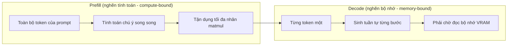
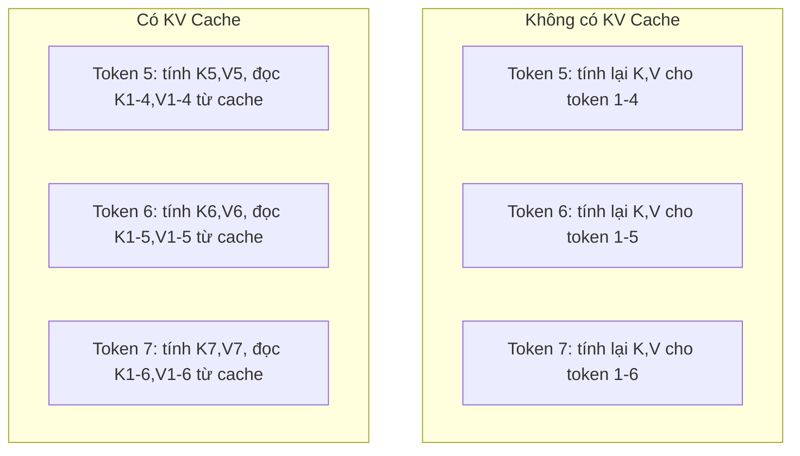
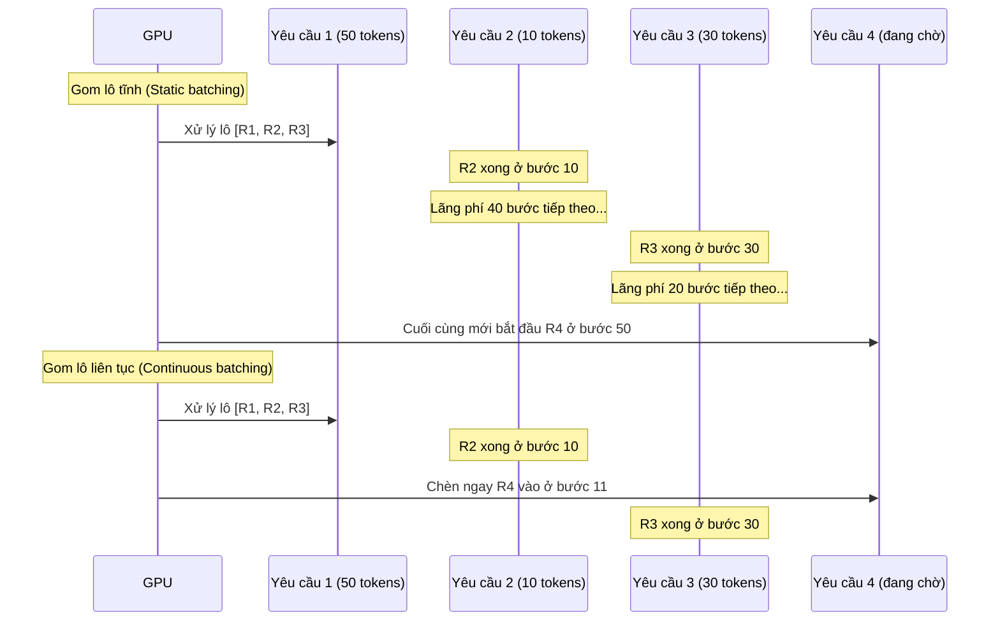
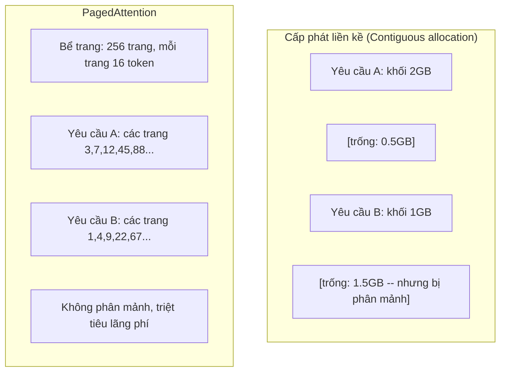
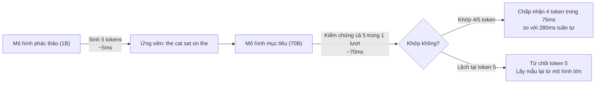

# Tối Ưu Hóa Suy Luận (Inference Optimization)

> Hai giai đoạn định hình toàn bộ quá trình suy luận của LLM: Nạp trước (prefill) xử lý toàn bộ câu nhắc song song — bị nghẽn bởi năng lực tính toán (compute-bound). Giải mã (decode) sinh từng token tuần tự — bị nghẽn bởi băng thông bộ nhớ (memory-bound). Mọi kỹ thuật tối ưu hóa suy luận đều nhắm vào một hoặc cả hai giai đoạn này.

**Type:** Build
**Languages:** Python
**Prerequisites:** Phase 10, Lessons 01-08 (Transformer architecture, attention)
**Time:** ~120 phút

## Mục Tiêu Học Tập

- Cài đặt bộ nhớ đệm KV (KV-cache) để triệt tiêu các phép tính toán dư thừa lặp lại trong quá trình sinh token tự hồi quy
- Giải thích sự khác biệt giữa hai giai đoạn nạp trước (prefill) và giải mã (decode) trong suy luận LLM, và lý do tại sao mỗi giai đoạn lại gặp các nút thắt cổ chai khác nhau (nghẽn tính toán vs nghẽn băng thông bộ nhớ)
- Cài đặt các khái niệm về xử lý theo lô liên tục (continuous batching) và cơ chế chú ý phân trang (PagedAttention) để tối đa hóa hiệu suất sử dụng GPU khi phục vụ nhiều yêu cầu đồng thời
- So sánh các kỹ thuật tối ưu hóa suy luận (KV-cache, giải mã suy đoán - speculative decoding, flash attention) và sự đánh đổi giữa thông lượng (throughput) và độ trễ (latency)

## Vấn Đề

Bạn triển khai mô hình Llama 3 70B trên cụm 4 GPU A100. Một người dùng đơn lẻ nhận được tốc độ khoảng 50 token/giây. Rất mượt mà. Nhưng khi có 100 người dùng truy cập đồng thời, thông lượng tụt dốc thảm hại xuống chỉ còn 3 token/giây cho mỗi người. Hóa đơn GPU trị giá 25.000 USD mỗi tháng của bạn đang phục vụ các câu trả lời còn chậm hơn cả tốc độ gõ phím của con người.

Bản thân mô hình không hề thay đổi giữa trường hợp 1 người dùng và 100 người dùng: cùng một bộ trọng số, cùng một kiến trúc, cùng một công thức toán học. Điều thay đổi duy nhất là cách bạn lập lịch điều phối khối lượng công việc (scheduling). Cách suy luận ngây thơ (naive inference) lãng phí hơn 90% năng lực tính toán sẵn có của GPU. Một người dùng đang chờ sinh token thứ 47 sẽ chiếm dụng toàn bộ một vị trí trong lô xử lý trong khi bus bộ nhớ GPU rơi vào trạng thái nhàn rỗi giữa các phép nhân ma trận. Trong khi đó, câu nhắc dài 2.000 token của một người dùng mới hoàn toàn có thể lấp đầy khoảng thời gian chết đó bằng các phép tính hữu ích.

Đây không phải là vấn đề về mở rộng quy mô phần cứng. Đây là bài toán về lập lịch điều phối. Các kỹ thuật trong bài học này — bao gồm lưu đệm KV (KV caching), gom lô liên tục (continuous batching), cơ chế chú ý phân trang (PagedAttention), giải mã suy đoán (speculative decoding) và lưu đệm tiền tố (prefix caching) — chính là lằn ranh phân định giữa một hóa đơn suy luận 25.000 USD/tháng và một hóa đơn chỉ 5.000 USD/tháng cho cùng một lưu lượng truy cập.

Hệ thống vLLM khi phục vụ Llama 3 70B trên 4 GPU A100-80GB đạt khoảng 50 token/giây/người dùng ở mức tải thấp, và duy trì ổn định 15–25 token/giây/người dùng khi có 100 yêu cầu đồng thời nhờ áp dụng continuous batching và PagedAttention. Nếu không có các tối ưu hóa này, chính phần cứng đó chỉ có thể phục vụ 5 token/giây/người dùng ở cùng mức tải. Cùng một dàn GPU, cùng một mô hình, nhưng thông lượng tăng gấp 4 lần.

## Khái Niệm

### Nạp Trước (Prefill) vs Giải Mã (Decode)

Mọi yêu cầu suy luận LLM đều trải qua hai giai đoạn hoàn toàn tách biệt:

**Nạp trước (Prefill)** xử lý toàn bộ câu nhắc đầu vào. Tất cả các token đầu vào đều đã biết trước, do đó cơ chế chú ý có thể được tính toán song song trên toàn bộ chuỗi. Đây là một phép nhân ma trận lớn — các nhân tính toán của GPU luôn được lấp đầy công suất. Nút thắt cổ chai ở đây là năng lực tính toán: phần cứng của bạn có thể cung cấp bao nhiêu phép tính số học (FLOPS) mỗi giây. Một GPU A100 đạt hiệu năng 312 TFLOPS (ở định dạng BF16). Giai đoạn prefill cho một câu nhắc dài 4.096 token trên mô hình 70B mất khoảng 400ms trên một A100 đơn lẻ.

**Giải mã (Decode)** sinh các token đầu ra tuần tự từng token một. Mỗi token mới sinh ra phải chú ý đến tất cả các token đứng trước nó, nhưng chỉ có đúng một token được tạo ra sau mỗi lượt lan truyền xuôi. Ma trận trọng số có kích thước khổng lồ tương đương giai đoạn prefill, nhưng giờ đây bạn chỉ nhân chúng với một vector duy nhất thay vì một ma trận. Các nhân tính toán của GPU hoàn thành phép tính chỉ trong vài micro giây, rồi sau đó phải ngồi chờ khối lượng trọng số tiếp theo được nạp từ bộ nhớ VRAM vào. Nút thắt cổ chai ở đây là băng thông bộ nhớ (memory bandwidth): tốc độ truyền tải trọng số mô hình từ bộ nhớ HBM vào các đơn vị tính toán nhanh đến mức nào. Một A100 có băng thông 2 TB/s. Mô hình 70B ở định dạng FP16 chiếm 140 GB. Việc đọc toàn bộ mô hình một lần đã mất 70ms — đó chính là giới hạn vật lý tối thiểu cho một bước giải mã token đơn lẻ.



**Tỷ số phép tính trên byte (ops:byte ratio)** (còn gọi là cường độ số học - arithmetic intensity) mô tả rõ sự đánh đổi này. Nó đo lường số lượng phép toán bạn thực hiện được trên mỗi byte dữ liệu đọc từ bộ nhớ:

```text
ops:byte ratio = FLOPs trên mỗi token / số byte đọc từ bộ nhớ
```

Trong giai đoạn prefill với một lô 4.096 token, bạn thực hiện khoảng 4.096 phép nhân-cộng tích lũy (multiply-accumulate) cho mỗi trọng số được nạp vào. Tỷ số này rất cao — bạn bị giới hạn bởi năng lực tính toán (compute-bound). Trong giai đoạn decode với batch size bằng 1, bạn chỉ thực hiện xấp xỉ 1 phép toán cho mỗi trọng số đọc vào. Tỷ số này cực kỳ thấp — bạn bị giới hạn hoàn toàn bởi băng thông bộ nhớ (memory-bound).

Nguyên lý cốt lõi: *Giai đoạn decode bị nghẽn bộ nhớ vì bạn phải quét qua toàn bộ trọng số của cả mô hình khổng lồ chỉ để tạo ra đúng một token duy nhất*. Mọi kỹ thuật tối ưu hóa dưới đây đều nhắm tới việc giảm lượng dữ liệu phải đọc, tăng số lượng token được xử lý trong mỗi lần đọc, hoặc tránh việc đọc lại hoàn toàn.

### Bộ Nhớ Đệm KV (KV Cache)

Trong cơ chế chú ý, vector truy vấn (Query) của mỗi token phải tương tác với các vector chìa khóa (Key) và giá trị (Value) của mọi token đứng trước nó. Nếu không có bộ nhớ đệm, việc sinh token thứ $N$ sẽ đòi hỏi phải chiếu và tính toán lại các vector Key và Value cho toàn bộ $N-1$ token trước đó. Token thứ 1 sẽ bị tính lại khi sinh token 2, rồi lại bị tính lại khi sinh token 3, token 4,... Đến token thứ 1.000, bạn đã phải chiếu lại token thứ 1 tới 999 lần.

Bộ nhớ đệm KV (KV cache) lưu trữ sẵn các vector Key và Value đã được tính toán từ các token trước. Khi sinh token thứ $N$, bạn chỉ cần tính vector Key và Value cho riêng token thứ $N$, sau đó nối chúng vào bộ nhớ đệm K/V tích lũy từ các token từ 1 đến $N-1$.



**Công thức tính dung lượng bộ nhớ cho KV cache:**

```text
Dung lượng KV cache = 2 * num_layers * num_kv_heads * head_dim * seq_len * bytes_per_param
```

Đối với Llama 3 70B (80 tầng, 8 đầu KV theo cơ chế GQA, head_dim=128, kiểu dữ liệu BF16):

```text
Mỗi token tiêu tốn: 2 * 80 * 8 * 128 * 2 bytes = 327.680 bytes = 320 KB
Tại 4.096 token: 320 KB * 4.096 = 1,28 GB
Tại 128K token: 320 KB * 131.072 = 40 GB
```

Một cuộc hội thoại dài 128K token trên Llama 3 70B ngốn tới 40GB VRAM chỉ riêng cho KV cache — chiếm trọn một nửa bộ nhớ của một GPU A100 80GB. Với 100 người dùng đồng thời ở mức 4K token mỗi người, KV cache đòi hỏi tới 128GB. Đây là lý do tại sao việc quản lý KV cache chính là thách thức trung tâm của bài toán tối ưu hóa suy luận.

### Xử Lý Theo Lô Liên Tục (Continuous Batching)

Kỹ thuật xử lý theo lô tĩnh (static batching) chờ cho đến khi gom đủ một lô gồm $N$ yêu cầu, xử lý chúng cùng nhau, và bắt buộc phải đợi cho tới khi *tất cả* các yêu cầu trong lô hoàn thành thì mới tiếp nhận đợt yêu cầu mới. Nếu một yêu cầu cần sinh 500 token trong khi một yêu cầu khác chỉ cần 10 token, thì yêu cầu ngắn sẽ phải ngồi chờ nhàn rỗi suốt 490 bước giải mã còn lại sau khi nó đã xong việc.

Xử lý theo lô liên tục (Continuous batching, còn gọi là gom lô ở cấp độ lặp - iteration-level batching) chèn các yêu cầu mới vào lô ngay khi có bất kỳ yêu cầu nào hoàn thành. Lô xử lý được tái đánh giá tại mỗi bước giải mã duy nhất. Một yêu cầu hoàn tất sau 10 token sẽ lập tức được thay thế bằng một yêu cầu đang xếp hàng chờ.



Mức độ cải thiện thông lượng phụ thuộc vào độ biến thiên chiều dài đầu ra. Nếu độ dài đầu ra đồng đều, continuous batching cho kết quả tương tự static batching. Nhưng khi độ dài biến thiên mạnh (kịch bản phổ biến trong thực tế), continuous batching có thể mang lại thông lượng cao gấp 2–5 lần vì các vị trí tính toán trên GPU không bao giờ bị bỏ trống.

### Cơ Chế Chú Ý Phân Trang (PagedAttention)

Theo cách truyền thống, KV cache cho mỗi yêu cầu được cấp phát dưới dạng một khối bộ nhớ liền kề (contiguous block). Khi các yêu cầu liên tục đến và đi, bộ nhớ VRAM sẽ bị phân mảnh — hoàn toàn tương tự như hiện tượng phân mảnh RAM trong hệ điều hành. Một yêu cầu 4K token cần một khối 1,28 GB liền kề. Ngay cả khi GPU còn trống tới 2 GB tổng cộng, nhưng nếu không có một vùng trống 1,28 GB *liền kề*, bạn buộc phải từ chối yêu cầu hoặc lãng phí bộ nhớ.

PagedAttention (đột phá từ vLLM) áp dụng nguyên lý bộ nhớ ảo của hệ điều hành vào việc quản lý KV cache. Thay vì cấp phát một khối bộ nhớ liền kề khổng lồ, nó phân bổ các "trang" (pages) có kích thước cố định (thường là 16 token mỗi trang). Các trang này có thể nằm rải rác ở bất kỳ đâu trong bộ nhớ vật lý của GPU. Một bảng trang (page table) ánh xạ các vị trí logic trong chuỗi của từng yêu cầu tới các vị trí trang vật lý tương ứng.



PagedAttention còn hỗ trợ cơ chế **sao chép khi ghi (copy-on-write)** cho các tiền tố dùng chung. Nếu 50 yêu cầu cùng chia sẻ một câu nhắc hệ thống (system prompt), các trang KV cache của câu nhắc đó chỉ cần lưu trữ đúng một lần và được tham chiếu bởi cả 50 yêu cầu. Chỉ khi các yêu cầu bắt đầu rẽ nhánh (tin nhắn của người dùng khác nhau), chúng mới được cấp phát các trang riêng. Kỹ thuật này giúp cắt giảm ngoạn mục lượng bộ nhớ tiêu thụ cho các ứng dụng có câu nhắc hệ thống dài.

Theo báo cáo của vLLM, PagedAttention giúp giảm tỷ lệ lãng phí bộ nhớ xuống gần như bằng 0 (~4% so với ~60–80% ở các phương pháp cấp phát truyền thống).

### Giải Mã Suy Đoán (Speculative Decoding)

Giai đoạn decode chạy chậm vì nó có tính chất tuần tự: sinh một token, đưa ngược trở lại đầu vào, rồi mới sinh token tiếp theo. Nhưng điều gì sẽ xảy ra nếu bạn có thể dự đoán nhanh trước 5 token với chi phí rất rẻ, rồi sau đó kiểm chứng toàn bộ chúng trong một lượt duy nhất?

Giải mã suy đoán (Speculative decoding) sử dụng một **mô hình phác thảo (draft model)** nhỏ và chạy rất nhanh để sinh ra $K$ token ứng viên. Sau đó, **mô hình mục tiêu (target model)** lớn sẽ xử lý toàn bộ $K$ ứng viên này trong một lượt lan truyền xuôi duy nhất (thao tác này tương đương một lượt prefill — xử lý song song, tận dụng tối đa năng lực tính toán). Nếu mô hình mục tiêu đồng ý với các dự đoán của mô hình phác thảo, bạn chấp nhận toàn bộ $K$ token đó chỉ trong thời gian của một lượt chạy mô hình lớn. Nếu nó phát hiện sai lệch tại vị trí $j$, bạn chấp nhận các token từ 1 đến $j-1$ và loại bỏ phần còn lại.



Mức tăng tốc phụ thuộc vào **tỷ lệ chấp nhận (acceptance rate)** — tức tần suất các dự đoán của mô hình nhỏ khớp với mô hình lớn. Khi dùng Llama 3 8B làm bản phác thảo cho Llama 3 70B, tỷ lệ chấp nhận thường đạt từ 70–85% trên ngôn ngữ tự nhiên. Điều này giúp tăng tốc độ giải mã từ 2–3 lần.

Ba hướng tiếp cận chính cho giải mã suy đoán:

| Phương pháp | Nguồn phác thảo | Tỷ lệ chấp nhận | Chi phí phụ trội |
|-------------|-----------------|-----------------|-------------------|
| Bản nháp độc lập (Draft-target) | Mô hình nhỏ riêng biệt | 70–85% | Bộ nhớ cho mô hình nhỏ |
| EAGLE | Đầu nơ-ron nhẹ gắn trên mô hình chính | 75–90% | ~1% tham số bổ sung |
| Tra cứu N-gram | Bảng thống kê n-gram token | 40–60% | Không đáng kể |

**EAGLE** huấn luyện một đầu tự hồi quy rất nhẹ ngay trên các trạng thái ẩn của mô hình mục tiêu. Nó dự đoán embedding của token tiếp theo dựa trên các đặc trưng ở tầng áp chót của mô hình chính. Vì nó tận dụng trực tiếp biểu diễn nội tại của mô hình lớn, EAGLE đạt tỷ lệ chấp nhận cao hơn mà hầu như không tốn thêm bộ nhớ. Phiên bản EAGLE-2 bổ sung thêm cây phác thảo động (dynamic draft tree) giúp điều chỉnh số lượng ứng viên theo ngữ cảnh.

**Giải mã suy đoán N-gram** duy trì một bảng tiếp nối n-gram từ ngữ cảnh hiện tại hoặc từ một kho ngữ liệu có sẵn. Nếu đoạn văn bản lặp lại các mẫu có sẵn (mã nguồn, cấu trúc JSON, văn bản mẫu), nó sẽ đưa ra phác thảo mà không cần tốn bất kỳ chi phí mạng nơ-ron nào.

Điểm quan trọng nhất: Giải mã suy đoán là phương pháp *chính xác tuyệt đối về mặt toán học* (mathematically exact) — phân phối xác suất đầu ra hoàn toàn đồng nhất với phân phối của mô hình mục tiêu gốc. Đây không phải là một phép tính xấp xỉ đánh đổi chất lượng. Bước kiểm chứng đảm bảo rằng mọi token được chấp nhận đều có xác suất chuẩn xác như khi mô hình lớn tự sinh ra nó.

### Lưu Đệm Tiền Tố (Prefix Caching)

Rất nhiều yêu cầu suy luận cùng chia sẻ chung một phần tiền tố: câu nhắc hệ thống của chatbot, đoạn ngữ cảnh tài liệu trong RAG, hoặc tập các ví dụ mẫu (few-shot examples). Nếu không có prefix caching, mỗi yêu cầu gửi đến đều phải tính toán lại KV cache cho các token tiền tố dùng chung này từ đầu.

Prefix caching lưu trữ KV cache cho các tiền tố phổ biến và tái sử dụng chúng xuyên suốt các yêu cầu. Khi một yêu cầu mới xuất hiện với tiền tố đã biết, hệ thống chỉ cần sao chép (hoặc tham chiếu) các mục KV đã lưu và chỉ thực hiện tính toán KV cho phần đuôi duy nhất của người dùng.

Với một câu nhắc hệ thống dài 2.000 token dùng chung cho tất cả các lượt gọi, prefix caching giúp loại bỏ khoảng 400ms thời gian nạp trước (prefill) cho mỗi yêu cầu. Ở quy mô 100 yêu cầu/giây, điều này giúp tiết kiệm tới 40 giây tính toán GPU trong mỗi giây — tương đương với việc dôi dư ra thêm năng lực của cả một GPU.

Thuật toán RadixAttention trong SGLang triển khai prefix caching bằng một cây cơ số (radix tree / trie), lập chỉ mục các tiền tố theo nội dung token. Bất kỳ yêu cầu nào khớp với một tiền tố đã lưu sẽ nhận được KV cache hoàn toàn miễn phí. Cây này cũng hỗ trợ khớp tiền tố từng phần — nếu bạn chia sẻ 1.500 trên tổng số 2.000 token tiền tố với một mục đã lưu, bạn có thể tái sử dụng 1.500 token đó và chỉ cần tính toán lại 500 token còn lại.

### Các Động Cơ Suy Luận Hàng Đầu (Inference Engines)

Ba công cụ suy luận đang thống trị môi trường sản xuất năm 2026:

| Động cơ | Cải tiến then chốt | Phù hợp nhất cho |
|---------|-------------------|------------------|
| vLLM | PagedAttention, continuous batching | Phục vụ tổng quát, khả năng tương thích cao nhất |
| SGLang | RadixAttention (prefix caching), sinh cấu trúc | Chatbot nhiều lượt, sinh văn bản có ràng buộc |
| TensorRT-LLM | Hợp nhất kernel NVIDIA, lượng tử hóa FP8 | Tối đa hóa thông lượng GPU đơn lẻ trên phần cứng NVIDIA |

**vLLM** là lựa chọn mặc định ban đầu. Nó hỗ trợ phổ mô hình rộng nhất, chạy trên phần cứng của nhiều hãng (NVIDIA, AMD, Intel), và đạt thông lượng cao nhờ PagedAttention kết hợp continuous batching. Giao diện API tương thích hoàn toàn với chuẩn OpenAI giúp bạn dễ dàng thay thế cho bất kỳ hệ thống nào đang dùng OpenAI API.

**SGLang** kế thừa nền tảng của vLLM nhưng bổ sung thêm RadixAttention cho việc lưu đệm tiền tố và một ngôn ngữ đặc thù để lập trình các luồng LLM có cấu trúc. Nếu khối lượng công việc của bạn bao gồm các cuộc hội thoại nhiều lượt, gọi công cụ (tool use) hoặc sinh đầu ra bị ràng buộc (JSON schema, biểu thức chính quy), SGLang thường vượt trội hơn vLLM từ 2–5 lần nhờ việc tái sử dụng tiền tố triệt để.

**TensorRT-LLM** biên dịch mô hình thành các GPU kernel được tối ưu hóa sâu bởi NVIDIA. Nó hợp nhất các phép toán (ghép attention + linear + activation vào chung một kernel duy nhất), khai thác tối đa định dạng FP8 trên GPU H100 và tích hợp chặt chẽ với máy chủ NVIDIA Triton. Nó mang lại thông lượng đơn GPU cao nhất trên phần cứng NVIDIA, nhưng đòi hỏi quy trình thiết lập phức tạp hơn và chỉ chạy độc quyền trên phần cứng NVIDIA.

Số liệu thực tế khi phục vụ Llama 3 70B (4x A100-80GB, định dạng BF16):

| Chỉ số | vLLM | SGLang | TensorRT-LLM |
|--------|------|--------|---------------|
| Thông lượng (1 người dùng) | ~50 TPS | ~55 TPS | ~65 TPS |
| Thông lượng (100 người dùng) | ~2.500 tổng TPS | ~3.200 tổng TPS | ~3.000 tổng TPS |
| Thời gian nhận token đầu (TTFT) | ~400ms | ~300ms (khi trúng prefix) | ~350ms |
| Ngữ cảnh tối đa | 128K | 128K | 128K |

### Khung Lý Thuyết Ops:Byte

Bạn không thể tối ưu hóa những gì bạn không đo lường được. Tỷ số ops:byte cho biết hệ thống đang bị nghẽn bởi năng lực tính toán hay băng thông bộ nhớ, từ đó xác định kỹ thuật tối ưu hóa nào thực sự mang lại hiệu quả:

```text
Trần tính toán (Compute roof): Năng lực tính toán đỉnh (FLOPS) của GPU
Trần bộ nhớ (Memory roof): Băng thông đỉnh * tỷ số ops:byte
```

Khi ops:byte ở mức thấp (giai đoạn giải mã, kích thước lô nhỏ), bạn chạm vào trần băng thông bộ nhớ. Việc bổ sung thêm nhân tính toán hay tăng xung nhịp GPU hoàn toàn không giúp ích gì. Bạn bắt buộc phải giảm lượng dữ liệu đọc từ bộ nhớ (lượng tử hóa, nén KV cache) hoặc tăng kích thước lô để phân bổ chi phí đọc qua nhiều công việc hữu ích hơn.

Khi ops:byte ở mức cao (giai đoạn nạp trước, kích thước lô lớn), bạn chạm vào trần tính toán. Việc tối ưu hóa băng thông bộ nhớ không còn mang lại nhiều ý nghĩa. Bạn cần GPU có nhiều FLOPS hơn, áp dụng kỹ thuật hợp nhất kernel (kernel fusion), hoặc giảm độ chính xác số học (FP8/FP16) để thực hiện được nhiều phép tính hơn mỗi giây.

| Kịch bản | ops:byte | Dạng nghẽn | Kỹ thuật tối ưu hóa phù hợp |
|----------|----------|------------|------------------------------|
| Prefill, batch=1 | ~4.096 | Tính toán (Compute) | Kernel fusion, FP8 |
| Decode, batch=1 | ~1 | Bộ nhớ (Memory) | Lượng tử hóa, nén KV cache |
| Decode, batch=32 | ~32 | Bộ nhớ (Memory) | Tăng kích thước lô, continuous batching |
| Decode, batch=256 | ~256 | Chuyển tiếp | Cả hai yếu tố đều quan trọng |
| Decode, batch=1024 | ~1.024 | Tính toán (Compute) | Kernel fusion, song song hóa tensor |

Điểm giao thoa trên GPU A100 nằm ở khoảng `ops:byte = 156` (312 TFLOPS / 2 TB/s). Dưới mức 156, bạn bị nghẽn bộ nhớ. Trên mức 156, bạn bị nghẽn tính toán. Kỹ thuật continuous batching đẩy giai đoạn giải mã tiến dần về điểm giao thoa này bằng cách gom nhiều token hơn vào mỗi chu kỳ xử lý.

````figure context-window-slide
````

## Xây Dựng (Build It)

### Bước 1: Bộ Nhớ Đệm KV Từ Đầu (KV Cache)

Xây dựng bộ nhớ đệm KV đa đầu (multi-head KV cache) lưu trữ các vector Key và Value theo từng tầng, từng đầu chú ý, và theo dõi mức độ tăng trưởng bộ nhớ:

```python
import numpy as np

class KVCache:
    def __init__(self, num_layers, num_heads, head_dim, max_seq_len, dtype=np.float16):
        self.num_layers = num_layers
        self.num_heads = num_heads
        self.head_dim = head_dim
        self.max_seq_len = max_seq_len
        self.dtype = dtype

        self.k_cache = np.zeros(
            (num_layers, num_heads, max_seq_len, head_dim), dtype=dtype
        )
        self.v_cache = np.zeros(
            (num_layers, num_heads, max_seq_len, head_dim), dtype=dtype
        )
        self.seq_len = 0

    def update(self, layer_idx, new_keys, new_values):
        num_new = new_keys.shape[1]
        end = self.seq_len + num_new
        self.k_cache[layer_idx, :, self.seq_len:end, :] = new_keys
        self.v_cache[layer_idx, :, self.seq_len:end, :] = new_values
        return (
            self.k_cache[layer_idx, :, :end, :],
            self.v_cache[layer_idx, :, :end, :]
        )

    def advance(self, num_tokens):
        self.seq_len += num_tokens

    def memory_bytes(self):
        return self.k_cache.nbytes + self.v_cache.nbytes

    def used_bytes(self):
        per_token = 2 * self.num_layers * self.num_heads * self.head_dim * np.dtype(self.dtype).itemsize
        return per_token * self.seq_len
```

### Bước 2: Cơ Chế Chú Ý Kết Hợp KV Cache

Một tầng chú ý đa đầu tối giản sử dụng bộ nhớ đệm KV cho các bước giải mã:

```python
def scaled_dot_product_attention(query, keys, values):
    head_dim = query.shape[-1]
    scores = np.matmul(query, keys.transpose(0, 1, 3, 2)) / np.sqrt(head_dim)
    seq_len_q = scores.shape[-2]
    seq_len_k = scores.shape[-1]
    if seq_len_q > 1:
        mask = np.triu(np.ones((seq_len_q, seq_len_k), dtype=np.float32), k=seq_len_k - seq_len_q + 1)
        scores = scores + mask * (-1e9)
    max_scores = np.max(scores, axis=-1, keepdims=True)
    exp_scores = np.exp(scores - max_scores)
    attn_weights = exp_scores / np.sum(exp_scores, axis=-1, keepdims=True)
    return np.matmul(attn_weights, values)


class MultiHeadAttention:
    def __init__(self, d_model, num_heads):
        self.num_heads = num_heads
        self.head_dim = d_model // num_heads
        scale = np.sqrt(2.0 / d_model)
        self.W_q = np.random.randn(d_model, d_model).astype(np.float32) * scale
        self.W_k = np.random.randn(d_model, d_model).astype(np.float32) * scale
        self.W_v = np.random.randn(d_model, d_model).astype(np.float32) * scale
        self.W_o = np.random.randn(d_model, d_model).astype(np.float32) * scale

    def forward(self, x, kv_cache=None, layer_idx=0):
        batch, seq_len, d_model = x.shape
        Q = np.matmul(x, self.W_q).reshape(batch, seq_len, self.num_heads, self.head_dim).transpose(0, 2, 1, 3)
        K = np.matmul(x, self.W_k).reshape(batch, seq_len, self.num_heads, self.head_dim).transpose(0, 2, 1, 3)
        V = np.matmul(x, self.W_v).reshape(batch, seq_len, self.num_heads, self.head_dim).transpose(0, 2, 1, 3)

        if kv_cache is not None:
            K_full, V_full = kv_cache.update(layer_idx, K[0], V[0])
            K = K_full[np.newaxis, :, :, :]
            V = V_full[np.newaxis, :, :, :]
            if seq_len == 1:
                kv_cache.advance(1)

        attn_out = scaled_dot_product_attention(Q, K, V)
        attn_out = attn_out.transpose(0, 2, 1, 3).reshape(batch, -1, d_model)
        return np.matmul(attn_out, self.W_o)
```

### Bước 3: Bộ Mô Phỏng Gom Lô Liên Tục (Continuous Batching)

Mô phỏng sự khác biệt về hiệu quả lập lịch giữa gom lô tĩnh và gom lô liên tục:

```python
import heapq

class Request:
    def __init__(self, request_id, prompt_tokens, output_tokens, arrival_step):
        self.request_id = request_id
        self.prompt_tokens = prompt_tokens
        self.output_tokens = output_tokens
        self.arrival_step = arrival_step
        self.tokens_generated = 0
        self.start_step = None
        self.end_step = None

    def is_done(self):
        return self.tokens_generated >= self.output_tokens


def simulate_static_batching(requests, batch_size):
    step = 0
    completed = []
    queue = list(requests)
    queue.sort(key=lambda r: r.arrival_step)

    while queue:
        batch = []
        while queue and len(batch) < batch_size:
            r = queue.pop(0)
            r.start_step = max(step, r.arrival_step)
            batch.append(r)

        if batch:
            step = max(step, max(r.start_step for r in batch))
            max_output = max(r.output_tokens for r in batch)
            for r in batch:
                r.tokens_generated = r.output_tokens
                r.end_step = step + max_output
            step += max_output
            completed.extend(batch)

    return completed


def simulate_continuous_batching(requests, batch_size):
    step = 0
    completed = []
    queue = sorted(requests, key=lambda r: r.arrival_step)
    queue_idx = 0
    active = []
    waiting = []

    while queue_idx < len(queue) or active or waiting:
        while queue_idx < len(queue) and queue[queue_idx].arrival_step <= step:
            waiting.append(queue[queue_idx])
            queue_idx += 1

        while waiting and len(active) < batch_size:
            r = waiting.pop(0)
            r.start_step = step
            active.append(r)

        if not active:
            if waiting:
                step += 1
                continue
            elif queue_idx < len(queue):
                step = queue[queue_idx].arrival_step
                continue
            else:
                break

        for r in active:
            r.tokens_generated += 1

        done = [r for r in active if r.is_done()]
        for r in done:
            r.end_step = step + 1
            completed.append(r)
        active = [r for r in active if not r.is_done()]

        step += 1

    return completed


def batching_stats(completed):
    latencies = [r.end_step - r.arrival_step for r in completed]
    total_time = max(r.end_step for r in completed) - min(r.arrival_step for r in completed)
    total_tokens = sum(r.output_tokens for r in completed)
    return {
        "avg_latency": np.mean(latencies),
        "p50_latency": np.median(latencies),
        "p99_latency": np.percentile(latencies, 99),
        "total_time": total_time,
        "throughput": total_tokens / total_time if total_time > 0 else 0,
    }
```

### Bước 4: Lưu Đệm Tiền Tố (Prefix Cache)

Cấu trúc lưu đệm tiền tố dựa trên cây tiền tố (Trie) lưu trữ dữ liệu KV cho các tiền tố dùng chung:

```python
class TrieNode:
    def __init__(self):
        self.children = {}
        self.kv_data = None
        self.hit_count = 0


class PrefixCache:
    def __init__(self, max_entries=1000):
        self.root = TrieNode()
        self.max_entries = max_entries
        self.total_entries = 0
        self.hits = 0
        self.misses = 0

    def _walk(self, token_ids):
        node = self.root
        depth = 0
        for tid in token_ids:
            if tid not in node.children:
                break
            node = node.children[tid]
            depth += 1
        return node, depth

    def lookup(self, token_ids):
        node, depth = self._walk(token_ids)
        if depth > 0:
            self.hits += 1
            current = self.root
            for tid in token_ids[:depth]:
                current = current.children[tid]
                current.hit_count += 1
            kv_entries = []
            current = self.root
            for tid in token_ids[:depth]:
                current = current.children[tid]
                if current.kv_data is not None:
                    kv_entries.append(current.kv_data)
            return depth, kv_entries
        self.misses += 1
        return 0, []

    def insert(self, token_ids, kv_per_token):
        node = self.root
        for i, tid in enumerate(token_ids):
            if tid not in node.children:
                if self.total_entries >= self.max_entries:
                    return i
                node.children[tid] = TrieNode()
                self.total_entries += 1
            node = node.children[tid]
            if i < len(kv_per_token):
                node.kv_data = kv_per_token[i]
        return len(token_ids)

    def hit_rate(self):
        total = self.hits + self.misses
        return self.hits / total if total > 0 else 0.0
```

### Bước 5: Mô Phỏng Giải Mã Suy Đoán (Speculative Decoding)

Mô phỏng giải mã suy đoán dạng bản nháp - mục tiêu với các tỷ lệ chấp nhận có thể tùy chỉnh:

```python
class DraftModel:
    def __init__(self, vocab_size, acceptance_rate=0.8):
        self.vocab_size = vocab_size
        self.acceptance_rate = acceptance_rate

    def generate(self, context, num_tokens):
        tokens = np.random.randint(0, self.vocab_size, size=num_tokens)
        return tokens

    def get_probs(self, context, token):
        probs = np.random.dirichlet(np.ones(self.vocab_size))
        return probs


class TargetModel:
    def __init__(self, vocab_size):
        self.vocab_size = vocab_size

    def get_probs(self, context, tokens=None):
        if tokens is not None:
            return [np.random.dirichlet(np.ones(self.vocab_size)) for _ in tokens]
        return np.random.dirichlet(np.ones(self.vocab_size))


def speculative_decode(draft_model, target_model, context, num_speculative=5,
                       draft_cost=1.0, target_cost=10.0, verify_cost=12.0):
    total_tokens = 0
    total_cost = 0.0
    accepted_counts = []
    context = list(context)

    max_tokens = 100

    while total_tokens < max_tokens:
        draft_tokens = draft_model.generate(context, num_speculative)
        total_cost += draft_cost * num_speculative

        target_probs = target_model.get_probs(context, draft_tokens)
        total_cost += verify_cost

        accepted = 0
        for i, token in enumerate(draft_tokens):
            draft_p = draft_model.get_probs(context + list(draft_tokens[:i]), token)
            target_p = target_probs[i]

            r = np.random.random()
            acceptance_prob = min(1.0, target_p[token] / (draft_p[token] + 1e-10))

            if r < draft_model.acceptance_rate:
                accepted += 1
                context.append(token)
                total_tokens += 1
            else:
                new_token = np.random.choice(draft_model.vocab_size, p=target_p)
                context.append(new_token)
                total_tokens += 1
                break

        accepted_counts.append(accepted)

        if accepted == num_speculative:
            bonus_probs = target_model.get_probs(context)
            bonus_token = np.random.choice(draft_model.vocab_size, p=bonus_probs)
            context.append(bonus_token)
            total_tokens += 1

    sequential_cost = total_tokens * target_cost
    return {
        "total_tokens": total_tokens,
        "speculative_cost": total_cost,
        "sequential_cost": sequential_cost,
        "speedup": sequential_cost / total_cost if total_cost > 0 else 1.0,
        "avg_accepted": np.mean(accepted_counts),
        "acceptance_rate": np.mean(accepted_counts) / num_speculative,
    }


def compare_speculation_strategies(vocab_size=1000, num_trials=20):
    results = {}

    for name, acceptance_rate, spec_tokens in [
        ("Draft-target (8B->70B)", 0.78, 5),
        ("EAGLE", 0.85, 6),
        ("N-gram", 0.50, 4),
        ("No speculation", 0.0, 0),
    ]:
        if spec_tokens == 0:
            results[name] = {
                "speedup": 1.0,
                "acceptance_rate": 0.0,
                "avg_accepted": 0.0,
            }
            continue

        trial_results = []
        for _ in range(num_trials):
            draft = DraftModel(vocab_size, acceptance_rate=acceptance_rate)
            target = TargetModel(vocab_size)
            context = list(np.random.randint(0, vocab_size, size=10))
            result = speculative_decode(draft, target, context, num_speculative=spec_tokens)
            trial_results.append(result)

        results[name] = {
            "speedup": np.mean([r["speedup"] for r in trial_results]),
            "acceptance_rate": np.mean([r["acceptance_rate"] for r in trial_results]),
            "avg_accepted": np.mean([r["avg_accepted"] for r in trial_results]),
        }

    return results
```

### Bước 6: Bộ Ước Tính Bộ Nhớ KV Cache

Tính toán nhu cầu bộ nhớ KV cache cho các cấu hình mô hình thực tế trong ngành:

```python
MODEL_CONFIGS = {
    "Llama-3-8B": {
        "num_layers": 32, "num_kv_heads": 8, "head_dim": 128,
        "model_params_b": 8, "gqa": True,
    },
    "Llama-3-70B": {
        "num_layers": 80, "num_kv_heads": 8, "head_dim": 128,
        "model_params_b": 70, "gqa": True,
    },
    "Llama-3-405B": {
        "num_layers": 126, "num_kv_heads": 8, "head_dim": 128,
        "model_params_b": 405, "gqa": True,
    },
    "Mistral-7B": {
        "num_layers": 32, "num_kv_heads": 8, "head_dim": 128,
        "model_params_b": 7, "gqa": True,
    },
    "GPT-4-est": {
        "num_layers": 120, "num_kv_heads": 96, "head_dim": 128,
        "model_params_b": 1800, "gqa": False,
    },
}


def kv_cache_memory(config, seq_len, dtype_bytes=2):
    per_token = 2 * config["num_layers"] * config["num_kv_heads"] * config["head_dim"] * dtype_bytes
    total = per_token * seq_len
    return {
        "per_token_bytes": per_token,
        "per_token_kb": per_token / 1024,
        "total_bytes": total,
        "total_mb": total / (1024 ** 2),
        "total_gb": total / (1024 ** 3),
    }


def memory_budget(config, gpu_memory_gb, model_dtype_bytes=2, kv_dtype_bytes=2):
    model_memory_gb = config["model_params_b"] * 1e9 * model_dtype_bytes / (1024 ** 3)
    overhead_gb = gpu_memory_gb * 0.1
    available_for_kv = gpu_memory_gb - model_memory_gb - overhead_gb

    if available_for_kv <= 0:
        return {"error": "Model does not fit in GPU memory", "model_memory_gb": model_memory_gb}

    per_token = 2 * config["num_layers"] * config["num_kv_heads"] * config["head_dim"] * kv_dtype_bytes
    max_tokens = int(available_for_kv * (1024 ** 3) / per_token)

    return {
        "gpu_memory_gb": gpu_memory_gb,
        "model_memory_gb": round(model_memory_gb, 1),
        "overhead_gb": round(overhead_gb, 1),
        "available_for_kv_gb": round(available_for_kv, 1),
        "max_total_tokens": max_tokens,
        "max_users_at_2k": max_tokens // 2048,
        "max_users_at_4k": max_tokens // 4096,
        "max_users_at_32k": max_tokens // 32768,
    }
```

## Sử Dụng (Use It)

### Với vLLM

```python
from vllm import LLM, SamplingParams

llm = LLM(
    model="meta-llama/Meta-Llama-3-70B-Instruct",
    tensor_parallel_size=4,
    enable_prefix_caching=True,
    max_model_len=8192,
    gpu_memory_utilization=0.9,
)

params = SamplingParams(temperature=0.7, max_tokens=256)
outputs = llm.generate(["Explain inference optimization in one paragraph."], params)
```

### Với SGLang Để Lưu Đệm Tiền Tố + Đầu Ra Có Cấu Trúc

```python
import sglang as sgl

@sgl.function
def classify(s, text):
    s += sgl.system("You are a classifier. Output JSON only.")
    s += sgl.user(f"Classify this text: {text}")
    s += sgl.assistant(sgl.gen("result", regex=r'\{"label": "(positive|negative|neutral)"\}'))

runtime = sgl.Runtime(model_path="meta-llama/Meta-Llama-3-70B-Instruct", tp_size=4)
sgl.set_default_backend(runtime)

results = classify.run_batch([
    {"text": "This product is amazing!"},
    {"text": "Terrible experience."},
    {"text": "It was okay I guess."},
])
```

### Với TensorRT-LLM

```python
import tensorrt_llm
from tensorrt_llm.runtime import ModelRunner

runner = ModelRunner.from_dir("./llama-70b-trt-engine/", rank=0)

outputs = runner.generate(
    batch_input_ids=[tokenizer.encode("Explain KV caching.")],
    max_new_tokens=256,
    temperature=0.7,
)
```

## Đóng Gói (Ship It)

Bài học này tạo ra artifact `outputs/skill-inference-optimization.md` — một kỹ năng chuyên biệt để chẩn đoán các nút thắt cổ chai và tối ưu hóa hệ thống phục vụ suy luận LLM trong thực tế.

## Bài Tập Thực Hành

1. Điều chỉnh bộ ước tính bộ nhớ KV cache để so sánh việc lượng tử hóa KV cache giữa FP16, FP8 và INT4. Đối với Llama 3 70B ở ngữ cảnh 4K, hãy tính số lượng người dùng đồng thời tối đa cho từng định dạng trên cụm 4 GPU A100-80GB. Lượng tử hóa KV sang INT4 sẽ giúp tăng dung lượng phục vụ người dùng lên khoảng 4 lần.

2. Mở rộng bộ mô phỏng continuous batching để theo dõi hiệu suất sử dụng GPU (tỷ lệ các vị trí trong lô được lấp đầy tại mỗi bước). Vẽ đồ thị hiệu suất theo thời gian cho cả gom lô tĩnh và gom lô liên tục với 50 yêu cầu có độ dài đầu ra tuân theo phân phối Pareto (shape=1.5, scale=20). Continuous batching phải duy trì hiệu suất >80%.

3. Cài đặt phiên bản cơ chế chú ý truy vấn theo nhóm (Grouped-Query Attention - GQA) cho KV cache trong đó `num_kv_heads < num_query_heads`. Llama 3 70B sử dụng 64 đầu truy vấn nhưng chỉ có 8 đầu KV. Tính toán mức tiết kiệm bộ nhớ so với cơ chế chú ý đa đầu đầy đủ (MHA — giảm 8 lần dung lượng KV cache).

4. Xây dựng bộ lưu đệm tiền tố áp dụng chính sách trục xuất ít sử dụng nhất (LRU eviction). Thiết lập `max_entries = 500` và sinh 1.000 yêu cầu trong đó 60% yêu cầu cùng chia sẻ 1 trong 5 tiền tố phổ biến. Đo lường tỷ lệ trúng đệm (hit rate) và so sánh với trường hợp bộ đệm vô hạn. Với chính sách trục xuất tốt, tỷ lệ trúng đệm phải duy trì trên 55%.

5. Mở rộng bộ mô phỏng giải mã suy đoán để cài đặt suy đoán dựa trên cây (theo phong cách EAGLE-2). Thay vì sinh một chuỗi đơn lẻ gồm $K$ token phác thảo, hãy sinh một cây các ứng viên (ví dụ: 2 nhánh tại mỗi tầng trên 3 tầng = 8 ứng viên ở nút lá). So sánh tổng số token được chấp nhận trong mỗi vòng kiểm chứng so với giải mã suy đoán tuyến tính truyền thống.

## Thuật Ngữ Then Chốt

| Thuật ngữ | Người ta thường nói | Bản chất thực sự |
|-----------|---------------------|-------------------|
| Nạp trước (Prefill) | "Xử lý câu nhắc" | Tính toán cơ chế chú ý trên toàn bộ token đầu vào song song — nghẽn tính toán (compute-bound) vì phép nhân ma trận lấp đầy các nhân GPU |
| Giải mã (Decode) | "Sinh token" | Tạo ra từng token một qua mỗi lượt lan truyền xuôi, phải đọc lại toàn bộ trọng số mô hình mỗi lần — nghẽn bộ nhớ (memory-bound) vì tính toán xong trước khi dữ liệu kịp nạp về |
| Bộ nhớ đệm KV (KV cache) | "Lưu đệm trạng thái chú ý" | Lưu trữ vector Key và Value của tất cả các token trước đó để không phải tính lại ở mỗi bước giải mã — đánh đổi bộ nhớ để tiết kiệm năng lực tính toán |
| Gom lô liên tục (Continuous batching) | "Gom lô động" | Chèn ngay các yêu cầu mới vào lô đang chạy khi có bất kỳ yêu cầu nào hoàn thành, được đánh giá tại mỗi bước lặp giải mã thay vì đợi cả lô |
| PagedAttention | "Bộ nhớ ảo cho KV cache" | Cấp phát KV cache theo các trang có kích thước cố định thay vì các khối liền kề, loại bỏ phân mảnh bộ nhớ và hỗ trợ sao chép khi ghi cho tiền tố dùng chung |
| Giải mã suy đoán (Speculative decoding) | "Phác thảo và kiểm chứng" | Sử dụng một mô hình nhỏ để đoán trước nhiều token, sau đó kiểm chứng tất cả trong một lượt chạy mô hình lớn — chính xác tuyệt đối về toán học, tăng tốc 2–3 lần |
| EAGLE | "Tự giải mã suy đoán" | Biến thể giải mã suy đoán huấn luyện một đầu nơ-ron nhẹ ngay trên các trạng thái ẩn của mô hình lớn, đạt tỷ lệ chấp nhận cao hơn dùng mô hình nhỏ tách biệt |
| Lưu đệm tiền tố (Prefix caching) | "Tái sử dụng KV của prompt hệ thống" | Lưu trữ sẵn KV cache của các tiền tố phổ biến (prompt hệ thống, ví dụ mẫu) và tái sử dụng cho các yêu cầu sau để bỏ qua giai đoạn prefill dư thừa |
| Tỷ số ops:byte | "Cường độ số học" | Tỷ số giữa số phép tính số học và số byte đọc từ bộ nhớ — quyết định xem tác vụ bị nghẽn tính toán (tỷ số cao) hay nghẽn bộ nhớ (tỷ số thấp) |
| Thời gian nhận token đầu (TTFT) | "Time to first token" | Độ trễ từ lúc gửi yêu cầu tới khi nhận được token đầu tiên — bị chi phối chủ yếu bởi thời gian prefill của các câu nhắc dài |

## Đọc Thêm

- [Kwon et al., 2023 -- "Efficient Memory Management for Large Language Model Serving with PagedAttention"](https://arxiv.org/abs/2309.06180) -- bài báo vLLM giới thiệu PagedAttention, hiện là tiêu chuẩn công nghiệp phục vụ suy luận LLM
- [Leviathan et al., 2023 -- "Fast Inference from Transformers via Speculative Decoding"](https://arxiv.org/abs/2211.17192) -- bài báo nền tảng chứng minh giải mã suy đoán sinh ra phân phối chuẩn xác đồng thời tăng tốc 2–3 lần
- [Li et al., 2024 -- "EAGLE: Speculative Sampling Requires Rethinking Feature Uncertainty"](https://arxiv.org/abs/2401.15077) -- đạt tỷ lệ chấp nhận vượt trội bằng cách huấn luyện đầu dự đoán trên chính các đặc trưng của mô hình mục tiêu
- [Zheng et al., 2024 -- "SGLang: Efficient Execution of Structured Language Model Programs"](https://arxiv.org/abs/2312.07104) -- giới thiệu RadixAttention cho việc lưu đệm tiền tố và mô hình lập trình tối ưu cho LLM
- [Williams et al., 2009 -- "Roofline: An Insightful Visual Performance Model for Multicore Architectures"](https://crsh.lbl.gov/publications/roofline-an-insightful-visual-performance-model-for-multicore-architectures/) -- bài báo Roofline kinh điển hình thức hóa khung lý thuyết ops:byte để phân tích nút thắt tính toán so với bộ nhớ
