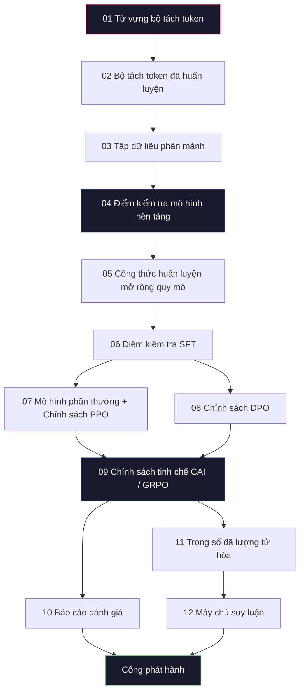
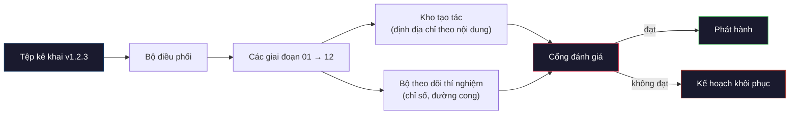

# Xây dựng đường ống LLM hoàn chỉnh (Building a Complete LLM Pipeline)

> Mọi thứ từ Bài 01 đến 12 đều là một giai đoạn trong một đường ống duy nhất. Bài học này đóng vai trò là bộ khung giàn (scaffold) biến các giai đoạn đó thành một lượt chạy đầu-cuối (end-to-end) hoàn chỉnh: phân tách token (tokenize), tiền huấn luyện (pre-train), mở rộng quy mô (scale), tinh chỉnh có giám sát (SFT), căn chỉnh (align), đánh giá (evaluate), lượng tử hóa (quantize) và phục vụ suy luận (serve). Bạn sẽ không huấn luyện một mô hình 70B trên máy tính xách tay. Bạn sẽ xây dựng tầng điều phối (orchestration layer), tệp kê khai (manifest), cổng đánh giá (eval gate) và kế hoạch khôi phục (rollback plan) mà một đội ngũ nghiên cứu mô hình biên giới (frontier team) năm 2026 sử dụng để quyết định những gì được phát hành. Đây chính là bài học tổng kết đỉnh cao (capstone).

**Type:** Build
**Languages:** Python (stdlib)
**Prerequisites:** Tất cả các bài học 01-12 của Giai đoạn 10
**Time:** ~120 phút

## Mục tiêu học tập

- Kết hợp mười hai bài học trước (hai bài học về bộ tách token, dữ liệu, tiền huấn luyện, định luật mở rộng tỷ lệ, SFT, RLHF, DPO, CAI, đánh giá, lượng tử hóa, suy luận) thành một bản đặc tả đường ống (pipeline spec) tái lập được duy nhất.
- Xác định giao ước tạo tác (artifact contract) giữa các giai đoạn: mỗi giai đoạn tiêu thụ những gì, tạo ra những gì và giai đoạn tiếp theo xác minh đầu vào như thế nào.
- Xây dựng một bộ điều phối (orchestrator) theo dõi các thí nghiệm, băm (hash) các tạo tác và thiết lập cổng ra quyết định phát hành dựa trên các ngưỡng đánh giá.
- Thiết kế kế hoạch khôi phục (rollback plan): những tạo tác nào tốn ít chi phí để chạy lại, những tạo tác nào tốn kém và cái giá phải trả cho một điểm kiểm tra (checkpoint) bị hỏng.

## Vấn đề thực tế

Từng bài học trước đều hoạt động độc lập tốt. Bộ tách token đã được huấn luyện. Mô hình GPT tí hon đã được tiền huấn luyện. Tập dữ liệu SFT đã được tập hợp. Mô hình phần thưởng (reward model) đã được huấn luyện. DPO đã được thực thi. Các chỉ số đánh giá đã được đo lường. Trọng số lượng tử hóa đã được xuất. Máy chủ suy luận đã khởi chạy. Mỗi bài học là một notebook riêng lẻ. Mỗi bài đều có các quy ước riêng, đường dẫn đầu ra riêng và giá trị khởi tạo ngẫu nhiên (seed) riêng.

Một lượt chạy huấn luyện mô hình biên giới không phải là một notebook. Llama 3 405B đã tiêu tốn 30 triệu giờ H100 trong khoảng 54 ngày. DeepSeek-V3 sử dụng khoảng 2,8 triệu giờ H800. Trong khoảng thời gian đó, một điểm kiểm tra bị lỗi hỏng, một trường hợp nhiễm bẩn dữ liệu (data contamination), hay một sự sụt giảm hiệu năng đánh giá (eval regression) đều có thể khiến đội ngũ mất một tuần thời gian thực và một tháng ngân sách GPU. Cách các đội ngũ vượt qua thử thách này là thông qua tính vệ sinh đường ống (pipeline hygiene): mỗi giai đoạn đều có đầu vào xác định (deterministic input), đầu ra xác định (deterministic output), một tệp kê khai (manifest), một mã băm (hash) và một cổng kiểm soát (gate).

Đây là bài học capstone. Bạn sẽ không chạy toàn bộ đường ống đầu-cuối trên máy tính xách tay. Bạn sẽ viết bộ điều phối để điều phối các giai đoạn, tệp kê khai mô tả lượt chạy, bộ xác minh kiểm soát quyết định phát hành và kế hoạch phát lại (replay plan) cho phép bên thứ ba tái lập công việc của bạn chỉ từ một tệp duy nhất. Mã nguồn ngắn gọn; nhưng tính kỷ luật kỹ thuật là rất lớn.

Mô hình thiết kế này mở rộng từ 100M đến 1T tham số mà không hề thay đổi cấu trúc. Cùng bốn thành phần cốt lõi -- tệp kê khai, bộ điều phối, cổng đánh giá, kho lưu trữ tạo tác (artifact store) -- vừa vận hành Llama 3 vừa vận hành mô hình GPT thử nghiệm cá nhân của bạn. Sự khác biệt chỉ nằm ở độ lớn của các con số bên trong cấu hình của từng giai đoạn, chứ không phải hình thái của đường ống.

## Khái niệm cốt lõi

### Mười hai giai đoạn

Mỗi bài học trong Giai đoạn 10 là một giai đoạn. Dưới đây là đồ thị phụ thuộc đầy đủ:



Giai đoạn 07 và 08 có thể chạy song song. Tất cả những giai đoạn khác đều là phụ thuộc cứng (hard dependency). Một thay đổi ở giai đoạn 02 (bộ tách token) sẽ làm vô hiệu hóa mọi tạo tác hạ nguồn. Một thay đổi ở giai đoạn 10 (đánh giá) chỉ làm vô hiệu hóa quyết định phát hành.

### Tệp kê khai (The Manifest)

Tệp kê khai (manifest) là một tệp duy nhất mô tả một lượt chạy một cách hoàn chỉnh đến mức có thể phát lại (replay) được. Không có bất kỳ kết quả nào do đường ống tạo ra được phép phụ thuộc vào trạng thái không nằm trong tệp kê khai. Các trường thông tin mang tính bắt buộc và nghiêm ngặt:

```yaml
pipeline_version: 1.2.3
seed: 42
git_commit: a1b2c3d4
stages:
  01_tokenizer:
    recipe: bpe_32k
    input_hash: sha256:...
    output_hash: sha256:...
    wall_clock_sec: 3600
    cost_usd: 12
```

Mã băm đầu ra (output hash) của giai đoạn $N$ chính là mã băm đầu vào (input hash) của giai đoạn $N+1$. Bất kỳ sự sai lệch nào cũng khiến đường ống dừng lại ngay lập tức. Đây là cách bạn phát hiện sớm sự hư hỏng dữ liệu. Đây cũng là cách một đồng nghiệp ở một châu lục khác xác minh rằng lượt chạy lại của họ tạo ra tạo tác giống hệt tạo tác của bạn.

Trong thực tế, các đội ngũ sử dụng một lược đồ YAML nhỏ kèm theo một bộ kiểm tra tệp kê khai để so khớp khác biệt (diff) với lượt chạy thành công trước đó. Bất kỳ sự thay đổi nào ngoài các trường dự kiến (chi phí, thời gian thực tế) đều là dấu hiệu cảnh báo đỏ.

### Định kiểu tạo tác (Artifact Typing)

Đầu ra của mỗi giai đoạn là một tạo tác có định kiểu (typed artifact). Không phải là một thư mục tùy tiện, không phải là một tệp pickle, mà là một kiểu dữ liệu có tên với lược đồ xác định.

| Giai đoạn | Kiểu tạo tác | Các trường khóa |
|---|---|---|
| 01-02 | Bộ tách token (Tokenizer) | vocab.json, merges.txt, config.json, hash |
| 03 | Tập dữ liệu (Dataset) | shards[], số hàng, số token, thống kê loại bỏ trùng lặp |
| 04-05 | Điểm kiểm tra (Checkpoint) | weights.safetensors, config.json, trạng thái optimizer, số bước huấn luyện |
| 06 | Mô hình SFT (SFT Model) | checkpoint + công thức SFT + tỷ lệ hòa trộn dữ liệu |
| 07 | Mô hình phần thưởng (Reward Model) | RM checkpoint + mã băm dữ liệu sở thích |
| 08-09 | Chính sách (Policy) | checkpoint + mã băm tham chiếu + beta + ngân sách KL đã tiêu thụ |
| 10 | Báo cáo đánh giá (Eval Report) | điểm chuẩn benchmark + chênh lệch suy giảm + mã băm dữ liệu đánh giá |
| 11 | Mô hình lượng tử hóa (Quantized Model) | trọng số lượng tử hóa + dữ liệu hiệu chuẩn + độ lệch độ chính xác so với FP16 |
| 12 | Bản đặc tả máy chủ (Server Spec) | điểm cuối (endpoint) + mã băm mô hình + cấu hình + hook quan sát |

Việc định kiểu ngăn chặn lỗi phổ biến nhất: lấy đầu ra của giai đoạn 08 làm đầu vào cho giai đoạn 06, phát hành một mô hình đã qua huấn luyện DPO qua đường dẫn SFT. Các tạo tác có định kiểu và chữ ký giai đoạn có định kiểu biến những lỗi này thành lỗi thời gian biên dịch (compile-time), chứ không phải lỗi sau 5 ngày chạy máy.

### Cổng đánh giá (The Eval Gate)

Phát hành không đơn thuần là "huấn luyện đã xong". Phát hành là "huấn luyện đã xong và cổng đánh giá đã vượt qua". Cổng đánh giá được xác định từ trước khi lượt chạy bắt đầu.

```yaml
gates:
  mmlu:      >= baseline + 0.5   # không được suy giảm
  humaneval: >= baseline + 1.0
  truthfulqa: >= baseline         # không được sụt giảm
  safety_refusal_rate: <= 0.05
  kl_from_reference: <= 25.0
  cost_total_usd: <= 50000
```

Mỗi cổng là một ngưỡng số học. Tuyệt đối không có các cổng "trông có vẻ ổn". Không có phê duyệt chủ quan. Nếu mọi cổng đều vượt qua, tạo tác được đánh dấu là có thể phát hành (shippable). Nếu bất kỳ cổng nào thất bại, lượt chạy sẽ bị giữ lại (held) chờ sự can thiệp phê duyệt rõ ràng từ một người đánh giá có tên cụ thể, và hành động ghi đè đó cũng được ghi lại vào tệp kê khai.

Hai cổng kiểm soát giúp ngăn chặn phần lớn thảm họa: Cổng *suy giảm hiệu năng* (regression gate - mô hình mới tối thiểu phải tốt bằng mô hình trước trên các bộ benchmark cốt lõi) phát hiện các lỗi huấn luyện; Cổng *ngân sách KL* (KL budget gate - chính sách đã căn chỉnh không được trôi xa hơn $X$ so với mô hình tham chiếu) ngăn chặn tình trạng căn chỉnh quá mức (overcooking). Mọi đường ống sản xuất đều sở hữu cả hai cổng này.

### Bộ điều phối (The Orchestrator)

Một đoạn mã nhỏ đọc tệp kê khai, điều phối các giai đoạn, theo dõi các tạo tác và dừng lại khi có bất kỳ vi phạm giao ước nào. Đây không phải là Airflow, cũng không phải Kubeflow. Đối với tính vệ sinh đường ống, bạn muốn một thứ gì đó đơn giản, rõ ràng do chính bạn viết.

Công việc của bộ điều phối rất tinh gọn:

1. Phân giải đồ thị DAG từ tệp kê khai.
2. Với mỗi giai đoạn, kiểm tra xem đầu ra kỳ vọng đã tồn tại với mã băm chính xác hay chưa (nếu có thì bỏ qua).
3. Chạy giai đoạn, thu thập stdout/stderr, đo lường thời gian thực (wall clock) và chi phí.
4. Xác minh mã băm đầu ra so với mã băm đầu vào kỳ vọng của giai đoạn hạ nguồn.
5. Khi xảy ra lỗi, ghi lại tệp kê khai một phần với chính xác giai đoạn gặp lỗi và thoát với mã khác không.

Toàn bộ logic đó nằm gọn trong 200 dòng mã Python. Nó sẽ tương tự như tệp `code/main.py` trong bài học này. Bên dưới hệ thống, đường ống thực tế dùng `torchrun` hoặc `ray` để thực thi từng giai đoạn trên các cụm máy chủ, nhưng bản thân bộ điều phối chạy trên một máy duy nhất.

### Theo dõi thí nghiệm và Lưu trữ tạo tác

Hai hệ thống bên ngoài tạo thành trụ cột cho đường ống.

**Bộ theo dõi thí nghiệm (Experiment tracker - wandb, neptune, mlflow).** Ghi nhật ký đường cong hàm mất mát (loss curves), các chỉ số đánh giá, dữ liệu đo đạc hệ thống (telemetry) cho từng giai đoạn. Bộ theo dõi là nơi bạn tìm đến khi cần so sánh lượt chạy A với lượt chạy B ba tuần sau đó. Các đội ngũ hầu như luôn dùng dịch vụ theo dõi có sẵn -- tự viết hệ thống riêng chỉ làm lãng phí thời gian vốn nên dành cho việc huấn luyện.

**Kho lưu trữ tạo tác (Artifact store - S3, R2, GCS).** Kho lưu trữ đối tượng bất biến (immutable object store) cho các điểm kiểm tra, tập dữ liệu, bộ tách token và báo cáo đánh giá. Các tạo tác được định địa chỉ theo mã băm (content-addressed), không phải theo tên tệp. Một tên tệp như `latest.pt` là một cái bẫy nguy hiểm; `ckpt-7b-step-20000-sha256:abc123.safetensors` mới là một giao ước bất biến.

Bộ điều phối ghi dữ liệu vào cả hai hệ thống. Bộ theo dõi dành cho con người xem biểu đồ. Kho lưu trữ tạo tác dành cho giai đoạn tiếp theo tra cứu đầu vào.

### Định giá và kiểm soát chi phí (Costing)

Một lượt chạy mô hình biên giới luôn đi kèm một con số bằng tiền USD. Kỷ luật ngân sách được thực hiện ở hai nơi:

**Ước tính trước lượt chạy (Pre-run estimate).** Từ tệp kê khai, tính toán số FLOPs kỳ vọng (với tiền huấn luyện: $6 \times \text{params} \times \text{tokens}$), số giờ GPU kỳ vọng (FLOPs / thông lượng đỉnh / hiệu suất sử dụng), và chi phí USD theo giá thuê hiện tại. Nếu ước tính vượt quá cổng ngân sách, đường ống từ chối khởi động.

**Theo dõi trong lượt chạy (In-run tracking).** Thời gian chạy thực tế và chi phí của từng giai đoạn được ghi vào tệp kê khai. Sau mỗi giai đoạn, ngân sách còn lại sẽ được kiểm tra. Nếu một giai đoạn vượt ngân sách, cổng của giai đoạn kế tiếp sẽ được đánh giá lại với số ngân sách còn lại mới. Bạn không bao giờ muốn phát hiện mình hết tiền chỉ khi nhà đầu tư gọi điện.

Chi phí được công bố của Llama 3 là 61 triệu USD. DeepSeek-V3 công bố 5,6 triệu USD cho lượt chạy tiền huấn luyện chính. Tỷ lệ chênh lệch phần lớn đến từ hiệu quả phần cứng cộng với kiến trúc hỗn hợp chuyên gia (MoE) -- nhưng chi phí cụ thể có thể nhìn thấy rõ ràng là vì cả hai đội ngũ đều theo dõi theo từng giai đoạn, chứ không chỉ theo dõi tổng thể sau khi chạy xong.

### Khả năng tái lập so với Tính tiền định (Reproducibility vs Determinism)

Hai khái niệm này không giống nhau. *Tái lập được (Reproducible)* nghĩa là cùng một tệp kê khai, cùng mã nguồn và cùng cơ sở hạ tầng sẽ tạo ra một điểm kiểm tra có các chỉ số hạ nguồn tương đương. *Tiền định (Deterministic)* nghĩa là đầu ra trùng khớp đến từng bit nhị phân (bit-identical).

Huấn luyện LLM hiện đại có tính tái lập nhưng không tiền định. Thứ tự phép rút gọn (reduce-order) trong huấn luyện phân tán, tính phi tiền định của nhân GPU (cuBLAS, flash-attn), và phép làm tròn độ chính xác hỗn hợp (mixed precision) kết hợp lại tạo ra các số thực dấu phẩy động khác biệt ở cấp độ $10^{-5}$ giữa các lượt chạy. Điều này hoàn toàn chấp nhận được đối với các chỉ số cuối cùng, vì chúng không thay đổi đáng kể. Nhưng nó sẽ gây bế tắc nếu bạn cố gắng gỡ lỗi bằng cách so sánh từng bit. Giải pháp là ghi lại mã băm đầu vào, mã băm đầu ra và các chỉ số tiêu đề của từng giai đoạn -- nếu các giá trị này khớp, lượt chạy được coi là "đã tái lập thành công" ngay cả khi trọng số không trùng khớp từng bit.



### Kế hoạch khôi phục (Rollback Plan)

Trước khi lượt chạy bắt đầu, hãy viết ra những gì sẽ xảy ra khi mỗi giai đoạn thất bại. Có ba cấp độ:

- **Chi phí chạy lại rẻ** (vài giờ): bộ tách token, đánh giá, lượng tử hóa, máy chủ suy luận. Chỉ cần chạy lại.
- **Trung bình** (vài ngày): SFT, DPO, CAI. Giữ lại mô hình nền tảng; chỉ chạy lại các giai đoạn căn chỉnh.
- **Rất tốn kém** (vài tuần và hàng triệu USD): tiền huấn luyện. Kế hoạch khôi phục ở đây không phải là "chạy lại từ đầu". Mà là "sử dụng điểm kiểm tra tốt gần nhất và chạy lại các giai đoạn hạ nguồn ít tốn kém hơn với dữ liệu đã được hiệu chỉnh".

Vì các phụ thuộc giai đoạn đều có định kiểu và được băm, bộ điều phối có thể tự động tính toán tập hợp cần khôi phục (rollback set): vô hiệu hóa giai đoạn thất bại cộng với mọi giai đoạn phụ thuộc phía sau nó. Lỗi ở giai đoạn 06 (SFT) sẽ vô hiệu hóa 06, 07, 08, 09, 10, 11, 12. Lỗi ở giai đoạn 11 (lượng tử hóa) chỉ vô hiệu hóa 11 và 12. Xác định rõ điều này từ đầu giúp tránh việc phải ứng biến bối rối trong khi toàn đội đang kiệt sức lúc 4 giờ sáng.

### Công thức sản xuất thực tế quan sát được năm 2026

Hầu hết các đội ngũ nghiên cứu mô hình biên giới đều hội tụ về cùng một khung sườn:

- Bộ tách token: 128k BPE với cơ chế dự phòng theo byte (byte fallback). Được huấn luyện trên một lát cắt đa ngôn ngữ nhỏ và cân bằng.
- Tiền huấn luyện: 10-20T token, chủ yếu là dữ liệu web cộng với mã nguồn và dữ liệu tổng hợp (synthetic). Bộ tối ưu hóa Muon hoặc AdamW. FSDP2 hoặc DeepSpeed ZeRO-3. Lưu điểm kiểm tra gradient (gradient checkpointing). Trọng số BF16, bản sao chính FP32.
- SFT: 500k-2M cặp chỉ dẫn, trộn lẫn dữ liệu con người và dữ liệu tổng hợp, với quy trình loại bỏ trùng lặp nghiêm ngặt đối với tập đánh giá.
- Căn chỉnh: DPO hoặc CAI + GRPO. RLHF chỉ được dùng ở nơi tín hiệu sở thích quá đa chiều đối với DPO.
- Đánh giá: MMLU-Pro, MATH, HumanEval+, GPQA, SWE-Bench Verified, LiveBench, cộng với một tập kiểm tra nội bộ bí mật (held-out set) mà công chúng không bao giờ nhìn thấy.
- Lượng tử hóa: 4-bit GPTQ hoặc AWQ để phục vụ, 8-bit cho các bài đánh giá an toàn nơi độ lệch chính xác mang tính quyết định.
- Phục vụ: vLLM, TensorRT-LLM, hoặc hệ thống nội bộ. Gom nhóm liên tục (continuous batching). Giải mã suy đoán (speculative decoding). Loại bỏ bộ nhớ đệm KV (KV cache eviction).

Các con số thay đổi sau mỗi sáu tháng. Khung sườn cốt lõi thì không.

````figure
beam-search
````

## Xây dựng thực tế (Build It)

Mã nguồn của bài học này là một bộ điều phối và một bộ kiểm tra tệp kê khai, chứ không phải mười hai kịch bản huấn luyện đầy đủ. Mỗi giai đoạn được mô phỏng bằng một hàm giữ chỗ (placeholder) tạo ra một tạo tác đầu ra có hình thái và mã băm chính xác. Việc chạy bộ điều phối từ đầu đến cuối chứng minh cơ chế liên kết của đường ống hoạt động trơn tru trước khi bạn tiêu tốn tiền GPU vào các giai đoạn thực tế.

Xem `code/main.py` để nắm toàn bộ quá trình triển khai. Các thành phần chính:

- Dataclass `Manifest`: phiên bản đường ống, seed, git commit, các giai đoạn, các cổng.
- Dataclass `Stage`: tên, kiểu, đầu vào (danh sách mã băm), đầu ra (mã băm), thời gian chạy, chi phí.
- `Orchestrator.run()`: phân giải DAG, điều phối các giai đoạn, xác minh mã băm, cập nhật tệp kê khai.
- `EvalGate.check()`: đọc các ngưỡng, so sánh với báo cáo đánh giá mới nhất, trả về đạt/không đạt.
- `ArtifactStore` (bản mô phỏng trong bộ nhớ): lưu/lấy theo mã băm, mô phỏng S3.
- `CostTracker`: theo dõi chi phí từng giai đoạn và tích lũy, dừng lại khi vượt mức trần.

Đường ống trong `main.py` chạy mười hai giai đoạn giữ chỗ, tạo ra một tệp kê khai và kích hoạt một cổng đánh giá không đạt để minh họa trạng thái giữ lại (held run) diễn ra như thế nào. Hãy hoán đổi từng hàm giữ chỗ bằng kịch bản huấn luyện thực tế từ bài học tương ứng, bạn sẽ có bộ khung hoàn chỉnh mà một đường ống mô hình biên giới thực tế sử dụng.

## Sử dụng thực tế (Use It)

Quy trình làm việc chuẩn mực gồm ba lệnh:

```bash
python code/main.py plan    # xác thực tệp kê khai, tính ước lượng chi phí, in đồ thị DAG
python code/main.py run     # thực thi các giai đoạn, ghi vào manifest.out.yaml
python code/main.py gate    # đọc manifest.out.yaml, áp dụng các cổng đánh giá, quyết định phát hành hay giữ lại
```

Hãy luôn chạy `plan` trước tiên. Phần lớn các lỗi đường ống đều lộ diện trong giai đoạn lập kế hoạch -- thiếu ngưỡng cổng, mã băm lỗi thời, vượt ngân sách. Chạy lệnh `plan` là miễn phí. Chạy lệnh `run` rất tốn kém. Hãy tiết kiệm chi phí bằng cách bắt lỗi ở phía rẻ tiền nhất.

Đầu ra của `gate` sẽ là `SHIP` (phát hành) hoặc `HOLD: <lý do>` (giữ lại). Một lượt chạy bị giữ lại không phải là thất bại; đó là một điểm quyết định. Người đánh giá được chỉ định có thể chọn ghi đè chấp thuận (và hành động này được ghi vào nhật ký) hoặc họ phê duyệt kế hoạch khôi phục.

## Xuất bản tạo tác (Ship It)

Bài học này tạo ra `outputs/skill-llm-pipeline-reviewer.md`. Cung cấp cho nó một tệp kê khai đường ống dự kiến và nó sẽ kiểm tra tất cả các giao ước: định kiểu giai đoạn, chuỗi mã băm, các cổng, kế hoạch khôi phục, ước tính chi phí. Nó sẽ từ chối phê duyệt một tệp kê khai thiếu cổng đánh giá, có ngân sách KL không giới hạn, hoặc một lượt chạy trộn lẫn dữ liệu đánh giá và dữ liệu huấn luyện.

## Bài tập thực hành

1. Mở rộng bộ điều phối để hỗ trợ thực thi song song giai đoạn 07 và 08. Sử dụng mô-đun thư viện chuẩn `concurrent.futures`. Xác nhận rằng tệp kê khai cuối cùng ghi lại đầu ra của cả hai giai đoạn và mã băm đầu vào của giai đoạn 09 là sự kết hợp tất định của cả hai.

2. Thêm một cổng "kiểm tra nhiễm bẩn dữ liệu" (contamination check gate). Dựa trên mã băm tập dữ liệu đánh giá và các phân mảnh tập dữ liệu huấn luyện, tính toán mức độ trùng lặp (khớp chuỗi chính xác hoặc khớp 13-gram). Cổng sẽ thất bại nếu độ trùng lặp vượt quá 0,1%. Thử đưa vào một tập huấn luyện bị nhiễm bẩn và xác nhận cổng sẽ giữ lại lượt chạy.

3. Triển khai bộ ước tính chi phí từ các nguyên lý đầu tiên (first principles). Đối với giai đoạn 04 (tiền huấn luyện), ước tính FLOPs bằng $6 \times \text{params} \times \text{tokens}$, giả định hiệu suất sử dụng FLOPs của mô hình (MFU) đạt 40% trên H100 ở mức 989 TFLOPs BF16, với giá thuê 2,50 USD/giờ GPU. Báo cáo con số ước tính cho một mô hình 7B được huấn luyện trên 2T token. So sánh với các con số đã công bố của Llama 2.

4. Xây dựng cơ chế khôi phục từng phần (partial rollback). Mô phỏng một sự cố ở giai đoạn 09 (CAI), sau đó chạy lại các giai đoạn từ 09 đến 12 trong khi giữ nguyên các giai đoạn 01-08 đã lưu trong bộ nhớ đệm (cache). Bộ điều phối phải phát hiện các tạo tác đã lưu đệm theo mã băm và bỏ qua chúng. Đo lường thời gian thực tiết kiệm được so với việc chạy lại toàn bộ.

5. Thêm tính năng quan sát (observability). Phát các span OpenTelemetry cho mỗi giai đoạn, kèm theo các thuộc tính về số tham số, số token đã quét, hàm mất mát và chi phí. Định tuyến các span tới một bộ thu thập cục bộ. Mục đích không phải là xem bảng điều khiển; mục đích là sức khỏe của mọi giai đoạn đều có thể truy vết được từ một ID truy vết duy nhất.

## Thuật ngữ then chốt

| Thuật ngữ | Điều mọi người hay nói | Ý nghĩa thực tế |
|---|---|---|
| Tệp kê khai (Manifest) | "Tệp công thức" | Tệp YAML hoặc JSON mô tả phiên bản đường ống, seed, cấu hình từng giai đoạn và các ngưỡng cổng — đủ để phát lại một lượt chạy |
| Định địa chỉ theo nội dung (Content-addressed) | "Theo mã băm chứ không theo tên" | Các tạo tác được lưu trữ theo mã SHA-256 nội dung của chúng, đảm bảo không bao giờ nhầm lẫn phiên bản A với phiên bản B |
| Cổng đánh giá (Eval gate) | "Tiêu chí phát hành" | Các ngưỡng số học trên các chỉ số benchmark và điểm an toàn bắt buộc phải vượt qua trước khi tạo tác được gắn nhãn có thể phát hành |
| Ngân sách KL (KL budget) | "Độ trôi của căn chỉnh" | Mức giới hạn trần đối với giá trị tích lũy $\mathrm{KL}(\text{policy} \Vert \text{reference})$ qua các giai đoạn căn chỉnh, được thực thi như một cổng kiểm soát |
| MFU | "Bạn đã vắt kiệt bao nhiêu phần trăm GPU" | Hiệu suất sử dụng FLOPs của mô hình (Model FLOPs Utilization) — số FLOPs đạt được chia cho công suất đỉnh trên lý thuyết. 40% là mức điển hình ở quy mô 70B, 55% ở quy mô 7B |
| Kế hoạch khôi phục (Rollback plan) | "Làm gì khi hệ thống gặp sự cố" | Tập hợp các hành động được viết sẵn cho từng giai đoạn khi thất bại: chạy lại, quay lui, hoặc huấn luyện lại với đầu vào đã sửa đổi |
| Bộ điều phối (Orchestrator) | "Nhạc trưởng" | Tiến trình đọc tệp kê khai, điều phối các giai đoạn, xác minh mã băm và dừng lại trước bất kỳ vi phạm giao ước nào |
| Kho lưu trữ tạo tác (Artifact store) | "S3 có quản lý phiên bản cho trọng số" | Kho lưu trữ đối tượng bất biến định địa chỉ theo nội dung — nguồn chân lý duy nhất cho các điểm kiểm tra, tập dữ liệu, báo cáo đánh giá |
| Tái lập được (Reproducible) | "Cùng chỉ số khi phát lại" | Khác biệt về trọng số ở mức bit nhị phân nhưng tương đương về các chỉ số đo lường hạ nguồn — mục tiêu thực tế trong huấn luyện LLM phân tán |
| Cổng chi phí (Cost gate) | "Bạn không được vượt quá X" | Ước tính chi phí trước khi chạy cộng với bộ theo dõi trong khi chạy — đường ống từ chối khởi động nếu ước tính vượt ngân sách |

## Đọc thêm

- [Dubey et al., 2024 -- "The Llama 3 Herd of Models"](https://arxiv.org/abs/2407.21783) -- mô tả công khai chi tiết nhất về một đường ống mô hình biên giới bao gồm dữ liệu, huấn luyện, căn chỉnh, đánh giá
- [DeepSeek-AI, 2024 -- "DeepSeek-V3 Technical Report"](https://arxiv.org/abs/2412.19437) -- đường ống ưu tiên hiệu quả với chi phí chỉ bằng khoảng 1/10 so với quy trình huấn luyện cấp độ Llama 3
- [Kaplan et al., 2020 -- "Scaling Laws for Neural Language Models"](https://arxiv.org/abs/2001.08361) -- mối quan hệ mở rộng quy mô giữa tính toán - dữ liệu - tham số nguyên bản
- [Hoffmann et al., 2022 -- "Training Compute-Optimal Large Language Models (Chinchilla)"](https://arxiv.org/abs/2203.15556) -- bản đính chính cho công trình của Kaplan giúp tái hiệu chuẩn ngân sách dữ liệu hiện đại
- [Tài liệu PyTorch FSDP2](https://pytorch.org/docs/stable/fsdp.html) -- nguyên thủy huấn luyện phân tán thay thế FSDP1 trong PyTorch 2.4+
- [Weights & Biases LLM Reports](https://wandb.ai/site/solutions/llms/) -- các tệp kê khai và đầu ra bộ theo dõi thí nghiệm thực tế cho các lượt chạy LLM mã nguồn mở, rất hữu ích làm mẫu tham khảo
