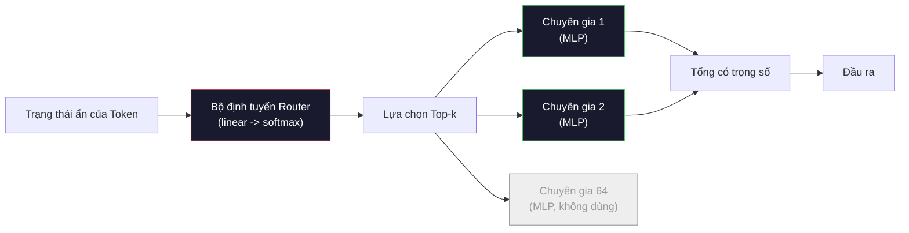

# Các mô hình mở: Phân tích chi tiết kiến trúc (Open Models: Architecture Walkthroughs)

> Bạn đã tự tay xây dựng mô hình GPT-2 Small từ đầu trong Bài 04. Các mô hình mở biên giới (frontier open models) vào năm 2026 đều thuộc cùng một dòng kiến trúc này với năm hoặc sáu thay đổi cụ thể: RMSNorm thay cho LayerNorm; SwiGLU thay cho GELU; RoPE thay cho vị trí học được (learned positions); GQA hoặc MLA thay cho MHA đầy đủ; và Hỗn hợp chuyên gia (Mixture-of-Experts - MoE) ở quy mô lớn. Nền tảng toán học bạn đã biết bao quát tới 95% cấu trúc của chúng. Bài học này sẽ đặt Llama 3, DeepSeek-V3, Mixtral, Qwen và Gemma lên bàn cân so sánh song song và chỉ ra chính xác từng dòng mã nơi mỗi kiến trúc rẽ nhánh.

**Type:** Learn
**Languages:** Python (stdlib)
**Prerequisites:** Giai đoạn 10, Bài 04, 05, 12 (Tiền huấn luyện, Mở rộng quy mô, Suy luận)
**Time:** ~45 phút

## Mục tiêu học tập

- Đọc tệp config.json của Llama 3, Mistral, Mixtral, Gemma 2, Qwen 2.5 và DeepSeek-V3, giải thích chi tiết từng trường thông tin.
- Nêu tên từng thay đổi kiến trúc cụ thể mà mỗi mô hình thực hiện so với GPT-2 Small và biện minh cho thay đổi đó từ các nguyên lý đầu tiên (first principles).
- Tính toán số lượng tham số, kích thước bộ nhớ đệm KV (KV cache) và bộ nhớ kích hoạt (activation memory) cho bất kỳ mô hình mở nào chỉ từ tệp cấu hình của nó.
- Lựa chọn mô hình mở phù hợp cho một mục tiêu triển khai cụ thể dựa trên các ràng buộc về độ trễ, bộ nhớ và năng lực mô hình.

## Vấn đề thực tế

Trong Bài 04, bạn đã viết 350 dòng mã numpy và tạo ra một mô hình mang hình thái của GPT-2. Trong khi đó, Llama 3 405B có một báo cáo kỹ thuật dày tới 200 trang. Trực giác tự nhiên khiến bạn nghĩ rằng đây là hai thực thể hoàn toàn khác nhau. Nhưng thực tế không phải vậy. Bản báo cáo 200 trang đó mô tả cùng một đối tượng với năm hoặc sáu sửa đổi có cơ sở chặt chẽ, cộng thêm hàng nghìn chi tiết kỹ thuật thực thi về việc mở rộng quy mô. Khung sườn cốt lõi -- tầng nhúng (embedding), các khối transformer, cơ chế chú ý (attention), mạng nơ-ron truyền thẳng (MLP), tầng chuẩn hóa (norm), đầu ra tuyến tính (head) -- hoàn toàn không thay đổi.

Bài học này đóng vai trò như một bản so sánh khác biệt (diff). Đối với mỗi họ mô hình mở chính, chúng tôi liệt kê chính xác những gì đã thay đổi so với GPT-2, lý do thay đổi và cái giá phải trả. Sau khi hoàn thành, bạn có thể đọc một thẻ mô hình (model card) hoàn toàn mới và tự động dịch ngược nó về mốc tham chiếu GPT-2 trong tâm trí.

Lợi ích thực tế là khi Meta phát hành Llama 5 hay DeepSeek phát hành V4, bạn sẽ không cần phải xây dựng một mô hình tư duy mới. Bạn chỉ cần nhìn vào tệp cấu hình, xem những "núm vặn" quen thuộc nào đã dịch chuyển và hiểu ngay những hệ quả hạ nguồn của chúng là gì. Các kiến trúc năm 2026 là một hộp công cụ hữu hạn. Mỗi mô hình mới chỉ đơn giản là chọn một tập hợp con khác nhau trong hộp công cụ đó.

## Khái niệm cốt lõi

### Phần lõi bất biến (The Invariant Core)

Tất cả các mô hình mở tự hồi quy (autoregressive open models) đều chia sẻ:

- Ma trận nhúng token (token embedding matrix) kích thước `vocab_size x hidden_dim`.
- Chồng gồm $N$ khối giải mã (decoder blocks): chuẩn hóa (norm), tự chú ý (self-attention), liên kết tắt (residual), chuẩn hóa (norm), MLP, liên kết tắt (residual).
- Tầng chuẩn hóa cuối cùng và đầu tuyến tính chiếu về `vocab_size` (thường chia sẻ trọng số với tầng nhúng).
- Mặt nạ nhân quả (causal mask), hàm mất mát cross-entropy dự đoán token kế tiếp.

Đó chính là hình thái kiến trúc chung. Phần còn lại chỉ là việc điều chỉnh các nút xoay.

### Sáu núm vặn thực sự thay đổi

Xuyên suốt mọi mô hình mở biên giới giai đoạn 2024-2026, cùng sáu lựa chọn thiết kế được chọn đi chọn lại:

1. **Chuẩn hóa (Normalization):** LayerNorm $\rightarrow$ RMSNorm.
2. **Mã hóa vị trí (Positional encoding):** Vị trí tuyệt đối học được $\rightarrow$ RoPE (cùng các biến thể: YaRN, NTK).
3. **Hàm kích hoạt (Activation):** GELU $\rightarrow$ SwiGLU (hoặc GeGLU).
4. **Chia sẻ đầu chú ý (Attention head sharing):** MHA $\rightarrow$ GQA $\rightarrow$ MQA $\rightarrow$ MLA.
5. **MLP dày đặc so với MLP thưa (Dense vs sparse MLP):** MLP dày đặc $\rightarrow$ Hỗn hợp chuyên gia (Mixture-of-Experts - MoE).
6. **Vị trí chuẩn hóa trước (Pre-norm placement):** Pre-norm được giữ lại; Post-norm hoàn toàn bị loại bỏ.

Mọi thứ khác (lịch trình tốc độ học, tỷ lệ pha trộn dữ liệu, kích thước batch, độ dài ngữ cảnh) đều nằm trong cấu hình huấn luyện chứ không thuộc về kiến trúc. Chỉ có đúng sáu núm vặn.

### Núm vặn 1: RMSNorm

LayerNorm trừ đi giá trị trung bình, chia cho độ lệch chuẩn, co giãn (scale) và dịch chuyển (shift). RMSNorm chỉ giữ lại thành phần co giãn:

```math
\mathop{\mathrm{RMSNorm}}(x) = \frac{x}{\sqrt{\mathop{\mathrm{mean}}(x^2) + \epsilon}} \cdot \gamma
```

Không trừ giá trị trung bình. Không có trọng số điều chỉnh độ lệch (bias). Tiết kiệm được một phép nhân ma trận trên mỗi token. Zhang và Sennrich (2019) đã chứng minh rằng nó đạt độ chính xác tương đương LayerNorm trên bài toán dịch máy trong khi nhanh hơn 10%. Mọi mô hình mở hiện đại đều sử dụng cơ chế này.

Chi phí: không có. Lợi ích: tăng nhẹ thông lượng, mã nguồn đơn giản hơn.

### Núm vặn 2: RoPE

Mã hóa vị trí học được trong GPT-2 là một bảng tra cứu gồm 1024 vị trí. Ngữ cảnh ở vị trí 1025 nằm ngoài giới hạn của bảng. Mô hình không thể ngoại suy vượt ra ngoài độ dài huấn luyện của nó.

Mã hóa vị trí quay (Rotary Position Embedding - RoPE, Su et al. 2021) đưa vị trí vào bằng cách xoay từng cặp vector Q và K trong không gian 2 chiều trước khi thực hiện tích vô hướng trong cơ chế chú ý. Góc xoay là một hàm tất định của vị trí, do đó không cần học bất kỳ tham số nào và không bao giờ bị cạn kiệt vị trí. Bằng các kỹ thuật co giãn (nội suy nhận biết NTK, YaRN), một mô hình được huấn luyện trên ngữ cảnh 8k có thể kéo dài lên 128k khi suy luận với mức suy giảm độ chính xác rất nhỏ.

```text
q_rotated = rotate(q, angle(pos))
k_rotated = rotate(k, angle(pos))
score = q_rotated . k_rotated
```

Mọi biến thể Llama, Mistral, Qwen, DeepSeek và Gemma đều sử dụng RoPE. Riêng Gemma 2 sử dụng cơ chế lai (RoPE trên hầu hết các lớp, chú ý cửa sổ trượt cục bộ trên các lớp xen kẽ).

### Núm vặn 3: SwiGLU

Tầng MLP của GPT-2 có dạng `x -> gelu(xW1 + b1) -> (...)W2 + b2`. SwiGLU (Shazeer 2020) thay thế hàm kích hoạt bằng một tích cổng (gated product):

```math
\mathop{\mathrm{SwiGLU}}(x) = (xW_1) \cdot \mathop{\mathrm{sigmoid}}(xW_1) \cdot xV
```

Hai phép chiếu song song thay vì một, được điều khiển bởi cổng kích hoạt Swish. Về mặt thực nghiệm, nó mang lại độ hỗn loạn (perplexity) tốt hơn trên mỗi tham số. Llama 2 đã áp dụng cấu trúc này và toàn bộ cộng đồng nhanh chóng làm theo. Kích thước ẩn của MLP thường được thiết lập sao cho tổng số tham số tương đương với MLP dày đặc ban đầu: nếu GPT-2 dùng `ff_dim = 4 * hidden`, SwiGLU sẽ dùng `ff_dim = (2/3) * 4 * hidden = 8/3 * hidden`.

### Núm vặn 4: Chia sẻ đầu chú ý (Attention Head Sharing)

GPT-2 sử dụng **Chú ý đa đầu (Multi-Head Attention - MHA)**: mỗi đầu sở hữu phép chiếu Q, K, V độc lập của riêng mình.

**Chú ý đa truy vấn (Multi-Query Attention - MQA, Shazeer 2019)** chia sẻ một đầu K và một đầu V duy nhất cho tất cả các đầu Q. Cơ chế này cắt giảm kích thước bộ nhớ đệm KV theo hệ số `num_heads`, tức giảm từ 12 đến 32 lần trên một mô hình điển hình. Độ chính xác suy giảm nhẹ trên các bài benchmark khó.

**Chú ý truy vấn theo nhóm (Grouped-Query Attention - GQA, Ainslie et al. 2023)** là giải pháp cân bằng trung gian: $G$ nhóm đầu Q cùng chia sẻ một cặp đầu K và V. Llama 3 8B dùng GQA với 32 đầu Q và 8 đầu KV ($G=8$), nhờ đó bộ nhớ đệm KV thu nhỏ 4 lần so với MHA đầy đủ.

**Chú ý tiềm ẩn đa đầu (Multi-Head Latent Attention - MLA, DeepSeek 2024)** nén K và V vào một không gian tiềm ẩn (latent) hạng thấp dùng chung, sau đó giải nén ngược trở lại cho từng đầu. Cơ chế này giúp thu nhỏ bộ nhớ đệm KV hơn nữa trong khi vẫn duy trì năng lực biểu diễn riêng của từng đầu. DeepSeek-V2 và V3 dựa vào MLA để đạt được hiệu năng vượt trội trên ngữ cảnh dài.

| Cơ chế | Số đầu KV | Bộ nhớ đệm KV | Độ chính xác |
|---|---|---|---|
| MHA | num_heads | Đầy đủ | Tốt nhất |
| GQA | num_groups ($G < \text{num\_heads}$) | Giảm theo tỷ lệ num_heads / $G$ | Gần tương đương MHA |
| MQA | 1 | Giảm theo tỷ lệ num_heads | Giảm nhẹ |
| MLA | Vector tiềm ẩn, giải nén theo từng đầu | Nhỏ hơn cả MQA | Gần tương đương MHA |

Đối với bất kỳ mô hình nào có kích thước trên khoảng 13B tham số, GQA hoặc MLA thực tế là bắt buộc. Sử dụng MHA đầy đủ ở quy mô lớn là một thảm họa đối với bộ nhớ đệm KV.

### Núm vặn 5: Hỗn hợp chuyên gia (Mixture of Experts - MoE)

Một tầng MLP dày đặc (dense MLP) sẽ kích hoạt toàn bộ tham số của nó cho mỗi token. Một tầng MLP MoE sở hữu $K$ chuyên gia (experts) trên mỗi khối và một bộ định tuyến (router) chọn ra top-$k$ chuyên gia hàng đầu cho từng token (thường là top-2). Chỉ có trọng số của các chuyên gia được chọn mới tham gia vào lượt truyền xuôi cho token đó.

```text
router_logits = xW_r
indices, weights = top_k(router_logits, k=2)
output = sum_i weights[i] * expert[indices[i]](x)
```

Điểm hấp dẫn là: bạn có thể sở hữu 64 chuyên gia với kích thước 7B mỗi chuyên gia (khiến tổng số tham số là khổng lồ) trong khi chỉ chạy 2 chuyên gia trên mỗi token (khiến chi phí tính toán trên mỗi token chỉ tương đương một mô hình 7B dày đặc). Mixtral 8x7B có tổng cộng 47B tham số nhưng chỉ kích hoạt 13B tham số cho mỗi token. DeepSeek-V3 có tổng cộng 671B tham số nhưng chỉ kích hoạt 37B tham số mỗi token.



Ưu điểm: cùng chi phí tính toán, nhiều tham số hơn, dung lượng biểu diễn vượt trội. Nhược điểm: bộ nhớ chứa toàn bộ chuyên gia vẫn phải được nạp vào VRAM (do đó việc phục vụ suy luận đòi hỏi nhiều VRAM hơn mô hình dày đặc tương đương về compute), việc cân bằng tải (load-balancing) cho bộ định tuyến rất phức tạp, và tinh chỉnh bộ định tuyến trong giai đoạn căn chỉnh là một bài toán nghiên cứu riêng biệt.

### Núm vặn 6: Vị trí Pre-norm được giữ vững

Mô hình transformer nguyên bản áp dụng chuẩn hóa lớp sau mỗi lớp con (post-norm). Mọi mô hình mở từ sau GPT-2 đều đặt nó *trước* mỗi lớp con (pre-norm). Pre-norm giúp việc huấn luyện ở các mô hình có độ sâu lớn ổn định hơn một cách triệt để. Đây là chuẩn mực không cần bàn cãi.

### So sánh chi tiết từng mô hình

Bảng tổng hợp dưới đây giúp cụ thể hóa tất cả các khái niệm trên:

| Mô hình | Năm | Tổng tham số | Tham số kích hoạt | Chuẩn hóa | Kích hoạt | Vị trí | Cơ chế chú ý | MoE | Ngữ cảnh |
|---|---|---|---|---|---|---|---|---|---|
| GPT-2 Small | 2019 | 124M | 124M | LayerNorm | GELU | Học được | MHA (12 đầu) | Không | 1k |
| Llama 3 8B | 2024 | 8B | 8B | RMSNorm | SwiGLU | RoPE | GQA (32/8) | Không | 128k |
| Llama 3 70B | 2024 | 70B | 70B | RMSNorm | SwiGLU | RoPE | GQA (64/8) | Không | 128k |
| Llama 3 405B | 2024 | 405B | 405B | RMSNorm | SwiGLU | RoPE | GQA (128/16) | Không | 128k |
| Mistral 7B | 2023 | 7.2B | 7.2B | RMSNorm | SwiGLU | RoPE | GQA | Không | 32k |
| Mixtral 8x7B | 2023 | 47B | 13B | RMSNorm | SwiGLU | RoPE | GQA | Có (8 chuyên gia, top-2) | 32k |
| Gemma 2 9B | 2024 | 9B | 9B | RMSNorm (pre+post) | GeGLU | RoPE + trượt | GQA | Không | 8k |
| Qwen 2.5 72B | 2024 | 72B | 72B | RMSNorm | SwiGLU | RoPE (YaRN) | GQA (64/8) | Không | 128k |
| DeepSeek V2 236B | 2024 | 236B | 21B | RMSNorm | SwiGLU | RoPE | MLA | Có (160 chuyên gia, top-6) | 128k |
| DeepSeek V3 | 2024 | 671B | 37B | RMSNorm | SwiGLU | RoPE | MLA | Có (256 chuyên gia, top-8) | 128k |
| Spark-X2.5 4B | 2026 | 4.1B | 4.1B | RMSNorm | GeGLU | RoPE + trượt (3:1) | GQA (16/4), gated output | Không | 1M |

Quan sát các cột: RMSNorm là phổ quát. SwiGLU hoặc họ hàng GeGLU là phổ quát. RoPE là phổ quát. GQA là phổ quát cho các mô hình trên 7B ngoại trừ trường hợp được thay bằng MLA. MoE là yếu tố phân hóa sức mạnh ở phân khúc cao nhất.

### Đọc hiểu tệp config.json

Cấu hình của Llama 3 8B:

```json
{
  "hidden_size": 4096,
  "intermediate_size": 14336,
  "num_hidden_layers": 32,
  "num_attention_heads": 32,
  "num_key_value_heads": 8,
  "max_position_embeddings": 131072,
  "rope_theta": 500000.0,
  "rms_norm_eps": 1e-5,
  "vocab_size": 128256
}
```

Mỗi trường đều tương ứng trực tiếp với những thành phần bạn đã tự tay lập trình.
Các tệp cấu hình mới bổ sung thêm một số trường làm thay đổi cách tính toán số học, do đó bộ tính toán sẽ đọc chúng khi có mặt:

- `head_dim`: được thiết lập rõ ràng khi nó không bằng `hidden_size / num_attention_heads`. Ví dụ Gemma 2 9B có hidden là 3584 và 16 đầu nhưng `head_dim` lại là 256, nên phép chiếu Q của nó là $3584 \times 4096$, không phải ma trận vuông.
- `tie_word_embeddings`: cho biết đầu ra LM head có tái sử dụng ma trận nhúng hay không. Llama 3 8B không ràng buộc trọng số (untied), làm xuất hiện thêm 525M tham số mà bạn sẽ bỏ sót nếu chỉ đếm ma trận nhúng một lần.
- `layer_types` và `sliding_window`: xác định lớp nào chú ý trên toàn bộ ngữ cảnh và lớp nào chỉ chú ý trên $W$ token gần nhất.

Ý nghĩa các trường cơ bản:
- `hidden_size`: số chiều nhúng vector.
- `intermediate_size`: kích thước lớp ẩn MLP (khoảng $3,5 \times \text{hidden}$ -- theo công thức SwiGLU).
- `num_hidden_layers`: độ sâu của chồng khối transformer.
- `num_attention_heads`: số lượng đầu Q.
- `num_key_value_heads`: số lượng đầu KV (trong cơ chế GQA).
- `max_position_embeddings`: độ dài ngữ cảnh huấn luyện tối đa.
- `rope_theta`: tần số cơ sở của RoPE. Meta đã mở rộng nó từ mặc định 10k lên 500k để hỗ trợ ngoại suy ngữ cảnh dài.
- `rms_norm_eps`: hằng số ổn định số học.
- `vocab_size`: số lượng token trong bộ từ vựng.

Chỉ từ những con số này, bạn có thể tính toán được tổng số tham số, dung lượng bộ nhớ đệm KV và bộ nhớ kích hoạt đỉnh. Xem `code/main.py` để nắm các công thức chuẩn xác.

### Dự trù ngân sách bộ nhớ kích hoạt (Activation Memory Budget)

Bộ nhớ kích hoạt chiếm ưu thế trong tổng bộ nhớ huấn luyện khi kích thước mô hình vượt qua vài tỷ tham số. Công thức ước tính sơ bộ cho giai đoạn tiền huấn luyện (có áp dụng lưu điểm kiểm tra gradient - gradient checkpointing):

```text
activation_mem ~ batch_size * seq_len * hidden_size * num_layers * bytes_per_element
```

Với Llama 3 8B ở batch size 1, chuỗi dài 8192, định dạng BF16, 32 lớp, chiều ẩn 4096: cần khoảng 8 GB chỉ riêng cho bộ nhớ kích hoạt khi có checkpointing, và lên tới 40 GB nếu không có. Đây chính là lý do vì sao flash-attention và ring-attention đóng vai trò sống còn -- chúng viết lại thuật toán tính toán chú ý để các kích hoạt vừa vặn trong bộ nhớ.

### Dự trù ngân sách bộ nhớ đệm KV (KV Cache Budget)

Khi thực hiện suy luận ở độ dài ngữ cảnh tối đa:

```text
kv_cache = 2 * num_layers * num_kv_heads * head_dim * max_seq_len * bytes_per_element
```

Với Llama 3 8B ở ngữ cảnh 128k, định dạng BF16, `head_dim = hidden / num_heads = 128`:
`2 * 32 * 8 * 128 * 131072 * 2 = 17,2 GB` cho mỗi chuỗi đơn lẻ.

Toàn bộ trọng số của mô hình 8B chiếm khoảng 16 GB ở định dạng BF16. Như vậy bộ nhớ đệm KV cho một chuỗi 128k duy nhất đã lớn hơn toàn bộ trọng số mô hình. Đây chính là áp lực bộ nhớ thúc đẩy các nghiên cứu về GQA, MLA và lượng tử hóa bộ nhớ đệm KV.

Công thức trên giả định mọi lớp đều lưu đệm toàn bộ chuỗi. Một lớp cửa sổ trượt (sliding-window) chỉ cần lưu $W$ token gần nhất, nên đối với các mô hình lai, tổng chi phí được tính theo từng lớp:

```text
kv_cache = 2 * num_kv_heads * head_dim * bytes_per_element
           * (full_layers * max_seq_len + sliding_layers * min(W, max_seq_len))
```

Spark-X2.5 4B chạy ba lớp cửa sổ trượt ($W = 512$) cho mỗi lớp chú ý đầy đủ: tức có 9 lớp đầy đủ và 27 lớp trượt trên tổng số 36 lớp. Ở ngữ cảnh 1M token, nó chỉ tiêu tốn khoảng 38,7 GB (36 GiB) cho mỗi chuỗi ở định dạng BF16. Nếu cả 36 lớp đều lưu toàn bộ ngữ cảnh, con số sẽ là 154,6 GB (144 GiB). Các lớp đầy đủ gánh vác phần lớn chi phí, đó là lý do vì sao tỷ lệ giữa lớp đầy đủ và lớp trượt là con số đầu tiên cần đọc trên một mô hình ngữ cảnh dài.

### Khi nào mỗi mô hình chiếm ưu thế?

- **Một GPU 80GB đơn lẻ, không dùng MoE:** Llama 3 8B, Mistral 7B, Gemma 2 9B. Dễ triển khai phục vụ, hệ sinh thái công cụ rộng rãi.
- **Một nút máy chủ đơn (8x80GB), năng lực lớn:** Llama 3 70B, Qwen 2.5 72B. Năng lực mô hình mở dày đặc cao nhất.
- **Năng lực mở tối đa, chấp nhận độ phức tạp của MoE:** DeepSeek V3, Mixtral 8x22B. Năng lực tốt nhất trên mỗi FLOP kích hoạt.
- **Nhu cầu ngữ cảnh dài:** Llama 3 (128k với mở rộng RoPE), DeepSeek (lợi thế vượt trội từ MLA).
- **Phục vụ suy luận độ trễ thấp:** Gemma 2 9B (cửa sổ trượt giảm tải tính toán trên ngữ cảnh dài).
- **Ngữ cảnh dài với ngân sách bộ nhớ khiêm tốn:** Các mô hình lai cửa sổ trượt như Spark-X2.5 4B, nơi chỉ một phần tư số lớp phải trả chi phí lưu đệm toàn bộ ngữ cảnh.

````figure
rmsnorm-vs-layernorm
````

## Xây dựng thực tế (Build It)

Mã nguồn của bài học này là một công cụ tính toán kiến trúc. Cung cấp bất kỳ tệp config.json nào, nó sẽ in ra số lượng tham số theo từng thành phần, kích thước bộ nhớ đệm KV ở ngữ cảnh tối đa, tỷ lệ mở rộng SwiGLU MLP và kết luận ngắn gọn về kiến trúc (dày đặc / GQA / MLA / MoE).

```python
config = {
    "hidden_size": 4096, "intermediate_size": 14336,
    "num_hidden_layers": 32, "num_attention_heads": 32,
    "num_key_value_heads": 8, "vocab_size": 128256,
    "max_position_embeddings": 131072,
}
```

Kịch bản duyệt qua từng trường kiến trúc, tính số tham số cho tầng nhúng, cơ chế chú ý (với mức giảm trừ của GQA và giá trị `head_dim` rõ ràng nếu cấu hình chỉ định), tầng MLP (với hệ số mở rộng SwiGLU hoặc GeGLU), các tầng chuẩn hóa và đầu LM head khi không ràng buộc với tầng nhúng. Sau đó, nó tính toán bộ nhớ đệm KV theo độ dài ngữ cảnh đã nêu, từng lớp một để các lớp cửa sổ trượt được chặn ở giới hạn cửa sổ của chúng, và in bản tóm tắt hoàn chỉnh.

Đối với các mô hình dày đặc, các con số tính ra khớp chính xác hoàn toàn với số tham số được công bố: Llama 3 8B đạt chính xác 8.030.261.248 tham số, Gemma 2 9B đạt 9.241.705.984 và Spark-X2.5 4B đạt 4.112.079.360. Qwen 2.5 72B có độ lệch 819.200 tham số, đây chính là nội dung của Bài tập 1.

Xem `code/main.py` để theo dõi mã nguồn chi tiết.

## Sử dụng thực tế (Use It)

Chạy bộ tính toán trên các cấu hình đi kèm kịch bản của Llama 3 8B, Mistral 7B, Mixtral 8x7B và DeepSeek V3. So sánh cấu trúc tham số chi tiết. Hãy nhận thấy rằng các mô hình MoE có tổng số tham số áp đảo các mô hình dày đặc nhưng số tham số kích hoạt thực tế lại thường nhỏ hơn. Hãy quan sát thấy bộ nhớ đệm KV của DeepSeek V3 nhỏ hơn của Llama 3 405B dù có tổng số tham số lớn hơn -- đó chính là sức mạnh của MLA.

Sau đó so sánh Gemma 2 9B và Spark-X2.5 4B. Đối với cả hai, tập lệnh sẽ in ra bộ nhớ đệm KV thực sự cần thiết và bộ nhớ đệm KV mà nó sẽ cần nếu mọi lớp đều là chú ý đầy đủ. Gemma 2 luân phiên theo tỷ lệ 1:1 ở ngữ cảnh 8k, nên mức tiết kiệm ở mức vừa phải. Spark-X2.5 chạy tỷ lệ 3:1 với cửa sổ 512 token ở ngữ cảnh 1M, mang lại mức tiết kiệm gấp 4 lần.

Tiếp theo, hãy đưa vào cấu hình của bất kỳ mô hình nào bạn có trên máy cục bộ, đọc kết quả tóm tắt và đánh giá xem liệu nó có vừa vặn với GPU của bạn hay không.

## Xuất bản tạo tác (Ship It)

Bài học này tạo ra `outputs/skill-open-model-picker.md`. Dựa trên mục tiêu triển khai (loại GPU, VRAM, độ dài ngữ cảnh, ngân sách độ trễ) và hồ sơ tác vụ (trò chuyện, viết mã, suy luận logic, ngữ cảnh dài), nó sẽ đề xuất một mô hình mở phù hợp, cơ chế lượng tử hóa từ Bài 11 và ngăn xếp suy luận từ Bài 12, kèm theo lập luận kỹ thuật rõ ràng dựa trên sáu núm vặn kiến trúc.

## Bài tập thực hành

1. Đọc tệp cấu hình của Qwen 2.5 72B từ HuggingFace. Tính toán tổng số tham số từ các nguyên lý đầu tiên. So sánh với giá trị do HuggingFace công bố và xác định độ lệch bắt nguồn từ đâu (làm tròn chiều của đầu chú ý, hệ số chia sẻ KV, v.v.).

2. DeepSeek V3 sử dụng 256 chuyên gia với cơ chế định tuyến top-8. Hãy tính tỷ lệ giữa số chuyên gia được kích hoạt so với tổng số chuyên gia và so sánh với tỷ lệ top-2 trên 8 của Mixtral 8x7B. Sự chuyển dịch từ mức độ thưa 25% sang mức độ thưa đậm đặc hơn (khoảng 3%) mang ý nghĩa gì đối với dung lượng mô hình trên mỗi FLOP tính toán?

3. Tính toán bộ nhớ đệm KV cho Llama 3 405B ở độ dài ngữ cảnh 128k trong hai định dạng FP8 và BF16. Ở định dạng FP8, con số này bằng một nửa BF16. Bạn có thể phục vụ song song bao nhiêu chuỗi trên một nút 8xH100 đơn lẻ (mỗi GPU 80GB = tổng 640GB, trừ đi bộ nhớ chứa trọng số)?

4. Gemma 2 luân phiên giữa các lớp chú ý đầy đủ và chú ý cửa sổ trượt. Hãy viết công thức toán học tính bộ nhớ đệm KV khi một nửa số lớp sử dụng cửa sổ trượt 4096 token thay vì toàn bộ ngữ cảnh. Điều này giúp tiết kiệm bao nhiêu bộ nhớ ở tổng ngữ cảnh 8k?

5. Tìm một mô hình mở biên giới mới được phát hành sau khi bài học này được viết. Xác định xem nó đã chọn những giá trị nào trong sáu núm vặn nói trên và liệu nó có đưa ra núm vặn thứ bảy nào mới hay không. Giáo trình sẽ có vẻ lỗi thời ngay khi một kiến trúc mới xuất hiện -- mục tiêu của bạn là cập nhật bảng so sánh mà không cần phải đập đi xây lại mô hình tư duy của mình.

## Thuật ngữ then chốt

| Thuật ngữ | Điều mọi người hay nói | Ý nghĩa thực tế |
|---|---|---|
| RMSNorm | "LayerNorm không cần trừ kỳ vọng" | Chuẩn hóa chỉ theo căn bậc hai của trung bình bình phương (root mean square), với trọng số co giãn học được — chi phí rẻ hơn và chất lượng tương đương LayerNorm |
| RoPE | "Mã hóa vị trí quay" | Xoay từng cặp vector Q và K trong không gian 2D theo một góc phụ thuộc vào vị trí — ngoại suy tốt ngoài độ dài huấn luyện bằng các kỹ thuật co giãn |
| SwiGLU | "Hàm kích hoạt MLP thế hệ mới" | Đơn vị tuyến tính có cổng với hàm Swish: `(xW1) * sigmoid(xW1) * xV` — chuẩn mực trên mọi mô hình mở từ năm 2024 trở đi |
| GQA | "Cơ chế chú ý trung dung" | Chú ý truy vấn theo nhóm (Grouped-Query Attention): $G$ nhóm đầu Q cùng chia sẻ một đầu K và một đầu V — thu nhỏ bộ nhớ đệm KV mà không làm sụt giảm độ chính xác như MQA |
| MLA | "Cơ chế chú ý của DeepSeek" | Chú ý tiềm ẩn đa đầu (Multi-Head Latent Attention): nén K/V vào một không gian tiềm ẩn hạng thấp dùng chung, giải nén theo từng đầu — kích thước bộ nhớ đệm KV nhỏ nhất cho các mô hình lớn |
| MoE | "Các chuyên gia thưa" | Hỗn hợp chuyên gia (Mixture of Experts): $N$ mạng MLP trên mỗi khối, bộ định tuyến chọn top-$k$ cho mỗi token — tổng tham số khổng lồ nhưng tham số kích hoạt nhỏ |
| Định tuyến Top-k (Top-k routing) | "Chọn $k$ chuyên gia mỗi token" | Bộ định tuyến tính điểm cho từng chuyên gia và kích hoạt $k$ chuyên gia có điểm cao nhất — $k$ điển hình từ 2 (Mixtral) đến 8 (DeepSeek) |
| YaRN | "Kéo giãn RoPE" | Bản mở rộng RoPE bổ sung — nội suy các góc quay để mở rộng ngữ cảnh từ 8k lên 128k+ trong thời gian suy luận |
| Chú ý cửa sổ trượt (Sliding-window attention) | "Không chú ý vào mọi thứ" | Mỗi token chỉ chú ý tới $W$ token gần nhất phía trước — giới hạn chi phí chú ý ở mức $O(W)$ trên mỗi token, dùng trong Gemma 2 và các bản Mistral ban đầu |
| Tham số kích hoạt (Active params) | "Những gì thực sự chạy trên mỗi token" | Đối với mô hình MoE, số lượng tham số thực sự tham gia vào lượt truyền xuôi cho mỗi token (nhỏ hơn nhiều so với tổng tham số) — quyết định số FLOPs trên mỗi token |

## Đọc thêm

- [Dubey et al., 2024 -- "The Llama 3 Herd of Models"](https://arxiv.org/abs/2407.21783) -- tài liệu tham khảo về kiến trúc và huấn luyện cho dòng mô hình Llama 3 dày đặc
- [DeepSeek-AI, 2024 -- "DeepSeek-V3 Technical Report"](https://arxiv.org/abs/2412.19437) -- cơ chế MLA kết hợp cân bằng tải không cần hàm mất mát phụ cùng kiến trúc MoE 671B
- [Jiang et al., 2024 -- "Mixtral of Experts"](https://arxiv.org/abs/2401.04088) -- bài báo kinh điển về mô hình mở MoE
- [Su et al., 2021 -- "RoFormer: Enhanced Transformer with Rotary Position Embedding"](https://arxiv.org/abs/2104.09864) -- bài báo gốc về RoPE
- [Shazeer, 2020 -- "GLU Variants Improve Transformer"](https://arxiv.org/abs/2002.05202) -- nghiên cứu về SwiGLU, GeGLU và các biến thể liên quan
- [Ainslie et al., 2023 -- "GQA: Training Generalized Multi-Query Transformer Models"](https://arxiv.org/abs/2305.13245) -- bài báo gốc giới thiệu GQA
- [Gemma 2 Team, 2024 -- "Gemma 2: Improving Open Language Models at a Practical Size"](https://arxiv.org/abs/2408.00118) -- cơ chế chú ý lai toàn phần + cửa sổ trượt, chuẩn hóa pre + post-norm
- [Qwen Team, 2024 -- "Qwen 2.5 Technical Report"](https://arxiv.org/abs/2412.15115) -- mở rộng ngữ cảnh bằng YaRN và các công thức huấn luyện ngữ cảnh siêu dài
