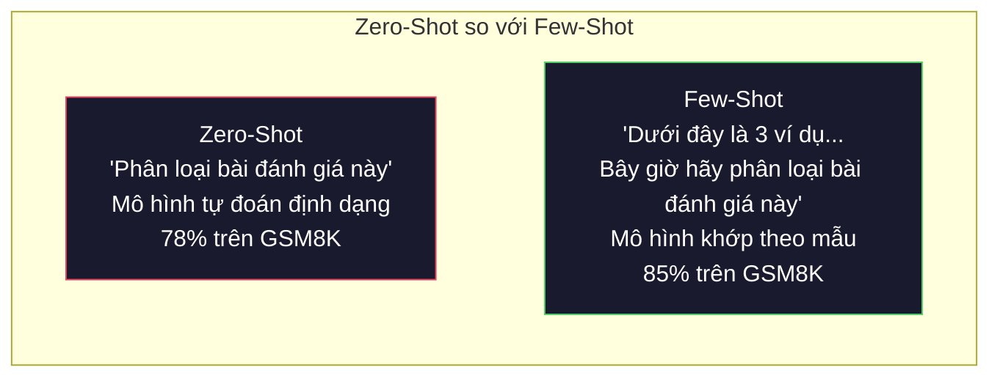
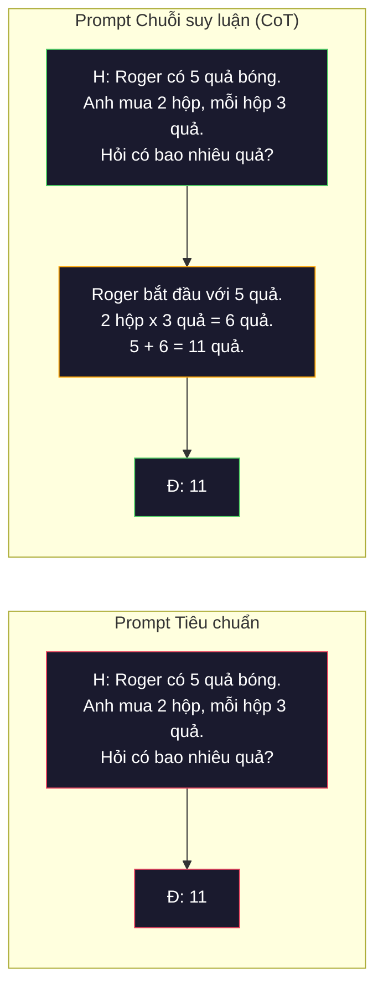
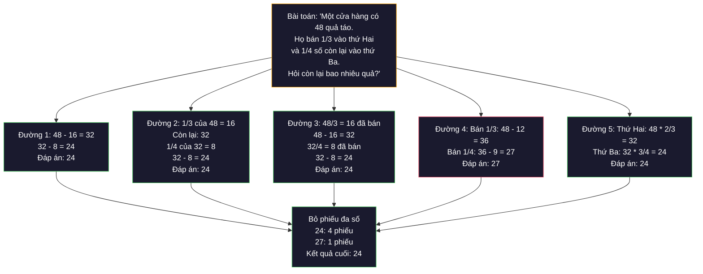
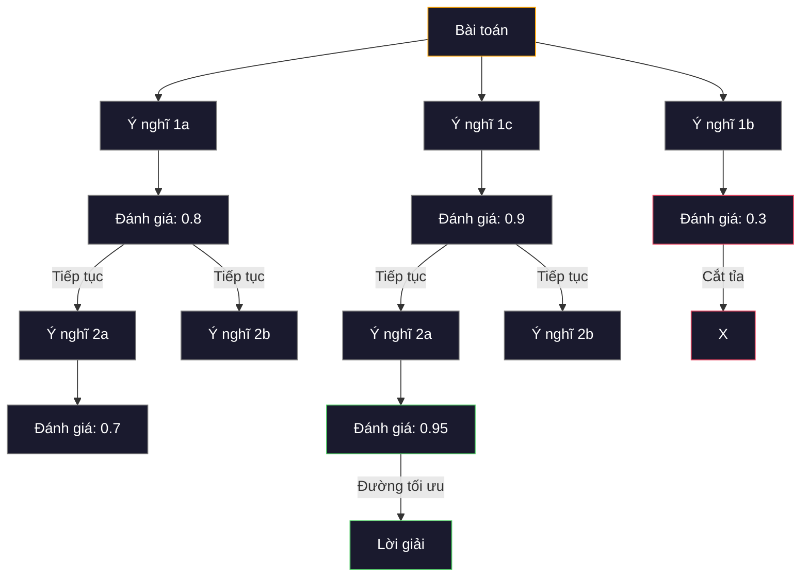
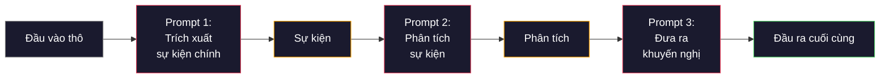

# Vài mẫu (Few-Shot), Chuỗi suy luận (Chain-of-Thought), Cây suy luận (Tree-of-Thought)

> Nói cho mô hình biết cần làm gì là kỹ nghệ prompt thông thường. Dạy cho mô hình cách tư duy mới là kỹ nghệ kỹ thuật thực thụ. Khoảng cách giữa độ chính xác 78% và 91% trên cùng một mô hình, cùng một tác vụ, cùng một tập dữ liệu không nằm ở việc đổi sang mô hình tốt hơn, mà nằm ở một chiến lược suy luận vượt trội hơn.

**Type:** Xây dựng (Build)  
**Languages:** Python  
**Prerequisites:** Bài 11.01 (Kỹ nghệ Prompt - Prompt Engineering)  
**Time:** ~45 phút  

## Mục tiêu học tập

- Triển khai kỹ thuật học vài mẫu (few-shot prompting) bằng cách chọn lọc và định dạng các ví dụ minh họa nhằm tối đa hóa độ chính xác của tác vụ
- Áp dụng suy luận chuỗi suy luận (chain-of-thought - CoT) để cải thiện độ chính xác trong các bài toán nhiều bước như toán đố chữ (math word problems)
- Xây dựng prompt cây suy luận (tree-of-thought - ToT) có khả năng khám phá nhiều nhánh suy luận và lựa chọn đường đi tối ưu nhất
- Đo lường mức độ cải thiện độ chính xác giữa không mẫu (zero-shot) so với vài mẫu (few-shot) và CoT trên một bộ dữ liệu đánh giá tiêu chuẩn

## Vấn đề thực tế

Bạn xây dựng một ứng dụng gia sư toán. Prompt của bạn ghi: "Hãy giải bài toán đố này." GPT-5 trả lời đúng 94% số lần trên GSM8K, bộ dữ liệu đánh giá chuẩn toán tiểu học. Bạn nghĩ rằng mình đã đạt đỉnh năng lực. Nhưng chưa hề — chuỗi suy luận (chain-of-thought) vẫn có thể gia tăng thêm 3-4 điểm phần trăm nữa.

Chỉ cần thêm vài từ -- "Hãy suy nghĩ từng bước một (Let's think step by step)" -- độ chính xác đã nhảy vọt lên 91% (trên các mô hình đời trước). Thêm vài ví dụ có giải thích chi tiết và con số đạt 95%. Cùng một mô hình. Cùng mức nhiệt độ (temperature). Cùng chi phí gọi API. Điểm khác biệt duy nhất là bạn đã cung cấp cho mô hình một "mẩu giấy nháp".

Đây không phải là một thủ thuật đường tắt. Đó là cách thức bản chất mà suy luận vận hành. Con người không giải quyết các bài toán phức tạp nhiều bước chỉ bằng một bước nhảy trực giác duy nhất trong tâm trí. Các kiến trúc Transformer cũng vậy. Khi bạn buộc mô hình phải sinh ra các token trung gian, những token này sẽ trở thành một phần của ngữ cảnh cho token tiếp theo. Mỗi bước suy luận sẽ tiếp thêm dữ liệu cho bước kế tiếp. Mô hình tính toán từng bước để dần tiến tới câu trả lời cuối cùng.

Tuy nhiên, "suy nghĩ từng bước" chỉ là điểm khởi đầu chứ chưa phải đích đến. Điều gì sẽ xảy ra nếu bạn lấy mẫu 5 lộ trình suy luận độc lập rồi áp dụng cơ chế bỏ phiếu theo số đông? Điều gì xảy ra nếu bạn để mô hình khám phá một cây khả năng (tree of possibilities), tự đánh giá và cắt tỉa các nhánh kém tiềm năng? Điều gì xảy ra nếu bạn đan xen giữa suy luận và việc gọi công cụ ngoài? Đây không phải là các ý tưởng giả thuyết. Chúng là những kỹ thuật đã được công bố với mức cải thiện hiệu năng được đo lường cụ thể, và bạn sẽ tự tay xây dựng tất cả trong bài học này.

## Khái niệm

### Không mẫu (Zero-Shot) so với Vài mẫu (Few-Shot): Khi ví dụ đánh bại chỉ dẫn

Prompt không mẫu (zero-shot prompting) chỉ cung cấp cho mô hình tác vụ mà không có gì khác. Prompt vài mẫu (few-shot prompting) cung cấp cho mô hình các ví dụ minh họa trước.

Wei và các cộng sự (2022) đã đo lường sự khác biệt này trên 8 bộ dữ liệu đánh giá. Đối với các tác vụ đơn giản như phân loại cảm xúc, zero-shot và few-shot chênh lệch nhau trong khoảng 2%. Nhưng đối với các tác vụ phức tạp như số học nhiều bước và suy luận ký hiệu, few-shot giúp cải thiện độ chính xác từ 10-25%.

Nguyên lý trực giác rất rõ ràng: ví dụ chính là các chỉ dẫn được nén lại. Thay vì mô tả dài dòng về định dạng đầu ra, bạn trực tiếp chỉ ra nó. Thay vì giải thích quy trình suy luận, bạn làm mẫu nó. Mô hình khớp mẫu (pattern-match) dựa trên các ví dụ mẫu một cách đáng tin cậy hơn nhiều so với việc diễn giải các chỉ dẫn trừu tượng.



**Khi few-shot chiếm ưu thế:** các tác vụ nhạy cảm về định dạng, bài toán phân loại, trích xuất dữ liệu có cấu trúc, thuật ngữ đặc thù chuyên ngành, bất kỳ tác vụ nào đòi hỏi mô hình phải khớp với một khuôn mẫu cụ thể.

**Khi zero-shot chiếm ưu thế:** các câu hỏi thực tế đơn giản, các tác vụ sáng tạo mà việc đưa ví dụ có nguy cơ hạn chế sự phong phú, hoặc các tác vụ mà việc tìm ví dụ tốt còn tốn công hơn viết một chỉ dẫn rõ ràng.

### Lựa chọn ví dụ: Tương đồng đánh bại Ngẫu nhiên

Không phải mọi ví dụ đều có giá trị như nhau. Việc chọn các ví dụ tương đồng với dữ liệu đầu vào mục tiêu vượt trội hơn việc chọn ngẫu nhiên từ 5-15% trong các tác vụ phân loại (Liu et al., 2022). Ba nguyên tắc cốt lõi:

1. **Độ tương đồng ngữ nghĩa (Semantic similarity)**: chọn các ví dụ gần nhất với đầu vào trong không gian nhúng (embedding space)
2. **Đa dạng nhãn (Label diversity)**: đảm bảo các ví dụ bao quát đầy đủ mọi danh mục nhãn đầu ra
3. **Tương thích độ khó (Difficulty matching)**: độ phức tạp của ví dụ phải tương xứng với bài toán đích

Số lượng ví dụ tối ưu cho hầu hết các tác vụ là từ 3-5. Dưới 3 ví dụ, mô hình không đủ tín hiệu để trích xuất quy luật. Trên 5 ví dụ, bạn sẽ chạm ngưỡng hiệu suất giảm dần (diminishing returns) và lãng phí token trong cửa sổ ngữ cảnh. Đối với bài toán phân loại có nhiều nhãn, hãy cung cấp một ví dụ cho mỗi nhãn.

### Chuỗi suy luận (Chain-of-Thought): Cung cấp giấy nháp cho mô hình

Kỹ thuật prompt chuỗi suy luận (Chain-of-Thought - CoT) được giới thiệu bởi Wei và các cộng sự (2022) tại Google Brain. Ý tưởng rất giản dị: thay vì chỉ yêu cầu mô hình đưa ra đáp án cuối cùng, hãy yêu cầu nó trình bày các bước suy luận trước.



Tại sao cơ chế này lại hoạt động hiệu quả về mặt bản chất máy tính? Mỗi token mà mô hình Transformer tạo ra sẽ trở thành ngữ cảnh cho token kế tiếp. Nếu không có CoT, mô hình buộc phải nén toàn bộ quá trình suy luận phức tạp vào trạng thái ẩn (hidden state) của một lượt truyền xuôi (forward pass) duy nhất. Với CoT, mô hình ngoại hóa các phép tính trung gian thành các token cụ thể. Mỗi token suy luận mở rộng thêm độ sâu tính toán thực tế của mô hình.

**Đánh giá trên chuẩn GSM8K (toán tiểu học, 8.500 bài toán):**

| Mô hình | Không mẫu (Zero-Shot) | CoT Không mẫu (Zero-Shot CoT) | CoT Vài mẫu (Few-Shot CoT) |
|---------|-----------------------|-------------------------------|---------------------------|
| GPT-4o | 78% | 91% | 95% |
| GPT-5 | 94% | 97% | 98% |
| o4-mini (mô hình suy luận) | 97% | — | — |
| Claude Opus 4.7 | 93% | 97% | 98% |
| Gemini 3 Pro | 92% | 96% | 98% |
| Llama 4 70B | 80% | 89% | 94% |
| DeepSeek-V3.1 | 89% | 94% | 96% |

**Lưu ý về các mô hình chuyên suy luận (Reasoning models).** Các dòng mô hình như OpenAI o-series (o3, o4-mini) và DeepSeek-R1 tự chạy chuỗi suy luận nội bộ trước khi xuất câu trả lời. Việc thêm "Hãy suy nghĩ từng bước một" vào các mô hình này là thừa thãi và đôi khi phản tác dụng — vì mô hình đã tự động thực hiện việc đó ở cấp độ kiến trúc.

Hai biến thể chính của CoT:

**Zero-shot CoT**: chèn thêm cụm từ "Let's think step by step" (Hãy suy nghĩ từng bước một) vào cuối prompt. Không cần cung cấp bất kỳ ví dụ nào. Kojima và các cộng sự (2022) đã chứng minh rằng chỉ một câu này giúp cải thiện đáng kể độ chính xác trên các bài toán số học, suy luận thông thường và suy luận logic hình thức.

**Few-shot CoT**: cung cấp các ví dụ minh họa kèm theo các bước suy luận hoàn chỉnh. Phương pháp này hiệu quả hơn zero-shot CoT vì mô hình thấy rõ ràng cấu trúc và mức độ chi tiết của suy luận mà bạn mong muốn.

**Khi CoT gây hại**: các tác vụ truy xuất dữ kiện đơn giản ("Thủ đô của nước Pháp là gì?"), phân loại một bước, hoặc các tác vụ mà tốc độ phản hồi quan trọng hơn độ chính xác tuyệt đối. CoT tiêu tốn thêm từ 50-200 token suy luận cho mỗi truy vấn. Đối với các tác vụ thông lượng cao, độ phức tạp thấp, đó là sự lãng phí chi phí không cần thiết.

### Tính tự nhất quán (Self-Consistency): Lấy mẫu nhiều đường, Bỏ phiếu một lần

Wang và các cộng sự (2023) đã giới thiệu kỹ thuật tính tự nhất quán (self-consistency). Ý tưởng cốt lõi: một lộ trình CoT đơn lẻ có thể chứa sai sót suy luận ngẫu nhiên. Nhưng nếu bạn lấy mẫu N lộ trình suy luận độc lập (với nhiệt độ `temperature > 0`) và tiến hành bỏ phiếu theo số đông (majority vote) trên câu trả lời cuối cùng, các sai số ngẫu nhiên sẽ triệt tiêu lẫn nhau.



Tính tự nhất quán đã nâng độ chính xác GSM8K từ 56,5% (CoT đơn) lên 74,4% với N=40 trong các thí nghiệm ban đầu trên PaLM 540B. Trên GPT-5, mức cải thiện nhỏ hơn (từ 97% lên 98%) vì độ chính xác cơ sở đã gần bão hòa. Kỹ thuật này phát huy sức mạnh tối đa trên các mô hình có độ chính xác CoT cơ sở đạt 60-85% -- điểm ngọt ngào nơi các lỗi đơn lẻ xuất hiện thường xuyên nhưng không mang tính hệ thống. Đối với các mô hình chuyên suy luận, cơ chế lấy mẫu nội bộ đã bao hàm tính chất này.

Sự đánh đổi: N mẫu sinh ra đồng nghĩa với chi phí API và độ trễ tăng gấp N lần. Trong thực tế, N=5 đã thu được phần lớn lợi ích. N=3 là mức tối thiểu để có một cuộc bỏ phiếu có ý nghĩa. N > 10 bắt đầu chạm ngưỡng hiệu suất suy giảm cho hầu hết các tác vụ.

### Cây suy luận (Tree-of-Thought): Thám hiểm theo nhánh cây

Yao và các cộng sự (2023) đã đề xuất phương pháp Cây suy luận (Tree-of-Thought - ToT). Trong khi CoT đi theo một lộ trình tuyến tính duy nhất, ToT khám phá nhiều nhánh suy luận và đánh giá nhánh nào hứa hẹn nhất trước khi tiếp tục đi sâu hơn.



ToT gồm ba thành phần chủ chốt:

1. **Sinh ý nghĩ (Thought generation)**: tạo ra nhiều bước đi tiếp theo tiềm năng
2. **Đánh giá trạng thái (State evaluation)**: chấm điểm từng ứng viên (có thể sử dụng chính LLM làm bộ chấm điểm)
3. **Thuật toán tìm kiếm (Search algorithm)**: duyệt theo chiều rộng (BFS) hoặc chiều sâu (DFS) trên cây, cắt tỉa (prune) các nhánh điểm thấp

Trong bài toán Trò chơi 24 (kết hợp 4 số bằng các phép tính số học để ra kết quả 24), GPT-4 với prompt tiêu chuẩn chỉ giải được 7,3% số bài toán. Với CoT, con số tụt xuống 4,0% (CoT gây hại ở đây vì không gian tìm kiếm phân nhánh quá rộng). Nhưng với ToT, tỷ lệ giải thành công đạt tới 74%.

ToT rất tốn kém tài nguyên tính toán. Mỗi nút trong cây đều cần một lượt gọi LLM. Một cây có hệ số phân nhánh 3 và độ sâu 3 có thể cần tới 39 lượt gọi LLM. Chỉ nên sử dụng ToT cho các bài toán có không gian tìm kiếm lớn nhưng đánh giá được từng trạng thái -- như lập kế hoạch, giải đố, hoặc sáng tạo giải pháp có nhiều ràng buộc chặt chẽ.

### ReAct: Kết hợp Suy nghĩ và Hành động (Thinking + Doing)

Yao và các cộng sự (2022) đã kết hợp các vết suy luận (reasoning traces) với hành động cụ thể. Mô hình luân phiên giữa suy nghĩ (sinh lập luận) và hành động (gọi công cụ, tìm kiếm, tính toán).

```mermaid
graph LR
    Q["Câu hỏi:\nDân số của quốc gia\nnơi có tháp\nEiffel là bao nhiêu?"]
    T1["Suy nghĩ: Mình cần\ntìm quốc gia có\ntháp Eiffel"]
    A1["Hành động: search\n'Vị trí tháp Eiffel'"]
    O1["Quan sát:\nParis, Pháp"]
    T2["Suy nghĩ: Bây giờ\ncần tìm dân số Pháp"]
    A2["Hành động: search\n'Dân số Pháp 2024'"]
    O2["Quan sát:\n68.4 triệu"]
    T3["Suy nghĩ: Đã có\nđáp án"]
    F["Trả lời:\n68.4 triệu"]

    Q --> T1 --> A1 --> O1 --> T2 --> A2 --> O2 --> T3 --> F

    style Q fill:#1a1a2e,stroke:#ffa500,color:#fff
    style T1 fill:#1a1a2e,stroke:#51cf66,color:#fff
    style A1 fill:#1a1a2e,stroke:#e94560,color:#fff
    style O1 fill:#1a1a2e,stroke:#808080,color:#fff
    style T2 fill:#1a1a2e,stroke:#51cf66,color:#fff
    style A2 fill:#1a1a2e,stroke:#e94560,color:#fff
    style O2 fill:#1a1a2e,stroke:#808080,color:#fff
    style T3 fill:#1a1a2e,stroke:#51cf66,color:#fff
    style F fill:#1a1a2e,stroke:#51cf66,color:#fff
```



ReAct vượt trội hơn CoT thuần túy trong các tác vụ đòi hỏi kiến thức chuyên sâu vì nó có thể neo (ground) lập luận vào dữ liệu thực tế. Trên HotpotQA (bộ dữ liệu trả lời câu hỏi đa bước - multi-hop QA), ReAct cùng GPT-4 đạt 35,1% khớp chính xác (exact match) so với 29,4% của CoT đơn thuần. Điểm mạnh thực sự là các lỗi suy luận sẽ được điều chỉnh nhờ các quan sát thực tế -- mô hình có thể cập nhật kế hoạch ngay giữa quá trình thực thi.

ReAct là nền tảng của các tác tử AI (AI agents) hiện đại. Mọi khung làm việc tác tử (LangChain, CrewAI, AutoGen) đều triển khai một biến thể của vòng lặp Suy nghĩ - Hành động - Quan sát (Thought-Action-Observation loop). Bạn sẽ xây dựng các tác tử hoàn chỉnh trong Phase 14. Bài học này tập trung vào khuôn mẫu prompt nền tảng.

### Thiết kế Prompt có Cấu trúc: Thẻ XML, Dấu phân tách, Tiêu đề

Khi prompt trở nên phức tạp, cấu trúc rõ ràng sẽ ngăn mô hình nhầm lẫn giữa các phần. Ba cách tiếp cận thông dụng:

**Thẻ XML** (hoạt động tốt nhất trên Claude, hiệu quả trên mọi mô hình):
```xml
<context>
You are reviewing a pull request.
The codebase uses TypeScript and React.
</context>

<task>
Review the following diff for bugs, security issues, and style violations.
</task>

<diff>
{diff_content}
</diff>

<output_format>
List each issue with: file, line, severity (critical/warning/info), description.
</output_format>
```

**Tiêu đề Markdown** (phổ quát):
```markdown
## Role
Senior security engineer at a fintech company.

## Task
Analyze this API endpoint for vulnerabilities.

## Input
{api_code}

## Rules
- Focus on OWASP Top 10
- Rate each finding: critical, high, medium, low
- Include remediation steps
```

**Dấu phân tách Delimiters** (tối giản nhưng hiệu quả):
```text
---INPUT---
{user_text}
---END INPUT---

---INSTRUCTIONS---
Summarize the above in 3 bullet points.
---END INSTRUCTIONS---
```

### Nối chuỗi Prompt (Prompt Chaining): Phân rã Tuần tự

Một số tác vụ quá phức tạp để hoàn thành trong một prompt duy nhất. Nối chuỗi prompt phân rã chúng thành các bước tuần tự, trong đó đầu ra của prompt trước trở thành đầu vào của prompt sau.



Nối chuỗi vượt trội hơn prompt đơn lẻ vì ba lý do:

1. **Mỗi bước đều đơn giản hơn**: mô hình tập trung vào một nhiệm vụ duy nhất thay vì phải ôm đồm tất cả
2. **Các đầu ra trung gian có thể kiểm tra được**: bạn có thể xác thực và chỉnh sửa dữ liệu giữa các bước
3. **Các bước khác nhau có thể dùng mô hình khác nhau**: dùng mô hình rẻ tiền cho khâu trích xuất, mô hình mạnh đắt tiền cho khâu suy luận

### So sánh Hiệu năng

| Kỹ thuật | Phù hợp nhất cho | Độ chính xác GSM8K (GPT-5) | Số lượt gọi API | Chi phí Token phát sinh | Độ phức tạp |
|----------|------------------|---------------------------|-----------------|------------------------|-------------|
| Zero-Shot | Tác vụ đơn giản | 94% | 1 | Không có | Tối thiểu |
| Few-Shot | Khớp định dạng | 96% | 1 | 200-500 tokens | Thấp |
| Zero-Shot CoT | Tăng tốc suy luận nhanh | 97% | 1 | 50-200 tokens | Tối thiểu |
| Few-Shot CoT | Độ chính xác cao nhất cho 1 lượt gọi | 98% | 1 | 300-600 tokens | Thấp |
| Self-Consistency (N=5) | Suy luận quan trọng rủi ro cao | 98.5% | 5 | Gấp 5 lần chi phí | Trung bình |
| Mô hình suy luận (o4-mini) | Thay thế trực tiếp CoT | 97% | 1 | Ẩn nội bộ (gấp 2-10 lần) | Tối thiểu |
| Tree-of-Thought | Bài toán tìm kiếm/lập kế hoạch | N/A (74% trên Game of 24) | 10-40+ | Gấp 10-40 lần chi phí | Cao |
| ReAct | Suy luận có căn cứ tri thức | N/A (35.1% trên HotpotQA) | 3-10+ | Biến thiên | Cao |
| Nối chuỗi Prompt | Tác vụ đa bước phức tạp | 96% (toàn pipeline) | 2-5 | Gấp 2-5 lần chi phí | Trung bình |

Việc chọn kỹ thuật phù hợp phụ thuộc vào ba yếu tố: yêu cầu độ chính xác, giới hạn độ trễ và ngân sách chi phí. Đối với đa số hệ thống sản xuất, few-shot CoT kết hợp với cơ chế dự phòng self-consistency 3 mẫu đã giải quyết được 90% các tình huống thực tế.

````figure few-shot-curve
````

## Tự xây dựng (Build It)

Chúng ta sẽ xây dựng một bộ giải bài toán đố toán học kết hợp kỹ thuật prompt vài mẫu, suy luận chuỗi suy luận và cơ chế bỏ phiếu tự nhất quán thành một đường ống (pipeline) thống nhất. Sau đó, chúng ta sẽ bổ sung Cây suy luận (ToT) cho các bài toán hóc búa.

Mã nguồn triển khai hoàn chỉnh nằm trong tệp `code/advanced_prompting.py`. Dưới đây là các thành phần chính.

### Bước 1: Kho lưu trữ Ví dụ Vài mẫu (Few-Shot Example Store)

Thành phần đầu tiên quản lý các ví dụ few-shot và lựa chọn các ví dụ phù hợp nhất cho bài toán đầu vào.

```python
GSM8K_EXAMPLES = [
    {
        "question": "Janet's ducks lay 16 eggs per day. She eats three for breakfast every morning and bakes muffins for her friends every day with four. She sells every egg at the farmers' market for $2. How much does she make every day at the farmers' market?",
        "reasoning": "Janet's ducks lay 16 eggs per day. She eats 3 and bakes 4, using 3 + 4 = 7 eggs. So she has 16 - 7 = 9 eggs left. She sells each for $2, so she makes 9 * 2 = $18 per day.",
        "answer": "18"
    },
    ...
]
```

Mỗi ví dụ bao gồm ba phần: câu hỏi, chuỗi suy luận và đáp án cuối cùng. Chuỗi suy luận chính là yếu tố biến một ví dụ few-shot thông thường thành một ví dụ CoT few-shot.

### Bước 2: Bộ dựng Prompt Chuỗi suy luận (Chain-of-Thought Prompt Builder)

Bộ dựng prompt lắp ráp thông điệp hệ thống, các ví dụ few-shot kèm chuỗi suy luận và câu hỏi mục tiêu thành một prompt duy nhất.

```python
def build_cot_prompt(question, examples, num_examples=3):
    system = (
        "You are a math problem solver. "
        "For each problem, show your step-by-step reasoning, "
        "then give the final numerical answer on the last line "
        "in the format: 'The answer is [number]'."
    )

    example_text = ""
    for ex in examples[:num_examples]:
        example_text += f"Q: {ex['question']}\n"
        example_text += f"A: {ex['reasoning']} The answer is {ex['answer']}.\n\n"

    user = f"{example_text}Q: {question}\nA:"
    return system, user
```

Ràng buộc định dạng ("The answer is [number]") là bắt buộc. Nếu không có nó, thuật toán tính tự nhất quán sẽ không thể trích xuất và so sánh câu trả lời giữa các mẫu sinh ra.

### Bước 3: Cơ chế Bỏ phiếu Tự nhất quán (Self-Consistency Voting)

Lấy mẫu N lộ trình suy luận độc lập và chọn đáp án chiếm đa số.

```python
def self_consistency_solve(question, examples, client, model, n_samples=5):
    system, user = build_cot_prompt(question, examples)

    answers = []
    reasonings = []
    for _ in range(n_samples):
        response = client.chat.completions.create(
            model=model,
            messages=[
                {"role": "system", "content": system},
                {"role": "user", "content": user}
            ],
            temperature=0.7
        )
        text = response.choices[0].message.content
        reasonings.append(text)
        answer = extract_answer(text)
        if answer is not None:
            answers.append(answer)

    vote_counts = Counter(answers)
    best_answer = vote_counts.most_common(1)[0][0] if vote_counts else None
    confidence = vote_counts[best_answer] / len(answers) if best_answer else 0

    return best_answer, confidence, reasonings, vote_counts
```

Thiết lập nhiệt độ `temperature=0.7` đóng vai trò then chốt. Nếu đặt nhiệt độ 0.0, toàn bộ N mẫu sinh ra sẽ y hệt nhau, làm mất đi ý nghĩa của việc bỏ phiếu. Bạn cần đủ tính ngẫu nhiên để tạo ra các lộ trình suy luận phong phú nhưng không quá cao để tránh mô hình đưa ra nội dung vô nghĩa.

### Bước 4: Bộ giải Cây suy luận (Tree-of-Thought Solver)

Đối với các bài toán mà suy luận tuyến tính thất bại, ToT khám phá nhiều hướng tiếp cận và đánh giá hướng đi nào có triển vọng nhất.

```python
def tree_of_thought_solve(question, client, model, breadth=3, depth=3):
    thoughts = generate_initial_thoughts(question, client, model, breadth)
    scored = [(t, evaluate_thought(t, question, client, model)) for t in thoughts]
    scored.sort(key=lambda x: x[1], reverse=True)

    for current_depth in range(1, depth):
        next_thoughts = []
        for thought, score in scored[:2]:
            extensions = extend_thought(thought, question, client, model, breadth)
            for ext in extensions:
                ext_score = evaluate_thought(ext, question, client, model)
                next_thoughts.append((ext, ext_score))
        scored = sorted(next_thoughts, key=lambda x: x[1], reverse=True)

    best_thought = scored[0][0] if scored else ""
    return extract_answer(best_thought), best_thought
```

Bộ đánh giá bản thân nó cũng là một lệnh gọi LLM. Bạn yêu cầu mô hình: "Trên thang điểm từ 0.0 đến 1.0, hướng suy luận này có triển vọng giải quyết bài toán đến mức nào?" Đây chính là trực giác cốt lõi của ToT -- mô hình tự đánh giá các giải pháp trung gian từng phần của chính nó.

### Bước 5: Đường ống Hoàn chỉnh với Chiến lược Thang bậc (Escalation Pipeline)

Đường ống kết hợp tất cả các kỹ thuật với một cơ chế leo thang chi phí hợp lý.

```python
def solve_with_escalation(question, examples, client, model):
    single_answer, _ = few_shot_cot_solve(question, examples, client, model)

    sc_answer, confidence, _, _ = self_consistency_solve(
        question, examples, client, model, n_samples=5
    )

    if confidence >= 0.8 and single_answer == sc_answer:
        return sc_answer, "self_consistency", confidence

    tot_answer, _ = tree_of_thought_solve(question, client, model)
    return tot_answer, "tree_of_thought", None
```

Logic leo thang: thử phương án rẻ trước (CoT đơn lẻ). Một lộ trình định ước duy nhất không mang lại tỷ lệ bỏ phiếu, vì vậy bài kiểm tra chất lượng là sự đồng thuận: đáp án từ phép thử temperature-0 phải trùng khớp với đáp án đa số từ các đường lấy mẫu. Nếu không khớp hoặc độ tin cậy của self-consistency dưới 0.8 (ít hơn 4 trong 5 mẫu đồng thuận), hệ thống sẽ chuyển sang ToT. Cách làm này cân bằng giữa chi phí và độ chính xác -- phần lớn bài toán được giải quyết với chi phí thấp, các bài toán khó được cấp thêm tài nguyên tính toán.

## Sử dụng trong thực tế (Use It)

### Prompt Vài mẫu dựa trên Bản mẫu với LangChain

LangChain cung cấp sự hỗ trợ tích hợp sẵn cho các bản mẫu prompt và bộ phân tích cú pháp đầu ra, giúp đơn giản hóa các khuôn mẫu few-shot và CoT:

```python
from langchain_core.prompts import FewShotPromptTemplate, PromptTemplate
from langchain_openai import ChatOpenAI

example_prompt = PromptTemplate(
    input_variables=["question", "reasoning", "answer"],
    template="Q: {question}\nA: {reasoning} The answer is {answer}."
)

few_shot_prompt = FewShotPromptTemplate(
    examples=examples,
    example_prompt=example_prompt,
    suffix="Q: {input}\nA: Let's think step by step.",
    input_variables=["input"]
)

llm = ChatOpenAI(model="gpt-4o", temperature=0.7)
chain = few_shot_prompt | llm
result = chain.invoke({"input": "If a train travels 120 km in 2 hours..."})
```

LangChain cũng hỗ trợ các lớp `ExampleSelector` để tự động chọn ví dụ theo độ tương đồng ngữ nghĩa:

```python
from langchain_core.example_selectors import SemanticSimilarityExampleSelector
from langchain_openai import OpenAIEmbeddings

selector = SemanticSimilarityExampleSelector.from_examples(
    examples,
    OpenAIEmbeddings(),
    k=3
)
```

### Prompt được Biên dịch với DSPy

DSPy xem các chiến lược prompt như các module có thể tối ưu hóa được bằng thuật toán. Thay vì phải tự tay viết các prompt CoT thủ công, bạn chỉ cần định nghĩa chữ ký (signature) tác vụ và để DSPy tự động tối ưu:

```python
import dspy

dspy.configure(lm=dspy.LM("openai/gpt-4o", temperature=0.7))

class MathSolver(dspy.Module):
    def __init__(self):
        self.solve = dspy.ChainOfThought("question -> answer")

    def forward(self, question):
        return self.solve(question=question)

solver = MathSolver()
result = solver(question="Janet's ducks lay 16 eggs per day...")
```

Lớp `ChainOfThought` của DSPy tự động thêm các vết suy luận. Hàm `dspy.majority` triển khai cơ chế self-consistency:

```python
result = dspy.majority(
    [solver(question=q) for _ in range(5)],
    field="answer"
)
```

### So sánh: Tự xây dựng từ đầu so với Khung làm việc (Frameworks)

| Tính năng | Tự xây dựng (Bài học này) | LangChain | DSPy |
|-----------|---------------------------|-----------|------|
| Kiểm soát định dạng prompt | Toàn diện | Dựa trên bản mẫu | Tự động hoàn toàn |
| Tính tự nhất quán (Self-consistency) | Tự viết bộ bỏ phiếu | Thủ công | Tích hợp sẵn (`dspy.majority`) |
| Lựa chọn ví dụ | Logic tự tạo | `ExampleSelector` | `dspy.BootstrapFewShot` |
| Cây suy luận (Tree-of-Thought) | Tự cài đặt thuật toán duyệt cây | Chuỗi đóng góp từ cộng đồng | Chưa tích hợp sẵn |
| Tối ưu hóa prompt | Lặp thủ công | Thủ công | Tự động biên dịch (compilation) |
| Phù hợp nhất cho | Học tập, hệ thống đặc thù | Luồng công việc tiêu chuẩn | Nghiên cứu, tự động tối ưu |

## Đóng gói ứng dụng (Ship It)

Bài học này cung cấp hai sản phẩm bàn giao:

**1. Prompt Chuỗi suy luận** (`outputs/prompt-reasoning-chain.md`): một bản mẫu prompt sẵn sàng cho môi trường sản xuất dành cho kỹ thuật few-shot CoT kết hợp self-consistency. Bạn chỉ cần điền ví dụ và miền bài toán của mình.

**2. Kỹ năng Lựa chọn Khuôn mẫu CoT** (`outputs/skill-cot-patterns.md`): một khung hướng dẫn ra quyết định để lựa chọn kỹ thuật suy luận phù hợp dựa trên loại tác vụ, yêu cầu về độ chính xác và ràng buộc chi phí.

## Bài tập thực hành

1. **Đo lường khoảng cách hiệu năng**: Lấy 10 bài toán từ GSM8K. Giải từng bài bằng các phương pháp: zero-shot, few-shot, zero-shot CoT và few-shot CoT. Ghi nhận độ chính xác cho từng phương pháp. Kỹ thuật nào tạo ra bước nhảy vọt lớn nhất trên mô hình bạn dùng?

2. **Thí nghiệm chọn lọc ví dụ**: Đối với cùng 10 bài toán trên, hãy so sánh việc chọn ví dụ ngẫu nhiên với việc chọn các ví dụ có nội dung tương đồng được chọn lọc thủ công. Đo lường sự khác biệt về độ chính xác. Tại thời điểm nào thì chất lượng ví dụ trở nên quan trọng hơn số lượng ví dụ?

3. **Đường cong chi phí của tính tự nhất quán**: Chạy thuật toán self-consistency với N=1, 3, 5, 7, 10 trên 20 bài toán GSM8K. Vẽ biểu đồ tương quan giữa độ chính xác và chi phí (tổng số token tiêu thụ). Đâu là "điểm gấp khúc" (knee of the curve) tối ưu nhất cho mô hình của bạn?

4. **Xây dựng vòng lặp ReAct**: Mở rộng đường ống với một công cụ máy tính bỏ túi. Khi mô hình tạo ra một biểu thức toán học, hãy thực thi nó bằng `eval()` của Python (trong môi trường sandbox an toàn) và đưa kết quả ngược trở lại mô hình. Đo lường xem suy luận có sự hỗ trợ của công cụ có vượt trội hơn CoT thuần túy hay không.

5. **ToT cho các tác vụ sáng tạo**: Điều chỉnh bộ giải Tree-of-Thought cho một tác vụ viết lách sáng tạo: "Viết một câu chuyện 6 từ vừa hài hước vừa buồn." Sử dụng LLM làm giám khảo đánh giá. Việc tìm kiếm khám phá phân nhánh có mang lại kết quả sáng tạo tốt hơn việc tạo văn bản một lần duy nhất hay không?

## Thuật ngữ cốt lõi

| Thuật ngữ | Điều mọi người hay nói | Ý nghĩa kỹ thuật thực tế |
|-----------|------------------------|--------------------------|
| Prompt vài mẫu (Few-shot prompting) | "Đưa cho nó vài ví dụ" | Chèn các ví dụ cặp đầu vào - đầu ra vào prompt để neo giữ định dạng và hành vi xử lý của mô hình |
| Chuỗi suy luận (Chain-of-Thought) | "Bắt nó suy nghĩ từng bước" | Khơi gợi các token suy luận trung gian nhằm mở rộng năng lực tính toán thực tế của mô hình trước khi đưa ra câu trả lời cuối |
| Tính tự nhất quán (Self-Consistency) | "Chạy nhiều lần rồi chọn" | Lấy mẫu N lộ trình suy luận đa dạng ở nhiệt độ > 0 và chọn câu trả lời xuất hiện nhiều nhất thông qua bỏ phiếu số đông |
| Cây suy luận (Tree-of-Thought) | "Cho nó thử nhiều phương án" | Tìm kiếm có cấu trúc trên cây các nhánh suy luận, trong đó từng giải pháp bộ phận được đánh giá và chỉ các nhánh tiềm năng mới được mở rộng |
| ReAct | "Suy nghĩ kèm dùng công cụ" | Đan xen các vết suy luận với các hành động bên ngoài (tìm kiếm, tính toán, gọi API) trong vòng lặp Suy nghĩ - Hành động - Quan sát |
| Nối chuỗi prompt (Prompt chaining) | "Chia nhỏ thành từng bước" | Phân rã một tác vụ phức tạp thành chuỗi các prompt nối tiếp nhau, trong đó đầu ra của bước trước làm đầu vào cho bước sau |
| CoT không mẫu (Zero-shot CoT) | "Chỉ cần thêm 'hãy suy nghĩ từng bước'" | Nối thêm một cụm từ kích hoạt suy luận vào prompt mà không cần ví dụ, dựa hoàn toàn vào khả năng suy luận tiềm ẩn của mô hình |

## Đọc thêm

- [Chain-of-Thought Prompting Elicits Reasoning in Large Language Models](https://arxiv.org/abs/2201.11903) -- Wei et al. 2022. Bài báo CoT gốc từ Google Brain. Đọc phần 2-3 để nắm các kết quả cốt lõi.
- [Self-Consistency Improves Chain of Thought Reasoning in Language Models](https://arxiv.org/abs/2203.11171) -- Wang et al. 2023. Bài báo về tính tự nhất quán. Bảng 1 cung cấp đầy đủ các số liệu đối sánh quan trọng.
- [Tree of Thoughts: Deliberate Problem Solving with Large Language Models](https://arxiv.org/abs/2305.10601) -- Yao et al. 2023. Bài báo về ToT. Kết quả trên bài toán Trò chơi 24 trong phần 4 là điểm nhấn nổi bật nhất.
- [ReAct: Synergizing Reasoning and Acting in Language Models](https://arxiv.org/abs/2210.03629) -- Yao et al. 2022. Nền tảng của các tác tử AI hiện đại. Phần 3 giải thích chi tiết vòng lặp Thought-Action-Observation.
- [Large Language Models are Zero-Shot Reasoners](https://arxiv.org/abs/2205.11916) -- Kojima et al. 2022. Bài báo giới thiệu câu thần chú "Let's think step by step". Mang lại hiệu quả kinh ngạc so với sự đơn giản của nó.
- [DSPy: Compiling Declarative Language Model Calls into Self-Improving Pipelines](https://arxiv.org/abs/2310.03714) -- Khattab et al. 2023. Tiếp cận kỹ nghệ prompt như một bài toán biên dịch chương trình. Rất đáng đọc nếu bạn muốn vượt qua kỹ nghệ prompt thủ công.
- [OpenAI — Reasoning models guide](https://platform.openai.com/docs/guides/reasoning) -- tài liệu chính thức từ nhà cung cấp về thời điểm chuỗi suy luận trở thành chế độ "suy luận nội bộ" được tính phí theo token riêng biệt.
- [Lightman et al., "Let's Verify Step by Step" (2023)](https://arxiv.org/abs/2305.20050) -- mô hình phần thưởng tiến trình (Process Reward Models - PRM) chấm điểm từng bước của chuỗi suy luận; tín hiệu giám sát suy luận kế tục phần thưởng chỉ dựa trên kết quả cuối cùng.
- [Snell et al., "Scaling LLM Test-Time Compute Optimally" (2024)](https://arxiv.org/abs/2408.03314) -- nghiên cứu hệ thống về độ dài CoT, lấy mẫu self-consistency và MCTS; hướng đi tiếp theo khi độ chính xác quan trọng hơn độ trễ phản hồi.
