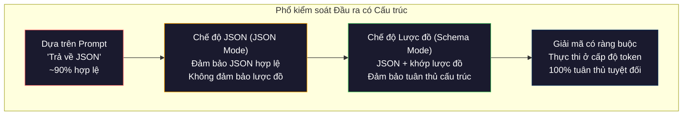
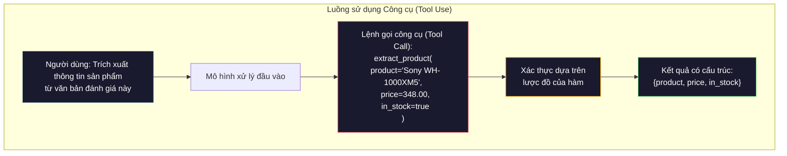

# Đầu ra có cấu trúc: JSON, Xác thực lược đồ, Giải mã có ràng buộc (Structured Outputs: JSON, Schema Validation, Constrained Decoding)

> LLM của bạn trả về một chuỗi ký tự. Ứng dụng của bạn cần định dạng JSON. Khoảng cách đó đã đánh sập nhiều hệ thống sản xuất hơn bất kỳ sự ảo giác (hallucination) nào của mô hình. Đầu ra có cấu trúc (structured output) là cây cầu kết nối giữa ngôn ngữ tự nhiên và dữ liệu có kiểu định danh. Làm chủ nó, LLM sẽ trở thành một API tin cậy. Xử lý sai lầm, bạn sẽ phải ngồi phân tích văn bản tự do bằng biểu thức chính quy (regex) lúc 3 giờ sáng.

**Type:** Xây dựng (Build)  
**Languages:** Python  
**Prerequisites:** Phase 10, Bài 01-05 (LLM từ con số không - LLMs from Scratch)  
**Time:** ~90 phút  
**Related:** Phase 5 · 20 (Đầu ra có cấu trúc & Giải mã có ràng buộc - Structured Outputs & Constrained Decoding) bao quát lý thuyết ở cấp độ bộ giải mã (bộ xử lý logit FSM/CFG, Outlines, XGrammar). Bài học này tập trung vào khía cạnh SDK sản xuất (OpenAI `response_format`, Anthropic tool use, Instructor) — hãy đọc Phase 5 · 20 trước nếu bạn muốn hiểu rõ những gì đang diễn ra bên dưới tầng API.

## Mục tiêu học tập

- Triển khai chế độ JSON (JSON mode) và đầu ra bị ràng buộc bởi lược đồ (schema-constrained outputs) bằng các tham số API của OpenAI và Anthropic
- Xây dựng một lớp xác thực Pydantic có khả năng từ chối các đầu ra sai định dạng của LLM và tự động thử lại kèm theo phản hồi lỗi
- Giải thích cách giải mã có ràng buộc (constrained decoding) ép buộc tạo ra JSON hợp lệ ngay ở cấp độ token mà không cần xử lý hậu kỳ
- Thiết kế các prompt trích xuất mạnh mẽ giúp chuyển đổi văn bản phi cấu trúc thành các cấu trúc dữ liệu có kiểu định danh một cách đáng tin cậy

## Vấn đề thực tế

Bạn yêu cầu LLM: "Hãy trích xuất tên sản phẩm, giá cả và tình trạng còn hàng từ văn bản này." Nó phản hồi:

```text
The product is the Sony WH-1000XM5 headphones, which cost $348.00 and are currently in stock.
```

Đó là một câu trả lời hoàn toàn chính xác. Nhưng nó cũng hoàn toàn vô dụng đối với ứng dụng của bạn. Hệ thống quản lý kho của bạn cần `{"product": "Sony WH-1000XM5", "price": 348.00, "in_stock": true}`. Bạn cần một đối tượng JSON với các khóa cụ thể, kiểu dữ liệu cụ thể và các ràng buộc giá trị cụ thể. Bạn không cần một câu văn miêu tả bằng tiếng Anh.

Giải pháp ngây thơ: thêm câu "Hãy trả lời bằng JSON" vào prompt của bạn. Cách này hoạt động tốt trong 90% trường hợp. 10% còn lại, mô hình sẽ bọc JSON trong các khối mã markdown, hoặc thêm phần mở đầu như "Dưới đây là JSON:", hoặc tạo ra JSON sai cú pháp vì nó đóng ngoặc nhọn quá sớm. Bộ phân tích JSON của bạn bị sập (crash). Toàn bộ đường ống xử lý bị đứt gãy. Bạn vội vàng bổ sung `try/except` và một vòng lặp thử lại (retry loop). Lần thử lại đôi khi lại tạo ra dữ liệu khác. Bây giờ bạn gặp phải vấn đề về tính nhất quán chồng lên vấn đề về phân tích cú pháp.

Đây không phải là vấn đề về kỹ nghệ prompt. Đây là vấn đề thuộc về cơ chế giải mã (decoding problem). Mô hình sinh token từ trái sang phải. Tại mỗi vị trí, nó chọn token tiếp theo có xác suất cao nhất từ một bộ từ vựng gồm hơn 100K lựa chọn. Đa số các lựa chọn đó sẽ tạo ra JSON không hợp lệ tại bất kỳ vị trí cụ thể nào. Nếu mô hình vừa mới phát ra chuỗi `{"price":`, token kế tiếp bắt buộc phải là một chữ số, một dấu ngoặc kép (nếu là chuỗi), `null`, `true`, `false`, hoặc dấu trừ âm. Bất kỳ ký tự nào khác đều tạo ra JSON sai cú pháp. Nếu không có các ràng buộc, mô hình có thể chọn một từ tiếng Anh nghe rất hợp lý nhưng lại hoàn toàn sai lầm về mặt cú pháp dữ liệu.

## Khái niệm

### Phổ kiểm soát Đầu ra có Cấu trúc

Có bốn cấp độ kiểm soát đầu ra có cấu trúc, mỗi cấp độ sau lại đáng tin cậy hơn cấp độ trước.



**Dựa trên prompt (Prompt-based)** ("Trả lời bằng JSON hợp lệ"): không có cơ chế cưỡng chế kỹ thuật nào. Mô hình thường tuân thủ nhưng đôi khi vi phạm. Độ tin cậy: ~90%. Dạng lỗi: bọc khối markdown, văn bản mở đầu rườm rà, đầu ra bị cắt cụt, sai cấu trúc trường.

**Chế độ JSON (JSON mode)**: API đảm bảo đầu ra luôn là JSON hợp lệ về mặt cú pháp. Tham số `response_format: { type: "json_object" }` của OpenAI kích hoạt tính năng này. Dữ liệu đầu ra sẽ phân tích cú pháp thành công mà không báo lỗi. Tuy nhiên, nó có thể không khớp với lược đồ bạn mong đợi -- xuất hiện các khóa thừa, sai kiểu dữ liệu hoặc thiếu các trường bắt buộc.

**Chế độ Lược đồ (Schema mode)**: API nhận vào một JSON Schema và cam kết đầu ra khớp chính xác với nó. Hiện nay mọi nhà cung cấp lớn đều hỗ trợ cơ chế này nguyên bản: OpenAI hỗ trợ `response_format: { type: "json_schema", json_schema: {...} }` (hoặc thông qua `tool_choice="required"`), Anthropic hỗ trợ gọi công cụ với `input_schema`, và Gemini hỗ trợ `response_schema` kèm theo `response_mime_type: "application/json"`. Đầu ra có đầy đủ các khóa, đúng kiểu dữ liệu và thỏa mãn mọi ràng buộc bạn đã thiết lập.

**Giải mã có ràng buộc (Constrained decoding)**: tại mỗi vị trí token trong quá trình sinh văn bản, bộ giải mã (decoder) sẽ che (mask) toàn bộ các token có nguy cơ tạo ra chuỗi đầu ra không hợp lệ. Nếu lược đồ yêu cầu một con số và mô hình chuẩn bị phát ra một chữ cái, xác suất của token chữ cái đó sẽ bị gán về bằng 0. Mô hình chỉ có thể chọn các token dẫn tới một chuỗi đầu ra hợp lệ. Đây chính là cơ chế mà chế độ structured outputs của OpenAI cũng như các thư viện như Outlines và Guidance triển khai bên dưới hệ thống.

### JSON Schema: Ngôn ngữ của Hợp đồng Dữ liệu

JSON Schema là cách bạn mô tả cho mô hình (hoặc tầng xác thực) biết hình dạng cấu trúc mà dữ liệu đầu ra bắt buộc phải tuân theo. Mọi hệ thống đầu ra có cấu trúc lớn đều sử dụng nó.

```json
{
  "type": "object",
  "properties": {
    "product": { "type": "string" },
    "price": { "type": "number", "minimum": 0 },
    "in_stock": { "type": "boolean" },
    "categories": {
      "type": "array",
      "items": { "type": "string" }
    }
  },
  "required": ["product", "price", "in_stock"]
}
```

Lược đồ này quy định: đầu ra phải là một đối tượng chứa trường `product` kiểu chuỗi, `price` kiểu số không âm, `in_stock` kiểu boolean, và một mảng tùy chọn `categories` chứa các phần tử chuỗi. Bất kỳ đầu ra nào không khớp sẽ bị từ chối ngay lập tức.

Lược đồ xử lý được các trường hợp phức tạp: đối tượng lồng nhau, mảng với các phần tử có kiểu định danh, kiểu liệt kê (enum - giới hạn một chuỗi trong các giá trị cho phép), khớp mẫu (khớp regex trên chuỗi), và các phép kết hợp toán tử (oneOf, anyOf, allOf cho các kiểu đầu ra đa hình).

### Khuôn mẫu Pydantic

Trong Python, bạn không cần phải viết JSON Schema bằng tay. Bạn định nghĩa một mô hình Pydantic và nó sẽ tự động tạo lược đồ cho bạn.

```python
from pydantic import BaseModel

class Product(BaseModel):
    product: str
    price: float
    in_stock: bool
    categories: list[str] = []
```

Đoạn mã này tạo ra cùng một cấu trúc JSON Schema như trên. Thư viện Instructor (và SDK của OpenAI) hỗ trợ trực tiếp các mô hình Pydantic: bạn chỉ cần truyền vào lớp mô hình và nhận về một thực thể (instance) đã được xác thực hoàn chỉnh. Nếu đầu ra của LLM không khớp, Instructor sẽ tự động gửi yêu cầu thử lại.

### Gọi hàm (Function Calling) / Sử dụng Công cụ (Tool Use)

Một giao diện thay thế cho cùng một bài toán. Thay vì yêu cầu mô hình tạo ra JSON trực tiếp, bạn định nghĩa các "công cụ" (hàm) với các tham số có kiểu dữ liệu rõ ràng. Mô hình sẽ tạo ra một lệnh gọi hàm kèm theo các đối số có cấu trúc. OpenAI gọi đây là "function calling". Anthropic gọi là "tool use". Kết quả thu được là như nhau: dữ liệu có cấu trúc chuẩn mực.



Sử dụng công cụ được ưu tiên khi mô hình cần đưa ra quyết định xem nên gọi hàm nào, chứ không chỉ đơn thuần là điền các tham số. Nếu bạn có 10 lược đồ trích xuất khác nhau và mô hình phải chọn lược đồ phù hợp dựa trên nội dung đầu vào, tool use mang lại cho bạn cả năng lực chọn lược đồ lẫn việc trả về dữ liệu có cấu trúc.

### Các dạng thức lỗi thường gặp (Common Failure Modes)

Ngay cả khi có cơ chế ràng buộc lược đồ, đầu ra có cấu trúc vẫn có thể gặp phải các lỗi tinh vi.

**Giá trị ảo giác (Hallucinated values)**: đầu ra khớp hoàn toàn với lược đồ nhưng lại chứa dữ liệu bịa đặt. Mô hình sinh ra `{"price": 299.99}` trong khi bài viết ghi rõ giá là $348. Xác thực lược đồ không thể phát hiện lỗi này -- vì kiểu dữ liệu hoàn toàn đúng, chỉ có giá trị thực tế là sai.

**Nhầm lẫn giá trị Enum**: bạn giới hạn một trường trong tập `["in_stock", "out_of_stock", "preorder"]`. Mô hình lại trả về `"available"` -- về mặt ngữ nghĩa thì đúng, nhưng lại không nằm trong tập giá trị được phép. Cơ chế giải mã ràng buộc tốt sẽ chặn được điều này, trong khi các phương pháp dựa trên prompt thông thường thì không.

**Độ sâu đối tượng lồng nhau (Nested object depth)**: các lược đồ lồng nhau quá sâu (từ 4 cấp trở lên) thường gây ra nhiều lỗi hơn. Mỗi cấp lồng nhau là một nơi mà mô hình có thể đánh mất khả năng theo dõi cấu trúc.

**Độ dài mảng (Array length)**: mô hình có thể tạo ra quá nhiều hoặc quá ít phần tử trong mảng. Lược đồ hỗ trợ `minItems` và `maxItems` nhưng không phải nhà cung cấp nào cũng cưỡng chế các trường này ở cấp độ giải mã token.

**Bỏ sót trường tùy chọn**: mô hình có xu hướng bỏ qua các trường mà về mặt kỹ thuật là tùy chọn (optional) nhưng lại mang ý nghĩa nghiệp vụ quan trọng. Hãy thiết lập chúng thành trường bắt buộc (required) trong lược đồ ngay cả khi dữ liệu đôi khi bị khuyết thiếu -- buộc mô hình phải trả về giá trị `null` một cách tường minh.

````figure mx-schema-funnel
````

## Tự xây dựng (Build It)

### Bước 1: Trình xác thực JSON Schema (JSON Schema Validator)

Xây dựng một bộ xác thực từ con số không nhằm kiểm tra xem một đối tượng Python có khớp với một JSON Schema cho trước hay không. Đây là thành phần chạy ở phía đầu ra để xác minh tính tuân thủ dữ liệu.

```python
import json

def validate_schema(data, schema):
    errors = []
    _validate(data, schema, "", errors)
    return errors

def _validate(data, schema, path, errors):
    schema_type = schema.get("type")

    if schema_type == "object":
        if not isinstance(data, dict):
            errors.append(f"{path}: expected object, got {type(data).__name__}")
            return
        for key in schema.get("required", []):
            if key not in data:
                errors.append(f"{path}.{key}: required field missing")
        properties = schema.get("properties", {})
        for key, value in data.items():
            if key in properties:
                _validate(value, properties[key], f"{path}.{key}", errors)

    elif schema_type == "array":
        if not isinstance(data, list):
            errors.append(f"{path}: expected array, got {type(data).__name__}")
            return
        min_items = schema.get("minItems", 0)
        max_items = schema.get("maxItems", float("inf"))
        if len(data) < min_items:
            errors.append(f"{path}: array has {len(data)} items, minimum is {min_items}")
        if len(data) > max_items:
            errors.append(f"{path}: array has {len(data)} items, maximum is {max_items}")
        items_schema = schema.get("items", {})
        for i, item in enumerate(data):
            _validate(item, items_schema, f"{path}[{i}]", errors)

    elif schema_type == "string":
        if not isinstance(data, str):
            errors.append(f"{path}: expected string, got {type(data).__name__}")
            return
        enum_values = schema.get("enum")
        if enum_values and data not in enum_values:
            errors.append(f"{path}: '{data}' not in allowed values {enum_values}")

    elif schema_type == "number":
        if not isinstance(data, (int, float)):
            errors.append(f"{path}: expected number, got {type(data).__name__}")
            return
        minimum = schema.get("minimum")
        maximum = schema.get("maximum")
        if minimum is not None and data < minimum:
            errors.append(f"{path}: {data} is less than minimum {minimum}")
        if maximum is not None and data > maximum:
            errors.append(f"{path}: {data} is greater than maximum {maximum}")

    elif schema_type == "boolean":
        if not isinstance(data, bool):
            errors.append(f"{path}: expected boolean, got {type(data).__name__}")

    elif schema_type == "integer":
        if not isinstance(data, int) or isinstance(data, bool):
            errors.append(f"{path}: expected integer, got {type(data).__name__}")
```

### Bước 2: Chuyển đổi mô hình kiểu Pydantic sang Lược đồ (Model to Schema)

Xây dựng một bộ chuyển đổi tối giản từ lớp Python sang lược đồ. Định nghĩa một lớp Python và tự động sinh ra JSON Schema tương ứng.

```python
class SchemaField:
    def __init__(self, field_type, required=True, default=None, enum=None, minimum=None, maximum=None):
        self.field_type = field_type
        self.required = required
        self.default = default
        self.enum = enum
        self.minimum = minimum
        self.maximum = maximum

def python_type_to_schema(field):
    type_map = {
        str: "string",
        int: "integer",
        float: "number",
        bool: "boolean",
    }

    schema = {}

    if field.field_type in type_map:
        schema["type"] = type_map[field.field_type]
    elif field.field_type == list:
        schema["type"] = "array"
        schema["items"] = {"type": "string"}
    elif isinstance(field.field_type, dict):
        schema = field.field_type

    if field.enum:
        schema["enum"] = field.enum
    if field.minimum is not None:
        schema["minimum"] = field.minimum
    if field.maximum is not None:
        schema["maximum"] = field.maximum

    return schema

def model_to_schema(name, fields):
    properties = {}
    required = []

    for field_name, field in fields.items():
        properties[field_name] = python_type_to_schema(field)
        if field.required:
            required.append(field_name)

    return {
        "type": "object",
        "properties": properties,
        "required": required,
    }
```

### Bước 3: Bộ lọc Token Ràng buộc (Constrained Token Filter)

Mô phỏng cơ chế giải mã có ràng buộc. Cho trước một chuỗi JSON đang dở dang và một lược đồ, xác định xem những nhóm token nào là hợp lệ tại vị trí ký tự hiện tại.

```python
def next_valid_tokens(partial_json, schema):
    stripped = partial_json.strip()

    if not stripped:
        return ["{"]

    try:
        json.loads(stripped)
        return ["<EOS>"]
    except json.JSONDecodeError:
        pass

    last_char = stripped[-1] if stripped else ""

    if last_char == "{":
        return ['"', "}"]
    elif last_char == '"':
        if stripped.endswith('":'):
            return ['"', "0-9", "true", "false", "null", "[", "{"]
        return ["a-z", '"']
    elif last_char == ":":
        return [" ", '"', "0-9", "true", "false", "null", "[", "{"]
    elif last_char == ",":
        return [" ", '"', "{", "["]
    elif last_char in "0123456789":
        return ["0-9", ".", ",", "}", "]"]
    elif last_char == "}":
        return [",", "}", "]", "<EOS>"]
    elif last_char == "]":
        return [",", "}", "<EOS>"]
    elif last_char == "[":
        return ['"', "0-9", "true", "false", "null", "{", "[", "]"]
    else:
        return ["any"]

def demonstrate_constrained_decoding():
    partial_states = [
        '',
        '{',
        '{"product"',
        '{"product":',
        '{"product": "Sony"',
        '{"product": "Sony",',
        '{"product": "Sony", "price":',
        '{"product": "Sony", "price": 348',
        '{"product": "Sony", "price": 348}',
    ]

    print(f"{'Partial JSON':<45} {'Valid Next Tokens'}")
    print("-" * 80)
    for state in partial_states:
        valid = next_valid_tokens(state, {})
        display = state if state else "(empty)"
        print(f"{display:<45} {valid}")
```

### Bước 4: Đường ống Trích xuất (Extraction Pipeline)

Kết hợp các thành phần thành một quy trình trích xuất hoàn chỉnh: định nghĩa lược đồ, mô phỏng LLM sinh đầu ra có cấu trúc, xác thực đầu ra và xử lý các lượt thử lại khi có lỗi.

```python
def simulate_llm_extraction(text, schema, attempt=0):
    if "headphones" in text.lower() or "sony" in text.lower():
        if attempt == 0:
            return '{"product": "Sony WH-1000XM5", "price": 348.00, "in_stock": true, "categories": ["audio", "headphones"]}'
        return '{"product": "Sony WH-1000XM5", "price": 348.00, "in_stock": true}'

    if "laptop" in text.lower():
        return '{"product": "MacBook Pro 16", "price": 2499.00, "in_stock": false, "categories": ["computers"]}'

    return '{"product": "Unknown", "price": 0, "in_stock": false}'

def extract_with_retry(text, schema, max_retries=3):
    for attempt in range(max_retries):
        raw = simulate_llm_extraction(text, schema, attempt)

        try:
            data = json.loads(raw)
        except json.JSONDecodeError as e:
            print(f"  Attempt {attempt + 1}: JSON parse error -- {e}")
            continue

        errors = validate_schema(data, schema)
        if not errors:
            return data

        print(f"  Attempt {attempt + 1}: Schema validation errors -- {errors}")

    return None

product_schema = {
    "type": "object",
    "properties": {
        "product": {"type": "string"},
        "price": {"type": "number", "minimum": 0},
        "in_stock": {"type": "boolean"},
        "categories": {"type": "array", "items": {"type": "string"}},
    },
    "required": ["product", "price", "in_stock"],
}
```

### Bước 5: Chạy Toàn bộ Đường ống (Run the Full Pipeline)

```python
def run_demo():
    print("=" * 60)
    print("  Structured Output Pipeline Demo")
    print("=" * 60)

    print("\n--- Schema Definition ---")
    product_fields = {
        "product": SchemaField(str),
        "price": SchemaField(float, minimum=0),
        "in_stock": SchemaField(bool),
        "categories": SchemaField(list, required=False),
    }
    generated_schema = model_to_schema("Product", product_fields)
    print(json.dumps(generated_schema, indent=2))

    print("\n--- Schema Validation ---")
    test_cases = [
        ({"product": "Test", "price": 10.0, "in_stock": True}, "Valid object"),
        ({"product": "Test", "price": -5.0, "in_stock": True}, "Negative price"),
        ({"product": "Test", "in_stock": True}, "Missing price"),
        ({"product": "Test", "price": "ten", "in_stock": True}, "String as price"),
        ("not an object", "String instead of object"),
    ]

    for data, label in test_cases:
        errors = validate_schema(data, product_schema)
        status = "PASS" if not errors else f"FAIL: {errors}"
        print(f"  {label}: {status}")

    print("\n--- Constrained Decoding Simulation ---")
    demonstrate_constrained_decoding()

    print("\n--- Extraction Pipeline ---")
    texts = [
        "The Sony WH-1000XM5 headphones are priced at $348 and currently available.",
        "The new MacBook Pro 16-inch laptop costs $2499 but is sold out.",
        "This is a random sentence with no product info.",
    ]

    for text in texts:
        print(f"\n  Input: {text[:60]}...")
        result = extract_with_retry(text, product_schema)
        if result:
            print(f"  Output: {json.dumps(result)}")
        else:
            print(f"  Output: FAILED after retries")
```

## Sử dụng trong thực tế (Use It)

### Đầu ra có Cấu trúc với OpenAI (Structured Outputs)

```python
# from openai import OpenAI
# from pydantic import BaseModel
#
# client = OpenAI()
#
# class Product(BaseModel):
#     product: str
#     price: float
#     in_stock: bool
#
# response = client.beta.chat.completions.parse(
#     model="gpt-5-mini",
#     messages=[
#         {"role": "system", "content": "Extract product information."},
#         {"role": "user", "content": "Sony WH-1000XM5, $348, in stock"},
#     ],
#     response_format=Product,
# )
#
# product = response.choices[0].message.parsed
# print(product.product, product.price, product.in_stock)
```

Chế độ structured outputs của OpenAI sử dụng cơ chế giải mã có ràng buộc ở bên trong. Mọi token mà mô hình sinh ra đều được đảm bảo sẽ tạo ra chuỗi đầu ra khớp với lược đồ Pydantic. Không cần cơ chế thử lại. Không cần kiểm tra tính hợp lệ thủ công. Ràng buộc đã được nhúng chặt vào quy trình giải mã.

### Sử dụng Công cụ với Anthropic (Tool Use)

```python
# import anthropic
#
# client = anthropic.Anthropic()
#
# response = client.messages.create(
#     model="claude-opus-4-7",
#     max_tokens=1024,
#     tools=[{
#         "name": "extract_product",
#         "description": "Extract product information from text",
#         "input_schema": {
#             "type": "object",
#             "properties": {
#                 "product": {"type": "string"},
#                 "price": {"type": "number"},
#                 "in_stock": {"type": "boolean"},
#             },
#             "required": ["product", "price", "in_stock"],
#         },
#     }],
#     messages=[{"role": "user", "content": "Extract: Sony WH-1000XM5, $348, in stock"}],
# )
```

Anthropic hiện thực hóa đầu ra có cấu trúc thông qua cơ chế sử dụng công cụ (tool use). Mô hình sẽ phát ra một lệnh gọi công cụ với các đối số có cấu trúc khớp với `input_schema`. Kết quả đạt được là như nhau, dù giao diện API có sự khác biệt.

### Thư viện Instructor

```python
# pip install instructor
# import instructor
# from openai import OpenAI
# from pydantic import BaseModel
#
# client = instructor.from_openai(OpenAI())
#
# class Product(BaseModel):
#     product: str
#     price: float
#     in_stock: bool
#
# product = client.chat.completions.create(
#     model="gpt-5-mini",
#     response_model=Product,
#     messages=[{"role": "user", "content": "Sony WH-1000XM5, $348, in stock"}],
# )
```

Instructor bọc quanh client của bất kỳ nhà cung cấp LLM nào và tự động bổ sung cơ chế xác thực và thử lại. Nếu lần thử đầu tiên không vượt qua bài kiểm tra hợp lệ, nó sẽ gửi chi tiết lỗi ngược lại cho mô hình làm ngữ cảnh và yêu cầu nó sửa đổi. Thư viện này hoạt động trên mọi nhà cung cấp chứ không chỉ riêng OpenAI.

## Đóng gói ứng dụng (Ship It)

Bài học này tạo ra `outputs/prompt-structured-extractor.md` -- một bản mẫu prompt có thể tái sử dụng giúp trích xuất dữ liệu có cấu trúc từ bất kỳ văn bản nào dựa trên định nghĩa lược đồ. Đưa vào một JSON Schema và văn bản tự do, bạn sẽ nhận lại dữ liệu JSON đã được xác thực.

Nó cũng cung cấp `outputs/skill-structured-outputs.md` -- khung hỗ trợ ra quyết định để chọn chiến lược đầu ra có cấu trúc phù hợp dựa trên nhà cung cấp dịch vụ, yêu cầu về độ tin cậy và độ phức tạp của lược đồ.

## Bài tập thực hành

1. Mở rộng bộ xác thực lược đồ để hỗ trợ toán tử `oneOf` (dữ liệu phải khớp chính xác với một trong số các lược đồ con). Điều này giải quyết các bài toán đầu ra đa hình (polymorphic outputs) -- ví dụ: một trường có thể là đối tượng `Product` hoặc đối tượng `Service` với cấu trúc khác nhau.

2. Xây dựng công cụ "so sánh khác biệt lược đồ" (schema diff) để đối chiếu hai lược đồ và chỉ ra các thay đổi gây phá vỡ tương thích (breaking changes - như xóa trường bắt buộc, đổi kiểu dữ liệu) so với các thay đổi an toàn (thêm trường tùy chọn, nới lỏng ràng buộc). Đây là công cụ thiết yếu để quản lý phiên bản lược đồ trích xuất trong môi trường sản xuất.

3. Triển khai bộ mô phỏng giải mã có ràng buộc chân thực hơn. Cho trước một JSON Schema và một bộ từ vựng gồm 100 token (chữ cái, chữ số, dấu câu, từ khóa), hãy duyệt qua quá trình sinh từng bước, che các token không hợp lệ tại mỗi vị trí. Đo lường tỷ lệ phần trăm từ vựng hợp lệ tại mỗi bước.

4. Xây dựng một bộ đánh giá trích xuất (extraction eval suite). Tạo 50 đoạn mô tả sản phẩm kèm nhãn JSON chuẩn do con người gắn. Chạy đường ống trích xuất của bạn trên cả 50 đoạn văn và đo lường tỷ lệ khớp chính xác tuyệt đối, độ chính xác ở cấp độ từng trường và mức độ tuân thủ kiểu dữ liệu. Xác định những trường nào khó trích xuất chính xác nhất.

5. Bổ sung "điểm tin cậy" (confidence scores) vào đường ống trích xuất. Đối với mỗi trường được trích xuất, hãy ước lượng mức độ tin cậy của mô hình (dựa trên xác suất token, hoặc bằng cách chạy trích xuất 3 lần và đo lường tính nhất quán). Đánh dấu các trường có độ tin cậy thấp để chuyển cho con người xem xét thủ công.

## Thuật ngữ cốt lõi

| Thuật ngữ | Điều mọi người hay nói | Ý nghĩa kỹ thuật thực tế |
|-----------|------------------------|--------------------------|
| Chế độ JSON (JSON mode) | "Trả về định dạng JSON" | Cờ cấu hình API cam kết đầu ra luôn đúng cú pháp JSON, nhưng không bắt buộc tuân theo bất kỳ lược đồ cụ thể nào |
| Đầu ra có cấu trúc (Structured output) | "JSON có kiểu định danh" | Đầu ra khớp chính xác với một JSON Schema với các khóa, kiểu dữ liệu và ràng buộc giá trị được chỉ định |
| Giải mã có ràng buộc (Constrained decoding) | "Sinh văn bản có định hướng" | Tại mỗi vị trí token, loại bỏ các token có nguy cơ vi phạm cú pháp -- đảm bảo 100% tuân thủ lược đồ |
| JSON Schema | "Bản mẫu định dạng JSON" | Ngôn ngữ khai báo cấu trúc, kiểu dữ liệu và ràng buộc của dữ liệu JSON (được dùng bởi OpenAPI, JSON Forms, v.v.) |
| Pydantic | "Dataclass của Python phiên bản nâng cấp" | Thư viện Python định nghĩa mô hình dữ liệu kèm xác thực kiểu, được dùng trong FastAPI và Instructor để tạo JSON Schema |
| Gọi hàm (Function calling) | "Sử dụng công cụ (Tool use)" | LLM tạo ra một lời gọi hàm có cấu trúc (tên hàm + các đối số có kiểu dữ liệu) thay vì văn bản tự do -- OpenAI và Anthropic đều hỗ trợ |
| Instructor | "Pydantic dành cho LLM" | Thư viện Python bọc quanh các client LLM để trả về các thực thể Pydantic đã xác thực, tự động thử lại khi xác thực thất bại |
| Che token (Token masking) | "Lọc bộ từ vựng" | Thiết lập xác suất của một số token cụ thể về 0 trong quá trình sinh để mô hình không thể tạo ra chúng |
| Tuân thủ lược đồ (Schema compliance) | "Khớp đúng hình dạng dữ liệu" | Dữ liệu đầu ra có đầy đủ các trường bắt buộc, đúng kiểu dữ liệu, giá trị nằm trong ngưỡng ràng buộc và không có trường lạ bị cấm |
| Vòng lặp thử lại (Retry loop) | "Thử lại cho đến khi thành công" | Gửi thông báo lỗi xác thực ngược lại cho mô hình và yêu cầu nó sửa chữa đầu ra -- Instructor tự động thực hiện việc này |

## Đọc thêm

- [OpenAI Structured Outputs Guide](https://platform.openai.com/docs/guides/structured-outputs) -- tài liệu chính thức về giải mã có ràng buộc dựa trên JSON Schema trong API OpenAI
- [Willard & Louf, 2023 -- "Efficient Guided Generation for Large Language Models"](https://arxiv.org/abs/2307.09702) -- bài báo về Outlines, mô tả cách biên dịch JSON Schema thành máy trạng thái hữu hạn (FSM) cho các ràng buộc cấp token
- [Instructor documentation](https://python.useinstructor.com/) -- thư viện tiêu chuẩn để lấy đầu ra có cấu trúc từ bất kỳ LLM nào kèm xác thực Pydantic và cơ chế tự động thử lại
- [Anthropic Tool Use Guide](https://docs.anthropic.com/en/docs/tool-use) -- cách Claude triển khai đầu ra có cấu trúc thông qua cơ chế sử dụng công cụ với `input_schema` của JSON Schema
- [JSON Schema specification](https://json-schema.org/) -- đặc tả kỹ thuật chi tiết của ngôn ngữ lược đồ được sử dụng trong mọi hệ thống đầu ra có cấu trúc lớn
- [Outlines library](https://github.com/outlines-dev/outlines) -- thư viện sinh mã có ràng buộc nguồn mở sử dụng regex và JSON Schema được biên dịch thành máy trạng thái hữu hạn
- [Dong et al., "XGrammar: Flexible and Efficient Structured Generation Engine for Large Language Models" (MLSys 2025)](https://arxiv.org/abs/2411.15100) -- công cụ ngữ pháp tiên tiến hiện nay; biên dịch tự động đẩy xuống giúp che token ở tốc độ ~100 ns / token
- [Beurer-Kellner et al., "Prompting Is Programming: A Query Language for Large Language Models" (LMQL)](https://arxiv.org/abs/2212.06094) -- bài báo LMQL tiếp cận giải mã có ràng buộc như một ngôn ngữ truy vấn có ràng buộc kiểu và giá trị
- [Microsoft Guidance (framework docs)](https://github.com/guidance-ai/guidance) -- công cụ sinh có ràng buộc dựa trên bản mẫu; mảnh ghép bổ trợ độc lập với nhà cung cấp cùng với Outlines và XGrammar
