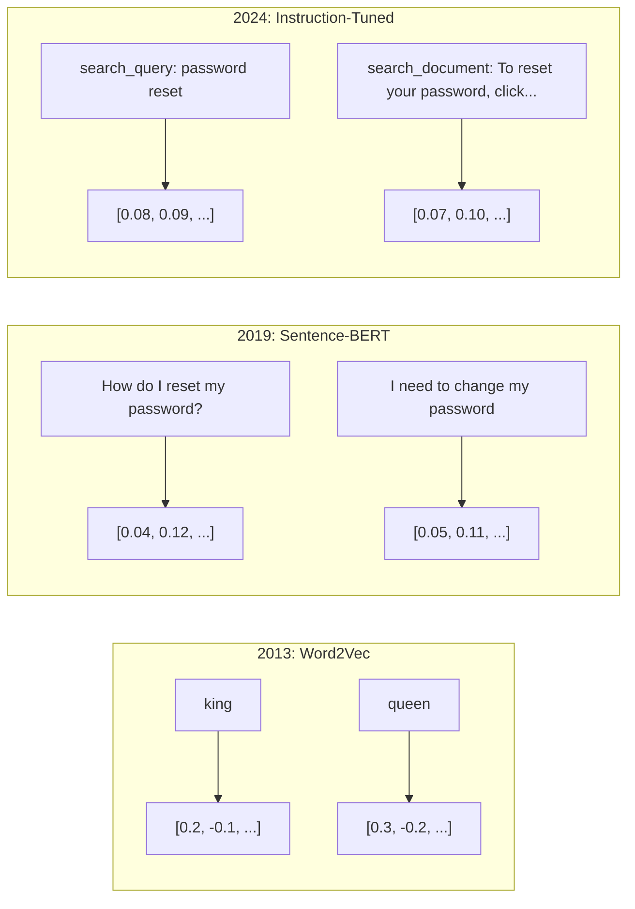
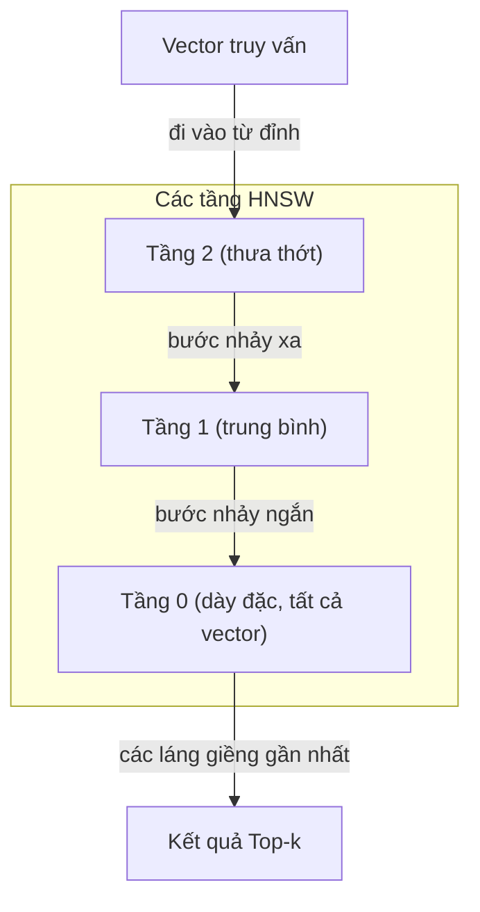
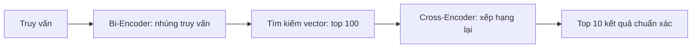

# Phần tử nhúng & Biểu diễn vector (Embeddings & Vector Representations)

> Văn bản mang tính rời rạc. Toán học mang tính liên tục. Mỗi khi bạn yêu cầu LLM tìm các tài liệu "tương đồng", so sánh ý nghĩa ngữ nghĩa, hoặc tìm kiếm vượt ra ngoài các từ khóa máy móc, bạn đang dựa vào một cây cầu nối liền hai thế giới đó. Cây cầu đó chính là phần tử nhúng (embedding). Nếu bạn không hiểu về embedding, bạn không thực sự hiểu AI hiện đại. Bạn chỉ đơn thuần đang sử dụng nó.

**Type:** Xây dựng (Build)  
**Languages:** Python  
**Prerequisites:** Phase 11, Bài 01 (Kỹ nghệ Prompt - Prompt Engineering)  
**Time:** ~75 phút  
**Related:** Phase 5 · 22 (Đi sâu vào các mô hình nhúng - Embedding Models Deep Dive) bao quát biểu diễn dày đặc (dense) so với thưa thớt (sparse) so với đa vector (multi-vector), cắt ngắn Matryoshka, và việc lựa chọn mô hình theo từng trục tiêu chí. Bài học này tập trung vào đường ống sản xuất thực tế (cơ sở dữ liệu vector, thuật toán HNSW, toán học đo độ tương đồng). Hãy đọc Phase 5 · 22 trước khi lựa chọn mô hình.

## Mục tiêu học tập

- Tạo phần tử nhúng văn bản (text embeddings) bằng các API thương mại và các mô hình mã nguồn mở, đồng thời tính toán độ tương đồng cosine (cosine similarity) giữa chúng
- Giải thích lý do tại sao embedding giải quyết triệt để vấn đề bất đối xứng từ vựng (vocabulary mismatch problem) mà tìm kiếm từ khóa truyền thống không thể xử lý
- Xây dựng một chỉ mục tìm kiếm ngữ nghĩa (semantic search index) có khả năng truy xuất tài liệu theo ý nghĩa thay vì khớp từ khóa máy móc
- Đánh giá chất lượng của mô hình nhúng bằng các bộ chuẩn truy xuất (precision@k, recall) và lựa chọn mô hình nhúng tối ưu cho tác vụ cụ thể

## Vấn đề thực tế

Bạn có 10.000 phiếu hỗ trợ khách hàng (support tickets). Một khách hàng gửi phản ánh: "khoản thanh toán của tôi không thực hiện được." Bạn cần tìm các phiếu hỗ trợ tương tự trong quá khứ để xử lý. Tìm kiếm từ khóa (keyword search) chỉ tìm thấy các phiếu có chứa từ "thanh toán" và "không thực hiện được". Nó hoàn toàn bỏ sót các phiếu chứa: "giao dịch thất bại", "thẻ bị từ chối", và "lỗi trừ tiền tài khoản". Những phiếu này mô tả cùng một sự cố nhưng bằng những từ ngữ hoàn toàn khác nhau.

Đây chính là bài toán bất đối xứng từ vựng (vocabulary mismatch problem). Ngôn ngữ tự nhiên của con người có hàng chục cách diễn đạt khác nhau cho cùng một khái niệm. Tìm kiếm từ khóa coi mỗi từ như một ký hiệu độc lập vô nghĩa. Nó không thể biết rằng "bị từ chối" và "không thực hiện được" là cùng một bản chất sự việc.

Bạn cần một phương thức biểu diễn văn bản mà ở đó ý nghĩa ngữ nghĩa -- chứ không phải chính tả con chữ -- quyết định mức độ tương đồng. Bạn cần một phương thức để đặt "khoản thanh toán của tôi không thực hiện được" và "giao dịch bị từ chối" nằm sát cạnh nhau trong một không gian toán học trừu tượng, đồng thời đẩy câu "khoản thanh toán của tôi đã đến đúng hạn" ra thật xa dù cho nó cũng chứa từ "thanh toán".

Phương thức biểu diễn đó chính là phần tử nhúng (embedding).

## Khái niệm

### Phần tử nhúng (Embedding) là gì?

Phần tử nhúng (embedding) là một vector dày đặc (dense vector) gồm các số thực dấu phẩy động (floating-point numbers) đại diện cho ý nghĩa ngữ nghĩa của một đoạn văn bản. Từ "dày đặc" (dense) mang tính cốt lõi -- mọi chiều trong vector đều chứa thông tin hữu ích, khác hoàn toàn với các biểu diễn thưa thớt (sparse representations như túi từ - bag-of-words, TF-IDF) nơi đa số các chiều đều bằng 0.

Câu văn "Con mèo ngồi trên tấm thảm" sẽ được chuyển hóa thành một mảng số như `[0.023, -0.041, 0.087, ..., 0.012]` -- một danh sách gồm 768 đến 3072 số tùy thuộc vào mô hình. Những con số này mã hóa ý nghĩa ngữ nghĩa. Bạn không bao giờ đọc hiểu trực tiếp từng con số riêng lẻ. Bạn dùng chúng để so sánh với nhau.

### Bước đột phá Word2Vec

Năm 2013, Tomas Mikolov cùng các đồng nghiệp tại Google đã công bố mô hình Word2Vec. Trực giác cốt lõi: huấn luyện một mạng nơ-ron nhân tạo để dự đoán một từ dựa trên các từ ngữ cảnh lân cận (hoặc ngược lại), khi đó các trọng số của lớp ẩn (hidden layer) sẽ trở thành các vector biểu diễn mang ý nghĩa ngữ nghĩa sâu sắc.

Kết quả nổi tiếng mang tính biểu tượng:

```text
king - man + woman = queen
```

(Vua - Đàn ông + Phụ nữ = Nữ hoàng). Các phép tính số học vector trên các embedding từ nắm bắt được các mối quan hệ ngữ nghĩa tinh tế. Hướng dịch chuyển từ "đàn ông" sang "phụ nữ" gần như tương đương với hướng dịch chuyển từ "vua" sang "nữ hoàng". Đây là khoảnh khắc mà toàn bộ giới khoa học nhận ra rằng hình học hoàn toàn có thể mã hóa được ý nghĩa tư duy.

Word2Vec tạo ra các vector 300 chiều. Mỗi từ chỉ nhận một vector duy nhất bất kể ngữ cảnh xuất hiện. Từ "ngân hàng" trong "ngân hàng thương mại" và "bờ ngân hàng" đều có chung một embedding. Hạn chế này đã thúc đẩy nghiên cứu của ngành suốt một thập kỷ sau đó.

### Từ cấp độ Từ đến cấp độ Câu

Embedding từ đại diện cho các token đơn lẻ. Nhưng các hệ thống thực tế cần nhúng toàn bộ câu văn, đoạn văn, hoặc tài liệu hoàn chỉnh. Bốn phương pháp chính đã xuất hiện:

**Lấy trung bình (Averaging)**: tính trung bình cộng của tất cả các vector từ trong câu. Rẻ tiền, mất mát thông tin, nhưng hoạt động tốt bất ngờ cho văn bản ngắn. Nó đánh mất hoàn toàn thứ tự từ ngữ -- "chó cắn người" và "người cắn chó" nhận embedding y hệt nhau.

**Token CLS**: các mô hình Transformer (BERT, 2018) xuất ra một embedding của token đặc biệt [CLS] đại diện cho toàn bộ đầu vào. Tốt hơn việc lấy trung bình nhưng token [CLS] ban đầu được huấn luyện cho tác vụ dự đoán câu tiếp theo, chứ không phải để tối ưu độ tương đồng.

**Học tương phản (Contrastive learning)**: huấn luyện mô hình một cách tường minh để kéo các cặp câu tương đồng lại gần nhau và đẩy các cặp câu dị biệt ra xa nhau. Sentence-BERT (Reimers & Gurevych, 2019) đã áp dụng cách tiếp cận này và trở thành nền móng cho các mô hình nhúng hiện đại. Với câu "Làm thế nào để đặt lại mật khẩu?" và "Tôi cần đổi mật khẩu", mô hình học được rằng chúng phải có các vector gần như trùng khít nhau.

**Embedding tinh chỉnh theo chỉ dẫn (Instruction-tuned embeddings)**: phương pháp hiện đại nhất. Các mô hình như E5 và GTE chấp nhận một tiền tố tác vụ (chẳng hạn `"search_query:"`, `"search_document:"`) để báo cho mô hình biết loại embedding nào cần sản sinh. Điều này cho phép một mô hình duy nhất phục vụ tối ưu cho nhiều tác vụ khác nhau.



### Các mô hình Nhúng Hiện đại

Thị trường hiện nay đã định hình xoay quanh một số tùy chọn cấp sản xuất (điểm số MTEB tính đến đầu năm 2026, chuẩn MTEB v2):

| Mô hình | Nhà cung cấp | Số chiều | MTEB | Ngữ cảnh | Chi phí / 1M tokens |
|---------|--------------|----------|------|----------|---------------------|
| Gemini Embedding 2 | Google | 3072 (Matryoshka) | 67.7 (truy xuất) | 8192 | $0.15 |
| embed-v4 | Cohere | 1024 (Matryoshka) | 65.2 | 128K | $0.12 |
| voyage-4 | Voyage AI | 1024/2048 (Matryoshka) | 66.8 | 32K | $0.12 |
| text-embedding-3-large | OpenAI | 3072 (Matryoshka) | 64.6 | 8192 | $0.13 |
| text-embedding-3-small | OpenAI | 1536 (Matryoshka) | 62.3 | 8192 | $0.02 |
| BGE-M3 | BAAI | 1024 (dense+sparse+ColBERT) | 63.0 đa ngôn ngữ | 8192 | Trọng số mở |
| Qwen3-Embedding | Alibaba | 4096 (Matryoshka) | 66.9 | 32K | Trọng số mở |
| Nomic-embed-v2 | Nomic | 768 (Matryoshka) | 63.1 | 8192 | Trọng số mở |

MTEB (Massive Text Embedding Benchmark) v2 bao gồm hơn 100 tác vụ đánh giá trên các mặt: truy xuất, phân loại, gom cụm, xếp hạng lại (reranking) và tóm tắt. Điểm càng cao càng tốt. Đến năm 2026, các mô hình trọng số mở (Qwen3-Embedding, BGE-M3) đã sánh ngang hoặc vượt qua các mô hình thương mại đóng trên hầu hết các khía cạnh. Gemini Embedding 2 dẫn đầu về năng lực truy xuất thuần túy; Voyage và Cohere dẫn đầu trong các lĩnh vực chuyên biệt (tài chính, pháp lý, lập trình). Hãy luôn kiểm chuẩn (benchmark) trên chính tập dữ liệu thực tế của bạn trước khi đưa ra lựa chọn cuối cùng.

### Các hàm đo Độ tương đồng (Similarity Metrics)

Cho trước hai vector nhúng, có ba phương pháp phổ biến để đo lường mức độ tương đồng giữa chúng:

**Độ tương đồng Cosine (Cosine similarity)**: cosine của góc giữa hai vector. Dao động từ -1 (hoàn toàn đối nghịch) đến 1 (cùng hướng tuyệt đối). Bỏ qua độ lớn (magnitude) của vector -- một câu 10 từ và một tài liệu 500 từ vẫn có thể đạt điểm tương đồng 1.0 nếu chúng chỉ về cùng một hướng ngữ nghĩa. Đây là chuẩn mặc định cho 90% trường hợp sử dụng.

```math
\mathop{\mathrm{cosine\_sim}}(a, b) = \frac{\mathop{\mathrm{dot}}(a, b)}{\lVert a \rVert \cdot \lVert b \rVert}
```

**Tích vô hướng (Dot product)**: tích trong thuần túy của hai vector. Hoàn toàn tương đương với độ tương đồng cosine khi các vector đã được chuẩn hóa về độ dài đơn vị (unit length). Tính toán nhanh hơn rất nhiều. Các vector embedding của OpenAI đã được chuẩn hóa sẵn, do đó tích vô hướng và cosine cho ra thứ tự xếp hạng giống hệt nhau.

```math
\mathop{\mathrm{dot}}(a, b) = \sum_i a_i b_i
```

**Khoảng cách Euclid (L2 distance)**: khoảng cách đường thẳng giữa hai điểm trong không gian vector. Giá trị càng nhỏ = càng tương đồng. Nhạy cảm với sự chênh lệch về độ dài của vector. Sử dụng khi vị trí tuyệt đối trong không gian mang ý nghĩa quan trọng, chứ không chỉ riêng hướng vector.

```math
\mathop{\mathrm{L2}}(a, b) = \sqrt{\sum_i (a_i - b_i)^2}
```

Bảng hướng dẫn lựa chọn:

| Phương pháp đo | Nên dùng khi | Tránh dùng khi |
|----------------|--------------|----------------|
| Độ tương đồng Cosine | So sánh văn bản có độ dài khác nhau; hầu hết tác vụ truy xuất | Độ lớn của vector chứa thông tin giá trị |
| Tích vô hướng (Dot product) | Vector đã được chuẩn hóa đơn vị sẵn; ưu tiên tốc độ tối đa | Các vector có độ lớn biến thiên |
| Khoảng cách Euclid | Gom cụm (Clustering); bài toán láng giềng gần nhất không gian | So sánh các tài liệu có độ dài chênh lệch quá lớn |

### Cơ sở dữ liệu Vector và Thuật toán HNSW

Tìm kiếm tương đồng vét cạn (brute-force) sẽ so sánh vector truy vấn với từng vector được lưu trữ. Với 1 triệu vector có 1536 chiều, thao tác này đòi hỏi 1,5 tỷ phép tính nhân-cộng cho mỗi truy vấn. Quá chậm cho các hệ thống trực tuyến.

Các cơ sở dữ liệu vector giải quyết thách thức này bằng các thuật toán Láng giềng Gần đúng (Approximate Nearest Neighbor - ANN). Thuật toán thống trị hiện nay là HNSW (Hierarchical Navigable Small World):

1. Xây dựng một đồ thị phân tầng gồm nhiều lớp vector
2. Các lớp trên cùng thưa thớt -- đóng vai trò các bước nhảy xa giữa các cụm cách biệt
3. Các lớp dưới dày đặc -- kết nối chi tiết giữa các vector nằm gần nhau
4. Quá trình tìm kiếm bắt đầu từ tầng trên cùng, hạ dần xuống các tầng dưới theo chiến lược tham lam
5. Trả về kết quả top-k gần đúng trong thời gian $O(\log n)$ thay vì $O(n)$

HNSW đánh đổi một phần nhỏ độ chính xác (thường vẫn giữ được tỷ lệ thu hồi - recall từ 95-99%) để đổi lấy tốc độ vượt bậc. Với 10 triệu vector, duyệt vét cạn mất vài giây; HNSW chỉ mất vài mili-giây.



Các giải pháp cơ sở dữ liệu vector trong sản xuất:

| Cơ sở dữ liệu | Phân loại | Phù hợp nhất cho | Quy mô tối đa |
|---------------|-----------|------------------|---------------|
| Pinecone | SaaS quản lý hoàn toàn | Triển khai nhanh, không cần vận hành | Hàng tỷ |
| Weaviate | Mã nguồn mở | Tự lưu trữ (self-hosted), tìm kiếm lai (hybrid search) | 100M+ |
| Qdrant | Mã nguồn mở | Hiệu năng cao, lọc dữ liệu phức tạp | 100M+ |
| ChromaDB | Nhúng nội bộ | Tạo mẫu nhanh, môi trường phát triển cục bộ | 1M |
| pgvector | Phần mở rộng Postgres | Hệ thống đã dùng sẵn cơ sở dữ liệu Postgres | 10M |
| FAISS | Thư viện tính toán | Chạy trực tiếp trong tiến trình, nghiên cứu | 1B+ |

### Chiến lược Phân mảnh Văn bản (Chunking Strategies)

Các tài liệu thường quá dài để nhúng thành một vector duy nhất. Một tệp PDF 50 trang bao quát hàng chục chủ đề -- embedding của nó sẽ là một giá trị trung bình mờ nhạt của mọi thứ, không phản ánh rõ nét bất kỳ chi tiết cụ thể nào. Do đó, bạn cần chia nhỏ tài liệu thành các phân mảnh (chunks) và nhúng từng mảnh riêng biệt.

**Phân mảnh kích thước cố định (Fixed-size chunking)**: chia văn bản theo từng khối N token với phần gối đầu M token (overlap). Đơn giản và dễ đoán. Phù hợp khi tài liệu không có cấu trúc rõ ràng. Ví dụ: khối 512 token gối đầu 50 token: mảnh 1 từ token 0-511, mảnh 2 từ token 462-973.

**Phân mảnh theo câu (Sentence-based chunking)**: ngắt tại ranh giới câu, gom các câu lại cho đến khi chạm giới hạn token. Mỗi phân mảnh luôn chứa các câu hoàn chỉnh. Phương pháp này tốt hơn chia cố định vì không bao giờ cắt ngang một ý nghĩ giữa chừng.

**Phân mảnh đệ quy (Recursive chunking)**: ưu tiên chia tại các mốc phân cách lớn nhất trước (tiêu đề đề mục). Nếu đoạn văn bản vẫn quá dài, chia tiếp tại ranh giới đoạn văn. Sau đó đến ranh giới câu, và cuối cùng mới đến ký tự. Đây là cơ chế của `RecursiveCharacterTextSplitter` trong LangChain, rất hiệu quả cho kho tài liệu đa định dạng.

**Phân mảnh ngữ nghĩa (Semantic chunking)**: nhúng từng câu riêng lẻ, sau đó gom các câu liên tiếp có độ tương đồng embedding cao lại với nhau. Khi độ tương đồng rơi xuống dưới một ngưỡng thiết lập, một phân mảnh mới sẽ được bắt đầu. Phương pháp này tốn kém tài nguyên (phải nhúng từng câu) nhưng tạo ra các phân mảnh có tính mạch lạc ngữ nghĩa cao nhất.

| Chiến lược | Độ phức tạp | Chất lượng | Phù hợp nhất cho |
|------------|-------------|------------|-------------------|
| Kích thước cố định | Thấp | Khá | Văn bản phi cấu trúc, nhật ký hệ thống (logs) |
| Theo câu | Thấp | Tốt | Bài báo, email |
| Đệ quy | Trung bình | Tốt | Markdown, HTML, tài liệu hỗn hợp |
| Ngữ nghĩa | Cao | Tốt nhất | Hệ thống đòi hỏi chất lượng truy xuất tối thượng |

Kích thước phân mảnh lý tưởng cho đa số hệ thống thực tế là từ 256-512 token với độ gối đầu 50 token.

### Bộ mã hóa kép (Bi-Encoders) so với Bộ mã hóa chéo (Cross-Encoders)

Một bộ mã hóa kép (bi-encoder) nhúng câu truy vấn và các tài liệu một cách hoàn toàn độc lập, sau đó so sánh các vector với nhau. Tốc độ rất nhanh -- bạn chỉ cần nhúng câu truy vấn một lần rồi so sánh với các embedding tài liệu đã được tính toán sẵn từ trước. Đây là kiến trúc được dùng cho khâu truy xuất (retrieval).

Một bộ mã hóa chéo (cross-encoder) nhận đồng thời cả câu truy vấn và tài liệu dưới dạng một đầu vào duy nhất và xuất ra trực tiếp điểm số liên quan. Tốc độ chậm -- nó phải chạy toàn bộ mô hình qua từng cặp truy vấn-tài liệu. Nhưng độ chính xác vượt trội hơn hẳn vì cơ chế chú ý (attention) có thể tương tác qua lại giữa các token của truy vấn và tài liệu cùng lúc.

Mô hình chuẩn trong sản xuất: bi-encoder truy xuất nhanh 100 ứng viên tiềm năng hàng đầu, sau đó cross-encoder xếp hạng lại (rerank) để chọn ra 10 kết quả chính xác nhất. Đây là quy trình truy xuất kết hợp xếp hạng lại (retrieve-then-rerank pipeline).



Các mô hình xếp hạng lại hàng đầu: Cohere Rerank 3.5 ($2 cho mỗi 1000 truy vấn), BGE-reranker-v2 (miễn phí, mã nguồn mở), Jina Reranker v2 (miễn phí, mã nguồn mở).

### Embedding Matryoshka (Matryoshka Embeddings)

Các embedding truyền thống mang tính chất "được ăn cả ngã về không". Một vector 1536 chiều tiêu tốn đúng 1536 số thực. Bạn không thể tự ý cắt ngắn về 256 chiều nếu mô hình không được huấn luyện cho việc đó.

Học biểu diễn Matryoshka (Matryoshka Representation Learning - Kusupati et al., 2022) khắc phục điều này. Mô hình được huấn luyện để N chiều đầu tiên đã chứa đựng những thông tin ngữ nghĩa quan trọng nhất, tương tự như búp bê gỗ lồng nhau của Nga. Việc cắt ngắn một embedding Matryoshka từ 1536 chiều xuống 256 chiều sẽ làm giảm nhẹ độ chính xác nhưng vẫn hoạt động rất hiệu quả.

Các mô hình text-embedding-3-small và text-embedding-3-large của OpenAI hỗ trợ cắt ngắn Matryoshka thông qua tham số `dimensions`. Yêu cầu 256 chiều thay vì 1536 chiều giúp giảm dung lượng lưu trữ tới 6 lần trong khi độ chính xác chỉ giảm khoảng 3-5% trên các bài kiểm tra MTEB.

### Lượng tử hóa Nhị phân (Binary Quantization)

Một embedding 1536 chiều lưu dưới dạng số thực float32 tốn 6.144 bytes. Nhân với 10 triệu tài liệu: bạn cần tới 61 GB bộ nhớ chỉ để lưu trữ vector.

Lượng tử hóa nhị phân (binary quantization) chuyển đổi mỗi số thực thành đúng 1 bit duy nhất: số dương thành 1, số âm thành 0. Dung lượng lưu trữ giảm từ 6.144 bytes xuống còn 192 bytes -- giảm tới 32 lần. Độ tương đồng được tính toán bằng khoảng cách Hamming (đếm số bit khác nhau), một phép toán mà CPU có thể xử lý trong một lệnh phần cứng duy nhất.

Độ chính xác truy xuất giảm khoảng 5-10%. Chiến lược phổ biến: dùng lượng tử hóa nhị phân cho lượt tìm kiếm quét nhanh đầu tiên qua hàng triệu vector, sau đó tính toán lại điểm số cho top-1000 kết quả bằng vector độ chính xác đầy đủ ban đầu. Cách này giữ được hơn 95% độ chính xác trong khi tiết kiệm 32 lần bộ nhớ RAM.

````figure cosine-similarity
````

## Tự xây dựng (Build It)

Chúng ta sẽ xây dựng một công cụ tìm kiếm ngữ nghĩa từ con số không. Không dùng cơ sở dữ liệu vector bên ngoài. Không gọi API embedding ngoài. Sử dụng Python thuần túy kèm thư viện numpy cho các phép toán ma trận.

### Bước 1: Phân mảnh Văn bản (Text Chunking)

```python
def chunk_text(text, chunk_size=200, overlap=50):
    words = text.split()
    chunks = []
    start = 0
    while start < len(words):
        end = start + chunk_size
        chunk = " ".join(words[start:end])
        chunks.append(chunk)
        start += chunk_size - overlap
    return chunks


def chunk_by_sentences(text, max_chunk_tokens=200):
    sentences = text.replace("\n", " ").split(".")
    sentences = [s.strip() + "." for s in sentences if s.strip()]
    chunks = []
    current_chunk = []
    current_length = 0
    for sentence in sentences:
        sentence_length = len(sentence.split())
        if current_length + sentence_length > max_chunk_tokens and current_chunk:
            chunks.append(" ".join(current_chunk))
            current_chunk = []
            current_length = 0
        current_chunk.append(sentence)
        current_length += sentence_length
    if current_chunk:
        chunks.append(" ".join(current_chunk))
    return chunks
```

### Bước 2: Tự tạo Embedding từ đầu

Chúng ta triển khai một bộ tạo embedding dày đặc đơn giản sử dụng TF-IDF kết hợp chuẩn hóa L2 norm. Đây không phải mô hình nơ-ron, nhưng nó tuân theo đúng bản chất giao ước kỹ thuật: nhận văn bản đầu vào, trả về vector kích thước cố định, các văn bản tương đồng sẽ tạo ra các vector gần nhau.

```python
import math
import numpy as np
from collections import Counter

class SimpleEmbedder:
    def __init__(self):
        self.vocab = []
        self.idf = []
        self.word_to_idx = {}

    def fit(self, documents):
        vocab_set = set()
        for doc in documents:
            vocab_set.update(doc.lower().split())
        self.vocab = sorted(vocab_set)
        self.word_to_idx = {w: i for i, w in enumerate(self.vocab)}
        n = len(documents)
        self.idf = np.zeros(len(self.vocab))
        for i, word in enumerate(self.vocab):
            doc_count = sum(1 for doc in documents if word in doc.lower().split())
            self.idf[i] = math.log((n + 1) / (doc_count + 1)) + 1

    def embed(self, text):
        words = text.lower().split()
        count = Counter(words)
        total = len(words) if words else 1
        vec = np.zeros(len(self.vocab))
        for word, freq in count.items():
            if word in self.word_to_idx:
                tf = freq / total
                vec[self.word_to_idx[word]] = tf * self.idf[self.word_to_idx[word]]
        norm = np.linalg.norm(vec)
        if norm > 0:
            vec = vec / norm
        return vec
```

### Bước 3: Các hàm tính Độ tương đồng

```python
def cosine_similarity(a, b):
    dot = np.dot(a, b)
    norm_a = np.linalg.norm(a)
    norm_b = np.linalg.norm(b)
    if norm_a == 0 or norm_b == 0:
        return 0.0
    return float(dot / (norm_a * norm_b))


def dot_product(a, b):
    return float(np.dot(a, b))


def euclidean_distance(a, b):
    return float(np.linalg.norm(a - b))
```

### Bước 4: Chỉ mục Vector với Tìm kiếm Vét cạn (Vector Index)

```python
class VectorIndex:
    def __init__(self):
        self.vectors = []
        self.texts = []
        self.metadata = []

    def add(self, vector, text, meta=None):
        self.vectors.append(vector)
        self.texts.append(text)
        self.metadata.append(meta or {})

    def search(self, query_vector, top_k=5, metric="cosine"):
        scores = []
        for i, vec in enumerate(self.vectors):
            if metric == "cosine":
                score = cosine_similarity(query_vector, vec)
            elif metric == "dot":
                score = dot_product(query_vector, vec)
            elif metric == "euclidean":
                score = -euclidean_distance(query_vector, vec)
            else:
                raise ValueError(f"Unknown metric: {metric}")
            scores.append((i, score))
        scores.sort(key=lambda x: x[1], reverse=True)
        results = []
        for idx, score in scores[:top_k]:
            results.append({
                "text": self.texts[idx],
                "score": score,
                "metadata": self.metadata[idx],
                "index": idx
            })
        return results

    def size(self):
        return len(self.vectors)
```

### Bước 5: Công cụ Tìm kiếm Ngữ nghĩa (Semantic Search Engine)

```python
class SemanticSearchEngine:
    def __init__(self, chunk_size=200, overlap=50):
        self.embedder = SimpleEmbedder()
        self.index = VectorIndex()
        self.chunk_size = chunk_size
        self.overlap = overlap

    def index_documents(self, documents, source_names=None):
        all_chunks = []
        all_sources = []
        for i, doc in enumerate(documents):
            chunks = chunk_text(doc, self.chunk_size, self.overlap)
            all_chunks.extend(chunks)
            name = source_names[i] if source_names else f"doc_{i}"
            all_sources.extend([name] * len(chunks))
        self.embedder.fit(all_chunks)
        for chunk, source in zip(all_chunks, all_sources):
            vec = self.embedder.embed(chunk)
            self.index.add(vec, chunk, {"source": source})
        return len(all_chunks)

    def search(self, query, top_k=5, metric="cosine"):
        query_vec = self.embedder.embed(query)
        return self.index.search(query_vec, top_k, metric)

    def search_with_scores(self, query, top_k=5):
        results = self.search(query, top_k)
        return [
            {
                "text": r["text"][:200],
                "source": r["metadata"].get("source", "unknown"),
                "score": round(r["score"], 4)
            }
            for r in results
        ]
```

### Bước 6: So sánh các Phương pháp đo Độ tương đồng

```python
def compare_metrics(engine, query, top_k=3):
    results = {}
    for metric in ["cosine", "dot", "euclidean"]:
        hits = engine.search(query, top_k=top_k, metric=metric)
        results[metric] = [
            {"score": round(h["score"], 4), "preview": h["text"][:80]}
            for h in hits
        ]
    return results
```

## Sử dụng trong thực tế (Use It)

Khi kết nối với API embedding cấp sản xuất, kiến trúc hệ thống vẫn giữ nguyên hoàn toàn. Chỉ có hàm tạo vector là thay đổi:

```python
from openai import OpenAI

client = OpenAI()

def openai_embed(texts, model="text-embedding-3-small", dimensions=None):
    kwargs = {"model": model, "input": texts}
    if dimensions:
        kwargs["dimensions"] = dimensions
    response = client.embeddings.create(**kwargs)
    return [item.embedding for item in response.data]
```

Cắt ngắn Matryoshka với OpenAI -- cùng một mô hình, ít số chiều hơn, tiết kiệm dung lượng lưu trữ:

```python
full = openai_embed(["semantic search query"], dimensions=1536)
compact = openai_embed(["semantic search query"], dimensions=256)
```

Vector 256 chiều sử dụng dung lượng lưu trữ ít hơn 6 lần. Với 10 triệu tài liệu, bạn chỉ cần 10 GB thay vì 61 GB bộ nhớ. Mức độ suy giảm độ chính xác chỉ khoảng 3-5% trên các bài kiểm tra chuẩn.

Xếp hạng lại (Reranking) với Cohere:

```python
import cohere

co = cohere.ClientV2()

results = co.rerank(
    model="rerank-v3.5",
    query="What is the refund policy?",
    documents=["Full refund within 30 days...", "No refunds after 90 days..."],
    top_n=3
)
```

Tạo embedding cục bộ mà không phụ thuộc vào kết nối mạng hay API ngoài:

```python
from sentence_transformers import SentenceTransformer

model = SentenceTransformer("BAAI/bge-small-en-v1.5")
embeddings = model.encode(["semantic search query", "another document"])
```

Lớp `VectorIndex` mà chúng ta tự xây dựng có thể phối hợp tương thích với bất kỳ giải pháp nào ở trên. Bạn chỉ việc thay đổi hàm tạo embedding, toàn bộ logic tìm kiếm và lập chỉ mục đều được giữ nguyên.

## Đóng gói ứng dụng (Ship It)

Bài học này bàn giao hai tài liệu thực hành:
- `outputs/prompt-embedding-advisor.md` -- prompt chuyên gia hướng dẫn lựa chọn mô hình nhúng và chiến lược tối ưu cho từng bài toán thực tế
- `outputs/skill-embedding-patterns.md` -- hướng dẫn kỹ năng giúp các tác tử AI hiểu và vận dụng embedding hiệu quả trong môi trường sản xuất

## Bài tập thực hành

1. **So sánh phép đo**: chạy cùng 5 truy vấn trên tập tài liệu mẫu bằng cách sử dụng độ tương đồng cosine, tích vô hướng và khoảng cách Euclid. Ghi nhận top-3 kết quả cho từng phép đo. Đối với những truy vấn nào thì các phép đo cho ra kết quả khác nhau? Giải thích lý do tại sao.

2. **Thí nghiệm kích thước phân mảnh**: lập chỉ mục tập tài liệu mẫu với các kích thước phân mảnh lần lượt là 50, 100, 200 và 500 từ. Đối với mỗi kích thước, chạy 5 truy vấn và ghi lại điểm tương đồng của kết quả top-1. Vẽ đồ thị biểu diễn mối quan hệ giữa kích thước phân mảnh và chất lượng truy xuất. Tìm điểm mà tại đó kích thước phân mảnh quá lớn bắt đầu làm giảm chất lượng.

3. **Mô phỏng Matryoshka**: xây dựng một `SimpleEmbedder` tạo ra vector 500 chiều. Cắt ngắn lần lượt về 50, 100, 200 và 500 chiều. Đo lường tỷ lệ thu hồi (recall) suy giảm như thế nào qua từng mức cắt ngắn. Bài tập này giúp bạn trải nghiệm cơ chế Matryoshka mà không cần huấn luyện mô hình phức tạp.

4. **Lượng tử hóa nhị phân**: lấy các embedding từ công cụ tìm kiếm, chuyển đổi chúng sang dạng nhị phân (1 nếu là số dương, 0 nếu là số âm) và lập trình tìm kiếm theo khoảng cách Hamming. So sánh top-10 kết quả tìm được với kết quả độ tương đồng cosine float32 đầy đủ. Đo lường tỷ lệ phần trăm trùng khớp giữa hai danh sách.

5. **Phân mảnh theo ranh giới câu**: thay thế phương pháp phân mảnh kích thước cố định bằng hàm `chunk_by_sentences`. Chạy lại các truy vấn và so sánh điểm số truy xuất. Việc tôn trọng ranh giới câu có giúp cải thiện chất lượng kết quả tìm kiếm hay không?

## Thuật ngữ cốt lõi

| Thuật ngữ | Điều mọi người hay nói | Ý nghĩa kỹ thuật thực tế |
|-----------|------------------------|--------------------------|
| Phần tử nhúng (Embedding) | "Chuyển chữ thành số" | Một vector dày đặc trong đó khoảng cách hình học phản ánh mức độ tương đồng ngữ nghĩa |
| Word2Vec | "Mô hình nhúng đời đầu" | Mô hình năm 2013 học vector từ bằng cách dự đoán từ ngữ cảnh; chứng minh số học vector mã hóa được ý nghĩa |
| Độ tương đồng Cosine (Cosine similarity) | "Đo hai vector giống nhau thế nào" | Cosine của góc giữa hai vector; 1 = cùng hướng tuyệt đối, 0 = vuông góc, -1 = đối nghịch hoàn toàn |
| HNSW | "Tìm kiếm vector siêu tốc" | Đồ thị thế giới nhỏ phân tầng điều hướng -- cấu trúc đa tầng cho phép tìm kiếm láng giềng gần đúng với độ phức tạp $O(\log n)$ |
| Bi-encoder | "Nhúng độc lập, so sánh nhanh" | Mã hóa câu truy vấn và tài liệu độc lập thành các vector; cho phép tính toán trước và truy xuất tốc độ cao |
| Cross-encoder | "Bộ xếp hạng lại chậm nhưng chính xác" | Xử lý đồng thời cặp truy vấn-tài liệu qua toàn bộ mô hình; độ chính xác vượt trội nhưng không thể tính toán trước |
| Embedding Matryoshka | "Vector có thể cắt ngắn" | Mô hình nhúng được huấn luyện sao cho N chiều đầu tiên đã chứa đựng thông tin quan trọng nhất, cho phép linh hoạt kích thước lưu trữ |
| Lượng tử hóa nhị phân (Binary quantization) | "Vector nhúng 1-bit" | Chuyển đổi vector số thực sang nhị phân (chỉ giữ lại bit dấu) giúp giảm 32 lần dung lượng lưu trữ kết hợp tìm kiếm theo khoảng cách Hamming |
| Phân mảnh (Chunking) | "Chia nhỏ tài liệu để nhúng" | Cắt tài liệu thành các đoạn 256-512 token để mỗi đoạn có thể được nhúng và truy xuất một cách độc lập và chính xác |
| Cơ sở dữ liệu vector (Vector database) | "Công cụ tìm kiếm cho embedding" | Hệ lưu trữ dữ liệu được tối ưu hóa riêng cho việc lưu trữ vector và thực thi tìm kiếm láng giềng gần đúng ở quy mô lớn |
| Học tương phản (Contrastive learning) | "Huấn luyện bằng so sánh cặp" | Phương pháp huấn luyện kéo các cặp embedding tương đồng lại gần nhau và đẩy các cặp dị biệt ra xa nhau |
| MTEB | "Bảng xếp hạng mô hình nhúng" | Massive Text Embedding Benchmark -- bộ kiểm chuẩn gồm 56 tập dữ liệu trên 8 nhóm tác vụ; tiêu chuẩn vàng để so sánh các mô hình nhúng |

## Đọc thêm

- Mikolov et al., "Efficient Estimation of Word Representations in Vector Space" (2013) -- bài báo Word2Vec khởi nguồn cho cuộc cách mạng embedding với phép suy luận vua - nữ hoàng kinh điển
- Reimers & Gurevych, "Sentence-BERT: Sentence Embeddings using Siamese BERT-Networks" (2019) -- phương pháp huấn luyện bi-encoder cho độ tương đồng cấp độ câu, nền tảng của các mô hình nhúng hiện đại
- Kusupati et al., "Matryoshka Representation Learning" (2022) -- kỹ thuật cốt lõi đằng sau các vector embedding có thể thay đổi số chiều mà OpenAI đã áp dụng cho text-embedding-3
- Malkov & Yashunin, "Efficient and Robust Approximate Nearest Neighbor using Hierarchical Navigable Small World Graphs" (2018) -- bài báo về HNSW, thuật toán đứng sau hầu hết các hệ thống tìm kiếm vector quy mô lớn
- OpenAI Embeddings Guide (platform.openai.com/docs/guides/embeddings) -- tài liệu tham khảo thực hành cho các mô hình text-embedding-3 bao gồm kỹ thuật giảm chiều Matryoshka
- Bảng xếp hạng MTEB (huggingface.co/spaces/mteb/leaderboard) -- bảng kiểm chuẩn trực tiếp so sánh tất cả các mô hình nhúng trên đa dạng tác vụ và ngôn ngữ
- [Muennighoff et al., "MTEB: Massive Text Embedding Benchmark" (EACL 2023)](https://arxiv.org/abs/2210.07316) -- bài báo định nghĩa 8 danh mục tác vụ đánh giá (phân loại, gom cụm, phân loại cặp, xếp hạng lại, truy xuất, STS, tóm tắt, khai thác song ngữ) mà bảng xếp hạng theo dõi
- [Tài liệu hướng dẫn Sentence Transformers](https://www.sbert.net/) -- tài liệu quy chuẩn về bi-encoder so với cross-encoder, các chiến lược gộp pooling và quy trình RAG (nạp - tách - nhúng - lưu) mà bài học này triển khai
