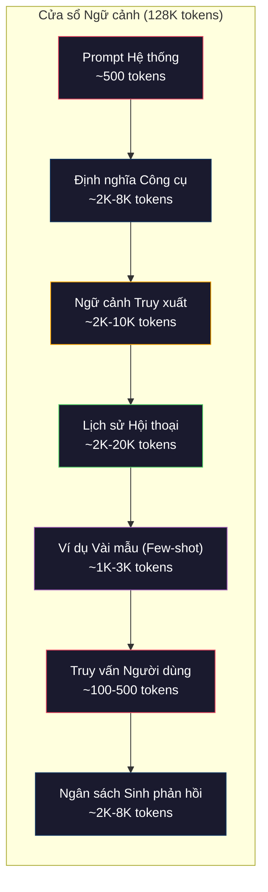
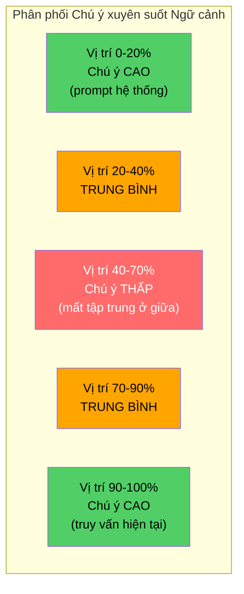
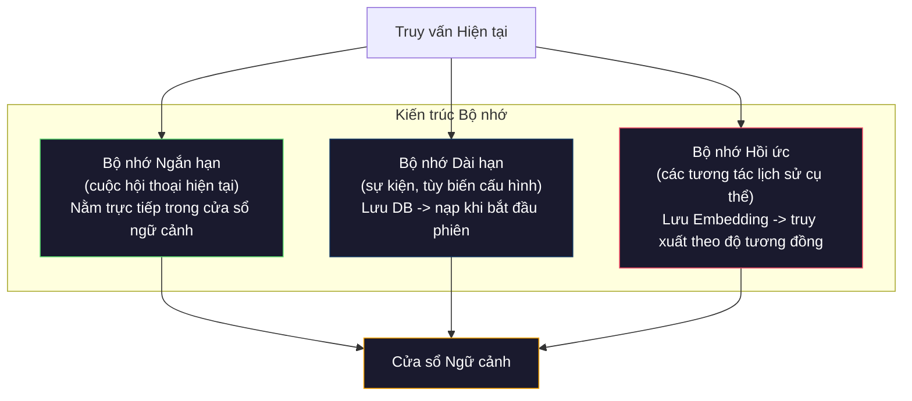

# Kỹ nghệ Ngữ cảnh: Cửa sổ, Ngân sách, Bộ nhớ và Truy xuất (Context Engineering: Windows, Budgets, Memory, and Retrieval)

> Kỹ nghệ prompt chỉ là một tập con. Kỹ nghệ ngữ cảnh (context engineering) mới là toàn bộ cuộc chơi. Prompt là chuỗi ký tự bạn gõ vào. Ngữ cảnh là tất cả những gì đi vào cửa sổ của mô hình: chỉ dẫn hệ thống, tài liệu được truy xuất, định nghĩa công cụ, lịch sử hội thoại, các ví dụ vài mẫu (few-shot), và chính bản thân prompt đó. Những kỹ sư AI xuất sắc nhất năm 2026 chính là các kỹ sư ngữ cảnh. Họ quyết định những gì được đưa vào, những gì phải loại bỏ, và theo thứ tự nào.

**Type:** Xây dựng (Build)  
**Languages:** Python  
**Prerequisites:** Phase 10 (LLM từ con số không - LLMs from Scratch), Phase 11 Bài 01-02  
**Time:** ~90 phút  
**Related:** Phase 11 · 15 (Lưu đệm prompt - Prompt Caching) — bố cục thân thiện với bộ nhớ đệm (cache-friendly layout) là một phần mở rộng của kỹ nghệ ngữ cảnh. Phase 5 · 28 (Đánh giá ngữ cảnh dài - Long-Context Evaluation) về cách đo lường hiện tượng mất tập trung ở giữa với chuẩn NIAH/RULER.

## Mục tiêu học tập

- Tính toán ngân sách token (token budgets) phân bổ trên toàn bộ các thành phần của cửa sổ ngữ cảnh (prompt hệ thống, công cụ, lịch sử, tài liệu truy xuất, dung lượng dự phòng cho việc sinh phản hồi)
- Triển khai các chiến lược quản lý cửa sổ ngữ cảnh: cắt tỉa (truncation), tóm tắt (summarization), và cửa sổ trượt (sliding window) cho lịch sử hội thoại
- Ưu tiên và sắp xếp thứ tự các thành phần ngữ cảnh để tối đa hóa sự chú ý (attention) của mô hình vào những thông tin quan trọng nhất
- Xây dựng bộ lắp ráp ngữ cảnh động (dynamic context assembler) tự động phân bổ token dựa trên ý định truy vấn và không gian cửa sổ còn trống

## Vấn đề thực tế

Claude Opus 4.7 sở hữu cửa sổ ngữ cảnh 200K token (1M ở bản beta). GPT-5 có 400K. Gemini 3 Pro đạt 2M. Llama 4 công bố con số 10M. Những con số này nghe có vẻ vô tận cho đến khi bạn thực sự lấp đầy chúng.

Dưới đây là một bảng phân bổ thực tế cho một trợ lý lập trình. Prompt hệ thống: 500 token. Định nghĩa cho 50 công cụ: 8.000 token. Tài liệu kỹ thuật được truy xuất: 4.000 token. Lịch sử hội thoại (10 lượt trao đổi): 6.000 token. Truy vấn hiện tại của người dùng: 200 token. Ngân sách sinh mã (đầu ra tối đa): 4.000 token. Tổng cộng: 22.700 token. Con số đó mới chỉ chiếm 18% của cửa sổ 128K.

Tuy nhiên, cơ chế chú ý (attention) không mở rộng tuyến tính theo độ dài ngữ cảnh. Một mô hình với 128K token ngữ cảnh phải trả chi phí chú ý bậc hai ($O(n^2)$ trong kiến trúc Transformer tiêu chuẩn, dù đa số mô hình sản xuất hiện nay đã dùng các biến thể chú ý hiệu quả hơn). Quan trọng hơn cả là độ chính xác truy xuất bị suy giảm nghiêm trọng. Bài kiểm tra "Cây kim trong đống cỏ khô" (Needle in a Haystack) chỉ ra rằng các mô hình gặp khó khăn lớn khi tìm kiếm thông tin nằm ở đoạn giữa của ngữ cảnh dài. Nghiên cứu của Liu và các cộng sự (2023) chứng minh rằng LLM truy xuất thông tin ở đầu và cuối ngữ cảnh dài với độ chính xác gần như hoàn hảo, nhưng độ chính xác tụt giảm từ 10-20% đối với thông tin nằm ở khúc giữa (vị trí từ 40-70% của ngữ cảnh). Hiện tượng "mất tập trung ở giữa" (lost-in-the-middle) này có mức độ khác nhau tùy theo từng mô hình nhưng tồn tại trên mọi kiến trúc hiện nay.

Bài học thực tế rút ra: việc có sẵn 200K token không đồng nghĩa với việc nhồi nhét đủ 200K token sẽ mang lại hiệu quả cao. Một ngữ cảnh 10K token được chọn lọc kỹ càng thường vượt trội hơn hẳn một ngữ cảnh 100K token bị đổ đống dữ liệu thô. Kỹ nghệ ngữ cảnh là bộ môn tối đa hóa tỷ lệ tín hiệu trên nhiễu (signal-to-noise ratio) bên trong cửa sổ ngữ cảnh.

Mỗi token thừa thãi bạn đưa vào cửa sổ sẽ chiếm chỗ của một token khác có thể chứa thông tin giá trị hơn. Mỗi định nghĩa công cụ không liên quan, mỗi lượt trò chuyện cũ kỹ đã hết giá trị, mỗi đoạn văn bản truy xuất không trả lời đúng trọng tâm câu hỏi -- từng chi tiết thừa đó đều làm cho mô hình hoạt động kém đi một chút.

## Khái niệm

### Cửa sổ Ngữ cảnh là một Tài nguyên Khan hiếm

Hãy hình dung cửa sổ ngữ cảnh giống như bộ nhớ RAM, chứ không phải ổ đĩa cứng. Nó có tốc độ truy xuất cực nhanh và truy cập trực tiếp, nhưng dung lượng có hạn. Bạn không thể nhồi nhét tất cả mọi thứ. Bạn bắt buộc phải chọn lọc.



Mỗi thành phần đều cạnh tranh không gian với nhau. Việc thêm nhiều định nghĩa công cụ đồng nghĩa với việc thu hẹp không gian cho lịch sử hội thoại. Việc nạp thêm tài liệu truy xuất đồng nghĩa với việc bớt chỗ cho các ví dụ few-shot. Kỹ nghệ ngữ cảnh là nghệ thuật phân bổ ngân sách này nhằm tối đa hóa hiệu năng thực hiện tác vụ.

### Hiện tượng Mất tập trung ở giữa (Lost-in-the-Middle)

Đây là phát hiện thực nghiệm quan trọng nhất trong kỹ nghệ ngữ cảnh. Mô hình chú ý tốt hơn nhiều vào thông tin nằm ở phần đầu và phần cuối của ngữ cảnh. Thông tin nằm ở đoạn giữa nhận được điểm số chú ý thấp hơn và rất dễ bị mô hình bỏ qua.

Liu và các cộng sự (2023) đã kiểm thử điều này một cách có hệ thống. Họ đặt một tài liệu liên quan xen kẽ giữa 20 tài liệu không liên quan ở các vị trí khác nhau và đo lường độ chính xác của câu trả lời. Khi tài liệu liên quan nằm ở vị trí đầu tiên hoặc cuối cùng, độ chính xác đạt 85-90%. Nhưng khi nó nằm ở đoạn giữa (vị trí thứ 10 trên 20), độ chính xác tụt xuống chỉ còn 60-70%.

Phát hiện này dẫn tới các nguyên tắc kỹ thuật trực tiếp:

- Đặt thông tin quan trọng nhất lên đầu tiên (prompt hệ thống, các ràng buộc sống còn)
- Đặt truy vấn hiện tại và ngữ cảnh liên quan trực tiếp nhất ở cuối cùng (tận dụng thiên kiến chú ý gần đây - recency bias)
- Xem đoạn giữa của ngữ cảnh như vùng có mức ưu tiên thấp nhất
- Nếu bắt buộc phải để thông tin ở giữa, hãy lặp lại các ý then chốt ở phần cuối



### Các thành phần của Ngữ cảnh (Context Components)

**Prompt hệ thống (System prompt)**: thiết lập danh tính, ràng buộc và quy tắc hành vi. Thành phần này luôn đứng đầu và giữ nguyên qua các lượt tương tác. Claude Code sử dụng khoảng 6.000 token cho prompt hệ thống của mình bao gồm định nghĩa công cụ và các chỉ dẫn hành vi. Hãy giữ nó thật cô đọng. Mỗi từ trong prompt hệ thống sẽ bị tính phí lặp lại trong mọi lệnh gọi API.

**Định nghĩa công cụ (Tool definitions)**: mỗi công cụ bổ sung thêm từ 50-200 token (tên hàm, mô tả, lược đồ tham số). 50 công cụ với mức trung bình 150 token mỗi công cụ sẽ ngốn mất 7.500 token trước khi người dùng kịp nói câu đầu tiên. Việc chọn lọc công cụ động (dynamic tool selection) -- chỉ nạp các công cụ liên quan đến truy vấn hiện tại -- có thể giảm tải từ 60-80% lượng token này.

**Ngữ cảnh truy xuất (Retrieved context)**: tài liệu từ cơ sở dữ liệu vector, kết quả tìm kiếm web, nội dung tệp mã nguồn. Chất lượng của khâu truy xuất quyết định trực tiếp chất lượng câu trả lời. Truy xuất kém còn tai hại hơn là không truy xuất -- vì nó lấp đầy cửa sổ bằng nhiễu và trực tiếp dẫn dắt mô hình đi sai hướng.

**Lịch sử hội thoại (Conversation history)**: toàn bộ thông điệp trước đó của người dùng và phản hồi của trợ lý. Tăng trưởng tuyến tính theo chiều dài cuộc trò chuyện. Một cuộc trò chuyện 50 lượt với 200 token mỗi lượt sẽ tích lũy 10.000 token lịch sử. Đa phần nội dung đó không còn liên quan đến truy vấn hiện tại.

**Ví dụ vài mẫu (Few-shot examples)**: các cặp đầu vào/đầu ra làm mẫu cho hành vi mong muốn. Hai đến ba ví dụ chất lượng cao thường cải thiện đầu ra tốt hơn hàng nghìn token chỉ dẫn lý thuyết. Nhưng chúng tiêu tốn không gian ngữ cảnh.

**Ngân sách sinh phản hồi (Generation budget)**: lượng token được giữ chỗ trước cho phản hồi của mô hình. Nếu bạn lấp đầy cửa sổ đến mức tối đa, mô hình sẽ không còn chỗ để trả lời. Hãy luôn dự phòng tối thiểu 2.000-4.000 token cho việc sinh văn bản.

### Chiến lược Nén Ngữ cảnh (Context Compression Strategies)

**Tóm tắt lịch sử (History summarization)**: thay vì lưu giữ nguyên văn toàn bộ các lượt trò chuyện cũ, định kỳ tóm tắt lại tiến trình hội thoại. Một câu "Chúng ta đã thảo luận về X, quyết định chọn Y, và người dùng muốn làm Z" chỉ tốn 100 token nhưng thay thế được 10 lượt hội thoại tốn tới 2.000 token. Thực hiện tóm tắt khi lịch sử vượt quá một ngưỡng nhất định (ví dụ: 5.000 token).

**Lọc theo độ liên quan (Relevance filtering)**: chấm điểm từng tài liệu được truy xuất so với truy vấn hiện tại và loại bỏ những tài liệu dưới ngưỡng. Nếu bạn truy xuất được 10 phân mảnh nhưng chỉ có 3 mảnh thực sự liên quan, hãy loại bỏ 7 mảnh còn lại. Thà chỉ đưa vào 3 phân mảnh chất lượng cao còn hơn nhồi 10 phân mảnh nửa vời.

**Cắt tỉa công cụ (Tool pruning)**: phân loại ý định (intent) trong câu hỏi của người dùng và chỉ nạp các công cụ phục vụ cho ý định đó. Một câu hỏi về lập trình không cần các công cụ quản lý lịch hẹn. Một câu hỏi về thời gian không cần công cụ thao tác hệ thống tệp. Kỹ thuật này có thể rút giảm token định nghĩa công cụ từ 8.000 xuống còn 1.000.

**Tóm tắt đệ quy (Recursive summarization)**: đối với các tài liệu rất dài, hãy tóm tắt theo từng giai đoạn. Trước tiên tóm tắt từng phần, sau đó tóm tắt lại các bản tóm tắt đó. Một tài liệu 50 trang sẽ được cô đọng thành một bản đúc kết 500 token nắm bắt trọn vẹn các ý chính.

### Hệ thống Bộ nhớ (Memory Systems)

Kỹ nghệ ngữ cảnh bao quát ba chiều kích thời gian của bộ nhớ:

**Bộ nhớ ngắn hạn (Short-term memory)**: cuộc trò chuyện hiện tại. Lưu trữ trực tiếp bên trong cửa sổ ngữ cảnh. Phát triển theo từng lượt trao đổi. Được quản lý thông qua cơ chế tóm tắt và cắt tỉa.

**Bộ nhớ dài hạn (Long-term memory)**: các sự kiện và sở thích được duy trì xuyên suốt nhiều phiên làm việc khác nhau. "Người dùng thích dùng TypeScript." "Dự án sử dụng cơ sở dữ liệu PostgreSQL." Được lưu trong cơ sở dữ liệu và truy xuất nạp vào khi phiên làm việc bắt đầu. Claude Code lưu trữ điều này trong các tệp `CLAUDE.md`. ChatGPT lưu trữ trong tính năng Memory của nó.

**Bộ nhớ hồi ức (Episodic memory)**: các tương tác cụ thể trong quá khứ có khả năng tái sử dụng. "Thứ Ba tuần trước, chúng ta đã gỡ một lỗi tương tự trong module xác thực." Được lưu trữ dưới dạng các vector nhúng và truy xuất khi cuộc trò chuyện hiện tại có độ tương đồng với một sự kiện trong quá khứ.



### Lắp ráp Ngữ cảnh Động (Dynamic Context Assembly)

Trực giác mấu chốt: các truy vấn khác nhau đòi hỏi các ngữ cảnh hoàn toàn khác nhau. Một prompt hệ thống tĩnh + danh sách công cụ tĩnh + toàn bộ lịch sử tĩnh là sự lãng phí tài nguyên to lớn. Các hệ thống hàng đầu đều thực hiện lắp ráp ngữ cảnh động theo từng truy vấn:

1. Phân loại ý định của truy vấn
2. Chọn lọc các công cụ liên quan (không nạp toàn bộ công cụ)
3. Truy xuất các tài liệu có độ tương đồng cao (không dùng một tập cố định)
4. Lựa chọn các lượt hội thoại lịch sử có giá trị tham khảo (không đưa vào toàn bộ lịch sử)
5. Thêm các ví dụ few-shot khớp với dạng tác vụ đang xử lý
6. Sắp xếp mọi thứ theo thứ tự quan trọng: thông tin cốt tử ở đầu, thông tin quan trọng ở cuối, thông tin tùy chọn ở đoạn giữa

Đây chính là yếu tố phân tách giữa một ứng dụng AI tầm thường và một ứng dụng AI đẳng cấp sản xuất. Mô hình nền tảng có thể giống nhau, nhưng ngữ cảnh được cung cấp chính là sự khác biệt quyết định thành bại.

````figure lost-in-the-middle
````

## Tự xây dựng (Build It)

### Bước 1: Bộ đếm Token (Token Counter)

Bạn không thể lập ngân sách cho thứ mà bạn không đo lường được. Xây dựng một bộ ước lượng token đơn giản (dựa trên việc tách từ, do số lượng chính xác phụ thuộc vào từng bộ tách từ tokenizer cụ thể).

```python
import json
import numpy as np
from collections import OrderedDict

def count_tokens(text):
    if not text:
        return 0
    return int(len(text.split()) * 1.3)

def count_tokens_json(obj):
    return count_tokens(json.dumps(obj))
```

### Bước 2: Bộ quản lý Ngân sách Ngữ cảnh (Context Budget Manager)

Lớp trừu tượng cốt lõi. Bộ quản lý ngân sách theo dõi lượng token mà từng thành phần tiêu thụ và áp đặt các giới hạn nghiêm ngặt.

```python
class ContextBudget:
    def __init__(self, max_tokens=128000, generation_reserve=4000):
        self.max_tokens = max_tokens
        self.generation_reserve = generation_reserve
        self.available = max_tokens - generation_reserve
        self.allocations = OrderedDict()

    def allocate(self, component, content, max_tokens=None):
        tokens = count_tokens(content)
        if max_tokens and tokens > max_tokens:
            words = content.split()
            target_words = int(max_tokens / 1.3)
            content = " ".join(words[:target_words])
            tokens = count_tokens(content)

        used = sum(self.allocations.values())
        if used + tokens > self.available:
            allowed = self.available - used
            if allowed <= 0:
                return None, 0
            words = content.split()
            target_words = int(allowed / 1.3)
            content = " ".join(words[:target_words])
            tokens = count_tokens(content)

        self.allocations[component] = tokens
        return content, tokens

    def remaining(self):
        used = sum(self.allocations.values())
        return self.available - used

    def utilization(self):
        used = sum(self.allocations.values())
        return used / self.max_tokens

    def report(self):
        total_used = sum(self.allocations.values())
        lines = []
        lines.append(f"Context Budget Report ({self.max_tokens:,} token window)")
        lines.append("-" * 50)
        for component, tokens in self.allocations.items():
            pct = tokens / self.max_tokens * 100
            bar = "#" * int(pct / 2)
            lines.append(f"  {component:<25} {tokens:>6} tokens ({pct:>5.1f}%) {bar}")
        lines.append("-" * 50)
        lines.append(f"  {'Used':<25} {total_used:>6} tokens ({total_used/self.max_tokens*100:.1f}%)")
        lines.append(f"  {'Generation reserve':<25} {self.generation_reserve:>6} tokens")
        lines.append(f"  {'Remaining':<25} {self.remaining():>6} tokens")
        return "\n".join(lines)
```

### Bước 3: Sắp xếp lại Chống Mất tập trung ở giữa (Lost-in-the-Middle Reordering)

Triển khai chiến lược sắp xếp lại vị trí: các mục quan trọng nhất được đưa lên đầu và đẩy về cuối, các mục ít quan trọng nhất được dồn vào giữa.

```python
def reorder_lost_in_middle(items, scores):
    paired = sorted(zip(scores, items), reverse=True)
    sorted_items = [item for _, item in paired]

    if len(sorted_items) <= 2:
        return sorted_items

    first_half = sorted_items[::2]
    second_half = sorted_items[1::2]
    second_half.reverse()

    return first_half + second_half

def score_relevance(query, documents):
    query_words = set(query.lower().split())
    scores = []
    for doc in documents:
        doc_words = set(doc.lower().split())
        if not query_words:
            scores.append(0.0)
            continue
        overlap = len(query_words & doc_words) / len(query_words)
        scores.append(round(overlap, 3))
    return scores
```

### Bước 4: Bộ nén Lịch sử Hội thoại (Conversation History Compressor)

Tóm tắt các lượt hội thoại cũ để thu hồi ngân sách token.

```python
class ConversationManager:
    def __init__(self, max_history_tokens=5000):
        self.turns = []
        self.summaries = []
        self.max_history_tokens = max_history_tokens

    def add_turn(self, role, content):
        self.turns.append({"role": role, "content": content})
        self._compress_if_needed()

    def _compress_if_needed(self):
        total = sum(count_tokens(t["content"]) for t in self.turns)
        if total <= self.max_history_tokens:
            return

        while total > self.max_history_tokens and len(self.turns) > 4:
            old_turns = self.turns[:2]
            summary = self._summarize_turns(old_turns)
            self.summaries.append(summary)
            self.turns = self.turns[2:]
            total = sum(count_tokens(t["content"]) for t in self.turns)

    def _summarize_turns(self, turns):
        parts = []
        for t in turns:
            content = t["content"]
            if len(content) > 100:
                content = content[:100] + "..."
            parts.append(f"{t['role']}: {content}")
        return "Previous: " + " | ".join(parts)

    def get_context(self):
        parts = []
        if self.summaries:
            parts.append("[Conversation Summary]")
            for s in self.summaries:
                parts.append(s)
        parts.append("[Recent Conversation]")
        for t in self.turns:
            parts.append(f"{t['role']}: {t['content']}")
        return "\n".join(parts)

    def token_count(self):
        return count_tokens(self.get_context())
```

### Bước 5: Bộ chọn lọc Công cụ Động (Dynamic Tool Selector)

Chỉ đưa vào các công cụ liên quan đến truy vấn hiện tại. Phân loại ý định, sau đó lọc danh sách công cụ.

```python
TOOL_REGISTRY = {
    "read_file": {
        "description": "Read contents of a file",
        "tokens": 120,
        "categories": ["code", "files"],
    },
    "write_file": {
        "description": "Write content to a file",
        "tokens": 150,
        "categories": ["code", "files"],
    },
    "search_code": {
        "description": "Search for patterns in codebase",
        "tokens": 130,
        "categories": ["code"],
    },
    "run_command": {
        "description": "Execute a shell command",
        "tokens": 140,
        "categories": ["code", "system"],
    },
    "create_calendar_event": {
        "description": "Create a new calendar event",
        "tokens": 180,
        "categories": ["calendar"],
    },
    "list_emails": {
        "description": "List recent emails",
        "tokens": 160,
        "categories": ["email"],
    },
    "send_email": {
        "description": "Send an email message",
        "tokens": 200,
        "categories": ["email"],
    },
    "web_search": {
        "description": "Search the web for information",
        "tokens": 140,
        "categories": ["research"],
    },
    "query_database": {
        "description": "Run a SQL query on the database",
        "tokens": 170,
        "categories": ["code", "data"],
    },
    "generate_chart": {
        "description": "Generate a chart from data",
        "tokens": 190,
        "categories": ["data", "visualization"],
    },
}

def classify_intent(query):
    query_lower = query.lower()

    intent_keywords = {
        "code": ["code", "function", "bug", "error", "file", "implement", "refactor", "debug", "test"],
        "calendar": ["meeting", "schedule", "calendar", "appointment", "event"],
        "email": ["email", "mail", "send", "inbox", "message"],
        "research": ["search", "find", "what is", "how does", "explain", "look up"],
        "data": ["data", "query", "database", "chart", "graph", "analytics", "sql"],
    }

    scores = {}
    for intent, keywords in intent_keywords.items():
        score = sum(1 for kw in keywords if kw in query_lower)
        if score > 0:
            scores[intent] = score

    if not scores:
        return ["code"]

    max_score = max(scores.values())
    return [intent for intent, score in scores.items() if score >= max_score * 0.5]

def select_tools(query, token_budget=2000):
    intents = classify_intent(query)
    relevant = {}
    total_tokens = 0

    for name, tool in TOOL_REGISTRY.items():
        if any(cat in intents for cat in tool["categories"]):
            if total_tokens + tool["tokens"] <= token_budget:
                relevant[name] = tool
                total_tokens += tool["tokens"]

    return relevant, total_tokens
```

### Bước 6: Đường ống Lắp ráp Ngữ cảnh Hoàn chỉnh (Full Context Engine)

Kết nối tất cả các thành phần lại với nhau. Cho trước một câu truy vấn, tự động lắp ráp ngữ cảnh tối ưu nhất.

```python
class ContextEngine:
    def __init__(self, max_tokens=128000, generation_reserve=4000):
        self.budget = ContextBudget(max_tokens, generation_reserve)
        self.conversation = ConversationManager(max_history_tokens=5000)
        self.system_prompt = (
            "You are a helpful AI assistant. You have access to tools for "
            "code editing, file management, web search, and data analysis. "
            "Use the appropriate tools for each task. Be concise and accurate."
        )
        self.knowledge_base = [
            "Python 3.12 introduced type parameter syntax for generic classes using bracket notation.",
            "The project uses PostgreSQL 16 with pgvector for embedding storage.",
            "Authentication is handled by Supabase Auth with JWT tokens.",
            "The frontend is built with Next.js 15 using the App Router.",
            "API rate limits are set to 100 requests per minute per user.",
            "The deployment pipeline uses GitHub Actions with Docker multi-stage builds.",
            "Test coverage must be above 80% for all new modules.",
            "The codebase follows the repository pattern for data access.",
        ]

    def assemble(self, query):
        self.budget = ContextBudget(self.budget.max_tokens, self.budget.generation_reserve)

        system_content, _ = self.budget.allocate("system_prompt", self.system_prompt, max_tokens=1000)

        tools, tool_tokens = select_tools(query, token_budget=2000)
        tool_text = json.dumps(list(tools.keys()))
        tool_content, _ = self.budget.allocate("tools", tool_text, max_tokens=2000)

        relevance = score_relevance(query, self.knowledge_base)
        threshold = 0.1
        relevant_docs = [
            doc for doc, score in zip(self.knowledge_base, relevance)
            if score >= threshold
        ]

        if relevant_docs:
            doc_scores = [s for s in relevance if s >= threshold]
            reordered = reorder_lost_in_middle(relevant_docs, doc_scores)
            doc_text = "\n".join(reordered)
            doc_content, _ = self.budget.allocate("retrieved_context", doc_text, max_tokens=3000)

        history_text = self.conversation.get_context()
        if history_text.strip():
            history_content, _ = self.budget.allocate("conversation_history", history_text, max_tokens=5000)

        query_content, _ = self.budget.allocate("user_query", query, max_tokens=500)

        return self.budget

    def chat(self, query):
        self.conversation.add_turn("user", query)
        budget = self.assemble(query)
        response = f"[Response to: {query[:50]}...]"
        self.conversation.add_turn("assistant", response)
        return budget


def run_demo():
    print("=" * 60)
    print("  Context Engineering Pipeline Demo")
    print("=" * 60)

    engine = ContextEngine(max_tokens=128000, generation_reserve=4000)

    print("\n--- Query 1: Code task ---")
    budget = engine.chat("Fix the bug in the authentication module where JWT tokens expire too early")
    print(budget.report())

    print("\n--- Query 2: Research task ---")
    budget = engine.chat("What is the best approach for implementing vector search in PostgreSQL?")
    print(budget.report())

    print("\n--- Query 3: After conversation history builds up ---")
    for i in range(8):
        engine.conversation.add_turn("user", f"Follow-up question number {i+1} about the implementation details of the system")
        engine.conversation.add_turn("assistant", f"Here is the response to follow-up {i+1} with technical details about the architecture")

    budget = engine.chat("Now implement the changes we discussed")
    print(budget.report())

    print("\n--- Tool Selection Examples ---")
    test_queries = [
        "Fix the bug in auth.py",
        "Schedule a meeting with the team for Tuesday",
        "Show me the database query performance stats",
        "Search for best practices on error handling",
    ]

    for q in test_queries:
        tools, tokens = select_tools(q)
        intents = classify_intent(q)
        print(f"\n  Query: {q}")
        print(f"  Intents: {intents}")
        print(f"  Tools: {list(tools.keys())} ({tokens} tokens)")

    print("\n--- Lost-in-the-Middle Reordering ---")
    docs = ["Doc A (most relevant)", "Doc B (somewhat relevant)", "Doc C (least relevant)",
            "Doc D (relevant)", "Doc E (moderately relevant)"]
    scores = [0.95, 0.60, 0.20, 0.80, 0.50]
    reordered = reorder_lost_in_middle(docs, scores)
    print(f"  Original order: {docs}")
    print(f"  Scores:         {scores}")
    print(f"  Reordered:      {reordered}")
    print(f"  (Most relevant at start and end, least relevant in middle)")
```

## Sử dụng trong thực tế (Use It)

### Quản lý Ngữ cảnh theo Lớp trong Khung điều phối (Harness-Managed Context)

Claude Code quản lý ngữ cảnh theo phương pháp tiếp cận đa lớp. Prompt hệ thống bao gồm các quy tắc hành vi và định nghĩa công cụ (~6K token). Khi bạn mở một tệp, nội dung của nó mới được bơm vào ngữ cảnh. Khi bạn tìm kiếm, kết quả tìm kiếm được thêm vào. Các lượt hội thoại cũ được tóm tắt lại. Tệp `CLAUDE.md` đóng vai trò bộ nhớ dài hạn duy trì xuyên suốt các phiên làm việc.

Quyết định kỹ thuật cốt lõi: Claude Code không bao giờ đổ toàn bộ kho mã nguồn của bạn vào ngữ cảnh cùng một lúc. Nó truy xuất các tệp liên quan theo nhu cầu thực tế (on demand). Đây chính là kỹ nghệ ngữ cảnh trong môi trường sản xuất.

### Nạp Ngữ cảnh Động với Cursor

Cursor lập chỉ mục toàn bộ kho mã của bạn thành các vector nhúng. Khi bạn gõ một câu hỏi, nó sẽ truy xuất các tệp và khối mã liên quan nhất bằng độ tương đồng vector. Chỉ những đoạn mã được chọn lọc đó mới được nạp vào cửa sổ ngữ cảnh. Một kho mã 500.000 dòng được nén gọn thành 5-10 khối mã quan trọng nhất.

Đây là khuôn mẫu kinh điển: nhúng tất cả, truy xuất theo nhu cầu, và chỉ đưa vào cửa sổ những gì thực sự có giá trị.

### Bộ nhớ Dài hạn của Trợ lý AI

ChatGPT lưu trữ các sở thích và sự kiện cá nhân của người dùng dưới dạng bộ nhớ dài hạn. Ở mỗi phiên hội thoại mới, các ký ức liên quan sẽ được truy xuất và nhúng vào prompt hệ thống. Dòng chữ "Người dùng thích dùng Python" chỉ tốn 5 token nhưng giúp tiết kiệm hàng trăm token chỉ dẫn lặp đi lặp lại qua nhiều cuộc trò chuyện.

### RAG chính là Kỹ nghệ Ngữ cảnh được Chuẩn hóa

Tạo tăng cường truy xuất (Retrieval-Augmented Generation - RAG) chính là sự hình thức hóa của bộ môn kỹ nghệ ngữ cảnh. Thay vì cố nhồi nhét toàn bộ tri thức nhân loại vào trọng số mô hình (huấn luyện) hoặc đưa vào prompt hệ thống (ngữ cảnh tĩnh), bạn truy xuất các tài liệu liên quan tại thời điểm truy vấn và bơm chúng vào cửa sổ ngữ cảnh. Toàn bộ đường ống RAG -- phân mảnh, nhúng, truy xuất, xếp hạng lại -- sinh ra chỉ để giải quyết một bài toán duy nhất: đưa đúng thông tin vào đúng vị trí trong cửa sổ ngữ cảnh.

## Đóng gói ứng dụng (Ship It)

Bài học này cung cấp:
- `outputs/prompt-context-optimizer.md` -- prompt có thể tái sử dụng giúp kiểm toán chiến lược lắp ráp ngữ cảnh và đề xuất các điểm tối ưu hóa. Cung cấp prompt hệ thống, số lượng công cụ, độ dài hội thoại trung bình và chiến lược truy xuất, nó sẽ chỉ ra những điểm lãng phí token và gợi ý cách khắc phục.
- `outputs/skill-context-engineering.md` -- khung hỗ trợ ra quyết định để thiết kế đường ống lắp ráp ngữ cảnh dựa trên loại tác vụ, kích thước cửa sổ ngữ cảnh và ngân sách độ trễ.

## Bài tập thực hành

1. Thêm một "bộ phát hiện lãng phí token" (token waste detector) vào lớp `ContextBudget`. Nó cần gắn cờ cảnh báo các thành phần ngốn hơn 30% ngân sách và gợi ý chiến lược nén cụ thể cho từng loại thành phần (tóm tắt lịch sử, cắt tỉa công cụ, xếp hạng lại tài liệu).

2. Triển khai cơ chế khử trùng lặp ngữ nghĩa (semantic deduplication) cho ngữ cảnh được truy xuất. Nếu hai tài liệu truy xuất có độ tương đồng lớn hơn 80% (theo tỷ lệ trùng từ hoặc độ tương đồng cosine của embedding), chỉ giữ lại tài liệu có điểm liên quan cao hơn. Đo lường lượng token ngân sách thu hồi được nhờ cơ chế này.

3. Xây dựng công cụ "phát lại ngữ cảnh" (context replay). Cho trước một bản ghi chép cuộc hội thoại, hãy phát lại từng lượt qua `ContextEngine` và trực quan hóa sự thay đổi phân bổ ngân sách qua từng lượt trao đổi. Vẽ biểu đồ mức tiêu thụ token theo thời gian. Xác định thời điểm chính xác mà tại đó ngữ cảnh bắt đầu phải kích hoạt cơ chế nén.

4. Triển khai bộ chọn lọc công cụ dựa trên độ ưu tiên (priority-based tool selector). Thay vì chỉ bật/tắt nhị phân (include/exclude), hãy gán cho mỗi công cụ một điểm liên quan đối với truy vấn hiện tại. Lần lượt đưa các công cụ có độ liên quan từ cao xuống thấp vào ngữ cảnh cho đến khi cạn kiệt ngân sách dành cho công cụ. So sánh hiệu năng hoàn thành tác vụ khi cung cấp 5, 10, 20 và 50 công cụ.

5. Xây dựng bộ nén ngữ cảnh đa chiến lược (multi-strategy context compressor). Triển khai ba chiến lược nén (cắt tỉa, tóm tắt, trích xuất các câu then chốt) và kiểm chuẩn chúng trên một tập gồm 20 tài liệu. Đo lường sự đánh đổi giữa tỷ lệ nén và mức độ bảo toàn thông tin (liệu phiên bản đã nén có còn chứa câu trả lời cho truy vấn hay không?).

## Thuật ngữ cốt lõi

| Thuật ngữ | Điều mọi người hay nói | Ý nghĩa kỹ thuật thực tế |
|-----------|------------------------|--------------------------|
| Cửa sổ ngữ cảnh (Context window) | "Mô hình đọc được bao nhiêu chữ" | Số lượng token tối đa (cả đầu vào + đầu ra) mà mô hình xử lý trong một lượt truyền xuôi -- 400K cho GPT-5, 200K (1M beta) cho Claude Opus 4.7, 2M cho Gemini 3 Pro |
| Kỹ nghệ ngữ cảnh (Context engineering) | "Kỹ nghệ prompt nâng cao" | Bộ môn quyết định những gì được đưa vào cửa sổ ngữ cảnh, theo thứ tự nào và với mức ưu tiên ra sao -- bao gồm truy xuất, nén, chọn lọc công cụ và quản lý bộ nhớ |
| Mất tập trung ở giữa (Lost-in-the-middle) | "Mô hình hay quên đoạn giữa" | Phát hiện thực nghiệm cho thấy LLM chú ý tốt hơn vào phần đầu và phần cuối của ngữ cảnh, với độ chính xác giảm 10-20% cho thông tin nằm ở đoạn giữa |
| Ngân sách token (Token budget) | "Còn lại bao nhiêu token để dùng" | Sự phân bổ dung lượng cửa sổ ngữ cảnh rõ ràng giữa các thành phần (prompt hệ thống, công cụ, lịch sử, truy xuất, sinh phản hồi) kèm giới hạn cụ thể |
| Ngữ cảnh động (Dynamic context) | "Nạp dữ liệu linh hoạt khi chạy" | Quá trình lắp ráp cửa sổ ngữ cảnh khác biệt cho từng truy vấn dựa trên phân loại ý định, chọn lọc công cụ phù hợp và kết quả truy xuất |
| Tóm tắt lịch sử (History summarization) | "Nén gọn cuộc trò chuyện" | Thay thế các lượt trao đổi cũ nguyên văn bằng một bản tóm tắt súc tích, tiết kiệm token trong khi vẫn bảo toàn thông tin trọng yếu |
| Cắt tỉa công cụ (Tool pruning) | "Chỉ lấy các công cụ cần thiết" | Phân loại ý định của người dùng và chỉ nạp các định nghĩa công cụ phù hợp, giảm 60-80% chi phí token của công cụ |
| Bộ nhớ dài hạn (Long-term memory) | "Ghi nhớ qua các phiên làm việc" | Các sự kiện và sở thích được lưu trong cơ sở dữ liệu và truy xuất nạp vào khi bắt đầu phiên mới -- CLAUDE.md, ChatGPT Memory |
| Bộ nhớ hồi ức (Episodic memory) | "Nhớ lại các sự kiện cụ thể đã qua" | Các tương tác trong quá khứ được lưu dưới dạng embedding và truy xuất khi truy vấn hiện tại tương đồng với cuộc hội thoại trước đó |
| Ngân sách sinh phản hồi (Generation budget) | "Chỗ trống để mô hình trả lời" | Lượng token được dự phòng riêng cho câu trả lời của mô hình -- nếu ngữ cảnh lấp đầy cửa sổ, mô hình sẽ không còn chỗ để tạo phản hồi |

## Đọc thêm

- [Liu et al., 2023 -- "Lost in the Middle: How Language Models Use Long Contexts"](https://arxiv.org/abs/2307.03172) -- nghiên cứu kinh điển về cơ chế chú ý phụ thuộc vào vị trí, chứng minh mô hình gặp khó khăn với thông tin ở giữa ngữ cảnh dài
- [Bài viết Contextual Retrieval của Anthropic](https://www.anthropic.com/news/contextual-retrieval) -- cách tiếp cận của Anthropic đối với việc truy xuất phân mảnh có nhận biết ngữ cảnh, giúp giảm 49% lỗi truy xuất
- [Bài viết "Context Engineering" của Simon Willison](https://simonwillison.net/2025/Jun/27/context-engineering/) -- bài viết định danh cho bộ môn kỹ thuật này và phân định ranh giới rõ ràng với kỹ nghệ prompt
- [Tài liệu hướng dẫn về RAG của LangChain](https://python.langchain.com/docs/tutorials/rag/) -- hướng dẫn triển khai thực tế của việc tạo tăng cường truy xuất như một khuôn mẫu kỹ nghệ ngữ cảnh
- [Kiểm thử Needle in a Haystack của Greg Kamradt](https://github.com/gkamradt/LLMTest_NeedleInAHaystack) -- bộ kiểm chuẩn vạch trần các lỗi truy xuất phụ thuộc vị trí trên mọi mô hình ngôn ngữ lớn hiện nay
- [Pope et al., "Efficiently Scaling Transformer Inference" (2022)](https://arxiv.org/abs/2211.05102) -- lý giải vì sao độ dài ngữ cảnh chi phối mạnh mẽ bộ nhớ và độ trễ, và cách KV cache, MQA, GQA thay đổi bài toán tính toán ngân sách
- [Agrawal et al., "SARATHI: Efficient LLM Inference by Piggybacking Decodes with Chunked Prefills" (2023)](https://arxiv.org/abs/2308.16369) -- phân tích hai giai đoạn suy luận khiến prompt dài tốn kém ở thời gian nhận token đầu tiên (TTFT) nhưng rẻ ở thời gian nhận mỗi token tiếp theo (TPOT)
- [Ainslie et al., "GQA: Training Generalized Multi-Query Transformer Models from Multi-Head Checkpoints" (EMNLP 2023)](https://arxiv.org/abs/2305.13245) -- bài báo về cơ chế chú ý truy vấn nhóm (GQA) giúp cắt giảm 8 lần bộ nhớ KV trong các bộ giải mã sản xuất mà không làm suy giảm chất lượng
