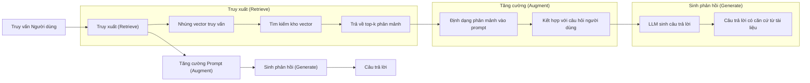
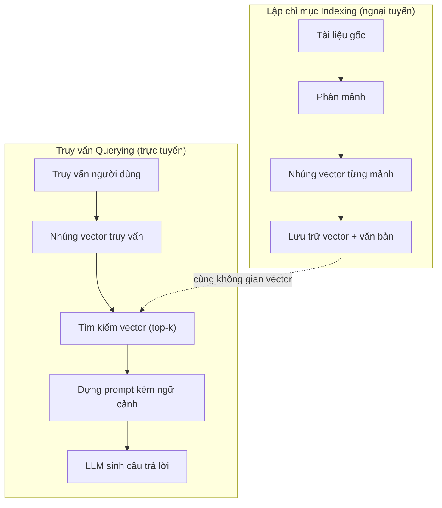

# RAG (Tạo tăng cường truy xuất - Retrieval-Augmented Generation)

> LLM của bạn biết tất cả mọi thứ cho đến thời điểm ngắt dữ liệu huấn luyện (training cutoff). Nó không biết gì về tài liệu nội bộ công ty bạn, kho mã nguồn dự án, hay biên bản cuộc họp tuần trước. RAG giải quyết bài toán này bằng cách truy xuất các tài liệu liên quan và nạp chúng vào prompt. Đây là khuôn mẫu kiến trúc được triển khai phổ biến nhất trong các ứng dụng AI thực tế. Nếu bạn chỉ chọn xây dựng một thứ từ khóa học này, hãy xây dựng một đường ống RAG.

**Type:** Xây dựng (Build)  
**Languages:** Python  
**Prerequisites:** Phase 10 (LLM từ con số không - LLMs from Scratch), Phase 11 Bài 01-05  
**Time:** ~90 phút  
**Related:** Phase 5 · 23 (Chiến lược phân mảnh cho RAG - Chunking Strategies for RAG) để tìm hiểu sâu về sáu thuật toán phân mảnh và thời điểm mỗi thuật toán chiếm ưu thế. Phase 5 · 22 (Đi sâu vào các mô hình nhúng - Embedding Models Deep Dive) để lựa chọn mô hình nhúng tối ưu. Phase 11 · 07 (RAG nâng cao - Advanced RAG) về tìm kiếm lai (hybrid search), xếp hạng lại (reranking) và chuyển đổi truy vấn (query transformation).

## Mục tiêu học tập

- Xây dựng một đường ống RAG hoàn chỉnh: tải tài liệu, phân mảnh, nhúng vector, lưu trữ vector, truy xuất và sinh phản hồi
- Triển khai tìm kiếm ngữ nghĩa (semantic search) bằng cơ sở dữ liệu vector (ChromaDB, FAISS, hoặc Pinecone) với cấu trúc lập chỉ mục chuẩn xác
- Giải thích lý do tại sao RAG được ưu tiên hơn tinh chỉnh mô hình (fine-tuning) cho các ứng dụng đòi hỏi căn cứ tri thức thực tế (chi phí, độ tươi mới của dữ liệu, khả năng trích dẫn nguồn)
- Đánh giá chất lượng RAG bằng các độ đo truy xuất (độ chuẩn xác - precision, độ thu hồi - recall) và các độ đo sinh (tính trung thực - faithfulness, độ liên quan - relevance)

## Vấn đề thực tế

Bạn xây dựng một chatbot cho doanh nghiệp của mình. Một khách hàng hỏi: "Chính sách hoàn tiền cho các gói doanh nghiệp (enterprise) là gì?" LLM trả lời bằng một câu văn chung chung về chính sách hoàn tiền thông thường của các dịch vụ SaaS. Tuy nhiên, chính sách thực tế của công ty bạn, nằm sâu trong trang thứ 120 của một trang wiki nội bộ, quy định rằng khách hàng doanh nghiệp được hoàn tiền theo tỷ lệ sử dụng trong vòng 60 ngày. LLM chưa từng được thấy tài liệu này. Nó không thể biết những gì nó chưa từng được học.

Tinh chỉnh mô hình (fine-tuning) là một giải pháp. Lấy LLM, huấn luyện thêm trên kho tài liệu nội bộ của bạn, rồi triển khai mô hình mới đó. Cách này có thể chạy được nhưng đi kèm những hạn chế chí mạng. Tinh chỉnh tiêu tốn hàng nghìn đô la chi phí tính toán GPU. Mô hình trở nên lỗi thời ngay khoảnh khắc một tài liệu nội bộ bị sửa đổi. Bạn không có cách nào để truy vết xem mô hình đã trích xuất câu trả lời từ tài liệu nào. Và nếu tháng sau công ty mua lại một dòng sản phẩm mới, bạn lại phải tốn tiền tinh chỉnh lại từ đầu.

Tạo tăng cường truy xuất (Retrieval-Augmented Generation - RAG) là giải pháp đối trọng. Bạn giữ nguyên mô hình gốc. Khi có câu hỏi gửi đến, bạn tìm kiếm trong kho tài liệu các đoạn văn liên quan, dán chúng vào prompt ngay trước câu hỏi, và để mô hình trả lời dựa trên chính những đoạn văn ngữ cảnh đó. Kho tài liệu có thể cập nhật trong vài phút. Bạn thấy chính xác những đoạn văn nào đã được truy xuất và dùng làm nguồn dẫn. Bản thân mô hình không bao giờ bị thay đổi trọng số. Đó là lý do tại sao RAG trở thành kiến trúc thống trị trong sản xuất: rẻ hơn, dữ liệu luôn mới nhất, dễ dàng kiểm toán nguồn gốc, và hoạt động tốt với bất kỳ LLM nào.

## Khái niệm

### Mô hình Kiến trúc RAG

Toàn bộ khuôn mẫu gói gọn trong bốn bước cơ bản:



Truy vấn -> Truy xuất -> Tăng cường prompt -> Sinh phản hồi. Mọi hệ thống RAG đều tuân thủ khuôn mẫu này. Sự khác biệt giữa các hệ thống RAG thực tế nằm ở độ sâu chi tiết của từng bước: cách bạn phân mảnh văn bản, cách bạn tạo embedding, cách bạn tìm kiếm, và cách bạn cấu trúc prompt.

### Tại sao RAG vượt trội hơn Tinh chỉnh mô hình (Fine-Tuning)

| Tiêu chí | Tinh chỉnh mô hình (Fine-tuning) | RAG |
|----------|----------------------------------|-----|
| Chi phí | $1.000 - $100.000+ cho mỗi lần huấn luyện | $0.01 - $0.10 cho mỗi lượt truy vấn (embedding + LLM) |
| Độ tươi mới của dữ liệu | Lỗi thời cho đến khi được huấn luyện lại | Cập nhật trong vài phút bằng cách đánh lại chỉ mục |
| Khả năng kiểm toán | Không thể truy vết câu trả lời bắt nguồn từ đâu | Trích dẫn chính xác các đoạn văn bản được nạp vào |
| Ảo giác (Hallucination) | Vẫn tự do bịa đặt thông tin | Bị ràng buộc chặt chẽ vào tài liệu được truy xuất |
| Bảo mật dữ liệu | Dữ liệu huấn luyện bị nướng vào trọng số | Tài liệu nằm an toàn trong kho dữ liệu vector của bạn |

Tinh chỉnh làm thay đổi trọng số mô hình vĩnh viễn. RAG thay đổi ngữ cảnh của mô hình một cách tạm thời. Đối với đa số các ứng dụng thực tế, ngữ cảnh tạm thời chính xác là thứ bạn cần.

Trường hợp duy nhất mà fine-tuning chiếm ưu thế: khi bạn cần mô hình tiếp thu một văn phong, giọng điệu đặc thù, hoặc một phong cách suy luận chuyên biệt mà prompt đơn thuần không thể đáp ứng. Còn đối với bài toán truy xuất tri thức thực tế, RAG luôn là lựa chọn chiến thắng.

### Các mô hình Nhúng (Embedding Models)

Mô hình nhúng chuyển đổi văn bản thành một vector dày đặc. Các đoạn văn có ý nghĩa tương đồng sẽ tạo ra các vector nằm gần nhau trong không gian đa chiều này. "Làm thế nào để đặt lại mật khẩu?" và "Tôi cần đổi mật khẩu" sẽ tạo ra các vector gần như trùng nhau dù chúng dùng từ ngữ khác nhau. Trong khi đó "Con mèo ngồi trên tấm thảm" sẽ tạo ra một vector hoàn toàn cách biệt.

Các mô hình nhúng phổ biến (danh mục tiêu biểu năm 2026 — xem Phase 5 · 22 để có phân tích chi tiết):

| Mô hình | Số chiều | Nhà cung cấp | Đặc điểm |
|---------|----------|--------------|----------|
| text-embedding-3-small | 1536 (Matryoshka) | OpenAI | Tối ưu chi phí/hiệu năng cho hầu hết tác vụ |
| text-embedding-3-large | 3072 (Matryoshka) | OpenAI | Độ chính xác cao hơn, cắt ngắn được về 256/512/1024 |
| Gemini Embedding 2 | 3072 (Matryoshka) | Google | Điểm truy xuất MTEB hàng đầu; ngữ cảnh 8K |
| voyage-4 | 1024/2048 (Matryoshka) | Voyage AI | Các biến thể chuyên ngành (code, tài chính, luật) |
| Cohere embed-v4 | 1024 (Matryoshka) | Cohere | Năng lực đa ngôn ngữ mạnh mẽ, ngữ cảnh 128K |
| BGE-M3 | 1024 (dense + sparse + ColBERT) | BAAI (trọng số mở) | Hỗ trợ cả 3 góc nhìn biểu diễn trong 1 mô hình |
| Qwen3-Embedding | 4096 (Matryoshka) | Alibaba (trọng số mở) | Điểm truy xuất hàng đầu trong các mô hình mở |
| all-MiniLM-L6-v2 | 384 | Trọng số mở (Sentence Transformers) | Chuẩn mực cơ sở cho việc tạo mẫu nhanh |

Trong bài học này, chúng ta sẽ tự xây dựng một mô hình nhúng đơn giản bằng TF-IDF. Không phải vì hệ thống sản xuất dùng TF-IDF, mà vì nó giúp trực quan hóa khái niệm: đưa văn bản vào, nhận vector ra, văn bản tương đồng cho vector gần nhau.

### Độ tương đồng Vector (Vector Similarity)

Cho trước hai vector, làm thế nào để đo lường độ tương đồng? Có ba phương pháp:

**Độ tương đồng Cosine (Cosine similarity)**: cosine của góc giữa hai vector. Dao động từ -1 (đối nghịch) đến 1 (cùng hướng). Bỏ qua độ lớn, chỉ quan tâm đến hướng vector. Đây là chuẩn mặc định cho RAG.

```math
\mathop{\mathrm{cosine\_sim}}(a, b) = \frac{\mathop{\mathrm{dot}}(a, b)}{\lVert a \rVert \cdot \lVert b \rVert}
```

**Tích vô hướng (Dot product)**: tích trong thuần túy giữa hai vector. Vector có độ lớn lớn hơn nhận điểm cao hơn. Hữu ích khi độ dài tài liệu mang thông tin hữu ích (tài liệu dài hơn có thể liên quan nhiều hơn).

```math
\mathop{\mathrm{dot}}(a, b) = \sum_i a_i b_i
```

**Khoảng cách Euclid (L2 distance)**: khoảng cách đường thẳng trong không gian vector. Khoảng cách càng nhỏ = càng tương đồng. Nhạy cảm với sự chênh lệch độ lớn giữa các vector.

```math
\mathop{\mathrm{L2}}(a, b) = \sqrt{\sum_i (a_i - b_i)^2}
```

Độ tương đồng Cosine là tiêu chuẩn thực tế. Nó xử lý êm đẹp các tài liệu có độ dài chênh lệch nhau nhờ phép chuẩn hóa độ lớn. Khi ai đó nhắc tới "tìm kiếm vector", họ gần như luôn ngầm định là độ tương đồng cosine.

### Chiến lược Phân mảnh (Chunking Strategies)

Tài liệu thường quá dài để nhúng thành một vector duy nhất. Một tệp PDF 50 trang sẽ cho ra một embedding rất tệ vì nó chứa đựng hàng chục chủ đề khác nhau. Thay vào đó, bạn chia nhỏ tài liệu thành các phân mảnh (chunks) và nhúng từng phân mảnh riêng biệt.

**Phân mảnh kích thước cố định (Fixed-size chunking)**: chia sau mỗi N token. Đơn giản và dễ đoán. Một phân mảnh 512 token với độ gối đầu 50 token có nghĩa là mảnh 1 từ token 0-511, mảnh 2 từ token 462-973, và cứ thế tiếp diễn. Phần gối đầu giúp đảm bảo bạn không vô tình cắt đôi một câu văn quan trọng ngay ranh giới.

**Phân mảnh ngữ nghĩa (Semantic chunking)**: chia tại các ranh giới tự nhiên như đoạn văn, đề mục, hoặc tiêu đề markdown. Mỗi phân mảnh là một khối ý nghĩa trọn vẹn. Phức tạp hơn khi cài đặt nhưng đem lại chất lượng truy xuất vượt trội.

**Phân mảnh đệ quy (Recursive chunking)**: ưu tiên chia tại ranh giới lớn nhất trước (tiêu đề mục). Nếu đoạn văn bản vẫn vượt quá giới hạn, chia tiếp tại ranh giới đoạn văn. Nếu vẫn quá dài, chia tại ranh giới câu. Đây là phương pháp của `RecursiveCharacterTextSplitter` trong LangChain và hoạt động rất tốt trong thực tế.

Kích thước phân mảnh đóng vai trò then chốt hơn nhiều người tưởng:

- Quá nhỏ (64-128 tokens): mỗi mảnh thiếu ngữ cảnh bổ trợ. Câu "Nó đã tăng 15% trong quý trước" trở nên vô nghĩa nếu không biết "nó" ở đây là doanh thu hay chi phí.
- Quá lớn (2048+ tokens): mỗi mảnh bao trùm nhiều chủ đề, làm loãng độ liên quan ngữ nghĩa. Khi bạn tìm dữ liệu doanh thu, bạn nhận về một mảnh có 10% nói về doanh thu và 90% nói về tuyển dụng nhân sự.
- Điểm ngọt ngào (256-512 tokens): vừa đủ ngữ cảnh để đứng độc lập, vừa đủ tập trung để phản ánh chính xác chủ đề.

Đa số hệ thống RAG thực tế sử dụng các phân mảnh từ 256-512 token với độ gối đầu 50 token. Khuyến nghị của Anthropic cũng nằm trong phạm vi này.

### Cơ sở dữ liệu Vector (Vector Databases)

Khi đã có embedding, bạn cần nơi lưu trữ và tìm kiếm chúng. Các lựa chọn thông dụng:

| Cơ sở dữ liệu | Phân loại | Phù hợp nhất cho |
|---------------|-----------|-------------------|
| FAISS | Thư viện trong tiến trình | Tạo mẫu nhanh, tập dữ liệu nhỏ và vừa |
| Chroma | Cơ sở dữ liệu gọn nhẹ | Phát triển cục bộ, triển khai ứng dụng nhỏ |
| Pinecone | Dịch vụ được quản lý | Môi trường sản xuất không muốn gánh nặng vận hành |
| Weaviate | Cơ sở dữ liệu mã nguồn mở | Hệ thống tự lưu trữ (self-hosted) trong sản xuất |
| pgvector | Phần mở rộng của Postgres | Dự án đã sử dụng sẵn cơ sở dữ liệu Postgres |
| Qdrant | Cơ sở dữ liệu mã nguồn mở | Tự lưu trữ với đòi hỏi hiệu năng truy vấn cực cao |

Trong bài học này, chúng ta sẽ tự xây dựng một bộ lưu trữ vector ngay trong bộ nhớ RAM. Nó lưu các vector vào một danh sách Python và thực hiện tìm kiếm vét cạn bằng độ tương đồng cosine. Cách làm này tương đương với FAISS ở chế độ chỉ mục phẳng (Flat index). Nó mở rộng tốt đến khoảng 100.000 vector trước khi bắt đầu chậm đi. Các hệ thống lớn trong sản xuất sử dụng các thuật toán láng giềng gần đúng (ANN) như HNSW để tìm kiếm qua hàng triệu vector trong vài phần nghìn giây.

### Đường ống Hoàn chỉnh (The Full Pipeline)



Giai đoạn lập chỉ mục chạy ngoại tuyến một lần cho mỗi tài liệu (hoặc khi tài liệu có sự cập nhật). Giai đoạn truy vấn chạy trực tuyến trên mỗi yêu cầu của người dùng. Trong môi trường sản xuất, khâu lập chỉ mục có thể xử lý hàng triệu tài liệu trong nhiều giờ, nhưng khâu truy vấn bắt buộc phải phản hồi dưới một giây.

### Các thông số Thực tế trong Sản xuất

Đa số các hệ thống RAG cấp sản xuất vận hành với các thông số sau:

- **k = 5 đến 10** phân mảnh được truy xuất cho mỗi truy vấn
- **Kích thước phân mảnh = 256 đến 512 tokens** kèm độ gối đầu 50 token
- **Ngân sách ngữ cảnh**: 2.500 - 5.000 token nội dung được truy xuất cho mỗi lượt gọi
- **Tổng prompt hoàn chỉnh**: ~8.000 - 16.000 token (prompt hệ thống + các phân mảnh + lịch sử hội thoại + câu hỏi người dùng)
- **Số chiều embedding**: 384 đến 3072 tùy theo mô hình
- **Thông lượng lập chỉ mục**: 100 - 1.000 tài liệu mỗi giây khi dùng API embedding
- **Độ trễ truy vấn**: 50 - 200ms cho khâu truy xuất vector, 500 - 3000ms cho khâu sinh phản hồi của LLM

````figure rag-chunking
````

## Tự xây dựng (Build It)

### Bước 1: Phân mảnh Tài liệu (Document Chunking)

```python
def chunk_text(text, chunk_size=200, overlap=50):
    words = text.split()
    chunks = []
    start = 0
    while start < len(words):
        end = start + chunk_size
        chunk = " ".join(words[start:end])
        chunks.append(chunk)
        start += chunk_size - overlap
    return chunks
```

### Bước 2: Tự tạo Embedding bằng TF-IDF

Chúng ta xây dựng một hàm tạo embedding đơn giản. TF-IDF (Tần suất từ - Nghịch đảo tần suất văn bản) không phải là embedding nơ-ron, nhưng nó chuyển đổi văn bản thành vector bằng cách tính toán tầm quan trọng của từng từ. Các từ xuất hiện thường xuyên trong một văn bản cụ thể nhận điểm TF cao. Các từ hiếm gặp trên toàn bộ tập dữ liệu nhận điểm IDF cao. Tích số của chúng tạo ra một vector nơi các từ mang tính đặc trưng sẽ có giá trị cao.

```python
import math
from collections import Counter

def build_vocabulary(documents):
    vocab = set()
    for doc in documents:
        vocab.update(doc.lower().split())
    return sorted(vocab)

def compute_tf(text, vocab):
    words = text.lower().split()
    count = Counter(words)
    total = len(words)
    return [count.get(word, 0) / total for word in vocab]

def compute_idf(documents, vocab):
    n = len(documents)
    idf = []
    for word in vocab:
        doc_count = sum(1 for doc in documents if word in doc.lower().split())
        idf.append(math.log((n + 1) / (doc_count + 1)) + 1)
    return idf

def tfidf_embed(text, vocab, idf):
    tf = compute_tf(text, vocab)
    return [t * i for t, i in zip(tf, idf)]
```

### Bước 3: Tìm kiếm theo Độ tương đồng Cosine

```python
def cosine_similarity(a, b):
    dot = sum(x * y for x, y in zip(a, b))
    norm_a = math.sqrt(sum(x * x for x in a))
    norm_b = math.sqrt(sum(x * x for x in b))
    if norm_a == 0 or norm_b == 0:
        return 0.0
    return dot / (norm_a * norm_b)

def search(query_embedding, stored_embeddings, top_k=5):
    scores = []
    for i, emb in enumerate(stored_embeddings):
        sim = cosine_similarity(query_embedding, emb)
        scores.append((i, sim))
    scores.sort(key=lambda x: x[1], reverse=True)
    return scores[:top_k]
```

### Bước 4: Xây dựng Prompt (Prompt Construction)

Đây là nơi chữ "Tăng cường" (Augmented) trong RAG diễn ra. Lấy các phân mảnh đã truy xuất được, định dạng chúng vào cấu trúc prompt, và yêu cầu LLM đưa ra câu trả lời dựa trên ngữ cảnh đã cung cấp.

```python
def build_rag_prompt(query, retrieved_chunks):
    context = "\n\n---\n\n".join(
        f"[Source {i+1}]\n{chunk}"
        for i, chunk in enumerate(retrieved_chunks)
    )
    return f"""Answer the question based ONLY on the following context.
If the context doesn't contain enough information, say "I don't have enough information to answer that."

Context:
{context}

Question: {query}

Answer:"""
```

### Bước 5: Đường ống RAG Hoàn chỉnh (Complete RAG Pipeline)

```python
class RAGPipeline:
    def __init__(self):
        self.chunks = []
        self.embeddings = []
        self.vocab = []
        self.idf = []

    def index(self, documents):
        all_chunks = []
        for doc in documents:
            all_chunks.extend(chunk_text(doc))
        self.chunks = all_chunks
        self.vocab = build_vocabulary(all_chunks)
        self.idf = compute_idf(all_chunks, self.vocab)
        self.embeddings = [
            tfidf_embed(chunk, self.vocab, self.idf)
            for chunk in all_chunks
        ]

    def query(self, question, top_k=5):
        query_emb = tfidf_embed(question, self.vocab, self.idf)
        results = search(query_emb, self.embeddings, top_k)
        retrieved = [(self.chunks[i], score) for i, score in results]
        prompt = build_rag_prompt(
            question, [chunk for chunk, _ in retrieved]
        )
        return prompt, retrieved
```

### Bước 6: Khâu Sinh phản hồi (Mô phỏng)

Trong môi trường sản xuất, đây là nơi bạn gọi API đến LLM. Để phục vụ việc học độc lập, chúng ta mô phỏng quá trình sinh bằng cách trích xuất câu có độ liên quan cao nhất từ ngữ cảnh được truy xuất.

```python
def simple_generate(prompt, retrieved_chunks):
    query_words = set(prompt.lower().split("question:")[-1].split())
    best_sentence = ""
    best_score = 0
    for chunk in retrieved_chunks:
        for sentence in chunk.split("."):
            sentence = sentence.strip()
            if not sentence:
                continue
            words = set(sentence.lower().split())
            overlap = len(query_words & words)
            if overlap > best_score:
                best_score = overlap
                best_sentence = sentence
    return best_sentence if best_sentence else "I don't have enough information."
```

## Sử dụng trong thực tế (Use It)

Khi kết nối với mô hình nhúng và LLM thực tế từ OpenAI, mã nguồn gần như không thay đổi về mặt cấu trúc:

```python
from openai import OpenAI

client = OpenAI()

def embed(text):
    response = client.embeddings.create(
        model="text-embedding-3-small",
        input=text
    )
    return response.data[0].embedding

def generate(prompt):
    response = client.chat.completions.create(
        model="gpt-4o-mini",
        messages=[{"role": "user", "content": prompt}],
        temperature=0
    )
    return response.choices[0].message.content
```

Hoặc khi sử dụng với Anthropic Claude:

```python
import anthropic

client = anthropic.Anthropic()

def generate(prompt):
    response = client.messages.create(
        model="claude-sonnet-5",
        max_tokens=1024,
        messages=[{"role": "user", "content": prompt}]
    )
    return response.content[0].text
```

Đường ống hoạt động hoàn toàn tương đồng. Bạn chỉ cần thay thế hàm tạo embedding và hàm sinh phản hồi. Logic truy xuất, phân mảnh và lắp ráp prompt vẫn giữ nguyên bất kể bạn sử dụng dịch vụ của nhà cung cấp nào.

Đối với việc lưu trữ vector ở quy mô lớn, hãy thay thế bộ tìm kiếm vét cạn bằng một cơ sở dữ liệu vector chuyên dụng như ChromaDB:

```python
import chromadb

client = chromadb.Client()
collection = client.create_collection("my_docs")

collection.add(
    documents=chunks,
    ids=[f"chunk_{i}" for i in range(len(chunks))]
)

results = collection.query(
    query_texts=["What is the refund policy?"],
    n_results=5
)
```

Chroma tự động xử lý khâu tạo embedding ngầm bên trong (mặc định sử dụng all-MiniLM-L6-v2) và lưu trữ vector vào cơ sở dữ liệu cục bộ. Cùng một khuôn mẫu kiến trúc, chỉ khác biệt về công cụ hạ tầng bên dưới.

## Đóng gói ứng dụng (Ship It)

Bài học này bàn giao hai tài liệu thực tế:
- `outputs/prompt-rag-architect.md` -- prompt chuyên gia hướng dẫn thiết kế kiến trúc hệ thống RAG cho từng miền bài toán cụ thể
- `outputs/skill-rag-pipeline.md` -- tài liệu hướng dẫn kỹ năng giúp các tác tử AI hiểu cách xây dựng và khắc phục sự cố (debug) đường ống RAG

## Bài tập thực hành

1. Thay thế embedding TF-IDF bằng phương pháp túi từ đơn giản (bag-of-words nhị phân: 1 nếu từ xuất hiện, 0 nếu không). So sánh chất lượng truy xuất trên tập tài liệu mẫu. TF-IDF sẽ vượt trội hơn vì nó gán trọng số cao hơn cho các từ hiếm mang tính đặc trưng.

2. Thử nghiệm các kích thước phân mảnh: thử lần lượt các kích thước 50, 100, 200 và 500 từ trên cùng một tập tài liệu. Với mỗi kích thước, chạy 5 câu truy vấn giống nhau và đếm số lần nhận được phân mảnh phù hợp nằm trong top-3. Xác định điểm ngọt ngào nơi chất lượng truy xuất đạt đỉnh.

3. Bổ sung siêu dữ liệu (metadata) cho từng phân mảnh (tên tài liệu nguồn, vị trí thứ tự phân mảnh). Chỉnh sửa bản mẫu prompt để yêu cầu LLM trích dẫn rõ nguồn gốc thông tin trong câu trả lời.

4. Triển khai quy trình đánh giá đơn giản: cho trước 10 cặp câu hỏi - đáp án chuẩn, chạy từng câu hỏi qua đường ống RAG và đo lường tỷ lệ phần trăm các phân mảnh được truy xuất có chứa đáp án đúng. Đây chính là độ đo tỷ lệ thu hồi tại k (retrieval recall at k).

5. Xây dựng đường ống RAG có nhận thức hội thoại (conversation-aware RAG): duy trì lịch sử của 3 lượt trao đổi gần nhất và đưa chúng vào prompt cùng với các phân mảnh được truy xuất. Kiểm thử với các câu hỏi nối tiếp có đại từ thay thế như "Thế còn gói doanh nghiệp thì sao?" sau khi vừa hỏi về giá cả.

## Thuật ngữ cốt lõi

| Thuật ngữ | Điều mọi người hay nói | Ý nghĩa kỹ thuật thực tế |
|-----------|------------------------|--------------------------|
| RAG | "AI đọc tài liệu của bạn" | Truy xuất các tài liệu liên quan, dán chúng vào prompt, và sinh câu trả lời được neo chặt trên cơ sở dữ liệu đó |
| Phần tử nhúng (Embedding) | "Chuyển chữ thành số" | Biểu diễn vector dày đặc của văn bản trong đó các ý nghĩa tương đồng sẽ tạo ra các vector nằm gần nhau |
| Cơ sở dữ liệu vector (Vector database) | "Công cụ tìm kiếm cho AI" | Hệ lưu trữ dữ liệu được tối ưu hóa cho việc lưu trữ vector và tìm kiếm láng giềng gần nhất theo độ tương đồng |
| Phân mảnh (Chunking) | "Chia nhỏ văn bản" | Chia tài liệu thành các đoạn nhỏ (thường từ 256-512 token) để mỗi đoạn có thể được nhúng và truy xuất độc lập |
| Độ tương đồng Cosine (Cosine similarity) | "Đo mức độ giống nhau của vector" | Cosine của góc giữa hai vector; 1 = cùng hướng tuyệt đối, 0 = vuông góc, -1 = đối nghịch hoàn toàn |
| Truy xuất Top-k (Top-k retrieval) | "Lấy ra k kết quả tốt nhất" | Trả về k phân mảnh có độ tương đồng cao nhất với câu truy vấn từ kho lưu trữ vector |
| Cửa sổ ngữ cảnh (Context window) | "Mô hình đọc được bao nhiêu chữ" | Số lượng token tối đa mà LLM có thể xử lý trong một yêu cầu duy nhất; các phân mảnh truy xuất phải nằm vừa vặn trong giới hạn này |
| Sinh có tăng cường (Augmented generation) | "Trả lời dựa trên ngữ cảnh được cho" | Sinh văn bản phản hồi dựa trên tài liệu được truy xuất làm ngữ cảnh thay vì chỉ phụ thuộc vào tri thức đã học |
| TF-IDF | "Chấm điểm độ quan trọng của từ" | Tần suất từ nhân Nghịch đảo tần suất văn bản; gán trọng số cho từ dựa trên mức độ đặc trưng của nó trong toàn bộ tập tài liệu |
| Lập chỉ mục (Indexing) | "Chuẩn bị tài liệu để tìm kiếm" | Quá trình ngoại tuyến gồm phân mảnh, tạo vector nhúng và lưu trữ tài liệu để sẵn sàng phục vụ tìm kiếm tại thời điểm truy vấn |

## Đọc thêm

- Lewis et al., "Retrieval-Augmented Generation for Knowledge-Intensive NLP Tasks" (2020) -- bài báo RAG gốc từ Facebook AI Research chính thức đặt nền móng cho khuôn mẫu truy xuất kết hợp sinh (retrieve-then-generate)
- Tài liệu hướng dẫn RAG của Anthropic (docs.anthropic.com) -- các chỉ dẫn thực tế về kích thước phân mảnh, cấu trúc prompt và phương pháp đánh giá
- Pinecone Learning Center, "What is RAG?" -- giải thích trực quan về đường ống RAG kèm các cân nhắc khi đưa vào môi trường sản xuất
- Sentence-BERT: Reimers & Gurevych (2019) -- bài báo đứng sau dòng mô hình embedding all-MiniLM, hướng dẫn huấn luyện bi-encoder cho độ tương đồng ngữ nghĩa
- [Karpukhin et al., "Dense Passage Retrieval for Open-Domain Question Answering" (EMNLP 2020)](https://arxiv.org/abs/2004.04906) -- bài báo về DPR chứng minh truy xuất bi-encoder dày đặc vượt trội hơn BM25 và định hình chuẩn mực cho các bộ truy xuất RAG hiện đại
- [LlamaIndex High-Level Concepts](https://docs.llamaindex.ai/en/stable/getting_started/concepts.html) -- các khái niệm cốt lõi khi xây dựng đường ống RAG: bộ nạp dữ liệu, bộ phân tích nút, chỉ mục, bộ truy xuất và bộ tổng hợp câu trả lời
- [Hướng dẫn RAG của LangChain](https://python.langchain.com/docs/tutorials/rag/) -- hướng dẫn tiếp cận mô hình RAG theo chuỗi các thành phần có thể thực thi (chain-of-runnables)
