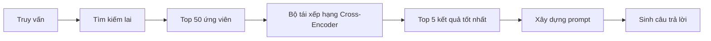
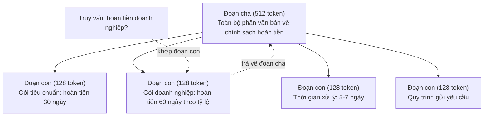
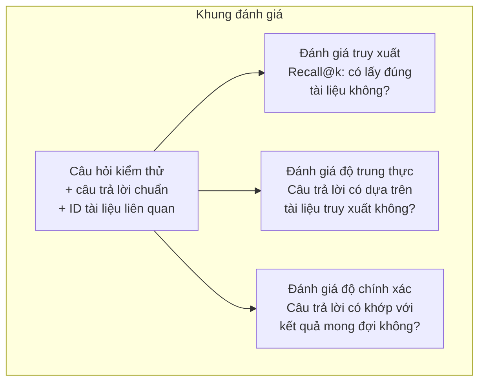

# RAG nâng cao (Phân đoạn, Tái xếp hạng, Tìm kiếm lai)

> RAG cơ bản chỉ truy xuất k đoạn văn bản tương đồng nhất (top-k most similar chunks). Cách tiếp cận này hiệu quả với các câu hỏi đơn giản, nhưng sẽ sụp đổ trước các bài toán suy luận đa bước (multi-hop reasoning), các truy vấn mơ hồ và các tập ngữ liệu quy mô lớn. RAG nâng cao (Advanced RAG) chính là lằn ranh khác biệt giữa một bản demo chạy được trên 10 tài liệu và một hệ thống vận hành thực tế ổn định trên 10 triệu văn bản.

**Loại:** Xây dựng (Build)
**Ngôn ngữ:** Python
**Điều kiện tiên quyết:** Giai đoạn 11, Bài học 06 (RAG)
**Thời lượng:** ~90 phút
**Liên quan:** Giai đoạn 5 · Bài 23 (Chiến lược phân đoạn cho RAG) trình bày chi tiết cả sáu thuật toán phân đoạn — đệ quy (recursive), ngữ nghĩa (semantic), theo câu (sentence), tài liệu cha (parent-document), phân đoạn muộn (late chunking), truy xuất theo ngữ cảnh (contextual retrieval) — cùng với kết quả đo chuẩn (benchmarks) của Vectara/Anthropic. Bài học này xây dựng tiếp nối dựa trên nền tảng đó: tìm kiếm lai (hybrid search), tái xếp hạng (reranking) và biến đổi truy vấn (query transformation).

## Mục tiêu học tập

- Cài đặt các chiến lược phân đoạn nâng cao (advanced chunking strategies: ngữ nghĩa, đệ quy, cha-con) giúp bảo toàn cấu trúc văn bản và ngữ cảnh
- Xây dựng một đường ống tìm kiếm lai (hybrid search pipeline) kết hợp thuật toán khớp từ khóa BM25 với tìm kiếm vectơ ngữ nghĩa (semantic vector search) và mô hình tái xếp hạng cross-encoder (cross-encoder reranker)
- Áp dụng các kỹ thuật biến đổi truy vấn (query transformation: HyDE, đa truy vấn, lùi bước / step-back) để cải thiện độ chính xác truy xuất trước các câu hỏi mơ hồ hoặc phức tạp
- Chẩn đoán và khắc phục các lỗi RAG phổ biến: truy xuất nhầm đoạn văn bản, thông tin cần tìm không có trong ngữ cảnh, suy luận đa bước bị đứt gãy

## Vấn đề đặt ra

Bạn đã xây dựng một đường ống RAG cơ bản trong Bài học 06. Nó hoạt động tốt với các câu hỏi trực diện trên một tập ngữ liệu nhỏ. Bây giờ hãy thử các trường hợp sau:

**Truy vấn mơ hồ (Ambiguous query)**: "Doanh thu quý trước là bao nhiêu?" Tìm kiếm ngữ nghĩa trả về các đoạn viết về chiến lược doanh thu, dự phóng doanh thu và chia sẻ của Giám đốc tài chính (CFO) về tăng trưởng doanh thu. Tất cả đều tương đồng về mặt ngữ nghĩa với từ "doanh thu" (revenue). Nhưng không đoạn nào chứa con số thực tế. Đoạn chứa câu trả lời đúng lại ghi là "47,2 triệu USD trong Quý 3 năm 2025" nhưng dùng từ "thu nhập / lợi nhuận" (earnings) thay vì "doanh thu" (revenue). Mô hình nhúng (embedding model) đánh giá "chiến lược doanh thu" gần với câu truy vấn hơn là "lợi nhuận Quý 3 là 47,2 triệu USD".

**Câu hỏi suy luận đa bước (Multi-hop question)**: "Đội ngũ nào có mức cải thiện điểm hài lòng khách hàng cao nhất?" Câu hỏi này đòi hỏi phải tìm điểm hài lòng của từng đội ngũ, so sánh chúng và xác định giá trị lớn nhất. Không một đoạn văn bản đơn lẻ nào chứa toàn bộ câu trả lời. Thông tin nằm rải rác trên báo cáo của nhiều nhóm khác nhau.

**Bài toán ngữ liệu lớn (Large corpus problem)**: Bạn có 2 triệu đoạn văn bản. Câu trả lời chính xác nằm ở đoạn số 1.847.293. Cơ chế truy xuất top-5 lại lấy ra các đoạn số 14, số 89.201, số 1.200.000, số 44 và số 901.333. Chúng rất gần trong không gian nhúng (embedding space), nhưng không đoạn nào chứa câu trả lời. Ở quy mô này, thuật toán tìm kiếm láng giềng gần nhất xấp xỉ (approximate nearest neighbor search) tạo ra sai số đủ lớn để đẩy các kết quả thực sự liên quan ra khỏi top-k.

RAG cơ bản thất bại vì độ tương đồng vectơ (vector similarity) không đồng nhất với độ liên quan thực sự (relevance). Một đoạn văn bản có thể tương đồng về mặt ngữ nghĩa với câu truy vấn nhưng hoàn toàn vô dụng trong việc trả lời câu hỏi đó. RAG nâng cao giải quyết hạn chế này bằng bốn kỹ thuật: tìm kiếm lai (bổ sung khớp từ khóa), tái xếp hạng (chấm điểm kỹ lưỡng hơn cho các ứng viên), biến đổi truy vấn (tối ưu hóa câu truy vấn trước khi tìm kiếm) và phân đoạn tốt hơn (truy xuất ở độ chi tiết phù hợp).

## Khái niệm

### Tìm kiếm lai: Ngữ nghĩa + Từ khóa

Tìm kiếm ngữ nghĩa (độ tương đồng vectơ) rất giỏi trong việc nắm bắt hàm ý. Câu hỏi "Làm thế nào để hủy đăng ký dịch vụ?" khớp tốt với "Các bước chấm dứt gói thuê bao" dù chúng không chung từ nào. Tuy nhiên, nó lại bỏ sót các kết quả khớp chính xác từng từ. Mã lỗi "E-4021" có thể không khớp với đoạn văn bản chứa đúng từ "E-4021" nếu mô hình nhúng coi chuỗi ký tự đó là nhiễu.

Tìm kiếm theo từ khóa (BM25) mang đặc tính ngược lại. Nó vượt trội ở khả năng khớp chính xác. Cụm từ "E-4021" sẽ khớp hoàn hảo. Nhưng câu hỏi "hủy đăng ký dịch vụ" sẽ trả về 0 kết quả nếu tài liệu chỉ ghi "chấm dứt gói thuê bao".

Tìm kiếm lai (hybrid search) chạy song song cả hai phương pháp, sau đó hợp nhất các kết quả lại với nhau.

**BM25** (Best Matching 25) là thuật toán tìm kiếm từ khóa tiêu chuẩn, đóng vai trò xương sống của các công cụ tìm kiếm từ thập niên 1990. Công thức tính:

```text
BM25(q, d) = tổng các từ t trong truy vấn q:
    IDF(t) * (tf(t,d) * (k1 + 1)) / (tf(t,d) + k1 * (1 - b + b * |d| / avgdl))
```

Trong đó, `tf(t,d)` là tần suất từ (term frequency) của từ `t` trong tài liệu `d`, `IDF(t)` là tần suất nghịch đảo tài liệu (inverse document frequency), `|d|` là độ dài tài liệu, `avgdl` là độ dài trung bình của các tài liệu trong tập dữ liệu, `k1` là tham số điều tiết mức bão hòa tần suất từ (mặc định 1.2), và `b` là tham số chuẩn hóa theo độ dài (mặc định 0.75).

Nói một cách dễ hiểu: BM25 chấm điểm tài liệu cao hơn khi nó chứa các từ khóa của truy vấn (đặc biệt là các từ hiếm), nhưng điểm số sẽ bão hòa dần đối với các từ lặp lại nhiều lần. Một tài liệu chứa từ "doanh thu" 50 lần không có nghĩa là nó liên quan gấp 50 lần so với một tài liệu chỉ xuất hiện từ đó một lần.

### Hợp nhất thứ hạng nghịch đảo (Reciprocal Rank Fusion - RRF)

Khi bạn có hai danh sách xếp hạng: một từ tìm kiếm vectơ, một từ BM25, làm thế nào để kết hợp chúng? Hợp nhất thứ hạng nghịch đảo (Reciprocal Rank Fusion - RRF) là phương pháp chuẩn mực.

```text
RRF_score(d) = tổng trên các danh sách xếp hạng R:
    1 / (k + rank_R(d))
```

Trong đó `k` là hằng số (thường đặt là 60) nhằm ngăn chặn kết quả xếp hạng quán quân chi phối toàn bộ điểm số.

Một tài liệu xếp hạng #1 trong tìm kiếm vectơ và #5 trong BM25 sẽ có điểm: `1/(60+1) + 1/(60+5) = 0.0164 + 0.0154 = 0.0318`.

Một tài liệu xếp hạng #3 trong tìm kiếm vectơ và #2 trong BM25 sẽ có điểm: `1/(60+3) + 1/(60+2) = 0.0159 + 0.0161 = 0.0320`.

RRF cân bằng tự nhiên giữa hai tín hiệu. Tài liệu có thứ hạng cao trong cả hai danh sách sẽ đạt điểm số cao nhất. Tài liệu xếp thứ nhất ở một danh sách nhưng hoàn toàn vắng mặt ở danh sách kia chỉ nhận được mức điểm vừa phải. Phương pháp này rất bền bỉ vì nó dựa trên thứ hạng (ranks) chứ không phụ thuộc vào phân phối điểm số gốc (raw scores), triệt tiêu sự chênh lệch phân phối điểm giữa hai hệ thống.

### Tái xếp hạng (Reranking)

Quá trình truy xuất ban đầu (dù là vectơ, từ khóa hay lai) rất nhanh nhưng thiếu độ chính xác cao. Nó sử dụng mô hình mã hóa kép (bi-encoders): câu truy vấn và từng tài liệu được chuyển đổi thành vectơ độc lập với nhau, sau đó mới tính độ tương đồng. Các vectơ tài liệu chỉ cần tính toán một lần và lưu vào bộ nhớ đệm (cache), cho phép mở rộng quy mô lên hàng triệu tài liệu.

Giai đoạn tái xếp hạng sử dụng mô hình mã hóa chéo (cross-encoders): câu truy vấn và văn bản ứng viên được đưa đồng thời vào cùng một mô hình để tính toán điểm liên quan. Mô hình phân tích cả hai đoạn văn bản cùng lúc, cho phép nắm bắt các tương tác ngữ nghĩa tinh tế giữa chúng. Mô hình cross-encoder có thể nhận biết câu hỏi "Lợi nhuận Q3 là bao nhiêu?" có mối liên hệ rất chặt chẽ với đoạn văn bản chứa "47,2 triệu USD trong Q3" ngay cả khi mô hình bi-encoder bỏ qua mối liên hệ này.

Sự đánh đổi ở đây là: cross-encoder chậm hơn từ 100 đến 1.000 lần so với bi-encoder vì phải xử lý từng cặp truy vấn - tài liệu cùng nhau. Bạn không thể tính toán trước điểm cross-encoder cho một triệu tài liệu. Giải pháp thực tế: truy xuất một tập ứng viên tương đối rộng (top-50 từ tìm kiếm lai), sau đó dùng cross-encoder để tái xếp hạng và chọn ra top-5 kết quả cuối cùng.



Các mô hình tái xếp hạng phổ biến (đội hình năm 2026):
- Cohere Rerank 3.5: API dịch vụ quản lý, hỗ trợ đa ngôn ngữ, đạt mức tăng độ bao phủ (recall) cao nhất trên các tập ngữ liệu hỗn hợp
- Voyage rerank-2.5: API dịch vụ quản lý, có độ trễ thấp nhất trong số các tùy chọn đám mây
- Jina-Reranker-v2 Multilingual: trọng số mở (open-weight), hỗ trợ hơn 100 ngôn ngữ
- bge-reranker-v2-m3: trọng số mở, mô hình đường cơ sở (baseline) rất mạnh
- cross-encoder/ms-marco-MiniLM-L-6-v2: trọng số mở, chạy mượt mà trên CPU phục vụ thử nghiệm nguyên mẫu
- ColBERTv2 / Jina-ColBERT-v2: các bộ tái xếp hạng đa vectơ tương tác muộn (late-interaction multi-vector rerankers) — chi phí tính toán là $O(\text{tokens})$ thay vì $O(\text{docs})$ tại thời điểm chấm điểm

### Biến đổi truy vấn (Query Transformation)

Đôi khi điểm nghẽn không nằm ở khâu truy xuất mà nằm ở chính câu hỏi gốc. "Vụ thay đổi chính sách mới hôm nọ là sao ấy nhỉ?" là một truy vấn tìm kiếm rất tệ. Nó không chứa thuật ngữ cụ thể nào. Vectơ nhúng của nó mơ hồ. Không một hệ thống truy xuất nào có thể tìm đúng tài liệu chỉ dựa vào câu hỏi đó.

**Viết lại truy vấn (Query rewriting)**: diễn đạt lại câu hỏi của người dùng thành một truy vấn tìm kiếm tường minh hơn. LLM có thể thực hiện việc này:

```text
Người dùng: "Vụ thay đổi chính sách mới hôm nọ là sao ấy nhỉ?"
Đã viết lại: "Các cập nhật và thay đổi chính sách gần đây"
```

**HyDE (Hypothetical Document Embeddings - Nhúng tài liệu giả định)**: thay vì tìm kiếm bằng câu hỏi trực tiếp, hệ thống yêu cầu LLM sinh ra một câu trả lời giả định, nhúng câu trả lời đó và tìm kiếm các tài liệu thực tế tương đồng với nó.

```text
Truy vấn: "Chính sách hoàn tiền cho khách hàng doanh nghiệp là gì?"
Câu trả lời giả định: "Khách hàng doanh nghiệp được quyền yêu cầu hoàn tiền toàn phần
trong vòng 60 ngày kể từ ngày mua. Số tiền hoàn lại được tính theo tỷ lệ thời gian còn lại
của gói đăng ký và được xử lý trong 5-7 ngày làm việc."
```

Sau đó, nhúng câu trả lời giả định này và tìm kiếm các tài liệu thực tế tương đồng. Ý tưởng cốt lõi: câu trả lời giả định nằm gần câu trả lời thực tế trong không gian nhúng hơn nhiều so với câu hỏi ban đầu. Câu hỏi và câu trả lời có cấu trúc ngôn ngữ rất khác nhau. Bằng cách sinh ra một câu trả lời giả định, bạn đã bắc cầu nối thu hẹp khoảng cách giữa "không gian câu hỏi" và "không gian câu trả lời" trong mô hình nhúng.

HyDE tốn thêm một lượt gọi LLM trước khi truy xuất, làm tăng độ trễ thêm khoảng 500-2000ms. Nhưng đây là sự đánh đổi hoàn toàn xứng đáng khi chất lượng truy xuất trên các câu hỏi thô quá kém.

### Phân đoạn Cha - Con (Parent-Child Chunking)

Kỹ thuật phân đoạn truyền thống buộc chúng ta phải đánh đổi: đoạn nhỏ giúp truy xuất chính xác, nhưng đoạn lớn mới cung cấp đủ ngữ cảnh. Kỹ thuật phân đoạn cha - con (parent-child chunking) xóa bỏ sự đánh đổi này.

Hệ thống lập chỉ mục (index) các đoạn con kích thước nhỏ (ví dụ 128 token) phục vụ truy xuất. Khi một đoạn con được tìm thấy, hệ thống sẽ trả về đoạn cha chứa nó (ví dụ 512 token) để đưa vào prompt. Đoạn con khớp chính xác với câu hỏi, còn đoạn cha cung cấp đầy đủ bối cảnh xung quanh giúp LLM sinh câu trả lời chuẩn xác.



Câu hỏi "hoàn tiền doanh nghiệp?" khớp chính xác với đoạn con C2. Nhưng ngữ cảnh cung cấp cho LLM lại là toàn bộ đoạn cha P, bao gồm cả thông tin về thời gian xử lý và quy trình gửi yêu cầu.

### Lọc siêu dữ liệu (Metadata Filtering)

Trước khi chạy tìm kiếm vectơ, hãy lọc tập ngữ liệu dựa trên siêu dữ liệu (metadata): ngày tạo, nguồn tài liệu, danh mục, tác giả, ngôn ngữ. Điều này giúp thu hẹp không gian tìm kiếm và ngăn chặn các kết quả không liên quan.

Câu hỏi "Chính sách bảo mật đã thay đổi những gì trong tháng trước?" chỉ nên tìm kiếm trong các tài liệu thuộc danh mục bảo mật được tạo trong 30 ngày gần nhất. Nếu không lọc siêu dữ liệu, hệ thống phải quét toàn bộ kho tài liệu và có thể lấy nhầm một tài liệu bảo mật từ 2 năm trước chỉ vì nó có độ tương đồng ngữ nghĩa cao.

Các hệ thống RAG trong môi trường sản xuất luôn lưu trữ siêu dữ liệu kèm theo mỗi đoạn: tài liệu gốc, ngày tạo, phân loại, tác giả, phiên bản. Các cơ sở dữ liệu vectơ (vector databases) hỗ trợ tính năng lọc trước theo siêu dữ liệu (pre-filtering) trước khi tính toán độ tương đồng, đây là yếu tố sống còn cho hiệu năng ở quy mô lớn.

### Đánh giá (Evaluation)

Sau khi hoàn thiện hệ thống RAG, làm thế nào để bạn biết nó hoạt động tốt hay không? Dưới đây là ba chỉ số quan trọng:

**Độ liên quan truy xuất (Retrieval relevance - Recall@k)**: đối với một tập câu hỏi kiểm thử đã biết trước tài liệu liên quan, có bao nhiêu phần trăm tài liệu đúng xuất hiện trong top-k kết quả? Nếu câu trả lời nằm ở đoạn số 47, liệu đoạn số 47 có lọt vào top-5 hay không?

**Độ trung thực (Faithfulness)**: câu trả lời được sinh ra có bám sát ngữ cảnh của các tài liệu truy xuất hay không? Nếu các đoạn văn bản trả về ghi rõ "thời hạn hoàn tiền 60 ngày" nhưng mô hình lại trả lời "thời hạn hoàn tiền 90 ngày", đó là lỗi vi phạm độ trung thực. Mô hình đã tự bịa đặt (hallucinated) dù có sẵn ngữ cảnh chính xác.

**Độ chính xác của câu trả lời (Answer correctness)**: câu trả lời sinh ra có khớp với câu trả lời chuẩn (ground truth) hay không? Đây là chỉ số đo lường toàn diện từ đầu đến cuối (end-to-end), kết hợp cả chất lượng truy xuất lẫn năng lực sinh văn bản.

Một phương pháp kiểm tra độ trung thực đơn giản: bóc tách từng khẳng định trong câu trả lời đã sinh và đối chiếu xem nội dung đó có xuất hiện trong các đoạn văn bản truy xuất hay không. Nếu câu trả lời chứa một thông tin không hề có trong ngữ cảnh, rất có thể mô hình đã bị ảo giác.



```figure
agentic-rag-loop
```

## Tự xây dựng (Build It)

### Bước 1: Cài đặt BM25

```python
import math
from collections import Counter

class BM25:
    def __init__(self, k1=1.2, b=0.75):
        self.k1 = k1
        self.b = b
        self.docs = []
        self.doc_lengths = []
        self.avg_dl = 0
        self.doc_freqs = {}
        self.n_docs = 0

    def index(self, documents):
        self.docs = documents
        self.n_docs = len(documents)
        self.doc_lengths = []
        self.doc_freqs = {}

        for doc in documents:
            words = doc.lower().split()
            self.doc_lengths.append(len(words))
            unique_words = set(words)
            for word in unique_words:
                self.doc_freqs[word] = self.doc_freqs.get(word, 0) + 1

        self.avg_dl = sum(self.doc_lengths) / self.n_docs if self.n_docs else 1

    def score(self, query, doc_idx):
        query_words = query.lower().split()
        doc_words = self.docs[doc_idx].lower().split()
        doc_len = self.doc_lengths[doc_idx]
        word_counts = Counter(doc_words)
        score = 0.0

        for term in query_words:
            if term not in word_counts:
                continue
            tf = word_counts[term]
            df = self.doc_freqs.get(term, 0)
            idf = math.log((self.n_docs - df + 0.5) / (df + 0.5) + 1)
            numerator = tf * (self.k1 + 1)
            denominator = tf + self.k1 * (1 - self.b + self.b * doc_len / self.avg_dl)
            score += idf * numerator / denominator

        return score

    def search(self, query, top_k=10):
        scores = [(i, self.score(query, i)) for i in range(self.n_docs)]
        scores.sort(key=lambda x: x[1], reverse=True)
        return scores[:top_k]
```

### Bước 2: Hợp nhất thứ hạng nghịch đảo (RRF)

```python
def reciprocal_rank_fusion(ranked_lists, k=60):
    scores = {}
    for ranked_list in ranked_lists:
        for rank, (doc_id, _) in enumerate(ranked_list):
            if doc_id not in scores:
                scores[doc_id] = 0.0
            scores[doc_id] += 1.0 / (k + rank + 1)
    fused = sorted(scores.items(), key=lambda x: x[1], reverse=True)
    return fused
```

### Bước 3: Đường ống tìm kiếm lai (Hybrid Search Pipeline)

```python
def hybrid_search(query, chunks, vector_embeddings, vocab, idf, bm25_index, top_k=5, fusion_k=60):
    query_emb = tfidf_embed(query, vocab, idf)
    vector_results = search(query_emb, vector_embeddings, top_k=top_k * 3)
    bm25_results = bm25_index.search(query, top_k=top_k * 3)
    fused = reciprocal_rank_fusion([vector_results, bm25_results], k=fusion_k)
    return fused[:top_k]
```

### Bước 4: Bộ tái xếp hạng đơn giản (Simple Reranker)

Trong môi trường thực tế, bạn sẽ sử dụng một mô hình cross-encoder hoàn chỉnh. Ở đây chúng ta xây dựng một bộ tái xếp hạng tính toán mức độ liên quan giữa truy vấn và tài liệu dựa trên độ trùng lặp từ, tầm quan trọng của thuật ngữ và mức độ khớp cụm từ (phrase matching).

```python
def rerank(query, candidates, chunks):
    query_words = set(query.lower().split())
    stop_words = {"the", "a", "an", "is", "are", "was", "were", "what", "how",
                  "why", "when", "where", "do", "does", "for", "of", "in", "to",
                  "and", "or", "on", "at", "by", "it", "its", "this", "that",
                  "with", "from", "be", "has", "have", "had", "not", "but"}
    query_terms = query_words - stop_words

    scored = []
    for doc_id, initial_score in candidates:
        chunk = chunks[doc_id].lower()
        chunk_words = set(chunk.split())

        term_overlap = len(query_terms & chunk_words)

        query_bigrams = set()
        q_list = [w for w in query.lower().split() if w not in stop_words]
        for i in range(len(q_list) - 1):
            query_bigrams.add(q_list[i] + " " + q_list[i + 1])
        bigram_matches = sum(1 for bg in query_bigrams if bg in chunk)

        position_boost = 0
        for term in query_terms:
            pos = chunk.find(term)
            if pos != -1 and pos < len(chunk) // 3:
                position_boost += 0.5

        rerank_score = (
            term_overlap * 1.0
            + bigram_matches * 2.0
            + position_boost
            + initial_score * 5.0
        )
        scored.append((doc_id, rerank_score))

    scored.sort(key=lambda x: x[1], reverse=True)
    return scored
```

### Bước 5: HyDE (Nhúng tài liệu giả định)

```python
def hyde_generate_hypothesis(query):
    templates = {
        "what": "The answer to '{query}' is as follows: Based on our documentation, {topic} involves specific policies and procedures that define how the process works.",
        "how": "To address '{query}': The process involves several steps. First, you need to initiate the request. Then, the system processes it according to the defined rules.",
        "default": "Regarding '{query}': Our records indicate specific details and policies related to this topic that provide a comprehensive answer."
    }
    query_lower = query.lower()
    if query_lower.startswith("what"):
        template = templates["what"]
    elif query_lower.startswith("how"):
        template = templates["how"]
    else:
        template = templates["default"]

    topic_words = [w for w in query.lower().split()
                   if w not in {"what", "is", "the", "how", "do", "does", "a", "an",
                                "for", "of", "to", "in", "on", "at", "by", "and", "or"}]
    topic = " ".join(topic_words) if topic_words else "this topic"

    return template.format(query=query, topic=topic)


def hyde_search(query, chunks, vector_embeddings, vocab, idf, top_k=5):
    hypothesis = hyde_generate_hypothesis(query)
    hypothesis_emb = tfidf_embed(hypothesis, vocab, idf)
    results = search(hypothesis_emb, vector_embeddings, top_k)
    return results, hypothesis
```

### Bước 6: Phân đoạn Cha - Con (Parent-Child Chunking)

```python
def create_parent_child_chunks(text, parent_size=200, child_size=50):
    words = text.split()
    parents = []
    children = []
    child_to_parent = {}

    parent_idx = 0
    start = 0
    while start < len(words):
        parent_end = min(start + parent_size, len(words))
        parent_text = " ".join(words[start:parent_end])
        parents.append(parent_text)

        child_start = start
        while child_start < parent_end:
            child_end = min(child_start + child_size, parent_end)
            child_text = " ".join(words[child_start:child_end])
            child_idx = len(children)
            children.append(child_text)
            child_to_parent[child_idx] = parent_idx
            child_start += child_size

        parent_idx += 1
        start += parent_size

    return parents, children, child_to_parent
```

### Bước 7: Đánh giá độ trung thực (Faithfulness Evaluation)

```python
def evaluate_faithfulness(answer, retrieved_chunks):
    answer_sentences = [s.strip() for s in answer.split(".") if len(s.strip()) > 10]
    if not answer_sentences:
        return 1.0, []

    grounded = 0
    ungrounded = []
    context = " ".join(retrieved_chunks).lower()

    for sentence in answer_sentences:
        words = set(sentence.lower().split())
        stop_words = {"the", "a", "an", "is", "are", "was", "were", "and", "or",
                      "to", "of", "in", "for", "on", "at", "by", "it", "this", "that"}
        content_words = words - stop_words
        if not content_words:
            grounded += 1
            continue

        matched = sum(1 for w in content_words if w in context)
        ratio = matched / len(content_words) if content_words else 0

        if ratio >= 0.5:
            grounded += 1
        else:
            ungrounded.append(sentence)

    score = grounded / len(answer_sentences) if answer_sentences else 1.0
    return score, ungrounded


def evaluate_retrieval_recall(queries_with_relevant, retrieval_fn, k=5):
    total_recall = 0.0
    results = []

    for query, relevant_indices in queries_with_relevant:
        retrieved = retrieval_fn(query, k)
        retrieved_indices = set(idx for idx, _ in retrieved)
        relevant_set = set(relevant_indices)
        hits = len(retrieved_indices & relevant_set)
        recall = hits / len(relevant_set) if relevant_set else 1.0
        total_recall += recall
        results.append({
            "query": query,
            "recall": recall,
            "hits": hits,
            "total_relevant": len(relevant_set)
        })

    avg_recall = total_recall / len(queries_with_relevant) if queries_with_relevant else 0
    return avg_recall, results
```

## Sử dụng trong thực tế (Use It)

Sử dụng mô hình cross-encoder thực tế để tái xếp hạng:

```python
from sentence_transformers import CrossEncoder

reranker = CrossEncoder("cross-encoder/ms-marco-MiniLM-L-6-v2")

def rerank_with_cross_encoder(query, candidates, chunks, top_k=5):
    pairs = [(query, chunks[doc_id]) for doc_id, _ in candidates]
    scores = reranker.predict(pairs)
    scored = list(zip([doc_id for doc_id, _ in candidates], scores))
    scored.sort(key=lambda x: x[1], reverse=True)
    return scored[:top_k]
```

Sử dụng dịch vụ tái xếp hạng của Cohere:

```python
import cohere

co = cohere.Client()

def rerank_with_cohere(query, candidates, chunks, top_k=5):
    docs = [chunks[doc_id] for doc_id, _ in candidates]
    response = co.rerank(
        model="rerank-english-v3.0",
        query=query,
        documents=docs,
        top_n=top_k
    )
    return [(candidates[r.index][0], r.relevance_score) for r in response.results]
```

Thực hiện kỹ thuật HyDE với LLM thực tế:

```python
import anthropic

client = anthropic.Anthropic()

def hyde_with_llm(query):
    response = client.messages.create(
        model="claude-sonnet-5",
        max_tokens=256,
        messages=[{
            "role": "user",
            "content": f"Write a short paragraph that would be a good answer to this question. Do not say you don't know. Just write what the answer would look like.\n\nQuestion: {query}"
        }]
    )
    return response.content[0].text
```

Triển khai tìm kiếm lai trong môi trường sản xuất với Weaviate:

```python
import weaviate

client = weaviate.connect_to_local()

collection = client.collections.get("Documents")
response = collection.query.hybrid(
    query="enterprise refund policy",
    alpha=0.5,
    limit=10
)
```

Tham số `alpha` kiểm soát tỷ trọng kết hợp: `0.0` = hoàn toàn theo từ khóa (BM25), `1.0` = hoàn toàn theo vectơ, `0.5` = trọng số tương đương. Phần lớn các hệ thống thực tế thiết lập `alpha` trong khoảng từ 0.3 đến 0.7.

## Đóng gói sản phẩm (Ship It)

Bài học này cung cấp các thành phẩm sau:
- `outputs/prompt-advanced-rag-debugger.md` -- prompt chuyên dụng để chẩn đoán và khắc phục các sự cố chất lượng RAG
- `outputs/skill-advanced-rag.md` -- kỹ năng xây dựng hệ thống RAG cấp sản xuất hoàn chỉnh với tìm kiếm lai và tái xếp hạng

## Bài tập thực hành (Exercises)

1. So sánh BM25, tìm kiếm vectơ và tìm kiếm lai trên tập tài liệu mẫu. Đối với mỗi câu trong số 5 truy vấn kiểm thử, hãy ghi lại phương pháp nào trả về đoạn văn bản phù hợp nhất ở vị trí số 1. Tìm kiếm lai cần phải vượt trội ở ít nhất 3 trên 5 trường hợp.

2. Cài đặt bộ lọc siêu dữ liệu (metadata filter). Bổ sung trường "category" cho mỗi tài liệu (security, billing, api, product). Trước khi chạy tìm kiếm vectơ, hãy lọc các đoạn văn bản theo đúng danh mục liên quan. Thử nghiệm với câu hỏi "What encryption is used?" và xác thực hệ thống chỉ tìm kiếm trong các đoạn thuộc danh mục security.

3. Xây dựng một đường ống HyDE hoàn chỉnh sử dụng hàm sinh câu trả lời đơn giản từ Bài học 06. So sánh chất lượng truy xuất (độ liên quan trong top-3) giữa tìm kiếm trực tiếp bằng câu hỏi và tìm kiếm qua HyDE trên cả 5 truy vấn kiểm thử. HyDE cần cải thiện rõ rệt kết quả đối với các câu hỏi mơ hồ.

4. Cài đặt chiến lược phân đoạn cha - con trên các tài liệu mẫu với tham số `child_size=30` và `parent_size=100`. Tìm kiếm bằng đoạn con nhưng chèn đoạn cha vào prompt. So sánh câu trả lời được sinh ra với phương pháp phân đoạn tiêu chuẩn có `chunk_size=50`.

5. Xây dựng một tập dữ liệu đánh giá gồm 10 câu hỏi kèm các đoạn văn bản chứa câu trả lời chuẩn. Đo lường Recall@3, Recall@5 và Recall@10 cho: (a) chỉ tìm kiếm vectơ, (b) chỉ tìm kiếm BM25, (c) tìm kiếm lai, (d) tìm kiếm lai kết hợp tái xếp hạng. Vẽ biểu đồ kết quả và chỉ ra những trường hợp mà việc tái xếp hạng mang lại lợi ích lớn nhất.

## Thuật ngữ cốt lõi (Key Terms)

| Thuật ngữ | Cách hiểu thông thường | Bản chất kỹ thuật |
|-----------|------------------------|-------------------|
| BM25 | "Tìm kiếm từ khóa" | Thuật toán xếp hạng xác suất chấm điểm tài liệu dựa trên tần suất từ (tf), tần suất nghịch đảo tài liệu (idf) và chuẩn hóa độ dài tài liệu |
| Tìm kiếm lai (Hybrid search) | "Tận dụng ưu điểm cả hai" | Chạy song song tìm kiếm ngữ nghĩa (vectơ) và tìm kiếm từ khóa (BM25), sau đó hợp nhất kết quả bằng kỹ thuật rank fusion |
| Hợp nhất thứ hạng nghịch đảo (Reciprocal Rank Fusion - RRF) | "Trộn danh sách xếp hạng" | Kết hợp nhiều danh sách xếp hạng bằng cách tính tổng 1/(k + thứ hạng) của mỗi tài liệu trên tất cả các danh sách |
| Tái xếp hạng (Reranking) | "Chấm điểm lượt hai" | Sử dụng mô hình cross-encoder phức tạp hơn để chấm điểm lại tập tài liệu ứng viên từ vòng truy xuất ban đầu |
| Cross-encoder | "Mô hình kết hợp truy vấn - tài liệu" | Mô hình tiếp nhận truy vấn và tài liệu trong một đầu vào duy nhất để xuất ra điểm liên quan; chính xác hơn bi-encoder nhưng quá chậm để quét toàn bộ ngữ liệu |
| Bi-encoder | "Mô hình nhúng độc lập" | Mô hình nhúng câu truy vấn và tài liệu một cách riêng biệt; tốc độ rất nhanh do vectơ được tính toán trước nhưng độ chính xác thấp hơn cross-encoder |
| HyDE | "Tìm kiếm bằng câu trả lời giả lập" | Sinh một câu trả lời giả định cho truy vấn, chuyển thành vectơ nhúng và dùng nó để tìm kiếm các tài liệu thực tế tương đồng |
| Phân đoạn cha - con (Parent-child chunking) | "Tìm kiếm đoạn nhỏ, ngữ cảnh đoạn lớn" | Lập chỉ mục các đoạn nhỏ để truy xuất chính xác nhưng trả về đoạn cha lớn hơn nhằm cung cấp đầy đủ ngữ cảnh |
| Lọc siêu dữ liệu (Metadata filtering) | "Thu hẹp trước khi tìm kiếm" | Lọc tài liệu theo thuộc tính (ngày, nguồn, danh mục) trước khi tính toán độ tương đồng vectơ để giảm không gian tìm kiếm |
| Độ trung thực (Faithfulness) | "Có bám sát dữ liệu không" | Mức độ mà câu trả lời sinh ra được bảo chứng bởi các tài liệu truy xuất, không bị ảo giác dựa trên dữ liệu huấn luyện của mô hình |

## Đọc thêm (Further Reading)

- Robertson & Zaragoza, "The Probabilistic Relevance Framework: BM25 and Beyond" (2009) -- tài liệu tham khảo kinh điển về BM25, giải thích nền tảng xác suất đằng sau công thức
- Cormack et al., "Reciprocal Rank Fusion Outperforms Condorcet and Individual Rank Learning Methods" (2009) -- bài báo gốc về RRF chứng minh phương pháp này vượt trội hơn các kỹ thuật hợp nhất thứ hạng phức tạp khác
- Gao et al., "Precise Zero-Shot Dense Retrieval without Relevance Labels" (2022) -- bài báo về HyDE chứng minh rằng việc nhúng tài liệu giả định giúp cải thiện chất lượng truy xuất mà không cần bất kỳ dữ liệu huấn luyện nào
- Nogueira & Cho, "Passage Re-ranking with BERT" (2019) -- chứng minh việc tái xếp hạng bằng cross-encoder trên nền BM25 giúp tăng đáng kể chất lượng truy xuất
- [Khattab et al., "DSPy: Compiling Declarative Language Model Calls into Self-Improving Pipelines" (2023)](https://arxiv.org/abs/2310.03714) -- xem việc xây dựng prompt và lựa chọn trọng số như một bài toán tối ưu hóa trên các đường ống truy xuất; tài liệu nền tảng cho tư duy "lập trình LLM" thay vì "viết prompt cho LLM"
- [Edge et al., "From Local to Global: A Graph RAG Approach to Query-Focused Summarization" (Microsoft Research 2024)](https://arxiv.org/abs/2404.16130) -- bài báo về GraphRAG: trích xuất thực thể - quan hệ kết hợp thuật toán phát hiện cộng đồng Leiden cho bài toán tóm tắt định hướng truy vấn; làm rõ sự khác biệt giữa truy xuất cục bộ và toàn cục
- [Asai et al., "Self-RAG: Learning to Retrieve, Generate, and Critique through Self-Reflection" (ICLR 2024)](https://arxiv.org/abs/2310.11511) -- hệ thống RAG tự đánh giá bằng token tự suy ngẫm; bước đột phá dạng tác tử vượt lên trên quy trình truy xuất-rồi-sinh tĩnh
- [LangChain Query Construction blog](https://blog.langchain.dev/query-construction/) -- cách chuyển đổi các câu hỏi ngôn ngữ tự nhiên thành truy vấn cơ sở dữ liệu có cấu trúc (Text-to-SQL, Cypher) như một bước tiền truy xuất
