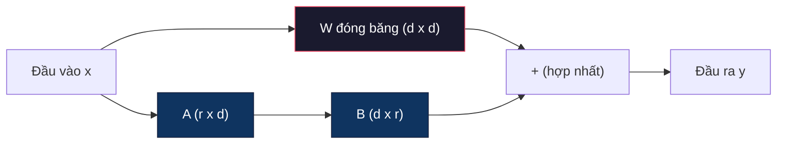
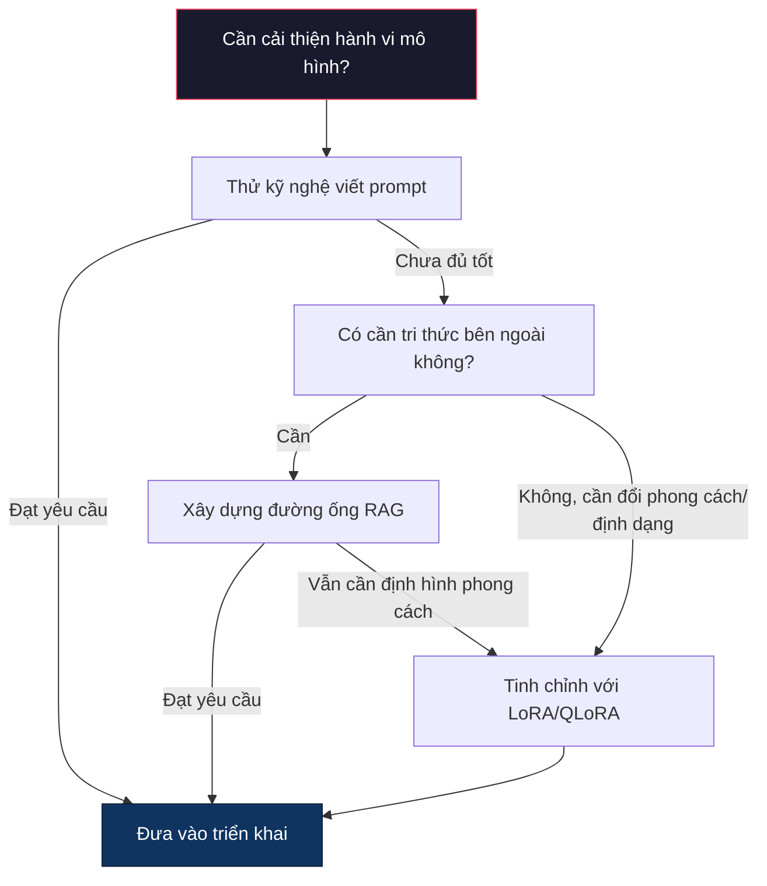

# Tinh chỉnh mô hình với LoRA & QLoRA (Fine-Tuning with LoRA & QLoRA)

> Tinh chỉnh toàn phần (full fine-tuning) một mô hình 7B đòi hỏi tới 56GB VRAM. Bạn không có ngần ấy tài nguyên, và phần lớn các doanh nghiệp cũng vậy. LoRA cho phép bạn tinh chỉnh cùng mô hình đó chỉ với 6GB VRAM bằng cách huấn luyện chưa tới 1% tổng số tham số. Đây không hề là sự thỏa hiệp về chất lượng -- nó tương đương với kết quả tinh chỉnh toàn phần trên hầu hết các tác vụ. Toàn bộ hệ sinh thái tinh chỉnh nguồn mở hiện nay đều vận hành dựa trên cơ chế đột phá này.

**Loại:** Xây dựng (Build)
**Ngôn ngữ:** Python
**Điều kiện tiên quyết:** Giai đoạn 10, Bài học 06 (Tinh chỉnh theo chỉ dẫn / SFT)
**Thời lượng:** ~75 phút
**Liên quan:** Giai đoạn 10 trình bày các vòng lặp SFT/DPO từ nền tảng toán học. Bài học này sẽ tích hợp các kiến thức đó vào các bộ công cụ PEFT hiện đại năm 2026 (PEFT, TRL, Unsloth, Axolotl, LLaMA-Factory).

## Mục tiêu học tập

- Cài đặt LoRA bằng cách chèn các ma trận bộ điều hợp hạng thấp (low-rank adapter matrices: A và B) vào các lớp chú ý (attention layers) của một mô hình đã tiền huấn luyện
- Tính toán lượng tham số tiết kiệm được của LoRA so với tinh chỉnh toàn phần (full fine-tuning): với hạng $r$ và số chiều $d_{\text{model}}$, ta chỉ huấn luyện $2 \cdot r \cdot d$ tham số thay vì $d^2$
- Tinh chỉnh mô hình sử dụng QLoRA (mô hình gốc lượng tử hóa 4-bit + bộ điều hợp LoRA) để vừa vặn trong bộ nhớ GPU người dùng phổ thông (consumer GPU)
- Hợp nhất (merge) trọng số LoRA ngược trở lại mô hình gốc phục vụ triển khai và so sánh tốc độ suy luận (inference speed) khi có và không có bộ điều hợp

## Vấn đề đặt ra

Bạn có một mô hình nền tảng, ví dụ Llama 3 8B. Bạn muốn mô hình này trả lời các phiếu hỗ trợ khách hàng (support tickets) theo đúng văn phong thương hiệu của công ty. Tinh chỉnh có giám sát (Supervised Fine-Tuning - SFT) là giải pháp tiêu chuẩn. Nhưng SFT lại vấp phải bài toán chi phí tài nguyên khổng lồ.

Tinh chỉnh toàn phần cập nhật mọi tham số trong mô hình. Llama 3 8B có 8 tỷ tham số. Ở định dạng nửa độ chính xác (fp16), mỗi tham số chiếm 2 byte. Bạn mất đứt 16GB VRAM chỉ để nạp trọng số mô hình. Trong quá trình huấn luyện, bạn còn cần thêm bộ nhớ cho gradient (16GB), trạng thái bộ tối ưu hóa Adam (32GB cho momentum + phương sai), và các giá trị kích hoạt (activations). Tổng cộng: xấp xỉ 56GB VRAM chỉ cho một mô hình 8B duy nhất.

Một GPU cao cấp như A100 80GB cũng chỉ vừa đủ để gánh tải này. Hai GPU A100 có giá thuê khoảng 3-4 USD/giờ trên các dịch vụ đám mây. Huấn luyện 3 kỷ nguyên (epochs) trên 50.000 mẫu dữ liệu mất từ 6 đến 10 giờ, tương đương 30-40 USD cho mỗi lần thử nghiệm. Chạy 10 lần thử nghiệm để tìm ra bộ siêu tham số tối ưu và bạn đã tiêu tốn tới 400 USD trước khi triển khai được bất kỳ thứ gì ra môi trường thực tế.

Nếu nâng quy mô lên mô hình Llama 3 70B, các con số sẽ trở nên bất khả thi đối với đa số lập trình viên: 140GB chỉ riêng cho trọng số, bắt buộc phải dùng cụm máy chủ đa GPU với chi phí hàng trăm USD cho mỗi lần huấn luyện.

Chưa dừng lại ở đó, tinh chỉnh toàn phần còn tiềm ẩn một nguy cơ bản chất: nó can thiệp vào tất cả trọng số của mạng nơ-ron. Khi bạn huấn luyện mô hình trên dữ liệu chăm sóc khách hàng, mô hình có thể bị suy giảm năng lực tư duy tổng quát vốn có. Hiện tượng này được gọi là "quên thảm họa" (catastrophic forgetting) — mô hình làm tốt tác vụ cụ thể của bạn nhưng lại kém đi ở mọi khía cạnh khác.

Chúng ta cần một phương pháp huấn luyện ít tham số hơn, tiêu tốn ít bộ nhớ hơn và không phá hủy tri thức sẵn có của mô hình gốc.

## Khái niệm

### LoRA: Thích ứng hạng thấp (Low-Rank Adaptation)

Edward Hu và các đồng sự tại Microsoft đã công bố LoRA vào tháng 6 năm 2021. Khám phá cốt lõi của bài báo là: các cập nhật trọng số trong quá trình tinh chỉnh thực chất có hạng nội tại (intrinsic rank) rất thấp. Bạn không cần thiết phải cập nhật toàn bộ 16,7 triệu tham số trong một ma trận trọng số kích thước 4096x4096. Thông tin hữu ích trong việc thích ứng hoàn toàn có thể được nén trọn vẹn trong một ma trận có hạng chỉ là 16 hoặc 32.

Xét về mặt toán học, một lớp tuyến tính (linear layer) tiêu chuẩn tính toán:

```math
y = Wx
```

Trong đó $W$ là ma trận kích thước $d_{\text{out}} \times d_{\text{in}}$. Đối với phép chiếu chú ý (attention projection) kích thước 4096x4096, ma trận này chứa 16.777.216 tham số.

LoRA sẽ đóng băng (freeze) ma trận trọng số $W$ và cộng thêm một thành phần phân rã hạng thấp:

```math
y = Wx + BAx
```

Trong đó $B$ có kích thước $(d_{\text{out}} \times r)$ và $A$ có kích thước $(r \times d_{\text{in}})$. Hạng $r$ nhỏ hơn rất nhiều so với $d$ -- thông thường chỉ là 8, 16 hoặc 32.

Với $r=16$ trên một lớp 4096x4096:
- Số tham số gốc: 4096 x 4096 = 16.777.216
- Số tham số LoRA: (4096 x 16) + (16 x 4096) = 65.536 + 65.536 = 131.072
- Mức độ cắt giảm: 131.072 / 16.777.216 = 0,78%

Bạn chỉ cần huấn luyện đúng 0,78% số lượng tham số nhưng lại thu về 95-100% chất lượng của việc tinh chỉnh toàn phần.



Ma trận A được khởi tạo theo phân phối Gauss ngẫu nhiên, còn ma trận B được khởi tạo bằng 0. Điều này đảm bảo tích số $BA$ ban đầu bằng 0 -- nghĩa là mô hình bắt đầu huấn luyện từ đúng hành vi nguyên bản của nó và dần dần tiếp thu tri thức thích ứng mới.

### Hệ số tỷ lệ: Alpha (The Scaling Factor: Alpha)

LoRA giới thiệu một hệ số tỷ lệ $\alpha$ nhằm kiểm soát mức độ tác động của cập nhật hạng thấp lên đầu ra cuối cùng:

```math
y = Wx + \frac{\alpha}{r} \cdot BAx
```

Khi $\alpha = r$, tỷ lệ co giãn là 1x. Khi $\alpha = 2r$ (thiết lập mặc định phổ biến), tỷ lệ là 2x. Siêu tham số này cho phép điều chỉnh tốc độ học (learning rate) của nhánh LoRA một cách độc lập với tốc độ học của mô hình nền tảng.

Kinh nghiệm thực hành:
- Thiết lập $\alpha = 2 \cdot \text{rank}$ là quy ước cộng đồng thường dùng (trong bài báo gốc, tác giả dùng $\alpha = \text{rank}$ cho phần lớn thử nghiệm)
- $\alpha = \text{rank}$ đem lại tỷ lệ 1x, mang tính thận trọng và rất ổn định
- Giá trị $\alpha$ cao hơn đồng nghĩa với bước cập nhật lớn hơn sau mỗi chu kỳ, có thể tăng tốc độ hội tụ nhưng cũng dễ gây mất ổn định huấn luyện

### Vị trí áp dụng LoRA (Where to Apply LoRA)

Mô hình transformer có rất nhiều lớp tuyến tính. Bạn không nhất thiết phải gắn LoRA vào tất cả các lớp đó. Bài báo gốc đã thử nghiệm nhiều cấu hình kết hợp:

| Lớp đích (Target Layers) | Tham số huấn luyện (mô hình 7B) | Chất lượng |
|-------------------------|---------------------------------|------------|
| Chỉ q_proj | 4,7M | Tốt |
| q_proj + v_proj | 9,4M | Tốt hơn |
| q_proj + k_proj + v_proj + o_proj | 18,9M | Tốt nhất cho cơ chế chú ý |
| Toàn bộ lớp tuyến tính (attention + MLP) | 37,7M | Cải thiện nhẹ, tăng gấp đôi tham số |

Điểm cân bằng lý tưởng cho hầu hết tác vụ là: `q_proj + v_proj`. Cấu hình này nhắm thẳng vào các phép chiếu truy vấn (query) và giá trị (value) trong khối tự chú ý (self-attention) — hai thành phần quyết định mô hình sẽ tập trung vào đâu và trích xuất thông tin gì. Việc bổ sung thêm các lớp MLP có thể giúp ích cho các tác vụ suy luận phức tạp như sinh mã nguồn, nhưng sẽ làm tăng gấp đôi số lượng tham số trong khi hiệu quả mang lại trên các bài toán thông thường không quá rõ rệt.

### Lựa chọn hạng (Rank Selection)

Hạng $r$ quyết định năng lực biểu diễn (expressiveness) của phần điều hợp:

| Hạng (Rank) | Tham số huấn luyện (mỗi lớp) | Phù hợp nhất cho |
|-------------|------------------------------|------------------|
| 4 | 32.768 | Phân loại đơn giản, phân tích cảm xúc |
| 8 | 65.536 | Hỏi đáp đơn miền, tóm tắt văn bản |
| 16 | 131.072 | Tác vụ đa miền, tuân theo chỉ dẫn (instruction following) |
| 32 | 262.144 | Suy luận phức tạp, sinh mã nguồn (code generation) |
| 64 | 524.288 | Hiệu quả biên giảm dần trên hầu hết tác vụ |
| 128 | 1.048.576 | Hiếm khi cần thiết |

Hu và các cộng sự đã chỉ ra rằng $r=4$ đã đủ để nắm bắt phần lớn khả năng thích ứng cho các tác vụ đơn giản. Trong thực tế triển khai, $r=8$ và $r=16$ là hai lựa chọn phổ biến nhất. Đẩy hạng lên trên $r=64$ hiếm khi cải thiện được chất lượng và bắt đầu làm mất đi lợi thế tiết kiệm bộ nhớ của LoRA.

### QLoRA: Lượng tử hóa 4-bit + LoRA

Tim Dettmers cùng nhóm nghiên cứu tại Đại học Washington đã công bố QLoRA vào tháng 5 năm 2023. Ý tưởng mang tính cách mạng: lượng tử hóa (quantize) mô hình nền tảng đã đóng băng xuống độ chính xác 4-bit, sau đó gắn các bộ điều hợp LoRA ở định dạng fp16 lên trên.

Cơ chế này thay đổi hoàn toàn bài toán bộ nhớ:

| Phương pháp | Bộ nhớ trọng số (7B) | Bộ nhớ huấn luyện (7B) | Yêu cầu GPU |
|-------------|----------------------|-----------------------|-------------|
| Tinh chỉnh toàn phần (fp16) | 14GB | ~56GB | 1x A100 80GB |
| LoRA (gốc fp16) | 14GB | ~18GB | 1x A100 40GB |
| QLoRA (gốc 4-bit) | 3,5GB | ~6GB | 1x RTX 3090 24GB |

QLoRA đóng góp ba cải tiến kỹ thuật nền tảng:

**NF4 (Normal Float 4-bit)**: Kiểu dữ liệu mới được thiết kế chuyên biệt cho trọng số mạng nơ-ron. Trọng số của mô hình học sâu thường tuân theo phân phối xấp xỉ chuẩn (normal distribution). NF4 định vị 16 mức lượng tử hóa của nó tại các phân vị của phân phối chuẩn tắc. Dưới góc độ lý thuyết thông tin, đây là cách biểu diễn tối ưu cho dữ liệu phân phối chuẩn, giúp bảo toàn nhiều thông tin hơn hẳn so với lượng tử hóa 4-bit đều (INT4) hay Float4 tiêu chuẩn.

**Lượng tử hóa kép (Double quantization)**: Bản thân các hằng số tỷ lệ dùng trong lượng tử hóa cũng ngốn bộ nhớ. Mỗi khối gồm 64 trọng số cần một hệ số co giãn fp32 (4 byte). Với mô hình 7B, con số này phát sinh thêm 0,4GB. Kỹ thuật lượng tử hóa kép tiếp tục lượng tử hóa các hằng số này xuống fp8, giảm mức phụ phí xuống chỉ còn 0,1GB. Tuy nhỏ nhưng rất quý giá khi bộ nhớ chạm ngưỡng giới hạn.

**Bộ tối ưu hóa phân trang (Paged optimizers)**: Trong quá trình huấn luyện, các trạng thái của bộ tối ưu hóa (momentum và phương sai của Adam) có thể vượt quá dung lượng GPU khi xử lý các chuỗi văn bản dài. Cơ chế phân trang tận dụng bộ nhớ hợp nhất (unified memory) của NVIDIA để tự động chuyển bớt trạng thái của bộ tối ưu hóa sang RAM của CPU khi bộ nhớ GPU chạm trần, và nạp lại khi cần thiết. Kỹ thuật này triệt tiêu hoàn toàn lỗi tràn bộ nhớ (Out of Memory - OOM) dù có làm giảm đôi chút thông lượng tính toán.

### Câu hỏi về chất lượng (The Quality Question)

Liệu việc cắt giảm tham số hay lượng tử hóa mô hình gốc có làm suy giảm chất lượng đầu ra? Hãy xem kết quả thực nghiệm từ nhiều công trình nghiên cứu:

| Phương pháp | MMLU (5-shot) | MT-Bench | HumanEval |
|-------------|--------------|----------|-----------|
| Tinh chỉnh toàn phần (Llama 2 7B) | 48,3 | 6,72 | 14,6 |
| LoRA r=16 | 47,9 | 6,68 | 14,0 |
| QLoRA r=16 (NF4) | 47,5 | 6,61 | 13,4 |
| QLoRA r=64 (NF4) | 48,1 | 6,70 | 14,2 |

LoRA với $r=16$ chỉ chênh lệch dưới 1% so với tinh chỉnh toàn phần trên hầu hết các điểm chuẩn (benchmarks). QLoRA ở $r=16$ giảm thêm một phần nhỏ không đáng kể. Khi nâng lên QLoRA $r=64$, kết quả gần như tương đương hoàn toàn với tinh chỉnh toàn phần trong khi tiết kiệm tới 90% bộ nhớ.

### Chi phí trong thực tế (Real-World Costs)

Chi phí tinh chỉnh mô hình Llama 3 8B trên 50.000 mẫu dữ liệu (3 kỷ nguyên):

| Phương pháp | Cấu hình GPU | Thời gian | Chi phí ước tính |
|-------------|--------------|-----------|------------------|
| Tinh chỉnh toàn phần | 2x A100 80GB | 8 giờ | ~$32 |
| LoRA r=16 | 1x A100 40GB | 4 giờ | ~$8 |
| QLoRA r=16 | 1x RTX 4090 24GB | 6 giờ | ~$5 |
| QLoRA r=16 (Unsloth) | 1x RTX 4090 24GB | 2,5 giờ | ~$2 |
| QLoRA r=16 | 1x T4 16GB | 12 giờ | ~$4 |

Chạy QLoRA trên một chiếc GPU máy tính cá nhân có chi phí thấp hơn cả một bữa ăn trưa. Đây chính là lý do vì sao cộng đồng tinh chỉnh mô hình nguồn mở bùng nổ mạnh mẽ từ năm 2023, và mọi khung huấn luyện hiện đại vào năm 2026 đều tích hợp sẵn QLoRA làm thiết lập mặc định.

### Ngăn xếp PEFT năm 2026 (The 2026 PEFT stack)

| Bộ công cụ (Framework) | Bản chất | Khi nào nên chọn |
|-----------------------|----------|------------------|
| **Hugging Face PEFT** | Thư viện chuẩn mực triển khai LoRA/QLoRA/DoRA/IA3 | Cần kiểm soát chi tiết ở mức mã nguồn và vòng lặp huấn luyện đã viết trên `transformers.Trainer` |
| **TRL** | Bộ huấn luyện học tăng cường từ phản hồi của HF (SFT, DPO, GRPO, PPO, ORPO) | Cần chạy DPO/GRPO sau SFT; được xây dựng trực tiếp trên PEFT |
| **Unsloth** | Tối ưu hóa lại toàn bộ lượt truyền xuôi/ngược bằng Triton-kernel | Cần tăng tốc độ huấn luyện 2-5 lần và giảm một nửa VRAM mà không mất độ chính xác; hỗ trợ tốt họ Llama/Mistral/Qwen |
| **Axolotl** | Khung bọc cấu hình qua YAML trên nền PEFT + TRL + DeepSpeed + Unsloth | Cần các lượt huấn luyện có tính lặp lại cao, quản lý phiên bản cấu hình rõ ràng |
| **LLaMA-Factory** | Giao diện đồ họa/dòng lệnh/API trên PEFT + TRL | Cần tinh chỉnh mô hình mà không cần viết mã; hỗ trợ hơn 100 họ mô hình khác nhau |
| **torchtune** | Công thức huấn luyện thuần PyTorch, không phụ thuộc vào `transformers` | Cần tối giản thư viện phụ thuộc và doanh nghiệp đã chuẩn hóa toàn bộ trên PyTorch |

Nguyên tắc vàng: Nghiên cứu chuyên sâu hoặc thử nghiệm đơn lẻ → PEFT. Quy trình sản xuất tự động lặp lại → Axolotl kết hợp kernel Unsloth. Xây dựng nguyên mẫu nhanh chóng → LLaMA-Factory.

### Hợp nhất bộ điều hợp (Merging Adapters)

Sau khi hoàn tất huấn luyện, bạn có hai thành phần riêng biệt: mô hình nền tảng đã đóng băng và một bộ điều hợp LoRA dung lượng rất nhỏ (khoảng 10-100MB). Bạn có hai cách tiếp cận:

1. **Giữ tách rời (Keep them separate)**: Nạp mô hình nền tảng, sau đó gắn bộ điều hợp lên trên. Có thể tráo đổi linh hoạt nhiều bộ điều hợp cho các tác vụ khác nhau. Đây là giải pháp lý tưởng để phục vụ nhiều biến thể nghiệp vụ từ cùng một mô hình gốc duy nhất.

2. **Hợp nhất vĩnh viễn (Merge them permanently)**: Tính toán $W' = W + (\alpha/r) \cdot BA$ và lưu kết quả thành một tệp trọng số mô hình hoàn chỉnh mới. Mô hình sau khi hợp nhất có kích thước giống hệt mô hình gốc ban đầu, loại bỏ hoàn toàn độ trễ tính toán phát sinh từ bộ điều hợp khi chạy suy luận.

Nếu bạn cần phục vụ nhiều bài toán (một adapter cho chăm sóc khách hàng, một cho viết code, một cho dịch thuật), hãy giữ tách rời. Nếu triển khai một mô hình chuyên dụng độc lập ra hệ thống thực tế, hãy hợp nhất.

Các kỹ thuật hợp nhất nâng cao giúp kết hợp nhiều bộ điều hợp:

- **TIES-Merging** (Yadav và đồng sự, 2023): Cắt tỉa các tham số có biên độ nhỏ, giải quyết xung đột dấu (sign conflicts), sau đó mới hợp nhất. Giảm thiểu hiện tượng triệt tiêu lẫn nhau giữa các adapter.
- **DARE** (Yu và đồng sự, 2023): Bỏ ngẫu nhiên một tỷ lệ tham số của adapter trước khi hợp nhất và co giãn lại các tham số còn lại. Đạt hiệu quả kinh ngạc trong việc phối hợp nhiều năng lực khác nhau.
- **Số học tác vụ (Task arithmetic)**: Đơn giản là cộng hoặc trừ trực tiếp các trọng số adapter. Việc cộng một adapter "viết code" với một adapter "giải toán" thường sinh ra mô hình làm tốt cả hai lĩnh vực.

### Khi nào KHÔNG nên tinh chỉnh

Tinh chỉnh mô hình chỉ nên là lựa chọn thứ ba, không bao giờ là lựa chọn đầu tiên.

**Bước một: Kỹ nghệ viết prompt (Prompt engineering).** Viết system prompt chi tiết hơn, bổ sung các ví dụ minh họa (few-shot), sử dụng chuỗi suy luận (chain-of-thought). Phương pháp này hoàn toàn miễn phí và chỉ tốn vài phút thiết lập. Nếu tinh chỉnh prompt đã đáp ứng được 80% yêu cầu, bạn gần như chắc chắn không cần đến fine-tuning.

**Bước hai: RAG (Retrieval-Augmented Generation).** Nếu bài toán đòi hỏi mô hình phải nắm bắt dữ liệu nội bộ riêng của doanh nghiệp (tài liệu quy trình, cơ sở tri thức, danh mục sản phẩm), thì việc truy xuất ngữ cảnh sẽ rẻ hơn, linh hoạt hơn và dễ cập nhật hơn nhiều so với việc nạp cứng tri thức vào trọng số mạng nơ-ron (xem Bài học 06).

**Bước ba: Tinh chỉnh mô hình (Fine-tuning).** Chỉ sử dụng khi bạn cần mô hình tuân thủ một văn phong, định dạng dữ liệu đầu ra nghiêm ngặt hoặc cấu trúc suy luận đặc thù mà prompting không thể đảm bảo. Khi bạn bắt buộc phải có đầu ra dạng cấu trúc chuẩn xác 100%. Khi bạn muốn chưng cất (distill) năng lực từ một mô hình khổng lồ sang một mô hình gọn nhẹ. Hoặc khi hệ thống đòi hỏi độ trễ cực thấp và không thể gánh thêm chi phí token từ các câu prompt dài dòng.



```figure
lora-params
```

## Tự xây dựng (Build It)

Chúng ta sẽ cài đặt LoRA từ đầu bằng PyTorch thuần túy. Không dùng thư viện hỗ trợ bên ngoài. Bạn sẽ tự tay viết lớp LoRA, chèn nó vào mạng nơ-ron, huấn luyện và tiến hành hợp nhất trọng số.

### Bước 1: Lớp LoRA (The LoRA Layer)

```python
import torch
import torch.nn as nn
import math

class LoRALayer(nn.Module):
    def __init__(self, in_features, out_features, rank=8, alpha=16):
        super().__init__()
        self.rank = rank
        self.alpha = alpha
        self.scaling = alpha / rank

        self.A = nn.Parameter(torch.randn(in_features, rank) * (1 / math.sqrt(rank)))
        self.B = nn.Parameter(torch.zeros(rank, out_features))

    def forward(self, x):
        return (x @ self.A @ self.B) * self.scaling
```

Ma trận A được khởi tạo ngẫu nhiên theo tỷ lệ chuẩn hóa. Ma trận B được khởi tạo toàn số 0. Tích $BA$ ban đầu có giá trị 0, đảm bảo mô hình giữ nguyên vẹn hành vi gốc tại thời điểm bắt đầu.

### Bước 2: Lớp tuyến tính bọc LoRA (LoRA-Wrapped Linear Layer)

```python
class LinearWithLoRA(nn.Module):
    def __init__(self, linear, rank=8, alpha=16):
        super().__init__()
        self.linear = linear
        self.lora = LoRALayer(
            linear.in_features, linear.out_features, rank, alpha
        )

        for param in self.linear.parameters():
            param.requires_grad = False

    def forward(self, x):
        return self.linear(x) + self.lora(x)
```

Lớp tuyến tính nguyên bản được đóng băng hoàn toàn. Chỉ có các tham số của LoRA (ma trận A và B) là cho phép lan truyền gradient để huấn luyện.

### Bước 3: Chèn LoRA vào mô hình (Inject LoRA into a Model)

```python
def inject_lora(model, target_modules, rank=8, alpha=16):
    for param in model.parameters():
        param.requires_grad = False

    lora_layers = {}
    for name, module in model.named_modules():
        if isinstance(module, nn.Linear):
            if any(t in name for t in target_modules):
                parent_name = ".".join(name.split(".")[:-1])
                child_name = name.split(".")[-1]
                parent = dict(model.named_modules())[parent_name]
                lora_linear = LinearWithLoRA(module, rank, alpha)
                setattr(parent, child_name, lora_linear)
                lora_layers[name] = lora_linear
    return lora_layers
```

Đầu tiên, hàm đóng băng toàn bộ tham số của mô hình. Sau đó, nó duyệt qua cây cấu trúc của mô hình, tìm các lớp tuyến tính có tên khớp với danh sách chỉ định, và thay thế chúng bằng lớp bọc LoRA tương ứng. Các ma trận LoRA A và B sẽ là những tham số huấn luyện được duy nhất trong toàn bộ mô hình.

### Bước 4: Đếm tham số (Count Parameters)

```python
def count_parameters(model):
    total = sum(p.numel() for p in model.parameters())
    trainable = sum(p.numel() for p in model.parameters() if p.requires_grad)
    frozen = total - trainable
    return {
        "total": total,
        "trainable": trainable,
        "frozen": frozen,
        "trainable_pct": 100 * trainable / total if total > 0 else 0
    }
```

### Bước 5: Hợp nhất trọng số trở lại (Merge Weights Back)

```python
def merge_lora_weights(model):
    for name, module in model.named_modules():
        if isinstance(module, LinearWithLoRA):
            with torch.no_grad():
                merged = (
                    module.lora.A @ module.lora.B
                ) * module.lora.scaling
                module.linear.weight.data += merged.T
            parent_name = ".".join(name.split(".")[:-1])
            child_name = name.split(".")[-1]
            if parent_name:
                parent = dict(model.named_modules())[parent_name]
            else:
                parent = model
            setattr(parent, child_name, module.linear)
```

Sau khi hợp nhất, các lớp LoRA bị loại bỏ hoàn toàn. Mô hình trở về đúng kiến trúc và kích thước ban đầu với phần thích ứng đã được tích hợp trực tiếp vào trọng số, không làm phát sinh thêm bất kỳ chi phí trễ nào trong quá trình suy luận.

### Bước 6: Mô phỏng lượng tử hóa QLoRA (Simulated QLoRA Quantization)

```python
def quantize_to_nf4(tensor, block_size=64):
    blocks = tensor.reshape(-1, block_size)
    scales = blocks.abs().max(dim=1, keepdim=True).values / 7.0
    scales = torch.clamp(scales, min=1e-8)
    quantized = torch.round(blocks / scales).clamp(-8, 7).to(torch.int8)
    return quantized, scales

def dequantize_from_nf4(quantized, scales, original_shape):
    dequantized = quantized.float() * scales
    return dequantized.reshape(original_shape)
```

Đoạn mã trên mô phỏng quá trình lượng tử hóa 4-bit bằng cách ánh xạ trọng số vào 16 mức rời rạc trong từng khối 64 phần tử. Trong môi trường thực tế, QLoRA sử dụng thư viện `bitsandbytes` để thực hiện phép toán NF4 chuẩn xác trực tiếp trên phần cứng GPU.

### Bước 7: Vòng lặp huấn luyện (Training Loop)

```python
def train_lora(model, data, epochs=5, lr=1e-3, batch_size=4):
    optimizer = torch.optim.AdamW(
        [p for p in model.parameters() if p.requires_grad], lr=lr
    )
    criterion = nn.MSELoss()

    losses = []
    for epoch in range(epochs):
        epoch_loss = 0.0
        n_batches = 0
        indices = torch.randperm(len(data["inputs"]))

        for i in range(0, len(indices), batch_size):
            batch_idx = indices[i:i + batch_size]
            x = data["inputs"][batch_idx]
            y = data["targets"][batch_idx]

            output = model(x)
            loss = criterion(output, y)

            optimizer.zero_grad()
            loss.backward()
            optimizer.step()

            epoch_loss += loss.item()
            n_batches += 1

        avg_loss = epoch_loss / n_batches
        losses.append(avg_loss)

    return losses
```

### Bước 8: Bản demo hoàn chỉnh (Full Demo)

```python
def demo():
    torch.manual_seed(42)
    d_model = 256
    n_classes = 10

    model = nn.Sequential(
        nn.Linear(d_model, 512),
        nn.ReLU(),
        nn.Linear(512, 512),
        nn.ReLU(),
        nn.Linear(512, n_classes),
    )

    n_samples = 500
    x = torch.randn(n_samples, d_model)
    y = torch.randint(0, n_classes, (n_samples,))
    y_onehot = torch.zeros(n_samples, n_classes).scatter_(1, y.unsqueeze(1), 1.0)

    data = {"inputs": x, "targets": y_onehot}

    params_before = count_parameters(model)

    lora_layers = inject_lora(
        model, target_modules=["0", "2"], rank=8, alpha=16
    )

    params_after = count_parameters(model)

    losses = train_lora(model, data, epochs=20, lr=1e-3)

    merge_lora_weights(model)
    params_merged = count_parameters(model)

    return {
        "params_before": params_before,
        "params_after": params_after,
        "params_merged": params_merged,
        "losses": losses,
    }
```

Bản demo khởi tạo một mạng nơ-ron nhỏ, chèn LoRA vào hai lớp tuyến tính, tiến hành huấn luyện và hợp nhất trọng số trở lại. Tỷ lệ tham số cần huấn luyện giảm mạnh xuống chỉ còn ~1% trong suốt quá trình học và trở lại kiến trúc ban đầu sau khi hợp nhất.

## Sử dụng trong thực tế (Use It)

Trong hệ sinh thái Hugging Face, áp dụng LoRA cho một mô hình thực tế chỉ mất khoảng 20 dòng mã:

```python
from transformers import AutoModelForCausalLM, AutoTokenizer
from peft import LoraConfig, get_peft_model, TaskType

model = AutoModelForCausalLM.from_pretrained("meta-llama/Llama-3.1-8B")
tokenizer = AutoTokenizer.from_pretrained("meta-llama/Llama-3.1-8B")

lora_config = LoraConfig(
    task_type=TaskType.CAUSAL_LM,
    r=16,
    lora_alpha=32,
    lora_dropout=0.05,
    target_modules=["q_proj", "v_proj"],
)

model = get_peft_model(model, lora_config)
model.print_trainable_parameters()
```

Để sử dụng QLoRA, bổ sung cấu hình lượng tử hóa bằng `bitsandbytes`:

```python
from transformers import BitsAndBytesConfig

bnb_config = BitsAndBytesConfig(
    load_in_4bit=True,
    bnb_4bit_quant_type="nf4",
    bnb_4bit_compute_dtype=torch.bfloat16,
    bnb_4bit_use_double_quant=True,
)

model = AutoModelForCausalLM.from_pretrained(
    "meta-llama/Llama-3.1-8B",
    quantization_config=bnb_config,
    device_map="auto",
)

model = get_peft_model(model, lora_config)
```

Quy trình cực kỳ tinh gọn: giữ nguyên vòng lặp huấn luyện và đường ống dữ liệu, mô hình nền tảng nằm ở bộ nhớ 4-bit, các bộ điều hợp LoRA huấn luyện ở fp16, và toàn bộ hệ thống hoạt động ổn định trong phạm vi 6GB VRAM.

Huấn luyện với `Trainer` của Hugging Face:

```python
from transformers import TrainingArguments, Trainer
from datasets import load_dataset

dataset = load_dataset("tatsu-lab/alpaca", split="train[:5000]")

training_args = TrainingArguments(
    output_dir="./lora-llama",
    num_train_epochs=3,
    per_device_train_batch_size=4,
    gradient_accumulation_steps=4,
    learning_rate=2e-4,
    fp16=True,
    logging_steps=10,
    save_strategy="epoch",
    optim="paged_adamw_8bit",
)

trainer = Trainer(
    model=model,
    args=training_args,
    train_dataset=dataset,
)

trainer.train()

model.save_pretrained("./lora-adapter")
```

Bộ điều hợp được lưu lại có dung lượng chỉ từ 10 đến 100MB trong khi mô hình gốc hoàn toàn nguyên vẹn. Bạn có thể dễ dàng chia sẻ adapter lên Hugging Face Hub mà không cần phải phát hành lại toàn bộ mô hình hàng chục gigabyte.

## Đóng gói sản phẩm (Ship It)

Bài học này cung cấp các thành phẩm sau:
- `outputs/prompt-lora-advisor.md` -- prompt chuyên gia giúp bạn quyết định hạng LoRA, các mô-đun đích và siêu tham số phù hợp với bài toán thực tế
- `outputs/skill-fine-tuning-guide.md` -- kỹ năng cung cấp cây quyết định toàn diện cho tác tử về thời điểm và cách thức tinh chỉnh mô hình

## Bài tập thực hành (Exercises)

1. **Nghiên cứu triệt tiêu hạng (Rank ablation study).** Chạy bản demo với các mức hạng $r \in \{2, 4, 8, 16, 32, 64\}$. Vẽ biểu đồ hàm mất mát cuối cùng theo hạng. Tìm điểm mà lợi ích biên bắt đầu giảm dần (khi tăng gấp đôi hạng không còn làm giảm đáng kể hàm mất mát). Đối với bài toán phân loại đơn giản trên vector đặc trưng 256 chiều, ngưỡng này thường rơi vào khoảng $r=8\text{--}16$.

2. **So sánh mô-đun đích (Target module comparison).** Tùy chỉnh hàm `inject_lora` để chỉ nhắm vào lớp "0", chỉ lớp "2", chỉ lớp "4", và cả ba lớp cùng lúc. Huấn luyện từng biến thể qua 20 kỷ nguyên. So sánh tốc độ hội tụ và hàm mất mát cuối cùng. Thử nghiệm này mô phỏng bài toán thực tế khi lựa chọn giữa `q_proj`, `v_proj` hay toàn bộ các lớp tuyến tính.

3. **Phân tích sai số lượng tử hóa (Quantization error analysis).** Lấy các ma trận trọng số của mô hình đã huấn luyện trước và sau khi chạy qua `quantize_to_nf4` / `dequantize_from_nf4`. Tính sai số bình phương trung bình (MSE), sai số tuyệt đối cực đại và hệ số tương quan giữa trọng số gốc và trọng số tái tạo. Thử nghiệm với các kích thước khối `block_size` là 32, 64, 128 và 256.

4. **Phục vụ đa bộ điều hợp (Multi-adapter serving).** Huấn luyện hai bộ điều hợp LoRA trên hai tập dữ liệu con khác nhau (ví dụ: các chỉ số chẵn so với các chỉ số lẻ). Lưu cả hai adapter lại. Nạp mô hình gốc một lần, sau đó lần lượt nạp từng adapter và kiểm chứng rằng mỗi adapter sinh ra kết quả khác nhau trên cùng một đầu vào. Đây là cách các hệ thống thương mại phục vụ nhiều tác vụ chuyên biệt từ một mô hình gốc.

5. **So sánh suy luận giữa mô hình hợp nhất và chưa hợp nhất.** So sánh đầu ra của mô hình LoRA trước và sau khi gọi `merge_lora_weights` trên cùng 100 mẫu đầu vào. Kiểm tra các giá trị đầu ra có đồng nhất hay không (trong phạm vi sai số dấu phẩy động $1\times 10^{-5}$). Sau đó đo đạc tốc độ suy luận của cả hai -- phiên bản đã hợp nhất sẽ nhanh hơn đôi chút do chỉ thực hiện một phép nhân ma trận thay vì hai.

## Thuật ngữ cốt lõi (Key Terms)

| Thuật ngữ | Cách hiểu thông thường | Bản chất kỹ thuật |
|-----------|------------------------|-------------------|
| LoRA | "Tinh chỉnh hiệu quả" | Low-Rank Adaptation: đóng băng trọng số gốc, huấn luyện hai ma trận nhỏ A và B mà tích số của chúng xấp xỉ phần cập nhật trọng số đầy đủ |
| QLoRA | "Tinh chỉnh trên máy tính xách tay" | Quantized LoRA: nạp mô hình gốc ở định dạng 4-bit NF4, gắn các adapter LoRA ở fp16 lên trên, giúp tinh chỉnh mô hình 7B chỉ với 6GB VRAM |
| Hạng (Rank - r) | "Mô hình học được bao nhiêu" | Chiều trong của các ma trận A và B; quyết định năng lực biểu diễn đối trọng với số lượng tham số huấn luyện |
| Alpha | "Tốc độ học LoRA" | Hệ số tỷ lệ áp dụng cho đầu ra của LoRA; tỷ số $\alpha/r$ định lượng mức độ đóng góp của phần thích ứng vào đầu ra cuối cùng |
| NF4 | "Lượng tử hóa 4-bit" | Normal Float 4: kiểu dữ liệu 4-bit với các mức lượng tử hóa phân bố theo phân vị của phân phối chuẩn, tối ưu cho trọng số mạng nơ-ron |
| Bộ điều hợp (Adapter) | "Phần nhỏ được huấn luyện" | Các ma trận LoRA A và B được lưu thành tệp riêng biệt (10-100MB), có thể nạp chồng lên bất kỳ bản sao nào của mô hình gốc |
| Mô-đun đích (Target modules) | "Những lớp áp dụng LoRA" | Các lớp tuyến tính cụ thể (như q_proj, v_proj, v.v.) được chỉ định để chèn bộ điều hợp LoRA |
| Hợp nhất trọng số (Merging) | "Khắc vĩnh viễn vào mô hình" | Phép tính $W + (\alpha/r) \cdot BA$ thay thế trực tiếp vào trọng số gốc, triệt tiêu độ trễ của adapter khi chạy suy luận |
| Bộ tối ưu hóa phân trang (Paged optimizers) | "Tránh lỗi OOM khi huấn luyện" | Tự động chuyển trạng thái bộ tối ưu hóa (momentum, phương sai của Adam) sang RAM của CPU khi bộ nhớ GPU chạm ngưỡng |
| Quên thảm họa (Catastrophic forgetting) | "Tinh chỉnh làm hỏng các tri thức cũ" | Hiện tượng việc cập nhật toàn bộ trọng số làm mô hình đánh mất các năng lực đã học được trước đó |

## Đọc thêm (Further Reading)

- Hu et al., "LoRA: Low-Rank Adaptation of Large Language Models" (2021) -- bài báo gốc giới thiệu phương pháp phân rã hạng thấp, đã thử nghiệm thành công trên GPT-3 175B với hạng chỉ bằng 4
- Dettmers et al., "QLoRA: Efficient Finetuning of Quantized Language Models" (2023) -- giới thiệu kiểu dữ liệu NF4, lượng tử hóa kép và bộ tối ưu hóa phân trang, giúp tinh chỉnh mô hình 65B trên một GPU 48GB duy nhất
- Tài liệu thư viện PEFT (huggingface.co/docs/peft) -- tài liệu chuẩn cho LoRA, QLoRA và các kỹ thuật hiệu quả tham số trong hệ sinh thái Hugging Face
- Yadav et al., "TIES-Merging: Resolving Interference When Merging Models" (2023) -- kỹ thuật hợp nhất nhiều bộ điều hợp LoRA mà không làm suy giảm chất lượng
- [Rafailov et al., "Direct Preference Optimization: Your Language Model is Secretly a Reward Model" (NeurIPS 2023)](https://arxiv.org/abs/2305.18290) -- cơ sở lý thuyết của DPO; giai đoạn tinh chỉnh theo sở thích diễn ra sau SFT mà không cần đến mô hình chấm điểm thưởng (reward model) riêng biệt
- [Tài liệu TRL](https://huggingface.co/docs/trl/) -- tài liệu tham khảo chính thức cho `SFTTrainer`, `DPOTrainer`, `KTOTrainer`, cùng cách tích hợp với PEFT/bitsandbytes/Unsloth
- [Tài liệu Unsloth](https://docs.unsloth.ai/) -- các kernel hợp nhất giúp nhân đôi thông lượng huấn luyện và giảm một nửa dung lượng bộ nhớ; tầng hiệu năng cốt lõi bên dưới TRL
- [Tài liệu Axolotl](https://axolotl-ai-cloud.github.io/axolotl/) -- khung huấn luyện đa GPU SFT/DPO/QLoRA điều khiển hoàn toàn bằng cấu hình YAML
