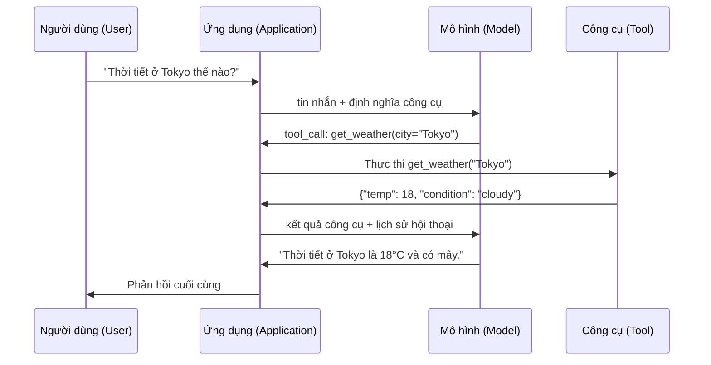

# Gọi hàm & Sử dụng công cụ (Function Calling & Tool Use)

> Bản thân các mô hình ngôn ngữ lớn (LLM) không thể tự thực hiện bất kỳ hành động nào. Toàn bộ năng lực của chúng chỉ gói gọn trong việc sinh văn bản. Chúng không thể kiểm tra thời tiết, không thể truy vấn cơ sở dữ liệu, không thể gửi email, chạy mã nguồn hay đọc một tệp tin. Mọi "tác tử AI" (AI agent) mà bạn từng thấy thực chất đều là một LLM sinh ra chuỗi JSON chỉ định cần gọi hàm nào -- và sau đó mã nguồn của bạn mới là bên thực sự thực thi hàm đó. Mô hình là bộ não. Công cụ là đôi tay. Cơ chế gọi hàm (function calling) chính là hệ thần kinh kết nối đôi bên.

**Loại:** Xây dựng (Build)
**Ngôn ngữ:** Python
**Điều kiện tiên quyết:** Giai đoạn 11, Bài học 03 (Đầu ra có cấu trúc / Structured Outputs)
**Thời lượng:** ~75 phút
**Liên quan:** Giai đoạn 11 · Bài 14 (Model Context Protocol - Giao thức ngữ cảnh mô hình) — khi một công cụ cần được chia sẻ giữa nhiều máy chủ khác nhau, hãy nâng cấp từ gọi hàm nội tuyến (inline function calling) sang máy chủ MCP. Bài học này tập trung vào trường hợp gọi hàm nội tuyến; MCP đề cập đến tầng giao thức chuẩn hóa.

## Mục tiêu học tập

- Cài đặt một vòng lặp gọi hàm hoàn chỉnh: định nghĩa lược đồ công cụ (tool schemas), phân tích JSON gọi công cụ từ mô hình, thực thi các hàm và trả kết quả về cho LLM
- Thiết kế lược đồ công cụ với mô tả tường minh và các tham số định kiểu chặt chẽ giúp mô hình gọi hàm chuẩn xác và đáng tin cậy
- Xây dựng vòng lặp tác tử đa lượt (multi-turn agent loop) có khả năng kết nối chuỗi nhiều lệnh gọi hàm để trả lời các truy vấn phức tạp
- Xử lý các tình huống biên trong gọi hàm: gọi công cụ song song (parallel tool calls), lan truyền lỗi (error propagation) và ngăn chặn vòng lặp gọi công cụ vô tận

## Vấn đề đặt ra

Bạn xây dựng một chatbot. Người dùng hỏi: "Thời tiết ở Tokyo hiện tại thế nào?"

Mô hình trả lời: "Tôi không có quyền truy cập vào dữ liệu thời tiết thời gian thực, nhưng dựa theo mùa này, Tokyo có khả năng đang khoảng 15 độ C..."

Đó là một câu ảo giác (hallucination) được ngụy trang khéo léo dưới lời cảnh báo miễn trừ trách nhiệm. Mô hình hoàn toàn không biết thời tiết thực tế. Nó sẽ không bao giờ biết được. Thời tiết thay đổi từng giờ từng phút, trong khi dữ liệu huấn luyện của mô hình đã cũ cả vài tháng.

Câu trả lời chính xác đòi hỏi phải gọi API của OpenWeatherMap, lấy nhiệt độ hiện tại và trả về con số thực tế. Mô hình không thể tự gọi API. Nhưng mã nguồn của bạn thì có thể. Mảnh ghép còn thiếu ở đây là: một giao thức có cấu trúc cho phép mô hình thông báo "Tôi cần gọi API thời tiết với các tham số này", để chương trình của bạn thực thi lệnh đó rồi nạp kết quả ngược lại cho mô hình.

Đây chính là cơ chế gọi hàm (function calling / tool use). Mô hình xuất ra định dạng JSON có cấu trúc mô tả rõ cần kích hoạt hàm nào với những đối số gì. Ứng dụng của bạn thực thi hàm đó. Kết quả được đẩy trở lại lịch sử trò chuyện. Cuối cùng, mô hình sử dụng dữ liệu thực tế này để tổng hợp câu trả lời hoàn chỉnh cho người dùng.

Không có cơ chế gọi hàm, LLM chỉ là những cuốn bách khoa toàn thư tĩnh. Có cơ chế gọi hàm, chúng trở thành các tác tử chủ động (agents).

## Khái niệm

### Vòng lặp gọi hàm (The Function Calling Loop)

Mọi tương tác sử dụng công cụ đều tuân theo một quy trình lặp gồm 5 bước:



Bước 1: Người dùng gửi tin nhắn. Bước 2: Mô hình nhận tin nhắn kèm theo các định nghĩa công cụ (JSON Schema mô tả các hàm khả dụng). Bước 3: Thay vì trả lời bằng văn bản thông thường, mô hình xuất ra một lệnh gọi công cụ (tool call) -- một đối tượng JSON có cấu trúc gồm tên hàm và các đối số. Bước 4: Mã nguồn của bạn thực thi hàm và thu nhận kết quả. Bước 5: Kết quả được gửi lại cho mô hình để nó tổng hợp dữ liệu thực tế và đưa ra câu trả lời sau cùng.

Mô hình không bao giờ trực tiếp thực thi bất kỳ đoạn mã nào. Nó chỉ đưa ra quyết định gọi cái gì và với tham số nào. Mã nguồn ứng dụng của bạn mới là bên thực thi duy nhất.

### Định nghĩa công cụ: Hợp đồng JSON Schema

Mỗi công cụ được định nghĩa thông qua một JSON Schema, chỉ định cho mô hình biết chức năng của hàm, các đối số cần thiết và kiểu dữ liệu bắt buộc của từng đối số:

```json
{
  "type": "function",
  "function": {
    "name": "get_weather",
    "description": "Lấy thông tin thời tiết hiện tại của một thành phố. Trả về nhiệt độ theo độ Celsius và tình trạng thời tiết.",
    "parameters": {
      "type": "object",
      "properties": {
        "city": {
          "type": "string",
          "description": "Tên thành phố, ví dụ 'Tokyo' hoặc 'San Francisco'"
        },
        "units": {
          "type": "string",
          "enum": ["celsius", "fahrenheit"],
          "description": "Đơn vị nhiệt độ"
        }
      },
      "required": ["city"]
    }
  }
}
```

Các trường `description` đóng vai trò tối quan trọng. Mô hình đọc các mô tả này để quyết định khi nào và làm thế nào để kích hoạt công cụ. Một mô tả mơ hồ như "lấy thời tiết" sẽ cho kết quả chọn công cụ kém hơn nhiều so với "Lấy thông tin thời tiết hiện tại của một thành phố. Trả về nhiệt độ theo độ Celsius và tình trạng thời tiết." Phần mô tả thực chất chính là một câu prompt điều hướng lựa chọn công cụ.

### So sánh giữa các nhà cung cấp

Mọi nhà cung cấp mô hình lớn đều hỗ trợ gọi hàm, nhưng giao diện API có đôi chút khác biệt:

| Nhà cung cấp | Tham số API | Định dạng gọi công cụ | Gọi song song | Bắt buộc gọi |
|--------------|-------------|-----------------------|---------------|--------------|
| OpenAI (GPT-5, o4) | `tools` | `tool_calls[].function` | Có (nhiều lệnh trong một lượt) | `tool_choice="required"` |
| Anthropic (Claude 4.6/4.7) | `tools` | `content[].type="tool_use"` | Có (nhiều khối nội dung) | `tool_choice={"type":"any"}` |
| Google (Gemini 3) | `function_declarations` | `functionCall` | Có | `function_calling_config` |
| Mô hình trọng số mở (Llama 4, Qwen3, DeepSeek-V3) | Tham số `tools` gốc trên Llama 4; Hermes hoặc ChatML trên các mô hình khác | Đa dạng | Tùy thuộc mô hình | Qua prompt hoặc `tool_choice` nếu hỗ trợ |

Bước sang năm 2026, ba nhà cung cấp dịch vụ đóng đã hội tụ về các định dạng gần như tương đồng dựa trên JSON Schema. Llama 4 hỗ trợ sẵn trường `tools` nguyên bản tương thích với cấu trúc của OpenAI. Các bản tinh chỉnh nguồn mở của bên thứ ba thường sử dụng định dạng Hermes (NousResearch). Khi cần dùng chung công cụ giữa nhiều máy chủ khác nhau, giao thức MCP (Giai đoạn 11 · Bài 14) là lựa chọn tối ưu hơn gọi hàm nội tuyến vì máy chủ công cụ có thể phục vụ bất kỳ tác tử nào.

### Lựa chọn công cụ: Auto, Required, Specific

Bạn có toàn quyền kiểm soát thời điểm mô hình được phép dùng công cụ:

**Auto (Tự động - mặc định)**: Mô hình tự phán đoán xem nên gọi công cụ hay trả lời trực tiếp. "2 + 2 bằng mấy?" -- trả lời trực tiếp. "Thời tiết thế nào?" -- gọi công cụ.

**Required (Bắt buộc)**: Mô hình bắt buộc phải gọi ít nhất một công cụ. Sử dụng tùy chọn này khi bạn biết chắc chắn ý định của người dùng đòi hỏi dữ liệu bên ngoài, ngăn chặn mô hình đoán mò thay vì tra cứu dữ liệu thực tế.

**Specific function (Chỉ định hàm cụ thể)**: Ép buộc mô hình phải gọi một hàm nhất định. Thiết lập `tool_choice={"type":"function", "function": {"name": "get_weather"}}` đảm bảo công cụ thời tiết luôn được gọi bất kể câu hỏi là gì. Kỹ thuật này phù hợp cho việc định tuyến (routing) khi tầng logic phía trước đã xác định chính xác công cụ cần dùng.

### Gọi hàm song song (Parallel Function Calling)

GPT-4o và Claude có thể phát sinh nhiều lệnh gọi hàm trong cùng một lượt phản hồi. Khi người dùng hỏi: "Thời tiết ở Tokyo và New York thế nào?", mô hình sẽ xuất ra đồng thời hai lệnh gọi công cụ:

```json
[
  {"name": "get_weather", "arguments": {"city": "Tokyo"}},
  {"name": "get_weather", "arguments": {"city": "New York"}}
]
```

Mã nguồn của bạn có thể thực thi cả hai lệnh cùng lúc (lý tưởng nhất là bất đồng bộ), trả về cả hai kết quả, và mô hình sẽ tổng hợp thành một câu trả lời duy nhất. Cơ chế này giảm số vòng trao đổi qua mạng từ 2 xuống 1. Đối với các tác tử cần thực hiện từ 5-10 thao tác mỗi lượt truy vấn, gọi hàm song song giúp giảm độ trễ từ 60-80%.

### Đầu ra có cấu trúc so với Gọi hàm

Bài học 03 đã giới thiệu về đầu ra có cấu trúc (structured outputs). Gọi hàm cũng sử dụng cùng cơ chế JSON Schema, nhưng nhằm phục vụ mục đích hoàn toàn khác biệt:

**Đầu ra có cấu trúc**: Buộc mô hình phải trả về dữ liệu đúng khuôn mẫu mong muốn. Đầu ra chính là kết quả cuối cùng. Ví dụ: trích xuất thông tin sản phẩm từ văn bản thành đối tượng `{name, price, in_stock}`.

**Gọi hàm**: Mô hình khai báo ý định thực hiện một hành động. Đầu ra chỉ là một bước trung gian. Ví dụ: `get_weather(city="Tokyo")` -- mô hình đang yêu cầu thực hiện hành động, chứ chưa đưa ra câu trả lời hoàn tất.

Dùng đầu ra có cấu trúc khi bạn muốn trích xuất dữ liệu. Dùng gọi hàm khi bạn muốn mô hình tương tác với các hệ thống bên ngoài.

### An toàn bảo mật: Các quy tắc bất khả xâm phạm

Gọi hàm là năng lực tiềm ẩn nhiều rủi ro an ninh nhất mà bạn trao cho một LLM. Mô hình tự quyết định những gì cần thực thi. Nếu tập công cụ của bạn bao gồm truy vấn cơ sở dữ liệu, mô hình sẽ tự tạo câu truy vấn. Nếu tập công cụ bao gồm chạy lệnh shell, mô hình sẽ tự viết câu lệnh đó.

**Quy tắc 1: Không bao giờ truyền trực tiếp SQL do mô hình sinh ra vào cơ sở dữ liệu.** Mô hình hoàn toàn có thể sinh ra lệnh `DROP TABLE`, các chuỗi tấn công `UNION injection`, hoặc các câu truy vấn quét sạch toàn bộ bảng dữ liệu. Luôn tham số hóa truy vấn, kiểm tra tính hợp lệ và chỉ cho phép các thao tác trong danh sách an toàn.

**Quy tắc 2: Áp dụng danh sách trắng các hàm được phép gọi (Allowlist functions).** Mô hình chỉ được phép gọi những hàm mà bạn đã định nghĩa tường minh. Tuyệt đối không bao giờ tạo công cụ tổng quát kiểu "thực thi bất kỳ hàm nào theo tên". Nếu bạn có 50 hàm nội bộ, chỉ hiển thị đúng 5 hàm mà người dùng thực sự cần.

**Quy tắc 3: Xác thực đối số đầu vào (Validate arguments).** Mô hình có thể truyền vào tên thành phố một chuỗi độc hại như `"; DROP TABLE users; --"`. Hãy luôn kiểm tra mọi đối số đối chiếu với kiểu dữ liệu, miền giá trị và định dạng mong đợi trước khi thực thi.

**Quy tắc 4: Làm sạch kết quả trả về của công cụ (Sanitize tool results).** Nếu một công cụ trả về dữ liệu nhạy cảm (khóa API, thông tin định danh cá nhân PII, thông báo lỗi hệ thống nội bộ), hãy lọc bỏ các thông tin đó trước khi gửi lại cho mô hình. Mô hình sẽ trích xuất nguyên văn kết quả công cụ vào phản hồi gửi cho người dùng.

**Quy tắc 5: Giới hạn tần suất và số lượt gọi công cụ (Rate limit tool calls).** Một mô hình bị rơi vào vòng lặp có thể kích hoạt hàng trăm lệnh gọi công cụ liên tiếp. Hãy thiết lập ngưỡng tối đa (khoảng 10-20 lần gọi cho mỗi cuộc hội thoại là mức hợp lý) để ngắt các vòng lặp vô tận.

### Xử lý lỗi (Error Handling)

Công cụ có thể gặp sự cố: API quá thời gian chờ (timeout), cơ sở dữ liệu gián đoạn, tệp tin không tồn tại. Mô hình cần nắm được khi nào công cụ gặp lỗi và nguyên nhân cụ thể là gì.

Hãy trả về thông báo lỗi dưới dạng kết quả công cụ có cấu trúc, thay vì quăng ra ngoại lệ (exceptions):

```json
{
  "error": true,
  "message": "Không tìm thấy thành phố 'Toky'. Có phải bạn muốn tìm 'Tokyo'?",
  "code": "CITY_NOT_FOUND"
}
```

Mô hình sẽ đọc thông báo này, điều chỉnh lại đối số và thử gọi lại. Các mô hình hiện đại rất giỏi trong việc tự sửa lỗi (self-correcting) nếu nhận được thông báo lỗi có cấu trúc rõ ràng. Ngược lại, chúng xử lý rất kém nếu nhận về phản hồi rỗng hoặc thông báo chung chung kiểu "đã xảy ra lỗi".

### MCP: Giao thức ngữ cảnh mô hình (Model Context Protocol)

MCP là chuẩn mở do Anthropic phát triển nhằm giải quyết bài toán tương thích giữa các công cụ. Thay vì mỗi ứng dụng phải tự viết mã kết nối công cụ riêng, MCP cung cấp một giao thức phổ quát: các công cụ được máy chủ MCP (MCP server) cung cấp, và các trình khách MCP (MCP client như Claude Code, Cursor hay chính ứng dụng của bạn) tiêu thụ.

Một máy chủ MCP duy nhất có thể chia sẻ công cụ cho bất kỳ trình khách nào tương thích. Một máy chủ Postgres MCP cung cấp khả năng truy vấn dữ liệu cho mọi tác tử AI hỗ trợ MCP. Một máy chủ GitHub MCP mang lại quyền truy cập kho lưu trữ cho bất kỳ tác tử nào. Công cụ chỉ cần viết một lần và dùng ở mọi nơi.

MCP đóng vai trò đối với việc gọi hàm tương tự như HTTP đối với mạng máy tính: chuẩn hóa tầng truyền tải giúp công cụ có tính khả chuyển tối đa.

```figure
mx-tool-call-loop
```

## Tự xây dựng (Build It)

### Bước 1: Định nghĩa thanh ghi công cụ (Tool Registry)

Xây dựng một thanh ghi lưu trữ định nghĩa và mã nguồn thực thi của từng công cụ. Mỗi công cụ gồm có một lược đồ JSON Schema (thứ mô hình nhìn thấy) và một hàm Python (thứ chương trình thực thi).

```python
import ast
import json
import math
import time
import hashlib


TOOL_REGISTRY = {}


def register_tool(name, description, parameters, function):
    TOOL_REGISTRY[name] = {
        "definition": {
            "type": "function",
            "function": {
                "name": name,
                "description": description,
                "parameters": parameters,
            },
        },
        "function": function,
    }
```

### Bước 2: Cài đặt 5 công cụ thực nghiệm

Chúng ta sẽ xây dựng máy tính toán học, công cụ tra cứu thời tiết, mô phỏng tìm kiếm web, trình đọc tệp và môi trường chạy mã Python có kiểm soát.

```python
def calculator(expression, precision=2):
    allowed = set("0123456789+-*/.() ")
    if not all(c in allowed for c in expression):
        return {"error": True, "message": f"Invalid characters in expression: {expression}"}
    try:
        result = eval(expression, {"__builtins__": {}}, {"math": math})
        return {"result": round(float(result), precision), "expression": expression}
    except Exception as e:
        return {"error": True, "message": str(e)}


WEATHER_DB = {
    "tokyo": {"temp_c": 18, "condition": "cloudy", "humidity": 72, "wind_kph": 14},
    "new york": {"temp_c": 22, "condition": "sunny", "humidity": 45, "wind_kph": 8},
    "london": {"temp_c": 12, "condition": "rainy", "humidity": 88, "wind_kph": 22},
    "san francisco": {"temp_c": 16, "condition": "foggy", "humidity": 80, "wind_kph": 18},
    "sydney": {"temp_c": 25, "condition": "sunny", "humidity": 55, "wind_kph": 10},
}


def get_weather(city, units="celsius"):
    key = city.lower().strip()
    if key not in WEATHER_DB:
        suggestions = [c for c in WEATHER_DB if c.startswith(key[:3])]
        return {
            "error": True,
            "message": f"City '{city}' not found.",
            "suggestions": suggestions,
            "code": "CITY_NOT_FOUND",
        }
    data = WEATHER_DB[key].copy()
    if units == "fahrenheit":
        data["temp_f"] = round(data["temp_c"] * 9 / 5 + 32, 1)
        del data["temp_c"]
    data["city"] = city
    return data


SEARCH_DB = {
    "python function calling": [
        {"title": "OpenAI Function Calling Guide", "url": "https://platform.openai.com/docs/guides/function-calling", "snippet": "Learn how to connect LLMs to external tools."},
        {"title": "Anthropic Tool Use", "url": "https://docs.anthropic.com/en/docs/tool-use", "snippet": "Claude can interact with external tools and APIs."},
    ],
    "MCP protocol": [
        {"title": "Model Context Protocol", "url": "https://modelcontextprotocol.io", "snippet": "An open standard for connecting AI models to data sources."},
    ],
    "weather API": [
        {"title": "OpenWeatherMap API", "url": "https://openweathermap.org/api", "snippet": "Free weather API with current, forecast, and historical data."},
    ],
}


def web_search(query, max_results=3):
    key = query.lower().strip()
    for db_key, results in SEARCH_DB.items():
        if db_key in key or key in db_key:
            return {"query": query, "results": results[:max_results], "total": len(results)}
    return {"query": query, "results": [], "total": 0}


FILE_SYSTEM = {
    "data/config.json": '{"model": "gpt-4o", "temperature": 0.7, "max_tokens": 4096}',
    "data/users.csv": "name,email,role\nAlice,alice@example.com,admin\nBob,bob@example.com,user",
    "README.md": "# My Project\nA tool-use agent built from scratch.",
}


def read_file(path):
    if ".." in path or path.startswith("/"):
        return {"error": True, "message": "Path traversal not allowed.", "code": "FORBIDDEN"}
    if path not in FILE_SYSTEM:
        available = list(FILE_SYSTEM.keys())
        return {"error": True, "message": f"File '{path}' not found.", "available_files": available, "code": "NOT_FOUND"}
    content = FILE_SYSTEM[path]
    return {"path": path, "content": content, "size_bytes": len(content), "lines": content.count("\n") + 1}


def run_code(code, language="python"):
    if language != "python":
        return {"error": True, "message": f"Language '{language}' not supported. Only 'python' is available."}
    try:
        tree = ast.parse(code)
    except SyntaxError as e:
        return {"error": True, "message": f"SyntaxError: {e}", "code": "SYNTAX_ERROR"}
    unsafe_names = {"exec", "eval", "compile", "__import__", "open", "globals", "locals", "vars", "getattr", "setattr", "delattr"}
    for node in ast.walk(tree):
        if isinstance(node, (ast.Import, ast.ImportFrom)):
            return {"error": True, "message": "Forbidden operation: import is not allowed", "code": "SECURITY_VIOLATION"}
        if isinstance(node, ast.Attribute) and node.attr.startswith("__") and node.attr.endswith("__"):
            return {"error": True, "message": "Forbidden operation: dunder attribute access is not allowed", "code": "SECURITY_VIOLATION"}
        if isinstance(node, ast.Name) and node.id in unsafe_names:
            return {"error": True, "message": f"Forbidden operation: {node.id} is not allowed", "code": "SECURITY_VIOLATION"}
    try:
        local_vars = {}
        exec(code, {"__builtins__": {"print": print, "range": range, "len": len, "str": str, "int": int, "float": float, "list": list, "dict": dict, "sum": sum, "min": min, "max": max, "abs": abs, "round": round, "sorted": sorted, "enumerate": enumerate, "zip": zip, "map": map, "filter": filter, "math": math}}, local_vars)
        result = local_vars.get("result", None)
        return {"success": True, "result": result, "variables": {k: str(v) for k, v in local_vars.items() if not k.startswith("_")}}
    except Exception as e:
        return {"error": True, "message": f"{type(e).__name__}: {e}"}
```

Kiểm tra chuỗi cấm đơn thuần chỉ xử lý mã nguồn dưới dạng văn bản thô, do đó dễ dàng bỏ sót các biến thể tinh vi. Bằng cách phân tích cú pháp mã nguồn thành cây cú pháp trừu tượng (Abstract Syntax Tree - AST) và duyệt cây, bộ lọc an toàn có thể ngăn chặn các câu lệnh `import`, việc truy cập thuộc tính dunder (như chuỗi `__class__` và `__globals__` nhằm chiếm quyền thông dịch), và các tên hàm nội tại nguy hiểm dựa trên đúng cấu trúc ngữ pháp. Dù vậy, hãy lưu ý đây chỉ là bộ lọc phục vụ mục đích giảng dạy, không phải rào chắn cô lập thực sự. Trong môi trường sản xuất, mã nguồn không đáng tin cậy phải được chạy trong tiến trình hoặc container riêng biệt (như tiến trình hạ quyền, gVisor, Firecracker hoặc môi trường sandbox độc lập).

### Bước 3: Đăng ký toàn bộ công cụ

```python
def register_all_tools():
    register_tool(
        "calculator", "Evaluate a mathematical expression. Supports +, -, *, /, parentheses, and decimals. Returns the numeric result.",
        {"type": "object", "properties": {"expression": {"type": "string", "description": "Math expression, e.g. '(10 + 5) * 3'"}, "precision": {"type": "integer", "description": "Decimal places in result", "default": 2}}, "required": ["expression"]},
        calculator,
    )
    register_tool(
        "get_weather", "Get current weather for a city. Returns temperature, condition, humidity, and wind speed.",
        {"type": "object", "properties": {"city": {"type": "string", "description": "City name, e.g. 'Tokyo' or 'San Francisco'"}, "units": {"type": "string", "enum": ["celsius", "fahrenheit"], "description": "Temperature units, defaults to celsius"}}, "required": ["city"]},
        get_weather,
    )
    register_tool(
        "web_search", "Search the web for information. Returns a list of results with title, URL, and snippet.",
        {"type": "object", "properties": {"query": {"type": "string", "description": "Search query"}, "max_results": {"type": "integer", "description": "Maximum results to return", "default": 3}}, "required": ["query"]},
        web_search,
    )
    register_tool(
        "read_file", "Read the contents of a file. Returns the file content, size, and line count.",
        {"type": "object", "properties": {"path": {"type": "string", "description": "Relative file path, e.g. 'data/config.json'"}}, "required": ["path"]},
        read_file,
    )
    register_tool(
        "run_code", "Run a small Python snippet behind a static-analysis guard and a restricted interpreter. This is a teaching filter, not real isolation. Set a 'result' variable to return output.",
        {"type": "object", "properties": {"code": {"type": "string", "description": "Python code to execute"}, "language": {"type": "string", "enum": ["python"], "description": "Programming language"}}, "required": ["code"]},
        run_code,
    )
```

### Bước 4: Xây dựng vòng lặp gọi hàm

Đây là cỗ máy điều phối trung tâm. Nó mô phỏng quyết định chọn công cụ của mô hình, thực thi công cụ và đưa kết quả trở lại vòng hội thoại.

```python
def simulate_model_decision(user_message, tools, conversation_history):
    msg = user_message.lower()

    if any(word in msg for word in ["weather", "temperature", "forecast"]):
        cities = []
        for city in WEATHER_DB:
            if city in msg:
                cities.append(city)
        if not cities:
            for word in msg.split():
                if word.capitalize() in [c.title() for c in WEATHER_DB]:
                    cities.append(word)
        if not cities:
            cities = ["tokyo"]
        calls = []
        for city in cities:
            calls.append({"name": "get_weather", "arguments": {"city": city.title()}})
        return calls

    if any(word in msg for word in ["calculate", "compute", "math", "what is", "how much"]):
        for token in msg.split():
            if any(c in token for c in "+-*/"):
                return [{"name": "calculator", "arguments": {"expression": token}}]
        if "+" in msg or "-" in msg or "*" in msg or "/" in msg:
            expr = "".join(c for c in msg if c in "0123456789+-*/.() ")
            if expr.strip():
                return [{"name": "calculator", "arguments": {"expression": expr.strip()}}]
        return [{"name": "calculator", "arguments": {"expression": "0"}}]

    if any(word in msg for word in ["search", "find", "look up", "google"]):
        query = msg.replace("search for", "").replace("look up", "").replace("find", "").strip()
        return [{"name": "web_search", "arguments": {"query": query}}]

    if any(word in msg for word in ["read", "file", "open", "cat", "show"]):
        for path in FILE_SYSTEM:
            if path.split("/")[-1].split(".")[0] in msg:
                return [{"name": "read_file", "arguments": {"path": path}}]
        return [{"name": "read_file", "arguments": {"path": "README.md"}}]

    if any(word in msg for word in ["run", "execute", "code", "python"]):
        return [{"name": "run_code", "arguments": {"code": "result = 'Hello from the sandbox!'", "language": "python"}}]

    return []


def execute_tool_call(tool_call):
    name = tool_call["name"]
    args = tool_call["arguments"]

    if name not in TOOL_REGISTRY:
        return {"error": True, "message": f"Unknown tool: {name}", "code": "UNKNOWN_TOOL"}

    tool = TOOL_REGISTRY[name]
    func = tool["function"]
    start = time.time()

    try:
        result = func(**args)
    except TypeError as e:
        result = {"error": True, "message": f"Invalid arguments: {e}"}

    elapsed_ms = round((time.time() - start) * 1000, 2)
    return {"tool": name, "result": result, "execution_time_ms": elapsed_ms}


def run_function_calling_loop(user_message, max_iterations=5):
    conversation = [{"role": "user", "content": user_message}]
    tool_definitions = [t["definition"] for t in TOOL_REGISTRY.values()]
    all_tool_results = []

    for iteration in range(max_iterations):
        tool_calls = simulate_model_decision(user_message, tool_definitions, conversation)

        if not tool_calls:
            break

        results = []
        for call in tool_calls:
            result = execute_tool_call(call)
            results.append(result)

        conversation.append({"role": "assistant", "content": None, "tool_calls": tool_calls})

        for result in results:
            conversation.append({"role": "tool", "content": json.dumps(result["result"]), "tool_name": result["tool"]})

        all_tool_results.extend(results)
        break

    return {"conversation": conversation, "tool_results": all_tool_results, "iterations": iteration + 1 if tool_calls else 0}
```

### Bước 5: Xác thực đối số đầu vào (Argument Validation)

Xây dựng bộ xác thực đối số dựa trên JSON Schema trước khi cho phép thực thi hàm:

```python
def validate_tool_arguments(tool_name, arguments):
    if tool_name not in TOOL_REGISTRY:
        return [f"Unknown tool: {tool_name}"]

    schema = TOOL_REGISTRY[tool_name]["definition"]["function"]["parameters"]
    errors = []

    if not isinstance(arguments, dict):
        return [f"Arguments must be an object, got {type(arguments).__name__}"]

    for required_field in schema.get("required", []):
        if required_field not in arguments:
            errors.append(f"Missing required argument: {required_field}")

    properties = schema.get("properties", {})
    for arg_name, arg_value in arguments.items():
        if arg_name not in properties:
            errors.append(f"Unknown argument: {arg_name}")
            continue

        prop_schema = properties[arg_name]
        expected_type = prop_schema.get("type")

        type_checks = {"string": str, "integer": int, "number": (int, float), "boolean": bool, "array": list, "object": dict}
        if expected_type in type_checks:
            if not isinstance(arg_value, type_checks[expected_type]):
                errors.append(f"Argument '{arg_name}': expected {expected_type}, got {type(arg_value).__name__}")

        if "enum" in prop_schema and arg_value not in prop_schema["enum"]:
            errors.append(f"Argument '{arg_name}': '{arg_value}' not in {prop_schema['enum']}")

    return errors
```

### Bước 6: Chạy bản demo thực nghiệm

```python
def run_demo():
    register_all_tools()

    print("=" * 60)
    print("  Function Calling & Tool Use Demo")
    print("=" * 60)

    print("\n--- Registered Tools ---")
    for name, tool in TOOL_REGISTRY.items():
        desc = tool["definition"]["function"]["description"][:60]
        params = list(tool["definition"]["function"]["parameters"].get("properties", {}).keys())
        print(f"  {name}: {desc}...")
        print(f"    params: {params}")

    print(f"\n--- Argument Validation ---")
    validation_tests = [
        ("get_weather", {"city": "Tokyo"}, "Valid call"),
        ("get_weather", {}, "Missing required arg"),
        ("get_weather", {"city": "Tokyo", "units": "kelvin"}, "Invalid enum value"),
        ("calculator", {"expression": 123}, "Wrong type (int for string)"),
        ("unknown_tool", {"x": 1}, "Unknown tool"),
    ]
    for tool_name, args, label in validation_tests:
        errors = validate_tool_arguments(tool_name, args)
        status = "VALID" if not errors else f"ERRORS: {errors}"
        print(f"  {label}: {status}")

    print(f"\n--- Tool Execution ---")
    direct_tests = [
        {"name": "calculator", "arguments": {"expression": "(10 + 5) * 3 / 2"}},
        {"name": "get_weather", "arguments": {"city": "Tokyo"}},
        {"name": "get_weather", "arguments": {"city": "Mars"}},
        {"name": "web_search", "arguments": {"query": "python function calling"}},
        {"name": "read_file", "arguments": {"path": "data/config.json"}},
        {"name": "read_file", "arguments": {"path": "../etc/passwd"}},
        {"name": "run_code", "arguments": {"code": "result = sum(range(1, 101))"}},
        {"name": "run_code", "arguments": {"code": "import os; os.system('rm -rf /')"}},
    ]
    for call in direct_tests:
        result = execute_tool_call(call)
        print(f"\n  {call['name']}({json.dumps(call['arguments'])})")
        print(f"    -> {json.dumps(result['result'], indent=None)[:100]}")
        print(f"    time: {result['execution_time_ms']}ms")

    print(f"\n--- Full Function Calling Loop ---")
    test_queries = [
        "What's the weather in Tokyo?",
        "Calculate (100 + 250) * 0.15",
        "Search for MCP protocol",
        "Read the config file",
        "Run some Python code",
        "Tell me a joke",
    ]
    for query in test_queries:
        print(f"\n  User: {query}")
        result = run_function_calling_loop(query)
        if result["tool_results"]:
            for tr in result["tool_results"]:
                print(f"    Tool: {tr['tool']} ({tr['execution_time_ms']}ms)")
                print(f"    Result: {json.dumps(tr['result'], indent=None)[:90]}")
        else:
            print(f"    [No tool called -- direct response]")
        print(f"    Iterations: {result['iterations']}")

    print(f"\n--- Parallel Tool Calls ---")
    multi_city_query = "What's the weather in tokyo and london?"
    print(f"  User: {multi_city_query}")
    result = run_function_calling_loop(multi_city_query)
    print(f"  Tool calls made: {len(result['tool_results'])}")
    for tr in result["tool_results"]:
        city = tr["result"].get("city", "unknown")
        temp = tr["result"].get("temp_c", "N/A")
        print(f"    {city}: {temp}C, {tr['result'].get('condition', 'N/A')}")

    print(f"\n--- Security Checks ---")
    security_tests = [
        ("read_file", {"path": "../../etc/passwd"}),
        ("run_code", {"code": "import subprocess; subprocess.run(['ls'])"}),
        ("calculator", {"expression": "__import__('os').system('ls')"}),
    ]
    for tool_name, args in security_tests:
        result = execute_tool_call({"name": tool_name, "arguments": args})
        blocked = result["result"].get("error", False)
        print(f"  {tool_name}({list(args.values())[0][:40]}): {'BLOCKED' if blocked else 'ALLOWED'}")
```

## Sử dụng trong thực tế (Use It)

### Gọi hàm với OpenAI (OpenAI Function Calling)

```python
# from openai import OpenAI
#
# client = OpenAI()
#
# tools = [{
#     "type": "function",
#     "function": {
#         "name": "get_weather",
#         "description": "Get current weather for a city",
#         "parameters": {
#             "type": "object",
#             "properties": {
#                 "city": {"type": "string"},
#                 "units": {"type": "string", "enum": ["celsius", "fahrenheit"]}
#             },
#             "required": ["city"]
#         }
#     }
# }]
#
# response = client.chat.completions.create(
#     model="gpt-4o",
#     messages=[{"role": "user", "content": "Weather in Tokyo?"}],
#     tools=tools,
#     tool_choice="auto",
# )
#
# tool_call = response.choices[0].message.tool_calls[0]
# args = json.loads(tool_call.function.arguments)
# result = get_weather(**args)
#
# final = client.chat.completions.create(
#     model="gpt-4o",
#     messages=[
#         {"role": "user", "content": "Weather in Tokyo?"},
#         response.choices[0].message,
#         {"role": "tool", "tool_call_id": tool_call.id, "content": json.dumps(result)},
#     ],
# )
# print(final.choices[0].message.content)
```

OpenAI trả về các lệnh gọi công cụ tại `response.choices[0].message.tool_calls`. Mỗi lệnh gọi có một trường `id` mà bạn bắt buộc phải gửi kèm khi trả về kết quả. Mô hình sử dụng ID này để ghép nối chính xác kết quả với lệnh gọi tương ứng. GPT-4o có thể trả về nhiều lệnh gọi công cụ cùng lúc trong một phản hồi -- bạn chỉ cần lặp qua danh sách và thực thi toàn bộ chúng.

### Sử dụng công cụ với Anthropic (Anthropic Tool Use)

```python
# import anthropic
#
# client = anthropic.Anthropic()
#
# response = client.messages.create(
#     model="claude-sonnet-5",
#     max_tokens=1024,
#     tools=[{
#         "name": "get_weather",
#         "description": "Get current weather for a city",
#         "input_schema": {
#             "type": "object",
#             "properties": {
#                 "city": {"type": "string"},
#                 "units": {"type": "string", "enum": ["celsius", "fahrenheit"]}
#             },
#             "required": ["city"]
#         }
#     }],
#     messages=[{"role": "user", "content": "Weather in Tokyo?"}],
# )
#
# tool_block = next(b for b in response.content if b.type == "tool_use")
# result = get_weather(**tool_block.input)
#
# final = client.messages.create(
#     model="claude-sonnet-5",
#     max_tokens=1024,
#     tools=[...],
#     messages=[
#         {"role": "user", "content": "Weather in Tokyo?"},
#         {"role": "assistant", "content": response.content},
#         {"role": "user", "content": [{"type": "tool_result", "tool_use_id": tool_block.id, "content": json.dumps(result)}]},
#     ],
# )
```

Anthropic trả về các lệnh gọi công cụ dưới dạng khối nội dung có `type: "tool_use"`. Kết quả công cụ được truyền ngược lại trong tin nhắn người dùng có `type: "tool_result"`. Hãy lưu ý điểm khác biệt chính: Anthropic sử dụng trường `input_schema` để định nghĩa tham số, trong khi OpenAI dùng `parameters`.

### Tích hợp với MCP (MCP Integration)

```python
# Các máy chủ MCP cung cấp công cụ thông qua giao thức chuẩn hóa.
# Mọi trình khách tương thích MCP đều có thể tự động khám phá và kích hoạt các công cụ này.
#
# Ví dụ: kết nối với máy chủ Postgres MCP
#
# from mcp import ClientSession, StdioServerParameters
# from mcp.client.stdio import stdio_client
#
# server_params = StdioServerParameters(
#     command="npx",
#     args=["-y", "@modelcontextprotocol/server-postgres", "postgresql://localhost/mydb"],
# )
#
# async with stdio_client(server_params) as (read, write):
#     async with ClientSession(read, write) as session:
#         await session.initialize()
#         tools = await session.list_tools()
#         result = await session.call_tool("query", {"sql": "SELECT count(*) FROM users"})
```

MCP tách biệt hoàn toàn giữa việc triển khai công cụ và việc sử dụng công cụ. Máy chủ Postgres chịu trách nhiệm về SQL. Máy chủ GitHub quản lý các lệnh API. Tác tử của bạn chỉ cần khám phá và kích hoạt công cụ -- không còn cần đến các đoạn mã tích hợp đặc thù cho từng nhà cung cấp.

## Đóng gói sản phẩm (Ship It)

Bài học này cung cấp:
- `outputs/prompt-tool-designer.md` -- mẫu prompt có thể tái sử dụng để thiết kế các định nghĩa công cụ. Bạn chỉ cần mô tả chức năng mong muốn, prompt sẽ sinh ra một định nghĩa JSON Schema hoàn chỉnh kèm mô tả, định kiểu và các ràng buộc dữ liệu.
- `outputs/skill-function-calling-patterns.md` -- khung quyết định triển khai cơ chế gọi hàm trong môi trường thực tế, bao gồm thiết kế công cụ, xử lý ngoại lệ, bảo mật và các mẫu kiến trúc đặc thù cho từng nhà cung cấp.

## Bài tập thực hành (Exercises)

1. **Bổ sung công cụ thứ 6: truy vấn cơ sở dữ liệu.** Cài đặt một công cụ SQL mô phỏng dựa trên bảng dữ liệu trong bộ nhớ. Công cụ này tiếp nhận tên bảng và các điều kiện lọc (không nhận chuỗi SQL thô). Xác thực tên bảng nằm trong danh sách trắng và các toán tử lọc chỉ giới hạn trong `=`, `>`, `<`, `>=`, `<=`. Trả về các hàng dữ liệu khớp dưới dạng JSON.

2. **Cài đặt cơ chế thử lại kèm phản hồi lỗi (Retry with error feedback).** Khi một lệnh gọi công cụ thất bại (ví dụ: không tìm thấy tên thành phố), hãy gửi thông báo lỗi ngược lại cho hàm phán đoán của mô hình để nó tự điều chỉnh đối số. Ghi lại số lần thử lại của mỗi lượt gọi và giới hạn tối đa 3 lần thử lại cho mỗi công cụ.

3. **Xây dựng tác tử đa bước (Multi-step agent).** Một số truy vấn đòi hỏi phải kết nối chuỗi nhiều công cụ liên tiếp: "Đọc tệp cấu hình để xem mô hình nào đang được thiết lập, sau đó tìm kiếm trên web bảng giá của mô hình đó." Cài đặt vòng lặp chạy liên tục cho đến khi mô hình quyết định không cần gọi thêm công cụ nào nữa, đồng thời tích lũy kết quả của các bước trước vào từng lượt ra quyết định. Giới hạn tối đa 10 vòng lặp để ngăn ngừa nguy cơ lặp vô tận.

4. **Đo lường độ chính xác lựa chọn công cụ.** Tạo một tập kiểm thử gồm 30 câu hỏi kèm tên công cụ mong đợi tương ứng. Chạy hàm quyết định trên toàn bộ 30 câu và tính tỷ lệ phần trăm chọn đúng công cụ. Xác định những câu hỏi nào dễ gây nhầm lẫn nhất giữa các công cụ.

5. **Cài đặt bộ nhớ đệm cho lệnh gọi công cụ (Tool call caching).** Nếu một công cụ được gọi với đúng các đối số giống hệt nhau trong vòng 60 giây, hãy trả về kết quả lưu trong cache thay vì thực thi lại hàm. Sử dụng từ điển khóa theo `(tool_name, frozenset(args.items()))`. Đo lường tỷ lệ trúng cache (hit rate) trong một cuộc hội thoại gồm 20 câu hỏi.

## Thuật ngữ cốt lõi (Key Terms)

| Thuật ngữ | Cách hiểu thông thường | Bản chất kỹ thuật |
|-----------|------------------------|-------------------|
| Gọi hàm (Function calling / Tool use) | "Sử dụng công cụ" | Mô hình xuất ra chuỗi JSON có cấu trúc chỉ định tên hàm và các đối số cụ thể -- mã nguồn của bạn mới là bên thực thi, không phải mô hình |
| Định nghĩa công cụ (Tool definition) | "Lược đồ hàm" | Một đối tượng JSON Schema mô tả tên, công dụng, các tham số và kiểu dữ liệu của công cụ -- mô hình đọc lược đồ này để quyết định cách gọi |
| Lựa chọn công cụ (Tool choice) | "Chế độ gọi" | Tham số điều khiển mô hình bắt buộc phải gọi công cụ (required), tự phán đoán (auto), hoặc bắt buộc gọi một hàm chỉ định (named) |
| Gọi song song (Parallel calling) | "Đa công cụ đồng thời" | Mô hình xuất ra nhiều lệnh gọi công cụ trong một lượt duy nhất, giúp giảm thiểu số vòng trao đổi mạng -- GPT-4o và Claude đều hỗ trợ tính năng này |
| Kết quả công cụ (Tool result) | "Đầu ra của hàm" | Giá trị trả về sau khi thực thi công cụ, được gửi lại cho mô hình dưới dạng tin nhắn để mô hình có dữ liệu thực tế sinh phản hồi |
| Xác thực đối số (Argument validation) | "Kiểm tra đầu vào" | Quá trình đối chiếu các đối số do mô hình sinh ra với kiểu dữ liệu, miền giá trị và các ràng buộc mong đợi trước khi thực thi hàm |
| MCP | "Giao thức công cụ" | Model Context Protocol -- chuẩn mở của Anthropic giúp máy chủ công cụ chia sẻ khả năng cho bất kỳ trình khách tương thích nào khám phá và gọi |
| Vòng lặp tác tử (Agent loop) | "Vòng lặp ReAct" | Chu trình lặp: mô hình quyết định công cụ → mã nguồn thực thi → nạp kết quả trở lại cho đến khi mô hình có đủ thông tin để trả lời |
| Nhiễm độc công cụ (Tool poisoning) | "Tấn công prompt qua công cụ" | Kỹ thuật tấn công mà kết quả trả về từ công cụ chứa các chỉ dẫn thao túng hành vi của mô hình -- cần làm sạch mọi kết quả công cụ |
| Giới hạn tần suất (Rate limiting) | "Hạn mức gọi" | Thiết lập số lượng lệnh gọi công cụ tối đa cho mỗi phiên hội thoại nhằm ngăn chặn vòng lặp vô tận và chi phí API ngoài tầm kiểm soát |

## Đọc thêm (Further Reading)

- [OpenAI Function Calling Guide](https://platform.openai.com/docs/guides/function-calling) -- tài liệu tham khảo chính thức về sử dụng công cụ với GPT-4o, bao gồm gọi song song, ép buộc gọi và đối số có cấu trúc
- [Anthropic Tool Use Guide](https://docs.anthropic.com/en/docs/tool-use) -- tài liệu hướng dẫn sử dụng công cụ trên Claude với input_schema, phản hồi đa công cụ và cấu hình tool_choice
- [Model Context Protocol Specification](https://modelcontextprotocol.io) -- đặc tả kỹ thuật chuẩn mở cho khả năng tương tác công cụ trên các ứng dụng AI theo kiến trúc client/server
- [Schick et al., 2023 -- "Toolformer: Language Models Can Teach Themselves to Use Tools"](https://arxiv.org/abs/2302.04761) -- bài báo kinh điển về việc huấn luyện LLM tự học cách quyết định thời điểm và phương thức gọi công cụ bên ngoài
- [Patil et al., 2023 -- "Gorilla: Large Language Model Connected with Massive APIs"](https://arxiv.org/abs/2305.15334) -- tinh chỉnh LLM để gọi chính xác hơn 1.645 API khác nhau và hạn chế tối đa ảo giác
- [Berkeley Function Calling Leaderboard](https://gorilla.cs.berkeley.edu/leaderboard.html) -- bảng xếp hạng điểm chuẩn theo thời gian thực so sánh độ chính xác gọi hàm giữa GPT-4o, Claude, Gemini và các mô hình nguồn mở
- [Yao et al., "ReAct: Synergizing Reasoning and Acting in Language Models" (ICLR 2023)](https://arxiv.org/abs/2210.03629) -- vòng lặp Suy nghĩ - Hành động - Quan sát (Thought-Action-Observation) làm nền tảng cho mọi vòng lặp tác tử bên ngoài lệnh gọi công cụ; bài học này kết thúc để mở ra Giai đoạn 14
- [Anthropic — Building effective agents (Dec 2024)](https://www.anthropic.com/research/building-effective-agents) -- năm mẫu kiến trúc tác tử có thể lắp ghép linh hoạt (chuỗi prompt, định tuyến, song song hóa, điều phối viên - công nhân, đánh giá viên - tối ưu hóa) xây dựng từ nguyên thủy sử dụng công cụ
