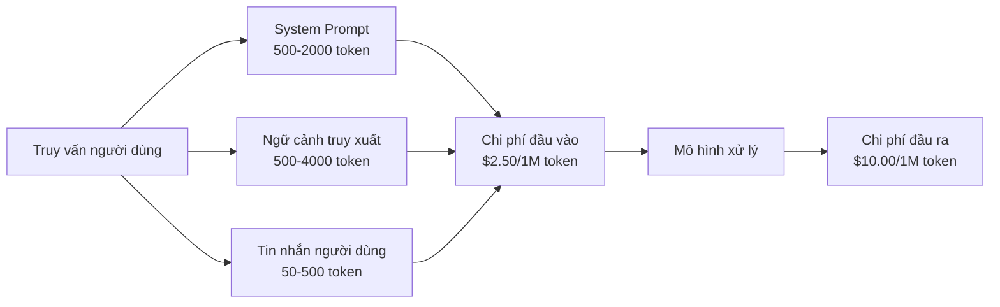
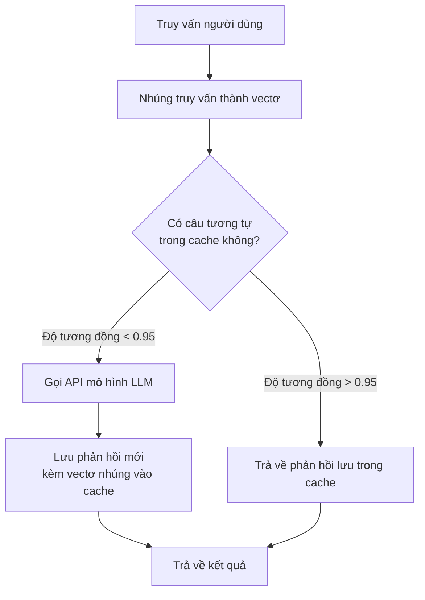
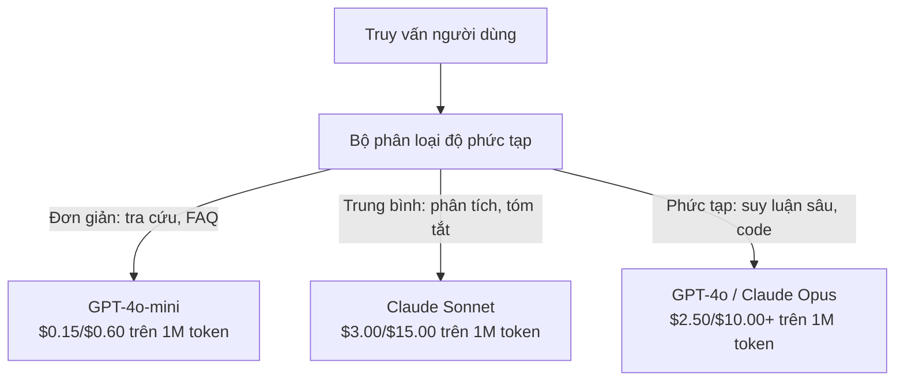

# Bộ nhớ đệm, Giới hạn tần suất & Tối ưu hóa chi phí (Caching, Rate Limiting & Cost Optimization)

> Phần lớn các startup AI không sụp đổ vì mô hình kém. Họ thất bại vì bài toán kinh tế trên từng đơn vị sản phẩm (unit economics) quá tồi tệ. Một lượt gọi GPT-4o chỉ tốn một phần nhỏ của cent. Nhưng mười nghìn người dùng, mỗi người thực hiện mười lượt gọi mỗi ngày, sẽ ngốn đứt 250 USD chỉ riêng cho token đầu vào -- trước khi bạn kịp thu về dù chỉ một đồng doanh thu. Những doanh nghiệp tồn tại được là những bên xem mỗi lần gọi API như một giao dịch tài chính thực sự, chứ không phải một lời gọi hàm thông thường.

**Loại:** Xây dựng (Build)
**Ngôn ngữ:** Python
**Điều kiện tiên quyết:** Giai đoạn 11, Bài học 09 (Gọi hàm / Function Calling)
**Thời lượng:** ~45 phút
**Liên quan:** Giai đoạn 11 · Bài 15 (Bộ nhớ đệm Prompt / Prompt Caching) — bài học này bao quát tầng bộ nhớ đệm cấp ứng dụng (bộ nhớ đệm ngữ nghĩa, băm chính xác, định tuyến mô hình). Bài học 15 đề cập đến bộ nhớ đệm prompt ở cấp nhà cung cấp (Anthropic cache_control, OpenAI tự động, Gemini CachedContent). Kết hợp cả hai để giảm từ 50-95% chi phí.

## Mục tiêu học tập

- Cài đặt bộ nhớ đệm ngữ nghĩa (semantic caching) giúp phục vụ các truy vấn tương tự hoặc lặp lại trực tiếp từ bộ nhớ đệm thay vì phải thực hiện cuộc gọi API tốn kém
- Tính toán chi phí trên từng yêu cầu giữa các nhà cung cấp và cài đặt cơ chế giới hạn tần suất dựa trên token (token-aware rate limiting) cùng cảnh báo ngân sách
- Xây dựng tầng tối ưu hóa chi phí với nén prompt (prompt compression), định tuyến mô hình (model routing giữa mô hình đắt và rẻ), và bộ nhớ đệm phản hồi
- Thiết kế chiến lược lưu đệm phân tầng (tiered caching) kết hợp so khớp chính xác, tương đồng ngữ nghĩa và bộ nhớ đệm tiền tố cho từng loại truy vấn

## Vấn đề đặt ra

Bạn xây dựng một chatbot RAG. Ứng dụng chạy mượt mà và người dùng đón nhận nồng nhiệt.

Thế rồi hóa đơn thanh toán ập đến.

GPT-5 có giá 1,25 USD cho mỗi triệu token đầu vào và 10 USD cho mỗi triệu token đầu ra. Claude Opus 4.7 có giá 5 USD đầu vào / 25 USD đầu ra. Gemini 3.1 Pro có giá 2 USD đầu vào / 12 USD đầu ra (với prompt dưới 200K token). GPT-5-mini có giá 0,25/2 USD. GPT-4o, mô hình dùng trong phép tính dưới đây, có giá 2,50/10 USD. Các con số này mang tính minh họa; hãy luôn đối chiếu bảng giá hiện hành của nhà cung cấp.

Dưới đây là phép tính tài chính có thể bóp nghẹt bất kỳ công ty khởi nghiệp nào:

- 10.000 người dùng hoạt động hàng ngày (DAU)
- 10 truy vấn mỗi người dùng mỗi ngày
- 1.000 token đầu vào cho mỗi truy vấn (system prompt + ngữ cảnh tài liệu + câu hỏi người dùng)
- 500 token đầu ra cho mỗi câu trả lời

**Chi phí token đầu vào hàng ngày:** 10.000 x 10 x 1.000 / 1.000.000 x 2,50 USD = **250 USD/ngày**
**Chi phí token đầu ra hàng ngày:** 10.000 x 10 x 500 / 1.000.000 x 10,00 USD = **500 USD/ngày**
**Tổng chi phí hàng tháng:** **22.500 USD/tháng**

Đó mới chỉ là tiền gọi LLM thuần túy. Chưa tính chi phí mô hình nhúng (embeddings), phí duy trì cơ sở dữ liệu vectơ, chi phí hạ tầng máy chủ. Bạn đang phải đối mặt với mức chi phí lên tới 30.000 USD mỗi tháng cho một con chatbot.

Điều cay đắng nhất là: 40-60% trong số các truy vấn đó là những câu hỏi gần như trùng lặp. Người dùng liên tục hỏi những vấn đề giống nhau bằng những câu từ chỉ hơi khác một chút. Câu system prompt của bạn -- vốn giống hệt nhau trên mọi request -- lại bị tính tiền lặp đi lặp lại từng giây từng phút. Các đoạn ngữ cảnh do hệ thống RAG truy xuất cũng lặp lại liên tục giữa những người dùng cùng tra cứu một chủ đề.

Bạn đang phải trả giá tối đa cho những phép tính hoàn toàn dư thừa.

## Khái niệm

### Giải phẫu chi phí của một lệnh gọi LLM (The Cost Anatomy of an LLM Call)

Mỗi lần gọi API bao gồm năm thành phần chi phí cấu thành:



System prompt chính là kẻ thấu chi thầm lặng. Một đoạn system prompt dài 1.500 token gửi kèm theo mọi yêu cầu sẽ tiêu tốn 3,75 USD cho mỗi triệu lượt gọi chỉ riêng cho phần tiền tố đó. Với lưu lượng 100.000 yêu cầu mỗi ngày, bạn mất đứt 375 USD/ngày -- tương đương 11.250 USD/tháng -- chỉ để truyền tải một đoạn văn bản bất biến!

### Bộ nhớ đệm của nhà cung cấp: Giảm giá tích hợp sẵn (Provider Caching: Built-in Discounts)

Bước sang năm 2026, cả ba nhà cung cấp dịch vụ đám mây lớn đều tích hợp sẵn cơ chế lưu đệm prompt phía máy chủ (prompt caching), nhưng cơ chế vận hành có sự khác biệt (xem chi tiết tại Giai đoạn 11 · Bài 15):

| Nhà cung cấp | Cơ chế | Mức chiết khấu | Ngưỡng tối thiểu | Thời gian lưu đệm (TTL) |
|--------------|--------|----------------|------------------|-------------------------|
| Anthropic | Đánh dấu tường minh qua cache_control | Giảm 90% khi trúng cache (tính thêm 25% phí ghi lần đầu) | 1.024 token (Sonnet/Opus), 2.048 token (Haiku) | 5 phút mặc định; mở rộng 1 giờ (trả thêm phí ghi x2) |
| OpenAI | Tự động so khớp tiền tố | Giảm 50% khi trúng cache | 1.024 token | Nỗ lực tối đa lên tới 1 giờ |
| Google Gemini | Gọi API CachedContent tường minh | Giảm ~75% (có tính phí lưu trữ) | 4.096 token (Flash) / 32.768 token (Pro) | TTL do người dùng tùy chỉnh |

**Phương pháp của Anthropic** mang tính tường minh. Bạn chủ động gắn cờ các đoạn văn bản trong prompt với `cache_control: {"type": "ephemeral"}`. Yêu cầu đầu tiên trả thêm 25% phụ phí ghi cache. Các yêu cầu tiếp theo có cùng tiền tố sẽ được giảm giá tới 90%. Một system prompt 2.000 token có giá thông thường 0,005 USD sẽ chỉ còn 0,000625 USD mỗi khi trúng cache. Trên quy mô 100.000 request, điều này giúp tiết kiệm tới 437,50 USD/ngày.

**Phương pháp của OpenAI** diễn ra hoàn toàn tự động. Mọi tiền tố prompt khớp với một yêu cầu vừa gửi trước đó đều tự động được giảm giá 50% mà không cần phải gắn nhãn thủ công. Sự đánh đổi: mức chiết khấu thấp hơn, người dùng ít quyền kiểm soát hơn, nhưng không tốn bất kỳ công sức cài đặt nào.

### Bộ nhớ đệm ngữ nghĩa: Tầng phòng thủ tùy biến (Semantic Caching: Your Custom Layer)

Bộ nhớ đệm của nhà cung cấp chỉ phát huy tác dụng khi tiền tố văn bản giống hệt nhau từng ký tự. Bộ nhớ đệm ngữ nghĩa (semantic caching) giải quyết bài toán hóc búa hơn nhiều: các truy vấn khác nhau về câu chữ nhưng mang cùng một ý định.

"Chính sách đổi trả hàng thế nào?" và "Làm sao để tôi trả lại một món đồ?" là hai chuỗi ký tự khác biệt nhưng có chung mục đích. Bộ nhớ đệm ngữ nghĩa sẽ nhúng cả hai câu thành vectơ, tính toán độ tương đồng cosin (cosine similarity), và lập tức trả về câu trả lời đã lưu trong cache nếu độ tương đồng vượt ngưỡng quy định (thường đặt từ 0.92 đến 0.95).



Chi phí nhúng là cực kỳ rẻ mạt: mô hình `text-embedding-3-small` của OpenAI chỉ tốn 0,02 USD cho mỗi triệu token. Chi phí kiểm tra bộ nhớ đệm gần như bằng 0 so với việc kích hoạt toàn bộ một lượt gọi LLM hoàn chỉnh.

### Bộ nhớ đệm chính xác: Băm và So khớp (Exact Caching: Hash and Match)

Đối với các lệnh gọi mang tính xác định (deterministic: thiết lập `temperature=0`, cùng mô hình, cùng prompt), cơ chế băm chính xác (exact caching) mang lại tốc độ vượt trội và đơn giản hơn nhiều: băm toàn bộ chuỗi prompt thành mã hash (SHA-256), kiểm tra trong bộ nhớ đệm, nếu thấy thì lập tức trả kết quả về.

Giải pháp này cực kỳ hiệu quả đối với:
- Cặp system prompt + ngữ cảnh cố định + câu hỏi người dùng giống hệt
- Lời gọi hàm (function calling) có chung định nghĩa công cụ
- Xử lý dữ liệu theo lô (batch processing) khi một tài liệu được quét qua nhiều lần

### Giới hạn tần suất: Bảo vệ ngân sách (Rate Limiting: Protecting Your Budget)

Giới hạn tần suất (rate limiting) không chỉ nhằm đảm bảo sự công bằng giữa các người dùng. Đó là tấm khiên bảo vệ sự sống còn của doanh nghiệp.

**Thuật toán thùng token (Token bucket algorithm)**: Mỗi người dùng sở hữu một "thùng" chứa tối đa $N$ token, và thùng này được nạp đầy dần với tốc độ $R$ token mỗi giây. Mỗi yêu cầu sẽ tiêu thụ một lượng token tương ứng từ thùng. Nếu thùng rỗng, yêu cầu sẽ bị từ chối. Thuật toán này vừa cho phép người dùng xả lượng truy cập đột biến trong thời gian ngắn (bursts) vừa kiểm soát chặt chẽ lưu lượng tiêu thụ trung bình.

**Hạn mức theo người dùng (Per-user quotas)**: Phân bổ hạn ngạch token hàng ngày/hàng tháng theo từng cấp độ tài khoản:

| Cấp bậc | Hạn mức token hàng ngày | Số yêu cầu tối đa / phút | Quyền truy cập mô hình |
|---------|-------------------------|--------------------------|------------------------|
| Miễn phí (Free) | 50.000 | 10 | Chỉ dùng GPT-4o-mini |
| Chuyên nghiệp (Pro) | 500.000 | 60 | GPT-4o, Claude Sonnet |
| Doanh nghiệp (Enterprise) | 5.000.000 | 300 | Toàn bộ các mô hình |

### Định tuyến mô hình: Đúng việc, đúng mô hình (Model Routing)

Không phải câu hỏi nào cũng cần đến sức mạnh của GPT-4o.

Câu hỏi "Mấy giờ cửa hàng đóng cửa?" hoàn toàn không xứng đáng phải tiêu tốn một mô hình có giá đầu ra 10 USD/triệu token. GPT-4o-mini với giá 0,60 USD/triệu token đầu ra hoàn toàn xử lý tốt câu này. Claude Haiku giá 1,25 USD/triệu token cũng xử lý hoàn hảo. Một bộ phân loại đơn giản sẽ định tuyến các câu hỏi dễ sang mô hình rẻ và chỉ dành các mô hình đắt tiền cho những câu hỏi tư duy phức tạp.



Một bộ định tuyến được tinh chỉnh tốt có thể cắt giảm ngay từ 40-70% chi phí gọi mô hình.

### Theo dõi chi phí: Nắm rõ từng đồng chi tiêu (Cost Tracking)

Bạn không thể tối ưu hóa những gì bạn không đo lường được. Hãy ghi nhật ký (log) mọi lượt gọi API với các trường dữ liệu sau:

- Dấu thời gian (Timestamp)
- Tên mô hình
- Số token đầu vào
- Số token đầu ra
- Độ trễ (ms)
- Chi phí tính toán được (USD)
- Định danh người dùng (User ID)
- Trạng thái trúng/trượt cache (hit/miss)
- Phân loại yêu cầu nghiệp vụ

Dữ liệu này sẽ chỉ rõ tính năng nào đang gây tốn kém nhất, nhóm người dùng nào đang tiêu thụ tài nguyên nặng nề, và vị trí nào áp dụng bộ nhớ đệm mang lại hiệu quả sinh lời cao nhất.

### Xử lý theo lô: Chiết khấu số lượng lớn (Batching: Bulk Discounts)

API xử lý theo lô (Batch API) của OpenAI cho phép xử lý các yêu cầu bất đồng bộ với mức chiết khấu thẳng 50% chi phí. Bạn gửi lên một tệp chứa tới 50.000 yêu cầu và nhận lại kết quả trong vòng 24 giờ.

Áp dụng xử lý theo lô cho:
- Quy trình xử lý tài liệu chạy ban đêm
- Phân loại dữ liệu hàng loạt
- Các lượt chạy đánh giá kiểm thử (eval runs)
- Đường ống làm giàu dữ liệu (data enrichment)

Tuyệt đối không áp dụng cho: các tính năng tương tác người dùng thời gian thực đòi hỏi độ trễ thấp.

### Cảnh báo ngân sách và Cầu dao ngắt tự động (Budget Alerts and Circuit Breakers)

Cầu dao tự động (circuit breaker) là cơ chế dừng chi tiêu khẩn cấp khi chạm ngưỡng giới hạn. Nếu không có nó, một vòng lặp vô tận trong mã nguồn hoặc một cuộc tấn công lạm dụng có thể thiêu rụi toàn bộ hạn mức thẻ tín dụng của bạn chỉ sau vài giờ.

Thiết lập ba ngưỡng phòng thủ:
1. **Cảnh báo (Warning - 70% ngân sách)**: Gửi thông báo cảnh báo tới đội ngũ kỹ thuật
2. **Tiết lưu (Throttle - 85% ngân sách)**: Tự động hạ cấp, chỉ cho phép định tuyến sang các mô hình giá rẻ
3. **Ngắt toàn bộ (Stop - 95% ngân sách)**: Từ chối các yêu cầu mới, chỉ phục vụ các câu hỏi đã có sẵn trong bộ nhớ đệm

### Ngăn xếp tối ưu hóa chi phí (The Optimization Stack)

Áp dụng các kỹ thuật theo thứ tự ưu tiên dưới đây. Mỗi tầng sẽ cộng hưởng hiệu quả lên các tầng trước đó:

| Tầng | Kỹ thuật | Mức tiết kiệm điển hình | Độ phức tạp cài đặt |
|------|----------|-------------------------|---------------------|
| 1 | Bộ nhớ đệm prompt nhà cung cấp | 30-50% | Thấp (chỉ cần gắn cờ cache) |
| 2 | Bộ nhớ đệm chính xác (Exact caching) | 10-20% | Thấp (băm hash + từ điển) |
| 3 | Bộ nhớ đệm ngữ nghĩa (Semantic caching) | 15-30% | Trung bình (vectơ nhúng + độ tương đồng) |
| 4 | Định tuyến mô hình (Model routing) | 40-70% | Trung bình (bộ phân loại độ phức tạp) |
| 5 | Giới hạn tần suất (Rate limiting) | Bảo vệ ngân sách an toàn | Thấp (thuật toán thùng token) |
| 6 | Nén câu prompt (Prompt compression) | 10-30% | Trung bình (viết lại prompt gọn gàng) |
| 7 | Xử lý theo lô (Batching) | Giảm 50% cho các tác vụ nền | Thấp (dùng Batch API) |

Một ứng dụng RAG khi áp dụng từ tầng 1 đến tầng 5 thông thường sẽ giảm chi phí từ 22.500 USD/tháng xuống chỉ còn khoảng 4.000 - 6.000 USD/tháng. Đó chính là lằn ranh quyết định giữa việc cạn kiệt dòng tiền hay xây dựng được một doanh nghiệp sinh lời bền vững.

### Mức tiết kiệm thực tế: Trước và Sau

Số liệu thực tế từ một ứng dụng chatbot RAG phục vụ 10.000 DAU:

| Chỉ số | Trước khi tối ưu hóa | Sau khi tối ưu hóa | Tỷ lệ tiết kiệm |
|--------|----------------------|--------------------|-----------------|
| Chi phí LLM hàng tháng | $22.500 | $5.200 | 77% |
| Chi phí trung bình / truy vấn | $0,0075 | $0,0017 | 77% |
| Tỷ lệ trúng cache | 0% | 52% | -- |
| Tỷ lệ định tuyến sang mini | 0% | 65% | -- |
| Độ trễ P95 | 2.800ms | 900ms (trúng cache: 50ms) | Nhanh hơn 68% |
| Chi phí nhúng hàng tháng | $0 | $180 | (phát sinh mới) |
| Tổng chi phí hàng tháng | $22.500 | $5.380 | Tiết kiệm 76% |

Chi phí phát sinh cho mô hình nhúng phục vụ semantic cache (180 USD/tháng) tự hoàn vốn chỉ sau giờ vận hành đầu tiên nhờ lượng cuộc gọi LLM được cắt giảm!

```figure
semantic-cache
```

## Tự xây dựng (Build It)

### Bước 1: Bộ tính toán chi phí (Cost Calculator)

Xây dựng công cụ tính toán chi phí token dựa trên bảng giá chi tiết của các mô hình hàng đầu.

```python
import hashlib
import time
import json
import math
from dataclasses import dataclass, field


MODEL_PRICING = {
    "gpt-4o": {"input": 2.50, "output": 10.00, "cached_input": 1.25},
    "gpt-4o-mini": {"input": 0.15, "output": 0.60, "cached_input": 0.075},
    "gpt-4.1": {"input": 2.00, "output": 8.00, "cached_input": 0.50},
    "gpt-4.1-mini": {"input": 0.40, "output": 1.60, "cached_input": 0.10},
    "gpt-4.1-nano": {"input": 0.10, "output": 0.40, "cached_input": 0.025},
    "o3": {"input": 2.00, "output": 8.00, "cached_input": 0.50},
    "o3-mini": {"input": 1.10, "output": 4.40, "cached_input": 0.55},
    "o4-mini": {"input": 1.10, "output": 4.40, "cached_input": 0.275},
    "claude-opus-4": {"input": 15.00, "output": 75.00, "cached_input": 1.50},
    "claude-sonnet-4": {"input": 3.00, "output": 15.00, "cached_input": 0.30},
    "claude-haiku-3.5": {"input": 0.80, "output": 4.00, "cached_input": 0.08},
    "gemini-2.5-pro": {"input": 1.25, "output": 10.00, "cached_input": 0.3125},
    "gemini-2.5-flash": {"input": 0.15, "output": 0.60, "cached_input": 0.0375},
}


def calculate_cost(model, input_tokens, output_tokens, cached_input_tokens=0):
    if model not in MODEL_PRICING:
        return {"error": f"Unknown model: {model}"}
    pricing = MODEL_PRICING[model]
    non_cached = input_tokens - cached_input_tokens
    input_cost = (non_cached / 1_000_000) * pricing["input"]
    cached_cost = (cached_input_tokens / 1_000_000) * pricing["cached_input"]
    output_cost = (output_tokens / 1_000_000) * pricing["output"]
    total = input_cost + cached_cost + output_cost
    return {
        "model": model,
        "input_tokens": input_tokens,
        "output_tokens": output_tokens,
        "cached_input_tokens": cached_input_tokens,
        "input_cost": round(input_cost, 6),
        "cached_input_cost": round(cached_cost, 6),
        "output_cost": round(output_cost, 6),
        "total_cost": round(total, 6),
    }
```

### Bước 2: Bộ nhớ đệm chính xác (Exact Cache)

Băm mã toàn bộ nội dung yêu cầu và trả về kết quả đã lưu cho các lệnh gọi hoàn toàn trùng khớp.

```python
class ExactCache:
    def __init__(self, max_size=1000, ttl_seconds=3600):
        self.cache = {}
        self.max_size = max_size
        self.ttl = ttl_seconds
        self.hits = 0
        self.misses = 0

    def _hash(self, model, messages, temperature):
        key_data = json.dumps({"model": model, "messages": messages, "temperature": temperature}, sort_keys=True)
        return hashlib.sha256(key_data.encode()).hexdigest()

    def get(self, model, messages, temperature=0.0):
        if temperature > 0:
            self.misses += 1
            return None
        key = self._hash(model, messages, temperature)
        if key in self.cache:
            entry = self.cache[key]
            if time.time() - entry["timestamp"] < self.ttl:
                self.hits += 1
                entry["access_count"] += 1
                return entry["response"]
            del self.cache[key]
        self.misses += 1
        return None

    def put(self, model, messages, temperature, response):
        if temperature > 0:
            return
        if len(self.cache) >= self.max_size:
            oldest_key = min(self.cache, key=lambda k: self.cache[k]["timestamp"])
            del self.cache[oldest_key]
        key = self._hash(model, messages, temperature)
        self.cache[key] = {
            "response": response,
            "timestamp": time.time(),
            "access_count": 1,
        }

    def stats(self):
        total = self.hits + self.misses
        return {
            "hits": self.hits,
            "misses": self.misses,
            "hit_rate": round(self.hits / total, 4) if total > 0 else 0,
            "cache_size": len(self.cache),
        }
```

### Bước 3: Bộ nhớ đệm ngữ nghĩa (Semantic Cache)

Chuyển đổi truy vấn thành vectơ và trả về câu trả lời đã lưu khi độ tương đồng vượt ngưỡng cho phép.

```python
def simple_embed(text):
    words = text.lower().split()
    vocab = {}
    for w in words:
        vocab[w] = vocab.get(w, 0) + 1
    norm = math.sqrt(sum(v * v for v in vocab.values()))
    if norm == 0:
        return {}
    return {k: v / norm for k, v in vocab.items()}


def cosine_similarity(a, b):
    if not a or not b:
        return 0.0
    all_keys = set(a) | set(b)
    dot = sum(a.get(k, 0) * b.get(k, 0) for k in all_keys)
    return dot


class SemanticCache:
    def __init__(self, similarity_threshold=0.85, max_size=500, ttl_seconds=3600):
        self.entries = []
        self.threshold = similarity_threshold
        self.max_size = max_size
        self.ttl = ttl_seconds
        self.hits = 0
        self.misses = 0

    def get(self, query):
        query_embedding = simple_embed(query)
        now = time.time()
        best_match = None
        best_sim = 0.0
        for entry in self.entries:
            if now - entry["timestamp"] > self.ttl:
                continue
            sim = cosine_similarity(query_embedding, entry["embedding"])
            if sim > best_sim:
                best_sim = sim
                best_match = entry
        if best_match and best_sim >= self.threshold:
            self.hits += 1
            best_match["access_count"] += 1
            return {"response": best_match["response"], "similarity": round(best_sim, 4), "original_query": best_match["query"]}
        self.misses += 1
        return None

    def put(self, query, response):
        if len(self.entries) >= self.max_size:
            self.entries.sort(key=lambda e: e["timestamp"])
            self.entries.pop(0)
        self.entries.append({
            "query": query,
            "embedding": simple_embed(query),
            "response": response,
            "timestamp": time.time(),
            "access_count": 1,
        })

    def stats(self):
        total = self.hits + self.misses
        return {
            "hits": self.hits,
            "misses": self.misses,
            "hit_rate": round(self.hits / total, 4) if total > 0 else 0,
            "cache_size": len(self.entries),
        }
```

### Bước 4: Bộ giới hạn tần suất (Rate Limiter)

Triển khai thuật toán thùng token với hạn mức cấu hình linh hoạt cho từng cấp người dùng.

```python
class TokenBucketRateLimiter:
    def __init__(self):
        self.buckets = {}
        self.tiers = {
            "free": {"capacity": 50_000, "refill_rate": 500, "max_requests_per_min": 10},
            "pro": {"capacity": 500_000, "refill_rate": 5_000, "max_requests_per_min": 60},
            "enterprise": {"capacity": 5_000_000, "refill_rate": 50_000, "max_requests_per_min": 300},
        }

    def _get_bucket(self, user_id, tier="free"):
        if user_id not in self.buckets:
            tier_config = self.tiers.get(tier, self.tiers["free"])
            self.buckets[user_id] = {
                "tokens": tier_config["capacity"],
                "capacity": tier_config["capacity"],
                "refill_rate": tier_config["refill_rate"],
                "last_refill": time.time(),
                "request_timestamps": [],
                "max_rpm": tier_config["max_requests_per_min"],
                "tier": tier,
                "total_tokens_used": 0,
            }
        return self.buckets[user_id]

    def _refill(self, bucket):
        now = time.time()
        elapsed = now - bucket["last_refill"]
        refill = int(elapsed * bucket["refill_rate"])
        if refill > 0:
            bucket["tokens"] = min(bucket["capacity"], bucket["tokens"] + refill)
            bucket["last_refill"] = now

    def check(self, user_id, tokens_needed, tier="free"):
        bucket = self._get_bucket(user_id, tier)
        self._refill(bucket)
        now = time.time()
        bucket["request_timestamps"] = [t for t in bucket["request_timestamps"] if now - t < 60]
        if len(bucket["request_timestamps"]) >= bucket["max_rpm"]:
            return {"allowed": False, "reason": "rate_limit", "retry_after_seconds": 60 - (now - bucket["request_timestamps"][0])}
        if bucket["tokens"] < tokens_needed:
            deficit = tokens_needed - bucket["tokens"]
            wait = deficit / bucket["refill_rate"]
            return {"allowed": False, "reason": "token_limit", "tokens_available": bucket["tokens"], "retry_after_seconds": round(wait, 1)}
        return {"allowed": True, "tokens_available": bucket["tokens"]}

    def consume(self, user_id, tokens_used, tier="free"):
        bucket = self._get_bucket(user_id, tier)
        bucket["tokens"] -= tokens_used
        bucket["request_timestamps"].append(time.time())
        bucket["total_tokens_used"] += tokens_used

    def get_usage(self, user_id):
        if user_id not in self.buckets:
            return {"error": "User not found"}
        b = self.buckets[user_id]
        return {
            "user_id": user_id,
            "tier": b["tier"],
            "tokens_remaining": b["tokens"],
            "capacity": b["capacity"],
            "total_tokens_used": b["total_tokens_used"],
            "utilization": round(b["total_tokens_used"] / b["capacity"], 4) if b["capacity"] else 0,
        }
```

### Bước 5: Bộ theo dõi chi phí (Cost Tracker)

Lưu vết toàn bộ các lệnh gọi API và tính toán chi phí vận hành theo thời gian thực.

```python
class CostTracker:
    def __init__(self, monthly_budget=1000.0):
        self.logs = []
        self.monthly_budget = monthly_budget
        self.alerts = []

    def log_call(self, model, input_tokens, output_tokens, cached_input_tokens=0, latency_ms=0, user_id="anonymous", cache_status="miss"):
        cost = calculate_cost(model, input_tokens, output_tokens, cached_input_tokens)
        entry = {
            "timestamp": time.time(),
            "model": model,
            "input_tokens": input_tokens,
            "output_tokens": output_tokens,
            "cached_input_tokens": cached_input_tokens,
            "latency_ms": latency_ms,
            "cost": cost["total_cost"],
            "user_id": user_id,
            "cache_status": cache_status,
        }
        self.logs.append(entry)
        self._check_budget()
        return entry

    def _check_budget(self):
        total = self.total_cost()
        pct = total / self.monthly_budget if self.monthly_budget > 0 else 0
        if pct >= 0.95 and not any(a["level"] == "stop" for a in self.alerts):
            self.alerts.append({"level": "stop", "message": f"Budget 95% consumed: ${total:.2f}/${self.monthly_budget:.2f}", "timestamp": time.time()})
        elif pct >= 0.85 and not any(a["level"] == "throttle" for a in self.alerts):
            self.alerts.append({"level": "throttle", "message": f"Budget 85% consumed: ${total:.2f}/${self.monthly_budget:.2f}", "timestamp": time.time()})
        elif pct >= 0.70 and not any(a["level"] == "warning" for a in self.alerts):
            self.alerts.append({"level": "warning", "message": f"Budget 70% consumed: ${total:.2f}/${self.monthly_budget:.2f}", "timestamp": time.time()})

    def total_cost(self):
        return round(sum(e["cost"] for e in self.logs), 6)

    def cost_by_model(self):
        by_model = {}
        for e in self.logs:
            m = e["model"]
            if m not in by_model:
                by_model[m] = {"calls": 0, "cost": 0, "input_tokens": 0, "output_tokens": 0}
            by_model[m]["calls"] += 1
            by_model[m]["cost"] = round(by_model[m]["cost"] + e["cost"], 6)
            by_model[m]["input_tokens"] += e["input_tokens"]
            by_model[m]["output_tokens"] += e["output_tokens"]
        return by_model

    def cache_savings(self):
        cache_hits = [e for e in self.logs if e["cache_status"] == "hit"]
        if not cache_hits:
            return {"saved": 0, "cache_hits": 0}
        saved = 0
        for e in cache_hits:
            full_cost = calculate_cost(e["model"], e["input_tokens"], e["output_tokens"])
            saved += full_cost["total_cost"]
        return {"saved": round(saved, 4), "cache_hits": len(cache_hits)}

    def summary(self):
        if not self.logs:
            return {"total_calls": 0, "total_cost": 0}
        total_latency = sum(e["latency_ms"] for e in self.logs)
        cache_hits = sum(1 for e in self.logs if e["cache_status"] == "hit")
        return {
            "total_calls": len(self.logs),
            "total_cost": self.total_cost(),
            "avg_cost_per_call": round(self.total_cost() / len(self.logs), 6),
            "avg_latency_ms": round(total_latency / len(self.logs), 1),
            "cache_hit_rate": round(cache_hits / len(self.logs), 4),
            "cost_by_model": self.cost_by_model(),
            "cache_savings": self.cache_savings(),
            "budget_remaining": round(self.monthly_budget - self.total_cost(), 2),
            "budget_utilization": round(self.total_cost() / self.monthly_budget, 4) if self.monthly_budget > 0 else 0,
            "alerts": self.alerts,
        }
```

### Bước 6: Bộ định tuyến mô hình (Model Router)

Phân loại độ phức tạp và chuyển hướng câu hỏi tới mô hình có mức giá tối ưu nhất.

```python
SIMPLE_KEYWORDS = ["what time", "hours", "address", "phone", "price", "return policy", "hello", "hi", "thanks", "yes", "no"]
COMPLEX_KEYWORDS = ["analyze", "compare", "explain why", "write code", "debug", "architect", "design", "trade-off", "evaluate"]


def classify_complexity(query):
    q = query.lower()
    if len(q.split()) <= 5 or any(kw in q for kw in SIMPLE_KEYWORDS):
        return "simple"
    if any(kw in q for kw in COMPLEX_KEYWORDS):
        return "complex"
    return "medium"


def route_model(query, tier="pro"):
    complexity = classify_complexity(query)
    routing_table = {
        "simple": {"free": "gpt-4.1-nano", "pro": "gpt-4o-mini", "enterprise": "gpt-4o-mini"},
        "medium": {"free": "gpt-4o-mini", "pro": "claude-sonnet-4", "enterprise": "claude-sonnet-4"},
        "complex": {"free": "gpt-4o-mini", "pro": "gpt-4o", "enterprise": "claude-opus-4"},
    }
    model = routing_table[complexity].get(tier, "gpt-4o-mini")
    return {"query": query, "complexity": complexity, "model": model, "tier": tier}
```

### Bước 7: Chạy bản demo thực nghiệm

```python
def simulate_llm_call(model, query):
    input_tokens = len(query.split()) * 4 + 500
    output_tokens = 150 + (len(query.split()) * 2)
    latency = 200 + (output_tokens * 2)
    return {
        "model": model,
        "response": f"[Simulated {model} response to: {query[:50]}...]",
        "input_tokens": input_tokens,
        "output_tokens": output_tokens,
        "latency_ms": latency,
    }


def run_demo():
    print("=" * 60)
    print("  Caching, Rate Limiting & Cost Optimization Demo")
    print("=" * 60)

    print("\n--- Model Pricing ---")
    for model, pricing in list(MODEL_PRICING.items())[:6]:
        cost_1k = calculate_cost(model, 1000, 500)
        print(f"  {model}: ${cost_1k['total_cost']:.6f} per 1K in + 500 out")

    print("\n--- Cost Comparison: 100K Requests ---")
    for model in ["gpt-4o", "gpt-4o-mini", "claude-sonnet-4", "claude-haiku-3.5"]:
        cost = calculate_cost(model, 1000 * 100_000, 500 * 100_000)
        print(f"  {model}: ${cost['total_cost']:.2f}")

    print("\n--- Anthropic Cache Savings ---")
    no_cache = calculate_cost("claude-sonnet-4", 2000, 500, 0)
    with_cache = calculate_cost("claude-sonnet-4", 2000, 500, 1500)
    saving = no_cache["total_cost"] - with_cache["total_cost"]
    print(f"  Without cache: ${no_cache['total_cost']:.6f}")
    print(f"  With 1500 cached tokens: ${with_cache['total_cost']:.6f}")
    print(f"  Savings per call: ${saving:.6f} ({saving/no_cache['total_cost']*100:.1f}%)")

    exact_cache = ExactCache(max_size=100, ttl_seconds=300)
    semantic_cache = SemanticCache(similarity_threshold=0.75, max_size=100)
    rate_limiter = TokenBucketRateLimiter()
    tracker = CostTracker(monthly_budget=100.0)

    print("\n--- Exact Cache ---")
    messages_1 = [{"role": "user", "content": "What is the return policy?"}]
    result = exact_cache.get("gpt-4o-mini", messages_1, 0.0)
    print(f"  First lookup: {'HIT' if result else 'MISS'}")
    exact_cache.put("gpt-4o-mini", messages_1, 0.0, "You can return items within 30 days.")
    result = exact_cache.get("gpt-4o-mini", messages_1, 0.0)
    print(f"  Second lookup: {'HIT' if result else 'MISS'} -> {result}")
    result = exact_cache.get("gpt-4o-mini", messages_1, 0.7)
    print(f"  With temp=0.7: {'HIT' if result else 'MISS (non-deterministic, skip cache)'}")
    print(f"  Stats: {exact_cache.stats()}")

    print("\n--- Semantic Cache ---")
    test_queries = [
        ("What is the return policy?", "Items can be returned within 30 days with receipt."),
        ("How do I return an item?", None),
        ("What are your store hours?", "We are open 9am-9pm Monday through Saturday."),
        ("When does the store open?", None),
        ("Tell me about quantum computing", "Quantum computers use qubits..."),
        ("Explain quantum mechanics", None),
    ]
    for query, response in test_queries:
        cached = semantic_cache.get(query)
        if cached:
            print(f"  '{query[:40]}' -> CACHE HIT (sim={cached['similarity']}, original='{cached['original_query'][:40]}')")
        elif response:
            semantic_cache.put(query, response)
            print(f"  '{query[:40]}' -> MISS (stored)")
        else:
            print(f"  '{query[:40]}' -> MISS (no match)")
    print(f"  Stats: {semantic_cache.stats()}")

    print("\n--- Rate Limiting ---")
    for i in range(12):
        check = rate_limiter.check("user_1", 1000, "free")
        if check["allowed"]:
            rate_limiter.consume("user_1", 1000, "free")
        status = "OK" if check["allowed"] else f"BLOCKED ({check['reason']})"
        if i < 5 or not check["allowed"]:
            print(f"  Request {i+1}: {status}")
    print(f"  Usage: {rate_limiter.get_usage('user_1')}")

    print("\n--- Model Routing ---")
    routing_queries = [
        "What time do you close?",
        "Summarize this quarterly earnings report",
        "Analyze the trade-offs between microservices and monoliths",
        "Hello",
        "Write code for a binary search tree with deletion",
    ]
    for q in routing_queries:
        route = route_model(q, "pro")
        print(f"  '{q[:50]}' -> {route['model']} ({route['complexity']})")

    print("\n--- Full Pipeline: Before vs After Optimization ---")
    queries = [
        "What is the return policy?",
        "How do I return something?",
        "What are your hours?",
        "When do you open?",
        "Explain the difference between TCP and UDP",
        "Compare TCP vs UDP protocols",
        "Hello",
        "What is your phone number?",
        "Write a Python function to sort a list",
        "Analyze the pros and cons of serverless architecture",
    ]

    print("\n  [Before: no caching, single model (gpt-4o)]")
    tracker_before = CostTracker(monthly_budget=1000.0)
    for q in queries:
        result = simulate_llm_call("gpt-4o", q)
        tracker_before.log_call("gpt-4o", result["input_tokens"], result["output_tokens"], latency_ms=result["latency_ms"], cache_status="miss")
    before = tracker_before.summary()
    print(f"  Total cost: ${before['total_cost']:.6f}")
    print(f"  Avg cost/call: ${before['avg_cost_per_call']:.6f}")
    print(f"  Avg latency: {before['avg_latency_ms']}ms")

    print("\n  [After: caching + routing + rate limiting]")
    exact_c = ExactCache()
    semantic_c = SemanticCache(similarity_threshold=0.75)
    tracker_after = CostTracker(monthly_budget=1000.0)

    for q in queries:
        messages = [{"role": "user", "content": q}]
        cached = exact_c.get("gpt-4o", messages, 0.0)
        if cached:
            tracker_after.log_call("gpt-4o-mini", 0, 0, latency_ms=5, cache_status="hit")
            continue
        sem_cached = semantic_c.get(q)
        if sem_cached:
            tracker_after.log_call("gpt-4o-mini", 0, 0, latency_ms=15, cache_status="hit")
            continue
        route = route_model(q)
        result = simulate_llm_call(route["model"], q)
        tracker_after.log_call(route["model"], result["input_tokens"], result["output_tokens"], latency_ms=result["latency_ms"], cache_status="miss")
        exact_c.put(route["model"], messages, 0.0, result["response"])
        semantic_c.put(q, result["response"])

    after = tracker_after.summary()
    print(f"  Total cost: ${after['total_cost']:.6f}")
    print(f"  Avg cost/call: ${after['avg_cost_per_call']:.6f}")
    print(f"  Avg latency: {after['avg_latency_ms']}ms")
    print(f"  Cache hit rate: {after['cache_hit_rate']:.0%}")

    if before["total_cost"] > 0:
        savings_pct = (1 - after["total_cost"] / before["total_cost"]) * 100
        print(f"\n  SAVINGS: {savings_pct:.1f}% cost reduction")
        print(f"  Latency improvement: {(1 - after['avg_latency_ms'] / before['avg_latency_ms']) * 100:.1f}% faster")

    print("\n--- Budget Alerts Demo ---")
    alert_tracker = CostTracker(monthly_budget=0.01)
    for i in range(5):
        alert_tracker.log_call("gpt-4o", 5000, 2000, latency_ms=500)
    print(f"  Total spent: ${alert_tracker.total_cost():.6f} / ${alert_tracker.monthly_budget}")
    for alert in alert_tracker.alerts:
        print(f"  ALERT [{alert['level'].upper()}]: {alert['message']}")

    print("\n--- Cost Breakdown by Model ---")
    multi_tracker = CostTracker(monthly_budget=500.0)
    for _ in range(50):
        multi_tracker.log_call("gpt-4o-mini", 800, 200, latency_ms=150)
    for _ in range(30):
        multi_tracker.log_call("claude-sonnet-4", 1500, 500, latency_ms=400)
    for _ in range(10):
        multi_tracker.log_call("gpt-4o", 2000, 800, latency_ms=600)
    for _ in range(10):
        multi_tracker.log_call("claude-opus-4", 3000, 1000, latency_ms=1200)
    breakdown = multi_tracker.cost_by_model()
    for model, data in sorted(breakdown.items(), key=lambda x: x[1]["cost"], reverse=True):
        print(f"  {model}: {data['calls']} calls, ${data['cost']:.6f}, {data['input_tokens']:,} in / {data['output_tokens']:,} out")
    print(f"  Total: ${multi_tracker.total_cost():.6f}")

    print("\n" + "=" * 60)
    print("  Demo complete.")
    print("=" * 60)


if __name__ == "__main__":
    run_demo()
```

## Sử dụng trong thực tế (Use It)

### Bộ nhớ đệm Prompt của Anthropic (Anthropic Prompt Caching)

```python
# import anthropic
#
# client = anthropic.Anthropic()
#
# response = client.messages.create(
#     model="claude-sonnet-5",
#     max_tokens=1024,
#     system=[
#         {
#             "type": "text",
#             "text": "You are a helpful customer support agent for Acme Corp...",
#             "cache_control": {"type": "ephemeral"},
#         }
#     ],
#     messages=[{"role": "user", "content": "What is the return policy?"}],
# )
#
# print(f"Input tokens: {response.usage.input_tokens}")
# print(f"Cache creation tokens: {response.usage.cache_creation_input_tokens}")
# print(f"Cache read tokens: {response.usage.cache_read_input_tokens}")
```

Lệnh gọi đầu tiên sẽ ghi nội dung vào bộ nhớ đệm (tính thêm 25% phụ phí ghi). Mọi lệnh gọi tiếp theo có cùng tiền tố system prompt sẽ đọc trực tiếp từ cache (hưởng chiết khấu 90%). Bộ nhớ đệm được duy trì trong 5 phút và tự động đặt lại bộ đếm thời gian mỗi khi trúng cache.

### Bộ nhớ đệm tự động của OpenAI (OpenAI Automatic Caching)

```python
# from openai import OpenAI
#
# client = OpenAI()
#
# response = client.chat.completions.create(
#     model="gpt-4o",
#     messages=[
#         {"role": "system", "content": "You are a helpful customer support agent..."},
#         {"role": "user", "content": "What is the return policy?"},
#     ],
# )
#
# print(f"Prompt tokens: {response.usage.prompt_tokens}")
# print(f"Cached tokens: {response.usage.prompt_tokens_details.cached_tokens}")
# print(f"Completion tokens: {response.usage.completion_tokens}")
```

OpenAI tự động hóa hoàn toàn việc lưu đệm. Mọi tiền tố prompt từ 1.024 token trở lên khớp với một yêu cầu vừa gửi sẽ tự động được chiết khấu 50%. Không cần sửa mã nguồn -- chỉ cần kiểm tra trường `prompt_tokens_details.cached_tokens` trong phản hồi để xác nhận tính năng đang hoạt động.

### API xử lý theo lô của OpenAI (OpenAI Batch API)

```python
# import json
# from openai import OpenAI
#
# client = OpenAI()
#
# requests = []
# for i, query in enumerate(queries):
#     requests.append({
#         "custom_id": f"request-{i}",
#         "method": "POST",
#         "url": "/v1/chat/completions",
#         "body": {
#             "model": "gpt-4o-mini",
#             "messages": [{"role": "user", "content": query}],
#         },
#     })
#
# with open("batch_input.jsonl", "w") as f:
#     for r in requests:
#         f.write(json.dumps(r) + "\n")
#
# batch_file = client.files.create(file=open("batch_input.jsonl", "rb"), purpose="batch")
# batch = client.batches.create(input_file_id=batch_file.id, endpoint="/v1/chat/completions", completion_window="24h")
# print(f"Batch ID: {batch.id}, Status: {batch.status}")
```

Batch API áp dụng mức giảm giá cố định 50% cho toàn bộ lượng token. Kết quả được trả về trong vòng 24 giờ. Rất lý tưởng cho các khối lượng công việc không đòi hỏi thời gian thực: đánh giá kiểm thử, gán nhãn dữ liệu, tóm tắt tài liệu hàng loạt.

### Bộ nhớ đệm ngữ nghĩa cấp sản xuất với Redis (Production Semantic Cache with Redis)

```python
# import redis
# import numpy as np
# from openai import OpenAI
#
# r = redis.Redis()
# client = OpenAI()
#
# def get_embedding(text):
#     response = client.embeddings.create(model="text-embedding-3-small", input=text)
#     return response.data[0].embedding
#
# def semantic_cache_lookup(query, threshold=0.95):
#     query_emb = np.array(get_embedding(query))
#     keys = r.keys("cache:emb:*")
#     best_sim, best_key = 0, None
#     for key in keys:
#         stored_emb = np.frombuffer(r.get(key), dtype=np.float32)
#         sim = np.dot(query_emb, stored_emb) / (np.linalg.norm(query_emb) * np.linalg.norm(stored_emb))
#         if sim > best_sim:
#             best_sim, best_key = sim, key
#     if best_sim >= threshold and best_key:
#         response_key = best_key.decode().replace("cache:emb:", "cache:resp:")
#         return r.get(response_key).decode()
#     return None
```

Trong môi trường thực tế, hãy thay thế thao tác quét tuyến tính bằng một chỉ mục vectơ chuyên dụng (như Redis Vector Search, Pinecone hoặc pgvector). Quét tuyến tính chỉ phù hợp khi số lượng mục dưới 1.000. Vượt qua ngưỡng đó, thuật toán tìm kiếm láng giềng gần nhất xấp xỉ (ANN) sẽ đảm bảo tốc độ tra cứu $O(\log n)$.

## Đóng gói sản phẩm (Ship It)

Bài học này cung cấp:
- `outputs/prompt-cost-optimizer.md` -- mẫu prompt phân tích ứng dụng LLM của bạn và đề xuất các giải pháp tối ưu hóa chi phí cụ thể kèm dự phóng mức tiết kiệm
- `outputs/skill-cost-patterns.md` -- khung quyết định lựa chọn chiến lược lưu đệm, cấu hình giới hạn tần suất và quy tắc định tuyến mô hình phù hợp với bài toán thực tế

## Bài tập thực hành (Exercises)

1. **Cài đặt cơ chế giải phóng bộ nhớ LRU cho Semantic Cache.** Thay thế cơ chế giải phóng mục cũ nhất (oldest-first) bằng thuật toán ít được sử dụng gần đây nhất (Least Recently Used - LRU). Theo dõi thời điểm truy cập gần nhất của từng mục và loại bỏ mục có thời gian truy cập xa nhất khi cache đầy. So sánh tỷ lệ trúng cache giữa hai chiến lược trên 100 câu truy vấn.

2. **Xây dựng công cụ dự phóng chi phí (Cost projection tool).** Dựa trên nhật ký các cuộc gọi API (từ `CostTracker`), hãy dự phóng tổng chi phí hàng tháng dựa theo giá trị trung bình 7 ngày gần nhất. Tính toán riêng biệt cho các biến động giữa ngày làm việc và cuối tuần. Kích hoạt cảnh báo nếu chi phí dự phóng tháng vượt ngân sách quá 20%.

3. **Cài đặt bộ nhớ đệm ngữ nghĩa phân tầng (Tiered semantic caching).** Sử dụng hai ngưỡng tương đồng: 0.98 cho các kết quả có độ tin cậy tuyệt đối (lập tức trả về kết quả) và 0.90 cho các kết quả có độ tin cậy vừa phải (trả về kèm thông báo: "Dựa trên một câu hỏi tương tự trước đây..."). Theo dõi tỷ lệ trúng từ mỗi tầng và đo lường sự hài lòng của người dùng.

4. **Xây dựng bộ phân loại định tuyến mô hình bằng Embedding.** Thay thế bộ phân loại dựa trên từ khóa bằng phương pháp so sánh vectơ nhúng. Nhúng 50 câu truy vấn mẫu đã được gán nhãn sẵn (đơn giản / trung bình / phức tạp), sau đó phân loại câu hỏi mới bằng cách tìm ví dụ được gán nhãn gần nhất. Đo lường độ chính xác phân loại trên tập kiểm thử gồm 20 câu.

5. **Cài đặt cầu dao ngắt tự động (Circuit breaker) với nhiều cấp độ hạ tải.** Tại 70% ngân sách, ghi log cảnh báo. Tại 85%, tự động ép toàn bộ lưu lượng chuyển sang mô hình rẻ nhất (gpt-4o-mini). Tại 95%, chỉ phục vụ các câu hỏi đã có sẵn trong bộ nhớ đệm và từ chối toàn bộ truy vấn mới. Kiểm thử bằng cách mô phỏng 1.000 yêu cầu trên ngân sách 1,00 USD và xác thực từng ngưỡng được kích hoạt chuẩn xác.

## Thuật ngữ cốt lõi (Key Terms)

| Thuật ngữ | Cách hiểu thông thường | Bản chất kỹ thuật |
|-----------|------------------------|-------------------|
| Bộ nhớ đệm Prompt (Prompt caching) | "Lưu đệm system prompt" | Cơ chế lưu đệm cấp nhà cung cấp: tiền tố prompt lặp lại được giảm giá (90% ở Anthropic, 50% ở OpenAI) -- tự động ở OpenAI, cần gắn nhãn tường minh ở Anthropic |
| Bộ nhớ đệm ngữ nghĩa (Semantic caching) | "Cache thông minh" | Nhúng truy vấn thành vectơ, tính độ tương đồng với các câu hỏi cũ, và trả về câu trả lời đã lưu nếu vượt ngưỡng -- bắt trọn các câu diễn giải lại cùng ý định |
| Bộ nhớ đệm chính xác (Exact caching) | "Cache mã băm" | Băm mã toàn bộ nội dung (mô hình + messages + temperature) và trả về phản hồi khi chuỗi đầu vào trùng khớp 100% -- chỉ dùng cho nhiệt độ bằng 0 |
| Thùng token (Token bucket) | "Bộ giới hạn tần suất" | Thuật toán trong đó mỗi người dùng có một thùng chứa $N$ token được nạp đầy với tốc độ $R$ token/giây -- cho phép xả lưu lượng đột biến nhưng chặn mức trung bình |
| Định tuyến mô hình (Model routing) | "Chia tải tiết kiệm" | Sử dụng bộ phân loại để đẩy câu hỏi dễ sang mô hình rẻ (GPT-4o-mini, Haiku) và câu hỏi khó sang mô hình đắt (GPT-4o, Opus) -- tiết kiệm 40-70% chi phí |
| Theo dõi chi phí (Cost tracking) | "Đo lường mức dùng" | Ghi log từng lệnh gọi API kèm tên mô hình, số token, độ trễ, chi phí và ID người dùng để nắm rõ vị trí phát sinh chi phí |
| Cầu dao ngắt tự động (Circuit breaker) | "Công tắc ngắt khẩn cấp" | Tự động hạ cấp dịch vụ (dùng mô hình rẻ hơn, chỉ phục vụ từ cache) hoặc từ chối yêu cầu khi chi tiêu tiệm cận hạn mức ngân sách |
| API xử lý theo lô (Batch API) | "Chiết khấu số lượng lớn" | Dịch vụ xử lý bất đồng bộ của OpenAI với mức giảm giá 50% -- gửi tối đa 50.000 yêu cầu, nhận kết quả trong 24 giờ |
| Nén câu prompt (Prompt compression) | "Ăn kiêng token" | Viết lại câu system prompt và ngữ cảnh để dùng ít token hơn nhưng vẫn bảo toàn đầy đủ ý nghĩa -- prompt ngắn hơn vừa rẻ hơn vừa chạy nhanh hơn |
| Tỷ lệ trúng cache (Cache hit rate) | "Hiệu suất lưu đệm" | Tỷ lệ phần trăm các yêu cầu được phục vụ trực tiếp từ cache mà không cần gọi mô hình -- thông thường đạt 40-60% trên các chatbot thực tế |

## Đọc thêm (Further Reading)

- [Anthropic Prompt Caching Guide](https://docs.anthropic.com/en/docs/build-with-claude/prompt-caching) -- tài liệu chính thức về cách sử dụng cache_control, cấu trúc bảng giá và vòng đời bộ nhớ đệm trên Claude
- [OpenAI Prompt Caching](https://platform.openai.com/docs/guides/prompt-caching) -- cơ chế lưu đệm tự động của OpenAI, cách đối soát qua trường usage và độ dài tiền tố tối thiểu
- [OpenAI Batch API](https://platform.openai.com/docs/guides/batch) -- chiết khấu 50% cho xử lý bất đồng bộ, định dạng JSONL, thời hạn hoàn tất 24 giờ và hạn mức 50.000 yêu cầu
- [Thư viện GPTCache](https://github.com/zilliztech/GPTCache) -- thư viện bộ nhớ đệm ngữ nghĩa mã nguồn mở hỗ trợ nhiều backend nhúng, vector store và chiến lược loại bỏ mục nhớ
- [Martian Model Router](https://docs.withmartian.com) -- giải pháp định tuyến mô hình thương mại tự động chọn mô hình rẻ nhất có khả năng giải quyết tốt câu hỏi
- [Not Diamond](https://www.notdiamond.ai) -- bộ định tuyến dựa trên học máy tối ưu hóa sự đánh đổi giữa chi phí và chất lượng trên nhiều nhà cung cấp
- [Helicone](https://www.helicone.ai) -- nền tảng quan sát LLM cung cấp bộ đệm proxy, theo dõi chi phí, giới hạn tần suất và cảnh báo ngân sách
- [Dean & Barroso, "The Tail at Scale" (CACM 2013)](https://research.google/pubs/the-tail-at-scale/) -- phân tích độ trễ, thông lượng, phân vị TTFT/TPOT và kỹ thuật hedged requests; nền tảng toán học đằng sau tư duy "chọn mô hình rẻ nhất vẫn đạt chuẩn P95"
- [Kwon et al., "Efficient Memory Management for Large Language Model Serving with PagedAttention" (SOSP 2023)](https://arxiv.org/abs/2309.06180) -- bài báo về vLLM; giải thích tại sao KV-cache phân trang kết hợp continuous batching vượt trội gấp 24 lần về thông lượng; tầng hạ tầng cốt lõi bên dưới bài toán chi phí và bộ nhớ đệm
- [Dao et al., "FlashAttention-2: Faster Attention with Better Parallelism and Work Partitioning" (ICLR 2024)](https://arxiv.org/abs/2307.08691) -- tối ưu hóa chi phí tính toán ở cấp kernel phần cứng song hành cùng lưu đệm prompt
