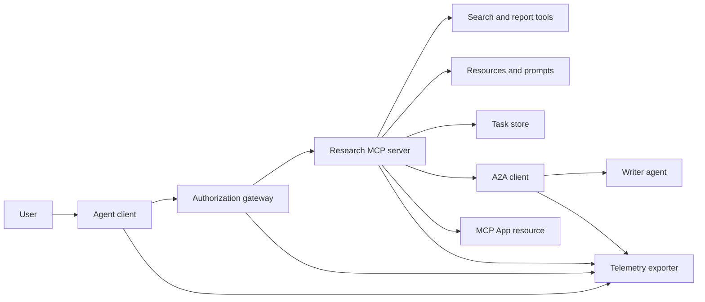
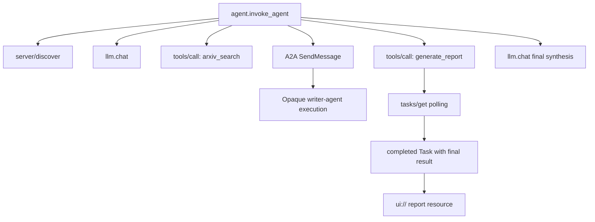
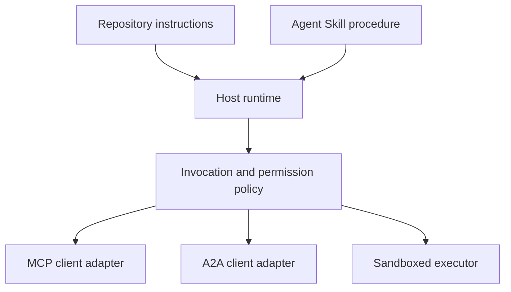

# Dự án Tổng kết: Hệ sinh thái Công cụ Phi trạng thái (Capstone: Stateless Tool Ecosystem)

> Một hệ thống tác tử cấp độ sản xuất là một tập hợp các ranh giới kiến trúc, chứ không phải một đống tính năng chất chồng. Bài thực hành tổng kết (capstone) này tách bạch một mô phỏng nội tiến trình dễ đọc khỏi các client giao thức, máy chủ ủy quyền, môi trường hộp cát và bộ trích xuất dữ liệu đo lường từ xa mà một hệ thống triển khai thực tế bắt buộc phải có.

**Loại:** Xây dựng (Build)
**Ngôn ngữ:** Python (thư viện chuẩn, mô phỏng nội tiến trình)
**Yêu cầu tiên quyết:** Phase 13 · 01 đến 22, sử dụng bản sửa đổi MCP `2026-07-28`
**Thời lượng:** ~120 phút

## Mục tiêu học tập

- Kết hợp các lệnh gọi công cụ, kết quả có cấu trúc tác vụ, công việc ủy quyền, tài nguyên giao diện người dùng (UI), chính sách ủy quyền và bản ghi dấu vết truy vết (traces) thành một luồng duy nhất.
- Đính kèm phiên bản giao thức, danh tính client và năng lực trong mỗi yêu cầu MCP thay vì phụ thuộc vào một phiên kết nối.
- Khám phá máy chủ trước khi sử dụng và điều phối công việc chạy lâu thông qua phần mở rộng Tác vụ (Tasks extension) chính thức.
- Phân biệt mô phỏng định hình theo giao thức (protocol-shaped simulation) với một bản triển khai MCP, A2A, OAuth hoặc OpenTelemetry thực thụ.
- Ánh xạ từng ranh giới mô phỏng tới thành phần môi trường sản xuất tương ứng cần thay thế nó.
- Giữ `AGENTS.md`, Kỹ năng Tác tử (Agent Skill), các bộ điều hợp runtime (runtime adapters), công cụ và chính sách bảo mật đúng với vai trò của chúng.
- Giải thích những tuyên bố nào có thể xác minh từ đầu ra cục bộ và những tuyên bố nào cần kiểm thử tích hợp trực tiếp.

## Vấn đề đặt ra

Thiết kế một hệ thống nghiên cứu và báo cáo. Người dùng yêu cầu tìm kiếm các bài báo khoa học về giao thức tác tử. Hệ thống tìm kiếm trong danh mục bài báo, ủy quyền tóm tắt, tạo báo cáo, trả về tài nguyên giao diện người dùng và ghi lại toàn bộ lộ trình di chuyển xuyên suốt hệ thống.

Câu mô tả ngắn gọn đó ẩn chứa nhiều hợp đồng độc lập:

- một lược đồ công cụ hướng tới mô hình;
- một phong bì yêu cầu phi trạng thái và hợp đồng khám phá máy chủ;
- một quyết định từ cổng API đối với tác nhân, phạm vi (scope) và danh tính công cụ;
- một hợp đồng thao tác chạy lâu dài;
- một giao thức ủy quyền tác vụ;
- một cầu nối giữa máy chủ và ứng dụng (host-to-app bridge);
- cơ chế lan truyền và trích xuất dấu vết truy vết;
- một quy trình vận hành tái sử dụng được.

Tệp `code/main.py` giữ cho các ranh giới này hoàn toàn tường minh bằng các hàm và từ điển Python thông thường. Nó không mở cổng giao vận mạng, không liên hệ arXiv thực tế, không thực hiện bắt tay OAuth, không gọi máy chủ A2A, không kết xuất MCP App, cũng không trích xuất dữ liệu đo lường từ xa. Điều này giúp luồng điều khiển dễ dàng được thanh tra mà không gây nhầm lẫn giữa một mô phỏng với một dịch vụ chuẩn hóa thực sự.

## Khái niệm cốt lõi

### Kiến trúc mục tiêu



Kiến trúc này là sự kết hợp mang tính khái niệm của các mẫu giao thức công khai. Nó không phải là một tuyên bố về cấu trúc nội bộ độc quyền của bất kỳ sản phẩm thương mại nào.

### Dấu vết mục tiêu (Target trace)



Trong một bản triển khai thực tế, mọi chặng giao tiếp đều lan truyền ngữ cảnh dấu vết. Tên span và các thuộc tính phải tuân thủ các quy ước ngữ nghĩa OpenTelemetry được hỗ trợ bởi phiên bản gắn mã giám sát đã chọn. Một mã định danh vết (`trace id`) dùng chung tự nó không chứng minh được mối quan hệ cha - con chính xác, việc trích xuất hay việc tiếp nhận thành công ở hệ thống backend.

### Các bề mặt giao thức hiện tại

Sử dụng tên phương thức được định nghĩa bởi giao thức hiện hành, không dùng các tên cũ từ bản thảo trước đây:

| Ranh giới | Bề mặt hiện tại | Thành phần capstone mô phỏng |
|---|---|---|
| Khám phá MCP | Bắt buộc dùng `server/discover` | Một hàm trực tiếp trả về phiên bản, năng lực và danh tính server |
| Ngữ cảnh yêu cầu MCP | Phiên bản, năng lực và danh tính client trong mỗi `params._meta` | Siêu dữ liệu yêu cầu mới được truyền vào mọi lệnh gọi mô phỏng |
| Lệnh gọi công cụ MCP | `tools/call` | Điều phối hàm Python trực tiếp |
| Thăm dò tác vụ MCP | `io.modelcontextprotocol/tasks` với `tasks/get` | Một handle đang xử lý theo sau bởi một tác vụ hoàn thành mang kết quả cuối cùng |
| Ủy quyền A2A | `SendMessage` trong gRPC và JSON-RPC; `POST /message:send` trong HTTP+JSON | Một span lồng nhau không có lệnh gọi từ xa hay độ trễ giả tạo |
| MCP App gọi công cụ máy chủ | `app.callServerTool({ name, arguments })` | Một chuỗi HTML không có cầu nối hoạt động trực tiếp |
| Ủy quyền OAuth | Máy chủ ủy quyền, siêu dữ liệu tài nguyên được bảo vệ, xác thực đối tượng và phạm vi | Tra cứu mã token tĩnh và kiểm tra thành viên của phạm vi (scope) |
| OpenTelemetry | SDK, bộ lan truyền, bộ trích xuất, và bộ thu thập hoặc backend | Các từ điển span lưu trữ trong bộ nhớ |

Tên giao thức chỉ là lớp bề mặt đầu tiên. Các bài kiểm thử sản xuất phải kiểm chứng quá trình tuần tự hóa, lỗi xác thực, hủy bỏ thao tác, hết hạn thời gian (timeouts), thử lại và độ tương thích phiên bản qua kết nối mạng thực tế.

### MCP phi trạng thái thay đổi ranh giới tích hợp

Bản sửa đổi `2026-07-28` loại bỏ các phiên giao thức và quá trình bắt tay `initialize` / `notifications/initialized`. Nó cũng loại bỏ tiêu đề `Mcp-Session-Id`. Mọi yêu cầu đều mang các trường `_meta` có không gian tên:

```json
{
  "io.modelcontextprotocol/protocolVersion": "2026-07-28",
  "io.modelcontextprotocol/clientCapabilities": {
    "extensions": {
      "io.modelcontextprotocol/tasks": {}
    }
  },
  "io.modelcontextprotocol/clientInfo": {
    "name": "capstone-client",
    "version": "1.0.0"
  }
}
```

Máy chủ bắt buộc phải triển khai `server/discover`. Kết quả thông thường sử dụng `resultType: "complete"`; một handle tác vụ sử dụng `resultType: "task"`. Mỗi kết quả cần định danh máy chủ trong `_meta.io.modelcontextprotocol/serverInfo`.

Phần mở rộng tác vụ gồm `tasks/get`, `tasks/update`, và `tasks/cancel`. Một công cụ ban đầu có thể trả về `resultType: "task"`; bản thân `tasks/get` trả về `resultType: "complete"`, và đối tượng `Task` hoàn tất sẽ chứa kết quả cuối cùng. Các phương thức cũ như `tasks/result` và `tasks/list` không còn thuộc phần mở rộng hiện hành. Phía client phải công bố `io.modelcontextprotocol/tasks` trong chính yêu cầu có thể tiếp nhận handle tác vụ. Nếu không, máy chủ sẽ trả về lỗi `-32021` kèm theo `requiredCapabilities` mang cấu trúc của đối tượng năng lực client còn thiếu, bao gồm `extensions.io.modelcontextprotocol/tasks`.

### Tư thế bảo mật (Security posture)

Mô hình triển khai chuẩn mực áp dụng cơ chế phòng thủ theo chiều sâu (defense in depth):

- Ủy quyền OAuth với PKCE khi loại client đòi hỏi;
- Ràng buộc tài nguyên và đối tượng phục vụ (audience) cho các token truy cập được phát hành;
- Cổng kiểm soát truy cập dựa trên vai trò (RBAC) kiểm tra công cụ và phạm vi được yêu cầu;
- Thông tin định danh thượng nguồn (upstream credentials) được giữ ngoài ngữ cảnh hiển thị của mô hình;
- Tệp kê khai mô tả công cụ được gắn cố định hoặc đã qua kiểm duyệt;
- Đánh giá theo Quy tắc Hai người (Rule of Two) đối với đầu vào không tin cậy, dữ liệu nhạy cảm và các hành động có hậu quả lớn;
- Hộp cát thực thi mà các giới hạn về hệ thống tệp, tiến trình, mạng, bí mật và tài nguyên được thực thi bên ngoài kỹ năng.

Bản demo chỉ triển khai các token tĩnh, kiểm tra phạm vi và mã băm mô tả. Nó hữu ích cho việc kiểm tra luồng chính sách, không dùng để xác thực an ninh.

### Kỹ năng là thủ tục, không phải tầng giao vận

Một Kỹ năng Tác tử (Agent Skill) có thể hướng dẫn runtime cách thực hiện quy trình nghiên cứu, những hợp đồng công cụ nào cần chờ đợi, bằng chứng nào cần lưu lại và khi nào thì dừng lại. Nó không thể làm cho một máy chủ MCP tự sinh ra, không thiết lập tính tương thích A2A, không cấp phát phạm vi quyền hạn và không tạo ra môi trường hộp cát.



Hãy phát hành toàn bộ thư mục kỹ năng khi thủ tục có tham chiếu tới các tệp đi kèm. Thành phần tạo tác tệp đơn phẳng trong bài capstone cũ này là bản thiết kế của khóa học, không phải bằng chứng cho thấy một host có thể bảo toàn một gói di động hoàn chỉnh. Các bài học từ 24 đến 27 xây dựng và kiểm thử toàn bộ vòng đời của gói hoàn chỉnh.

### Siêu dữ liệu tạo tác của khóa học là một bộ điều hợp cục bộ

Danh mục và trình cài đặt của khóa học nhận diện các tệp phẳng có tên `skill-*.md`, nhưng đó là quy ước riêng của kho mã nguồn này chứ không phải hợp đồng gói Agent Skills di động chuẩn hóa. Bộ phân tích frontmatter tối giản của chúng chỉ đọc các khóa ở cấp cao nhất. Do đó bài học này giữ các trường định danh di động và các trường danh mục khóa học ở cùng một cấp độ:

```yaml
---
name: ecosystem-blueprint
description: Produce a full Phase 13 ecosystem architecture for a product need.
version: "1.0.0"
phase: "13"
lesson: "23"
tags: [mcp, capstone, ecosystem, architecture, a2a, otel]
---
```

`name` và `description` là các trường định danh di động. `version`, `phase`, `lesson`, và `tags` là các phần mở rộng danh mục riêng của khóa học. Bộ phân tích của khóa học yêu cầu `tags` ở dạng danh sách nội tuyến (inline list) để bộ lọc `--tag capstone` có thể khớp chính xác.

Một kỹ năng dạng thư mục di động có thể sử dụng bản đồ `metadata` tùy chọn cho dữ liệu mở rộng dạng chuỗi. Điều đó không làm cho `metadata` có thể hoán đổi với lược đồ danh mục của kho mã nguồn này. Nếu tệp phẳng này lồng `version` hoặc `tags` vào bên dưới `metadata`, bộ phân tích tối giản sẽ bỏ qua các khóa thụt lề đó, danh mục sẽ ghi nhận phiên bản rỗng và bộ lọc thẻ sẽ không tìm thấy thành phần tạo tác. Các host trong môi trường sản xuất nên sử dụng bộ phân tích cú pháp YAML an toàn và kiểm thực theo đúng lược đồ đã tài liệu hóa của họ.

### Bảng so sánh giữa mô phỏng và môi trường sản xuất

| Tầng | `code/main.py` | Thay thế trong sản xuất | Bằng chứng yêu cầu |
|---|---|---|---|
| Khám phá | `server_discover()` cộng với `TOOLS` tĩnh | `server/discover` theo sau bởi `tools/list` có nhận biết bộ nhớ đệm | Bản ghi truyền tải trên đường truyền, thứ tự tất định và kiểm thực lược đồ |
| Xác thực | Từ điển tra cứu theo mã token | Xác thực máy chủ ủy quyền OAuth và tài nguyên được bảo vệ | Kiểm thử nhà phát hành, đối tượng, phạm vi, thời hạn và lỗi xác thực |
| Phân quyền | Kiểm tra thành viên của phạm vi | Chính sách cổng API ràng buộc với tác nhân, công cụ, đích đến và đối tượng thuê (tenant) | Các ca kiểm thử kiểm toán cho phép (allow) và từ chối (deny) |
| Tìm kiếm | Dữ liệu bài báo cố định (fixtures) | API tìm kiếm thực tế hoặc máy chủ MCP | Nguồn gốc dữ liệu, xếp hạng và kiểm thử xử lý lỗi |
| Tác vụ | Handle cục bộ cộng với gọi `tasks/get` ngay lập tức | Kho lưu trữ `io.modelcontextprotocol/tasks` bền vững với `tasks/get`, `tasks/update`, `tasks/cancel`, và TTL | Kiểm thử chuyển dịch trạng thái, đầu vào, hủy bỏ và phục hồi sau sự cố |
| Ủy quyền | Hàm sleep cộng với span lồng nhau | Client A2A và Thẻ tác tử từ xa | Kiểm thử hợp đồng, hết hạn thời gian, thử lại và tính hộp đen khép kín |
| Ứng dụng | Chuỗi HTML và định dạng URI | Tài nguyên MCP Apps và cầu nối `App` | Kiểm thử CSP, phân quyền, lệnh gọi công cụ và trình duyệt |
| Đo lường từ xa | Danh sách lưu trong bộ nhớ | SDK OTel và bộ trích xuất (exporter) | Biên nhận của bộ thu thập và xác nhận mối quan hệ trace-parent |
| Hộp cát | Không có | Môi trường thực thi cách ly do máy chủ thực thi | Kiểm thử thoát hộp cát, lưu lượng mạng ngoài, bí mật và giới hạn tài nguyên |

Bảng này đóng vai trò là ranh giới bàn giao. Một lần chạy thành công cục bộ chỉ kiểm chứng duy nhất mô hình mô phỏng.

### Bản đồ kiến trúc Phase 13

| Nhóm bài học | Đóng góp kiến trúc |
|---|---|
| 01-05 | Giao diện công cụ, lệnh gọi, lược đồ, kết quả có cấu trúc và kiểm thực tất định |
| 06-14 | Phong bì yêu cầu MCP phi trạng thái, khám phá, giao vận, tài nguyên, prompt, phần mở rộng và Apps |
| 15-18 | Phòng thủ đầu độc, OAuth, cổng API, sổ đăng ký và xác thực cấp độ sản xuất |
| 19 | Ủy quyền tin nhắn và tác vụ qua A2A |
| 20 | Thiết kế dấu vết truy vết OpenTelemetry GenAI |
| 21 | Định tuyến nhà cung cấp mô hình |
| 22 | Hợp đồng kỹ năng di động và ranh giới runtime |

```figure
t3-capstone-chain
```

## Xây dựng thực tế (Build It)

Chạy khung thử nghiệm nội tiến trình:

```bash
cd phases/13-tools-and-protocols/23-capstone-tool-ecosystem
python3 code/main.py
```

Hãy thanh tra sáu yếu tố sau:

1. `server/discover` công bố bản sửa đổi `2026-07-28` và phần mở rộng Tasks.
2. Alice có thể đọc và tạo báo cáo, trong khi lệnh gọi với phạm vi ghi của Bob bị từ chối.
3. Mọi span cục bộ trong một lượt chạy điều phối đều chia sẻ một mã định danh vết (`trace id`) và ghi lại mã định danh span cha (`parent span id`).
4. Báo cáo khởi đầu dưới dạng một handle tác vụ. Lệnh `tasks/get` trả về một tác vụ hoàn tất mà kết quả cuối cùng chứa văn bản và tham chiếu `ui://`.
5. Tác tử viết bài được ủy quyền vẫn giữ nguyên tính chất hộp đen vì bộ điều phối chỉ ghi nhận span ở ranh giới giao tiếp.
6. Không có đầu ra nào tuyên bố rằng đã diễn ra kết nối mạng, trao đổi OAuth, xuất dữ liệu tới bộ thu thập, kết xuất trình duyệt hay thực thi trong hộp cát.

Tập lệnh chạy hai lần, do đó nó sinh ra hai trace gốc. Các mục kiểm toán chỉ tồn tại cục bộ trong tiến trình và được đặt lại ở lần chạy tiếp theo.

## Sử dụng trong thực tế (Use It)

Nâng cấp từng tầng một:

1. Thay thế `server_discover()` và danh sách công cụ tĩnh bằng các lệnh gọi `server/discover` và `tools/list` thực tế. Gửi phiên bản, danh tính và năng lực trong mỗi yêu cầu.
2. Thay thế token tĩnh bằng máy chủ ủy quyền và xác thực tài nguyên được bảo vệ.
3. Triển khai phần mở rộng `io.modelcontextprotocol/tasks` và kiểm thử `tasks/get`, `tasks/update`, `tasks/cancel`, thời gian chờ, TTL và khả năng phục hồi khi khởi động lại. Không thêm `tasks/result` hoặc `tasks/list`.
4. Thay thế stub ủy quyền bằng một client A2A giải quyết Thẻ tác tử và gửi tin nhắn.
5. Xây dựng ứng dụng với SDK chính thức và gọi các công cụ của máy chủ thông qua `app.callServerTool`.
6. Trích xuất các span tới một bộ thu thập kiểm thử và kiểm chứng mối quan hệ cha - con tại phía nhận.
7. Chạy việc thực thi công cụ và tập lệnh bên trong hợp đồng hộp cát từ Bài học 26.
8. Đóng gói quy trình thành một thư mục hoàn chỉnh và vượt qua cổng kiểm duyệt phát hành của Bài học 27.

Mỗi bước nâng cấp đều cần một bài kiểm thử tích hợp vượt qua ranh giới mới tương ứng. Không được xóa bỏ các bài kiểm thử chính sách cấp thấp hơn khi kết nối thực tế được thiết lập.

## Chuyển giao sản phẩm (Ship It)

Bài học này tạo ra `outputs/skill-ecosystem-blueprint.md`, một thành phần tạo tác tệp đơn kế thừa của khóa học. Nó yêu cầu một bản thiết kế kiến trúc một trang bao quát các khối cơ bản, bảo mật, ủy quyền, đo lường từ xa, đóng gói và rủi ro vận hành phức tạp nhất. Các trường danh mục cấp cao nhất của nó được kiểm tra bởi các bộ phân tích danh mục và trình cài đặt thực tế của kho mã nguồn.

Bởi vì đây không phải là một gói dạng thư mục, nó không thể chứa các tệp tham chiếu, tập lệnh, tài nguyên tĩnh hay fixture đánh giá. Hãy sử dụng định dạng gói từ Bài 22 và các Bài 24 đến 27 khi phát hành một kỹ năng có thể tái sử dụng bên ngoài khóa học này.

## Bài tập

1. Chạy `code/main.py`. Tách bạch các dữ kiện được chứng minh bởi đầu ra khỏi các tuyên bố sản xuất vẫn cần bằng chứng tích hợp.
2. Thêm một backend tĩnh thứ hai và định nghĩa quy tắc xung đột khi hai công cụ có cùng tên. Sau đó thay thế cả hai danh sách bằng các lệnh gọi `tools/list` thực tế.
3. Thay thế stub tác tử viết bài bằng một máy chủ kiểm thử A2A. Ghi lại Thẻ tác tử, yêu cầu tin nhắn, nhánh hết hạn thời gian và sản phẩm tạo tác trả về.
4. Thêm một kho lưu trữ tác vụ tồn tại qua các lần khởi động lại tiến trình. Chứng minh rằng client có thể tiếp tục với `tasks/get`, tuân thủ `pollIntervalMs`, và đọc kết quả cuối cùng của tác vụ hoàn tất mà không dùng `tasks/result`.
5. Xây dựng một MCP App tối giản và xác minh `app.callServerTool` trong trình duyệt với CSP nghiêm ngặt và phân quyền tường minh.
6. Trích xuất các span mô phỏng thông qua một SDK OTel tới một bộ thu thập cục bộ. Kiểm chứng việc tiếp nhận, mã định danh vết, quan hệ cha - con và trạng thái lỗi.
7. Viết `AGENTS.md` cho các quy tắc bảo trì toàn kho mã nguồn và một gói kỹ năng riêng biệt cho quy trình nghiên cứu tái sử dụng. Giải thích tại sao cả hai tệp đều không cấp thẩm quyền công cụ.

## Thuật ngữ then chốt

| Thuật ngữ | Cách gọi thông thường | Ý nghĩa kỹ thuật chuẩn xác |
|---|---|---|
| Dự án tổng kết (Capstone) | "Mọi thứ được nối lại với nhau" | Tích hợp theo từng giai đoạn mà ranh giới giữa mô phỏng và thực tế luôn được nêu rõ |
| Mô phỏng định hình theo giao thức (Protocol-shaped simulation) | "Về cơ bản là MCP" | Dữ liệu và lệnh gọi cục bộ có cấu trúc giống giao thức nhưng chưa triển khai hợp đồng truyền tải trên dây |
| Phần mở rộng Tasks (Tasks extension) | "Lệnh gọi công cụ kéo dài" | Vòng đời tùy chọn `io.modelcontextprotocol/tasks` với danh tính bền vững, thăm dò, đầu vào từ client, kết quả cuối và ngữ nghĩa hủy bỏ |
| Ranh giới hộp đen (Opacity boundary) | "Tác tử khác tự lo liệu" | Phía gọi chỉ thấy giao diện và tạo tác đã công bố, không thấy suy luận nội bộ hay trạng thái riêng tư |
| Bộ điều hợp runtime (Runtime adapter) | "Tích hợp kỹ năng" | Mã máy chủ ánh xạ thủ tục di động sang khám phá, kích hoạt, công cụ, chính sách và ngữ cảnh |
| Bằng chứng tích hợp (Integration evidence) | "Nó đã vượt qua kiểm thử" | Bản ghi truyền tải, tạo tác hoặc quan sát phía nhận chứng minh ranh giới thực tế đã được vượt qua |

## Tài liệu đọc thêm

- [Đặc tả MCP bản 2026-07-28](https://modelcontextprotocol.io/specification/2026-07-28) cho các yêu cầu phi trạng thái, khám phá, công cụ, ủy quyền và hành vi giao vận.
- [Các thay đổi chính của MCP 2026-07-28](https://modelcontextprotocol.io/specification/2026-07-28/changelog) về việc loại bỏ session, siêu dữ liệu trên từng yêu cầu, MRTR, các phần mở rộng và việc ngừng hỗ trợ tính năng cũ.
- [Phần mở rộng MCP Tasks](https://tasks.extensions.modelcontextprotocol.io/specification/draft/tasks) cho `tasks/get`, `tasks/update`, `tasks/cancel`, và kết quả cuối cùng được mang bởi các tác vụ ở trạng thái kết thúc.
- [MCP Apps SDK](https://github.com/modelcontextprotocol/ext-apps/blob/main/docs/overview.md) cho `App` và `app.callServerTool`.
- [Giao thức A2A](https://a2a-protocol.org/latest/) cho Agent Cards, phân phối tin nhắn, tác vụ, tạo tác và các liên kết giao vận.
- [Quy ước ngữ nghĩa OpenTelemetry GenAI](https://opentelemetry.io/docs/specs/semconv/gen-ai/) cho các quy ước về trace và thuộc tính.
- [Đặc tả Agent Skills](https://agentskills.io/specification) cho hợp đồng gói di động được sử dụng bởi tầng thủ tục.
