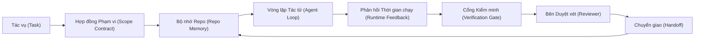

# Kỹ nghệ Bàn làm việc Tác tử: Vì sao các Mô hình Năng lực cao vẫn Thất bại

> Một mô hình năng lực cao là chưa đủ. Các tác tử đáng tin cậy cần một bàn làm việc: chỉ dẫn, trạng thái, phạm vi, phản hồi, kiểm minh, duyệt xét và chuyển giao. Bỏ qua những thành phần này, ngay cả mô hình tiên tiến nhất (frontier model) cũng sẽ tạo ra các sản phẩm không an toàn để phát hành.

**Phân loại:** Học + Xây dựng (Learn + Build)  
**Ngôn ngữ:** Python (thư viện chuẩn - stdlib)  
**Điều kiện tiên quyết:** Phase 14 · 01 (Vòng lặp Tác tử - Agent Loop), Phase 14 · 26 (Các Chế độ Thất bại - Failure Modes)  
**Thời lượng:** ~45 phút  

## Mục tiêu Học tập

- Phân tách năng lực mô hình (model capability) khỏi độ tin cậy thực thi (execution reliability).
- Nêu tên bảy bề mặt bàn làm việc (workbench surfaces) quyết định liệu một tác tử có thể phát hành mã nguồn hay không.
- So sánh một lần chạy chỉ dùng prompt (prompt-only) với một lần chạy có bàn làm việc dẫn hướng trên một tác vụ kho mã nguồn nhỏ.
- Tạo báo cáo chế độ thất bại đối soát từng bề mặt bị thiếu với triệu chứng mà nó gây ra.

## Vấn đề Đặt ra

Bạn đưa một mô hình tiên tiến vào một kho lưu trữ (repo) thực tế và yêu cầu nó bổ sung xác thực dữ liệu đầu vào (input validation). Nó mở bốn tệp tin, viết các dòng mã trông có vẻ hợp lý, tuyên bố thành công và dừng lại. Bạn chạy bộ kiểm thử. Hai kiểm thử thất bại. Tệp thứ ba bị chỉnh sửa chẳng liên quan gì đến logic xác thực. Hoàn toàn không có nhật ký ghi lại tác tử đã giả định những gì, đã thử làm gì đầu tiên, hay còn tồn đọng những việc gì.

Mô hình không sai về cú pháp Python. Nó hiểu sai về bản thân công việc. Nó không hề biết tiêu chí thế nào được tính là hoàn thành (definition of done), nơi nào nó được phép ghi, kiểm thử nào mang tính chuẩn mực và có thẩm quyền quyết định, hay phiên làm việc tiếp theo sẽ tiếp quản công việc ra sao.

Đây không phải là lỗi của mô hình. Đây là lỗi của bàn làm việc (workbench bug). Bề mặt bao bọc xung quanh tác tử đang thiếu đi những thành phần có khả năng biến một lần sinh văn bản đơn lẻ (one-shot generation) thành kỹ nghệ phần mềm đáng tin cậy và có thể tiếp tục khôi phục (resumable).

## Khái niệm Cốt lõi

Bàn làm việc (workbench) là môi trường vận hành bao bọc lấy mô hình trong suốt quá trình thực thi tác vụ. Nó gồm bảy bề mặt:

| Bề mặt | Nội dung truyền tải | Thất bại khi thiếu vắng |
|--------|---------------------|------------------------|
| Chỉ dẫn (Instructions) | Quy tắc khởi động, hành vi bị cấm, định nghĩa hoàn thành | Tác tử tự đoán việc phát hành nghĩa là gì |
| Trạng thái (State) | Tác vụ hiện tại, các tệp đã sửa, trở ngại (blockers), hành động kế tiếp | Mỗi phiên làm việc đều phải khởi động lại từ con số không |
| Phạm vi (Scope) | Tệp được phép sửa, tệp cấm chỉnh sửa, tiêu chí chấp thuận | Các chỉnh sửa rò rỉ sang mã nguồn không liên quan |
| Phản hồi (Feedback) | Đầu ra lệnh thực tế được thu thập đưa vào vòng lặp | Tác tử tuyên bố thành công ngay trên mã lỗi 400 |
| Kiểm minh (Verification) | Kiểm thử (tests), kiểm tra lỗi tĩnh (lint), chạy kiểm tra nhanh (smoke run), kiểm tra phạm vi | Mã "trông có vẻ ổn" bị đẩy thẳng lên nhánh main |
| Duyệt xét (Review) | Lượt kiểm duyệt thứ hai với một vai trò độc lập | Người xây dựng tự chấm bài làm của chính mình |
| Chuyển giao (Handoff) | Những gì đã thay đổi, lý do, và phần việc còn lại | Phiên làm việc kế tiếp phải tự khám phá lại mọi thứ |

Bàn làm việc độc lập với mô hình. Bạn có thể hoán đổi mô hình mà vẫn giữ nguyên các bề mặt. Nhưng bạn không thể loại bỏ các bề mặt mà vẫn duy trì được độ tin cậy.



Vòng lặp khép kín dựa trên tệp trạng thái, chứ không phải lịch sử trò chuyện. Trò chuyện (chat) có tính biến động tạm thời (volatile). Kho lưu trữ mới chính là hệ thống nguồn chân lý (system of record).

### Bàn làm việc so với kỹ nghệ nhắc lệnh

Nhắc lệnh (prompting) cho mô hình biết bạn muốn gì ở lượt tương tác hiện tại. Bàn làm việc chỉ cho mô hình cách thức thực hiện công việc qua nhiều lượt và xuyên suốt nhiều phiên làm việc. Hầu hết các câu chuyện thất bại của tác tử thực chất là thất bại của bàn làm việc nhưng lại được ngụy trang dưới vỏ bọc kỹ nghệ nhắc lệnh.

### Bàn làm việc so với khung điều phối

Một khung điều phối (framework) cung cấp cho bạn môi trường thực thi (runtime) như LangGraph, AutoGen, Agents SDK. Một bàn làm việc cung cấp cho tác tử một không gian làm việc bên trong môi trường thực thi đó. Bạn cần cả hai. Chuỗi bài học chuyên đề này tập trung vào thành phần thứ hai.

### Suy luận từ các nguyên mẫu nền tảng, không phụ thuộc vào cách phân loại của nhà cung cấp

Hiện nay có rất nhiều bài viết về "kỹ nghệ khung khai thác" (harness engineering). Addy Osmani, OpenAI, Anthropic, LangChain, Martin Fowler, MongoDB, HumanLayer, Augment Code, Thoughtworks, danh sách tổng hợp của walkinglabs, cùng một loạt bài viết trên Medium và Hacker News đều đang bàn luận về chủ đề này. Họ bất đồng về ranh giới của một khung khai thác (harness), những gì thuộc phạm vi của nó, và nên dùng hệ thuật ngữ nào. Chúng ta không cần phải chọn phe. Bảy bề mặt này thực chất là một lớp trải nghiệm người dùng (UX layer); bên dưới mọi bàn làm việc là cùng một tập hợp các nguyên mẫu hệ thống phân tán (distributed-systems primitives) nâng đỡ bất kỳ hệ thống phụ trợ (backend) đáng tin cậy nào.

Hãy tạm bỏ nhãn dán "tác tử" sang một bên. Một lượt chạy của tác tử là một phép tính toán vượt qua ranh giới thời gian, tiến trình và máy móc. Để làm cho quá trình đó đáng tin cậy, bạn cần chính các nguyên mẫu mà bất kỳ hệ thống sản xuất (production) nào cũng cần.

| Nguyên mẫu | Bản chất | Vai trò đối với một tác tử |
|------------|----------|---------------------------|
| Hàm (Function) | Trình xử lý định kiểu (typed handler). Thuần khiết (pure) khi có thể. Nắm quyền kiểm soát đầu vào và đầu ra. | Lời gọi công cụ (tool call), kiểm tra quy tắc, bước kiểm minh, lời gọi mô hình |
| Tiến trình công nhân (Worker) | Tiến trình sống lâu (long-lived) sở hữu một hoặc nhiều hàm và một vòng đời | Tiến trình xây dựng (builder), tiến trình duyệt xét (reviewer), tiến trình kiểm minh (verifier), một máy chủ MCP |
| Bộ kích hoạt (Trigger) | Nguồn sự kiện kích hoạt thực thi một hàm | Bước lặp của vòng lặp tác tử, yêu cầu HTTP, thông điệp hàng đợi, cron, tệp thay đổi, hook |
| Môi trường thực thi (Runtime) | Ranh giới quyết định cái gì chạy ở đâu, với thời gian chờ (timeout) và tài nguyên nào | Tiến trình của Claude Code, runtime của LangGraph, container của worker |
| HTTP / RPC | Tuyến truyền dẫn giữa bên gọi và tiến trình công nhân | Giao thức gọi công cụ, yêu cầu MCP, API của mô hình |
| Hàng đợi (Queue) | Vùng đệm bền vững giữa bộ kích hoạt và worker; áp lực ngược (back-pressure), thử lại (retry), tính lũy đẳng (idempotency) | Bảng tác vụ (task board), nhật ký phản hồi (feedback log), hộp thư duyệt xét |
| Tính bền vững phiên (Session persistence) | Trạng thái tồn tại qua các sự cố sập (crashes), khởi động lại, hoán đổi mô hình | `agent_state.json`, các điểm kiểm tra (checkpoints), kho khóa-giá trị (KV stores), chính repo |
| Chính sách phân quyền (Authorization policy) | Ai có thể gọi hàm nào với phạm vi nào | Danh sách tệp được phép/bị cấm, ranh giới phê duyệt, danh sách năng lực MCP |

Bây giờ hãy ánh xạ bảy bề mặt bàn làm việc vào các nguyên mẫu đó:

- **Chỉ dẫn (Instructions)** — chính sách + siêu dữ liệu hàm. Các quy tắc là những bước kiểm tra (hàm). Bộ định tuyến (`AGENTS.md`) là chính sách gắn liền với quá trình khởi động của runtime.
- **Trạng thái (State)** — tính bền vững phiên. Một kho lưu trữ có khóa mà runtime đọc ở mọi bước. Tệp, KV, hoặc DB; ngữ nghĩa bền vững mới là điều cốt lõi, phần phụ trợ lưu trữ không quá quan trọng.
- **Phạm vi (Scope)** — chính sách phân quyền trên từng tác vụ. Các mẫu đường dẫn (globs) cho phép/bị cấm là một danh sách kiểm soát truy cập (ACL). Yêu cầu phê duyệt cấu thành một lưới quyền hạn.
- **Phản hồi (Feedback)** — nhật ký gọi hàm được ghi vào hàng đợi. Mỗi lời gọi shell là một bản ghi có tính bền vững, có thể phát lại được.
- **Kiểm minh (Verification)** — một hàm. Xác định (deterministic) trên các đầu vào. Được kích hoạt khi kết thúc tác vụ. Thất bại theo hướng đóng (fails closed).
- **Duyệt xét (Review)** — một worker độc lập với quyền chỉ đọc (read-only) trên các tạo tác của builder và quyền chỉ ghi (write-only) trên các báo cáo duyệt xét.
- **Chuyển giao (Handoff)** — một bản ghi bền vững được phát ra bởi bộ kích hoạt kết thúc phiên. Bộ kích hoạt khởi động của phiên kế tiếp sẽ đọc bản ghi này.

Bản thân vòng lặp tác tử là một worker tiêu thụ các sự kiện (thông điệp người dùng, kết quả công cụ, nhịp đồng hồ), gọi các hàm (mô hình, sau đó là các công cụ mà mô hình chọn), ghi lại các bản ghi (trạng thái, phản hồi), và phát ra các bộ kích hoạt (kiểm minh, duyệt xét, chuyển giao). Hoàn toàn không có gì thần bí; nó có hình thái tương tự như một bộ xử lý tác vụ thông thường.

### Các mẫu phổ biến, được dịch sang nguyên mẫu nền tảng

Mọi mô hình khung khai thác (harness pattern) phổ biến đều có thể quy về tám nguyên mẫu nói trên. Bảng quy đổi:

| Mô hình từ nhà cung cấp hoặc cộng đồng | Bản chất thực sự |
|----------------------------------------|------------------|
| Vòng lặp Ralph (Ralph Loop - Claude Code, Codex, sách agentic_harness) — tái tiêm ý định ban đầu vào ngữ cảnh mới tinh khi tác tử cố dừng lại quá sớm | Một bộ kích hoạt đưa tác vụ trở lại hàng đợi với ngữ cảnh sạch; tính bền vững phiên truyền mục tiêu tiếp tục |
| Lập kế hoạch / Thực thi / Kiểm minh (PEV - Plan / Execute / Verify) | Ba worker, mỗi bên một vai trò, giao tiếp qua trạng thái và hàng đợi giữa các pha |
| Phân tách khung điều khiển và năng lực tính toán (Harness-compute separation - OpenAI Agents SDK, tháng 4/2026) — chia tách mặt phẳng điều khiển khỏi mặt phẳng thực thi | Tái diễn đạt lại sự phân tách giữa control-plane và data-plane. Khái niệm này đã có từ hàng thập kỷ trước nhãn dán tác tử |
| Hộ chiếu Tác tử Mở (Open Agent Passport - OAP, tháng 3/2026) — ký số và kiểm toán từng lời gọi công cụ dựa trên chính sách khai báo trước khi thực thi | Một chính sách phân quyền được thực thi bởi một worker tiền hành động, với một hàng đợi kiểm toán có chữ ký |
| Chỉ dẫn và Cảm biến (Guides and Sensors - Birgitta Böckeler / Thoughtworks) — quy tắc truyền thẳng (feedforward) + khả năng quan sát phản hồi (feedback) | Chính sách phân quyền + hàm kiểm minh + dấu vết quan sát (observability traces) |
| Thu gọn lũy tiến, 5 giai đoạn (Progressive compaction - phân tích kỹ thuật đảo ngược Claude Code, tháng 4/2026) | Một worker quản lý trạng thái chạy định kỳ như cron trên phiên bền vững để giữ nó trong ngân sách |
| Móc chặn / Phần mềm trung gian (Hooks / middleware - LangChain, Claude Code) — chặn các lời gọi mô hình và công cụ | Các bộ kích hoạt + hàm bao bọc lấy đường dẫn gọi hàm của runtime |
| Kỹ năng dạng Markdown kèm bộc lộ lũy tiến (Skills as Markdown with progressive disclosure - Anthropic, Flue) | Một sổ đăng ký hàm (function registry) trong đó siêu dữ liệu của hàm được nạp vào ngữ cảnh đúng lúc cần (just-in-time) |
| Tác tử hộp cát (Sandbox agents - Codex, Sandcastle, Vercel Sandbox) | Mặt phẳng tính toán (compute plane): một môi trường thực thi với hệ thống tệp, mạng và vòng đời được cô lập |
| Máy chủ MCP (MCP servers) | Các worker công khai hàm qua giao thức RPC ổn định, sử dụng danh sách năng lực làm cơ chế phân quyền |

Mỗi mục trong bảng đó là việc cộng đồng tác tử khám phá lại một nguyên mẫu vốn đã có tên gọi trong các hệ thống phân tán và đặt cho nó một cái tên mới. Chúng là những nhãn dán hữu ích cho tiếp thị; nhưng không hữu ích như một hệ từ vựng kỹ nghệ.

### Các số liệu thực tế chứng minh điều gì

Tuyên bố "khung khai thác quan trọng hơn mô hình" hiện đã có các con số thực tế chứng minh. Rất đáng để nắm bắt, vì chúng cũng là lập luận trung thực duy nhất chống lại quan điểm "chỉ cần chờ đợi một mô hình thông minh hơn".

- Terminal Bench 2.0 — cùng một mô hình, chỉ thay đổi khung khai thác đã đưa một tác tử lập trình từ vị trí ngoài top 30 lên vị trí thứ 5 (LangChain, *Anatomy of an Agent Harness*).
- Vercel — xóa bỏ 80% công cụ của tác tử; tỷ lệ thành công tăng vọt từ 80% lên 100% (MongoDB).
- Harvey — các tác tử pháp lý tăng hơn gấp đôi độ chính xác chỉ nhờ tối ưu hóa khung khai thác (MongoDB).
- 88% dự án tác tử AI doanh nghiệp thất bại khi đưa vào sản xuất. Các thất bại tập trung xung quanh môi trường thực thi chứ không phải khả năng lập luận (preprints.org, *Harness Engineering for Language Agents*, tháng 3/2026).
- Một nghiên cứu đối chuẩn năm 2025 trên ba khung nguồn mở phổ biến ghi nhận tỷ lệ hoàn thành tác vụ khoảng ~50%; WebAgent trong bối cảnh ngữ cảnh dài sụp đổ từ 40-50% xuống dưới 10%, chủ yếu do các vòng lặp vô hạn và mất mục tiêu (được phân tích rộng rãi trong các bài viết đầu năm 2026).

Bài học rút ra không phải là "khung khai thác luôn chiến thắng mãi mãi". Các mô hình sẽ dần tiếp thu các kỹ thuật của khung khai thác theo thời gian. Nhưng bài học rút ra là: ngày nay, kỹ nghệ chịu lực chính nằm ở xung quanh mô hình chứ không phải bên trong nó, và các nguyên mẫu gánh vác tải trọng đó chính là những gì mà mọi hệ thống sản xuất từ trước đến nay luôn cần.

### Điểm dừng chân hạn chế của các bài viết từ nhà cung cấp

Đây là phần mà chúng ta không cần phải vòng vo né tránh:

- Bài viết *Anatomy of an Agent Harness* của LangChain điểm qua các thành phần cốt lõi của khung: prompts, tools, hooks, sandboxes, orchestration, memory, skills, subagents, và một "vòng lặp đơn sơ" (dumb loop) của runtime. Nó không nhắc đến hàng đợi, worker như một đơn vị triển khai, ngữ nghĩa kích hoạt, tính bền vững phiên như một mối quan tâm độc lập, hay chính sách phân quyền. Nó xem khung khai thác như một đối tượng để cấu hình, chứ không phải một hệ thống để triển khai.
- Bài viết *Agent Harness Engineering* của Addy Osmani đưa ra khuôn khổ `Tác tử = Mô hình + Khung khai thác` (`Agent = Model + Harness`) và mô hình bánh cóc (ratchet pattern), nhưng dừng lại trước việc giải thích khung khai thác được xây dựng từ những gì. Nó giống một tuyên ngôn lập trường hơn là một đặc tả kỹ thuật.
- Anthropic và OpenAI đi sâu nhất vào các bề mặt nhưng lại chỉ giam mình bên trong môi trường thực thi của riêng họ. Thông báo về "sự phân tách khung-tính toán" (harness-compute separation) trong Agents SDK tháng 4/2026 là bài viết đầu tiên từ một nhà cung cấp công khai thừa nhận sự phân tách giữa mặt phẳng điều khiển và mặt phẳng dữ liệu (control-plane / data-plane). Đó là một ý tưởng nguyên mẫu kinh điển, không hề mới.
- Cuốn sách agentic_harness xem khung khai thác như một đối tượng cấu hình (Jaymin West, *Agentic Engineering*, chương 6) và nhận định sắc bén nhất là "khung khai thác là ranh giới bảo mật chính trong một hệ thống tác tử". Đó thực chất chỉ là chính sách phân quyền được diễn đạt lại.
- Các chủ đề thảo luận trên Hacker News liên tục hội tụ về cùng một điểm. Luồng thảo luận tháng 4/2026 *The agent harness belongs outside the sandbox* lập luận rằng khung khai thác nên nằm "giống như một trình giám sát máy ảo (hypervisor) nằm ngoài mọi thứ và ủy quyền truy cập dựa trên ngữ cảnh và người dùng". Một lần nữa, đó chính là chính sách phân quyền dưới dạng một mặt phẳng độc lập.

Bạn không cần phải bất đồng với bất kỳ bài viết nào trong số này để nhận ra khoảng trống đó. Họ đang viết các mô tả UX về một hệ thống vốn dĩ đã tồn tại. Chúng ta đang trực tiếp xây dựng hệ thống đó. Khi hệ thống được xây dựng đúng, bảy bề mặt sẽ tự nhiên xuất hiện từ các nguyên mẫu. Khi nó được xây dựng sai, thì bao nhiêu lớp chau chuốt cho `AGENTS.md` cũng không thể bù đắp được một hàng đợi bị thiếu.

Vì vậy, khi bạn nghe về "kỹ nghệ khung khai thác" ở nơi khác, hãy dịch nó về các nguyên mẫu. Nhắc lệnh và quy tắc là chính sách và hàm. Giàn giáo (scaffolding) là môi trường thực thi. Rào chắn bảo vệ (guardrails) là phân quyền + kiểm minh. Móc chặn (hooks) là bộ kích hoạt. Bộ nhớ là tính bền vững phiên. Vòng lặp Ralph là việc đưa lại vào hàng đợi (requeue). Tác tử phụ (subagents) là các worker. Hộp cát (sandboxes) là các mặt phẳng tính toán. Hệ từ vựng có thể thay đổi; nhưng bản chất kỹ nghệ thì không. Bàn làm việc (workbench) là UX hướng về phía tác tử; còn khung khai thác (harness), theo định nghĩa trường tồn qua mọi đợt tái cấu trúc tiếp thị của các nhà cung cấp, chính là các hàm, worker, trigger, runtime, queue, persistence và policy được kết nối với nhau một cách chuẩn xác.

````figure
wb-seven-surfaces
````

## Thực hành Xây dựng

`code/main.py` chạy một tác vụ kho mã nguồn nhỏ hai lần. Lần đầu chỉ chạy bằng prompt, sau đó chạy với đầy đủ bảy bề mặt được kết nối. Cùng một mô hình, cùng một tác vụ. Tập lệnh sẽ đếm xem bề mặt nào bị thiếu trong lần chạy thất bại và in ra một báo cáo về chế độ thất bại.

Tác vụ kho mã nguồn được chủ ý giữ ở mức nhỏ gọn: bổ sung xác thực dữ liệu đầu vào cho một trình xử lý theo phong cách FastAPI trong một tệp duy nhất và viết một bài kiểm thử vượt qua thành công.

Chạy thử nghiệm:

```bash
python3 code/main.py
```

Đầu ra: nhật ký so sánh song song giữa hai lần chạy, một tệp `failure_modes.json` tóm tắt lần chạy chỉ dùng prompt, và phán quyết một dòng cho lần chạy có bàn làm việc.

Tác tử ở đây là một đoạn mã giả (stub) dựa trên quy tắc đơn giản; trọng tâm nằm ở các bề mặt, chứ không phải ở mô hình. Xuyên suốt phần còn lại của chuyên đề nhỏ này, bạn sẽ xây dựng lại từng bề mặt dưới dạng một tạo tác thực tế, có thể tái sử dụng.

## Ứng dụng Thực tế

Ba nơi mà các bề mặt bàn làm việc đã và đang tồn tại trong thực tế, ngay cả khi không ai gọi chúng bằng cái tên đó:

- **Claude Code, Codex, Cursor.** `AGENTS.md` và `CLAUDE.md` chính là bề mặt chỉ dẫn. Các lệnh gạch chéo (slash commands) là phạm vi. Các móc chặn (hooks) là kiểm minh.
- **LangGraph, OpenAI Agents SDK.** Các điểm kiểm tra (checkpoints) và kho lưu trữ phiên là bề mặt trạng thái. Bàn giao là bề mặt chuyển giao.
- **CI trên một repo thực tế.** Kiểm thử, linter và kiểm tra kiểu (type-check) là kiểm minh. Bản mẫu PR (PR template) là chuyển giao. CODEOWNERS là duyệt xét.

Kỹ nghệ bàn làm việc là bộ môn biến các bề mặt này thành tường minh và có thể tái sử dụng, thay vì để mỗi nhóm phát triển phải tự mò mẫm khám phá lại chúng từ đầu.

## Tạo tác Phát hành

`outputs/skill-workbench-audit.md` là một kỹ năng di động giúp kiểm toán một repo hiện có theo bảy bề mặt bàn làm việc và báo cáo xem bề mặt nào đang thiếu, bề mặt nào chỉ có một phần, và bề mặt nào đang hoạt động tốt. Hãy đặt nó bên cạnh bất kỳ thiết lập tác tử nào; nó sẽ chỉ cho bạn biết cần phải khắc phục điều gì trước tiên.

## Bài tập Thực hành

1. Chọn một kho lưu trữ nơi bạn đã chạy tác tử. Chấm điểm bảy bề mặt từ 0 (thiếu hoàn toàn) đến 2 (hoạt động tốt). Bề mặt yếu nhất của bạn là gì?
2. Mở rộng `main.py` sao cho lần chạy chỉ dùng prompt cũng đưa ra tuyên bố "thành công" giả mạo. Kiểm chứng xem cổng kiểm minh có bắt được lỗi này hay không.
3. Bổ sung một bề mặt thứ tám cho sản phẩm của riêng bạn. Hãy biện minh vì sao nó không thể bị gộp vào một trong bảy bề mặt hiện có.
4. Chạy lại tập lệnh với một tác tử giả lập khác có hành vi ảo giác sinh thêm một thao tác ghi tệp ngoài ý muốn. Bề mặt nào sẽ bắt được lỗi này đầu tiên?
5. Ánh xạ năm chế độ thất bại thường gặp trong ngành từ Phase 14 · 26 vào bảy bề mặt này. Mỗi bề mặt được thiết kế để triệt tiêu chế độ thất bại nào?

## Thuật ngữ Then chốt

| Thuật ngữ | Điều mọi người hay nói | Ý nghĩa thực sự |
|-----------|------------------------|-----------------|
| Bàn làm việc (Workbench) | "Phần cài đặt thiết lập" | Các bề mặt kỹ nghệ xung quanh mô hình giúp công việc trở nên đáng tin cậy |
| Bề mặt (Surface) | "Một tài liệu" hoặc "một đoạn mã" | Một đầu vào có tên định danh, máy đọc được mà tác tử đọc hoặc ghi ở mỗi lượt |
| Nguồn chân lý (System of record) | "Ghi chú" | Tệp mà tác tử coi là chân lý khi lịch sử trò chuyện đã biến mất |
| Định nghĩa hoàn thành (Definition of done) | "Nghiệm thu" | Một danh sách kiểm tra khách quan, gắn với tệp mà tác tử không thể làm giả |
| Kiểm toán bàn làm việc (Workbench audit) | "Kiểm tra độ sẵn sàng của repo" | Một lượt rà soát trên bảy bề mặt nhằm phát hiện các mảnh ghép còn thiếu trước khi bắt đầu công việc |

## Tài liệu Đọc thêm

Hãy đọc những tài liệu này như các điểm dữ liệu tham khảo, chứ không phải những chân lý tuyệt đối. Mỗi tài liệu chỉ là một hệ phân loại bộ phận. Hãy dịch mọi khái niệm trở về nguyên mẫu (hàm, worker, trigger, runtime, HTTP/RPC, queue, persistence, policy) trước khi quyết định áp dụng nó.

Góc nhìn từ các nhà cung cấp:

- [Addy Osmani, Agent Harness Engineering](https://addyosmani.com/blog/agent-harness-engineering/) — `Agent = Model + Harness` và mô hình bánh cóc (ratchet pattern); còn mỏng về mặt hạ tầng
- [LangChain, The Anatomy of an Agent Harness](https://blog.langchain.com/the-anatomy-of-an-agent-harness/) — các thành phần cốt lõi của khung: prompts, tools, hooks, orchestration, sandboxes, memory, skills, subagents, runtime; bỏ qua hàng đợi, việc triển khai, phân quyền
- [OpenAI, Harness engineering: leveraging Codex in an agent-first world](https://openai.com/index/harness-engineering/) — góc nhìn của đội ngũ Codex về các bề mặt xung quanh runtime của họ
- [OpenAI, Unrolling the Codex agent loop](https://openai.com/index/unrolling-the-codex-agent-loop/) — vòng lặp tác tử được thu gọn thành một vòng lặp `while` trên các lời gọi hàm
- [Anthropic, Effective harnesses for long-running agents](https://www.anthropic.com/engineering/effective-harnesses-for-long-running-agents) — các bề mặt ngữ cảnh dài hạn bên trong một runtime cụ thể
- [Anthropic, Harness design for long-running application development](https://www.anthropic.com/engineering/harness-design-long-running-apps) — các ghi chép thiết kế ứng dụng
- [LangChain Deep Agents harness capabilities](https://docs.langchain.com/oss/python/deepagents/harness) — bề mặt cấu hình runtime

Các bài viết từ giới kỹ sư thực chiến với chi tiết ứng dụng:

- [Martin Fowler / Birgitta Böckeler, Harness engineering for coding agent users](https://martinfowler.com/articles/harness-engineering.html) — chỉ dẫn (truyền thẳng - feedforward) + cảm biến (phản hồi - feedback); cách đặt vấn đề rõ ràng nhất theo lý thuyết điều khiển
- [HumanLayer, Skill Issue: Harness Engineering for Coding Agents](https://www.humanlayer.dev/blog/skill-issue-harness-engineering-for-coding-agents) — "đây không phải vấn đề của mô hình, mà là vấn đề của cấu hình"
- [MongoDB, The Agent Harness: Why the LLM Is the Smallest Part of Your Agent System](https://www.mongodb.com/company/blog/technical/agent-harness-why-llm-is-smallest-part-of-your-agent-system) — số liệu thực tế: Vercel 80% lên 100%, Harvey tăng 2x độ chính xác, Terminal Bench từ ngoài Top 30 lên Top 5
- [Augment Code, Harness Engineering for AI Coding Agents](https://www.augmentcode.com/guides/harness-engineering-ai-coding-agents) — hướng dẫn tiếp cận ưu tiên ràng buộc
- [Sequoia podcast, Harrison Chase on Context Engineering Long-Horizon Agents](https://sequoiacap.com/podcast/context-engineering-our-way-to-long-horizon-agents-langchains-harrison-chase/) — các mối quan tâm về runtime vượt trên mối quan tâm về mô hình

Sách, bài báo khoa học và triển khai tham chiếu:

- [Jaymin West, Agentic Engineering — Chương 6: Harnesses](https://www.jayminwest.com/agentic-engineering-book/6-harnesses) — phân tích chi tiết cấp độ sách, coi khung khai thác là ranh giới bảo mật chính
- [preprints.org, Harness Engineering for Language Agents (Tháng 3/2026)](https://www.preprints.org/manuscript/202603.1756) — khuôn khổ học thuật dưới dạng điều khiển / tính chủ động / môi trường thực thi
- [walkinglabs/awesome-harness-engineering](https://github.com/walkinglabs/awesome-harness-engineering) — danh sách tuyển chọn về ngữ cảnh, đánh giá, khả năng quan sát, điều phối
- [ai-boost/awesome-harness-engineering](https://github.com/ai-boost/awesome-harness-engineering) — danh sách tuyển chọn thay thế (công cụ, đánh giá, bộ nhớ, MCP, quyền hạn)
- [HKUDS/OpenHarness](https://github.com/HKUDS/OpenHarness) — khung khai thác tác tử mở tích hợp sẵn tác tử cá nhân

Các chủ đề Hacker News đáng đọc vì những bất đồng quan điểm, chứ không phải sự đồng thuận:

- [HN: Effective harnesses for long-running agents](https://news.ycombinator.com/item?id=46081704)
- [HN: Improving 15 LLMs at Coding in One Afternoon. Only the Harness Changed](https://news.ycombinator.com/item?id=46988596)
- [HN: The agent harness belongs outside the sandbox](https://news.ycombinator.com/item?id=47990675) — lập luận cho việc tách phân quyền thành một mặt phẳng độc lập

Tham chiếu chéo bên trong giáo trình này:

- Phase 14 · 23 — Các quy ước GenAI của OpenTelemetry: lớp quan sát mà các tài liệu về cảm biến đề cập
- Phase 14 · 26 — Danh mục chế độ thất bại mà bảy bề mặt được thiết kế để giải quyết
- Phase 14 · 27 — Các biện pháp phòng thủ tấn công tiêm lời nhắc (prompt injection) nằm ở nguyên mẫu chính sách phân quyền
- Phase 14 · 29 — Môi trường thực thi sản xuất (hàng đợi, sự kiện, cron): nơi các nguyên mẫu trong bài học này vận hành khi triển khai
