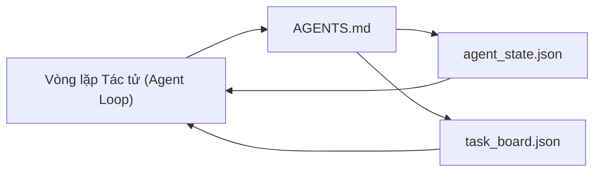

# Bàn làm việc Tác tử Tối thiểu

> Bàn làm việc hữu dụng nhỏ gọn nhất gồm ba tệp tin: một bộ định tuyến chỉ dẫn gốc, một tệp trạng thái, và một bảng tác vụ. Mọi thành phần khác đều được xếp lớp lên trên. Nếu một kho mã nguồn không thể duy trì ba tệp này, không mô hình nào có thể cứu vãn được nó.

**Phân loại:** Xây dựng (Build)  
**Ngôn ngữ:** Python (thư viện chuẩn - stdlib)  
**Điều kiện tiên quyết:** Phase 14 · 31 (Vì sao các Mô hình Năng lực cao vẫn Thất bại)  
**Thời lượng:** ~45 phút  

## Mục tiêu Học tập

- Định nghĩa ba tệp tin cấu thành nên một bàn làm việc khả thi tối thiểu (minimum viable workbench).
- Giải thích vì sao một bộ định tuyến gốc ngắn gọn lại vượt trội hơn một tệp `AGENTS.md` nguyên khối (monolithic) dài dòng.
- Xây dựng một tệp trạng thái mà tác tử có thể đọc ở mỗi lượt và ghi vào lúc kết thúc.
- Xây dựng một bảng tác vụ có thể tồn tại qua các phiên làm việc đa phiên mà không cần tới lịch sử trò chuyện.

## Vấn đề Đặt ra

Hầu hết các nhóm tiếp cận bàn làm việc bằng cách viết một tệp `AGENTS.md` dài 3000 dòng rồi coi như đã xong. Mô hình nạp tệp đó vào, phớt lờ những phần nó không thể tóm lược, và tiếp tục thất bại ở chính những bề mặt mà nó luôn thất bại từ trước đến nay.

Bạn cần điều ngược lại. Một tệp gốc nhỏ gọn có nhiệm vụ định tuyến tác tử đến các tệp sâu hơn chỉ khi thực sự liên quan. Một trạng thái bền vững mà tác tử đọc trước khi hành động và ghi lại sau khi hoàn thành. Một bảng tác vụ cho biết những gì đang xử lý, những gì bị tắc nghẽn, và những gì cần làm tiếp theo.

Ba tệp tin. Mỗi tệp một nhiệm vụ rõ ràng. Mỗi tệp đều đủ khả năng đọc hiểu cho máy (machine-readable) để sau này có thể phát triển thành một hệ thống thực thụ.

## Khái niệm Cốt lõi



### AGENTS.md là một bộ định tuyến, không phải sách hướng dẫn

Một tệp `AGENTS.md` tốt cần phải ngắn gọn. Nó điều hướng tác tử tới:

- Tệp trạng thái (bạn đang ở đâu).
- Bảng tác vụ (những gì còn lại).
- Các quy tắc chi tiết hơn (nằm tại `docs/agent-rules.md`).
- Lệnh kiểm minh (làm sao để biết mã hoạt động đúng).

Bất cứ nội dung nào dài dòng hơn đều nên được chuyển vào các tài liệu chuyên sâu, chỉ nạp khi cần thiết. Các cuốn hướng dẫn dài sẽ bị phớt lờ. Các bộ định tuyến ngắn sẽ được tuân thủ.

### agent_state.json là hệ thống nguồn chân lý

Trạng thái lưu trữ: mã định danh (id) tác vụ đang hoạt động, các tệp đã chạm tới, các giả định đã đưa ra, các yếu tố gây tắc nghẽn (blockers), và hành động tiếp theo. Tác tử đọc tệp này ở mỗi lượt. Phiên làm việc tiếp theo sẽ đọc nó thay vì phải phát lại lịch sử trò chuyện.

Trạng thái được lưu trong tệp vì lịch sử trò chuyện không đáng tin cậy. Các phiên làm việc có thể sập. Cuộc trò chuyện bị cắt tỉa bớt ngữ cảnh. Nhưng tệp tin thì không.

### task_board.json là hàng đợi

Bảng tác vụ mang theo mọi tác vụ cùng trạng thái `todo | in_progress | done | blocked`. Đây là hàng đợi mà tác tử rút việc ra khi trạng thái trống rỗng, và cũng là hàng đợi mà bạn theo dõi khi muốn biết liệu tác tử có đang đi đúng hướng hay không.

Một tác vụ trên bảng có một mã định danh (id), một mục tiêu (goal), một bên sở hữu (`builder`, `reviewer`, hoặc `human`), và các tiêu chí chấp thuận (acceptance criteria). Bảng được chủ ý giữ ở mức nhỏ gọn: khi nó phình to vượt quá một màn hình, bạn đang gặp vấn đề về lập kế hoạch chứ không phải vấn đề về bảng tác vụ.

### Ba tệp là mức sàn, không phải trần giới hạn

Các bài học sau sẽ bổ sung các hợp đồng phạm vi (scope contracts), trình chạy phản hồi (feedback runners), cổng kiểm minh (verification gates), danh sách kiểm tra của bên duyệt xét (reviewer checklists), và các gói chuyển giao (handoff packets). Ba tệp ở đây chính là nền tảng mà tất cả các bài học đó mặc định giả định là đã có.

````figure
wb-three-files
````

## Thực hành Xây dựng

`code/main.py` ghi bàn làm việc tối thiểu vào một kho lưu trữ trống và minh họa một lượt hoạt động đơn lẻ của tác tử bao gồm:

1. Đọc `agent_state.json`.
2. Lấy tác vụ tiếp theo từ `task_board.json` nếu trạng thái đang trống.
3. Chỉnh sửa một tệp duy nhất nằm trong phạm vi.
4. Ghi ngược trở lại trạng thái đã được cập nhật.

Chạy thử nghiệm:

```bash
python3 code/main.py
```

Tập lệnh tạo thư mục `workdir/` ngay bên cạnh nó, thiết lập ba tệp tin, chạy một lượt tác tử, và in ra phần khác biệt (diff). Chạy lại tập lệnh để quan sát cách lượt thứ hai tiếp quản công việc tại đúng vị trí mà lượt thứ nhất đã dừng lại.

## Ứng dụng Thực tế

Bên trong các sản phẩm tác tử trong môi trường sản xuất, ba tệp tin này cũng xuất hiện dưới những cái tên khác nhau:

- **Claude Code:** `AGENTS.md` hoặc `CLAUDE.md` đóng vai trò bộ định tuyến, kho lưu trữ kiểu `.claude/state.json` cho trạng thái, các móc chặn (hooks) cho bảng tác vụ.
- **Codex / Cursor:** các quy tắc không gian làm việc (workspace rules) cho bộ định tuyến, bộ nhớ phiên (session memory) cho trạng thái, các tác vụ xếp hàng trong thanh bên trò chuyện cho bảng tác vụ.
- **Tác tử Python tùy biến:** chính là các tệp bạn vừa tự tay viết.

Tên gọi có thể thay đổi. Nhưng hình thái cốt lõi thì không.

## Các mẫu sản xuất trong thực tế

Bàn làm việc tối thiểu trụ vững khi tiếp xúc với các monorepo thực tế nhờ ba mẫu kiến trúc được xếp lớp lên trên nó. Chúng độc lập với nhau; hãy chọn mẫu mà kho mã nguồn của bạn thực sự cần.

**Các tệp `AGENTS.md` lồng nhau với cơ chế ưu tiên tệp gần nhất (nearest-wins precedence).** OpenAI triển khai 88 tệp `AGENTS.md` trên khắp repo chính của họ, mỗi tệp cho một thành phần phụ. Codex, Cursor, Claude Code và Copilot đều duyệt ngược từ tệp đang xử lý về thư mục gốc của repo và nối mọi tệp `AGENTS.md` chúng tìm thấy trên đường đi. Các tệp ở thư mục con sẽ mở rộng tệp gốc. Codex bổ sung thêm `AGENTS.override.md` để thay thế hoàn toàn thay vì mở rộng; cơ chế ghi đè này là đặc thù riêng của Codex và nên tránh dùng cho công việc đa công cụ. Phép đo của Augment Code là con số mang tính quyết định: các tệp `AGENTS.md` xuất sắc nhất tạo ra bước nhảy vọt về chất lượng tương đương việc nâng cấp từ Haiku lên Opus; các tệp tệ nhất làm cho đầu ra kém hơn cả khi hoàn toàn không có tệp hướng dẫn nào.

**Các phản mẫu (anti-patterns) cần từ chối, ngay cả khi chúng trông có vẻ bao quát được nhiều trường hợp.** Các chỉ dẫn xung đột nhau sẽ âm thầm khiến tác tử tụt từ chế độ tương tác (interactive) xuống chế độ tham lam (greedy mode) (ICLR 2026 AMBIG-SWE: tỷ lệ giải quyết từ 48,8% → 28%); hãy đánh số thứ tự ưu tiên thay vì xếp chồng ngang hàng. Các quy tắc phong cách không thể kiểm minh ("tuân thủ Google Python Style Guide") mà không kèm lệnh thực thi sẽ khiến tác tử tự biên tự diễn về mức độ tuân thủ; hãy ghép nối mỗi quy tắc phong cách với lệnh lint chính xác. Đặt phong cách lên trước các lệnh thực thi sẽ chôn vùi lộ trình kiểm minh; lệnh chạy phải đi trước, phong cách để sau cùng. Viết cho con người thay vì viết cho tác tử gây lãng phí ngân sách ngữ cảnh; sự ngắn gọn súc tích là một tính năng.

**Liên kết mềm liên công cụ (cross-tool symlinks).** Một tệp gốc duy nhất kèm theo các liên kết mềm (`ln -s AGENTS.md CLAUDE.md`, `ln -s AGENTS.md .github/copilot-instructions.md`, `ln -s AGENTS.md .cursorrules`) giúp mọi tác tử lập trình cùng nhìn vào một nguồn chân lý duy nhất. Lệnh `nx ai-setup` của Nx tự động hóa điều này trên Claude Code, Cursor, Copilot, Gemini, Codex và OpenCode từ một cấu hình duy nhất.

## Tạo tác Phát hành

`outputs/skill-minimal-workbench.md` tạo ra bàn làm việc ba tệp cho bất kỳ kho mã nguồn mới nào: một bộ định tuyến `AGENTS.md` được tinh chỉnh cho dự án, một `agent_state.json` với các khóa thích hợp, và một `task_board.json` được gieo sẵn danh sách công việc tồn đọng (backlog) hiện tại.

## Bài tập Thực hành

1. Thêm mốc thời gian `last_run` vào `agent_state.json`. Từ chối chạy nếu tệp đã cũ hơn 24 giờ trừ khi có người vận hành xác nhận.
2. Thêm trường `priority` vào bảng tác vụ và thay đổi bộ rút tác vụ (puller) để luôn chọn công việc `todo` có độ ưu tiên cao nhất.
3. Di chuyển `task_board.json` sang định dạng JSON Lines để mỗi tác vụ là một dòng, giúp việc so sánh khác biệt (diff) trong hệ thống quản lý phiên bản rõ ràng hơn.
4. Viết tập lệnh `lint_workbench.py` báo lỗi nếu `AGENTS.md` dài quá 80 dòng hoặc tham chiếu đến một tệp không tồn tại.
5. Quyết định xem trong ba tệp trên, mất tệp nào sẽ gây thiệt hại nặng nề nhất. Hãy đưa ra lý lẽ bảo vệ quan điểm đó.

## Thuật ngữ Then chốt

| Thuật ngữ | Điều mọi người hay nói | Ý nghĩa thực sự |
|-----------|------------------------|-----------------|
| Bộ định tuyến (Router) | `AGENTS.md` | Tệp gốc ngắn gọn điều hướng tác tử tới các tài liệu và tệp sâu hơn |
| Tệp trạng thái (State file) | "Ghi chú" | Bản ghi máy đọc được về vị trí hiện tại của tác tử, được ghi lại ở mỗi lượt |
| Bảng tác vụ (Task board) | "Công việc tồn đọng" | Hàng đợi công việc dạng JSON kèm theo trạng thái, bên sở hữu, tiêu chí chấp thuận |
| Nguồn chân lý (System of record) | "Nguồn sự thật chuẩn mực" | Tệp mà bàn làm việc coi là có thẩm quyền tối cao khi cuộc trò chuyện kết thúc |

## Tài liệu Đọc thêm

- [agents.md — đặc tả mở](https://agents.md/) — được chấp nhận bởi Cursor, Codex, Claude Code, Copilot, Gemini, OpenCode
- [Augment Code, A good AGENTS.md is a model upgrade. A bad one is worse than no docs at all](https://www.augmentcode.com/blog/how-to-write-good-agents-dot-md-files) — các bước nhảy vọt về chất lượng đã được đo lường
- [Blake Crosley, AGENTS.md Patterns: What Actually Changes Agent Behavior](https://blakecrosley.com/blog/agents-md-patterns) — những gì hiệu quả trong thực nghiệm và những gì không
- [Datadog Frontend, Steering AI Agents in Monorepos with AGENTS.md](https://dev.to/datadog-frontend-dev/steering-ai-agents-in-monorepos-with-agentsmd-13g0) — cơ chế ưu tiên lồng nhau trong thực tế
- [Nx Blog, Teach Your AI Agent How to Work in a Monorepo](https://nx.dev/blog/nx-ai-agent-skills) — tạo cấu hình từ một nguồn duy nhất cho sáu công cụ
- [The Prompt Shelf, AGENTS.md Best Practices: Structure, Scope, and Real Examples](https://thepromptshelf.dev/blog/agents-md-best-practices/) — thứ tự các phần giữ vững được tính chuẩn mực qua các lần duyệt
- [Anthropic, Claude Code subagents](https://code.claude.com/docs/en/sub-agents)
- Phase 14 · 31 — các chế độ thất bại mà bàn làm việc tối thiểu này triệt tiêu
- Phase 14 · 34 — lược đồ trạng thái bền vững mà bài học này giới thiệu trước
