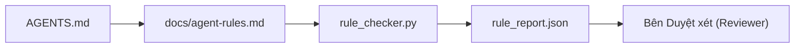

# Chỉ dẫn Tác tử dưới dạng Ràng buộc Thực thi được

> Chỉ dẫn viết dưới dạng văn xuôi chỉ là những lời nguyện ước. Chỉ dẫn viết dưới dạng ràng buộc chính là các bài kiểm thử. Bàn làm việc biến từng quy tắc thành một thực thể mà tác tử có thể kiểm tra lúc chạy và bên duyệt xét có thể thẩm tra sau khi hoàn thành.

**Phân loại:** Xây dựng (Build)  
**Ngôn ngữ:** Python (thư viện chuẩn - stdlib)  
**Điều kiện tiên quyết:** Phase 14 · 32 (Bàn làm việc Tối thiểu)  
**Thời lượng:** ~50 phút  

## Mục tiêu Học tập

- Phân tách văn phong định tuyến khỏi các quy tắc vận hành (operational rules).
- Diễn đạt các quy tắc khởi động, hành vi bị cấm, định nghĩa hoàn thành, xử lý tính bất định và ranh giới phê duyệt thành các ràng buộc máy có thể kiểm tra được (machine-checkable constraints).
- Triển khai một bộ kiểm tra quy tắc (rule checker) nhằm chấm điểm một lượt chạy dựa trên bộ quy tắc.
- Làm cho bộ quy tắc thân thiện với việc so sánh khác biệt (diff-friendly) để bên duyệt xét có thể thấy rõ những gì đã thay đổi.

## Vấn đề Đặt ra

Một tệp `AGENTS.md` điển hình thường đọc như một tài liệu hướng dẫn hòa nhập nhân viên mới (onboarding doc). Nó bảo tác tử "hãy cẩn thận", "kiểm thử kỹ lưỡng" và "hỏi lại nếu không chắc chắn". Ba ngày sau, tác tử phát hành một thay đổi không có kiểm thử, ghi đè vào một thư mục bị cấm, và chẳng bao giờ hỏi lại vì nó không hề biết ranh giới nằm ở đâu.

Các chỉ dẫn sẽ phát huy sức mạnh to lớn khi chúng mang tính vận hành (operational) và trở nên vô dụng khi chỉ mang tính nguyện vọng (aspirational). Giải pháp là viết các quy tắc mà bàn làm việc có thể thông dịch và bên duyệt xét có thể chấm điểm.

## Khái niệm Cốt lõi

Các quy tắc thuộc về tệp `docs/agent-rules.md`, tách biệt khỏi bộ định tuyến gốc ngắn gọn. Mỗi quy tắc đều có tên, danh mục và một hàm kiểm tra.



### Năm danh mục bao quát hầu hết các quy tắc

| Danh mục | Câu hỏi quy tắc trả lời | Ví dụ |
|----------|--------------------------|-------|
| Khởi động (Startup) | Điều gì bắt buộc phải đúng trước khi công việc bắt đầu? | "tệp trạng thái phải tồn tại và mới cập nhật" |
| Bị cấm (Forbidden) | Điều gì tuyệt đối không bao giờ được xảy ra? | "không chỉnh sửa `scripts/release.sh`" |
| Định nghĩa hoàn thành (Definition of done) | Điều gì chứng minh tác vụ đã hoàn thành? | "pytest thoát với mã 0 và dòng chấp thuận được thỏa mãn" |
| Tính bất định (Uncertainty) | Tác tử làm gì khi không chắc chắn? | "mở một ghi chú câu hỏi thay vì tự ý đoán mò" |
| Phê duyệt (Approval) | Điều gì đòi hỏi phải có con người phê duyệt? | "bất kỳ phụ thuộc mới nào, bất kỳ thao tác ghi lên môi trường prod nào" |

Một quy tắc không khớp với một trong năm danh mục này thường có xu hướng là hai quy tắc gộp lại. Hãy tách rời chúng ra.

### Quy tắc có khả năng đọc hiểu cho máy

Mỗi quy tắc đều có một định danh (slug), một danh mục, một dòng mô tả súc tích, và một trường `check` chỉ định tên một hàm trong `rule_checker.py`. Thêm một quy tắc đồng nghĩa với việc thêm một hàm kiểm tra; bộ kiểm tra sẽ phát triển song hành cùng bàn làm việc.

### Quy tắc thân thiện với việc so sánh khác biệt

Các quy tắc được bố trí mỗi quy tắc dưới một tiêu đề trong một tệp Markdown duy nhất. Việc đổi tên sẽ hiển thị rõ ràng trong các bản so sánh khác biệt mã (diff). Các quy tắc mới được đặt ở đầu danh mục tương ứng. Các quy tắc lỗi thời sẽ bị xóa bỏ chứ không được chú thích (comment out), bởi vì bàn làm việc là nguồn chân lý chứ không phải nhật ký lưu giữ cảm xúc của cả nhóm từ quý trước.

### Quy tắc so với rào chắn bảo vệ của khung điều phối

Các rào chắn bảo vệ của khung điều phối (như guardrails của OpenAI Agents SDK, interrupts của LangGraph) thực thi các quy tắc ở cấp độ môi trường chạy (runtime). Bộ quy tắc trong bài học này là bản hợp đồng con người đọc được và duyệt xét được mà các rào chắn đó triển khai thực hiện. Bạn cần cả hai: môi trường chạy ngăn chặn các vi phạm ngay trong một lượt, còn bộ quy tắc chứng minh rằng môi trường chạy đang làm đúng việc.

### Bộc lộ lũy tiến: một tấm bản đồ, không phải bách khoa toàn thư

Lý do khiến `AGENTS.md` liên tục phình to là vì mỗi sự cố lại thêm vào một quy tắc nhưng không sự cố nào loại bỏ bớt quy tắc cũ. Sau một năm, tệp tin dài đến hai nghìn dòng; tác tử chỉ đọc được màn hình đầu tiên, cạn kiệt ngân sách chú ý (attention budget), và chỉ hành động dựa trên một phần nhỏ những gì được chỉ dẫn. Một tệp chỉ dẫn khổng lồ thất bại vì lý do tương tự như một tài liệu nhập môn dài bốn mươi trang: người đọc chỉ lướt qua một lần và không bao giờ quay lại đúng phần cần thiết.

Giải pháp không phải là viết một tệp ngắn hơn. Mà là phân tầng tệp tin (layered). Bộ định tuyến gốc giữ ở mức đủ ngắn để đọc ở mỗi phiên và chỉ chứa các con trỏ định hướng. Chi tiết chuyên sâu nằm trong các tệp chủ đề mà tác tử chỉ nạp khi tác vụ thực sự chạm tới chúng. Hãy trao cho tác tử một tấm bản đồ thay vì cả cuốn bách khoa toàn thư, và để nó tự tìm đến trang sách mà nó cần.

```text
AGENTS.md                  # bộ định tuyến, < 50 dòng: repo này là gì, tìm ở đâu, 5 quy tắc cứng
docs/
  agent-rules.md           # toàn bộ bộ quy tắc (bài học này)
  architecture.md          # nạp khi tác vụ chạm vào ranh giới mô-đun
  testing.md               # nạp khi tác vụ viết hoặc chạy kiểm thử
  deploy.md                # chỉ nạp cho công việc phát hành, được khóa sau quy tắc phê duyệt
feature_list.json          # danh sách tồn đọng tính năng (Phase 14 · 36)
```

| Tầng | Nằm tại | Đọc khi | Ngân sách kích thước |
|------|---------|---------|----------------------|
| Định tuyến (Router) | `AGENTS.md` | Mọi phiên, luôn luôn | Dưới ~50 dòng |
| Quy tắc (Rules) | `docs/agent-rules.md` | Mọi phiên, khi khởi động | Một màn hình cho mỗi danh mục |
| Tài liệu chủ đề (Topic docs) | `docs/<chủ-đề>.md` | Chỉ khi tác vụ chạm vào chủ đề đó | Sâu tùy ý theo nhu cầu |

Hai bài kiểm tra giữ cho việc phân tầng luôn chuẩn mực. Kiểm tra khả năng tiếp cận (reachability test): một tác tử phải tiếp cận được bất kỳ quy tắc nào trong tối đa hai bước nhảy (hops) từ bộ định tuyến, do đó bộ định tuyến phải liên kết mọi tài liệu chủ đề bằng đường dẫn cụ thể, chứ không mô tả mơ hồ bằng văn xuôi. Kiểm tra độ tươi mới (freshness test): bộ định tuyến đủ ngắn để người duyệt đọc lại toàn bộ ở mỗi PR, và đó là điều duy nhất ngăn nó âm thầm phình to trở lại thành cuốn bách khoa toàn thư. Một con trỏ không còn trỏ đúng địa chỉ là lỗi nghiêm trọng hơn một quy tắc bị thiếu; do đó, một liên kết gãy trong bộ định tuyến tự thân nó đã là một vi phạm kiểm tra khởi động.

````figure
wb-rule-checkoff
````

## Thực hành Xây dựng

`code/main.py` bao gồm:

- Trình phân tích cú pháp `agent-rules.md` nạp các quy tắc vào một dataclass.
- Các hàm kiểm tra theo phong cách `rule_checker.py`, tương ứng một hàm cho mỗi tham chiếu `check`.
- Một lượt chạy tác tử thử nghiệm vi phạm hai quy tắc và lượt kiểm tra phát hiện chính xác các vi phạm đó.

Chạy thử nghiệm:

```bash
python3 code/main.py
```

Đầu ra: bộ quy tắc đã được phân tích cú pháp, dấu vết lượt chạy, kết quả đạt/không đạt cho từng quy tắc, và một tệp `rule_report.json` được lưu ngay cạnh tập lệnh.

## Các mẫu sản xuất trong thực tế

Ba mẫu kiến trúc phân biệt một bộ quy tắc tồn tại được qua một quý với một bộ quy tắc xuống cấp chỉ sau một tuần:

**Gắn thẻ mức độ nghiêm trọng tại thời điểm tạo lập.** Mỗi quy tắc mang một mức `severity`: `block` (chặn), `warn` (cảnh báo), hoặc `info` (thông tin). Bộ kiểm tra báo cáo cả ba; môi trường thực thi chỉ từ chối hành động khi gặp mức `block`. Đa phần các nhóm hay đánh giá quá mức độ nghiêm trọng lúc đầu rồi âm thầm hạ thấp nó dưới áp lực tiến độ; việc gắn thẻ ngay từ lúc viết buộc việc hiệu chuẩn phải diễn ra từ sớm. Kết hợp điều này với cổng kiểm minh (Phase 14 · 38), nơi ghi nhận chữ ký của bất kỳ thao tác ghi đè (override) nào lên quy tắc mức `block` vào tệp nhật ký kiểm toán `overrides.jsonl`.

**Hết hạn quy tắc như một cơ chế thúc đẩy bắt buộc.** Mỗi quy tắc mang một ngày `expires_at` (mặc định 90 ngày kể từ lúc lập). Bộ kiểm tra phát ra cảnh báo khi một quy tắc chưa hết hạn nhưng không có vi phạm nào trong suốt 60 ngày liên tục; đợt duyệt xét hàng quý tiếp theo sẽ quyết định giữ lại, hạ cấp xuống `info`, hoặc xóa bỏ. Dữ liệu thực tế từ hệ thống AI Code Review của Cloudflare (tháng 4/2026, 131.246 lượt chạy duyệt xét trên 5.169 kho lưu trữ trong 30 ngày) cho thấy các bộ quy tắc có hạn sử dụng rõ ràng luôn duy trì dưới 30 quy tắc mỗi repo; trong khi các bộ không có hạn phình to lên hơn 80 quy tắc với phần lớn chưa từng một lần được kích hoạt.

**Markdown làm nguồn, JSON làm bộ đệm cache.** `agent-rules.md` là tệp được con người trực tiếp biên soạn; `agent-rules.lock.json` là bộ đệm mà trình kiểm tra đọc trên đường dẫn thực thi nóng (hot path). Tệp khóa này được tạo lại thông qua một pre-commit hook. Các bản khác biệt Markdown dễ dàng duyệt xét bởi con người; trong khi việc phân tích cú pháp Markdown được loại bỏ khỏi từng lượt chạy vì bộ kiểm tra chỉ nạp tệp JSON nhỏ gọn đã dựng sẵn. Hình thái này hoàn toàn tương đồng với `package.json` / `package-lock.json` và `Cargo.toml` / `Cargo.lock`.

## Ứng dụng Thực tế

Trong môi trường sản xuất:

- Claude Code, Codex, Cursor đọc các quy tắc lúc khởi động phiên và trích dẫn chúng khi từ chối các hành vi vi phạm. Bộ kiểm tra chạy lại chúng trên CI để phát hiện sự trôi dạt ngầm (silent drift).
- Rào chắn bảo vệ của OpenAI Agents SDK đăng ký các bài kiểm tra này dưới dạng guardrail đầu vào và đầu ra. Markdown là bề mặt tài liệu; SDK là bề mặt thời gian chạy.
- Các lệnh ngắt (interrupts) của LangGraph được kích hoạt khi một nút đang chạy vi phạm quy tắc. Bộ xử lý ngắt đọc quy tắc, hỏi ý kiến con người, và tiếp tục phiên làm việc.

Bộ quy tắc có tính khả chuyển (portable) trên cả ba nền tảng này vì nó thuần túy là markdown đi kèm tên các hàm thực thi.

## Tạo tác Phát hành

`outputs/skill-rule-set-builder.md` phỏng vấn chủ dự án, phân loại các chỉ dẫn văn xuôi hiện có vào năm danh mục, và tạo ra một tệp `agent-rules.md` có quản lý phiên bản cùng với khung mã kiểm tra (checker stub).

## Bài tập Thực hành

1. Thêm một danh mục thứ sáu nếu sản phẩm của bạn thực sự cần thiết. Hãy bảo vệ quan điểm vì sao nó không thể bị thu gọn vào một trong năm danh mục có sẵn.
2. Mở rộng bộ kiểm tra để một quy tắc có thể mang mức độ nghiêm trọng (`block`, `warn`, `info`) và báo cáo tổng hợp theo các mức này.
3. Tích hợp bộ kiểm tra vào quy trình CI: đánh trượt bản dựng nếu một quy tắc mức block bị thất bại trong lần chạy mới nhất của tác tử.
4. Thêm trường ngày hết hạn "expiry" cho từng quy tắc. Sau 90 ngày không có lần kiểm tra nào thất bại, quy tắc sẽ được đưa ra xem xét loại bỏ.
5. Tìm một tệp `AGENTS.md` thực tế và viết lại nó theo các quy tắc thuộc năm danh mục. Có bao nhiêu dòng thực sự mang tính vận hành? Có bao nhiêu dòng chỉ mang tính nguyện vọng viển vông?

## Thuật ngữ Then chốt

| Thuật ngữ | Điều mọi người hay nói | Ý nghĩa thực sự |
|-----------|------------------------|-----------------|
| Quy tắc vận hành (Operational rule) | "Một chỉ dẫn thực tế" | Một quy tắc mà bàn làm việc có thể kiểm tra ở thời gian chạy |
| Quy tắc mang tính nguyện vọng (Aspirational rule) | "Hãy cẩn thận nhé" | Một quy tắc không có kiểm tra; cần phải nâng cấp hoặc xóa bỏ |
| Định nghĩa hoàn thành (Definition of done) | "Nghiệm thu" | Bằng chứng khách quan dựa trên tệp chứng minh tác vụ đã hoàn thành |
| Mức độ nghiêm trọng chặn (Block severity) | "Quy tắc cứng" | Vi phạm sẽ dừng lượt chạy; không thể bỏ qua nếu không có người can thiệp |
| Hết hạn quy tắc (Rule expiry) | "Quét dọn quy tắc cũ" | Một quy tắc không có vi phạm trong N ngày sẽ được đưa vào diện giải nghệ |

## Tài liệu Đọc thêm

- [Rào chắn bảo vệ của OpenAI Agents SDK](https://openai.github.io/openai-agents-python/guardrails/)
- [Các lệnh ngắt của LangGraph](https://langchain-ai.github.io/langgraph/how-tos/human_in_the_loop/breakpoints/)
- [Anthropic, Building Effective Agents](https://www.anthropic.com/research/building-effective-agents)
- [Rick Hightower, Agent RuleZ: A Deterministic Policy Engine](https://medium.com/@richardhightower/agent-rulez-a-deterministic-policy-engine-for-ai-coding-agents-9489e0561edf) — mức độ nghiêm trọng block/warn/info trong sản xuất
- [Cloudflare, Orchestrating AI Code Review at Scale](https://blog.cloudflare.com/ai-code-review/) — 131.000 lượt chạy duyệt xét, bài học về cấu trúc quy tắc
- [microservices.io, GenAI development platform — part 1: guardrails](https://microservices.io/post/architecture/2026/03/09/genai-development-platform-part-1-development-guardrails.html) — phòng thủ theo chiều sâu giữa quy tắc và CI
- [Type-Checked Compliance: Deterministic Guardrails (arXiv 2604.01483)](https://arxiv.org/pdf/2604.01483) — Lean 4 như một giới hạn trên của quy tắc dưới dạng kiểm tra
- [logi-cmd/agent-guardrails](https://github.com/logi-cmd/agent-guardrails) — triển khai cổng hợp nhất: phạm vi, kiểm thử đột biến, ngân sách vi phạm
- Phase 14 · 32 — bàn làm việc tối thiểu nơi bộ quy tắc này tích hợp vào
- Phase 14 · 38 — cổng kiểm minh tiêu thụ báo cáo quy tắc
- Phase 14 · 39 — tác tử duyệt xét chấm điểm mức độ tuân thủ quy tắc
