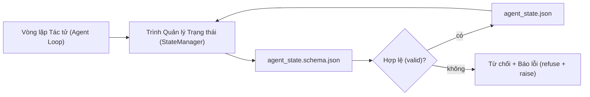

# Bộ nhớ Kho lưu trữ và Trạng thái Bền vững

> Lịch sử trò chuyện mang tính biến động tạm thời. Kho lưu trữ mới là nơi lưu trữ bền vững. Bàn làm việc lưu trữ trạng thái tác tử trong các tệp tin được quản lý phiên bản để phiên làm việc tiếp theo, tác tử tiếp theo và bên duyệt xét tiếp theo đều đọc từ cùng một nguồn chân lý.

**Phân loại:** Xây dựng (Build)  
**Ngôn ngữ:** Python (thư viện chuẩn - stdlib + tùy chọn `jsonschema`)  
**Điều kiện tiên quyết:** Phase 14 · 32 (Bàn làm việc Tối thiểu)  
**Thời lượng:** ~60 phút  

## Mục tiêu Học tập

- Định nghĩa rõ những gì thuộc về bộ nhớ kho lưu trữ (repo memory) và những gì thuộc về lịch sử trò chuyện (chat history).
- Soạn thảo các lược đồ JSON Schema cho `agent_state.json` và `task_board.json`.
- Xây dựng một trình quản lý trạng thái (state manager) có khả năng nạp, xác thực, biến đổi và lưu trữ trạng thái một cách nguyên tử (atomically).
- Sử dụng lược đồ để từ chối các thao tác ghi sai lệch trước khi chúng làm hỏng bàn làm việc.

## Vấn đề Đặt ra

Tác tử hoàn thành một phiên làm việc. Cửa sổ trò chuyện đóng lại. Phiên tiếp theo mở ra và hỏi phải bắt đầu từ đâu. Mô hình nói "để tôi kiểm tra các tệp tin", đọc những dòng ghi chú cũ kỹ đã lỗi thời, và làm lại công việc vốn đã hoàn thành trước đó. Hoặc tệ hơn nữa, nó viết lại một tệp đã làm xong chỉ vì không ai thông báo cho nó biết tệp đó đã hoàn tất.

Giải pháp của bàn làm việc là bộ nhớ kho lưu trữ: trạng thái được lưu trữ trong các tệp JSON ngay trong repo, tuân theo một lược đồ định sẵn, được ghi nhận một cách nguyên tử, và thân thiện với việc so sánh khác biệt mã (diff) khi duyệt mã (code review). Trò chuyện chỉ là một luồng thông tin ngắn hạn tạm thời; kho lưu trữ mới chính là hệ thống nguồn chân lý (system of record).

## Khái niệm Cốt lõi



### Những gì thuộc về bộ nhớ kho lưu trữ

| Thuộc về kho lưu trữ | Không thuộc về kho lưu trữ |
|----------------------|----------------------------|
| Mã định danh tác vụ đang chạy | Bản ghi chép thô cuộc trò chuyện |
| Các tệp đã chạm tới trong phiên này | Dấu vết lập luận ở cấp độ token |
| Các giả định mà tác tử đã đưa ra | "Người dùng có vẻ bực bội" |
| Các điểm nghẽn (blockers) đang mở | Các kết quả hoàn thành mẫu ngẫu nhiên |
| Hành động kế tiếp | Mã định danh mô hình riêng của từng nhà cung cấp |

Phép thử ở đây là tính bền vững: liệu thông tin này có còn hữu ích sau ba tháng nữa khi chạy lại trên CI hay không? Nếu có, hãy đưa vào repo. Nếu không, hãy chuyển nó sang hệ thống đo đạc từ xa (telemetry).

### Trạng thái ưu tiên lược đồ (Schema-first)

Lược đồ JSON Schema đóng vai trò bản hợp đồng. Nếu không có nó, mỗi tác tử sẽ tự ý phát minh ra các trường mới, mỗi bên duyệt xét sẽ phải học một cấu trúc mới, và mỗi tập lệnh CI sẽ phải xử lý các trường hợp ngoại lệ cho từng phiên bản cũ. Khi có lược đồ, một thao tác ghi sai lệch đồng nghĩa với một thao tác ghi bị từ chối thẳng thừng.

Lược đồ bao quát:

- Các khóa bắt buộc.
- Các giá trị `status` được cho phép.
- Các giá trị bị cấm (ví dụ: cấm dùng `null` cho mảng).
- Các ràng buộc khuôn mẫu (mã tác vụ phải khớp mẫu `T-\d{3,}`).
- Trường phiên bản phục vụ việc di chuyển dữ liệu (migrations).

### Thao tác ghi nguyên tử (Atomic writes)

Các thao tác ghi trạng thái cần phải sống sót qua các sự cố sập giữa chừng: ghi ra một tệp tạm thời, thực hiện đồng bộ hóa hệ thống tệp (`fsync`), rồi đổi tên đè lên tệp mục tiêu. Tệp trạng thái là nguồn chân lý; một tệp bị ghi dở dang nửa chừng còn nguy hại hơn việc hoàn toàn không có tệp nào.

### Di chuyển phiên bản dữ liệu (Migrations)

Khi lược đồ thay đổi, hãy phát hành một tập lệnh di chuyển dữ liệu đi kèm với việc nâng cấp phiên bản lược đồ. Tệp trạng thái mang theo một trường `schema_version`; trình quản lý trạng thái sẽ từ chối nạp một tệp có phiên bản mà nó không thể tự động di chuyển.

````figure
wb-state-persist
````

## Thực hành Xây dựng

`code/main.py` triển khai:

- `agent_state.schema.json` và `task_board.schema.json`.
- Trình xác thực thuần thư viện chuẩn (tập con của JSON Schema: required, type, enum, pattern, items).
- Các phương thức `StateManager.load`, `StateManager.update`, `StateManager.commit` với cơ chế ghi tạm-và-đổi-tên nguyên tử.
- Bản minh họa sửa đổi trạng thái, lưu trữ, nạp lại và chứng minh tính toàn vẹn qua chu trình đọc-ghi (round-trip).

Chạy thử nghiệm:

```bash
python3 code/main.py
```

Tập lệnh ghi các tệp `workdir/agent_state.json` và `workdir/task_board.json`, biến đổi chúng qua hai lượt tương tác, và in ra trạng thái đã được xác thực ở mỗi bước.

## Các mẫu sản xuất trong thực tế

Bốn mẫu kiến trúc giúp biến giải pháp tối thiểu trong bài học này thành một hệ thống đủ vững vàng cho một monorepo đa tác tử:

**Thao tác ghi tạm-và-đổi-tên nguyên tử là bắt buộc.** Báo cáo lỗi tháng 3/2026 của dự án Hive đã ghi nhận rất rõ chế độ thất bại này: tệp `state.json` được ghi thông qua phương thức `write_text()` và các ngoại lệ bị bắt rồi âm thầm bỏ qua. Các thao tác ghi dang dở khiến các phiên sau tiếp tục chạy trên một trạng thái đã bị hỏng mà không có tín hiệu cảnh báo nào. Giải pháp luôn là: dùng `tempfile.mkstemp` trong cùng thư mục với tệp mục tiêu, ghi nội dung, gọi `fsync`, sau đó dùng `os.replace` (thao tác đổi tên mang tính nguyên tử trên cả POSIX lẫn Windows). Hàm `atomic_write` trong bài học này thực hiện chuẩn xác quy trình đó.

**Khóa lũy đẳng (Idempotency keys) trên mọi lời gọi công cụ không có tính lũy đẳng.** Nếu một tác tử gặp sự cố sập sau khi gọi một công cụ nhưng trước khi kịp ghi nhận kết quả vào điểm kiểm tra (checkpoint), quy trình phục hồi sẽ thử gọi lại công cụ đó. Điều này an toàn với các thao tác đọc; nhưng cực kỳ nguy hiểm đối với việc gửi email, chèn bản ghi vào cơ sở dữ liệu, hay tải tệp lên. Mô hình xử lý: ghi lại nhật ký mọi ID lời gọi công cụ trước khi thực thi vào tệp `pending_calls.jsonl`. Khi thử lại, kiểm tra xem ID đã tồn tại chưa; nếu có, bỏ qua việc gọi lại và sử dụng kết quả đã được đệm trong bộ nhớ cache. Cả Anthropic và LangChain đều đặc biệt nhấn mạnh điểm này trong các tài liệu hướng dẫn năm 2026; trình lưu điểm kiểm tra của LangGraph cũng lưu vết các thao tác ghi đang chờ vì lý do tương tự.

**Tách biệt các tạo tác dung lượng lớn khỏi tệp trạng thái.** Không lưu trữ các tệp CSV, bản ghi trò chuyện dài dằng dặc hay các tệp được sinh ra bên trong `agent_state.json`. Hãy lưu tạo tác đó thành một tệp riêng biệt (hoặc tải lên kho lưu trữ đối tượng - object storage) và chỉ lưu trữ đường dẫn tệp trong trạng thái. Nhờ đó, các điểm kiểm tra luôn nhỏ gọn và có tốc độ xử lý nhanh; trong khi các tạo tác có thể phát triển dung lượng độc lập.

**Lưu trữ hướng sự kiện (Event sourcing) phục vụ kiểm toán, bản chụp nhanh (snapshots) phục vụ khôi phục.** Nối thêm các bản ghi vào tệp nhật ký sự kiện (`state.events.jsonl`) ở mỗi lần biến đổi trạng thái; định kỳ chụp bản nhanh vào `state.json`. Việc tiếp tục phiên làm việc (resume) sẽ đọc từ bản chụp nhanh, sau đó phát lại bất kỳ sự kiện nào xảy ra sau mốc thời gian của bản chụp đó. Cách này tốn thêm dung lượng đĩa nhưng cho phép bạn phát lại chính xác từng quyết định của tác tử — điều tối quan trọng khi gỡ lỗi các lượt chạy kéo dài. Postgres cũng áp dụng cơ chế nhật ký kết hợp điểm kiểm tra tương tự ở tầng lưu trữ với WAL, dù ở mức độ thấp hơn nhiều so với các sự kiện tầng ứng dụng.

**Di chuyển lược đồ hoặc từ chối nạp.** Giá trị số nguyên `schema_version` đóng vai trò là bản hợp đồng. Khi trình quản lý nạp một tệp có phiên bản lạ, nó sẽ từ chối đọc. Hãy phát hành một tập lệnh di chuyển dữ liệu bên cạnh việc nâng phiên bản lược đồ; tập lệnh `tools/migrate_state.py` sẽ chạy một cách lũy đẳng ở mỗi lần khởi động.

## Ứng dụng Thực tế

Trong môi trường sản xuất:

- **Các trình lưu điểm kiểm tra của LangGraph (LangGraph checkpointers).** Cùng ý tưởng, khác biệt về phương thức lưu trữ. Trình lưu điểm kiểm tra lưu trạng thái đồ thị vào SQLite, Postgres, hoặc một backend tùy biến. Lược đồ trong bài học này chính là thứ bạn cần tìm đến khi checkpointer bị hỏng và bạn phải đọc trạng thái thủ công bằng tay.
- **Các khối bộ nhớ Letta (Letta memory blocks).** Các khối bền vững với lược đồ có cấu trúc (Phase 14 · 08). Cùng một kỷ luật được áp dụng cho các nhân vật tác tử (personas) hoạt động lâu dài.
- **Kho phiên của OpenAI Agents SDK (Session store).** Các backend cắm được (pluggable), có nhận thức về lược đồ. Tệp trạng thái trong bài học này chính là hiện thân của backend tệp cục bộ.

## Tạo tác Phát hành

`outputs/skill-state-schema.md` tạo ra một cặp JSON Schema riêng biệt cho từng dự án (trạng thái + bảng tác vụ), một lớp `StateManager` bằng Python được kết nối với cơ chế ghi nguyên tử, và một bộ khung di chuyển dữ liệu để việc nâng cấp lược đồ trong tương lai không phá vỡ bàn làm việc.

## Bài tập Thực hành

1. Thêm mốc thời gian `last_human_touch`. Từ chối bất kỳ thao tác ghi nào của tác tử trong vòng năm giây kể từ khi có thao tác chỉnh sửa của con người.
2. Mở rộng trình xác thực để hỗ trợ từ khóa `oneOf`, cho phép một tác vụ có thể là tác vụ xây dựng (build) hoặc tác vụ duyệt xét (review) với các trường bắt buộc khác nhau.
3. Thêm trường `schema_version` và viết tập lệnh di chuyển từ v1 sang v2 (đổi tên `blockers` thành `risks`).
4. Chuyển đổi tầng lưu trữ phụ trợ từ tệp cục bộ sang SQLite. Giữ nguyên toàn bộ giao diện lập trình (API) của `StateManager`.
5. Chạy hai tác tử cùng ghi vào một tệp trạng thái với khoảng cách tranh chấp ghi là 50 ms. Sự cố gì sẽ xảy ra và cơ chế đổi tên nguyên tử giúp bảo vệ bạn như thế nào?

## Thuật ngữ Then chốt

| Thuật ngữ | Điều mọi người hay nói | Ý nghĩa thực sự |
|-----------|------------------------|-----------------|
| Bộ nhớ kho lưu trữ (Repo memory) | "Tệp ghi chú" | Trạng thái được lưu trong các tệp được theo dõi trong repo, tuân theo lược đồ |
| Ưu tiên lược đồ (Schema-first) | "Xác thực đầu vào" | Xác định bản hợp đồng trước khi thực hiện ghi, từ chối sự trôi dạt dữ liệu |
| Ghi nguyên tử (Atomic write) | "Chỉ việc đổi tên thôi" | Ghi vào tệp tạm, fsync, đổi tên, đảm bảo lỗi dở dang không làm hỏng tệp |
| Di chuyển lược đồ (Migration) | "Nâng cấp lược đồ" | Một tập lệnh biến đổi trạng thái vN thành trạng thái v(N+1) |
| Nguồn chân lý (System of record) | "Nguồn sự thật chuẩn mực" | Tạo tác mà bàn làm việc coi là có thẩm quyền tối cao |

## Tài liệu Đọc thêm

- [Đặc tả JSON Schema](https://json-schema.org/specification.html)
- [Trình lưu điểm kiểm tra của LangGraph](https://langchain-ai.github.io/langgraph/concepts/persistence/)
- [Các khối bộ nhớ của Letta](https://docs.letta.com/v1-sdk/memory/memory-blocks)
- [Fast.io, AI Agent State Checkpointing: A Practical Guide](https://fast.io/resources/ai-agent-state-checkpointing/) — lưu điểm kiểm tra ưu tiên lược đồ kèm tính lũy đẳng
- [Fast.io, AI Agent Workflow State Persistence: Best Practices 2026](https://fast.io/resources/ai-agent-workflow-state-persistence/) — kiểm soát tương tranh, TTL, lưu trữ hướng sự kiện
- [Hive Issue #6263 — các thao tác ghi state.json không nguyên tử bị bỏ qua âm thầm](https://github.com/aden-hive/hive/issues/6263) — chế độ thất bại trong một dự án thực tế
- [eunomia, Checkpoint/Restore Systems: Evolution, Techniques, Applications](https://eunomia.dev/blog/2025/05/11/checkpointrestore-systems-evolution-techniques-and-applications-in-ai-agents/) — các nguyên mẫu Checkpoint/Restore từ lịch sử hệ điều hành áp dụng vào tác tử
- [Indium, 7 State Persistence Strategies for Long-Running AI Agents in 2026](https://www.indium.tech/blog/7-state-persistence-strategies-ai-agents-2026/)
- [Microsoft Agent Framework, Compaction](https://learn.microsoft.com/en-us/agent-framework/agents/conversations/compaction) — trình quản lý điểm kiểm tra của nhà cung cấp
- Phase 14 · 08 — các khối bộ nhớ và năng lực tính toán trong thời gian ngủ
- Phase 14 · 32 — bàn làm việc ba tệp tối thiểu mà bài học này cụ thể hóa thành lược đồ
- Phase 14 · 40 — các gói chuyển giao đọc từ cùng một lược đồ này
