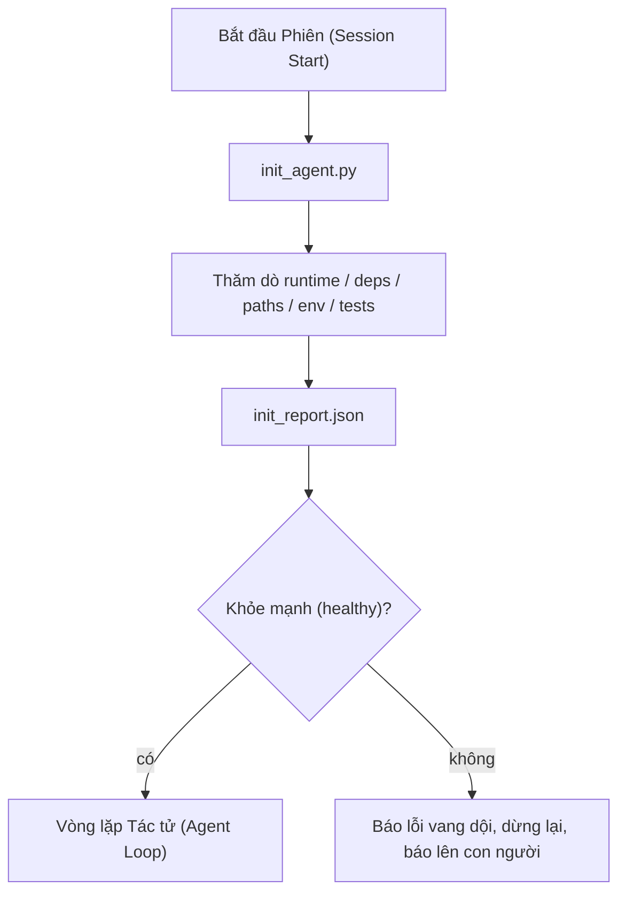

# Tập lệnh Khởi tạo cho Tác tử

> Mỗi phiên làm việc khởi động lạnh đều phải trả giá. Tác tử đọc lại cùng những tệp tin, thử lại cùng những phép thăm dò, và khám phá lại những đường dẫn quen thuộc. Một tập lệnh khởi tạo sẽ trả chi phí đó một lần duy nhất và ghi lại kết quả vào trạng thái.

**Phân loại:** Xây dựng (Build)  
**Ngôn ngữ:** Python (thư viện chuẩn - stdlib)  
**Điều kiện tiên quyết:** Phase 14 · 32 (Bàn làm việc Tối thiểu), Phase 14 · 34 (Bộ nhớ Kho lưu trữ)  
**Thời lượng:** ~45 phút  

## Mục tiêu Học tập

- Nhận diện những phần việc mà một tác tử không bao giờ phải làm lại ở mỗi phiên làm việc.
- Xây dựng một tập lệnh khởi tạo (init script) mang tính tất định (deterministic) để thăm dò môi trường thực thi, các phần phụ thuộc và tình trạng kho mã nguồn.
- Lưu trữ bền vững kết quả thăm dò để tác tử đọc trực tiếp thay vì phải chạy lại các bước kiểm tra.
- Báo lỗi vang dội (fail loud), báo lỗi tức thì (fail fast), và tập trung một nơi duy nhất để tra cứu khi quá trình khởi tạo thất bại.

## Vấn đề Đặt ra

Mở một phiên làm việc mới. Tác tử đoán phiên bản Python. Đoán lệnh chạy kiểm thử. Liệt kê thư mục gốc của kho lưu trữ tới năm lần chỉ để tìm điểm nhập (entry point). Thử import một gói chưa hề được cài đặt. Hỏi người dùng tệp cấu hình nằm ở đâu. Cho đến khi nó thực hiện được một chỉnh sửa thực sự, mười nghìn token đã bị tiêu tốn vào các công việc thiết lập vốn dĩ chỉ cần giải quyết gọn gàng bằng một tập lệnh duy nhất.

Giải pháp là một tập lệnh khởi tạo chạy trước khi tác tử thực hiện bất kỳ hành động nào khác và ghi lại tệp `init_report.json` để tác tử đọc ngay lúc khởi động.

## Khái niệm Cốt lõi



### Những gì tập lệnh khởi tạo thăm dò

| Phép thăm dò (Probe) | Vì sao quan trọng |
|----------------------|-------------------|
| Phiên bản môi trường thực thi (Runtime) | Sai phiên bản Python hoặc Node sẽ dẫn đến các lỗi âm thầm do sai lệch phiên bản |
| Mức độ sẵn sàng của phụ thuộc (Dependencies) | Bị thiếu một gói sau này sẽ tốn chi phí gấp mười lần việc bắt lỗi nó ngay từ đầu |
| Lệnh kiểm thử (Test command) | Tác tử phải biết cách kiểm minh; nếu thiếu lệnh này thì bàn làm việc coi như đã hỏng |
| Đường dẫn trong kho mã nguồn (Repo paths) | Các đường dẫn cố định (hard-coded) dễ bị trôi dạt; hãy phân giải một lần và ghim lại |
| Biến môi trường (Environment variables) | Thiếu `OPENAI_API_KEY` là một bề mặt thất bại, không phải một bí ẩn thời gian chạy |
| Độ tươi mới của trạng thái và bảng việc | Trạng thái cũ kỹ từ một phiên bị sập là một cạm bẫy nguy hiểm |
| Commit chuẩn tốt gần nhất (LKG commit) | Điểm neo để so sánh khác biệt mã (diff) lúc chuyển giao ở cuối phiên |

### Báo lỗi vang dội, tức thì và tập trung tại một nơi

Một phép thăm dò thất bại đồng nghĩa với việc dừng lại ngay lập tức và báo cáo lên con người. Tuyệt đối không có chuyện "tác tử sẽ tự xoay xở xử lý". Toàn bộ ý nghĩa của việc khởi tạo là từ chối bắt đầu khi bàn làm việc đang ở trạng thái bị hỏng hóc.

### Tính lũy đẳng (Idempotent)

Chạy tập lệnh hai lần liên tiếp. Lần chạy thứ hai phải là một thao tác không làm thay đổi gì (no-op) ngoại trừ mốc thời gian được làm mới. Tính lũy đẳng chính là yếu tố cho phép bạn tích hợp tập lệnh vào CI, các hook, hoặc lệnh gạch chéo tiền tác vụ.

### Khởi tạo so với các quy tắc khởi động

Các quy tắc (Phase 14 · 33) mô tả những điều kiện bắt buộc phải đúng để hành động. Khởi tạo là tập lệnh xác lập rằng các quy tắc đó có thể được kiểm tra. Có quy tắc mà không có khởi tạo thì quy tắc sẽ biến thành những lời dặn dò "hãy cẩn thận nhé". Có khởi tạo mà không có quy tắc thì thất bại chỉ được ngụy trang bóng bẩy hơn.

````figure
wb-init-probes
````

## Thực hành Xây dựng

`code/main.py` triển khai `init_agent.py`:

- Năm phép thăm dò: phiên bản Python, các phụ thuộc trong danh sách qua `importlib.util.find_spec`, khả năng phân giải lệnh kiểm thử, các biến môi trường bắt buộc, độ tươi mới của tệp trạng thái.
- Mỗi phép thăm dò trả về `(tên, trạng_thái, chi_tiết)`.
- Tập lệnh ghi tệp `init_report.json` với toàn bộ kết quả thăm dò và thoát với mã khác 0 nếu có bất kỳ phép thăm dò mức độ nghiêm trọng block nào thất bại.

Chạy thử nghiệm:

```bash
python3 code/main.py
```

Tập lệnh in ra bảng kết quả thăm dò, ghi tệp `init_report.json`, và thoát với mã 0 trên luồng suôn sẻ hoặc mã khác 0 kèm danh sách các phép thăm dò thất bại.

## Các mẫu sản xuất trong thực tế

Ba mẫu kiến trúc phân biệt một tập lệnh khởi tạo hữu ích với một thủ tục mang tính hình thức:

**Neo vào commit chuẩn tốt gần nhất (Last-known-good - LKG commit anchoring).** Thăm dò commit hiện tại so với tệp `LKG` được ghi lại ở lần hợp nhất (merge) thành công gần nhất. Nếu lượng khác biệt (diff) vượt quá ngân sách (mặc định 50 tệp), hãy từ chối bắt đầu và yêu cầu con người phê chuẩn đường cơ sở (baseline) mới. Đây chính là cơ chế mà hệ thống AI Code Review của Cloudflare sử dụng để giới hạn phạm vi tác tử duyệt xét: mỗi phiên duyệt xét đều được neo vào cùng một commit chuẩn tốt gần nhất và không bao giờ làm trầm trọng thêm sự trôi dạt giữa các phiên.

**Tệp khóa kèm thời gian sống (Lock files with TTL).** Ghi tệp `prereqs.lock` sau lượt kiểm tra thăm dò thành công đầu tiên. Các lần chạy tiếp theo sẽ tin tưởng tệp khóa này trong N giờ (mặc định 24 giờ) và bỏ qua các phép thăm dò tốn kém. Tập lệnh khởi tạo đọc tệp khóa trước; nếu tệp còn mới và mã băm (content hash) của bản kê khai phụ thuộc trùng khớp, nó sẽ kết thúc sớm (short-circuit). Đây chính là mẫu kiến trúc mà Docker sử dụng cho bộ đệm tầng (layer caches): phép thăm dò lũy đẳng + mã băm nội dung = bỏ qua.

**Không mạng, không LLM, không bất ngờ trên đường dẫn nóng.** Các phép thăm dò khởi tạo là những đường ống kỹ thuật mang tính tất định. Một phép thăm dò gọi LLM để phân loại lỗi hoặc gửi yêu cầu tới dịch vụ bên ngoài để kiểm tra giấy phép thì không phải là một phép thăm dò; đó là một quy trình nghiệp vụ (workflow). Nếu một phép thăm dò mất hơn ba giây trong một lần chạy thử (dry run), hãy coi đó là một dấu hiệu bất ổn (workbench smell) và di chuyển nó ra khỏi quá trình khởi tạo hoặc lưu bộ đệm kết quả của nó.

## Ứng dụng Thực tế

Trong môi trường sản xuất:

- **Các móc chặn của Claude Code (Claude Code hooks).** Móc chặn `pre-task` gọi tập lệnh khởi tạo và từ chối khởi chạy tác tử nếu tập lệnh thất bại.
- **GitHub Actions.** Một công việc `setup-agent` chạy tập lệnh khởi tạo; công việc chạy tác tử sẽ phụ thuộc vào nó.
- **Điểm nhập Docker (Docker entrypoint).** Container của tác tử chạy tập lệnh khởi tạo trước khi thực thi môi trường runtime của tác tử; nhật ký sẽ hiển thị nếu thất bại.

Tập lệnh khởi tạo có tính khả chuyển vì nó không phụ thuộc vào bất kỳ khung điều phối cụ thể nào. Bash, Make, hay một tệp tasks đều có thể bao bọc nó.

## Tạo tác Phát hành

`outputs/skill-init-script.md` phỏng vấn dự án, phân loại các công việc thiết lập thành các phép thăm dò, và tạo ra tệp `init_agent.py` chuyên biệt cho dự án cùng với quy trình làm việc CI chạy tệp này trước mọi bước tác tử.

## Bài tập Thực hành

1. Thêm một phép thăm dò so sánh commit hiện tại với commit chuẩn tốt gần nhất và từ chối bắt đầu nếu có hơn 50 tệp bị thay đổi.
2. Cấu hình tập lệnh để ghi tệp `prereqs.lock` và từ chối khởi động nếu tệp khóa đã cũ hơn bảy ngày.
3. Thêm cờ `--fix` để tự động cài đặt các phần phụ thuộc phục vụ phát triển (dev dependencies) bị thiếu, nhưng tuyệt đối không chỉnh sửa các phụ thuộc môi trường chạy (runtime) mà không có sự phê duyệt.
4. Chuyển đổi các phép thăm dò từ các hàm mã hóa cứng sang một sổ đăng ký dạng YAML. Đưa ra lập luận bảo vệ sự đánh đổi này.
5. Thiết lập ngân sách thời gian cho từng phép thăm dò. Một phép thăm dò chạy lâu hơn ba giây chính là một dấu hiệu bất ổn của bàn làm việc.

## Thuật ngữ Then chốt

| Thuật ngữ | Điều mọi người hay nói | Ý nghĩa thực sự |
|-----------|------------------------|-----------------|
| Phép thăm dò (Probe) | "Một bước kiểm tra" | Một hàm tất định trả về `(tên, trạng_thái, chi_tiết)` |
| Báo cáo khởi tạo (Init report) | "Đầu ra thiết lập" | Tệp JSON ghi cạnh trạng thái chứa kết quả thăm dò |
| Tính lũy đẳng (Idempotent) | "Chạy lại an toàn" | Hai lần chạy liên tiếp sinh ra các báo cáo giống hệt nhau ngoại trừ mốc thời gian |
| Báo lỗi vang dội (Fail loud) | "Không nuốt lỗi" | Dừng lại và báo cáo lên con người; không ngấm ngầm dùng phương án dự phòng |
| Chi phí thiết lập (Setup tax) | "Phí khởi động" | Lượng token mà tác tử tiêu tốn mỗi phiên để khám phá lại những điều hiển nhiên |

## Tài liệu Đọc thêm

- [Anthropic, Effective harnesses for long-running agents](https://www.anthropic.com/engineering/effective-harnesses-for-long-running-agents)
- [GitHub Actions, composite actions for setup](https://docs.github.com/en/actions/sharing-automations/creating-actions/creating-a-composite-action)
- [microservices.io, GenAI dev platform: guardrails](https://microservices.io/post/architecture/2026/03/09/genai-development-platform-part-1-development-guardrails.html) — kiểm tra pre-commit + CI dưới dạng khởi tạo
- [Augment Code, How to Build Your AGENTS.md (2026)](https://www.augmentcode.com/guides/how-to-build-agents-md) — kỳ vọng về khởi tạo
- [Codex Blog, Codex CLI Context Compaction](https://codex.danielvaughan.com/2026/03/31/codex-cli-context-compaction-architecture/) — bắt đầu phiên dưới dạng khởi tạo có nhận thức về thu gọn ngữ cảnh
- Phase 14 · 33 — bộ quy tắc mà tập lệnh này kích hoạt
- Phase 14 · 34 — tệp trạng thái mà tập lệnh này gieo mầm
- Phase 14 · 38 — cổng kiểm minh tiêu thụ báo cáo của tập lệnh khởi tạo
- Phase 14 · 40 — quy trình chuyển giao tiêu thụ commit chuẩn tốt gần nhất từ báo cáo khởi tạo
