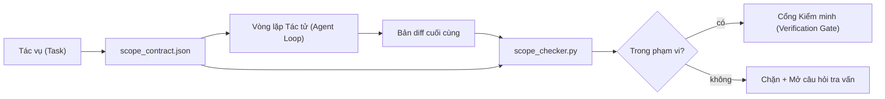

# Hợp đồng Phạm vi và Ranh giới Tác vụ

> Mô hình không biết nơi công việc kết thúc. Hợp đồng phạm vi là một tệp riêng cho từng tác vụ quy định rõ nơi công việc bắt đầu, nơi nó kết thúc, và cách thức hoàn nguyên nếu công việc bị tràn ra ngoài. Hợp đồng này biến yêu cầu "hãy ở trong phạm vi" từ một lời nguyện ước thành một phép kiểm tra cụ thể.

**Phân loại:** Xây dựng (Build)  
**Ngôn ngữ:** Python (thư viện chuẩn - stdlib)  
**Điều kiện tiên quyết:** Phase 14 · 32 (Bàn làm việc Tối thiểu), Phase 14 · 33 (Quy tắc dưới dạng Ràng buộc)  
**Thời lượng:** ~50 phút  

## Mục tiêu Học tập

- Viết một hợp đồng phạm vi (scope contract) mà tác tử đọc ở đầu tác vụ và trình kiểm minh đọc ở cuối tác vụ.
- Chỉ định rõ ràng các tệp được phép sửa, tệp cấm chỉnh sửa, tiêu chí chấp thuận, kế hoạch hoàn nguyên và ranh giới phê duyệt.
- Triển khai một bộ kiểm tra phạm vi (scope checker) so sánh bản so sánh khác biệt mã (diff) với hợp đồng và gắn cờ các vi phạm.
- Làm cho sự phình to phạm vi (scope creep) trở nên hiển thị trực quan, tự động và có thể duyệt xét được.

## Vấn đề Đặt ra

Các tác tử có xu hướng tự ý mở rộng phạm vi (creep). Tác vụ ban đầu chỉ là "sửa lỗi đăng nhập". Nhưng bản khác biệt mã (diff) lại chạm tới tuyến đường dẫn đăng nhập, hàm trợ giúp gửi email, trình điều khiển cơ sở dữ liệu, tệp README, và tập lệnh phát hành. Mỗi lần chạm tới đều có một lý do có vẻ hợp lý tại thời điểm đó. Nhưng gộp lại, chúng biến thành một thay đổi hoàn toàn khác biệt so với những gì đã được phê duyệt.

Sự phình to phạm vi là chế độ thất bại ít được giám sát nhất trong các công việc của tác tử bởi vì tác tử luôn giải trình từng bước đi với thái độ hết sức thiện chí. Biện pháp khắc phục không phải là một câu prompt nghiêm ngặt hơn. Giải pháp là một bản hợp đồng nằm trên đĩa ghi rõ những gì đã được cam kết và một bài kiểm tra so sánh kết quả thực tế với cam kết đó.

## Khái niệm Cốt lõi



### Những gì nằm trong một hợp đồng phạm vi

| Trường | Mục đích |
|--------|----------|
| `task_id` | Liên kết với tác vụ trên bảng công việc |
| `goal` | Một câu súc tích mà người duyệt xét có thể thẩm tra |
| `allowed_files` | Các mẫu đường dẫn (globs) mà tác tử được phép ghi |
| `forbidden_files` | Các mẫu đường dẫn mà tác tử tuyệt đối không được chạm vào ngay cả do vô ý |
| `acceptance_criteria` | Các lệnh kiểm thử hoặc các dòng xác thực khẳng định (assertion) chứng minh việc đã xong |
| `rollback_plan` | Một đoạn văn người vận hành có thể thực thi nếu cần dừng lại khẩn cấp |
| `approvals_required` | Các hành động ngoài phạm vi đòi hỏi phải có sự ký duyệt tường minh của con người |

Một hợp đồng thiếu vắng trường `forbidden_files` là một hợp đồng chưa hoàn chỉnh. Không gian phủ định chiếm một nửa giá trị của bản hợp đồng.

### Sử dụng mẫu đường dẫn (Globs), không dùng đường dẫn thô

Các repo thực tế liên tục di chuyển tệp. Ghim các hợp đồng theo các mẫu đường dẫn glob (`app/**/*.py`, `tests/test_signup*.py`) để việc tái cấu trúc giữa các phiên không làm vô hiệu hóa hợp đồng.

### Kế hoạch hoàn nguyên là một phần của phạm vi

Liệt kê cách thức hoàn nguyên (rollback) buộc người soạn thảo hợp đồng phải suy nghĩ về những rủi ro có thể xảy ra. Một hợp đồng mà bạn không thể hoàn nguyên là một hợp đồng không bao giờ nên được phê duyệt.

### Kiểm tra phạm vi là kiểm tra phần khác biệt

Tác tử tạo ra một bản khác biệt mã (diff). Bộ kiểm tra đọc bản diff, các mẫu glob được phép, các mẫu glob bị cấm, cùng danh sách các lệnh chấp thuận đã được thực thi. Mỗi vi phạm là một phát hiện được gắn thẻ mà cổng kiểm minh có thể từ chối thông qua.

### Hai độ cao của phạm vi: danh sách tính năng và hợp đồng tác vụ

Hợp đồng phạm vi giới hạn ranh giới cho một tác vụ đơn lẻ. Nó không giới hạn toàn bộ dự án. Một tác tử có thể tuân thủ hoàn hảo bên trong hợp đồng sửa lỗi đăng nhập nhưng ngay ở lượt tiếp theo, nó lại tự ý quyết định rằng dự án cần có thêm một trang cài đặt, một nút chuyển chế độ tối (dark mode), và viết lại toàn bộ bộ định tuyến. Hợp đồng trước đó chưa từng được hỏi xem công việc nào thuộc phạm vi của dự án, mà chỉ giới hạn tệp nào nằm trong phạm vi của tác vụ.

Độ cao thứ hai đó cần nguyên mẫu riêng của nó: tệp `feature_list.json` mà tác tử đọc ở đầu phiên làm việc. Đây là danh sách tồn đọng (backlog) của dự án dưới dạng một tệp có cấu trúc thứ tự, máy đọc được. Tác tử chọn chính xác một tính năng có trạng thái `status` là `todo`, ghi mã định danh `id` của nó vào hợp đồng phạm vi đang hoạt động, và bị cấm bắt đầu tính năng thứ hai trong cùng một phiên làm việc. Nguyên tắc "mỗi lần một tính năng" không còn là một dòng trong lời nhắc mà tác tử có thể dùng lập luận để vượt qua, mà trở thành một giá trị nó đọc từ đĩa và là một phép kiểm tra mà cổng kiểm soát bắt buộc phải thực thi.

```json
{
  "project": "knowledge-base",
  "active": "import-pdf",
  "features": [
    { "id": "import-pdf",   "status": "in_progress", "goal": "nhập tệp PDF vào thư viện",        "done_when": "pytest tests/test_import.py && tệp PDF mẫu xuất hiện trong giao diện thư viện" },
    { "id": "full-text-search", "status": "todo",     "goal": "tìm kiếm nội dung tài liệu và xếp hạng kết quả",   "done_when": "truy vấn trả về các kết quả được xếp hạng kèm đoạn trích dẫn" },
    { "id": "cite-answers", "status": "todo",         "goal": "câu trả lời mang theo trích dẫn nguồn",        "done_when": "mỗi câu trả lời hiển thị ít nhất một trích dẫn có thể nhấp chuột" }
  ]
}
```

| Trường | Mục đích |
|--------|----------|
| `active` | Tính năng duy nhất mà phiên hiện tại được phép chỉnh sửa; để trống nghĩa là chọn một và gán giá trị |
| `features[].id` | Định danh slug ổn định mà trường `task_id` của hợp đồng phạm vi trỏ tới |
| `features[].status` | `todo`, `in_progress`, `done`, `blocked`; chỉ duy nhất một tính năng được ở trạng thái `in_progress` tại một thời điểm |
| `features[].goal` | Một câu súc tích mà người duyệt xét có thể thẩm tra |
| `features[].done_when` | Dòng tiêu chuẩn chấp thuận giúp chuyển trạng thái từ `in_progress` sang `done` |

Hai quy tắc biến danh sách này thành bộ phận chịu lực thay vì vật trang trí. Thứ nhất, bất biến "tối đa một tính năng `in_progress`" tự thân nó là một kiểm tra khởi động (Phase 14 · 33): nếu danh sách xuất hiện hai tính năng đang xử lý, phiên làm việc sẽ từ chối khởi động cho đến khi có con người giải quyết. Thứ hai, danh sách tính năng là một tệp tin chứ không phải tin nhắn trò chuyện, vì trò chuyện sẽ trôi ra ngoài ngữ cảnh còn tệp tin thì tồn tại bền vững qua các phiên và qua các tác tử khác nhau. Quy trình chuyển giao (Phase 14 · 40) ghi trạng thái tính năng đã hoàn thành ngược lại thành `done` để phiên kế tiếp mở ra trên một bảng công việc chính xác thay vì phải tự suy diễn lại những gì còn sót lại.

Hợp đồng và danh sách kết hợp với nhau theo nguyên tắc đặc quyền tối thiểu (least privilege), theo cùng cơ chế hợp nhất mô tả dưới đây: mảng `allowed_files` của hợp đồng tác vụ bắt buộc phải nằm gọn bên trong những gì mà tính năng đang hoạt động chạm tới, tuyệt đối không được vượt ra ngoài.

````figure
wb-scope-bounce
````

## Thực hành Xây dựng

`code/main.py` triển khai:

- Lược đồ `scope_contract.json` (tập con của JSON Schema, mảng glob).
- Trình phân tích cú pháp bản diff chuyển đổi danh sách các tệp đã chạm tới cùng danh sách các lệnh đã chạy thành một `RunSummary`.
- Hàm `scope_check` trả về `(violations, in_scope, off_scope)` đối soát với hợp đồng.
- Hai lượt chạy minh họa: một lượt tuân thủ nghiêm ngặt phạm vi, một lượt tự ý phình to phạm vi. Bộ kiểm tra sẽ gắn cờ cảnh báo sự phình to đó kèm chính xác tệp vi phạm và lý do.

Chạy thử nghiệm:

```bash
python3 code/main.py
```

Đầu ra: bản hợp đồng, hai lượt chạy, phán quyết cho từng lượt chạy, và một tệp `scope_report.json` được lưu lại.

## Các mẫu sản xuất trong thực tế

Một kỹ sư thực chiến áp dụng mô hình "specsmaxxing" (viết hợp đồng phạm vi dưới dạng YAML trước khi gọi tác tử) ghi nhận tỷ lệ tác tử bị sa đà vào các ngõ cụt (rabbit-hole rate) giảm từ 52% xuống 21% chỉ trong ba tuần mà không hề thay đổi tác tử. Bản hợp đồng đã gánh vác phần việc đó, chứ không phải mô hình. Ba mẫu sau đây giúp duy trì thành quả đó:

**Ngân sách vi phạm (Violation budgets), không dùng thất bại nhị phân.** Thư viện `agent-guardrails` (cổng hợp nhất mã nguồn mở được dùng bởi Claude Code, Cursor, Windsurf, Codex thông qua MCP) cung cấp một trường `violationBudget` cho từng tác vụ: các sai lệch phạm vi nhỏ nằm trong ngân sách sẽ được hiển thị dưới dạng cảnh báo (warnings); chỉ khi ngân sách bị vượt quá thì cổng hợp nhất mới từ chối. Kết hợp với `violationSeverity: "error" | "warning"`. Ngân sách chính là sự khác biệt giữa một cổng kiểm soát được áp dụng thực tế và một cổng kiểm soát bị chính đội ngũ phát triển vô hiệu hóa vì khó chịu.

**Tính bất đối xứng về mức độ nghiêm trọng theo họ đường dẫn.** Các thao tác ghi ngoài phạm vi vào thư mục `docs/**` thường chỉ ở mức `warn`; nhưng thao tác ngoài phạm vi vào `scripts/**`, `migrations/**`, `config/prod/**` luôn luôn ở mức `block`. Tính bất đối xứng này phải nằm trong hợp đồng chứ không phải trong môi trường chạy, bởi nó mang tính đặc thù riêng cho từng dự án và thay đổi theo từng tác vụ.

**Ngân sách thời gian và mạng lưới đi liền với ngân sách tệp tin.** Trường `time_budget_minutes` giới hạn thời gian thực tế chạy trên đồng hồ (wall clock); môi trường thực thi sẽ từ chối tiếp tục khi vượt quá thời gian này mà không có sự tái phê duyệt. Danh sách cho phép `network_egress` trên các tên miền máy chủ ngăn tác tử âm thầm gọi tới một API bên ngoài không nằm trong tác vụ. Đây cũng là những chiều kích của phạm vi; các mẫu đường dẫn tệp là điều kiện cần, nhưng chưa đủ.

**Ngữ nghĩa hợp nhất đa hợp đồng theo nguyên tắc đặc quyền tối thiểu (least privilege).** Khi hai hợp đồng phạm vi cùng được áp dụng (ví dụ: hợp đồng toàn dự án cộng với hợp đồng chuyên biệt cho tác vụ), phép hợp nhất được thực hiện như sau: **giao (intersect)** tập `allowed_files` (cả hai hợp đồng đều phải cho phép đường dẫn), **hợp (union)** tập `forbidden_files` (chỉ cần một bên cấm là bị cấm), `time_budget_minutes` lấy giá trị hạn chế nhất (min), `approvals_required` được tích lũy gộp lại. `network_egress` có giá trị `None` nghĩa là không áp đặt, `[]` là từ chối toàn bộ, `[...]` là danh sách cho phép; khi hợp nhất, `None` nhường quyền cho bên kia, hai danh sách sẽ lấy phần giao, và từ chối toàn bộ vẫn giữ nguyên là từ chối toàn bộ. Hãy nêu rõ điều này trong lược đồ hợp đồng để việc hợp nhất diễn ra cơ học và có thể duyệt xét được.

## Ứng dụng Thực tế

Các mô hình trong sản xuất:

- **Các lệnh gạch chéo của Claude Code.** Một lệnh `/scope` ghi hợp đồng và ghim nó làm ngữ cảnh phiên. Các tác tử phụ (subagents) đọc hợp đồng trước khi hành động.
- **GitHub Pull Requests.** Đẩy hợp đồng dưới dạng tệp JSON trong phần nội dung PR hoặc dưới dạng tạo tác được theo dõi. CI chạy bộ kiểm tra phạm vi đối soát với bản diff hợp nhất.
- **Các lệnh ngắt của LangGraph.** Một vi phạm phạm vi sẽ kích hoạt lệnh ngắt; bộ xử lý sẽ hỏi con người xem cần mở rộng hợp đồng hay yêu cầu tác tử lùi lại.

Hợp đồng đi liền với tác vụ. Khi tác vụ đóng lại, hợp đồng sẽ được lưu trữ vào `outputs/scope/closed/`.

## Tạo tác Phát hành

`outputs/skill-scope-contract.md` tạo ra một hợp đồng phạm vi từ bản mô tả tác vụ và một trình kiểm tra có nhận thức về các mẫu glob chạy trên CI đối với mọi bản diff do tác tử tạo ra.

## Bài tập Thực hành

1. Thêm trường `network_egress` liệt kê các máy chủ bên ngoài được phép gọi. Từ chối các lần chạy chạm tới các máy chủ khác.
2. Mở rộng bộ kiểm tra để xử lý lỗi mềm (fail soft) đối với `docs/**` và lỗi cứng (fail hard) đối với `scripts/**`. Hãy biện minh cho tính bất đối xứng này.
3. Cho hợp đồng tự động suy diễn `allowed_files` từ trường `goal` bằng một bộ quy tắc tĩnh (không dùng LLM). Điểm gì sẽ bị hỏng ngay ở trường hợp biên đầu tiên?
4. Thêm trường `time_budget_minutes` và từ chối tiếp tục khi đồng hồ thời gian thực tế vượt quá mốc này.
5. Chạy hai hợp đồng trên cùng một bản diff. Ngữ nghĩa hợp nhất chuẩn xác sẽ là gì khi cả hai cùng được áp dụng?

## Thuật ngữ Then chốt

| Thuật ngữ | Điều mọi người hay nói | Ý nghĩa thực sự |
|-----------|------------------------|-----------------|
| Hợp đồng phạm vi (Scope contract) | "Bản tóm tắt tác vụ" | Tệp JSON riêng cho tác vụ liệt kê tệp cho phép/bị cấm, nghiệm thu, hoàn nguyên |
| Phình to phạm vi (Scope creep) | "Nó cũng tiện tay sửa..." | Các tệp ngoài hợp đồng bị thay đổi trong cùng một tác vụ |
| Kế hoạch hoàn nguyên (Rollback plan) | "Chúng ta có thể revert" | Sổ tay vận hành ngắn gọn cho người điều hành để dừng khẩn cấp |
| Ranh giới phê duyệt (Approval boundary) | "Cần ký duyệt" | Một hành động trong hợp đồng đòi hỏi phải có con người trực tiếp phê duyệt |
| Kiểm tra phần khác biệt (Diff check) | "Kiểm toán đường dẫn" | So sánh các tệp đã chạm tới với các mẫu đường dẫn glob trong hợp đồng |

## Tài liệu Đọc thêm

- [Các lệnh ngắt có sự tham gia của con người trong LangGraph](https://langchain-ai.github.io/langgraph/concepts/human_in_the_loop/)
- [Chính sách phê duyệt công cụ của OpenAI Agents SDK](https://platform.openai.com/docs/guides/agents-sdk)
- [logi-cmd/agent-guardrails — cổng hợp nhất và xác thực phạm vi](https://github.com/logi-cmd/agent-guardrails) — ngân sách vi phạm, các tầng mức độ nghiêm trọng
- [Dev|Journal, Ngăn ngừa trôi dạt cấu hình tác tử AI bằng kiểm thử hợp đồng tác tử](https://earezki.com/ai-news/2026-05-05-i-built-a-tiny-ci-tool-to-keep-ai-agent-configs-from-drifting-in-my-repo/) — chế độ `--strict` không phụ thuộc thư viện ngoài
- [Agentic Coding Is Not a Trap (nhật ký sản xuất)](https://dev.to/jtorchia/agentic-coding-is-not-a-trap-i-answered-the-viral-hn-post-with-my-own-production-logs-33d9) — số liệu specsmaxxing thực tế: 52% → 21%
- [Các mẫu glob phân quyền trong OpenCode](https://opencode.ai/docs/agents/) — phạm vi chi tiết trên từng quyền hạn
- [Knostic, Bảo mật tác tử lập trình AI: Mô hình đe dọa và chiến lược bảo vệ](https://www.knostic.ai/blog/ai-coding-agent-security) — phạm vi như một phần của nguyên tắc đặc quyền tối thiểu
- [Augment Code, Bản mẫu đặc tả AI](https://www.augmentcode.com/guides/ai-spec-template) — hệ thống ranh giới ba tầng (phải làm/hỏi ý kiến/tuyệt đối không)
- Phase 14 · 27 — các biện pháp phòng thủ tiêm lời nhắc đi kèm với khóa phạm vi
- Phase 14 · 33 — bộ quy tắc mà hợp đồng này cụ thể hóa cho từng tác vụ
- Phase 14 · 38 — cổng kiểm minh nơi bộ kiểm tra gửi báo cáo
