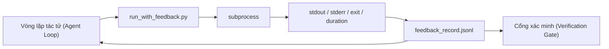

# Vòng lặp phản hồi thời gian chạy (Runtime Feedback Loops)

> Các tác tử không nhìn thấy đầu ra lệnh thực tế sẽ phải suy đoán. Một bộ chạy phản hồi (feedback runner) sẽ ghi lại stdout, stderr, mã thoát (exit code) và thời gian thực thi vào một bản ghi có cấu trúc mà lượt tiếp theo có thể đọc. Nhờ đó, tác tử sẽ phản ứng dựa trên thực tế thay vì dự đoán chủ quan về thực tế.

**Type:** Xây dựng (Build)
**Languages:** Python (stdlib)
**Prerequisites:** Phase 14 · 32 (Minimal Workbench), Phase 14 · 35 (Init Script)
**Time:** ~50 phút

## Mục tiêu học tập

- Phân biệt phản hồi thời gian chạy (runtime feedback) với đo kiểm từ xa cho khả năng quan sát (observability telemetry).
- Xây dựng một bộ chạy phản hồi đóng gói các lệnh shell và lưu trữ bền vững các bản ghi có cấu trúc.
- Cắt ngắn (truncate) các đầu ra lớn một cách tất định để vòng lặp duy trì trong giới hạn ngân sách token (token budget).
- Từ chối tiến triển vòng lặp khi thiếu thông tin phản hồi.

## Vấn đề đặt ra

Tác tử thông báo "đang chạy kiểm thử". Tin nhắn tiếp theo nói "toàn bộ kiểm thử đã vượt qua". Nhưng thực tế là không có bài kiểm thử nào được chạy. Tác tử đã tự tưởng tượng ra kết quả, hoặc nó đã chạy lệnh nhưng không bao giờ đọc kết quả trả về, hoặc nó đã đọc kết quả nhưng âm thầm cắt bỏ dòng thông báo lỗi.

Một bộ chạy phản hồi sẽ xóa bỏ khoảng cách đó. Mọi lệnh đều đi qua bộ chạy. Mọi bản ghi đều lưu lại lệnh, stdout và stderr thu thập được, mã thoát, thời gian chạy thực tế (wall-clock duration), và một dòng ghi chú của tác tử (agent note). Tác tử đọc bản ghi này ở lượt kế tiếp. Cổng xác minh (verification gate) sẽ đọc các bản ghi vào cuối nhiệm vụ.

## Khái niệm cốt lõi



### Các trường trong một bản ghi phản hồi

| Trường | Lý do quan trọng |
|---|---|
| `command` | Mảng tham số argv chính xác, không có bất ngờ từ việc mở rộng shell (shell expansion) |
| `stdout_tail` | N dòng cuối, cắt ngắn một cách tất định (deterministic truncation) |
| `stderr_tail` | N dòng cuối, tách biệt hoàn toàn với stdout |
| `exit_code` | Tín hiệu thành công rõ ràng, không mơ hồ |
| `duration_ms` | Làm nổi bật các phép thăm dò chậm và tiến trình chạy mất kiểm soát |
| `started_at` | Dấu thời gian (timestamp) để phục phát lại (replay) |
| `agent_note` | Một dòng tác tử ghi lại những gì nó kỳ vọng trước đó |

### Cắt ngắn mang tính tất định

Một tệp nhật ký 50 MB sẽ phá hủy vòng lặp tác tử. Bộ chạy sẽ cắt ngắn phần đầu và phần cuối với ký hiệu đánh dấu `...truncated N lines...`, đảm bảo tính tất định để cùng một đầu ra luôn tạo ra cùng một bản ghi. Không dùng kỹ thuật lấy mẫu ngẫu nhiên (sampling); những phần mà tác tử cần xem nhất (lỗi cuối cùng, bản tóm tắt cuối cùng) đều nằm ở phần đuôi (tail).

### Phản hồi đối chiếu với đo kiểm từ xa

Đo kiểm từ xa (telemetry - Phase 14 · 23, quy ước OTel GenAI) dành cho người vận hành theo dõi và đánh giá các lượt chạy qua thời gian. Phản hồi (feedback) dành riêng cho lượt tiếp theo của chính phiên chạy hiện tại. Chúng chia sẻ một số trường dữ liệu nhưng nằm trong các tệp khác nhau với chính sách lưu giữ (retention) khác nhau.

### Từ chối tiến triển khi thiếu phản hồi

Nếu bộ chạy gặp lỗi trước khi thu được mã thoát, bản ghi sẽ mang giá trị `exit_code: null` và `error: <lý do>`. Vòng lặp tác tử bắt buộc phải từ chối tuyên bố thành công khi mã thoát là `null`. Không có mã thoát, không có tiến triển.

```figure
wb-feedback-loop
```

## Thực hành xây dựng

`code/main.py` triển khai:

- `run_with_feedback(command, agent_note)` đóng gói `subprocess.run`, thu thập stdout/stderr/exit/duration, cắt ngắn tất định và ghi thêm vào `feedback_record.jsonl`.
- Một hàm tải (loader) nhỏ truyền luồng JSONL thành một danh sách Python.
- Một bản demo chạy ba lệnh (thành công, thất bại, chạy chậm) và in ra bản ghi cuối cùng của mỗi lệnh.

Chạy thử:

```bash
python3 code/main.py
```

Đầu ra: ba bản ghi phản hồi được ghi nối vào `feedback_record.jsonl`, bản ghi cuối cùng của mỗi lệnh được in trực tiếp. Theo dõi tệp qua các lần chạy lại để thấy vòng lặp tích lũy dữ liệu.

## Các mô hình sản xuất trong thực tế

Ba mô hình giúp củng cố bộ chạy để sẵn sàng đưa vào môi trường sản xuất (production).

**Ẩn thông tin nhạy cảm khi ghi, không phải khi đọc (Redact at write, not at read).** Bất kỳ bản ghi nào chạm vào stdout hoặc stderr đều có thể làm rò rỉ bí mật (secrets). Bộ chạy tích hợp một bước làm sạch (redaction pass) trước khi nối vào JSONL: loại bỏ các dòng khớp với `^Bearer `, `password=`, `api[_-]?key=`, `AKIA[0-9A-Z]{16}` (AWS), `xox[baprs]-` (Slack). Làm sạch tại thời điểm đọc là một sai lầm chết người; tệp nằm trên đĩa chính là thứ kẻ tấn công có thể tiếp cận. Hãy kiểm toán các mẫu làm sạch định kỳ hàng quý dựa trên các định dạng bí mật quan sát được trong môi trường thời gian chạy thực tế.

**Chính sách xoay vòng thay vì một tệp đơn lẻ (Rotation policy, not a single file).** Giới hạn `feedback_record.jsonl` ở mức 1 MB mỗi tệp; khi vượt giới hạn thì xoay vòng sang `.1`, `.2`, và xóa `.5`. Vòng lặp của tác tử chỉ đọc tệp hiện tại, do đó chi phí thời gian chạy luôn được chặn trên. Hệ thống lưu trữ thành phần tạo tác CI (CI artifact storage) sẽ nhận toàn bộ tập hợp đã xoay vòng. Nếu không có xoay vòng, tệp sẽ trở thành nút cổ chai trong mọi lệnh gọi hàm tải.

**Định danh lệnh cha cho chuỗi thử lại (Parent-command id for retry chains).** Mọi bản ghi đều nhận một `command_id`; các lần thử lại mang `parent_command_id` trỏ về lần thử trước đó. Danh sách "các lần thử thất bại" của người thẩm định (Phase 14 · 40) và quy trình kiểm toán của cổng xác minh đều lần theo chuỗi này. Không có liên kết này, các lần thử lại trông giống như những thành công độc lập và quá trình kiểm toán sẽ che giấu đi lịch sử thất bại.

## Ứng dụng thực tế

Các mô hình trong môi trường sản xuất:

- **Công cụ Bash của Claude Code:** Công cụ này vốn đã thu thập stdout, stderr, mã thoát và thời gian thực thi. Bộ chạy trong bài học này là phiên bản tương đương, độc lập với framework dành cho bất kỳ sản phẩm tác tử nào.
- **Các nút LangGraph (LangGraph nodes):** Đóng gói bất kỳ nút shell nào trong bộ chạy để bản ghi được lưu trữ bền vững bên ngoài trạng thái đồ thị (graph state).
- **Nhật ký CI (CI logs):** Dẫn luồng JSONL vào kho lưu trữ thành phần tạo tác CI của bạn; người đánh giá có thể phát lại bất kỳ lệnh nào mà không cần chạy lại phiên làm việc.

Bộ chạy là một lớp vỏ mỏng có thể tồn tại qua mọi đợt di chuyển framework vì nó nắm quyền kiểm soát cấu trúc của bản ghi.

## Triển khai thành phẩm

`outputs/skill-feedback-runner.md` tạo ra một tệp `run_with_feedback.py` tùy biến cho dự án với ngân sách cắt ngắn phù hợp, một bộ ghi JSONL được gắn kết với workbench và một bộ nạp mà tác tử đọc ở mỗi lượt.

## Bài tập thực hành

1. Thêm trường `cwd` (thư mục làm việc hiện tại) vào mỗi bản ghi để có thể phân biệt cùng một lệnh được chạy từ các thư mục khác nhau.
2. Thêm một bước `redaction` để loại bỏ các dòng khớp với `^Bearer ` hoặc `password=`. Kiểm thử trên một bản ghi mẫu (fixture record).
3. Giới hạn tổng kích thước `feedback_record.jsonl` ở mức 1 MB bằng cách xoay vòng sang các tệp `.1`, `.2`. Hãy bảo vệ và giải thích lý do chọn chính sách xoay vòng này.
4. Thêm `parent_command_id` để chuỗi thử lại hiển thị rõ ràng: lệnh nào đã tạo ra đầu vào mà lệnh tiếp theo tiêu thụ.
5. Dẫn luồng JSONL vào một giao diện TUI nhỏ làm nổi bật mã thoát khác 0 gần nhất. Liệt kê tám tính năng chính mà TUI phải hiển thị để hữu ích trong một buổi thẩm định (review).

## Thuật ngữ cốt lõi

| Thuật ngữ | Cách gọi thông thường | Ý nghĩa thực tế |
|---|---|---|
| Bản ghi phản hồi (Feedback record) | "Nhật ký chạy" (Run log) | Mục JSONL có cấu trúc chứa lệnh, đầu ra, mã thoát, thời gian thực thi |
| Cắt ngắn phần đuôi (Tail truncation) | "Cắt tỉa nhật ký" (Trim the log) | Thu thập phần đầu + đuôi mang tính tất định để bản ghi vừa vặn trong ngân sách token |
| Từ chối khi thiếu mã thoát (Refuse-on-null) | "Chặn khi thiếu dữ liệu" (Block on missing data) | Vòng lặp không được phép tiến triển khi `exit_code` là null |
| Ghi chú của tác tử (Agent note) | "Thẻ kỳ vọng" (Expectation tag) | Dự đoán một dòng mà tác tử viết ra trước khi đọc kết quả |
| Phân tách đo kiểm (Telemetry split) | "Hai tệp nhật ký" (Two log files) | Phản hồi dành cho lượt tiếp theo, đo kiểm từ xa dành cho người vận hành |

## Tài liệu đọc thêm

- [OpenTelemetry GenAI semantic conventions](https://opentelemetry.io/docs/specs/semconv/gen-ai/)
- [Anthropic, Effective harnesses for long-running agents](https://www.anthropic.com/engineering/effective-harnesses-for-long-running-agents)
- [Guardrails AI x MLflow — deterministic safety, PII, quality validators](https://guardrailsai.com/blog/guardrails-mlflow) — các mẫu làm sạch dưới dạng bài kiểm thử hồi quy (regression tests)
- [Aport.io, Best AI Agent Guardrails 2026: Pre-Action Authorization Compared](https://aport.io/blog/best-ai-agent-guardrails-2026-pre-action-authorization-compared/) — thu thập trước/sau công cụ
- [Andrii Furmanets, AI Agents in 2026: Practical Architecture for Tools, Memory, Evals, Guardrails](https://andriifurmanets.com/blogs/ai-agents-2026-practical-architecture-tools-memory-evals-guardrails) — các bề mặt khả năng quan sát (observability surfaces)
- Phase 14 · 23 — Các quy ước OTel GenAI cho khía cạnh đo kiểm từ xa
- Phase 14 · 24 — Các nền tảng quan sát tác tử (Langfuse, Phoenix, Opik)
- Phase 14 · 33 — Quy tắc yêu cầu phản hồi trước khi tuyên bố hoàn thành
- Phase 14 · 38 — Cổng xác minh đọc tệp JSONL
