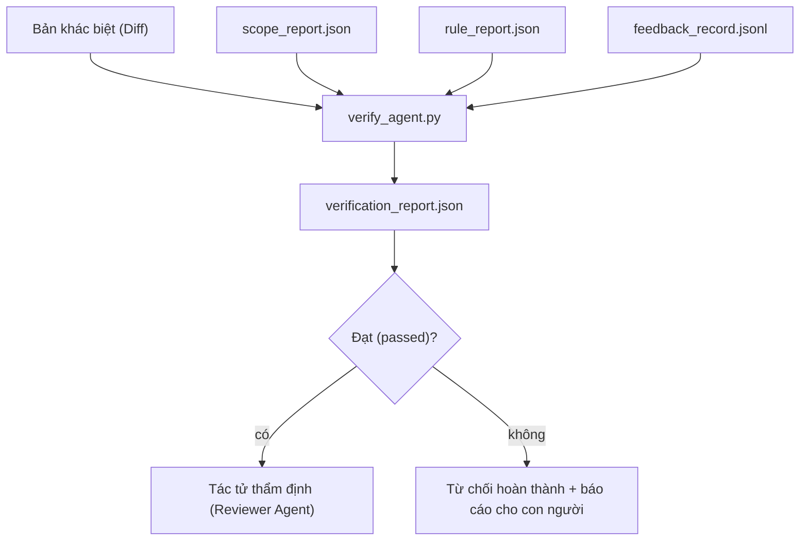

# Cổng xác minh (Verification Gates)

> Tác tử không có quyền tự đánh dấu công việc của mình là hoàn thành. Cổng xác minh (verification gate) đọc hợp đồng phạm vi (scope contract), nhật ký phản hồi (feedback log), báo cáo quy tắc (rule report) và bản khác biệt mã (diff), rồi trả lời một câu hỏi duy nhất: nhiệm vụ này đã thực sự hoàn tất chưa? Nếu cổng nói không, nhiệm vụ chưa hoàn thành, bất kể giao diện trò chuyện nói gì.

**Type:** Xây dựng (Build)
**Languages:** Python (stdlib)
**Prerequisites:** Phase 14 · 33 (Rules), Phase 14 · 36 (Scope), Phase 14 · 37 (Feedback)
**Time:** ~55 phút

## Mục tiêu học tập

- Định nghĩa cổng xác minh (verification gate) như một hàm tất định trên các thành phần tạo tác (artifacts) của workbench.
- Kết hợp báo cáo quy tắc, báo cáo phạm vi, bản ghi phản hồi và diff thành một phán quyết (verdict) duy nhất.
- Xuất ra tệp `verification_report.json` mà cả tác tử thẩm định (reviewer agent) và hệ thống CI đều có thể đọc.
- Từ chối tiến triển nhiệm vụ trước bất kỳ lỗi nào có mức độ nghiêm trọng chặn (block-severity failure), không có ngoại lệ.

## Vấn đề đặt ra

Các tác tử thường tuyên bố thành công quá dễ dãi. Có ba dạng thức thất bại chiếm ưu thế:

- "Trông ổn rồi." Mô hình tự đọc bản diff của chính nó và tự kết luận rằng nó chính xác.
- "Kiểm thử đã vượt qua." Khẳng định đầy tự tin. Nhưng không có bản ghi nào chứng minh kiểm thử thực sự đã chạy.
- "Đã đáp ứng tiêu chí nghiệm thu." Các tiêu chí nghiệm thu bị diễn giải lỏng lẻo tới mức bất cứ thứ gì "na ná hoàn thành" cũng được chấp nhận.

Giải pháp từ workbench là một cổng xác minh duy nhất đọc các thành phần tạo tác mà tác tử đã tạo ra và đưa ra quyết định. Cổng xác minh có tính tất định. Cổng xác minh nằm trong hệ thống quản lý phiên bản (version control). Cổng xác minh được tích hợp vào CI. Tác tử không thể "mua chuộc" hay đánh lừa được nó.

## Khái niệm cốt lõi



### Những gì cổng xác minh kiểm tra

| Hạng mục kiểm tra | Thành phần tạo tác nguồn | Mức độ nghiêm trọng |
|---|---|---|
| Mọi lệnh nghiệm thu (acceptance commands) đều đã chạy | `feedback_record.jsonl` | Chặn (block) |
| Mọi lệnh nghiệm thu đều thoát với mã 0 | `feedback_record.jsonl` | Chặn (block) |
| Kiểm tra phạm vi không có hành vi ghi bị cấm | `scope_report.json` | Chặn (block) |
| Kiểm tra phạm vi không có hành vi ghi ngoài phạm vi | `scope_report.json` | Chặn (block) hoặc Cảnh báo (warn) |
| Mọi quy tắc mức độ chặn đều vượt qua | `rule_report.json` | Chặn (block) |
| Không có mã thoát `null` trong phản hồi | `feedback_record.jsonl` | Chặn (block) |
| Các tệp bị chạm tới khớp với `scope.allowed_files` | Cả hai | Cảnh báo (warn) |

Một phát hiện mức `warn` chỉ chú thích vào phán quyết; một phát hiện mức `block` sẽ ngăn chặn hoàn toàn kết quả `passed: true`.

### Mang tính tất định, không mang tính xác suất

Cổng xác minh phải đưa ra cùng một phán quyết cho cùng một tập hợp thành phần tạo tác trong mọi lần chạy. Không sử dụng các mô hình ngôn ngữ lớn làm giám khảo (LLM judges). Giám khảo LLM thuộc về phía tác tử thẩm định (Phase 14 · 39) - nơi mục tiêu là đánh giá định tính chứ không phải xác định trạng thái cứng.

### Một báo cáo, một đường dẫn

Cổng xác minh phát ra một tệp `verification_report.json` cho mỗi lần chốt nhiệm vụ, được ghi tại `outputs/verification/<task_id>.json`. Hệ thống CI tiêu thụ cùng đường dẫn này. Việc có nhiều cổng với nhiều đường dẫn khác nhau sẽ làm phân mảnh nguồn chân lý duy nhất (source of truth).

### Từ chối không ngoại lệ

Các phát hiện mức độ chặn (block-severity) không thể bị ghi đè bởi tác tử. Chúng chỉ có thể bị ghi đè bởi con người, đi kèm với một `override_reason` (lý do ghi đè) và định danh người dùng `overridden_by` được ghi lại. Hành động ghi đè là một thay đổi có chữ ký xác thực, không phải là quyết định của tác tử.

```figure
wb-gate-sequence
```

## Thực hành xây dựng

`code/main.py` triển khai:

- Một bộ nạp cho từng thành phần tạo tác đầu vào, tất cả đều được giả lập (stubbed) cục bộ để bài học có tính độc lập trọn vẹn.
- Hàm thuần khiết `verify(task_id, artifacts) -> VerdictReport`.
- Bộ in hiển thị kết quả từng hạng mục kiểm tra và phán quyết đạt/không đạt cuối cùng.
- Một bản demo với ba kịch bản nhiệm vụ: vượt qua hoàn toàn (clean pass), phình phạm vi (scope creep), thiếu tiêu chí nghiệm thu (missing acceptance).

Chạy thử:

```bash
python3 code/main.py
```

Đầu ra: ba báo cáo phán quyết, mỗi báo cáo được lưu ngay bên cạnh tập lệnh.

## Các mô hình sản xuất trong thực tế

Năm mô hình nâng tầm cổng xác minh từ "chỉ là một tác vụ linter khác" thành "ranh giới quyết định then chốt".

**Phòng thủ theo chiều sâu, không dựa vào một cổng đơn lẻ (Defense-in-depth, not single gate).** Pre-commit hook → kiểm tra trạng thái CI → hook cấp quyền trước công cụ (pre-tool authz hook) → cổng trước khi hợp nhất (pre-merge gate). Mỗi tầng đều mang tính tất định để nếu một tầng bỏ sót, tầng tiếp theo sẽ bắt giữ được. Cẩm nang tháng 3/2026 của microservices.io nêu rõ: pre-commit hook là không thể bỏ qua (non-bypassable) vì khác với kỹ năng phía mô hình (model-side skill), nó không phụ thuộc vào việc tác tử có tuân thủ chỉ dẫn hay không. Cổng xác minh nằm ở tầng CI / pre-merge.

**Phòng thủ bằng kiểm tra tất định, chỉ dùng giám khảo mô hình cho sự tinh tế (Defense by deterministic check, model-judge only for nuance).** Cặp chuẩn tắc lai (Hybrid Norm pairing) năm 2026 của Anthropic: phần thưởng có thể xác minh được (verifiable rewards - unit tests, kiểm tra schema, mã thoát) trả lời câu hỏi "mã có giải quyết được vấn đề không?" — còn tiêu chí LLM (LLM rubrics) trả lời "mã có dễ đọc, an toàn, chuẩn phong cách không?". Cổng xác minh vận hành nhóm thứ nhất; tác tử thẩm định (Phase 14 · 39) vận hành nhóm thứ hai. Việc trộn lẫn chúng sẽ làm suy yếu tín hiệu.

**Nhật ký ghi đè có chữ ký, không dùng trao đổi Slack (Signed override log, not Slack threads).** Mọi thao tác ghi đè đều phát ra một hàng trong `outputs/verification/overrides.jsonl` bao gồm: dấu thời gian, mã phát hiện lỗi, lý do, người dùng ký duyệt, mã băm commit HEAD hiện tại. Môi trường chạy sẽ từ chối bất kỳ sự ghi đè nào thiếu chữ ký; dấu vết kiểm toán (audit trail) được theo dõi qua git. Đây là ranh giới giữa một chính sách ghi đè thực thụ và màn kịch ghi đè giả tạo.

**Mức sàn độ bao phủ như một kiểm tra hạng nhất (Coverage floor as a first-class check).** Tệp `coverage_report.json` cung cấp dữ liệu cho kiểm tra `coverage_floor` (mặc định 80%). Cổng xác minh sẽ thất bại nếu độ bao phủ đo được tụt xuống dưới mức sàn hoặc thấp hơn mức sàn của lần hợp nhất trước quá 1 điểm phần trăm. Không có bước kiểm tra này, các tác tử sẽ âm thầm xóa bỏ các bài kiểm thử bị lỗi và các báo cáo xác minh vẫn xanh mượt một cách giả tạo.

**Chế độ nghiêm ngặt `--strict` nâng cấp cảnh báo thành chặn (`--strict` mode promotes warns to blocks).** Đối với các nhánh phát hành (release branches), các PR chặn bàn giao (ship-blocking PRs), hoặc phân loại sau sự cố (post-incident triage), cờ `--strict` biến mọi cảnh báo thành lỗi nghiêm trọng bắt buộc dừng. Cờ này là tùy chọn theo từng nhánh; không phải là mặc định toàn cục, vì việc quá nghiêm ngặt với mọi thứ sẽ làm xói mòn quy trình làm việc thường nhật.

## Ứng dụng thực tế

Các mô hình trong môi trường sản xuất:

- **Bước chạy CI (CI step):** Một tác vụ `verify_agent` chạy cổng xác minh đối chiếu với các thành phần tạo tác cuối cùng của tác tử. Cơ chế bảo vệ hợp nhất (merge protection) sẽ từ chối nếu không có `passed: true`.
- **Hook trước bàn giao (Pre-handoff hook):** Môi trường chạy tác tử gọi cổng xác minh trước khi tạo tài liệu bàn giao (handoff doc). Không có phán quyết xanh, không có bàn giao.
- **Phân loại thủ công (Manual triage):** Người vận hành đọc báo cáo khi tác tử tuyên bố thành công nhưng con người nghi ngờ điều đó.

Cổng xác minh là ranh giới quyết định trong quy trình workbench. Mọi bề mặt khác đều nằm ở thượng nguồn (upstream) của nó.

## Triển khai thành phẩm

`outputs/skill-verification-gate.md` kết nối cổng xác minh vào một dự án cụ thể: các lệnh nghiệm thu nào cung cấp dữ liệu cho nó, quy tắc nào thuộc mức độ chặn, hành vi ghi ngoài phạm vi nào được tha thứ, và nhật ký kiểm toán ghi đè được lưu trữ ra sao.

## Bài tập thực hành

1. Thêm một kiểm tra `coverage_floor`: lệnh kiểm thử phải tạo ra một báo cáo độ bao phủ đạt ít nhất 80%. Quyết định thành phần tạo tác nào sẽ mang thông tin mức sàn này.
2. Hỗ trợ chế độ `--strict` để nâng mọi `warn` lên `block`. Viết tài liệu nêu rõ các trường hợp mà chế độ nghiêm ngặt là giá trị mặc định đúng đắn.
3. Cải tiến để cổng xác minh tạo ra một bản tóm tắt bằng Markdown bên cạnh tệp JSON. Lập luận xem những trường dữ liệu nào xứng đáng nằm trong bản tóm tắt.
4. Thêm kiểm tra `time_since_last_human_touch`: bất kỳ tệp nào được chỉnh sửa trong vòng 60 giây kể từ khi có thao tác phím của con người sẽ được miễn trừ khỏi các cờ cảnh báo ngoài phạm vi.
5. Chạy cổng xác minh trên một bản diff thực tế từ tác tử trong sản phẩm của bạn. Có bao nhiêu phát hiện là lỗi thật và bao nhiêu là nhiễu? Cổng xác minh cần phát triển thêm ở những điểm nào?

## Thuật ngữ cốt lõi

| Thuật ngữ | Cách gọi thông thường | Ý nghĩa thực tế |
|---|---|---|
| Cổng xác minh (Verification gate) | "Kiểm tra chặn cổng" (The check that stops things) | Hàm tất định trên các thành phần tạo tác workbench tạo ra phán quyết đạt/không đạt |
| Mức độ chặn (Block severity) | "Lỗi dừng bắt buộc" (Hard fail) | Phát hiện lỗi ngăn cản `passed: true` và đòi hỏi phải có ghi đè có chữ ký |
| Nhật ký ghi đè (Override log) | "Lý do chấp nhận cho qua" (Why we let it through) | Các mục có chữ ký kèm lý do và ID người dùng, được kiểm toán qua thẩm định |
| Lệnh nghiệm thu (Acceptance command) | "Bằng chứng" (The proof) | Lệnh shell mà mã thoát 0 của nó chính là định nghĩa của `hoàn thành` |
| Một đường dẫn báo cáo (One report path) | "Nguồn chân lý" (Source of truth) | `outputs/verification/<task_id>.json`, được tiêu thụ bởi cả CI và con người |

## Tài liệu đọc thêm

- [Anthropic, Harness design for long-running application development](https://www.anthropic.com/engineering/harness-design-long-running-apps)
- [OpenAI Agents SDK guardrails](https://openai.github.io/openai-agents-python/guardrails/)
- [microservices.io, GenAI dev platform: guardrails](https://microservices.io/post/architecture/2026/03/09/genai-development-platform-part-1-development-guardrails.html) — phòng thủ theo chiều sâu giữa pre-commit và CI
- [ICMD, The 2026 Playbook for Agentic AI Ops](https://icmd.app/article/the-2026-playbook-for-agentic-ai-ops-guardrails-costs-and-reliability-at-scale-1776661990431) — bậc thang cổng phê duyệt (bản nháp → phê duyệt → tự động dưới các ngưỡng)
- [Type-Checked Compliance: Deterministic Guardrails (arXiv 2604.01483)](https://arxiv.org/pdf/2604.01483) — Lean 4 như cận trên của các cổng kiểm soát tất định
- [logi-cmd/agent-guardrails — merge gate spec](https://github.com/logi-cmd/agent-guardrails) — các cổng phạm vi + kiểm thử đột biến (mutation-testing gates)
- [Guardrails AI x MLflow](https://guardrailsai.com/blog/guardrails-mlflow) — các bộ xác thực tất định đóng vai trò bộ chấm điểm CI
- Phase 14 · 27 — Phòng thủ chèn prompt (cặp đối kháng của cổng xác minh)
- Phase 14 · 36 — Hợp đồng phạm vi mà cổng này thực thi
- Phase 14 · 37 — Nhật ký phản hồi mà cổng này chấm điểm
- Phase 14 · 39 — Tác tử thẩm định mà cổng này bàn giao sang
