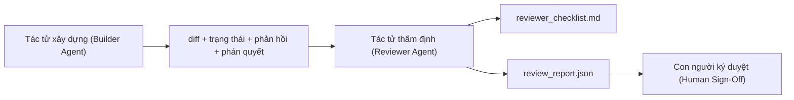

# Tác tử thẩm định: Tách biệt bên xây dựng và bên chấm điểm (Reviewer Agent: Separate Builder from Marker)

> Tác tử viết mã không thể tự chấm điểm cho chính nó. Tác tử thẩm định (reviewer agent) là một vòng lặp thứ hai với prompt hệ thống (system prompt) khác biệt, mục tiêu khác biệt và quyền truy cập chỉ đọc (read-only) đối với mọi thứ mà tác tử xây dựng (builder agent) tạo ra. Khoảng cách giữa bên xây dựng và bên thẩm định chính là nơi phần lớn độ tin cậy được tạo dựng.

**Type:** Xây dựng (Build)
**Languages:** Python (stdlib)
**Prerequisites:** Phase 14 · 38 (Verification Gate)
**Time:** ~55 phút

## Mục tiêu học tập

- Nêu rõ lý do tại sao cùng một tác tử không thể tự đánh giá công việc của mình một cách đáng tin cậy.
- Xây dựng một vòng lặp tác tử thẩm định (reviewer agent loop) tiêu thụ các thành phần tạo tác từ bên xây dựng và xuất ra báo cáo thẩm định có cấu trúc.
- Soạn thảo một tiêu chí chấm điểm (rubric) cho người thẩm định để đánh giá theo các chiều kích cụ thể thay vì cảm tính (vibes).
- Kết nối tác tử thẩm định vào workbench để bước đánh giá của con người được bắt đầu từ một thành phần tạo tác thực thụ.

## Vấn đề đặt ra

Bạn yêu cầu tác tử sửa một lỗi. Nó chỉnh sửa bốn tệp, chạy các bài kiểm thử và báo cáo đã hoàn tất. Cổng xác minh (Phase 14 · 38) xác nhận các tiêu chí nghiệm thu đã chạy và phạm vi được giữ vững. Cổng trả về `passed: true`. Bạn hợp nhất mã. Hai ngày sau, bạn phát hiện ra rằng bản sửa lỗi đó đã giải quyết nhầm nửa còn lại của lỗi.

Nghiệm thu là điều kiện cần nhưng chưa đủ. Tác tử thẩm định sẽ đặt ra những câu hỏi mà quy trình nghiệm thu thông thường không thể hỏi: Bản sửa đổi này có giải quyết đúng vấn đề không? Nó có mở rộng phạm vi mà không gắn cờ cảnh báo không? Nó có ghi lại các giả định đáng lẽ cần bị nghi vấn không? Nó có để lại workbench ở trạng thái mà phiên làm việc tiếp theo có thể tiếp quản trơn tru không?

## Khái niệm cốt lõi



### Tiêu chí chấm điểm của tác tử thẩm định (Reviewer rubric)

Năm chiều kích (dimensions), mỗi chiều kích được chấm từ 0 đến 2 điểm.

| Chiều kích | Câu hỏi đánh giá |
|---|---|
| Độ khớp vấn đề (Problem fit) | Thay đổi có giải quyết nhiệm vụ như đã nêu, chứ không phải một nhiệm vụ lân cận không? |
| Kỷ luật phạm vi (Scope discipline) | Các chỉnh sửa có được giới hạn nghiêm ngặt trong hợp đồng hay hợp đồng đã bị nới rộng một cách có chủ đích? |
| Các giả định (Assumptions) | Tất cả các giả định ngầm có được ghi chép lại ở nơi có thể xem xét được không? |
| Chất lượng xác minh (Verification quality) | Lệnh nghiệm thu có thực sự chứng minh được mục tiêu không, hay nó chỉ chứng minh một phiên bản yếu hơn? |
| Mức độ sẵn sàng bàn giao (Handoff readiness) | Phiên làm việc tiếp theo có thể tiếp quản một cách gọn gàng từ trạng thái hiện tại không? |

Tổng điểm tối đa là 10. Điểm dưới 7 là lỗi mềm (soft fail - cần chỉnh sửa); điểm dưới 5, hoặc bất kỳ chiều kích nào bị điểm 0, là lỗi cứng (hard fail - từ chối).

### Bên thẩm định là một vai trò riêng biệt, không nhất thiết là một mô hình riêng biệt

Bạn có thể chạy tác tử thẩm định với cùng một mô hình nền tảng như tác tử xây dựng. Tính kỷ luật đến từ sự phân tách vai trò: system prompt khác nhau, đầu vào khác nhau, không có quyền ghi đối với bản diff. Sự thay đổi trong tư thế làm việc chính là sự thay đổi trong chất lượng tín hiệu.

### Tác tử thẩm định không thể chỉnh sửa bản diff

Bên thẩm định chỉ đọc bản diff, trạng thái, phản hồi và phán quyết. Nó tạo ra một báo cáo. Nó tuyệt đối không vá (patch) bản diff. Nếu báo cáo yêu cầu "hãy sửa chỗ này", lượt tiếp theo của tác tử xây dựng sẽ thực hiện việc sửa đổi; tác tử thẩm định quay lại nhiệm vụ thẩm định. Việc lẫn lộn vai trò sẽ xóa bỏ khoảng cách kiểm định khách quan.

### Tiêu chí thẩm định đối chiếu với cổng xác minh

Cổng xác minh (Phase 14 · 38) kiểm tra các sự thật mang tính tất định: nghiệm thu đã chạy chưa, các quy tắc có vượt qua không, phạm vi có được giữ vững không. Tác tử thẩm định đưa ra các phán đoán định tính: đây có phải công việc đúng đắn không, nó có được lập tài liệu đầy đủ không, bản bàn giao có dùng được không. Cả hai đều bắt buộc phải có.

```figure
wb-builder-marker
```

## Thực hành xây dựng

`code/main.py` triển khai:

- Một dataclass `ReviewerInputs` đóng gói các thành phần tạo tác mà người thẩm định đọc.
- Bộ chấm điểm rubric với một hàm cho mỗi chiều kích. Mỗi hàm đều mang tính tất định và ở mức giả lập phục vụ bài học; các triển khai thực tế sẽ gọi một LLM.
- Bộ ghi `review_report.json` với năm điểm số thành phần, tổng điểm và phán quyết (`pass`, `soft_fail`, `hard_fail`).
- Hai kịch bản demo: một thay đổi chuẩn mực (clean change) và một thay đổi kiểu "kiểm thử đúng nhưng giải quyết sai vấn đề" (right tests, wrong problem).

Chạy thử:

```bash
python3 code/main.py
```

Đầu ra: hai báo cáo thẩm định được ghi vào đĩa cùng bảng điểm từng chiều kích hiển thị trên console.

## Các mô hình sản xuất trong thực tế

Bằng chứng thực tế: Hệ thống Đánh giá Mã nguồn bằng AI (AI Code Review) của Cloudflare vào tháng 4 năm 2026 đã chạy 131.246 lượt đánh giá trên 48.095 yêu cầu hợp nhất (merge requests) tại 5.169 kho lưu trữ chỉ trong 30 ngày. Thời gian đánh giá trung vị hoàn tất trong 3 phút 39 giây. Tối đa bảy chuyên gia thẩm định chuyên biệt (bảo mật, hiệu năng, chất lượng mã, tài liệu, quản lý phát hành, tuân thủ, Quy chuẩn Kỹ thuật) chạy song song dưới sự điều phối của một Điều phối viên Thẩm định (Review Coordinator) chịu trách nhiệm loại bỏ các phát hiện trùng lặp và đánh giá mức độ nghiêm trọng. Mô hình hàng đầu (top-tier model) được dành riêng độc quyền cho điều phối viên; các chuyên gia chạy trên các tầng mô hình rẻ hơn.

Bốn mô hình giúp kiến trúc này vận hành ở quy mô lớn:

**Bể chuyên gia thẩm định thay vì một tác tử thẩm định duy nhất (Specialist pool, not one big reviewer).** Một người thẩm định với tiêu chí 5 chiều kích hoạt động tốt cho các kho mã cá nhân. Nhưng khi cơ sở mã có các bề mặt trọng yếu về bảo mật, hiệu năng và tài liệu, hãy chia thành các chuyên gia với các prompt nhỏ gọn hơn. Điều phối viên sẽ làm nhiệm vụ khử trùng lặp; các chuyên gia không bao giờ phải chạy toàn bộ rubric. Sự phân tầng mô hình xuất hiện tự nhiên: các chuyên gia rẻ tiền, điều phối viên đắt tiền.

**Giảm thiểu độ lệch như một yêu cầu thiết kế, không phải là bước tối ưu hóa sau cùng (Bias mitigation as design requirement, not optimization).** Các giám khảo LLM bộc lộ bốn độ lệch (biases) có tính hệ thống (Adnan Masood, tháng 4/2026): độ lệch vị trí (position bias - GPT-4 không nhất quán ~40% khi đổi thứ tự (A,B) thành (B,A)), độ lệch dài dòng (verbosity bias - điểm số bị thổi phồng ~15% cho các đầu ra dài hơn), tự ưu tiên (self-preference - giám khảo thích các đầu ra từ cùng họ mô hình của mình), độ lệch uy quyền (authority bias - giám khảo đánh giá quá cao các trích dẫn tác giả nổi tiếng). Các giải pháp giảm thiểu: đánh giá cả hai thứ tự và chỉ tính các chiến thắng nhất quán; sử dụng thang điểm 1-4 khuyến khích rõ ràng tính súc tích; luân chuyển giám khảo giữa các họ mô hình; loại bỏ tên tác giả trước khi chấm điểm.

**Tập chuẩn định thay vì cảm tính (Calibration set, not vibes).** Một tập hợp lịch sử gồm 10-20 nhiệm vụ với các phán quyết chính xác đã biết trước. Chạy tác tử thẩm định trên tập này mỗi khi thay đổi prompt. Nếu độ tương đồng với hồ sơ lịch sử giảm xuống dưới 80%, tiêu chí chấm điểm cần được sửa đổi trước khi tác tử thẩm định được triển khai. Đây là điều mà mọi nhóm kỹ thuật cuối cùng đều tự khám phá lại; tốt nhất là hãy bắt đầu ngay với nó.

**Chuẩn tắc lai kết hợp với cổng xác minh (Hybrid norm with the gate).** Cổng xác minh (Phase 14 · 38) xử lý các kiểm tra tất định (nghiệm thu đã chạy chưa, kiểm thử có vượt qua không, phạm vi có được giữ vững không). Tác tử thẩm định xử lý các kiểm tra ngữ nghĩa (đây có phải công việc đúng không, các giả định có được ghi lại không, bản bàn giao có dùng được không). Hướng dẫn năm 2026 của Anthropic nêu rõ sự phân tách này: đừng yêu cầu người thẩm định làm lại những gì mà cổng xác minh đã chứng minh xong.

## Ứng dụng thực tế

Các mô hình trong môi trường sản xuất:

- **Tác tử phụ Claude Code (Claude Code subagents):** Một tác tử phụ thẩm định chạy sau khi tác tử xây dựng chốt nhiệm vụ. Nó gửi một bình luận lên PR kèm theo điểm số rubric.
- **Bàn giao trong OpenAI Agents SDK (OpenAI Agents SDK handoffs):** Bên xây dựng bàn giao cho Bên thẩm định khi hoàn thành nhiệm vụ. Bên thẩm định có thể bàn giao ngược lại kèm danh sách các phát hiện lỗi hoặc chuyển lên cho con người.
- **Ghép cặp hai mô hình (Two-model pairing):** Tác tử xây dựng chạy trên mô hình nhanh hơn, rẻ hơn. Tác tử thẩm định chạy trên mô hình mạnh mẽ hơn với ngữ cảnh hẹp hơn, tập trung vào khả năng phán đoán.

Tác tử thẩm định là đôi mắt thứ hai mà workbench phát triển khi con người không thể tự mình thực hiện mọi lượt đánh giá.

## Triển khai thành phẩm

`outputs/skill-reviewer-agent.md` tạo ra một rubric thẩm định đặc thù cho dự án, một bản khung tác tử thẩm định được kết nối với các thành phần tạo tác của bên xây dựng và tích hợp với cổng xác minh để quy trình đánh giá của con người bắt đầu từ một báo cáo bằng văn bản thay vì một trang giấy trắng.

## Bài tập thực hành

1. Thêm một chiều kích thứ sáu đặc thù cho miền sản phẩm của bạn. Lập luận tại sao nó không bị hấp thu bởi năm chiều kích hiện có.
2. Chạy tác tử thẩm định với hai system prompt khác nhau (ngắn gọn, dài dòng). Prompt nào tạo ra báo cáo mà con người có nhiều khả năng đọc hơn?
3. Thêm trường `confidence` (độ tin cậy) cho từng chiều kích. Từ chối xuất báo cáo khi độ tin cậy ở chiều kích thấp nhất dưới 0,6.
4. Xây dựng một tập chuẩn định (calibration set): 10 lần chốt nhiệm vụ trong lịch sử với các phán quyết đúng đã biết. Chạy tác tử thẩm định trên tập này. Những điểm nào nó không khớp với hồ sơ lịch sử?
5. Thêm tiện ích "yêu cầu thêm bằng chứng" (request more evidence): bên thẩm định có thể yêu cầu bên xây dựng chạy một bài kiểm thử cụ thể trước khi chấm điểm. Cơ chế lùi bước (back-off) phù hợp là gì để vòng lặp này không bị vô tận?

## Thuật ngữ cốt lõi

| Thuật ngữ | Cách gọi thông thường | Ý nghĩa thực tế |
|---|---|---|
| Tiêu chí thẩm định (Reviewer rubric) | "Danh sách kiểm tra" (Checklist) | Thang chấm 0-2 cho 5 chiều kích với câu hỏi bằng văn bản cho mỗi chiều |
| Lỗi mềm (Soft fail) | "Cần sửa đổi" (Needs revisions) | Tổng điểm dưới 7; bên xây dựng nhận các phát hiện lỗi để xử lý |
| Lỗi cứng (Hard fail) | "Từ chối" (Reject) | Tổng điểm dưới 5 hoặc bất kỳ chiều kích nào bị 0; dừng lại và báo cáo con người |
| Phân tách vai trò (Role separation) | "Prompt khác nhau" (Different prompt) | Cùng một mô hình có thể đóng cả hai vai; tính kỷ luật nằm ở đầu vào và tư thế làm việc |
| Mức sàn độ tin cậy (Confidence floor) | "Không phát báo cáo tín hiệu yếu" (Don't ship low-signal reports) | Từ chối đưa ra phán quyết khi rubric không đủ mức độ chắc chắn |

## Tài liệu đọc thêm

- [OpenAI Agents SDK handoffs](https://openai.github.io/openai-agents-python/handoffs/)
- [Anthropic Claude Code subagents](https://code.claude.com/docs/en/sub-agents)
- [Cloudflare, Orchestrating AI Code Review at Scale](https://blog.cloudflare.com/ai-code-review/) — kiến trúc 7 chuyên gia + điều phối viên, 131k lượt chạy / 30 ngày
- [Agent-as-a-Judge: Evaluating Agents with Agents (OpenReview / ICLR)](https://openreview.net/forum?id=DeVm3YUnpj) — DevAI benchmark, 366 yêu cầu giải pháp phân cấp
- [Adnan Masood, Rubric-Based Evaluations and LLM-as-a-Judge: Methodologies, Biases, Empirical Validation](https://medium.com/@adnanmasood/rubric-based-evals-llm-as-a-judge-methodologies-and-empirical-validation-in-domain-context-71936b989e80) — 4 độ lệch và các giải pháp giảm thiểu
- [MLflow, LLM-as-a-Judge Evaluation](https://mlflow.org/llm-as-a-judge) — bộ công cụ sản xuất cho bên xây dựng/đánh giá tách biệt
- [LangChain, How to Calibrate LLM-as-a-Judge with Human Corrections](https://www.langchain.com/articles/llm-as-a-judge) — quy trình làm việc với tập chuẩn định
- [Evidently AI, LLM-as-a-judge: a complete guide](https://www.evidentlyai.com/llm-guide/llm-as-a-judge)
- [Arize, LLM as a Judge — Primer and Pre-Built Evaluators](https://arize.com/llm-as-a-judge/)
- Phase 14 · 05 — Self-Refine và CRITIC (đường cơ sở tự đánh giá đơn tác tử)
- Phase 14 · 30 — Phát triển tác tử dựa trên đánh giá (bộ tạo tập chuẩn định)
- Phase 14 · 38 — Cổng xác minh mà bên thẩm định đọc dữ liệu
- Phase 14 · 40 — Gói bàn giao mà báo cáo thẩm định cung cấp dữ liệu
