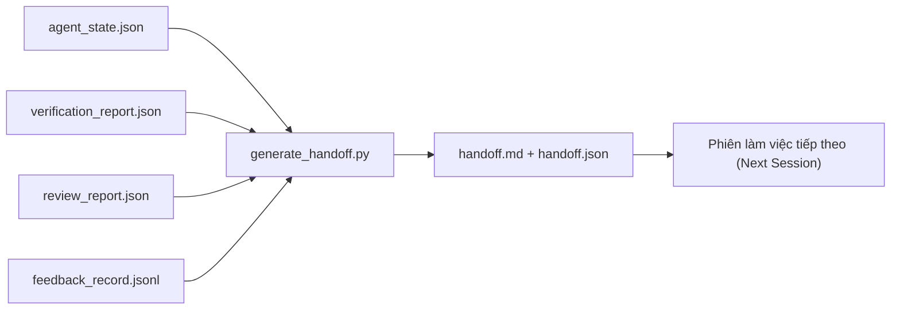

# Bàn giao đa phiên (Multi-Session Handoff)

> Phiên làm việc rồi sẽ kết thúc. Nhưng công việc thì chưa. Gói bàn giao (handoff packet) là thành phần tạo tác giúp biến "tác tử đã làm việc trong một giờ" thành "phiên làm việc tiếp theo đạt năng suất ngay từ phút đầu tiên". Hãy chủ động xây dựng nó như một thành phần có chủ đích, thay vì một ý nghĩ thoáng qua sau cùng.

**Type:** Xây dựng (Build)
**Languages:** Python (stdlib)
**Prerequisites:** Phase 14 · 34 (Repo Memory), Phase 14 · 38 (Verification), Phase 14 · 39 (Reviewer)
**Time:** ~50 phút

## Mục tiêu học tập

- Xác định bảy trường dữ liệu mà mọi gói bàn giao (handoff packet) đều bắt buộc phải có.
- Tạo gói bàn giao từ các thành phần tạo tác của workbench mà không cần phải viết tay các đoạn văn mô tả.
- Cắt gọn (trim) các tệp nhật ký phản hồi dung lượng lớn thành bản tóm tắt có kích thước phù hợp cho bàn giao.
- Đảm bảo hành động đầu tiên của phiên làm việc tiếp theo mang tính tất định.

## Vấn đề đặt ra

Phiên làm việc kết thúc. Tác tử thông báo "tuyệt vời, chúng ta đã đạt được tiến độ". Phiên làm việc tiếp theo mở ra. Tác tử mới hỏi "chúng ta đang dừng lại ở đâu?". Câu trả lời của tác tử trước đã biến mất hoàn toàn. Tác tử mới phải tự tìm hiểu lại từ đầu, chạy lại chính những lệnh đã chạy, hỏi lại con người những câu hỏi cũ và tiêu tốn ba mươi phút chỉ để khôi phục lại trạng thái của ba mươi giây cuối cùng trong phiên trước.

Cái giá của một quy trình bàn giao tồi tệ sẽ phải trả ở mọi phiên làm việc trong suốt vòng đời của nhiệm vụ. Giải pháp là một gói bàn giao được tạo tự động khi phiên kết thúc: những gì đã thay đổi, lý do tại sao, những gì đã thử, những gì thất bại, những gì còn tồn đọng và việc cụ thể cần làm đầu tiên vào lần tới.

## Khái niệm cốt lõi



### Bảy trường dữ liệu trong mỗi gói bàn giao

| Trường | Câu hỏi được giải đáp |
|---|---|
| `summary` | Một đoạn văn tóm tắt những gì đã được thực hiện |
| `changed_files` | Cái nhìn tổng quan nhanh về bản diff |
| `commands_run` | Những lệnh nào đã thực sự được thực thi |
| `failed_attempts` | Những gì đã được thử và lý do tại sao nó không hiệu quả |
| `open_risks` | Những rủi ro nào có thể ảnh hưởng đến phiên tiếp theo, kèm mức độ nghiêm trọng |
| `next_action` | Bước hành động cụ thể đầu tiên mà phiên tiếp theo cần thực hiện |
| `verdict_pointer` | Đường dẫn trỏ tới các báo cáo xác minh và báo cáo thẩm định |

Trường `next_action` là trường chịu tải cốt lõi (load-bearing). Một bản bàn giao có đầy đủ mọi thứ trừ `next_action` chỉ là một báo cáo trạng thái đơn thuần, không phải là một gói bàn giao.

### Gói bàn giao được tạo tự động, không phải viết tay

Một bản bàn giao viết bằng tay là thứ sẽ bị bỏ qua vào những ngày làm việc khó khăn, căng thẳng. Bộ tạo (generator) đọc các thành phần tạo tác của workbench và tự động phát ra gói bàn giao. Nhiệm vụ của tác tử là để lại workbench ở trạng thái mà bộ tạo có thể tóm tắt được, chứ không phải tự ngồi viết bản tóm tắt đó.

### Hai dạng thức: cho con người đọc và cho máy đọc

`handoff.md` là tệp dành cho con người đọc. `handoff.json` là tệp dành cho tác tử tiếp theo tải vào bộ nhớ. Cả hai đều được sinh ra từ cùng một tập thành phần tạo tác nguồn. Nếu có sự sai lệch, dữ liệu JSON sẽ được ưu tiên.

### Cắt gọn nhật ký phản hồi

Tệp nhật ký đầy đủ `feedback_record.jsonl` có thể chứa hàng trăm mục. Gói bàn giao chỉ lưu giữ K mục gần nhất cộng với tất cả các mục có mã thoát khác 0. Phiên tiếp theo có thể tải lại toàn bộ nhật ký nếu cần, nhưng gói bàn giao luôn được giữ ở kích thước nhỏ gọn.

### Để lại một trạng thái sạch sẽ

Một bản bàn giao mô tả công việc. Một trạng thái sạch sẽ giúp công việc có thể tiếp tục được. Chúng không phải là một. Một tệp `handoff.md` hoàn hảo sẽ trở nên vô giá trị nếu phiên tiếp theo mở ra với một bản diff mới áp dụng dở dang, một tệp tạm mà tác tử bỏ quên, một nhánh rẽ lạc lõng và các bài kiểm thử báo lỗi ngay trước khi kịp chạy. Tác tử tiếp theo sau đó sẽ phải dành mười phút đầu tiên để dọn dẹp bãi chiến trường của phiên trước thay vì bắt tay vào xây dựng, và chi phí lãng phí đó sẽ nhân lên ở mỗi phiên trong suốt vòng đời nhiệm vụ.

Do đó, phiên làm việc không kết thúc khi tính năng hoạt động. Nó chỉ kết thúc khi workbench ở trạng thái mà bộ tạo có thể tóm tắt và phiên tiếp theo có thể tin cậy. Dọn dẹp là một giai đoạn riêng biệt, được chạy trước khi bàn giao, và nó là một bước kiểm tra mang tính hệ thống chứ không phải là một thói quen tùy tiện, bởi vì thói quen là thứ dễ bị bỏ qua nhất vào một ngày tồi tệ.

| Kiểm tra | Thế nào là sạch | Tại sao trạng thái bẩn gây tắc nghẽn |
|---|---|---|
| Cây làm việc (Working tree) | Mọi thay đổi đều đã được commit hoặc stash rõ ràng kèm ghi chú | Một bản diff áp dụng dở dang trông giống như công việc có chủ đích đối với tác tử tiếp theo |
| Thành phần tạm (Temp artifacts) | Không còn các tệp `*.tmp`, thư mục nháp (scratch dirs), lệnh in gỡ lỗi (debug prints) hoặc khối mã bị chú thích bỏ sót lại | Các tệp thừa làm ô nhiễm bản diff và làm sai lệch mô hình tư duy của tác tử tiếp theo |
| Kiểm thử (Tests) | Xanh (đạt), hoặc đỏ (thất bại) nhưng lỗi đã được định danh cụ thể trong `open_risks` | Một bài kiểm thử đỏ âm thầm là cái bẫy mà phiên tiếp theo sẽ vấp phải |
| Bảng tính năng (Feature board) | Trạng thái trong `feature_list.json` phản ánh đúng thực tế (Phase 14 · 36) | Một bảng theo dõi lỗi thời sẽ khiến phiên tiếp theo làm lại những việc đã hoàn thành |
| Nhánh (Branch) | Nằm trên nhánh dự kiến, không có HEAD bị tách rời (detached HEAD), không có nhánh mồ côi | Nhánh sai khiến commit đầu tiên của phiên tiếp theo rơi vào nhầm vị trí |

Giai đoạn dọn dẹp sẽ xuất ra một tệp `clean_state.json` ghi lại các vấn đề gây nghẽn; một danh sách rỗng là tiền điều kiện mà bộ tạo bàn giao khẳng định trước khi ghi gói dữ liệu. Một gói bàn giao được dựng trên một cây làm việc bẩn không phải là bàn giao, mà là chuyển tiếp một mớ hỗn độn. Hai thành phần tạo tác này đi đôi với nhau: dọn dẹp chứng minh workbench an toàn để rời đi, còn gói bàn giao đảm bảo phiên tiếp theo biết chính xác nơi cần bắt đầu.

```figure
wb-handoff-packet
```

## Thực hành xây dựng

`code/main.py` triển khai:

- Một bộ nạp tập hợp trạng thái, phán quyết, thẩm định và phản hồi thành một ảnh chụp nhanh duy nhất `WorkbenchSnapshot`.
- Hàm `generate_handoff(snapshot) -> (markdown, payload)`.
- Bộ lọc chọn K mục phản hồi gần nhất cùng tất cả các lần thoát có mã khác 0.
- Lượt chạy demo ghi `handoff.md` và `handoff.json` ngay cạnh tập lệnh.

Chạy thử:

```bash
python3 code/main.py
```

Đầu ra: nội dung bàn giao được in ra màn hình, cùng cả hai tệp được lưu trên đĩa.

## Các mô hình sản xuất trong thực tế

Codex CLI, Claude Code và OpenCode mỗi công cụ đều có cơ chế nén ngữ cảnh (compaction) riêng; gói bàn giao có cấu trúc nằm bên trên cả ba cơ chế này.

**Chiến lược nén ngữ cảnh có thể khác nhau; cấu trúc lược đồ gói dữ liệu thì không (Compaction strategies vary; the packet schema does not).** Lệnh POST /v1/responses/compact của Codex CLI là một khối nhị phân AES mờ đục phía máy chủ (luồng nhanh cho các mô hình OpenAI); phương án dự phòng là một "bản tóm tắt bàn giao" cục bộ được nối vào dưới dạng tin nhắn vai trò người dùng `_summary`. Claude Code chạy cơ chế nén ngữ cảnh tịnh tiến năm giai đoạn khi đạt 95% ngữ cảnh. OpenCode thực hiện ẩn tin nhắn theo dấu thời gian kết hợp bản tóm tắt 5 tiêu đề từ LLM. Ba cơ chế khác nhau nhưng cùng chung một nhu cầu: tuần tự hóa những gì còn sót lại sau nén thành một thành phần tạo tác khả chuyển. Gói bàn giao chính là thành phần tạo tác đó.

**Bàn giao sang phiên mới không phải là nén ngữ cảnh (Fresh-session handoff is not compaction).** Nén ngữ cảnh kéo dài một phiên làm việc; bàn giao đóng gọn gàng một phiên và khởi đầu phiên tiếp theo. Góc nhìn trong Hermes Issue #20372 (tháng 4/2026) rất chuẩn xác: khi việc nén ngữ cảnh tại chỗ bắt đầu làm suy giảm chất lượng, tác tử nên ghi một gói bàn giao cô đọng, kết thúc phiên và tiếp tục lại trong một ngữ cảnh hoàn toàn mới. Gói bàn giao là thứ giúp quá trình chuyển đổi này trở nên ít tốn kém. Sai lầm phổ biến là tiếp tục nén cho đến khi chất lượng sụp đổ; giải pháp đúng là phân bổ ngân sách cho một lần bàn giao sớm và sạch sẽ.

**Một gói bàn giao hoạt động cho mỗi nhánh và chủ đề (One active handoff per branch and topic).** Sự phối hợp giữa nhiều tác tử thường bị phá vỡ do các gói bàn giao cũ kỹ, lỗi thời hơn là do đầu ra mô hình kém. Luôn bao gồm trường `branch`, `last_known_good_commit`, và `status` mang một trong các giá trị `active | superseded | archived`. Các gói bàn giao cũ sẽ được lưu trữ (archived); chỉ gói bàn giao đang hoạt động (active) mới định hướng cho phiên tiếp theo. Đây là điểm khác biệt giữa "bàn giao dưới dạng ghi chú" và "bàn giao dưới dạng trạng thái".

**Khép lại phiên khi đạt 50-75% ngữ cảnh, không đợi chạm trần (Wrap up before 50-75% context, not at the wall).** Cẩm nang về mô hình viết tay (CLAUDE.md + HANDOVER.md) ghi nhận kết quả tốt nhất khi phiên làm việc kết thúc ở mức 50-75% ngân sách ngữ cảnh thay vì 95%. Bộ tạo gói dữ liệu sẽ chạy mượt mà trước khi các thành phần tạo tác do nén làm ô nhiễm trạng thái nguồn. Chi phí tạo bàn giao rất rẻ khi ngữ cảnh còn nguyên vẹn; nhưng sẽ rất đắt khi mô hình đã bắt đầu mất định hướng.

## Ứng dụng thực tế

Các mô hình trong môi trường sản xuất:

- **Hook kết thúc phiên (Session-end hook):** Môi trường chạy kích hoạt bộ tạo khi người dùng đóng cuộc trò chuyện. Gói dữ liệu được đưa vào `outputs/handoff/<session_id>/`.
- **Mẫu PR (PR template):** Tệp markdown của bộ tạo cũng chính là nội dung mô tả của PR. Người đánh giá có thể đọc hiểu mà không cần mở năm tệp khác.
- **Bàn giao chéo tác tử (Cross-agent handoff):** Xây dựng bằng một sản phẩm (Claude Code), tiếp tục bằng một sản phẩm khác (Codex). Gói bàn giao đóng vai trò là ngôn ngữ chung (lingua franca).

Gói dữ liệu nhỏ gọn, có cấu trúc đồng nhất và rất rẻ để sản xuất. Lợi ích tiết kiệm chi phí sẽ nhân lên theo từng phiên làm việc.

## Triển khai thành phẩm

`outputs/skill-handoff-generator.md` tạo ra một bộ sinh được tùy biến theo các đường dẫn thành phần tạo tác của dự án, một hook cuối phiên để thực thi nó và một lược đồ `handoff.json` mà tác tử tiếp theo sẽ nạp khi khởi động.

## Bài tập thực hành

1. Thêm trường `assumptions_to_validate` (các giả định cần kiểm chứng) để làm nổi bật mọi giả định mà bên xây dựng đã ghi nhận nhưng bên thẩm định không chấm điểm trên 1.
2. Cắt gọn bản tóm tắt phản hồi theo cách khác nhau cho các lượt chạy thất bại so với các lượt chạy thành công. Lập luận bảo vệ tính bất đối xứng này.
3. Bổ sung danh sách "câu hỏi dành cho con người". Ngưỡng tiêu chuẩn nào để một câu hỏi được đưa vào gói bàn giao thay vì gửi dưới dạng tin nhắn trò chuyện?
4. Đảm bảo tính lũy thừa (idempotent) cho bộ tạo: chạy hai lần liên tiếp sẽ tạo ra cùng một gói dữ liệu. Những yếu tố nào cần phải duy trì ổn định để đạt được điều này?
5. Thêm phần "tiền điều kiện cho phiên tiếp theo" (next session prereqs) liệt kê chính xác các thành phần tạo tác mà phiên tiếp theo bắt buộc phải nạp trước khi hành động.

## Thuật ngữ cốt lõi

| Thuật ngữ | Cách gọi thông thường | Ý nghĩa thực tế |
|---|---|---|
| Gói bàn giao (Handoff packet) | "Tóm tắt phiên" (Session summary) | Thành phần tạo tác được sinh tự động mang 7 trường dữ liệu, dưới cả dạng markdown và JSON |
| Hành động tiếp theo (Next action) | "Làm gì đầu tiên" (What to do first) | Bước cụ thể duy nhất để khởi đầu phiên làm việc tiếp theo |
| Cắt gọn phản hồi (Feedback trim) | "Tóm tắt nhật ký" (Log summary) | K bản ghi gần nhất cộng với mọi mục thoát có mã khác 0 |
| Báo cáo trạng thái (Status report) | "Những gì đã làm" (What we did) | Tài liệu thiếu trường `next_action`; hữu ích nhưng không phải là một gói bàn giao |
| Con trỏ phán quyết (Verdict pointer) | "Biên lai" (Receipt) | Đường dẫn tới các báo cáo xác minh và thẩm định nhằm phục vụ khả năng truy vết |

## Tài liệu đọc thêm

- [Anthropic, Effective harnesses for long-running agents](https://www.anthropic.com/engineering/effective-harnesses-for-long-running-agents)
- [OpenAI Agents SDK handoffs](https://openai.github.io/openai-agents-python/handoffs/)
- [Codex Blog, Codex CLI Context Compaction: Architecture, Configuration, Managing Long Sessions](https://codex.danielvaughan.com/2026/03/31/codex-cli-context-compaction-architecture/) — POST /v1/responses/compact và phương án dự phòng cục bộ
- [Justin3go, Shedding Heavy Memories: Context Compaction in Codex, Claude Code, OpenCode](https://justin3go.com/en/posts/2026/04/09-context-compaction-in-codex-claude-code-and-opencode) — so sánh cơ chế nén ngữ cảnh của ba nhà cung cấp
- [JD Hodges, Claude Handoff Prompt: How to Keep Context Across Sessions (2026)](https://www.jdhodges.com/blog/ai-session-handoffs-keep-context-across-conversations/) — CLAUDE.md + HANDOVER.md, ngân sách ngữ cảnh 50-75%
- [Mervin Praison, Managing Handoffs in Multi-Agent Coding Sessions: Fresh Context Without Losing Continuity](https://mer.vin/2026/04/managing-handoffs-in-multi-agent-coding-sessions-fresh-context-without-losing-continuity/) — góc nhìn hệ thống phân tán
- [Hermes Issue #20372 — tự động bàn giao sang phiên mới khi nén ngữ cảnh trở nên rủi ro](https://github.com/NousResearch/hermes-agent/issues/20372)
- [Hermes Issue #499 — Đại tu chất lượng nén ngữ cảnh](https://github.com/NousResearch/hermes-agent/issues/499) — các prompt định hướng bàn giao trong Codex CLI
- [Microsoft Agent Framework, Compaction](https://learn.microsoft.com/en-us/agent-framework/agents/conversations/compaction)
- [OpenCode, Context Management and Compaction](https://deepwiki.com/sst/opencode/2.4-context-management-and-compaction)
- [LangChain, Context Engineering for Agents](https://www.langchain.com/blog/context-engineering-for-agents)
- Phase 14 · 34 — Tệp trạng thái mà bộ tạo đọc dữ liệu
- Phase 14 · 38 — Phán quyết xác minh mà gói bàn giao trỏ tới
- Phase 14 · 39 — Báo cáo thẩm định được đóng gói kèm theo
