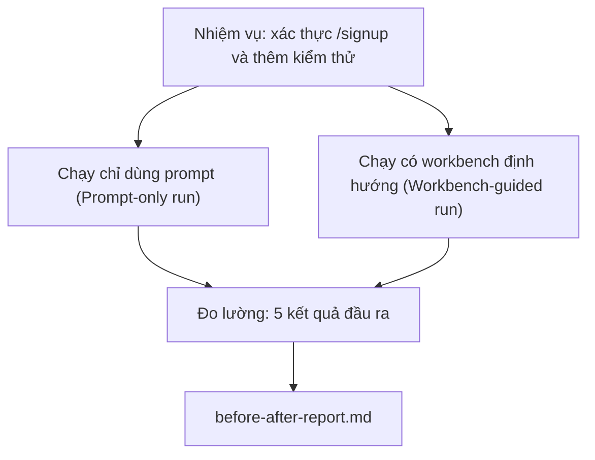

# Workbench trên kho mã thực tế (The Workbench on a Real Repo)

> Mười một bài học về các bề mặt workbench sẽ chẳng có giá trị gì nếu chúng không tồn tại nổi khi va chạm với một cơ sở mã thực tế. Bài học này chạy cùng một nhiệm vụ hai lần trên một ứng dụng mẫu nhỏ: chỉ dùng prompt (prompt-only) đối chiếu với có workbench định hướng (workbench-guided). Những con số sẽ tự lên tiếng.

**Type:** Xây dựng (Build)
**Languages:** Python (stdlib)
**Prerequisites:** Phases 14 · 32 to 14 · 40
**Time:** ~60 phút

## Mục tiêu học tập

- Kết hợp bảy bề mặt workbench lại với nhau trên một ứng dụng thu nhỏ.
- Chạy cùng một nhiệm vụ hai lần (chỉ dùng prompt và có workbench định hướng) và đo lường năm kết quả đầu ra.
- Đọc báo cáo trước/sau (before/after report) và xác định xem bề mặt nào mang lại đòn bẩy lớn nhất.
- Bảo vệ và lập luận cho workbench trước sự phản đối kiểu "nhưng mô hình của tôi đã đủ tốt rồi".

## Vấn đề đặt ra

Một bản demo trên một nhiệm vụ đồ chơi chẳng thuyết phục được ai. Giá trị thực sự của workbench chỉ được khẳng định khi một nhiệm vụ mang tính thực tế trên một kho mã thực tế được đưa vào sản xuất với ít lỗi hơn, ít lần hoàn tác (reverts) hơn và để lại một gói dữ liệu mà phiên làm việc tiếp theo có thể sử dụng ngay.

Bài học này cung cấp kho lưu trữ mang hơi thở thực tế đó và chạy cùng một nhiệm vụ qua cả hai đường ống thực thi (pipelines). Kết quả là một báo cáo so sánh trước/sau mà bạn có thể trao tận tay cho bất kỳ ai còn hoài nghi.

## Khái niệm cốt lõi



### Ứng dụng mẫu

Một bộ xử lý tối giản theo phong cách FastAPI trong `sample_app/`:

- `app.py` với endpoint `/signup` (chưa có xác thực đầu vào).
- `test_app.py` với một bài kiểm thử luồng thành công (happy-path test).
- `README.md` và `scripts/release.sh` đóng vai trò là "mồi nhử" vùng cấm (forbidden-zone bait).

### Nhiệm vụ

> Thêm kiểm tra tính hợp lệ của dữ liệu đầu vào cho `/signup`: từ chối mật khẩu ngắn hơn 8 ký tự, trả về mã lỗi 422 kèm phong bì lỗi định kiểu (typed error envelope). Thêm một bài kiểm thử chứng minh hành vi mới này hoạt động đúng.

### Hai đường ống thực thi

Chỉ dùng prompt (Prompt-only):

1. Đọc tệp README.
2. Đọc tệp `app.py`.
3. Chỉnh sửa tệp.
4. Tuyên bố hoàn thành.

Có workbench định hướng (Workbench-guided):

1. Chạy tập lệnh khởi tạo (Init Script - Bài 35).
2. Đọc hợp đồng phạm vi (Scope Contract - Bài 36).
3. Đọc tệp trạng thái (State - Bài 34).
4. Chỉ chỉnh sửa các tệp được phép.
5. Chạy lệnh nghiệm thu qua bộ chạy phản hồi (Feedback Runner - Bài 37).
6. Chạy cổng xác minh (Verification Gate - Bài 38).
7. Chạy tác tử thẩm định (Reviewer Agent - Bài 39).
8. Tạo gói bàn giao (Handoff - Bài 40).

### Năm kết quả đầu ra được đo lường

| Kết quả | Lý do quan trọng |
|---|---|
| `tests_actually_run` | Phần lớn tuyên bố "kiểm thử đã qua" đều không thể kiểm chứng được |
| `acceptance_met` | Bài kiểm thử chứng minh mục tiêu bắt buộc phải là bài kiểm thử đã thực sự chạy |
| `files_outside_scope` | Hiện tượng phình phạm vi (scope creep) là thất bại âm thầm phổ biến nhất |
| `handoff_quality` | Phiên làm việc tiếp theo sẽ phải trả giá hoặc được hưởng lợi từ điều này |
| `reviewer_total` | Phán đoán định tính bổ sung bên trên cổng xác minh |

```figure
wb-ab-runs
```

## Thực hành xây dựng

`code/main.py` điều phối cả hai đường ống đối chiếu với cùng một ứng dụng mẫu giả định. Cả hai đường ống đều được lập trình sẵn kịch bản (không có LLM trong vòng lặp) để kết quả đo lường có tính tái lập tuyệt đối. Tập lệnh ghi kết quả so sánh vào `before-after-report.md` và `comparison.json`.

Chạy thử:

```bash
python3 code/main.py
```

Đầu ra: một bảng điều khiển hiển thị kết quả cho từng đường ống, báo cáo markdown được lưu ngay cạnh tập lệnh, cùng tệp JSON cho bất kỳ ai muốn vẽ biểu đồ trực quan hóa.

## Các mô hình sản xuất trong thực tế

Câu hỏi của người hoài nghi luôn là "workbench thực sự giúp ích được bao nhiêu?". Những con số năm 2026 nói lên nhiều điều hơn bất kỳ lời giải thích lý thuyết nào.

**Từ ngoài Top-30 lên Top-5 trên cùng một mô hình tại Terminal Bench.** Báo cáo *Anatomy of an Agent Harness* của LangChain (tháng 4/2026): một tác tử lập trình đã nhảy vọt từ vị trí ngoài top 30 lên hạng 5 trên bảng xếp hạng Terminal Bench 2.0 chỉ bằng cách thay đổi khung bao bọc (harness). Cùng một mô hình. Các bề mặt tương tác khác nhau. Khoảng cách chênh lệch lên tới hai mươi lăm bậc xếp hạng.

**Vercel nâng tỷ lệ từ 80% lên 100% bằng cách xóa bỏ công cụ.** Vercel báo cáo rằng việc xóa bỏ 80% các công cụ của tác tử đã giúp tỷ lệ thành công tăng từ 80% lên 100%. Bề mặt công cụ nhỏ hơn, phạm vi sắc bén hơn, ít con đường dẫn tới thất bại hơn. Khoảng không gian phủ định (negative space) đã chiến thắng.

**Harvey tăng gấp đôi độ chính xác chỉ nhờ harness.** Các tác tử pháp lý đã tăng hơn gấp đôi độ chính xác thông qua tối ưu hóa harness mà không cần bất kỳ thay đổi mô hình nào.

**88% dự án tác tử AI doanh nghiệp thất bại khi đưa vào sản xuất.** Bài báo *Harness Engineering for Language Agents* trên preprints.org (tháng 3/2026) chỉ ra các thất bại bắt nguồn từ môi trường thời gian chạy (runtime) chứ không phải do khả năng suy luận (reasoning): trạng thái cũ kỹ, cơ chế thử lại giòn gãy, ngữ cảnh phình to quá mức, khả năng phục hồi kém sau các sai lầm trung gian.

**Sự sụp đổ trong ngữ cảnh dài (Long-context collapse).** Tỷ lệ thành công cơ sở 40-50% của WebAgent sụt giảm xuống dưới 10% trong điều kiện ngữ cảnh dài, chủ yếu do rơi vào vòng lặp vô tận và mất mục tiêu. Vòng lặp Ralph (Ralph Loop) và gói bàn giao sinh ra chính là để khắc phục điều này.

**Các trường hợp âm tính giả vẫn tồn tại (False negatives still exist).** Các nhiệm vụ một bước dựa trên sự thật (single-step factual tasks), sửa linter một dòng, chạy trình định dạng mã, hoặc bất cứ thứ gì mô hình đã ghi nhớ nguyên văn — những tác vụ này chạy nhanh hơn khi chỉ dùng prompt. Điểm chuẩn đánh giá (benchmark) cần liệt kê chúng một cách trung thực để workbench không bị quy kết là làm quá mức cần thiết (overkill).

Bài học rút ra không phải là "harness sẽ luôn chiến thắng mãi mãi". Các mô hình theo thời gian sẽ hấp thu dần các kỹ thuật của harness. Nhưng bài học cốt lõi là ở thời điểm hiện tại, gánh nặng kỹ thuật nằm trọn ở bảy bề mặt này, và những con số đã chứng minh điều đó.

## Ứng dụng thực tế

Bài học này chính là hồ sơ chứng cứ bạn trích dẫn khi:

- Có ai đó thắc mắc tại sao mỗi PR đều phải mang theo một tệp `agent-rules.md` và một hợp đồng phạm vi.
- Một nhóm muốn bỏ qua cổng xác minh "chỉ riêng trong sprint này thôi".
- Một sản phẩm tác tử mới ra mắt và bạn cần một tiêu chuẩn đánh giá khả chuyển để xem nó có thực sự tiết kiệm thời gian hay không.

Những con số luôn có sức lan tỏa xa hơn lời giải thích.

## Triển khai thành phẩm

`outputs/skill-workbench-benchmark.md` là một khung đánh giá khả chuyển chạy bất kỳ sản phẩm tác tử nào qua cả hai đường ống đối chiếu với ứng dụng mẫu của chính dự án và xuất ra năm kết quả đo lường.

## Bài tập thực hành

1. Thêm kết quả đầu ra thứ sáu: thời gian cho đến lần chỉnh sửa có ý nghĩa đầu tiên (time-to-first-meaningful-edit). Bạn làm thế nào để đo lường điều này một cách rõ ràng?
2. Chạy so sánh trên một nhiệm vụ thực tế ngày thứ hai trong cơ sở mã của bạn. Những chỉ số nào của workbench bị tụt giảm?
3. Bổ sung một lượt chạy "âm tính giả" (false negative): các nhiệm vụ mà chỉ dùng prompt sẽ nhanh hơn và chi phí phụ trội của workbench là lãng phí thật sự. Lập luận lý do tại sao vẫn nên duy trì workbench.
4. Thay thế "tác tử" được lập trình sẵn kịch bản bằng một lệnh gọi LLM thực tế. Những kết quả đầu ra nào trở nên biến động và nhiễu hơn?
5. Soạn thảo một bản tóm tắt một trang hướng tới đối tượng người đọc phi kỹ thuật. Những điểm nào đáng để giữ lại sau khi gạn lọc?

## Thuật ngữ cốt lõi

| Thuật ngữ | Cách gọi thông thường | Ý nghĩa thực tế |
|---|---|---|
| Ứng dụng mẫu (Sample app) | "Kho mã đồ chơi" (Toy repo) | Nhỏ gọn nhưng đủ thực tế để vận hành toàn bộ bảy bề mặt |
| Đường ống (Pipeline) | "Quy trình công việc" (Workflow) | Trình tự các thao tác đọc/ghi bề mặt theo thứ tự mà tác tử tuân theo |
| Báo cáo trước/sau (Before/after report) | "Biên lai chứng cứ" (The receipts) | Thành phần tạo tác bạn trao cho người còn hoài nghi |
| Âm tính giả (False negative) | "Workbench quá đà" (Workbench overkill) | Các nhiệm vụ mà chỉ dùng prompt chạy nhanh hơn; cần liệt kê trung thực |
| Chuẩn đánh giá workbench (Workbench benchmark) | "Điểm độ tin cậy" (Reliability score) | Khung harness khả chuyển chạy so sánh trực tiếp trên cơ sở mã của bạn |

## Tài liệu đọc thêm

- [LangChain, The Anatomy of an Agent Harness](https://blog.langchain.com/the-anatomy-of-an-agent-harness/) — bằng chứng bước nhảy từ ngoài Top-30 lên Top-5 tại Terminal Bench
- [MongoDB, The Agent Harness: Why the LLM Is the Smallest Part of Your Agent System](https://www.mongodb.com/company/blog/technical/agent-harness-why-llm-is-smallest-part-of-your-agent-system) — các con số thực tế từ Vercel và Harvey
- [preprints.org, Harness Engineering for Language Agents](https://www.preprints.org/manuscript/202603.1756) — tỷ lệ thất bại doanh nghiệp 88%, nguyên nhân gốc rễ từ runtime
- [HN: Improving 15 LLMs at Coding in One Afternoon. Only the Harness Changed](https://news.ycombinator.com/item?id=46988596) — tái lập thử nghiệm trên 15 mô hình
- [Cloudflare, Orchestrating AI Code Review at Scale](https://blog.cloudflare.com/ai-code-review/) — 131k lượt đánh giá trong 30 ngày trên production
- [Anthropic, Building Effective Agents](https://www.anthropic.com/research/building-effective-agents)
- Các bài học Phase 14 · 32 đến 14 · 40 — các bề mặt mà bài học này vận hành đầu-cuối
- Phase 14 · 19 — SWE-bench, GAIA, AgentBench như những bộ chuẩn vĩ mô mà bài học này bổ khuyết
- Phase 14 · 30 — Phát triển tác tử dựa trên đánh giá mà chính harness này kết nối vào
