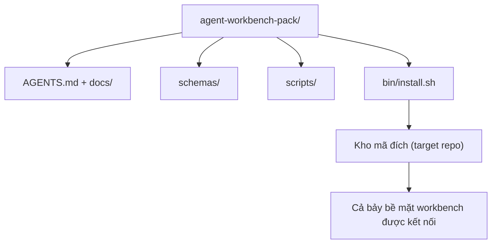

# Dự án tốt nghiệp: Phát hành bộ công cụ Agent Workbench tái sử dụng (Capstone: Ship a Reusable Agent Workbench Pack)

> Chuỗi bài học nhỏ này khép lại với một gói công cụ hoàn chỉnh mà bạn có thể thả vào bất kỳ kho mã nào. Mười một bài học về các bề mặt được cô đọng vào một thư mục mà bạn có thể `cp -r` và có ngay một tác tử hoạt động đáng tin cậy vào sáng hôm sau. Dự án tốt nghiệp này chính là thành phần tạo tác mang lại giá trị thực tiễn cốt lõi của chương trình giảng dạy.

**Type:** Xây dựng (Build)
**Languages:** Python (stdlib)
**Prerequisites:** Phases 14 · 31 to 14 · 41
**Time:** ~75 phút

## Mục tiêu học tập

- Đóng gói toàn bộ bảy bề mặt workbench thành một thư mục cắm-và-chạy (drop-in directory) duy nhất.
- Cố định phiên bản (pin) các lược đồ (schemas), tập lệnh và khuôn mẫu (templates) để kho mã mới luôn có một đường cơ sở tốt đã được chứng thực.
- Bổ sung một tập lệnh cài đặt duy nhất giúp triển khai gói công cụ một cách có tính lũy thừa (idempotently).
- Quyết định những gì nên đưa vào gói và những gì cần giữ lại bên ngoài, lập luận giải thích cho từng lựa chọn.
- Chứng minh một thay đổi kho lưu trữ có sự hỗ trợ của tác tử kèm bằng chứng cụ thể mà người thẩm định có thể tái lập được.

## Vấn đề đặt ra

Một workbench chỉ tồn tại rải rác trong một tệp Google Doc, lịch sử trò chuyện và ba tập lệnh nhớ mang máng là một workbench sẽ bị đập đi xây lại vào mỗi quý. Phương thuốc cứu cánh là một gói có quản lý phiên bản: một kho lưu trữ hoặc thư mục chứa đầy đủ các bề mặt, lược đồ, tập lệnh và một trình cài đặt bằng một lệnh duy nhất.

Bạn sẽ kết thúc bài học này với việc phát hành `outputs/agent-workbench-pack/` trên đĩa cùng một tệp `bin/install.sh` có khả năng thả gói này vào bất kỳ kho mã đích nào.

## Khái niệm cốt lõi



### Bố cục gói công cụ

```text
outputs/agent-workbench-pack/
├── AGENTS.md
├── docs/
│   ├── agent-rules.md
│   ├── reliability-policy.md
│   ├── handoff-protocol.md
│   └── reviewer-rubric.md
├── schemas/
│   ├── agent_state.schema.json
│   ├── task_board.schema.json
│   └── scope_contract.schema.json
├── scripts/
│   ├── init_agent.py
│   ├── run_with_feedback.py
│   ├── verify_agent.py
│   └── generate_handoff.py
├── bin/
│   └── install.sh
└── README.md
```

### Những gì nằm trong gói, những gì nằm ngoài gói

Nằm trong gói:

- Các lược đồ bề mặt (Surface schemas). Chúng là hợp đồng.
- Bốn tập lệnh nêu trên. Chúng là môi trường chạy (runtime).
- Bốn tài liệu hướng dẫn. Chúng là các quy tắc và tiêu chí chấm điểm (rubric).

Nằm ngoài gói:

- Các nhiệm vụ đặc thù của dự án. Nhiệm vụ thuộc về bảng theo dõi của kho mã đích, không thuộc về gói công cụ.
- Các lệnh gọi SDK của nhà cung cấp cụ thể. Gói công cụ hoàn toàn độc lập với framework (framework-agnostic).
- Văn bản hướng dẫn hòa nhập (onboarding prose). Gói công cụ nằm song song với quy trình hòa nhập hiện có của nhóm, chứ không thay thế nó.

### Trình cài đặt

Một tập lệnh ngắn `bin/install.sh` (hoặc `bin/install.py`):

1. Từ chối cài đặt đè lên một gói đã tồn tại nếu không có cờ `--force`.
2. Sao chép gói công cụ vào kho mã đích.
3. Tự động kết nối CI nếu thư mục `.github/workflows/` đã tồn tại.
4. In ra các bước tiếp theo: điền vào bảng nhiệm vụ, thiết lập các lệnh nghiệm thu, chạy tập lệnh khởi tạo.

### Quản lý phiên bản

Gói công cụ mang một tệp `VERSION`. Các thay đổi về lược đồ và tập lệnh đòi hỏi phải di chuyển dữ liệu (migrations) sẽ nâng số hiệu phiên bản chính (major). Các thay đổi chỉ liên quan đến tài liệu sẽ nâng số hiệu bản vá (patch). Tệp `agent_state.json` của kho mã đích sẽ ghi nhận phiên bản gói công cụ mà nó được khởi tạo.

```figure
wb-pack-install
```

## Thực hành xây dựng

`code/main.py` tập hợp gói công cụ vào thư mục `outputs/agent-workbench-pack/` ngay cạnh bài học, được gieo mầm (seeded) từ các lược đồ và tập lệnh từ các bài học trước trong chuỗi bài này cùng các tài liệu bạn đã soạn thảo.

Chạy thử:

```bash
python3 code/main.py
```

Tập lệnh sẽ sao chép và cố định các bề mặt, viết tệp README, in ra cây thư mục của gói và kết thúc với mã 0. Việc chạy lại đảm bảo tính lũy thừa.

## Các mô hình sản xuất trong thực tế

Một gói công cụ chỉ có giá trị nếu nó tồn tại được qua các nhánh rẽ (forks), các đợt cập nhật và sự thay đổi thượng nguồn không mấy thân thiện. Bốn mô hình giúp đạt được điều đó:

**`VERSION` là hợp đồng, không phải công cụ tiếp thị (`VERSION` is the contract, not the marketing).** Nâng phiên bản chính đòi hỏi phải di chuyển trạng thái. Nâng phiên bản phụ đòi hỏi phải chạy lại bộ kiểm tra. Nâng bản vá chỉ tác động tới tài liệu. Trình cài đặt ghi tệp `.workbench-version` vào kho mã đích ở mỗi lần cài đặt; `lint_pack.py` từ chối phát hành nếu tệp khóa của kho mã đích không khớp với `VERSION` của gói. Đây là cách mà `npm`, `Cargo`, và `pyproject.toml` tồn tại qua 10 năm biến động; bản chất của tác tử không hề thay đổi các quy tắc này.

**Một nguồn duy nhất cho việc phân phối đa công cụ (Single source for cross-tool distribution).** Nx phát hành một lệnh duy nhất `nx ai-setup` triển khai `AGENTS.md`, `CLAUDE.md`, `.cursor/rules/`, `.github/copilot-instructions.md`, và một máy chủ MCP từ một cấu hình duy nhất. Gói công cụ này cũng nên làm tương tự; trình cài đặt tạo ra các liên kết tượng trưng (symlinks - ví dụ `ln -s AGENTS.md CLAUDE.md`) để một nguồn chân lý duy nhất được tỏa ra tới mọi tác tử lập trình. Chia tách gói để hỗ trợ riêng lẻ một công cụ này thay vì công cụ khác là một dạng thức thất bại.

**Tập lệnh gỡ cài đặt `uninstall.sh` từ chối khi trạng thái không rỗng (`uninstall.sh` that refuses on non-trivial state).** Việc gỡ cài đặt gói tuyệt đối không được xóa `agent_state.json`, `task_board.json`, hoặc `outputs/` của người dùng. Trình gỡ cài đặt sẽ loại bỏ các lược đồ, tập lệnh, tài liệu và `AGENTS.md` (với tùy chọn `--keep-agents-md` để giữ lại) và từ chối tiếp tục nếu các tệp trạng thái có bất kỳ thay đổi nào chưa được commit. Trạng thái thuộc quyền sở hữu của người dùng; gói công cụ không sở hữu nó.

**Kỹ năng có thể phát hành theo phong cách SkillKit (Skill-as-publishable, SkillKit-style distribution).** Gói công cụ được phát hành dưới dạng một kỹ năng SkillKit: `skillkit install agent-workbench-pack` triển khai nó trên 32 tác tử AI từ một nguồn duy nhất. Kho lưu trữ của gói là nguồn chân lý; SkillKit là kênh phân phối. Sự phụ thuộc khóa chặt nhà cung cấp (vendor lock-in) biến mất; cả bảy bề mặt vẫn giữ nguyên vẹn.

## Ứng dụng thực tế

Ba nơi mà gói công cụ có thể được phát hành:

- **Dưới dạng thư mục thả trực tiếp vào kho mã:** `cp -r outputs/agent-workbench-pack /duong/dan/toi/repo`.
- **Dưới dạng kho mẫu công khai (public template repo):** Phân nhánh và tùy biến (fork-and-customize), với `VERSION` kiểm soát độ trôi dạt.
- **Dưới dạng một kỹ năng SkillKit:** Được kết nối vào sản phẩm tác tử của bạn để một lệnh duy nhất có thể thiết lập toàn bộ.

Gói công cụ là công thức. Mỗi lần cài đặt là một phần ăn hoàn chỉnh.

## Triển khai thành phẩm

`outputs/skill-workbench-pack.md` tạo ra một gói công cụ được tinh chỉnh riêng cho dự án: các quy tắc được mài sắc dựa trên lịch sử của nhóm, các biểu thức tìm kiếm tệp (scope globs) khớp với cấu trúc repo, các chiều kích rubric được mở rộng thêm một mục đặc thù cho miền bài toán.

## Bài tập thực hành

1. Quyết định xem tài liệu tùy chọn thứ năm nào xứng đáng được nâng cấp vào gói công cụ chuẩn tắc. Lập luận bảo vệ lựa chọn đó.
2. Viết lại trình cài đặt bằng Python có thêm cờ `--dry-run`. So sánh sự tiện dụng khi trải nghiệm thực tế so với bash.
3. Bổ sung `bin/uninstall.sh` giúp gỡ bỏ gói công cụ an toàn và từ chối nếu các tệp trạng thái có lịch sử dữ liệu quan trọng. Yếu tố nào được định nghĩa là "lịch sử dữ liệu quan trọng" (non-trivial)?
4. Thêm `lint_pack.py` phát hiện lỗi khi gói bị trôi dạt lệch khỏi `VERSION`. Kết nối nó vào CI của chính kho mã lưu trữ gói.
5. Soạn thảo sổ tay hướng dẫn di chuyển (migration runbook) từ một workbench tự phát bằng tay sang gói công cụ chuẩn này. Thứ tự các bước thực hiện như thế nào để giảm thiểu tối đa thời gian gián đoạn (downtime)?

## Thực hành nghề nghiệp: Chứng minh một thay đổi kho lưu trữ (Career Practice: Prove One Repository Change)

Bản demo đóng gói chứng minh rằng bộ lắp ráp (assembler) chạy và tạo ra các tệp. Nó không chứng minh rằng tác tử của bạn có thể hoàn thành một nhiệm vụ mới, rằng các kiểm tra được tạo ra chứng minh được nhiệm vụ đó, hay một hệ thống được triển khai sẽ hoạt động trơn tru. Hãy luôn phân tách rạch ròi các tuyên bố đó.

Hãy chọn một nhiệm vụ thực tế nhỏ trong một kho mã bạn sở hữu hoặc có quyền thay đổi. Sử dụng một tác tử lập trình mà bạn đã có quyền truy cập. Một bản sửa lỗi, một tính năng có phạm vi giới hạn hoặc một cải tiến vận hành là đủ; việc cài đặt nhiều tác tử không thuộc phạm vi bài tập này.

Hãy phân bổ một phiên làm việc riêng biệt ngoài bài thực hành đóng gói. Sao chép mẫu bằng chứng được liên kết bên dưới vào thư mục `learning-artifacts/` của chính bạn. Hãy giữ nguyên mẫu và gói đã được đưa vào kho làm tài liệu tham khảo.

### 1. Đóng khung nhiệm vụ và chọn mức độ tự chủ (Frame the task and choose the autonomy)

Sử dụng khung nhiệm vụ từ bài học 43 và kế hoạch bằng chứng từ bài học 44. Ghi lại phiên bản mã bắt đầu, mục tiêu có thể quan sát được, các phi mục tiêu (non-goals), các đường dẫn được phép và bằng chứng nghiệm thu. Xác định rõ người dùng hoặc người vận hành thực tế đang cần hành vi này.

Chọn một chế độ làm việc: các bước có hướng dẫn (guided steps), triển khai theo điểm kiểm tra (checkpointed implementation), hoặc một lượt chạy tự chủ có ranh giới (bounded autonomous run). Giải thích lý do tại sao tính bất định, các hệ quả và khả năng hoàn tác lại biện minh cho lựa chọn này. Một cấu trúc lại cục bộ nhỏ có thể cần ít điểm kiểm tra hơn so với một thay đổi liên quan đến kiểm soát truy cập.

Thiết lập ngân sách thời gian thực tế và giới hạn token hoặc chi phí nếu tác tử có hiển thị thông tin này. Ghi nhận các phép đo chưa khả dụng một cách trung thực. Định nghĩa điều kiện dừng khi gặp lỗi lặp lại, khi đòi hỏi quyền hạn mới, khi cạn kiệt ngân sách hoặc khi gặp một quyết định hợp đồng chưa giải quyết được; chỉ rõ ai có thẩm quyền giải quyết nó.

### 2. Chuẩn bị môi trường hữu ích nhỏ nhất (Prepare the smallest useful environment)

Thu thập triển khai liên quan, bên gọi, bài kiểm thử và các chỉ dẫn cục bộ. Ghi lại lý do tại sao từng nguồn xứng đáng nằm trong ngữ cảnh và bằng chứng hiện tại nào sẽ ghi đè một ghi chú cũ kỹ. Không tải toàn bộ kho mã theo mặc định.

Đưa ra một lựa chọn rõ ràng cho từng phần mở rộng liên quan: một kỹ năng cung cấp một quy trình có thể lặp lại; một công cụ MCP cung cấp quyền truy cập; một hook chạy một kiểm tra tất định; một plugin đóng gói các năng lực. Chỉ giữ lại một phần mở rộng khi nhiệm vụ thực sự cần nó, với mức quyền hạn tối thiểu đủ để nó hoạt động.

Ghi lại chi phí ngữ cảnh hoặc chi phí bảo trì của một bổ sung được đề xuất mà bạn quyết định từ chối. Kiểm tra lại một ký ức hoặc chỉ dẫn cũ kỹ, sau đó cho ngừng hoạt động hoặc thay thế nó trong cấu hình do người học sở hữu khi bằng chứng ủng hộ quyết định đó. Chạy lại kiểm tra bị ảnh hưởng để xác nhận rằng việc loại bỏ không làm mất đi một ràng buộc cần thiết.

### 3. Ghi nhận đường cơ sở và triển khai (Capture the baseline and implement)

Trước khi chỉnh sửa, hãy chạy kiểm tra hiện có gần nhất và thể hiện trạng thái hiện tại của hành vi được yêu cầu. Lưu giữ lệnh, phiên bản mã, kết quả và vị trí lưu bằng chứng. Một tính năng chưa tồn tại vẫn có đường cơ sở: ghi lại phản hồi quan sát được hoặc thao tác không được hỗ trợ.

Để tác tử triển khai bên trong phạm vi hợp đồng. Lưu giữ nhật ký can thiệp (intervention log) kèm lý do cho mỗi lần hiệu chỉnh, thay đổi quyền hoặc sửa đổi kế hoạch. Việc ủy quyền (delegation) là tùy chọn; nếu thấy hữu ích, hãy áp dụng hợp đồng sở hữu và tích hợp từ bài học 45 trước khi thêm một tác tử làm việc khác.

### 4. Thử thách bằng chứng (Challenge the evidence)

Chọn bằng chứng có khả năng quan sát được bề mặt bị thay đổi. Đối với giao diện người dùng (UI), hãy dựng lại và kiểm tra hành trình được phục vụ ở các độ rộng màn hình liên quan. Đối với API, hãy kiểm tra yêu cầu và phản hồi được tuần tự hóa. Đối với CLI, hãy chạy lệnh đã biên dịch và kiểm tra mã thoát cùng đầu ra. Chọn các kiểm tra mà nhiệm vụ của bạn cần và giải thích các giới hạn của chúng.

Viết một kết quả kỳ vọng từ hợp đồng nhiệm vụ một cách độc lập với triển khai của tác tử. Trong một bản sao dùng một lần (disposable copy), hãy cố tình đưa vào một kết quả sai cụ thể, chẳng hạn như chấp nhận một giá trị không hợp lệ hoặc bỏ rơi một trường phản hồi bắt buộc. Chạy chính kiểm tra nghiệm thu đó: nó bắt buộc phải thất bại vì lý do đó.

Nếu nó vẫn xanh (vượt qua), hãy củng cố lại câu lệnh khẳng định (assertion) hoặc cơ chế quan sát trước khi tin tưởng nó. Khôi phục lại triển khai đúng và chạy lại thành công. Lưu giữ cả hai biên lai kết quả. Lỗi cú pháp hoặc thiết lập kiểm thử bị hỏng không được tính là phát hiện hồi quy (detecting the regression).

Xem xét bản diff cuối cùng, bao gồm cả các bài kiểm thử bị thay đổi, đối chiếu với mục tiêu ban đầu và các đường dẫn được phép. Yêu cầu một đồng nghiệp hoặc một phiên tác tử thẩm định riêng biệt thử thách bằng chứng yếu nhất mà không được phép chỉnh sửa triển khai. Bạn vẫn nắm quyền phán quyết cuối cùng; sự đồng ý của một tác tử khác không phải là bằng chứng thực thi.

### 5. Diễn tập vận hành và phục hồi (Rehearse operation and recovery)

Chạy thành phần tạo tác đã thay đổi trong một môi trường cục bộ hoặc môi trường thử nghiệm (staging) dùng một lần. Gắn nhãn cho mọi quan sát là `local`, `staging`, hoặc `live`, đi kèm phiên bản mã chính xác hoặc định danh thành phần tạo tác. Diễn tập cục bộ chỉ hỗ trợ cho tuyên bố cục bộ; bài tập này không bắt buộc phải triển khai lên sản xuất.

Chọn một tín hiệu thất bại liên quan đến nhiệm vụ, một ngưỡng, một cửa sổ quan sát và một người chịu trách nhiệm. Giải thích phản ứng khi vượt ngưỡng đó. Kích hoạt tín hiệu đó một cách an toàn trong buổi diễn tập và lưu giữ nhật ký, số liệu hoặc phản hồi quan sát được.

Diễn tập việc hoàn tác (rollback) về một thành phần tạo tác tốt đã biết và kiểm tra xem hành vi trước đó có được khôi phục hay không. Tính toán đến dữ liệu bền vững khi áp dụng; việc chỉ thay thế tệp nhị phân có thể không đảo ngược được sự thay đổi dữ liệu. Ghi lại bất kỳ bước phục hồi nào bạn không thể xác minh.

### 6. Cải tiến cho lượt chạy tiếp theo và bàn giao (Improve the next run and hand it off)

So sánh kết quả với đường cơ sở, bao gồm thời gian trôi qua, dữ liệu sử dụng khả dụng và các lần can thiệp của con người. Một nhiệm vụ chỉ cho thấy những gì đã diễn ra trên chính nhiệm vụ đó; nó không chứng minh rằng tác tử nhìn chung luôn nhanh hơn hoặc đáng tin cậy hơn.

Thúc đẩy một hiệu chỉnh quan sát được thành một bài kiểm thử, một ranh giới quyền hạn nhỏ hơn, một tác vụ tự động hóa hoặc một ví dụ rõ ràng hơn bằng cách áp dụng bài học 46. Chạy lại kiểm tra bị ảnh hưởng. Loại bỏ các thay đổi tạm thời và nêu rõ nhánh cuối cùng, các tệp bị thay đổi, rủi ro tồn đọng và hành động tiếp theo cho phiên làm việc kế tiếp.

### Tiêu chí đánh giá thủ công (Manual review rubric)

Yêu cầu người thẩm định kiểm tra các tệp bằng chứng và tái lập ít nhất bài kiểm tra nghiệm thu yếu nhất. Sử dụng các trạng thái `đã chứng minh` (demonstrated), `cần sửa đổi` (needs revision), hoặc `chưa xác minh` (unverified) cho mỗi hàng, kèm con trỏ bằng chứng và lý do. Việc điền đầy đủ các trường và các tập lệnh đóng gói chạy thành công không thể thay thế cho các quan sát thực tế này.

| Chiều kích | Bằng chứng người thẩm định cần thử thách |
|---|---|
| Nhiệm vụ và quyền tự chủ | Hành vi bắt đầu, mục tiêu có ranh giới, quyền hạn được biện minh, ngân sách và quy tắc dừng sử dụng được |
| Ngữ cảnh và môi trường | Các nguồn liên quan, quyền truy cập công cụ được biện minh và quyết định cho nghỉ hưu được kiểm tra lại |
| Xác minh | Hành vi thực tế trước/sau và một kết quả sai có chủ đích mà chính kiểm tra đó từ chối |
| Đánh giá và vận hành | Bản diff đã kiểm tra, thử thách độc lập, quan sát thời gian chạy có gắn nhãn và diễn tập phục hồi |
| Lặp lại và bàn giao | Một cải tiến đã xác minh, các giới hạn trung thực, trạng thái cuối sạch sẽ và hành động tiếp theo tái lập được |

Giải quyết dứt điểm các phát hiện `cần sửa đổi` trước khi tuyên bố hoàn thành nhiệm vụ. Giữ nguyên các bằng chứng chưa có là `chưa xác minh` và thu hẹp tuyên bố lại một cách tương ứng. Hồ sơ năng lực (portfolio) này thể hiện năng lực phán đoán kỹ thuật của bạn trên một nhiệm vụ có ranh giới rõ ràng; nó không phải là sự đảm bảo cho việc tuyển dụng hay đưa vào triển khai thực tế.

## Thành phẩm bàn giao

Lưu giữ gói công cụ tái sử dụng và bản sao đã hoàn thành của bạn tại [career-agent-evidence.md](https://github.com/rohitg00/ai-engineering-from-scratch/blob/main/phases/14-agent-engineering/42-agent-workbench-capstone/outputs/career-agent-evidence.md). Biểu mẫu này kết nối khung nhiệm vụ, kế hoạch thực thi, biên lai thời gian chạy, đánh giá thẩm định, diễn tập phục hồi và bản bàn giao thành một nghiên cứu tình huống (case study) hoàn chỉnh có thể xem xét được.

## Thuật ngữ cốt lõi

| Thuật ngữ | Cách gọi thông thường | Ý nghĩa thực tế |
|---|---|---|
| Gói workbench (Workbench pack) | "Bộ khởi động" (The starter kit) | Một thư mục có quản lý phiên bản mang theo toàn bộ bảy bề mặt |
| Trình cài đặt (Installer) | "Tập lệnh thiết lập" (Setup script) | `bin/install.sh` triển khai gói công cụ một cách có tính lũy thừa |
| Phiên bản gói (Pack version) | "VERSION" | Tăng major cho thay đổi schema/script, tăng patch cho riêng tài liệu |
| Gói thả-vào-dùng-ngay (Drop-in pack) | "cp -r là chạy" (cp -r and go) | Gói hoạt động ngay mà không cần tùy biến cho từng repo vào ngày đầu tiên |
| Bản mẫu có thể phân nhánh (Forkable template) | "Mẫu GitHub" (GitHub template) | Kho lưu trữ công khai mà tính năng "Use this template" của GitHub có thể nhân bản |

## Tài liệu đọc thêm

- Các bài học Phase 14 · 31 đến 14 · 41 — toàn bộ các bề mặt mà gói này đóng gói lại
- [SkillKit](https://github.com/rohitg00/skillkit) — cài đặt kỹ năng này trên 32 tác tử AI
- [Nx Blog, Teach Your AI Agent How to Work in a Monorepo](https://nx.dev/blog/nx-ai-agent-skills) — bộ tạo nguồn đơn trên sáu công cụ
- [agents.md — the open spec](https://agents.md/) — những gì bộ định tuyến của gói bạn phải triển khai
- [HKUDS/OpenHarness](https://github.com/HKUDS/OpenHarness) — triển khai tham chiếu tương đương của một gói công cụ
- [Augment Code, A good AGENTS.md is a model upgrade](https://www.augmentcode.com/blog/how-to-write-good-agents-dot-md-files) — chuẩn chất lượng tài liệu cho gói công cụ
- [Anthropic, Effective harnesses for long-running agents](https://www.anthropic.com/engineering/effective-harnesses-for-long-running-agents)
- [Anthropic, Harness design for long-running application development](https://www.anthropic.com/engineering/harness-design-long-running-apps)
- Phase 14 · 30 — Phát triển tác tử dựa trên đánh giá tiêu thụ cổng xác minh của gói
- Phase 14 · 41 — Bộ chuẩn đánh giá trước/sau mà gói này cải tiến dựa trên đó
