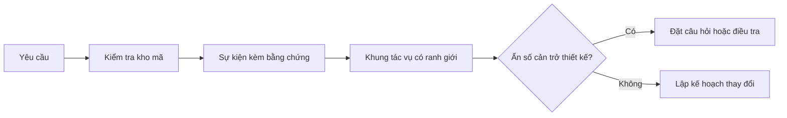

# Định khung Tác vụ Trước khi Agent Viết Mã

> Một coding agent có thể triển khai một tác vụ rõ ràng một cách nhanh chóng. Nó cũng có thể triển khai một tác vụ không rõ ràng một cách nhanh chóng. Tốc độ là như nhau. Nhưng cái giá phải trả thì không.

**Loại hình:** Học tập + Xây dựng (Learn + Build)
**Ngôn ngữ:** Python (thư viện chuẩn - stdlib)
**Điều kiện tiên quyết:** Các bài học 31 và 36 thuộc Phase 14
**Thời lượng:** ~60 phút

## Mục tiêu Học tập

- Chuyển đổi một yêu cầu thành khung tác vụ (task frame) có ranh giới rõ ràng trước khi chỉnh sửa mã.
- Tách biệt các sự kiện thực tế trong kho mã (repository facts) khỏi các giả định và câu hỏi còn bỏ ngỏ.
- Xác định các đường dẫn được phép (allowed paths), đường dẫn cấm (forbidden paths), và bằng chứng nghiệm thu (acceptance evidence).
- Quyết định thời điểm công tác trinh sát (reconnaissance) đã đủ để bắt đầu triển khai công việc.

## Thất bại Tốn kém

"Thêm cơ chế bảo vệ chống trùng lặp email" nghe có vẻ cụ thể. Nhưng thực tế không phải vậy. Tính duy nhất (uniqueness) thuộc về tầng API, dịch vụ miền (domain service), hay cơ sở dữ liệu? Phép so sánh có phân biệt chữ hoa chữ thường không? Định dạng lỗi (error shape) nào đã được công khai ra bên ngoài? Liệu có được phép chạy migration không? Bài kiểm thử (test) nào sẽ chứng minh hành vi đó?

Một agent có năng lực sẽ lấp đầy những khoảng trống đó bằng các lựa chọn nghe có vẻ hợp lý. Đó chính là tình huống nguy hiểm, bởi vì mã triển khai có thể rất sạch sẽ, được kiểm thử đầy đủ, nhưng vẫn hoàn toàn không tương thích với toàn bộ hệ thống.

Do đó, đơn vị công việc đầu tiên của một coding agent không phải là chỉnh sửa mã (edit). Đó là một khung tác vụ được bảo chứng bởi bằng chứng từ kho mã (repository evidence).

## Khung Tác vụ

Một khung tác vụ hữu ích có sáu trường thông tin:

| Trường | Câu hỏi |
|---|---|
| Mục tiêu (Goal) | Hành vi quan sát được (observable behavior) nào bắt buộc phải thay đổi? |
| Sự kiện kho mã (Repository facts) | Bạn đã xác minh được điều gì trong mã nguồn, kiểm thử, cấu hình, hoặc lịch sử git? |
| Đường dẫn được phép (Allowed paths) | Thay đổi được phép nằm ở những đâu? |
| Đường dẫn cấm (Forbidden paths) | Những phần nào tuyệt đối không được chạm vào? |
| Bằng chứng nghiệm thu (Acceptance evidence) | Lệnh hoặc quan sát nào chứng minh mục tiêu đã hoàn thành? |
| Ẩn số (Unknowns) | Những quyết định nào vẫn cần thêm bằng chứng hoặc phán đoán của con người? |

Sự kiện cần có chứng từ xác thực (receipts). "API sử dụng mã trạng thái 409 cho các trường hợp trùng lặp" không phải là một sự kiện cho đến khi bạn có thể chỉ ra bài kiểm thử hoặc hàm xử lý (handler) hiện có. Một đường dẫn tệp kèm số dòng là đủ. Một kết quả chạy lệnh thậm chí còn tốt hơn khi hành vi thực thi đóng vai trò cốt yếu.



## Trinh sát Là Cuộc Tìm kiếm Các Ràng buộc

Đừng đọc toàn bộ kho mã. Hãy tìm kiếm các bề mặt đặt ra ràng buộc (constraints) cho thay đổi:

1. Hành vi hiện tại và hàm/thành phần gọi nó (caller).
2. Bài kiểm thử hiện có gần nhất.
3. Hợp đồng công khai (public contract) hoặc cấu trúc dữ liệu tuần tự hóa (serialized shape).
4. Các hướng dẫn dự án (project instructions) chi phối đường dẫn liên quan.
5. Các câu lệnh biên dịch (build) và kiểm định (verification).
6. Các thay đổi tương tự đã hoàn thành trước đó nhằm phát hiện các mẫu (patterns) cục bộ.

Hãy dừng lại khi mọi quyết định trong kế hoạch đều đã được hỗ trợ bởi bằng chứng, được ủy quyền rõ ràng, hoặc được liệt kê như một ẩn số. Việc tiếp tục đọc mã sau thời điểm đó thường chỉ là sự trì hoãn.

## Ẩn số Không phải là Thất bại

Một ẩn số (unknown) là một khoảng trống có kiểm soát. Một giả định (assumption) là một câu trả lời không kiểm soát cho khoảng trống đó.

Phân loại từng ẩn số:

- **Có thể khám phá (Discoverable):** kho mã hoặc hệ thống đang chạy có thể đưa ra câu trả lời.
- **Có thể quyết định (Decidable):** hợp đồng tác vụ trao quyền cho agent tự lựa chọn.
- **Thuộc con người (Human):** lựa chọn làm thay đổi hành vi sản phẩm, chi phí, rủi ro, hoặc tính tương thích công khai.
- **Trì hoãn (Deferred):** lựa chọn nằm ngoài lát cắt (slice) này và thuộc về mục tiêu không thực hiện (non-goals).

Agent nên tiếp tục tiến hành qua các ẩn số có thể khám phá và được ủy quyền. Nó phải tạm dừng trước các ẩn số thuộc về con người trước khi lựa chọn bị chôn vùi trong mã.

## Nghiệm thu Trước khi Triển khai

Hãy viết bằng chứng trước khi viết bản vá (patch). Bằng chứng có thể là:

- một lệnh kiểm thử đơn vị (unit test) hoặc kiểm thử tích hợp (integration test) trọng tâm;
- một hành trình trình duyệt (browser journey) với kích thước khung nhìn (viewport) xác định và trạng thái kỳ vọng;
- một yêu cầu mạng (wire request) và hợp đồng phản hồi chính xác;
- một phép đo hiệu năng đi kèm ngưỡng giới hạn;
- một kiểm tra phạm vi (scope check) xác nhận không có tệp tin không liên quan nào bị thay đổi.

"Tất cả kiểm thử đều vượt qua (Tests pass)" không phải là một kế hoạch chứng minh. Hãy nêu tên bài kiểm thử có thẩm quyền và tuyên bố mà nó bảo chứng.

## Xây dựng Thực tế

Phần thực hành tạo ra một `TaskFrame`, kiểm tra tính hợp lệ của các ranh giới và bằng chứng, rồi ghi ra `outputs/task-frame.md`.

Chạy từ thư mục bài học này:

```bash
python3 code/main.py
python3 -m unittest discover code/tests -v
```

Hãy làm hỏng ví dụ theo bốn cách: xóa mục tiêu, xóa chứng từ của sự kiện, để chồng lấn giữa đường dẫn được phép và đường dẫn cấm, và xóa lệnh nghiệm thu. Trình xác thực sẽ từ chối từng khung tác vụ vì một lý do khác nhau.

## Áp dụng vào Kho Mã Thực tế

Trước khi yêu cầu một agent chỉnh sửa mã:

1. Viết mục tiêu dưới dạng một hành vi, không phải một thay đổi trên tệp.
2. Ghi lại hai hoặc ba sự kiện kèm theo bằng chứng chính xác.
3. Nêu tập hợp đường dẫn được phép nhỏ nhất có thể.
4. Nêu rõ không gian loại trừ (negative space) một cách rõ ràng.
5. Viết lệnh hoặc quan sát sẽ khép lại tác vụ.
6. Liệt kê các quyết định mà bạn chưa có đủ căn cứ để đưa ra.

Khung tác vụ nên vừa vặn trên một màn hình hiển thị. Nếu không thể, tác vụ đó có thể đang chứa nhiều thay đổi cần được xác minh độc lập.

## Bài tập

1. Định khung một lỗi (bug) thực tế từ một trong các kho mã của bạn mà không đề xuất giải pháp.
2. Tìm một tuyên bố trong khung tác vụ thực chất chỉ là một giả định. Thay thế nó bằng bằng chứng thực tế.
3. Thêm một ẩn số thuộc con người mà câu trả lời cho nó sẽ làm thay đổi hợp đồng công khai.
4. Chia tách một đường dẫn được phép quá rộng thành tập hợp an toàn nhỏ nhất.
5. Thêm một chứng từ phạm vi (scope receipt) vào bằng chứng nghiệm thu.

## Đọc thêm

- [Nuseibeh and Easterbrook, Requirements Engineering: A Roadmap](https://www.cs.toronto.edu/~sme/papers/2000/ICSE2000.pdf), về việc gắn chặt quá trình triển khai với các mục tiêu trong thế giới thực và các ràng buộc không ngừng biến đổi.
- [Yang et al., SWE-agent: Agent-Computer Interfaces Enable Automated Software Engineering](https://arxiv.org/abs/2405.15793), đưa ra bằng chứng cho thấy giao diện xung quanh một coding agent làm thay đổi hiệu quả của nó.

## Điều Bạn Giữ lại

Giữ lại `outputs/task-frame.md`. Đây là đầu vào cho bài học tiếp theo, nơi khung tác vụ sẽ trở thành một kế hoạch thực thi được chứng minh bằng bằng chứng.
