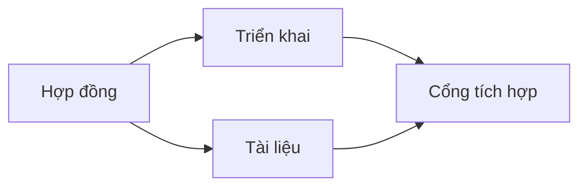

# Xây dựng Kế hoạch Thực thi Được bảo chứng bằng Bằng chứng

> Một kế hoạch không phải là một danh sách việc cần làm (to-do list) được tô vẽ đẹp đẽ hơn. Đó là một đồ thị phụ thuộc (dependency graph), trong đó mọi thay đổi đều có lý do xác đáng và mọi nút kết thúc (terminal node) đều có bằng chứng nghiệm thu rõ ràng.

**Loại hình:** Học tập + Xây dựng (Learn + Build)
**Ngôn ngữ:** Python (thư viện chuẩn - stdlib)
**Điều kiện tiên quyết:** Bài học 43 thuộc Phase 14
**Thời lượng:** ~65 phút

## Mục tiêu Học tập

- Chuyển đổi khung tác vụ thành các hạng mục công việc (work items) đi kèm bằng chứng và phép chứng minh.
- Mô hình hóa thứ tự thực hiện dưới dạng các quan hệ phụ thuộc (dependencies) thay vì chuỗi mô tả tuần tự bằng văn bản xuôi.
- Phát hiện các sự kiện còn thiếu, các quan hệ phụ thuộc không xác định và các chu trình (cycles) trước khi chỉnh sửa mã.
- Phân biệt các bước có thể thực thi đồng thời với các bước bắt buộc phải chờ đợi.

## Tại sao Kế hoạch của Agent Thường Thất bại

Những kế hoạch yếu kém thường chỉ lặp lại yêu cầu ở thì tương lai:

1. Cập nhật API.
2. Thêm bài kiểm thử.
3. Cập nhật tài liệu.

Không có thông tin nào trong danh sách đó cho biết đã phát hiện ra điều gì, tại sao các tệp đó lại chính xác, hợp đồng nào thay đổi trước, hay những công việc nào có thể diễn ra đồng thời. Agent có thể làm theo từng bước mà vẫn tạo ra công việc phải làm lại (rework).

Một kế hoạch vững chắc đưa ra năm cam kết cho mỗi hạng mục công việc:

| Cam kết | Mục đích |
|---|---|
| Định danh (Identifier) | Tham chiếu ổn định phục vụ quan hệ phụ thuộc và bàn giao |
| Thay đổi (Change) | Thay đổi nhỏ nhất về mặt hành vi hoặc hợp đồng |
| Bằng chứng (Evidence) | Các sự kiện trong kho mã biện minh cho thay đổi |
| Quan hệ phụ thuộc (Dependencies) | Phần công việc bắt buộc phải hoàn thành trước |
| Phép chứng minh (Proof) | Phép kiểm tra chính xác dùng để đóng hạng mục |

## Lập Kế hoạch cho Hợp đồng Trước khi Triển khai

Khi nhiều bề mặt phụ thuộc vào cùng một hành vi, hãy định nghĩa hành vi đó trước. Các bài kiểm thử, phần triển khai, tài liệu và bước tích hợp khi đó có thể chia sẻ chung một hợp đồng thay vì tự phát minh ra bốn phiên bản khác nhau.



Đồ thị bộc lộ khả năng đồng thời an toàn. Quá trình triển khai và viết tài liệu có thể tiến hành cùng lúc sau khi hợp đồng đã được cố định. Cổng tích hợp sẽ chờ cả hai hoàn thành.

## Bằng chứng Làm Thay đổi Kế hoạch

Bằng chứng từ kho mã không phải là thứ để trang trí. Nó phải có khả năng làm thay đổi công việc:

- Một hàm trợ giúp (helper) hiện có giúp loại bỏ một lớp trừu tượng mới dự kiến tạo ra.
- Một bài kiểm thử tính tương thích buộc phải bổ sung một bước di chuyển dữ liệu (migration).
- Một ràng buộc triển khai dời thay đổi lược đồ (schema) sang một tác vụ khác.
- Một kiểu phản hồi công khai làm thay đổi thứ tự giữa việc triển khai và viết tài liệu.

Nếu bằng chứng không thể làm thay đổi kế hoạch, thì rất có thể đó không phải là bằng chứng cho quyết định đó.

## Thiết kế Cho Khả năng Bị Gián đoạn

Các phiên làm việc của coding agent có thể kết thúc bất ngờ. Một kế hoạch có thể tiếp tục (resumable plan) cần có các hạng mục công việc đủ nhỏ để một phiên làm việc khác có thể xác định ngay:

- hạng mục nào đã hoàn thành;
- phép chứng minh nào đã chạy;
- những tạo tác (artifacts) nào đã thay đổi;
- những quan hệ phụ thuộc nào hiện đã được gỡ chặn;
- hạng mục an toàn tiếp theo cần thực hiện là gì.

Đừng chỉ mã hóa trạng thái trong các hộp kiểm (checkboxes) bên trong khung chat. Hãy lưu trữ kế hoạch ngay cạnh phần việc đang làm.

## Kiểm định Tính Hợp lệ của Kế hoạch

Hãy từ chối kế hoạch trước khi thực thi khi:

- một mã định danh bị trùng lặp;
- một hạng mục công việc không có bằng chứng;
- một hạng mục công việc không có phép chứng minh;
- một quan hệ phụ thuộc chỉ đến một hạng mục không xác định;
- đồ thị chứa một chu trình lặp (cycle);
- hành động không thể đảo ngược đầu tiên diễn ra trước khi sự không chắc chắn (uncertainty) liên quan được giải quyết.

Năm kiểm tra đầu tiên mang tính cơ học. Kiểm tra cuối cùng đòi hỏi khả năng phán đoán và cần được nêu ra một cách rõ ràng.

## Xây dựng Thực tế

Tệp `code/main.py` mô hình hóa các hạng mục công việc, kiểm tra tính hợp lệ của các chứng từ, tính toán các làn sóng thực thi (execution waves) bằng thuật toán sắp xếp tô-pô (topological sort), và ghi ra `outputs/evidence-plan.json`.

Chạy:

```bash
python3 code/main.py
python3 -m unittest discover code/tests -v
```

Ví dụ này tạo ra ba làn sóng (waves). Việc định nghĩa hợp đồng chạy đầu tiên. Triển khai và viết tài liệu chạy cùng nhau. Cổng tích hợp chạy cuối cùng.

## Sử dụng với Coding Agent

Hãy yêu cầu agent tạo kế hoạch trước khi nó thay đổi các tệp. Đánh giá kế hoạch dựa trên ba yếu tố:

1. Mọi đường dẫn và tuyên bố về hành vi đều có chứng từ xác thực từ kho mã.
2. Mỗi hạng mục đều có một phép chứng minh hoàn thành rõ ràng.
3. Đồ thị trì hoãn những công việc tốn kém hoặc không thể đảo ngược cho đến khi sự không chắc chắn mà nó phụ thuộc được giải quyết xong.

Hãy phê duyệt kế hoạch, chứ không phê duyệt một lời hứa hẹn mơ hồ rằng agent sẽ cẩn thận.

## Bài tập

1. Thêm một hạng mục migration đòi hỏi sự phê duyệt rõ ràng từ con người.
2. Tạo ra một chu trình lặp và giải thích sự bất đồng quan điểm sản phẩm tiềm ẩn đằng sau nó.
3. Tách một hạng mục có chứa hai lệnh chứng minh thành các hạng mục riêng biệt.
4. Thêm một hạng mục công việc có thể chạy trong làn sóng thứ hai mà không chạm vào một trong hai nhánh hiện có.
5. Hiển thị kế hoạch dưới dạng Markdown trong khi vẫn giữ JSON làm nguồn chân lý duy nhất (source of truth).

## Đọc thêm

- [Nuseibeh and Easterbrook, Requirements Engineering: A Roadmap](https://www.cs.toronto.edu/~sme/papers/2000/ICSE2000.pdf), về mối quan hệ lặp đi lặp lại giữa mục tiêu, đặc tả, sự đồng thuận và tiến hóa.
- [Barry Boehm, A Spiral Model of Software Development and Enhancement](https://dl.acm.org/doi/10.1145/12944.12948), về việc sắp xếp thứ tự phát triển xoay quanh việc giải quyết rủi ro thay vì theo một trình tự tuyến tính cố định.

## Điều Bạn Giữ lại

Giữ lại `outputs/evidence-plan.json`. Nó sẽ trở thành hợp đồng ủy quyền trong bài học tiếp theo.
