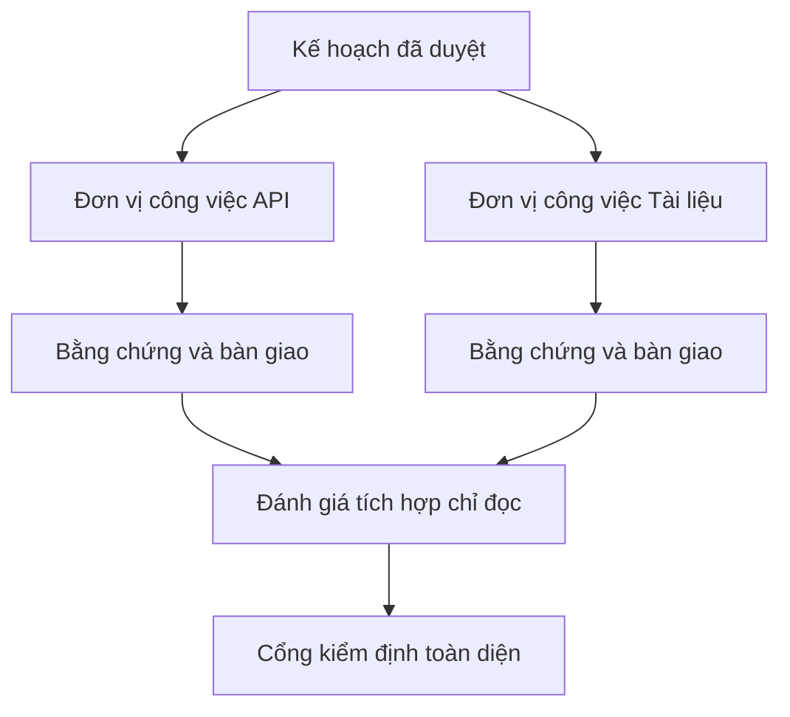

# Ủy quyền Công việc của Agent với Cơ chế Cô lập và Hợp đồng Hợp nhất

> Các agent chạy song song chỉ giúp tiết kiệm thời gian thực tế (wall time) khi các phần việc thực sự độc lập. Nếu không, chúng chỉ biến một tác vụ rõ ràng thành một bài toán điều phối phức tạp với tốc độ thất bại nhanh hơn.

**Loại hình:** Học tập + Xây dựng (Learn + Build)
**Ngôn ngữ:** Python (thư viện chuẩn - stdlib)
**Điều kiện tiên quyết:** Các bài học 39 và 44 thuộc Phase 14
**Thời lượng:** ~70 phút

## Mục tiêu Học tập

- Quyết định xem việc ủy quyền (delegation) có thực sự chính đáng dựa trên tính độc lập thực tế hay không.
- Trao cho mỗi worker quyền sở hữu tệp độc quyền (exclusive file ownership) và bằng chứng nghiệm thu rõ ràng.
- Tính toán các làn sóng thực thi (execution waves) từ các quan hệ phụ thuộc.
- Thiết kế một hợp đồng hợp nhất (merge contract) để kết hợp thành quả của các agent một cách an toàn.

## Bài Kiểm tra Tính Song song

Đừng ủy quyền chỉ vì có sẵn nhiều agent hơn. Chỉ ủy quyền khi có ít nhất một trong các điều kiện sau đây thỏa mãn:

- hai cuộc điều tra có thể trả lời các ẩn số khác nhau một cách độc lập;
- hai phần triển khai nắm quyền sở hữu các tệp và hợp đồng hoàn toàn tách biệt (disjoint);
- một người đánh giá (reviewer) có thể kiểm tra một tạo tác đã hoàn thành mà không làm thay đổi nó;
- một bước kiểm tra chậm từ bên ngoài có thể chạy ngầm trong khi công việc cục bộ vẫn tiếp tục.

Hãy giữ công việc chạy tuần tự (serial) khi các agent cần cùng những tệp tin, cùng một quyết định chưa giải quyết, hoặc cùng một môi trường khả biến (mutable environment).

## Một Đơn vị Công việc Là một Hợp đồng

Mỗi đơn vị được ủy quyền cần có:

| Trường | Ý nghĩa |
|---|---|
| Mục tiêu (Goal) | Một kết quả quan sát được duy nhất |
| Người phụ trách (Owner) | Một worker duy nhất chịu trách nhiệm giải trình |
| Đường dẫn (Paths) | Quyền sở hữu ghi độc quyền (exclusive write ownership) |
| Quan hệ phụ thuộc (Dependencies) | Các đơn vị đã hoàn thành bắt buộc phải có trước khi bắt đầu |
| Phép chứng minh (Proof) | Bằng chứng chính xác trả về cho bộ tích hợp (integrator) |
| Bàn giao (Handoff) | Các tệp đã thay đổi, các quyết định đã đưa ra, rủi ro còn lại |

"Xử lý phần backend" không phải là một đơn vị công việc. "Triển khai bước kiểm tra trùng lặp trong `app/accounts.py` và chứng minh nó bằng bài kiểm thử tài khoản trọng tâm" mới là một đơn vị công việc.

## Ba Tầng Cô lập

1. **Cô lập hệ thống tệp (Filesystem isolation):** các worktree hoặc sandbox tách biệt ngăn chặn các chỉnh sửa chung ngoài ý muốn.
2. **Cô lập quyền sở hữu (Ownership isolation):** các hợp đồng ngăn cản hai worker cố tình chỉnh sửa cùng một đường dẫn.
3. **Cô lập trạng thái (State isolation):** nhật ký (logs) và đầu ra tách biệt ngăn không cho worker này ghi đè lên bằng chứng của worker khác.

Sự cô lập hệ thống tệp không giải quyết được vấn đề quyền sở hữu. Hai worktree hoàn toàn sạch sẽ vẫn có thể tạo ra các thiết kế xung đột nhau. Hợp đồng hợp nhất phải giải quyết các giao diện dùng chung (shared interfaces) trước khi công việc bắt đầu.



## Bộ Tích hợp Không Xây dựng lại Toàn bộ Công việc

Bộ tích hợp (integrator) nên:

1. xác nhận từng phần bàn giao khớp với phạm vi được giao phó;
2. đọc kết quả chứng minh thực tế, chứ không chỉ đọc phần tóm tắt của worker;
3. kết hợp các thay đổi theo đúng thứ tự phụ thuộc;
4. chạy cổng kiểm thử tích hợp chéo (cross-unit gate) toàn diện;
5. từ chối bất kỳ sự phình to phạm vi (scope expansion) ngầm nào;
6. ghi lại các xung đột dưới dạng những quyết định mới, thay vì âm thầm tự chỉnh sửa.

Nếu việc tích hợp đòi hỏi phải viết lại phần lớn kết quả của worker, thì sự phân rã ban đầu đã hoàn toàn sai lầm.

## Vai trò của Con người và Agent

Việc ủy quyền không loại bỏ đi khả năng phán đoán của con người. Con người vẫn nắm quyền đối với các lựa chọn làm thay đổi hành vi công khai, rủi ro, quyền hạn, hoặc chi phí không thể đảo ngược. Các agent có thể đảm nhiệm công việc điều tra có ranh giới, triển khai mã, kiểm định và đánh giá.

Đây chính là quyền tự chủ có hiệu chuẩn (calibrated autonomy): hệ thống trao quyền tự do ở những nơi có bằng chứng và khả năng hoàn tác (rollback) mạnh mẽ, đồng thời yêu cầu điểm kiểm soát (checkpoint) ở những nơi có hậu quả lớn.

## Xây dựng Thực tế

Phần thực hành kiểm tra sự chồng lấn đường dẫn, xác thực các quan hệ phụ thuộc, tính toán các làn sóng thực thi an toàn, và ghi ra `outputs/delegation-plan.json`.

Chạy:

```bash
python3 code/main.py
python3 -m unittest discover code/tests -v
```

Hãy thay đổi đơn vị tài liệu (docs unit) để nó sở hữu thư mục `app/`. Kế hoạch sẽ bị chặn vì đường dẫn cha đó chồng lấn với đơn vị API.

## Bài tập

1. Phân rã một thay đổi thực tế thành hai đơn vị công việc độc lập và một bộ tích hợp.
2. Tìm một đề xuất chia tách song song trông có vẻ độc lập nhưng thực chất không phải. Nêu rõ quyết định dùng chung giữa chúng.
3. Thêm một worker nghiên cứu chỉ đọc (read-only) có đầu ra là một bảng sự kiện thực tế.
4. Thêm một cổng hợp nhất (merge gate) kiểm tra tập hợp tệp thay đổi cuối cùng so với tất cả các hợp đồng đơn vị.
5. Định nghĩa một quy tắc hủy bỏ (cancellation rule) cho một worker khi quan hệ phụ thuộc của nó trở nên không hợp lệ.

## Đọc thêm

- [Reid Smith, The Contract Net Protocol](https://doi.org/10.1109/TC.1980.1675516), tài liệu chính thức ban đầu về phân bổ tác vụ phân tán và báo cáo kết quả.
- [Eric Horvitz, Principles of Mixed-Initiative User Interfaces](https://dl.acm.org/doi/10.1145/302979.303030), về việc quyết định thời điểm tự động hóa nên hành động và thời điểm nên trao lại quyền kiểm soát cho con người.

## Điều Bạn Giữ lại

Giữ lại `outputs/delegation-plan.json`. Tệp này ghi lại lý do tại sao việc chia tách là an toàn, ai sở hữu từng đường dẫn, và bước tích hợp bắt buộc phải nhận được bằng chứng gì.
