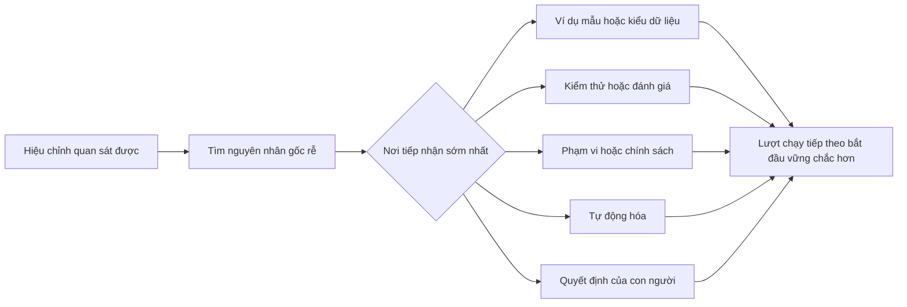

# Biến Mọi Hiệu chỉnh Agent thành Cải tiến Hệ thống

> Một hiệu chỉnh chỉ tồn tại trong khung chat chỉ giải quyết được một lượt chạy duy nhất. Một hiệu chỉnh được nâng cấp thành bài kiểm thử, ranh giới, ví dụ mẫu hoặc công cụ sẽ cải thiện mọi lượt chạy sau này.

**Loại hình:** Học tập + Xây dựng (Learn + Build)
**Ngôn ngữ:** Python (thư viện chuẩn - stdlib)
**Điều kiện tiên quyết:** Các bài học từ 37 đến 41 thuộc Phase 14
**Thời lượng:** ~65 phút

## Mục tiêu Học tập

- Chuyển đổi các hiệu chỉnh (corrections) cho agent thành các biện pháp kiểm soát bền vững (durable controls).
- Đặt từng biện pháp kiểm soát tại tầng sớm nhất có thể ngăn chặn sự tái diễn.
- Loại bỏ trùng lặp các bài học kinh nghiệm được lặp lại bằng các dấu vân tay (fingerprints) ổn định.
- Đào thải (retire) các biện pháp kiểm soát không còn bảo vệ hệ thống trước rủi ro thực tế nào.

## Hiệu chỉnh Là Bằng chứng

Khi bạn nói với agent "đừng chỉnh sửa tệp đó", bạn đã học được rằng ranh giới phạm vi chưa có tính thực thi bằng mã (executable). Khi bạn nói "định dạng đầu ra này bị sai", bạn đã học được rằng đang thiếu một ví dụ mẫu hoặc một bài kiểm thử. Khi quá trình thiết lập môi trường lại thất bại, bạn đã học được rằng tri thức về môi trường thuộc về tầng tự động hóa.

Hãy coi hiệu chỉnh như một quan sát thực tế về toàn bộ hệ thống làm việc, chứ không phải là một thất bại trong việc viết prompt.

## Nâng cấp Lên Tầng Hiệu quả Sớm nhất

Hãy sử dụng thứ tự ưu tiên sau:

| Thất bại tái diễn | Đích đến bền vững |
|---|---|
| Kết quả sai hoặc thoái lui (regression) | Bài kiểm thử (test) hoặc đánh giá (evaluation) |
| Hành động ngoài phạm vi hoặc không an toàn | Chính sách phạm vi hoặc phân quyền (scope/permission policy) |
| Lỗi thiết lập hoặc lệnh lặp đi lặp lại | Tự động hóa hoặc công cụ (automation/tool) |
| Lỗi định dạng đầu ra lặp đi lặp lại | Ví dụ kinh điển (canonical example) kèm trình xác thực |
| Quy ước cục bộ mơ hồ | Chỉ dẫn kèm kiểm tra kịch bản (scenario check) |
| Bất đồng quan điểm về sản phẩm | Hồ sơ quyết định của con người (human decision record) |

Các biện pháp kiểm soát sớm hơn luôn ít tốn kém hơn. Một kiểu dữ liệu (type) ngăn chặn trạng thái không hợp lệ sẽ mạnh hơn một nhận xét đánh giá mã (review comment) phát hiện ra nó sau đó. Một bài kiểm thử trọng tâm sẽ mạnh hơn một đoạn văn bản dài yêu cầu agent phải ghi nhớ.



## Hồ sơ Bánh cóc (The Ratchet Record)

Hãy ghi lại:

- triệu chứng;
- nguyên nhân gốc rễ;
- hậu quả;
- số lần tái diễn;
- biện pháp kiểm soát được chọn;
- phương pháp kiểm định cho biện pháp kiểm soát;
- người phụ trách;
- ngày xem xét hoặc đào thải.

Đừng nâng cấp mọi sở thích nhất thời chỉ xảy ra một lần. Chỉ nâng cấp một hiệu chỉnh khi tần suất tái diễn hoặc mức độ hậu quả biện minh cho sự phức tạp lâu dài được thêm vào hệ thống.

## Tách biệt Nguyên nhân khỏi Triệu chứng

"Agent đã chỉnh sửa tệp README" chỉ là một triệu chứng. Các nguyên nhân tiềm ẩn bao gồm:

- tác vụ cho phép chỉnh sửa từ thư mục gốc của kho mã;
- tài liệu được ngầm hiểu là an toàn để sửa;
- kế hoạch đã gộp chung phần triển khai với phần tài liệu;
- hai worker có quyền sở hữu chồng lấn lên nhau.

Mỗi nguyên nhân sẽ thuộc về một biện pháp kiểm soát khác nhau. Một quy tắc chỉ đơn thuần lặp lại triệu chứng sẽ thất bại ngay trong trường hợp tiếp theo chỉ hơi khác biệt một chút.

## Biện pháp Kiểm soát Cũng Bị Thoái hóa

Các biện pháp kiểm soát cũ có thể xung đột nhau, làm phình to ngữ cảnh (context), và mã hóa một hệ thống vốn dĩ không còn tồn tại. Mọi quy tắc được nâng cấp đều cần một bước kiểm tra đào thải (retirement check). Hãy loại bỏ hoặc viết lại nó khi:

- kiến trúc nền tảng bên dưới đã thay đổi;
- một biện pháp kiểm soát có tính thực thi mạnh hơn đã thay thế nó;
- lỗi đó đã không còn tái diễn trong một khoảng thời gian có ý nghĩa;
- biện pháp kiểm soát tạo ra nhiều trở ngại hơn mức rủi ro mà nó ngăn ngừa.

Mục tiêu không phải là tạo ra một tệp chỉ dẫn dài nhất. Mục tiêu là một hệ thống nhỏ gọn nhất có khả năng bảo toàn những kinh nghiệm phán đoán khó khăn lắm mới đúc kết được.

## Xây dựng Thực tế

Phần thực hành phân loại các hiệu chỉnh, nâng cấp chúng thành các biện pháp kiểm soát, lấy dấu vân tay (fingerprint) các lỗi trùng lặp, và ghi ra `outputs/feedback-ratchet.json`.

Chạy:

```bash
python3 code/main.py
python3 -m unittest discover code/tests -v
```

Hãy thêm hai hiệu chỉnh có cách diễn đạt khác nhau nhưng cùng chung nguyên nhân gốc rễ. Cải thiện bước chuẩn hóa (normalization) cho đến khi chúng được gộp lại thành một biện pháp kiểm soát duy nhất mà không gộp nhầm các lỗi không liên quan.

## Bài tập

1. Lấy năm hiệu chỉnh từ một phiên lập trình gần đây và phân loại đúng nơi tiếp nhận thực sự của chúng.
2. Thay thế một quy tắc viết bằng văn xuôi bằng một bài kiểm thử có thể thực thi.
3. Thêm trọng số hậu quả để một lỗi nghiêm trọng ngay lần đầu tiên xuất hiện cũng có thể được nâng cấp ngay lập tức.
4. Thêm người phụ trách và ngày đào thải vào đầu ra của bài thực hành.
5. Đánh giá một chỉ dẫn agent hiện có và chỉ xóa nó sau khi đã chứng minh rằng một biện pháp kiểm soát mạnh hơn đã tồn tại.

## Đọc thêm

- [Basili, Caldiera, and Rombach, The Goal Question Metric Approach](https://www.cs.toronto.edu/~sme/CSC444F/handouts/GQM-paper.pdf), về việc chuyển đổi các mục tiêu thành câu hỏi và các phép đo lường vận hành.
- [Shinn et al., Reflexion](https://arxiv.org/abs/2303.11366), về việc sử dụng các vết phản hồi (feedback traces) để cải thiện các quyết định sau này mà không cần thay đổi trọng số mô hình.
- [Madaan et al., Self-Refine](https://arxiv.org/abs/2303.17651), về phản hồi lặp đi lặp lại và hiệu chỉnh bên trong một vòng lặp tác vụ.

## Điều Bạn Giữ lại

Giữ lại `outputs/feedback-ratchet.json`. Đây là điểm kết thúc bền vững của lộ trình Kỹ thuật có Agent hỗ trợ (Agent-Assisted Engineering) và là đầu vào cho các thay đổi môi trường làm việc trong tương lai.
