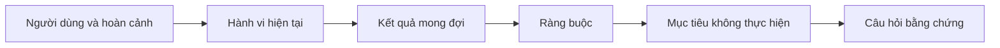

# Xác định Kết quả Mong đợi Trước khi Chọn Đầu ra

> Việc triển khai nhanh chóng chỉ làm tăng thêm cái giá phải trả khi chọn sai vấn đề. Hãy định hình kết quả mong đợi trước để tốc độ phát triển đi đúng hướng.

**Loại hình:** Học tập + Xây dựng (Learn + Build)
**Ngôn ngữ:** Python (thư viện chuẩn - stdlib)
**Điều kiện tiên quyết:** Không có
**Thời lượng:** ~60 phút

## Mục tiêu Học tập

- Viết một khung kết quả mong đợi (outcome frame) mà không đề cập cụ thể đến giải pháp.
- Nhận diện người dùng, hoàn cảnh, hành vi hiện tại và thay đổi mong muốn.
- Làm rõ ràng các ràng buộc (constraints) và các mục tiêu không thực hiện (non-goals).
- Phát hiện sự rò rỉ giải pháp (solution leakage) trước khi nó bị đóng băng thành phạm vi dự án.

## Đầu ra Không phải là Kết quả Mong đợi

"Xây dựng một trợ lý xử lý sự cố (incident assistant)" chỉ nêu tên một đầu ra (output). Nó không cho biết ai cần nó, điều gì sẽ trở nên tốt hơn, hay những gì bắt buộc phải giữ an toàn.

Một khung kết quả mong đợi (outcome frame) sẽ phát biểu:

> Khi có cảnh báo hệ thống production xuất hiện, kỹ sư trực ban (on-call engineer) xác định được dịch vụ gặp sự cố và hành động an toàn tiếp theo trong vòng hai phút, trong khi quá trình chẩn đoán vẫn ở chế độ chỉ đọc và có thể kiểm toán được.

Câu nói đó có thể được đáp ứng bởi một phần mềm, một tài liệu hướng dẫn vận hành (runbook), một bước sửa dữ liệu, hoặc một thay đổi nhỏ trên giao diện. Nó giữ cho đội ngũ gắn chặt với kết quả thực tế thay vì bám lấy tạo tác đầu tiên mà ai đó tưởng tượng ra.

## Khung Sáu Phần

| Thành phần | Câu hỏi |
|---|---|
| Người dùng (User) | Ai là người trực tiếp trải nghiệm vấn đề? |
| Hoàn cảnh (Situation) | Vấn đề xảy ra khi nào và ở đâu? |
| Hành vi hiện tại (Current behavior) | Điều gì đang xảy ra hôm nay, bao gồm cả các giải pháp tình thế (workarounds)? |
| Kết quả mong đợi (Desired outcome) | Trạng thái quan sát được nào cần được cải thiện? |
| Ràng buộc (Constraints) | Những giới hạn cố định nào về an toàn, chính sách, chi phí hoặc tính tương thích? |
| Mục tiêu không thực hiện (Non-goals) | Những phần việc hấp dẫn lân cận nào bị loại trừ? |



## Phát hiện Sự Rò rỉ Giải pháp

Các phát biểu về kết quả mong đợi bị rò rỉ giải pháp (solution leakage) khi chúng chứa hình thức sản phẩm, giao diện, lựa chọn mô hình, framework, hoặc kiến trúc chưa được chứng minh bằng bằng chứng thực tế.

- "Người dùng nhận được bản tóm tắt AI hàng tuần" đã để rò rỉ hình thức tóm tắt và tần suất.
- "Người dùng hiểu rõ các thay đổi trong tài khoản trước khi phê duyệt" nêu đúng kết quả cần đạt.
- "Triển khai một cơ sở dữ liệu vector (vector database)" đã để rò rỉ hạ tầng kỹ thuật.
- "Bằng chứng chính sách liên quan sẵn sàng trong quá trình đánh giá" nêu đúng một năng lực cần có.

Các ràng buộc có thể nêu tên công nghệ cụ thể khi tính tương thích thực sự bắt buộc điều đó. Hãy ghi lại lý do tại sao nó là cố định.

## Ràng buộc Bảo vệ Kết quả Mong đợi

Ràng buộc không phải là chi tiết triển khai. Chúng là một phần của mục tiêu trong thế giới thực:

- không thực hiện thao tác ghi trên production trong quá trình chẩn đoán;
- phản hồi trong phạm vi ngân sách thời gian xử lý sự cố;
- các sự kiện kiểm toán hiện có vẫn giữ nguyên giá trị thẩm quyền;
- không thêm phụ thuộc mới trong lúc chạy (runtime dependency);
- hành vi trợ năng (accessibility) được bảo toàn nguyên vẹn.

Một bản dựng đạt được kết quả mong đợi nhưng vi phạm một ràng buộc thì coi như chưa đạt được kết quả.

## Mục tiêu Không Thực hiện Tạo ra Ranh giới

Mục tiêu không thực hiện (non-goals) ngăn một lát cắt hữu ích biến thành một nền tảng cồng kềnh. Các non-goal tốt phải đủ cụ thể để từ chối các yêu cầu phát sinh:

- không tự động khắc phục sự cố (remediation);
- không xây dựng hệ thống định tuyến cảnh báo mới;
- không thay thế vị trí chỉ huy sự cố (incident commander);
- không phân tích dữ liệu lịch sử trong lát cắt này.

## Xây dựng Thực tế

Phần thực hành kiểm tra tính hợp lệ của một `OutcomeFrame` và ghi ra `outputs/outcome-frame.json`.

```bash
python3 code/main.py
python3 -m unittest discover code/tests -v
```

Hãy thay thế kết quả mong đợi bằng "sử dụng trợ lý sự cố". Trình xác thực sẽ gắn cờ cảnh báo rằng đầu ra được đề xuất đã bị rò rỉ vào kết quả mong đợi.

## Bài tập

1. Viết lại một yêu cầu tính năng (feature request) từ backlog của bạn thành một khung kết quả mong đợi.
2. Thêm một ràng buộc làm thay đổi những giải pháp nào còn khả thi.
3. Thêm hai mục tiêu không thực hiện để giữ cho lát cắt đầu tiên luôn nhỏ gọn.
4. Xác định quan sát sớm nhất có thể bác bỏ kết quả mong đợi.
5. Viết ra ba đầu ra khác nhau có thể cùng thỏa mãn một kết quả mong đợi.

## Đọc thêm

- [Nuseibeh and Easterbrook, Requirements Engineering: A Roadmap](https://www.cs.toronto.edu/~sme/papers/2000/ICSE2000.pdf), về việc coi các mục tiêu trong thế giới thực là điểm tựa cho công việc phần mềm.
- [Dardenne, van Lamsweerde, and Fickas, Goal-Directed Requirements Acquisition](https://doi.org/10.1016/0167-6423(93)90021-G), về việc tinh chỉnh các mục tiêu cấp cao thành các ràng buộc và yêu cầu vận hành.

## Điều Bạn Giữ lại

Giữ lại `outputs/outcome-frame.json`. Bài học tiếp theo sẽ kiểm tra nó dựa trên quy trình làm việc mà con người thực sự thực hiện trong thực tế.
