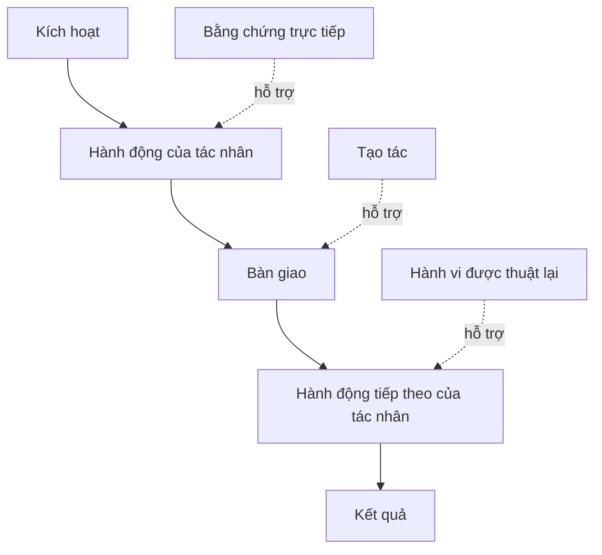

# Khám phá Quy trình Làm việc Thực tế Con người Thực hiện

> Các yêu cầu kỹ thuật (requirements) không ngồi yên trong một cuộc họp chờ được thu thập. Chúng nằm rải rác trên các hành động, các giải pháp tình thế (workarounds), hồ sơ ghi chép và các bất đồng quan điểm.

**Loại hình:** Học tập + Xây dựng (Learn + Build)
**Ngôn ngữ:** Python (thư viện chuẩn - stdlib)
**Điều kiện tiên quyết:** Bài học 47 thuộc Phase 14
**Thời lượng:** ~70 phút

## Mục tiêu Học tập

- Mô hình hóa quy trình làm việc hiện tại dưới dạng các hành động có thứ tự đi kèm bằng chứng.
- Tách biệt quan sát trực tiếp khỏi hành vi được thuật lại hoặc suy diễn.
- Định vị các điểm ma sát (friction), khâu bàn giao (handoffs), thẩm quyền (authority), và trạng thái ẩn (hidden state).
- Giữ cho các tuyên bố không chắc chắn luôn hiển hiện rõ ràng thay vì vội vàng biến chúng thành yêu cầu kỹ thuật.

## Bắt đầu từ Hệ thống Hiện tại

Đừng bắt đầu bằng cách hỏi mọi người muốn những tính năng gì. Hãy bắt đầu bằng cách tái hiện lại những gì đang thực sự diễn ra hôm nay.

Đối với mỗi bước, hãy ghi lại:

| Trường | Ví dụ |
|---|---|
| Tác nhân (Actor) | Kỹ sư trực ban (on-call engineer) |
| Kích hoạt (Trigger) | Cảnh báo hệ thống production xuất hiện |
| Hành động (Action) | Mở cảnh báo, sau đó tìm kiếm trên các bảng điều khiển (dashboards) |
| Đầu vào (Input) | Tải dữ liệu cảnh báo (alert payload) và hồ sơ triển khai (deployment record) |
| Đầu ra (Output) | Dịch vụ nghi vấn và người phụ trách |
| Ma sát (Friction) | Chuyển đổi ngữ cảnh qua lại giữa ba công cụ khác nhau |
| Thẩm quyền (Authority) | Chỉ huy sự cố phê duyệt thao tác ghi |
| Bằng chứng (Evidence) | Bản ghi màn hình, nhật ký sự cố, tài liệu hướng dẫn vận hành (runbook) |

Quy trình làm việc rộng lớn hơn nhiều so với những gì diễn ra trên màn hình. Nó bao gồm thời gian chờ đợi, việc sao chép-dán dữ liệu, các kênh liên lạc phụ, các bước phê duyệt, khôi phục lỗi và cả những bước mà mọi người đã quen đến mức không còn để ý tới.

## Bằng chứng Có Cấp độ Mạnh Yếu

Hãy sử dụng một thang bậc bằng chứng đơn giản:

1. **Hành vi trực tiếp (Direct behavior):** quan sát thực tế, dấu vết thực thi (trace), bản ghi hình hoặc sự kiện hệ thống.
2. **Tạo tác (Artifact):** phiếu yêu cầu (ticket), tài liệu vận hành, nhật ký (log), biểu mẫu hoặc sản phẩm đầu ra đã hoàn thành.
3. **Hành vi được thuật lại (Reported behavior):** một người tự mô tả những gì họ làm.
4. **Suy diễn (Inference):** đội ngũ tự kết luận điều gì có thể xảy ra.

Cả bốn cấp độ đều có thể hữu ích. Tuy nhiên, chỉ hai cấp độ đầu tiên mới chứng minh trực tiếp hành vi hiện tại. Hãy dán nhãn các cấp độ còn lại để mức độ tự tin không bị thổi phồng một cách âm thầm.



## Tìm kiếm Bốn Yếu tố

- **Ma sát (Friction):** nỗ lực lặp đi lặp lại, sự chậm trễ, nhập lại dữ liệu hoặc phục hồi lỗi.
- **Trạng thái ẩn (Hidden state):** các sự kiện chỉ được lưu trong trí nhớ, tin nhắn chat hoặc ghi chú cá nhân.
- **Thẩm quyền (Authority):** người hoặc hệ thống được phép thực hiện một thay đổi mang lại hậu quả quan trọng.
- **Trường hợp ngoại lệ (Exceptions):** tình huống mà quy trình bình thường không còn diễn ra bình thường nữa.

Các tính năng AI thường thất bại ở các khâu bàn giao và các trường hợp ngoại lệ bởi vì kịch bản lý tưởng (happy path) là con đường duy nhất từng được định hình.

## Đừng Xóa nhòa Bất đồng Bằng Phép Trung bình

Hai người dùng có thể thực hiện hai quy trình làm việc khác nhau vì những lý do hoàn toàn chính đáng. Hãy giữ nguyên các biến thể đó cho đến khi bạn hiểu rõ chúng đại diện cho điều gì:

- các vai trò khác nhau;
- các mức độ rủi ro khác nhau;
- quy trình cũ và quy trình hiện tại;
- sự khác biệt về trình độ chuyên môn;
- một sự bất đồng thực sự về chính sách.

Một quy trình làm việc được "tính trung bình" có thể sẽ không mô tả chính xác bất kỳ ai.

## Xây dựng Thực tế

Phần thực hành lưu trữ bằng chứng trên từng bước của quy trình làm việc, kiểm định thứ tự thực hiện và mức độ tự tin, tính toán tỷ lệ bằng chứng trực tiếp, và ghi ra `outputs/workflow-evidence.json`.

```bash
python3 code/main.py
python3 -m unittest discover code/tests -v
```

Hãy thêm một nhánh ngoại lệ trong đó hồ sơ triển khai bị thiếu. Giữ nguyên thứ tự chính và ghi lại nơi nhánh rẽ bắt đầu.

## Bài tập

1. Tái hiện lại một quy trình làm việc từ tệp nhật ký mà không phỏng vấn bất kỳ ai.
2. Phỏng vấn một người dùng và đánh dấu mọi tuyên bố vẫn còn thiếu bằng chứng trực tiếp.
3. Thêm một ranh giới thẩm quyền và một bước phục hồi khi thất bại.
4. Mô hình hóa hai biến thể quy trình làm việc mà không gộp chúng lại với nhau.
5. Xác định một tính năng được đề xuất có khả năng loại bỏ một bước hiển hiện nhưng lại để nguyên các công việc ẩn bên dưới.

## Đọc thêm

- [Nuseibeh and Easterbrook, Requirements Engineering: A Roadmap](https://www.cs.toronto.edu/~sme/papers/2000/ICSE2000.pdf), đặc biệt là phần luận bàn về việc khơi gợi yêu cầu (elicitation) như một quá trình diễn giải, mô hình hóa và kiểm định thay vì chỉ đơn thuần là thu thập.
- [Gotel and Finkelstein, An Analysis of the Requirements Traceability Problem](https://doi.org/10.1109/ICRE.1994.292398), về sự khó khăn trong việc duy trì mối liên hệ truy vết giữa yêu cầu và nguồn gốc của chúng.

## Điều Bạn Giữ lại

Giữ lại `outputs/workflow-evidence.json`. Tệp này sẽ chuyển các điểm ma sát và sự không chắc chắn quan sát được thành một bản đồ giả định (assumption map) trong bài học tiếp theo.
