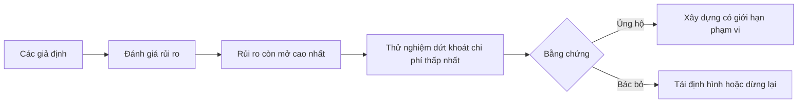

# Lập bản đồ giả định và giải quyết giả định rủi ro nhất trước tiên

> Một lộ trình phát triển (roadmap) thường che giấu sự bất định bên trong các tính năng. Một bản đồ giả định (assumption map) bộc lộ những điều bắt buộc phải đúng trước khi những tính năng đó xứng đáng được triển khai.

**Type:** Learn + Build
**Languages:** Python (stdlib)
**Prerequisites:** Phase 14 lesson 48
**Time:** ~65 phút

## Mục tiêu học tập

- Chuyển đổi công việc được đề xuất thành các giả định tường minh (explicit assumptions).
- Đánh giá riêng biệt mức độ tác động (impact), độ bất định (uncertainty), và tính bất khả đảo (irreversibility).
- Lựa chọn thử nghiệm tiếp theo dựa trên rủi ro kỹ thuật, không phải sự nhiệt tình cảm tính.
- Thay thế các giả định đã qua kiểm thử bằng bằng chứng thực nghiệm và các quyết định dứt khoát.

## Mọi quá trình xây dựng đều chứa đựng các canh bạc

Một công cụ xử lý sự cố (incident tool) có thể phụ thuộc vào tất cả những điều sau đây để thành công:

- ngữ cảnh cảnh báo chứa đủ thông tin để xác định một dịch vụ;
- các kỹ sư tin tưởng một đề xuất mà chính họ không trực tiếp suy luận ra;
- thời gian phản hồi mong muốn có ý nghĩa quan trọng về mặt vận hành;
- dữ liệu cần thiết có thể được truy cập mà không yêu cầu quyền hạn thiếu an toàn;
- quy trình làm việc diễn ra đủ thường xuyên để biện minh cho chi phí bảo trì.

Đây không phải là các nhiệm vụ triển khai kỹ thuật đơn thuần. Chúng là các điều kiện tiên quyết để việc xây dựng mang lại giá trị, khả năng sử dụng, tính khả thi và độ an toàn.

## Các phân lớp giả định

| Phân lớp | Câu hỏi cốt lõi |
|---|---|
| Giá trị (Value) | Kết quả đầu ra có đủ quan trọng hay không? |
| Khả năng sử dụng (Usability) | Người dùng có thể hiểu và hành động dựa trên kết quả đó hay không? |
| Tính khả thi (Feasibility) | Hệ thống có thể tạo ra kết quả với dữ liệu và các ràng buộc hiện có hay không? |
| Khả năng duy trì (Viability) | Tổ chức có thể cáng đáng chi phí, quyền sở hữu và việc vận hành lâu dài hay không? |
| Độ an toàn (Safety) | Hệ thống có thể thất bại mà không gây ra những hậu quả không thể chấp nhận được hay không? |

Hãy viết các giả định dưới dạng các phát biểu có thể bác bỏ được (falsifiable statements). Một câu như "Tính năng này rất hữu ích" là không thể kiểm thử. Nhưng câu "Tám trên mười kỹ sư trực ban (on-call) xác định dịch vụ chính xác nhanh hơn nhờ kết quả chỉ đọc (read-only)" thì hoàn toàn có thể kiểm chứng.

## Rủi ro không phải là một con số đơn lẻ

Phần thực hành này sử dụng ba chiều đánh giá theo thang điểm từ một đến năm:

- **Tác động (Impact):** mức độ thiệt hại nếu giả định là sai.
- **Độ bất định (Uncertainty):** mức độ thiếu hụt hoặc yếu ớt của bằng chứng hiện tại.
- **Tính bất khả đảo (Irreversibility):** chi phí phải trả để học được bài học sau khi đã cam kết nguồn lực.

Điểm số mẫu nhân tác động với độ bất định, sau đó cộng thêm tính bất khả đảo. Công thức này không phải là chân lý phổ quát; mục đích của nó là buộc nhóm phát triển phải nêu rõ lý do tại sao một ẩn số này cần phải được làm sáng tỏ trước một ẩn số khác.



## Thiết kế một thử nghiệm, không phải một nghi thức xác nhận

Một bài kiểm tra hữu ích cần phải có:

- một khẳng định có khả năng bị chứng minh là sai;
- một quần thể hoặc mẫu thử nghiệm thực tế;
- một kết quả có thể quan sát và đo lường được;
- một ngưỡng quyết định được ấn định từ trước khi có kết quả;
- một quyết định tiếp theo rõ ràng tương ứng cho các trường hợp: đạt (pass), trượt (fail), hoặc bằng chứng còn mơ hồ (ambiguous).

Hãy tránh các bài kiểm thử chỉ đơn thuần chứng minh rằng nhóm kỹ sư đủ năng lực kỹ thuật để tạo ra ý tưởng đó.

## Tính bất khả đảo làm thay đổi thứ tự ưu tiên

Những lựa chọn để lại hệ quả lớn và không thể đảo ngược đòi hỏi phải có bằng chứng từ sớm. Một quy trình phát lại chỉ đọc (read-only replay) có thể được tiến hành trước khi tích hợp trực tiếp vào môi trường sản xuất (production). Một bộ điều hợp tạm thời (temporary adapter) có thể được triển khai trước một đợt di chuyển dữ liệu (data migration). Một đề xuất cần con người phê duyệt (human-approved recommendation) có thể đi trước một hành động tự động hóa hoàn toàn.

Hình thái kiến trúc của quá trình xây dựng cần phải bám sát hình thái của sự bất định.

## Xây dựng thực tế

Phần thực hành này xếp hạng các giả định, phân biệt các khẳng định đã được kiểm chứng với các khẳng định còn mở, lựa chọn rủi ro mở cao nhất và xuất ra tệp `outputs/assumption-map.json`.

```bash
python3 code/main.py
python3 -m unittest discover code/tests -v
```

Hãy thay đổi bằng chứng đối với giả định có mức rủi ro cao nhất và quan sát cách thức thử nghiệm tiếp theo tự động điều chỉnh tương ứng.

## Bài tập thực hành

1. Viết năm giả định cho một tính năng mà bạn muốn xây dựng.
2. Bổ sung một giả định an toàn mà danh sách tính năng ban đầu của bạn đã bỏ sót.
3. Xác định một ngưỡng định lượng cụ thể khiến bạn sẽ dừng hẳn quá trình xây dựng.
4. Thay thế một thử nghiệm quy mô lớn bằng một bài kiểm tra mang tính quyết định với chi phí thấp hơn.
5. So sánh thứ tự xếp hạng rủi ro với mức độ ưu tiên trên lộ trình sản phẩm (roadmap) và giải thích sự sai lệch nếu có.

## Tài liệu đọc thêm

- [Barry Boehm, A Spiral Model of Software Development and Enhancement](https://dl.acm.org/doi/10.1145/12944.12948), thảo luận về chu trình phát triển theo định hướng rủi ro nhằm giải quyết sự bất định trước khi đưa ra các cam kết sâu hơn.
- [Dardenne, van Lamsweerde, and Fickas, Goal-Directed Requirements Acquisition](https://doi.org/10.1016/0167-6423(93)90021-G), giới thiệu phương pháp tinh chỉnh mục tiêu kết hợp với việc làm nổi bật các trở ngại và ràng buộc hệ thống.

## Những gì bạn lưu giữ

Hãy lưu lại `outputs/assumption-map.json`. Bài học tiếp theo sẽ sử dụng tệp này để lựa chọn lát cắt nhỏ nhất có thể đem lại bằng chứng mang tính quyết định.
