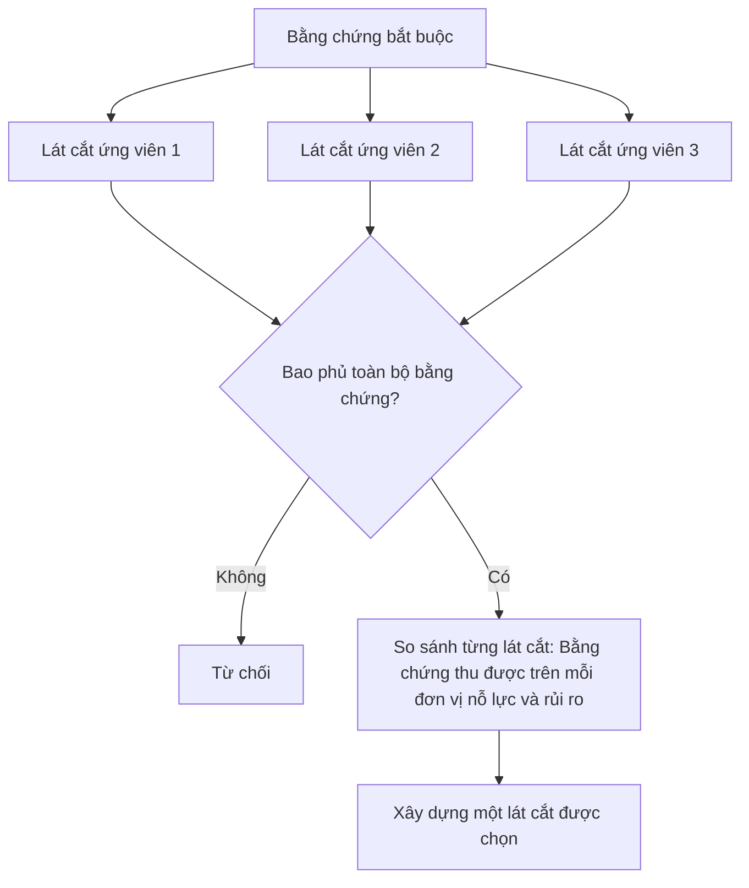

# Lựa chọn lát cắt nhỏ nhất có thể làm thay đổi quyết định

> "Nhỏ" chỉ thực sự hữu ích khi nó chứng minh được một điều gì đó quan trọng. Một bản dựng nhỏ bé không thể làm thay đổi quyết định tiếp theo thì đơn thuần chỉ là một sản phẩm dang dở.

**Type:** Learn + Build
**Languages:** Python (stdlib)
**Prerequisites:** Phase 14 lesson 49
**Time:** ~65 phút

## Mục tiêu học tập

- Định nghĩa một lát cắt (slice) dựa trên các giả định mà nó chứng minh được.
- Cân bằng giữa giá trị kết quả đầu ra (outcome value), mức độ giảm thiểu sự bất định (uncertainty reduction), nỗ lực triển khai (effort), và hậu quả tiềm ẩn (consequence).
- Ưu tiên bằng chứng có thể đảo ngược (reversible evidence) thay vì sớm đưa ra cam kết triển khai lên môi trường sản xuất (production).
- Loại bỏ các lát cắt né tránh phần rủi ro cốt lõi của quy trình công việc (workflow).

## Lát cắt dọc đồng nghĩa với bằng chứng xuyên suốt

Một lát cắt hữu ích phải đi qua quy trình làm việc thực tế tối thiểu cần thiết để quan sát được một kết quả đầu ra. Nó có thể bị thu hẹp về đối tượng người dùng, phạm vi dữ liệu, thời lượng thực thi và năng lực chức năng. Tuy nhiên, nó tuyệt đối không được thu hẹp bằng cách lược bỏ chính sự bất định mà bạn đang cần kiểm nghiệm.

Các ví dụ thực tế:

- Một quy trình phát lại chỉ đọc (read-only replay) trên mười sự cố thực tế giúp kiểm tra khả năng nhận diện dịch vụ và mức độ tin cậy của kỹ sư vận hành.
- Một bảng điều khiển (dashboard) hoàn thiện bóng bẩy dựa trên dữ liệu tổng hợp (synthetic data) có thể kiểm tra khả năng thấu hiểu trực quan, nhưng không kiểm chứng được tính khả thi của dữ liệu.
- Một hệ thống tự động khắc phục sự cố (auto-remediator) chạy thẳng trên môi trường sản xuất sẽ kiểm thử mọi thứ cùng một lúc nhưng lại kéo theo hậu quả rủi ro không thể chấp nhận được.

## Xác định tập bằng chứng bắt buộc trước tiên

Hãy lấy các giả định còn mở có mức độ rủi ro cao nhất và chuyển hóa chúng thành một tập bằng chứng bắt buộc (required proof set). Một lát cắt ứng viên chỉ được coi là hợp lệ (eligible) nếu nó bao phủ trọn vẹn tập bằng chứng đó.

Sau đó, so sánh các lát cắt hợp lệ dựa trên:

| Chiều đánh giá | Hướng ưu tiên |
|---|---|
| Giá trị kết quả đầu ra (Outcome value) | Càng nhiều càng tốt |
| Độ bất định được giảm thiểu (Uncertainty reduced) | Càng nhiều càng tốt |
| Nỗ lực triển khai (Effort) | Càng ít càng tốt |
| Hậu quả rủi ro (Consequence) | Càng ít càng tốt |
| Tính khả đảo (Reversibility) | Càng cao càng tốt |

Điểm số trong phần thực hành được thiết kế đơn giản một cách có chủ đích. Cổng sàng lọc điều kiện hợp lệ mang tính quyết định hơn nhiều so với phép tính số học thuần túy.



## Những "mức tối thiểu sai lầm" phổ biến

- **Mức tối thiểu chỉ tập trung giao diện (UI-only minimum):** loại bỏ sự bất định cốt lõi về mặt dữ liệu và vận hành thực tế.
- **Mức tối thiểu chỉ tập trung hạ tầng (Infrastructure-only minimum):** chứng minh được khả năng kỹ thuật thuần túy nhưng không đem lại giá trị nào cho người dùng.
- **Mức tối thiểu trường hợp thuận lợi (Happy-path minimum):** bỏ qua các ngoại lệ (exceptions) phức tạp vốn là nơi ẩn chứa phần lớn rủi ro.
- **Mức tối thiểu phục vụ bản demo (Demo minimum):** tạo ra một sản phẩm trình diễn đầy tính thuyết phục nhưng không có một phép đo lường nào có khả năng tái lập.
- **Mức tối thiểu nền tảng (Platform minimum):** xây dựng cỗ máy tái sử dụng phức tạp trước khi có dù chỉ một quy trình thực tế chứng minh được tính cần thiết của nó.

## Bổ sung quy tắc dừng

Trước khi bắt tay vào mã hóa, hãy xác định rõ điều gì sẽ xảy ra nếu lát cắt này thất bại:

- từ bỏ kết quả mục tiêu ban đầu;
- thay đổi đối tượng người dùng hoặc bối cảnh áp dụng;
- thử nghiệm một cơ chế kỹ thuật khác;
- thu thập nguồn bằng chứng tốt hơn;
- thu hẹp thẩm quyền (authority) của tác tử sâu hơn nữa.

Nếu bất kỳ kết quả thử nghiệm nào cũng đều dẫn đến kết luận "tiếp tục xây dựng", thì lát cắt đó không phải là một thử nghiệm khoa học chân chính.

## Xây dựng thực tế

Phần thực hành này sàng lọc các ứng viên dựa trên bằng chứng bắt buộc, chấm điểm các lát cắt đủ điều kiện và ghi kết quả vào `outputs/slice-decision.json`.

```bash
python3 code/main.py
python3 -m unittest discover code/tests -v
```

Hãy thêm vào một ứng viên có chi phí thấp hơn nhưng chỉ chứng minh được một giả định bắt buộc. Ứng viên đó bắt buộc phải bị loại bỏ dù cho điểm số bằng số của nó có cao đến đâu.

## Bài tập thực hành

1. Thiết kế ba lát cắt khác nhau cho cùng một kết quả mục tiêu ở các mức độ hậu quả rủi ro khác nhau.
2. Nêu rõ tập bằng chứng bắt buộc trước khi tiến hành chấm điểm các lát cắt.
3. Lược bỏ một tính năng chức năng trong khi vẫn giữ nguyên vẹn bằng chứng mang tính quyết định.
4. Xây dựng một quy tắc dừng (stop rule) cụ thể cho một đợt thử nghiệm thí điểm (pilot) thất bại.
5. Xác định một thành phần nền tảng có thể tái sử dụng mà nên được hoãn lại cho tới sau khi lát cắt hoàn tất.

## Tài liệu đọc thêm

- [Barry Boehm, A Spiral Model of Software Development and Enhancement](https://dl.acm.org/doi/10.1145/12944.12948), bàn luận về việc điều chỉnh từng chu trình phát triển tương thích với các rủi ro mà nó bắt buộc phải giải quyết.
- [Lenarduzzi and Taibi, MVP Explained: A Systematic Mapping Study on the Definitions of Minimal Viable Product](https://arxiv.org/abs/1609.07592), phân tích sự mơ hồ xung quanh hai khái niệm "tối thiểu" (minimum) và "khả thi" (viable) trong thực tiễn phát triển sản phẩm phần mềm.

## Những gì bạn lưu giữ

Hãy lưu lại `outputs/slice-decision.json`. Tệp này ghi nhận lý do tại sao lát cắt được chọn là lát cắt nhỏ nhất có khả năng làm thay đổi quyết định kỹ thuật tiếp theo.
