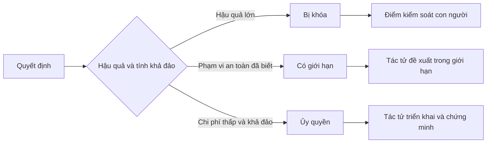

# Viết đặc tả kỹ thuật bảo toàn quyền phán đoán

> Một bản đặc tả kỹ thuật (specification) hữu ích cần cố định các bất biến (invariants) và bằng chứng kiểm chứng, đồng thời mở rộng các lựa chọn triển khai có thể đảo ngược. Nó là một ranh giới quyết định, không phải một kịch bản chi tiết từng lời thoại.

**Type:** Learn + Build
**Languages:** Python (stdlib)
**Prerequisites:** Phase 14 lesson 50
**Time:** ~75 phút

## Mục tiêu học tập

- Tách bạch rõ ràng kết quả đầu ra (outcome), các bất biến (invariants), các ví dụ cụ thể (examples), các mục tiêu ngoài phạm vi (non-goals), và bằng chứng kiểm chứng (proof).
- Phân loại các quyết định kỹ thuật thành: bị khóa (locked), có giới hạn (bounded), hoặc được ủy quyền (delegated).
- Bảo toàn quyền phán đoán (judgment) của tác tử (agent) tại những nơi mà các lựa chọn có chi phí thấp và có thể đảo ngược được.
- Đòi hỏi các điểm kiểm soát có con người can thiệp (human checkpoints) tại những nơi phát sinh hậu quả lớn hoặc làm thay đổi hành vi hướng ra bên ngoài.

## Hai thái cực tiêu cực

Một nhiệm vụ thiếu đặc tả (underspecified) đòi hỏi tác tử phải tự phỏng đoán toàn bộ hệ thống. Ngược lại, một nhiệm vụ bị đặc tả quá mức (overspecified) lại biến tác tử thành một công cụ sao chép cơ học một thiết kế vốn có thể đã sai lầm ngay từ đầu.

Khoảng trung dung hữu ích chính là một hợp đồng có thể thực thi được (executable contract):

| Bề mặt hợp đồng | Mục đích |
|---|---|
| Kết quả đầu ra (Outcome) | Kết quả có thể quan sát và đo lường được |
| Bất biến (Invariants) | Các điều kiện bắt buộc phải luôn luôn duy trì tính đúng đắn |
| Ví dụ (Examples) | Các trường hợp cụ thể làm sáng tỏ ý đồ thiết kế |
| Mục tiêu ngoài phạm vi (Non-goals) | Các hành vi lân cận được chủ động loại trừ |
| Chính sách quyết định (Decision policy) | Những lựa chọn nào bị khóa, có giới hạn hoặc được ủy quyền |
| Bằng chứng (Proof) | Bằng chứng bắt buộc phải có trước khi đánh dấu hoàn tất |

## Ba chế độ ra quyết định

- **Bị khóa (Locked):** tác tử tuyệt đối không được tự ý lựa chọn. Áp dụng cho tính tương thích giao diện công khai, thẩm quyền hệ thống, độ an toàn, chi phí không thể đảo ngược, hoặc các cam kết sản phẩm cốt lõi.
- **Có giới hạn (Bounded):** tác tử có thể lựa chọn bên trong các giới hạn tường minh. Áp dụng cho ngân sách tìm kiếm (search budgets), số lần thử lại (retry counts), danh sách phụ thuộc cho phép, hoặc một họ giao diện đã biết trước.
- **Được ủy quyền (Delegated):** tác tử nắm quyền quyết định và phải giải trình được lựa chọn đó. Áp dụng cho cấu trúc mã nguồn cục bộ, cách đặt tên, các tái cấu trúc có thể đảo ngược, và chi tiết triển khai nội bộ.



## Đặc tả hành vi thông qua các ví dụ

Các ví dụ cô đọng ý định thiết kế tốt hơn nhiều so với việc dùng các tính từ trừu tượng. Các khái niệm như "hữu ích", "vững chắc" (robust), và "sẵn sàng cho môi trường sản xuất" (production-ready) đều không thể thực thi được bằng mã lệnh. Một tập hợp nhỏ bao gồm các ca thông thường, ca biên (edge cases), ca thất bại và ca bị cấm sẽ mang lại cho cả bên xây dựng lẫn bên kiểm định một căn cứ đối chiếu cụ thể.

Các ví dụ không thể thay thế cho các bất biến. Một trường hợp kiểm thử thành công đơn lẻ không bao giờ có thể chứng minh được một quy tắc an toàn phổ quát.

## Bằng chứng phải tương xứng với khẳng định

- Một kiểm thử đơn vị (unit test) chứng minh một hợp đồng hàm ở phạm vi cục bộ.
- Một kiểm thử tầng truyền dẫn (wire test) chứng minh hành vi tuần tự hóa dữ liệu và giao vận mạng.
- Một hành trình trình duyệt (browser journey) chứng minh một luồng giao diện người dùng thực tế.
- Một tập phát lại (replay set) chứng minh hành vi ổn định trên các ca đại diện.
- Một nhật ký kiểm toán (audit log) chứng minh rằng các ranh giới thẩm quyền được giữ vững tuyệt đối.

Không bao giờ được chấp nhận bằng chứng ở một tầng kiến trúc thấp hơn để làm bằng chứng cho một khẳng định ở tầng kiến trúc cao hơn.

## Chủ động bảo toàn các ẩn số

Một bản đặc tả kỹ thuật hoàn toàn có thể ghi rõ: "bản triển khai có thể chọn bất kỳ nguồn dữ liệu chỉ đọc nào có phản hồi bên trong giới hạn thời gian cho phép". Đó không phải là sự mơ hồ. Đó là một quyết định ủy quyền có chủ đích đi kèm với ranh giới an toàn và cơ chế chứng minh rõ ràng.

Các bản đặc tả cần phải tiến hóa khi có thêm bằng chứng mới. Hãy lưu giữ lý do đằng sau các lựa chọn bị khóa và có giới hạn để các đội ngũ kế thừa sau này có thể xem xét điều chỉnh mà không cần phải "khảo cổ" lại mã nguồn.

## Xây dựng thực tế

Phần thực hành này xác thực từng bề mặt hợp đồng, kiểm tra các chế độ ra quyết định và xuất ra tệp `outputs/executable-specification.json`.

```bash
python3 code/main.py
python3 -m unittest discover code/tests -v
```

Hãy thử chuyển quyết định ghi dữ liệu vào môi trường sản xuất (production-write) từ trạng thái bị khóa sang trạng thái được ủy quyền. Hãy giải thích tại sao cấu trúc lược đồ (schema) chấp nhận giá trị đó nhưng phân tích rủi ro sản phẩm lại từ chối nó.

## Bài tập thực hành

1. Chuyển đổi một thẻ công việc (backlog ticket) thành sáu bề mặt hợp đồng đặc tả kỹ thuật.
2. Thay thế ba chỉ dẫn triển khai chi tiết bằng một bất biến duy nhất và hai ví dụ cụ thể.
3. Đánh dấu từng quyết định và giải trình hợp lý cho từng lựa chọn bị khóa hoặc có giới hạn.
4. Bổ sung một chứng từ xác thực bằng chứng (proof receipt) cho từng bất biến.
5. Loại bỏ một ràng buộc kỹ thuật không có căn cứ bằng chứng hoặc không có lý do phân tích rủi ro rõ ràng.

## Tài liệu đọc thêm

- [Nuseibeh and Easterbrook, Requirements Engineering: A Roadmap](https://www.cs.toronto.edu/~sme/papers/2000/ICSE2000.pdf), thảo luận về mối quan hệ giữa các mục tiêu, đặc tả chính xác, quá trình xác thực, sự đồng thuận và tiến hóa yêu cầu phần mềm.
- [Zave and Jackson, Four Dark Corners of Requirements Engineering](https://doi.org/10.1145/237432.237434), phân tích việc tách biệt các giả định môi trường, yêu cầu người dùng, và đặc tả hệ thống.
- [Gotel and Finkelstein, An Analysis of the Requirements Traceability Problem](https://doi.org/10.1109/ICRE.1994.292398), nghiên cứu việc bảo toàn nguồn gốc và lý do tồn tại của các yêu cầu kỹ thuật.

## Những gì bạn lưu giữ

Hãy lưu lại `outputs/executable-specification.json`. Tệp này trở thành bản hợp đồng chung mà các tác tử lập trình và người đánh giá là con người cùng chia sẻ.
