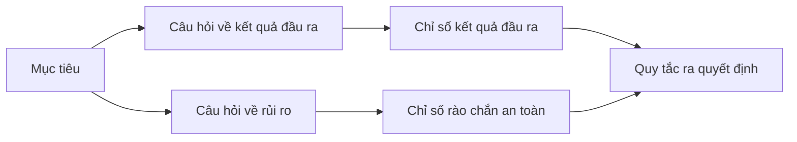

# Thiết kế các chỉ số thành công trước khi có kết quả

> Việc đo lường cần phục vụ cho một quyết định, chứ không phải để trang trí cho bảng điều khiển (dashboard). Hãy bắt đầu từ mục tiêu, suy ra các câu hỏi, sau đó chọn ra các chỉ số tối thiểu có thể trả lời trọn vẹn những câu hỏi đó.

**Type:** Learn + Build
**Languages:** Python (stdlib)
**Prerequisites:** Phase 14 lessons 47 and 51
**Time:** ~70 phút

## Mục tiêu học tập

- Suy ra các câu hỏi và chỉ số đo lường từ một mục tiêu kết quả đầu ra (outcome goal).
- Xác định ngưỡng (thresholds), cửa sổ đo lường (windows), nguồn dữ liệu (sources) và chiều hướng đánh giá (directions) trước khi quan sát kết quả thực tế.
- Kết hợp các chỉ số kết quả đầu ra với các rào chắn an toàn (guardrails) và chỉ số đối nghịch (counter-metrics).
- Khớp nối bằng chứng đánh giá tương thích với quyết định mà bản dựng cần hỗ trợ.

## Mô hình Mục tiêu, Câu hỏi, Chỉ số (GQM)

Hãy bắt đầu với một mục tiêu:

> Giảm thời gian xác định dịch vụ bị ảnh hưởng mà không làm gia tăng các hành động thiếu an toàn.

Suy ra các câu hỏi định hướng:

- Dịch vụ chính xác được xác định nhanh đến mức nào?
- Mức độ thường xuyên mà dịch vụ được xác định là chính xác?
- Quá trình chẩn đoán có duy trì tuyệt đối tính chất chỉ đọc (read-only) hay không?
- Quy trình làm việc mới có làm tăng tỷ lệ bỏ qua cảnh báo hoặc gia tăng khối lượng công việc của người vận hành hay không?

Sau đó lựa chọn các chỉ số giúp vận hành hóa (operationalize) các câu hỏi đó.



## Một chỉ số cần có một bản hợp đồng

Mỗi chỉ số đo lường đều cần các thông tin sau:

| Trường | Ví dụ |
|---|---|
| Tên chỉ số (Name) | `median_identification_seconds` |
| Chiều hướng (Direction) | tối đa (at most) |
| Ngưỡng (Threshold) | 120 |
| Cửa sổ (Window) | mười lần phát lại sự cố (ten incident replays) |
| Nguồn dữ liệu (Source) | nhật ký sự kiện phát lại (replay event log) |
| Quần thể mẫu (Population) | các kỹ sư trực ban tham gia đợt thí điểm |
| Phân loại (Kind) | kết quả đầu ra (outcome) hoặc rào chắn (guardrail) |

Nếu thiếu nguồn dữ liệu và cửa sổ đo lường, một con số sẽ không bao giờ có thể được tái lập. Nếu không có ngưỡng định lượng, nó không thể điều hướng cho một quyết định kỹ thuật.

## Chỉ số kết quả đầu ra, Rào chắn an toàn, và Chỉ số đối nghịch

- **Chỉ số kết quả đầu ra (Outcome metric):** trạng thái mong muốn có thực sự được cải thiện hay không?
- **Rào chắn an toàn (Guardrail):** một ràng buộc cố định có luôn được duy trì tính đúng đắn hay không?
- **Chỉ số đối nghịch (Counter-metric):** sự cải thiện cục bộ có làm dịch chuyển chi phí hoặc gây tổn hại sang một bộ phận khác hay không?

Đối với một quy trình xử lý sự cố, tốc độ là chưa đủ. Tính chính xác, các thao tác ghi vào môi trường sản xuất (production writes), khối lượng công việc của kỹ sư vận hành và các cảnh báo bị bỏ sót là những yếu tố bảo vệ hệ thống trước một kết quả nhanh nhưng không an toàn.

## Bằng chứng ngoại tuyến và trực tuyến

Quy trình phát lại ngoại tuyến (offline replay) rất hữu ích cho tính lặp lại (repeatability) và độ bao phủ các trường hợp biên. Một đợt thử nghiệm thí điểm có giới hạn phạm vi (bounded pilot) lại hữu ích cho việc quan sát hành vi thực tế, mức độ tin cậy và các tác động lên quy trình công việc. Hai phương thức này không thể thay thế lẫn nhau.

Hãy sử dụng nguồn bằng chứng có chi phí thấp nhất đủ để trả lời cho quyết định hiện tại. Đừng vội vàng đưa người dùng thực tế vào thử nghiệm chỉ vì mã nguồn đã sẵn sàng.

## Quyết định trước khi bạn đo lường

Hãy định nghĩa rõ ràng các kết luận: đạt (pass), trượt (fail), và mơ hồ (ambiguous) trước khi nhìn thấy kết quả đo lường thực tế. Nếu không, nhóm phát triển sẽ có xu hướng tự ý dịch chuyển ngưỡng để bảo vệ công sức xây dựng của mình.

Ví dụ cụ thể:

- đạt: tỷ lệ xác định dịch vụ chính xác đạt ít nhất 0.9 và thời gian trung vị tối đa là 120 giây;
- trượt: xuất hiện bất kỳ thao tác ghi nào vào môi trường sản xuất hoặc tỷ lệ chính xác dưới 0.75;
- mơ hồ: mức cải thiện nhỏ nhưng có phương sai lớn, đòi hỏi phải bổ sung một tập phát lại quy mô lớn hơn.

## Xây dựng thực tế

Phần thực hành này xác thực một kế hoạch đo lường, đánh giá các ngưỡng bao hàm (inclusive thresholds), ghi nhận các giá trị bị thiếu và xuất ra tệp `outputs/measurement-report.json`.

```bash
python3 code/main.py
python3 -m unittest discover code/tests -v
```

Hãy thử loại bỏ chỉ số rào chắn an toàn và quan sát lý do tại sao kế hoạch trở nên không hợp lệ mặc dù các chỉ số kết quả đầu ra vẫn còn nguyên vẹn.

## Bài tập thực hành

1. Suy ra ba câu hỏi từ một mục tiêu kết quả đầu ra duy nhất.
2. Bổ sung một chỉ số đối nghịch để phát hiện chi phí bị dịch chuyển sang một vai trò (role) khác.
3. Xác định rõ nguồn dữ liệu, quần thể mẫu và cửa sổ đo lường cho từng chỉ số.
4. Viết các quyết định cho nhánh đạt, trượt và mơ hồ trước khi tạo ra bất kỳ giá trị dữ liệu nào.
5. Xác định một chỉ số dễ thu thập nhưng không thể làm thay đổi quyết định kỹ thuật nào. Hãy loại bỏ nó.

## Tài liệu đọc thêm

- [Basili, Software Modeling and Measurement: The Goal/Question/Metric Paradigm](https://drum.lib.umd.edu/items/8119803a-362b-42ec-b6ce-2311713e7236), giới thiệu việc suy luận các phép đo lường vận hành từ các mục tiêu tường minh.
- [Basili, Caldiera, and Rombach, The Goal Question Metric Approach](https://www.cs.toronto.edu/~sme/CSC444F/handouts/GQM-paper.pdf), thảo luận về việc ứng dụng phương pháp GQM như một hệ thống phản hồi và cải tiến liên tục.

## Những gì bạn lưu giữ

Hãy lưu lại `outputs/measurement-report.json`. Tệp này xác lập cổng bằng chứng kiểm định cho các giai đoạn nguyên mẫu (prototype), thí điểm (pilot), hoặc đưa vào sản xuất (production).
