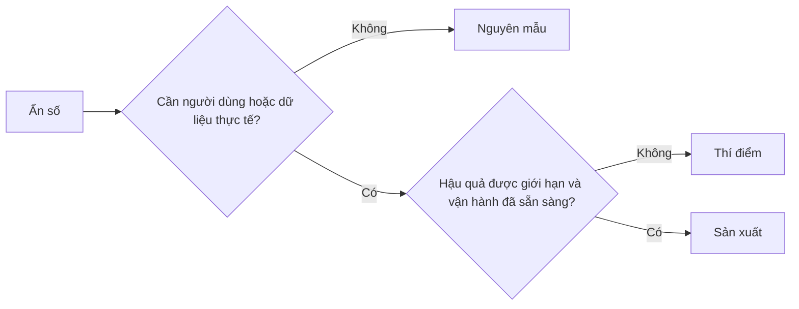

# Lựa chọn có chủ đích giữa Nguyên mẫu, Thí điểm hoặc Sản xuất

> Đây là các môi trường học hỏi (learning environments) hoàn toàn khác nhau, chứ không phải các mức độ hoàn thiện hình thức. Hãy lựa chọn giai đoạn có thể giải đáp ẩn số hiện tại với mức hậu quả không cần thiết thấp nhất.

**Type:** Learn + Build
**Languages:** Python (stdlib)
**Prerequisites:** Phase 14 lessons 50 to 52
**Time:** ~70 phút

## Mục tiêu học tập

- Lựa chọn giai đoạn xây dựng dựa trên ẩn số kỹ thuật, đối tượng người dùng, dữ liệu, hậu quả rủi ro và mức độ sẵn sàng vận hành.
- Xác định các cơ chế kiểm soát đặc thù theo từng giai đoạn và tiêu chí nghiệm thu/kết thúc (exit criteria).
- Ngăn ngừa tình trạng các bản nguyên mẫu (prototypes) âm thầm biến thành hệ thống sản xuất (production systems).
- Trì hoãn việc trao thẩm quyền thực tế cho tới khi bằng chứng thực nghiệm và năng lực vận hành chứng minh được tính xác đáng của nó.

## Ba câu hỏi hoàn toàn khác nhau

| Giai đoạn | Câu hỏi cốt lõi |
|---|---|
| Nguyên mẫu (Prototype) | Cơ chế kỹ thuật này liệu có khả năng tạo ra bằng chứng hay không? |
| Thí điểm (Pilot) | Nó có vận hành an toàn với một nhóm đối tượng thực tế bị giới hạn và các điều kiện thực tế hay không? |
| Sản xuất (Production) | Tổ chức có thể làm chủ và duy trì nó liên tục ở mức độ tin cậy và rủi ro đã cam kết hay không? |

Một bản nguyên mẫu có thể hoàn thiện đầy đủ về mặt kỹ thuật nhưng vẫn hoàn toàn có thể loại bỏ được (disposable). Một đợt thí điểm có thể sử dụng dữ liệu sản xuất thực tế trong khi vẫn được giới hạn nghiêm ngặt về đối tượng tiếp cận và thẩm quyền. Giai đoạn sản xuất chỉ thực sự bắt đầu khi tổ chức chấp nhận gánh vác trách nhiệm vận hành liên tục.

## Nguyên mẫu (Prototype)

Hãy sử dụng bản nguyên mẫu khi ẩn số cần kiểm chứng không đòi hỏi người dùng thực hay dữ liệu thực tế. Hãy giữ cho nó:

- sẵn sàng để vứt bỏ (discardable);
- độc lập và cô lập (isolated);
- phạm vi hành vi thu hẹp tối đa;
- tường minh về câu hỏi học hỏi cần giải đáp;
- không đưa ra bất kỳ cam kết vận hành giả tạo nào.

Đừng vội tối ưu hóa kiến trúc trước khi cơ chế cốt lõi chứng minh được giá trị để bước sang giai đoạn tiếp theo.

## Thí điểm (Pilot)

Hãy sử dụng giai đoạn thí điểm khi ẩn số đòi hỏi phải có hành vi thực tế, dữ liệu thực tế hoặc một quy trình làm việc thực tế, nhưng mức độ hậu quả tiềm ẩn hoặc mức độ sẵn sàng vận hành chưa tương thích để phát hành diện rộng.

Một đợt thí điểm bắt buộc phải có:

- một nhóm người dùng cụ thể được định danh rõ ràng;
- một cá nhân chịu trách nhiệm trực tiếp là con người;
- thời lượng thực thi và phạm vi thẩm quyền được giới hạn rành mạch;
- cơ chế kiểm toán (audit) và khả năng quay lui trạng thái (rollback);
- các ngưỡng chỉ số kết quả đầu ra và rào chắn an toàn;
- tiêu chí kết thúc rõ ràng cho các nhánh: mở rộng (expand), điều chỉnh (revise), hoặc dừng lại (stop).

## Sản xuất (Production)

Môi trường sản xuất đòi hỏi nhiều điều kiện khắt khe hơn một thao tác triển khai mã nguồn đơn thuần:

- mục tiêu mức dịch vụ (service level objective - SLO);
- trách nhiệm trực ban (on-call) và quy trình xử lý sự cố rõ ràng;
- đánh giá an ninh bảo mật và quyền riêng tư dữ liệu;
- các cơ chế kiểm soát chi phí và năng lực chịu tải;
- quy trình quay lui và khắc phục sự cố sau thảm họa;
- hệ thống giám sát liên tục (continuous monitoring);
- lộ trình cho dừng vận hành và thu hồi hệ thống (retirement path).



## Hiện tượng trôi dạt giai đoạn (Stage Drift)

Mã nguồn nguyên mẫu sẽ trở nên cực kỳ nguy hiểm khi nó bắt đầu thu hút người dùng, dữ liệu hoặc thẩm quyền thực tế mà không đi kèm với quyền sở hữu và trách nhiệm vận hành tương ứng. Hãy đánh dấu rõ ràng các ranh giới của nguyên mẫu và thí điểm trong tệp cấu hình, chính sách kiểm soát truy cập, hệ thống đo đạc từ xa (telemetry), và tài liệu kỹ thuật. Một biểu ngữ cảnh báo (warning banner) trên giao diện là hoàn toàn không đủ.

Giai đoạn hiện tại của hệ thống phải là thứ có thể quan sát và định danh trực tiếp từ chính hệ thống đó.

## Xây dựng thực tế

Phần thực hành này lựa chọn giai đoạn phù hợp từ bối cảnh ra quyết định, trả về các biện pháp kiểm soát bắt buộc và xuất ra tệp `outputs/stage-decisions.json`.

```bash
python3 code/main.py
python3 -m unittest discover code/tests -v
```

Hãy thử thay đổi ví dụ thí điểm thành mức hậu quả thấp với sự sẵn sàng vận hành đầy đủ. Hãy giải thích những bằng chứng bổ sung nào sẽ biện minh cho việc chuyển thẳng lên môi trường sản xuất.

## Bài tập thực hành

1. Phân loại ba dự án hiện tại của bạn theo giai đoạn học hỏi, không theo trạng thái triển khai hạ tầng.
2. Viết các tiêu chí kết thúc đợt thí điểm có bao gồm quyết định dừng hẳn dự án (stop decision).
3. Bổ sung một biện pháp kiểm soát kỹ thuật ngăn chặn bản nguyên mẫu truy cập vào dữ liệu môi trường sản xuất.
4. Xác định trách nhiệm vận hành đầu tiên biến bản dựng thành một hệ thống sản xuất thực thụ.
5. Thiết kế một chứng từ quay lui (rollback receipt) cho đợt thí điểm có giới hạn phạm vi.

## Tài liệu đọc thêm

- [Barry Boehm, A Spiral Model of Software Development and Enhancement](https://dl.acm.org/doi/10.1145/12944.12948), thảo luận về việc gắn kết mức độ cam kết nguồn lực của từng vòng lặp với các rủi ro đã được hóa giải.
- [Fagerholm et al., Building Blocks for Continuous Experimentation](https://doi.org/10.1145/2601248.2601276), phân tích các điều kiện kỹ thuật và tổ chức cần thiết để vận hành các thử nghiệm liên tục.

## Những gì bạn lưu giữ

Hãy lưu lại `outputs/stage-decisions.json`. Tệp này ghi nhận lý do tại sao từng giai đoạn được coi là xác đáng và những biện pháp kiểm soát nào bắt buộc phải tồn tại trước khi bước sang giai đoạn tiếp theo.
