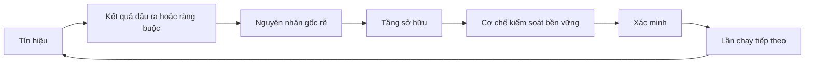

# Xây dựng cơ cấu bánh cóc phản hồi đi kèm quyền sở hữu và cơ chế thu hồi

> Việc phát hành (shipping) khép lại một vòng lặp xây dựng và mở ra một vòng lặp học hỏi. Bằng chứng thực nghiệm bắt buộc phải làm thay đổi hệ thống, nếu không nó sẽ chỉ là dữ liệu đo đạc từ xa (telemetry) mà không ai chịu trách nhiệm.

**Type:** Learn + Build
**Languages:** Python (stdlib)
**Prerequisites:** Phase 14 lessons 46 and 53
**Time:** ~75 phút

## Mục tiêu học tập

- Chuyển đổi các sự cố, kết quả đánh giá, hành vi người dùng và các điều chỉnh thành các hành động có người làm chủ (owned actions).
- Điều hướng từng tín hiệu tới ngữ cảnh (context), đánh giá (evaluation), chính sách (policy), môi trường thực thi (runtime) hoặc danh mục công việc tồn đọng (backlog).
- Thiết lập mức độ ưu tiên cho các lỗi tái diễn dựa trên mức độ nghiêm trọng và tần suất xuất hiện.
- Gắn điều kiện thu hồi/cho dừng hoạt động (retirement condition) cho mọi cơ chế kiểm soát.
- Truyền đạt một quyết định chuyển giao sản phẩm đi kèm bằng chứng, sự đánh đổi và một cá nhân chịu trách nhiệm giải trình cụ thể.

## Phản hồi là một thành phần hạ tầng

Một nhóm phát triển có thể thu thập các vết thực thi (traces), kết quả đánh giá (evaluations), phiếu hỗ trợ (support tickets), và nhật ký sự cố (incident logs) nhưng không rút ra được bất kỳ bài học nào từ chúng. Cơ chế còn thiếu ở đây chính là sự xúc tiến (promotion): một lộ trình được định nghĩa rõ ràng từ việc quan sát thực tế đến một thay đổi mang tính bền vững đi kèm người làm chủ và bằng chứng kiểm chứng.

Vòng lặp học hỏi bao gồm:

1. quan sát một tín hiệu cụ thể;
2. kết nối nó với một kết quả đầu ra, một ràng buộc hoặc một giả định;
3. xác định tầng hệ thống sớm nhất sở hữu nguyên nhân gốc rễ;
4. tạo ra một thay đổi có giới hạn phạm vi;
5. xác minh rằng khả năng tái diễn đã giảm đi;
6. rà soát xem liệu cơ chế kiểm soát đó có nên tiếp tục được duy trì hay không.

## Điều hướng tới tầng kiến trúc sở hữu

| Tín hiệu | Điểm đến |
|---|---|
| Dương tính giả (False positive), hồi quy (regression), kết quả sai lệch | Đánh giá hoặc kiểm thử |
| Ngữ cảnh bị thiếu, công việc trùng lặp, sự kiện lỗi thời | Nguồn ngữ cảnh hoặc tuyến truy xuất |
| Hành động không an toàn hoặc lỗ hổng thẩm quyền | Ranh giới chính sách hoặc quyền hạn |
| Quá thời gian chờ (Timeout), bão thử lại (retry storm), phần phụ thuộc không khả dụng | Kiểm soát môi trường thực thi |
| Nhu cầu sản phẩm mới hoặc sự đánh đổi chưa được giải quyết | Mục tồn đọng đã được định hình rõ nét |

Hãy khắc phục nguyên nhân ở tầng kiến trúc hiệu quả sớm nhất. Đừng vội bổ sung thêm một đoạn văn bản vào câu lệnh nhắc (prompt) khi mà một bài kiểm thử hoặc một ranh giới phân quyền có thể triệt tiêu hoàn toàn khả năng xảy ra lỗi đó.



## Quyền sở hữu là một phần của cơ chế kiểm soát

Mỗi hành động trong cơ cấu bánh cóc (ratchet action) đều bắt buộc phải có:

- một người chịu trách nhiệm duy nhất;
- mức độ ưu tiên dựa trên mức hậu quả và tần suất tái diễn;
- cấu phần/tạo tác (artifact) cụ thể cần sửa đổi;
- bước xác minh chứng minh tính hiệu quả của thay đổi;
- cửa sổ rà soát hoặc thời hạn hết hiệu lực;
- điều kiện thu hồi (retirement condition).

Một đề xuất cải tiến vô chủ chỉ là một quan sát được định dạng đẹp mắt hơn mà thôi.

## Thu hồi các cơ chế kiểm soát lỗi thời

Các hệ thống phản hồi thường có xu hướng tích tụ dần các quy tắc và chính sách. Những chính sách đó lâu dần có thể trở nên mâu thuẫn và gây tốn kém chi phí vận hành. Hãy rà soát lại các cơ chế kiểm soát khi:

- kiến trúc hệ thống hoặc quy trình công việc thay đổi;
- một bất biến ở tầng thấp hơn thay thế cho một chỉ thị ở tầng cao hơn;
- lỗi cần phòng tránh đã không còn xuất hiện trong suốt khung thời gian đã chọn;
- cơ chế kiểm soát ngăn cản công việc hợp lệ thường xuyên hơn mức nó ngăn chặn tác hại thực tế.

Việc thu hồi cũng đòi hỏi phải có căn cứ bằng chứng. Tuyệt đối không xóa bỏ một cơ chế kiểm soát chỉ vì cảm thấy nó đã cũ.

## Kết nối phản hồi giữa quá trình xây dựng sản phẩm và tác tử lập trình

Cùng một cơ cấu bánh cóc phục vụ cho cả hai lộ trình:

- Bằng chứng thực tế từ sản phẩm làm thay đổi khung kết quả đầu ra, các giả định, lát cắt hoặc kế hoạch đo lường.
- Các sửa đổi của tác tử lập trình (coding-agent) làm thay đổi các kiểm thử, ngữ cảnh, phạm vi nhiệm vụ, quy trình tự động hóa hoặc quá trình bàn giao.
- Các sự cố vận hành có thể làm thay đổi đồng thời cả ranh giới sản phẩm lẫn bàn làm việc (workbench) của tác tử.

Đó là lý do tại sao việc định hình bản dựng không phải là một giai đoạn kết thúc trước khi lập trình. Nó tiếp diễn liên tục xuyên suốt qua từng thay đổi được phê duyệt.

## Xây dựng thực tế

Phần thực hành này phân loại các tín hiệu, tạo các hành động bánh cóc có người sở hữu, xếp thứ tự ưu tiên và xuất ra tệp `outputs/feedback-backlog.json`.

```bash
python3 code/main.py
python3 -m unittest discover code/tests -v
```

Hãy thêm vào một tín hiệu quá thời gian chờ (timeout) ở môi trường thực thi và xác nhận rằng nó được điều hướng chính xác tới tầng thực thi (runtime) thay vì danh mục tồn đọng chung của sản phẩm.

## Phòng thí nghiệm thực hành: Làm chủ một quyết định sau một bước thụt lùi

Hãy chọn một quy trình công việc từ dự án hồ sơ năng lực (portfolio project) trong lộ trình nghề nghiệp của bạn. Đưa nó qua một quyết định, một thử nghiệm nhỏ và một đợt rà soát. Lưu giữ toàn bộ bằng chứng trong [mẫu bằng chứng chuyển giao nghề nghiệp (career delivery template)](https://github.com/rohitg00/ai-engineering-from-scratch/blob/main/phases/14-agent-engineering/54-build-the-feedback-ratchet/outputs/career-delivery-evidence.md).

Phần thực hành mã nguồn Python chỉ tạo ra các hành động mẫu trong danh mục tồn đọng. Nó không trực tiếp quan sát người dùng, không đo lường một sự can thiệp thực tế và không chứng minh sự sẵn sàng cho nghề nghiệp. Việc hoàn thành lượt chạy mã lệnh đó chỉ là bước chuẩn bị cho bài tập thực tế này.

### 1. Thiết lập những gì đã diễn ra

Ghi lại đối tượng người dùng, nhiệm vụ, quy trình công việc hiện tại, và kết quả đầu ra mà bạn muốn cải thiện. Đính kèm liên kết tới một quan sát đã được đồng thuận, một bản ghi hỗ trợ đã được che giấu thông tin nhạy cảm (redacted), hoặc một vết thực thi nhiệm vụ có khả năng tái lập. Hãy phân tách rạch ròi giữa những gì bạn trực tiếp quan sát được, những gì người khác báo cáo lại, và những gì bạn tự suy diễn.

Hãy tìm ra một bước thụt lùi: một giả định bị sụp đổ, một kết quả đầu ra không thể sử dụng được, một chi phí phát sinh ngoài dự kiến, hoặc một quá trình bàn giao bị chậm trễ. Giải thích bằng chứng nào đã làm thay đổi nhận thức của bạn. Một bước thụt lùi đòi hỏi một hành động phản hồi và một quyết định dứt khoát, chứ không phải một câu chuyện thành công thêu dệt xung quanh nó.

Nếu bạn không thể làm việc trực tiếp với người dùng, hãy vận hành một kịch bản mô phỏng được dán nhãn rõ ràng cùng với một đồng nghiệp hoặc một kịch bản đã được tuyên bố trước. Giữ các quan sát mô phỏng tách biệt hoàn toàn với bằng chứng người dùng thực tế. Tuyệt đối không thêu dệt các cuộc phỏng vấn, sự phê duyệt, mức độ chấp nhận của người dùng hoặc tác động kinh doanh giả tạo.

### 2. Tiến triển bên trong phạm vi thẩm quyền của bạn

Liệt kê các ẩn số và chọn hành động có tính khả đảo và chi phí thấp nhất có thể giải quyết ẩn số mang lại hậu quả lớn nhất. Nêu rõ những gì bạn có quyền tự quyết định, những gì bị ràng buộc bởi các thỏa thuận hiện có, và những gì đòi hỏi phải có sự ủy quyền chính thức trước khi thực thi.

Ví dụ: bạn có thể chuẩn bị sẵn một tập phát lại ngoại tuyến đã che giấu thông tin nhạy cảm trong khi chờ đợi sự cấp phép sử dụng dữ liệu khách hàng. Chủ động nhận trách nhiệm có nghĩa là thúc đẩy các công việc đã được ủy quyền tiến lên và làm rõ quyết định nào đang bị tắc nghẽn. Nó không đồng nghĩa với việc tự ý mở rộng quyền truy cập hoặc quyền phê duyệt của bạn.

### 3. So sánh các phương án và tóm tắt cho người sở hữu quyết định

Viết một bản tóm tắt quyết định ngắn gọn dành cho một người không cần biết chi tiết kỹ thuật triển khai. Bản tóm tắt bao gồm:

- bài toán người dùng và bằng chứng đã làm thay đổi kế hoạch ban đầu;
- ít nhất hai phương án lựa chọn, bao gồm một phương án thủ công chi phí thấp hoặc phương án "không xây dựng gì thêm" nếu khả thi;
- sự đánh đổi về chất lượng, thiết kế tương tác, nỗ lực triển khai, chi phí vận hành và rủi ro;
- khuyến nghị của bạn, sự bất định còn tồn đọng và quyết định cụ thể cần đưa ra;
- người sở hữu quyết định, các bên liên quan bị ảnh hưởng và thời hạn bắt buộc phải có quyết định.

Hãy nhờ một đồng nghiệp đóng vai một bên liên quan bị ảnh hưởng để phản biện một sự đánh đổi. Ghi lại sự phản đối đó và cách thức nó làm thay đổi (hoặc không làm thay đổi) khuyến nghị ban đầu của bạn. Hãy dán nhãn phản hồi đóng vai này là phản hồi mô phỏng; nó không thể thay thế cho sự đồng thuận của một bên liên quan thực tế.

### 4. Vận hành một thử nghiệm có giới hạn phạm vi

Lựa chọn giữa nguyên mẫu, thí điểm, hoặc sản xuất dựa trên câu hỏi mà bạn cần giải đáp. Xác định rõ đối tượng người dùng, dữ liệu, thẩm quyền, thời lượng, phương án quay lui, và các điều kiện để tiếp tục, thay đổi hoặc dừng lại trước khi thu thập kết quả.

Duyệt qua tương tác từ điểm bắt đầu của người dùng cho tới khi một nhiệm vụ được hoàn tất trọn vẹn. Hãy đưa vào một trường hợp đầu ra không chính xác hoặc dữ liệu bị thiếu hụt. Quan sát xem liệu người dùng có thể nhận thấy lỗi, sửa chữa nó và tự phục hồi mà không cần sự trợ giúp ngầm từ phía bạn hay không.

Tính toán thời gian con người phải rà soát và sửa lỗi như một phần cấu thành của quy trình làm việc. Một mô hình phản hồi nhanh hơn vẫn có thể khiến cho toàn bộ nhiệm vụ tổng thể bị chậm đi hoặc trở nên khó tin cậy hơn.

### 5. So sánh kết quả đầu ra và hiệu quả kinh tế

Ghi lại một đường cơ sở (baseline) và một phép đo theo dõi (follow-up) bằng cách sử dụng cùng một định nghĩa chỉ số, cùng quần thể nhiệm vụ, cùng phương pháp thu thập và các cửa sổ quan sát có thể so sánh được. Giữ số lượng mẫu, các trường hợp ngoại trừ và liên kết bằng chứng ngay bên cạnh các con số. Nếu các điều kiện đó thay đổi, hãy giải thích tại sao sự so sánh này bị hạn chế về độ tin cậy.

Đưa vào một kết quả đầu ra của người dùng, một rào chắn an toàn hoặc chất lượng, và tổng nỗ lực rà soát của con người. Ghi nhận kết quả ngay cả khi nó không đạt được mục tiêu ban đầu. Các mẫu nhỏ hoặc mẫu mô phỏng chỉ hỗ trợ cho một khẳng định học hỏi có giới hạn, chứ không phải một khẳng định về tác động kinh doanh đã được chứng minh.

Ước tính chi phí cho mỗi nhiệm vụ hoàn thành thành công dựa trên các lượt gọi mô hình, các lần thử lại, các dịch vụ phụ trợ và chi phí rà soát của con người. Nêu rõ giả định về đơn giá nhân công và tách biệt mức sử dụng thực tế đo được với các ước tính phỏng đoán. So sánh chi phí đó với phương án thay thế thủ công hoặc giả định giá trị đằng sau dự án.

Sử dụng bài học hiện có về [FinOps cho LLM](https://aiengineeringfromscratch.com/lesson?path=phases/17-infrastructure-and-production/27-finops-llms) để đào sâu việc phân bổ chi phí và kinh tế học đơn vị (unit economics). Việc thay đổi mô hình chỉ là một trong các phản ứng khả dĩ; việc thu hẹp quy trình làm việc hoặc giữ lại một bước thao tác thủ công đôi khi mới là quyết định sản phẩm đúng đắn hơn.

### 6. Khép kín vòng lặp

Sử dụng các tiêu chí đã tuyên bố từ trước để đưa ra khuyến nghị tiếp tục (continue), thay đổi (change), hoặc dừng lại (stop). Nếu bằng chứng chưa đủ để đưa ra kết luận dứt khoát, hãy nêu rõ quan sát nào còn thiếu và bài kiểm tra có giới hạn phạm vi tiếp theo là gì. Ghi lại phản hồi của người sở hữu quyết định có trách nhiệm giải trình; để ở trạng thái chờ xử lý (pending) nếu chưa có quyết định nào được đưa ra.

Chọn một điểm cải tiến cho chính quy trình chuyển giao sản phẩm: một khung nhiệm vụ rõ ràng hơn, một buổi duyệt với người dùng sớm hơn, một danh sách kiểm tra (checklist) rà soát tốt hơn, một phạm vi bàn giao tác tử nhỏ hơn, hoặc một trường hợp đánh giá chặt chẽ hơn. Chỉ định một người sở hữu và một ngày rà soát cụ thể.

Khi đến ngày rà soát, hãy quyết định xem nên giữ lại, sửa đổi hay thu hồi cải tiến đó. Ghi lại bằng chứng cho sự lựa chọn. Một danh sách kiểm tra mới tạo ra nhiều công việc hơn mà không ngăn chặn được lỗi mục tiêu thì hoàn toàn chưa xứng đáng để tồn tại lâu dài.

## Sản phẩm bàn giao

Hãy sao chép [career-delivery-evidence.md](https://github.com/rohitg00/ai-engineering-from-scratch/blob/main/phases/14-agent-engineering/54-build-the-feedback-ratchet/outputs/career-delivery-evidence.md) vào dự án của riêng bạn và hoàn thiện nó bằng các liên kết bằng chứng thực tế. Hãy giữ cho tệp mẫu trong kho mã nguồn khả năng tái sử dụng. Đính kèm bản tóm tắt quyết định, bản duyệt tương tác, đối chiếu đo lường và hành động theo dõi có người chịu trách nhiệm vào sản phẩm hồ sơ năng lực nghề nghiệp của bạn.

## Xác minh tính đúng đắn

Hãy sử dụng bản tiêu chí nghiệm thu thủ công (rubric) này cùng với một đồng nghiệp. Đánh dấu từng hàng là **đạt** (met), **cần cải thiện** (needs work), hoặc **không quan sát thấy** (not observed), và cung cấp một liên kết bằng chứng hoặc một quan sát cụ thể còn thiếu. Việc điền đầy đủ thông tin vào một trường không phải là bằng chứng chứng minh sự phán đoán đó là xác đáng.

| Tiêu chí | Bằng chứng đáp ứng yêu cầu |
|---|---|
| Cơ sở quy trình vững chắc | Một quan sát có thể truy vết hỗ trợ cho bài toán; các tuyên bố được báo cáo, sự suy diễn và kịch bản mô phỏng đều được dán nhãn rõ ràng. |
| Tôn trọng thẩm quyền | Công việc tiếp theo có tính khả đảo là rõ ràng, và bất kỳ hành động bị hạn chế nào đều chờ đợi người sở hữu quyết định thực tế. |
| Truyền đạt sự đánh đổi | Các phương án thay thế đáng tin cậy, sự phản đối của bên liên quan, một đề xuất cụ thể và một yêu cầu ra quyết định rõ ràng đều được ghi nhận. |
| Tương tác được kiểm nghiệm | Bản duyệt bao quát các trường hợp thành công, thất bại, khả năng phục hồi và nỗ lực rà soát của con người. |
| Đối chiếu kết quả | Định nghĩa đường cơ sở và đo đạc sau can thiệp đồng nhất; kích thước mẫu, rào chắn an toàn, chi phí và các hạn chế so sánh đều hiển hiện rõ ràng. |
| Làm chủ bước thụt lùi | Bằng chứng làm thay đổi quyết định tiếp tục/thay đổi/dừng lại và dẫn tới một hành động tiếp theo có người chịu trách nhiệm. |
| Cải tiến quy trình | Một cải tiến quy trình công việc có người sở hữu, ngày rà soát, và quyết định giữ lại/sửa đổi/thu hồi dựa trên bằng chứng. |

Hành vi của người dùng thực tế không được quan sát vẫn luôn là một lỗ hổng lớn ngay cả khi mọi bước mô phỏng đều vượt qua thành công. Hãy bảo toàn ranh giới đó trong lời tuyên bố hồ sơ năng lực và xác định quan sát tiếp theo cần thiết để khỏa lấp lỗ hổng đó.

## Bài tập thực hành

1. Chuyển đổi một sự cố thực tế và một lời phàn nàn của người dùng thành các hành động trong cơ cấu bánh cóc.
2. Nêu tên tầng kiến trúc sớm nhất có thể ngăn ngừa từng sự cố tái diễn.
3. Bổ sung các lệnh hoặc quan sát xác minh vào đầu ra của phần thực hành.
4. Xác định một điều kiện thu hồi cho một quy tắc chính sách.
5. Truy vết một điều chỉnh đã được chấp thuận quay trở lại khung nhiệm vụ tiếp theo.

## Tài liệu đọc thêm

- [Basili, Caldiera, and Rombach, The Goal Question Metric Approach](https://www.cs.toronto.edu/~sme/CSC444F/handouts/GQM-paper.pdf), thảo luận về quá trình học hỏi của tổ chức thông qua phương pháp đo lường hướng mục tiêu.
- [Fagerholm et al., Building Blocks for Continuous Experimentation](https://doi.org/10.1145/2601248.2601276), nghiên cứu về vòng lặp kỹ thuật và tổ chức giúp kết nối bằng chứng thực nghiệm với sự phát triển liên tục của sản phẩm.
- [Nuseibeh and Easterbrook, Requirements Engineering: A Roadmap](https://www.cs.toronto.edu/~sme/papers/2000/ICSE2000.pdf), nhìn nhận các yêu cầu kỹ thuật dưới góc độ tiến hóa liên tục xuyên suốt vòng đời hệ thống.

## Những gì bạn lưu giữ

Hãy lưu lại `outputs/feedback-backlog.json` như một ví dụ định tuyến mẫu và bản bằng chứng chuyển giao nghề nghiệp đã hoàn thiện như một bản ghi nhận các quyết định của chính bạn. Cùng nhau, chúng khép lại lộ trình Phán đoán Sản phẩm và Chuyển giao (Product Judgment and Delivery) và cung cấp thông tin quý giá cho khung kết quả đầu ra tiếp theo.
