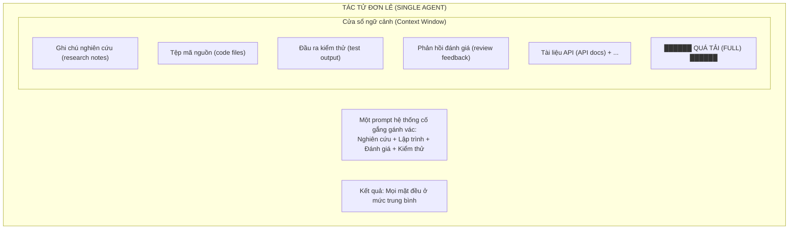
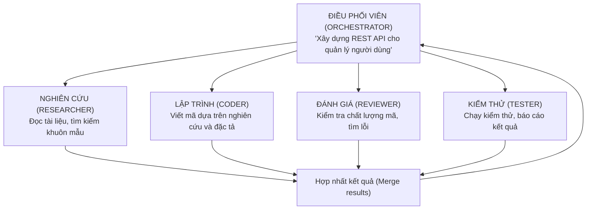
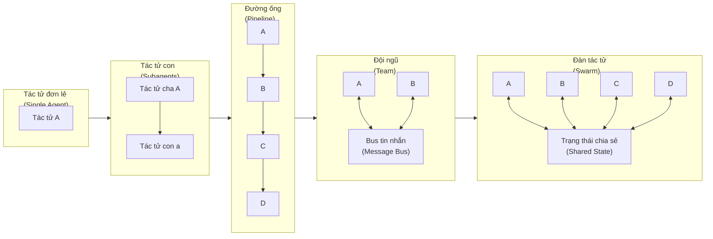
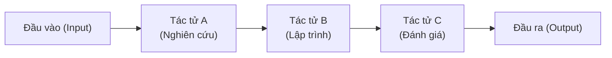
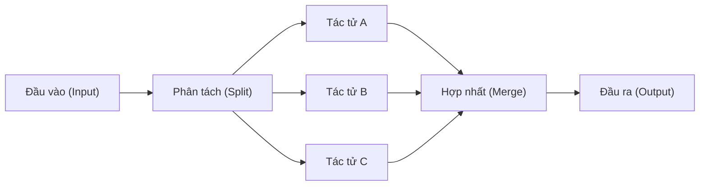
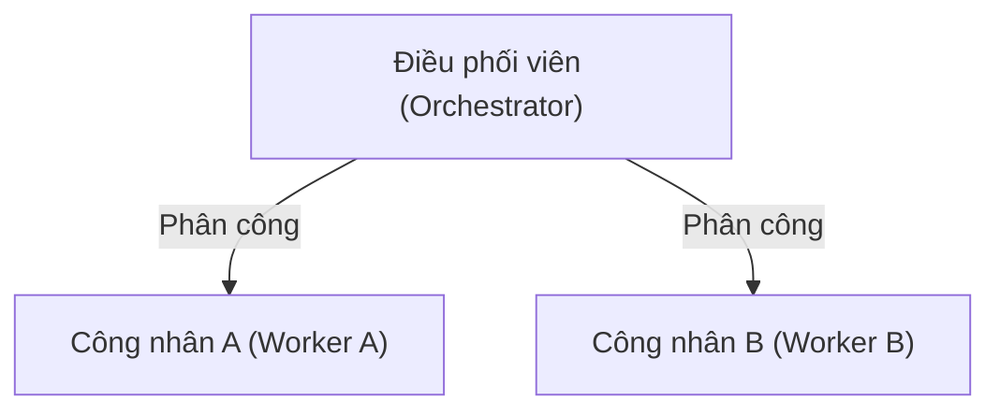
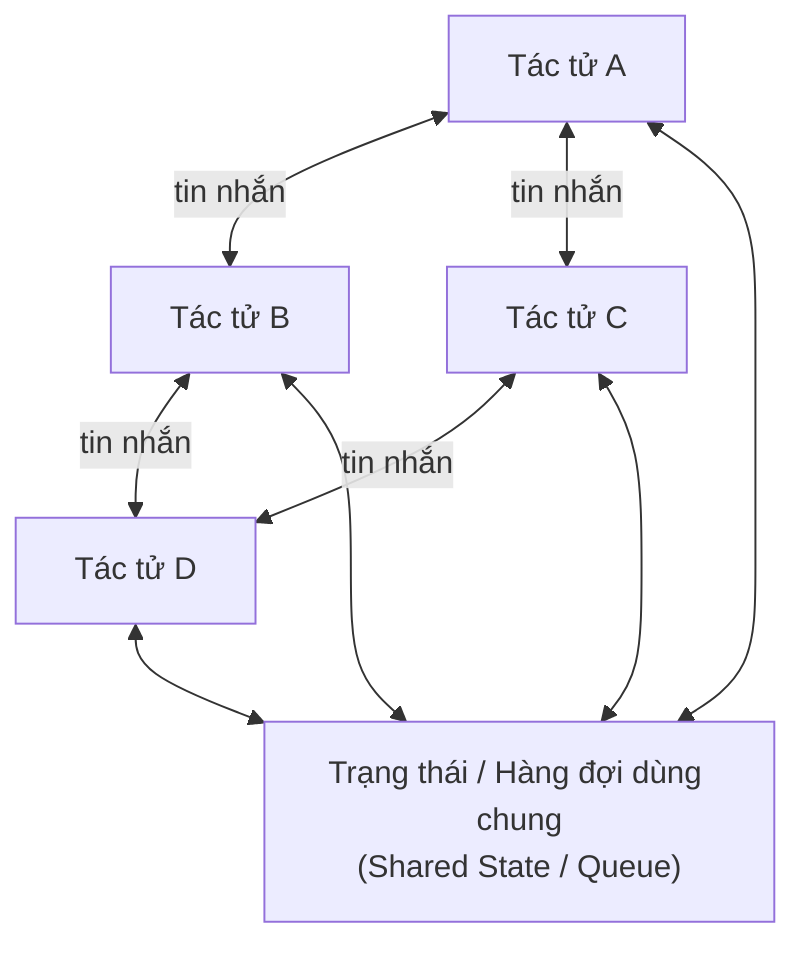

# Tại sao nên dùng Hệ đa tác tử? (Why Multi-Agent?)

> Một tác tử đơn lẻ rồi sẽ chạm trần giới hạn. Nước đi khôn ngoan không phải là xây dựng một tác tử to hơn - mà là phối hợp nhiều tác tử hơn.

**Type:** Learn
**Languages:** TypeScript
**Prerequisites:** Phase 14 (Agent Engineering)
**Time:** ~60 phút

## Mục tiêu học tập

- Nhận diện ngưỡng trần giới hạn của tác tử đơn lẻ (single-agent ceiling) bao gồm tràn ngữ cảnh (context overflow), pha tạp chuyên môn (mixed expertise), điểm nghẽn tuần tự (sequential bottleneck) và giải thích thời điểm việc chia tách thành nhiều tác tử là quyết định đúng đắn.
- So sánh các mẫu hình điều phối (orchestration patterns): đường ống tuần tự (pipeline), phân nhánh song song (parallel fan-out), giám sát viên (supervisor), kiến trúc phân cấp (hierarchical) và lựa chọn cấu trúc phù hợp cho từng cấu trúc tác vụ cụ thể.
- Thiết kế một hệ đa tác tử (multi-agent system) với ranh giới vai trò rõ ràng, trạng thái dùng chung (shared state) và hợp đồng giao tiếp (communication contract) chuẩn mực.
- Phân tích sự đánh đổi giữa độ phức tạp của hệ đa tác tử (độ trễ (latency), chi phí (cost), khó khăn khi gỡ lỗi (debugging difficulty)) so với sự tinh giản của tác tử đơn lẻ.

## Vấn đề

Bạn đã tự tay xây dựng một tác tử đơn lẻ (single agent) trong Phase 14. Nó hoạt động tốt. Nó có thể đọc tệp, chạy lệnh terminal, gọi API và lập luận về kết quả thu được. Sau đó, bạn đưa nó vào một cơ sở mã (codebase) thực tế: 200 tệp nguồn, ba ngôn ngữ lập trình, hệ thống kiểm thử phụ thuộc vào hạ tầng bên ngoài và yêu cầu phải nghiên cứu kỹ lưỡng các API bên ngoài trước khi bắt tay viết mã.

Tác tử lập tức nghẹn cứng. Không phải vì mô hình ngôn ngữ lớn (LLM - Large Language Model) bị kém thông minh, mà vì tác vụ đã vượt quá khả năng xử lý của một vòng lặp tác tử đơn lẻ (single agent loop). Cửa sổ ngữ cảnh (context window) nhanh chóng bị lấp đầy bởi nội dung các tệp tin. Tác tử quên mất những gì nó đã đọc từ 40 lượt gọi công cụ (tool calls) trước đó. Nó vừa cố gắng làm một nhà nghiên cứu, vừa làm lập trình viên, vừa làm người duyệt mã (reviewer) cùng một lúc — và kết quả là làm hỏng cả ba việc.

Đây chính là ngưỡng trần của tác tử đơn lẻ (single-agent ceiling). Bạn sẽ chạm phải bức tường này bất cứ khi nào tác vụ đòi hỏi:

- **Nhiều ngữ cảnh hơn mức có thể chứa trong một cửa sổ** - đọc 50 tệp tin sẽ thổi bay giới hạn 200k tokens.
- **Các năng lực chuyên môn khác nhau ở từng giai đoạn** - khâu nghiên cứu đòi hỏi kỹ thuật tạo prompt (prompting) rất khác so với sinh mã nguồn.
- **Khối lượng công việc có thể xử lý song song** - tại sao phải đọc ba tệp tin một cách tuần tự khi bạn hoàn toàn có thể đọc chúng đồng thời?

## Khái niệm

### Ngưỡng trần của Tác tử Đơn lẻ (The Single-Agent Ceiling)

Một tác tử đơn lẻ là một vòng lặp duy nhất, một cửa sổ ngữ cảnh duy nhất và một prompt hệ thống (system prompt) duy nhất:



Ba mắt xích sẽ bị đứt gãy:

1. **Bão hòa ngữ cảnh (Context saturation)** - kết quả của các công cụ liên tục tích tụ. Đến lượt thứ 30, tác tử đã ngốn tới 150k tokens chứa nội dung tệp, đầu ra lệnh console và các bước lập luận trước đó. Những chi tiết cốt lõi từ lượt thứ 5 bị trôi vào quên lãng.

2. **Nhầm lẫn vai trò (Role confusion)** - một prompt hệ thống tuyên bố "bạn là một nhà nghiên cứu, lập trình viên, người đánh giá mã và kiểm thử viên" sẽ tạo ra một tác tử chỉ nghiên cứu nửa vời, lập trình chắp vá và không bao giờ hoàn thành việc đánh giá mã một cách nghiêm túc.

3. **Điểm nghẽn tuần tự (Sequential bottleneck)** - tác tử đọc tệp A, sau đó tệp B, rồi tệp C. Ba lượt gọi LLM nối tiếp. Ba lượt thực thi công cụ nối tiếp. Không hề có tính song song.

### Giải pháp Đa tác tử (The Multi-Agent Solution)

Chia nhỏ khối lượng công việc. Giao cho mỗi tác tử một nhiệm vụ duy nhất, một cửa sổ ngữ cảnh riêng biệt và một prompt hệ thống được tinh chỉnh chuyên biệt cho công việc đó:



Mỗi tác tử sở hữu:
- Một prompt hệ thống tập trung ("Bạn là chuyên gia đánh giá mã nguồn. Nhiệm vụ duy nhất của bạn là phát hiện lỗi sai logic và bảo mật.")
- Cửa sổ ngữ cảnh riêng biệt (không bị làm nhiễu bởi các thao tác của tác tử khác)
- Hợp đồng đầu vào/đầu ra rõ ràng (nhận ghi chú nghiên cứu, xuất ra mã nguồn hoàn chỉnh)

### Các hệ thống thực tế áp dụng mô hình này

**Tác tử con của Claude Code (Claude Code subagents)** - khi Claude Code khởi tạo một tác tử con bằng công cụ `Task`, nó tạo ra một tác tử con với phạm vi nhiệm vụ hẹp. Tác tử cha giữ cho ngữ cảnh của mình luôn sạch sẽ. Tác tử con hoàn thành công việc chuyên sâu và chỉ trả về một bản tóm tắt súc tích.

**Devin** - vận hành đồng thời một tác tử lập kế hoạch (planner agent), một tác tử lập trình (coder agent) và một tác tử trình duyệt (browser agent). Tác tử lập kế hoạch bẻ nhỏ bài toán thành từng bước. Tác tử lập trình tập trung viết mã. Tác tử trình duyệt tra cứu tài liệu kỹ thuật. Mỗi tác tử sở hữu một ngữ cảnh hoàn toàn độc lập.

**Các đội ngũ đa tác tử lập trình trên SWE-bench (Multi-agent coding teams)** - các hệ thống đạt điểm số cao nhất trên bảng xếp hạng SWE-bench đều kết hợp một tác tử nghiên cứu để đọc cơ sở mã, một tác tử lập kế hoạch để thiết kế bản sửa lỗi và một tác tử lập trình để hiện thực hóa bản sửa lỗi đó. Các hệ thống dùng tác tử đơn lẻ đều đạt kết quả thấp hơn đáng kể.

**ChatGPT Deep Research** - kích hoạt nhiều tác tử tìm kiếm song song, mỗi tác tử khám phá một góc độ chuyên sâu khác nhau, sau đó tổng hợp kết quả lại thành một báo cáo hoàn chỉnh.

### Phổ kiến trúc (The Spectrum)

Kiến trúc đa tác tử không phải là một lựa chọn nhị phân. Nó là một dải phổ liên tục:



- **Tác tử đơn lẻ (Single agent)** - một vòng lặp, một prompt. Phù hợp cho các tác vụ đơn giản, dữ liệu nhỏ.
- **Tác tử con (Subagents)** - một tác tử cha khởi tạo các tác tử con cho những nhiệm vụ cụ thể. Tác tử cha nắm giữ kế hoạch tổng thể. Tác tử con báo cáo lại tiến độ. Đây chính là cách tiếp cận của Claude Code.
- **Đường ống tuần tự (Pipeline)** - các tác tử chạy theo chuỗi nối tiếp nhau. Đầu ra của Tác tử A trở thành đầu vào của Tác tử B. Rất phù hợp với quy trình phân giai đoạn rõ rệt: nghiên cứu -> lập trình -> đánh giá -> kiểm thử.
- **Đội ngũ (Team)** - các tác tử chạy song song cùng kết nối qua một bus tin nhắn dùng chung. Mỗi tác tử đảm nhận một vai trò nhất định. Một bộ điều phối chịu trách nhiệm kết nối. Phù hợp khi cần phối hợp nhiều kỹ năng khác nhau cùng lúc.
- **Đàn tác tử (Swarm)** - tập hợp nhiều tác tử tương đồng hoặc hoàn toàn đồng nhất cùng chia sẻ trạng thái chung. Không có bộ điều phối cố định. Các tác tử chủ động nhặt tác vụ từ hàng đợi công việc. Rất hiệu quả cho các bài toán thông lượng cao và xử lý song song khối lượng lớn.

### Bốn mẫu hình Đa tác tử Cốt lõi

#### Mẫu hình 1: Đường ống tuần tự (Pipeline)



Mỗi tác tử biến đổi dữ liệu nhận được và chuyển tiếp đến tác tử tiếp theo. Dễ dàng phân tích và lập luận. Tuy nhiên, sự cố tại một mắt xích sẽ làm nghẽn toàn bộ chuỗi còn lại.

#### Mẫu hình 2: Phân nhánh song song / Hợp nhất (Fan-out / Fan-in)



Chia nhỏ khối lượng công việc cho các tác tử chạy song song, sau đó thu thập và hợp nhất kết quả. Thích hợp cho các tác vụ có thể phân tách thành các nhiệm vụ con độc lập nhau.

#### Mẫu hình 3: Điều phối viên - Công nhân (Orchestrator-Worker)



Một điều phối viên thông minh quyết định cần làm gì, ủy quyền công việc cho các công nhân và tổng hợp kết quả cuối cùng. Bản thân điều phối viên là một tác tử sở hữu công cụ để khởi tạo và quản lý các công nhân.

#### Mẫu hình 4: Đàn tác tử ngang hàng (Peer Swarm)



Không có điều phối viên trung tâm. Các tác tử giao tiếp trực tiếp ngang hàng (peer-to-peer). Các quyết định của hệ thống xuất hiện một cách tự phát từ sự tương tác qua lại. Khó gỡ lỗi hơn, nhưng có khả năng mở rộng lên số lượng tác tử rất lớn.

### Khi nào KHÔNG nên dùng Hệ đa tác tử

Kiến trúc đa tác tử luôn đi kèm với sự phức tạp gia tăng. Mỗi tin nhắn trao đổi giữa các tác tử là một điểm tiềm ẩn lỗi. Quy trình gỡ lỗi chuyển từ việc "đọc một cuộc hội thoại duy nhất" sang "truy vết luồng thông điệp qua năm tác tử khác nhau".

**Nên giữ nguyên tác tử đơn lẻ khi:**
- Tác vụ vừa vặn trong một cửa sổ ngữ cảnh duy nhất (dưới ~100k tokens dữ liệu hoạt động).
- Bạn không cần các prompt hệ thống chuyên biệt cho từng giai đoạn khác nhau.
- Tốc độ thực thi tuần tự đã đủ nhanh và đáp ứng yêu cầu.
- Tác vụ đủ đơn giản đến mức chi phí quản lý điều phối lớn hơn giá trị mang lại.

**Cái giá của sự phức tạp:**
- Mỗi ranh giới tác tử là một bước nén dữ liệu có tổn thất thông tin (lossy compression): toàn bộ ngữ cảnh của Tác tử A buộc phải tóm gọn thành một tin nhắn gửi cho Tác tử B.
- Logic điều phối (ai làm gì, khi nào, theo thứ tự nào) là mảnh đất màu mỡ sinh ra lỗi hệ thống.
- Độ trễ tăng vọt: $N$ tác tử đồng nghĩa với tối thiểu $N$ lượt gọi LLM tuần tự, và sẽ còn nhiều hơn nếu chúng phải trao đổi qua lại.
- Chi phí nhân lên: mỗi tác tử tiêu hao tokens độc lập.

Quy tắc kinh nghiệm: nếu một tác vụ cần ít hơn 20 lượt gọi công cụ và nằm gọn trong 100k tokens, hãy giữ nguyên mô hình tác tử đơn lẻ.

````figure
swarm-messages
````

## Tự tay xây dựng (Build It)

### Bước 1: Tác tử đơn lẻ bị quá tải

Dưới đây là một tác tử đơn lẻ đang cố gắng ôm đồm mọi việc. Nó có một prompt hệ thống khổng lồ và một cửa sổ ngữ cảnh duy nhất chứa toàn bộ tài liệu nghiên cứu, mã nguồn và các đánh giá:

```typescript
type AgentResult = {
  content: string;
  tokensUsed: number;
  toolCalls: number;
};

async function singleAgentApproach(task: string): Promise<AgentResult> {
  const systemPrompt = `You are a full-stack developer. You must:
1. Research the requirements
2. Write the code
3. Review the code for bugs
4. Write tests
Do ALL of these in a single conversation.`;

  const contextWindow: string[] = [];
  let totalTokens = 0;
  let totalToolCalls = 0;

  const research = await fakeLLMCall(systemPrompt, `Research: ${task}`);
  contextWindow.push(research.output);
  totalTokens += research.tokens;
  totalToolCalls += research.calls;

  const code = await fakeLLMCall(
    systemPrompt,
    `Given this research:\n${contextWindow.join("\n")}\n\nNow write code for: ${task}`
  );
  contextWindow.push(code.output);
  totalTokens += code.tokens;
  totalToolCalls += code.calls;

  const review = await fakeLLMCall(
    systemPrompt,
    `Given all previous context:\n${contextWindow.join("\n")}\n\nReview the code.`
  );
  contextWindow.push(review.output);
  totalTokens += review.tokens;
  totalToolCalls += review.calls;

  return {
    content: contextWindow.join("\n---\n"),
    tokensUsed: totalTokens,
    toolCalls: totalToolCalls,
  };
}
```

Những điểm yếu chí mạng của cách tiếp cận này:
- Cửa sổ ngữ cảnh phình to sau mỗi bước. Đến bước đánh giá mã, nó vừa chứa ghi chú nghiên cứu, vừa chứa mã nguồn, vừa chứa các lập luận trung gian trước đó.
- Prompt hệ thống mang tính chung chung, không thể tinh chỉnh tối ưu cho từng giai đoạn.
- Không có bất kỳ tác vụ nào được thực hiện song song.

### Bước 2: Các Tác tử Chuyên biệt (Specialist Agents)

Bây giờ hãy phân rã bài toán. Mỗi tác tử nhận đúng một nhiệm vụ duy nhất:

```typescript
type SpecialistAgent = {
  name: string;
  systemPrompt: string;
  run: (input: string) => Promise<AgentResult>;
};

function createSpecialist(name: string, systemPrompt: string): SpecialistAgent {
  return {
    name,
    systemPrompt,
    run: async (input: string) => {
      const result = await fakeLLMCall(systemPrompt, input);
      return {
        content: result.output,
        tokensUsed: result.tokens,
        toolCalls: result.calls,
      };
    },
  };
}

const researcher = createSpecialist(
  "researcher",
  "You are a technical researcher. Read documentation, find patterns, and summarize findings. Output only the facts needed for implementation."
);

const coder = createSpecialist(
  "coder",
  "You are a senior TypeScript developer. Given requirements and research notes, write clean, tested code. Nothing else."
);

const reviewer = createSpecialist(
  "reviewer",
  "You are a code reviewer. Find bugs, security issues, and logic errors. Be specific. Cite line numbers."
);
```

Mỗi chuyên gia sở hữu một prompt tập trung. Mỗi tác tử nhận một cửa sổ ngữ cảnh sạch sẽ chỉ chứa thông tin đầu vào mà nó thực sự cần.

### Bước 3: Điều phối thông qua Truyền Thông điệp (Message Passing)

Kết nối các chuyên gia lại với nhau bằng cơ chế truyền thông điệp rõ ràng:

```typescript
type AgentMessage = {
  from: string;
  to: string;
  content: string;
  timestamp: number;
};

async function multiAgentApproach(task: string): Promise<AgentResult> {
  const messages: AgentMessage[] = [];
  let totalTokens = 0;
  let totalToolCalls = 0;

  const researchResult = await researcher.run(task);
  messages.push({
    from: "researcher",
    to: "coder",
    content: researchResult.content,
    timestamp: Date.now(),
  });
  totalTokens += researchResult.tokensUsed;
  totalToolCalls += researchResult.toolCalls;

  const coderInput = messages
    .filter((m) => m.to === "coder")
    .map((m) => `[From ${m.from}]: ${m.content}`)
    .join("\n");

  const codeResult = await coder.run(coderInput);
  messages.push({
    from: "coder",
    to: "reviewer",
    content: codeResult.content,
    timestamp: Date.now(),
  });
  totalTokens += codeResult.tokensUsed;
  totalToolCalls += codeResult.toolCalls;

  const reviewerInput = messages
    .filter((m) => m.to === "reviewer")
    .map((m) => `[From ${m.from}]: ${m.content}`)
    .join("\n");

  const reviewResult = await reviewer.run(reviewerInput);
  messages.push({
    from: "reviewer",
    to: "orchestrator",
    content: reviewResult.content,
    timestamp: Date.now(),
  });
  totalTokens += reviewResult.tokensUsed;
  totalToolCalls += reviewResult.toolCalls;

  return {
    content: messages.map((m) => `[${m.from} -> ${m.to}]: ${m.content}`).join("\n\n"),
    tokensUsed: totalTokens,
    toolCalls: totalToolCalls,
  };
}
```

Mỗi tác tử chỉ nhận những tin nhắn được gửi đích danh cho mình. Ngữ cảnh hoàn toàn không bị ô nhiễm chéo. 50k tokens tài liệu mà tác tử nghiên cứu đã đọc sẽ không bao giờ xuất hiện làm rối cửa sổ ngữ cảnh của người đánh giá mã.

### Bước 4: So sánh đối chiếu (Compare)

```typescript
async function compare() {
  const task = "Build a rate limiter middleware for an Express.js API";

  console.log("=== Single Agent ===");
  const single = await singleAgentApproach(task);
  console.log(`Tokens: ${single.tokensUsed}`);
  console.log(`Tool calls: ${single.toolCalls}`);

  console.log("\n=== Multi-Agent ===");
  const multi = await multiAgentApproach(task);
  console.log(`Tokens: ${multi.tokensUsed}`);
  console.log(`Tool calls: ${multi.toolCalls}`);
}
```

Phiên bản đa tác tử sử dụng nhiều tổng lượng token hơn (ba tác tử, ba lượt gọi LLM riêng biệt), nhưng ngữ cảnh của từng tác tử luôn trong trạng thái tinh gọn, tập trung. Chất lượng đầu ra của từng công đoạn được nâng cao rõ rệt nhờ prompt hệ thống đã được chuyên môn hóa cao độ.

## Ứng dụng thực tế (Use It)

Bài học này cung cấp một mẫu prompt tái sử dụng để đánh giá thời điểm thích hợp nên chuyển sang hệ đa tác tử. Xem tại `outputs/prompt-multi-agent-decision.md`.

## Bài tập thực hành (Exercises)

1. Bổ sung một chuyên gia thứ tư: tác tử "kiểm thử" (tester) tiếp nhận mã nguồn từ lập trình viên và phản hồi đánh giá từ người duyệt mã, sau đó viết các bộ kiểm thử tự động.
2. Nâng cấp đường ống để người duyệt mã có thể gửi phản hồi ngược lại cho lập trình viên theo một vòng lặp sửa đổi (tối đa 2 vòng lặp).
3. Chuyển đổi đường ống tuần tự thành phân nhánh song song (fan-out): chạy song song tác tử nghiên cứu và một tác tử "phân tích yêu cầu", sau đó hợp nhất đầu ra của cả hai trước khi chuyển giao cho tác tử lập trình.

## Các thuật ngữ then chốt (Key Terms)

| Thuật ngữ | Điều mọi người hay nói | Ý nghĩa bản chất thực tế |
|---|---|---|
| Đàn tác tử (Swarm) | "Một tâm trí tập thể (hive mind) của các AI" | Tập hợp các tác tử ngang hàng với trạng thái chia sẻ chung và không có thủ lĩnh cố định. Hành vi toàn cục xuất hiện từ các tương tác cục bộ. |
| Điều phối viên (Orchestrator) | "Tác tử sếp / Tác tử chỉ huy" | Một tác tử có công cụ cho phép khởi tạo và quản lý các tác tử khác. Nó lập kế hoạch và ủy thác nhưng thường không trực tiếp thực thi chi tiết. |
| Bộ điều phối luồng (Coordinator) | "Cảnh sát giao thông" | Một thành phần phi tác tử (thường chỉ là mã điều khiển thông thường, không dùng LLM) làm nhiệm vụ định tuyến thông điệp dựa trên các luật định sẵn. |
| Đồng thuận (Consensus) | "Các tác tử biểu quyết nhất trí" | Giao thức mà trong đó nhiều tác tử phải đạt được sự thống nhất trước khi tiến hành bước tiếp theo. Dùng khi cần hòa giải các đầu ra mâu thuẫn. |
| Hành vi đột sinh (Emergent behavior) | "Các tác tử tự tìm ra cách" | Các mẫu hình hoạt động ở cấp độ toàn hệ thống nảy sinh từ tương tác giữa các tác tử mà không hề được lập trình tường minh từ đầu. Có thể hữu ích hoặc gây hại. |
| Phân nhánh song song / Hợp nhất (Fan-out / fan-in) | "Map-reduce dành cho tác tử" | Chia nhỏ một tác vụ cho nhiều tác tử chạy song song (fan-out), sau đó thu gom và tổng hợp các kết quả lại (fan-in). |
| Truyền thông điệp (Message passing) | "Các tác tử trò chuyện với nhau" | Cơ chế giao tiếp giữa các tác tử: gửi dữ liệu có cấu trúc từ tác tử này sang tác tử khác, thay thế cho việc chia sẻ chung cửa sổ ngữ cảnh. |

## Tài liệu đọc thêm (Further Reading)

- [The Landscape of Emerging AI Agent Architectures](https://arxiv.org/abs/2409.02977) - Khảo sát toàn diện về các mẫu hình kiến trúc đa tác tử.
- [AutoGen: Enabling Next-Gen LLM Applications](https://arxiv.org/abs/2308.08155) - Framework hội thoại đa tác tử của Microsoft.
- [Claude Code subagents documentation](https://docs.anthropic.com/en/docs/claude-code) - Cách Claude Code ủy quyền nhiệm vụ bằng công cụ `Task`.
- [CrewAI documentation](https://docs.crewai.com/) - Framework đa tác tử dựa trên phân vai (role-based).
