# Giao thức Truyền thông (Communication Protocols)

> Các tác tử không thể nói cùng một ngôn ngữ thì không phải là một đội ngũ. Họ chỉ là những kẻ xa lạ đang gào thét vào khoảng không vô định.

**Type:** Build
**Languages:** TypeScript
**Prerequisites:** Phase 14 (Agent Engineering), Bài 16.01 (Why Multi-Agent)
**Time:** ~120 phút

## Mục tiêu học tập

- Hiện thực hóa cơ chế khám phá và kích hoạt công cụ theo chuẩn MCP để các tác tử có thể sử dụng công cụ được cung cấp bởi các máy chủ bên ngoài.
- Xây dựng Thẻ Tác tử (Agent Card) và điểm cuối tác vụ (task endpoint) theo chuẩn A2A, cho phép một tác tử ủy quyền công việc cho tác tử khác qua giao thức HTTP.
- So sánh đối chiếu MCP (truy cập công cụ), A2A (tác tử với tác tử), ACP (kiểm toán doanh nghiệp) và ANP (định danh phi tập trung) nhằm giải thích rõ giao thức nào giải quyết bài toán nào.
- Kết nối phối hợp nhiều giao thức trong một hệ thống hợp nhất duy nhất: tác tử khám phá công cụ qua MCP và ủy thác tác vụ qua A2A.

## Vấn đề

Bạn đã phân tách hệ thống của mình thành nhiều tác tử chuyên biệt: một tác tử nghiên cứu (researcher), một tác tử lập trình (coder), một tác tử duyệt mã (reviewer). Từng tác tử đều làm rất xuất sắc công việc cá nhân của mình. Nhưng giờ đây, bạn cần chúng phải thực sự trò chuyện và phối hợp với nhau.

Ý tưởng đầu tiên thường trực quan và ngây thơ: truyền các chuỗi văn bản (strings) qua lại. Tác tử nghiên cứu trả về một khối văn bản, tác tử lập trình cố gắng phân tích chuỗi đó theo bất kỳ cách nào có thể. Cách này hoạt động tạm ổn cho đến khi tác tử lập trình hiểu sai bản tóm tắt nghiên cứu, hoặc hai tác tử rơi vào thế khóa chết (deadlock) khi cùng chờ đợi phản hồi của nhau, hoặc khi bạn cần tích hợp các tác tử do các đội ngũ kỹ thuật khác nhau phát triển. Đột nhiên, giải pháp "chỉ cần truyền chuỗi ký tự" sụp đổ hoàn toàn.

Đây chính là bài toán về giao thức truyền thông (communication protocol problem). Nếu không có một hợp đồng dùng chung quy định cách thức các tác tử trao đổi thông tin, các hệ thống đa tác tử (multi-agent systems) sẽ trở nên vô cùng mong manh, không thể kiểm toán, và bất khả thi khi muốn mở rộng quy mô vượt quá số lượng một vài tác tử do chính tay bạn viết ra.

Hệ sinh thái AI đã giải quyết thách thức này bằng bốn giao thức tiêu biểu, mỗi giao thức nhắm vào một lát cắt khác nhau của bài toán:

- **MCP** dành cho truy cập công cụ (tool access)
- **A2A** dành cho sự cộng tác giữa tác tử với tác tử (agent-to-agent collaboration)
- **ACP** dành cho khả năng kiểm toán cấp doanh nghiệp (enterprise auditability)
- **ANP** dành cho định danh phi tập trung và thiết lập niềm tin (decentralized identity and trust)

Bài học này sẽ đi sâu vào bản chất. Bạn sẽ đọc trực tiếp định dạng truyền tải trên đường truyền (wire format) thực tế từ từng bản đặc tả, xây dựng các bản cài đặt hoạt động hoàn chỉnh và kết nối cả bốn giao thức thành một hệ thống thống nhất.

## Khái niệm

### Bức tranh Toàn cảnh về các Giao thức

Hãy hình dung bốn giao thức này như các tầng kiến trúc xếp chồng, mỗi tầng giải quyết một câu hỏi riêng biệt:

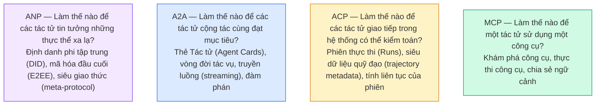

Chúng không phải là đối thủ cạnh tranh triệt tiêu lẫn nhau. Chúng giải quyết những bài toán khác nhau ở các cấp độ trừu tượng khác nhau.

### Nhắc lại về MCP (Recap)

MCP đã được tìm hiểu chuyên sâu trong Phase 13. Tóm tắt nhanh: MCP chuẩn hóa cách một mô hình ngôn ngữ lớn (LLM) kết nối với các công cụ và nguồn dữ liệu bên ngoài. Đây là một giao thức **khách - chủ (client-server)**, trong đó tác tử (client) khám phá và gọi các công cụ được máy chủ (server) công bố.

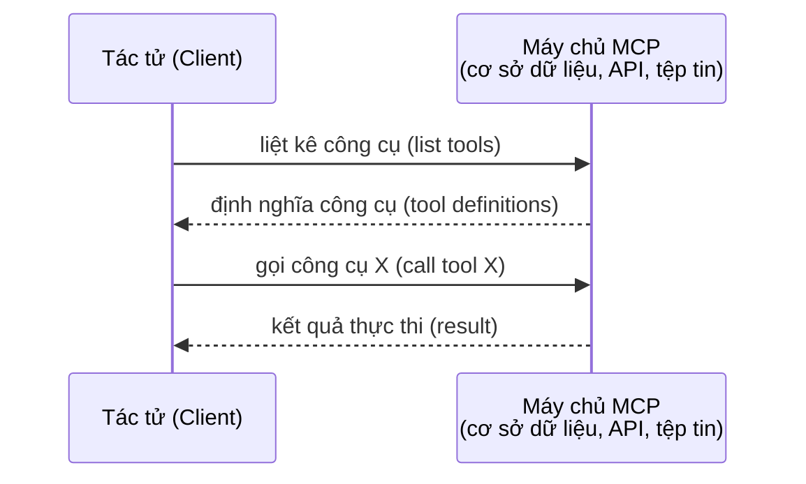

MCP là giao tiếp **tác tử tới công cụ (agent-to-tool)**. Nó không sinh ra để giúp các tác tử trò chuyện với nhau.

### A2A (Giao thức Tác tử với Tác tử - Agent2Agent Protocol)

**Được khởi xướng bởi:** Google (hiện được bảo trợ dưới Linux Foundation với định danh `lf.a2a.v1`)
**Phiên bản đặc tả:** 1.0.1
**Bài toán giải quyết:** Làm thế nào để các tác tử tự chủ có thể cộng tác, đàm phán và ủy quyền tác vụ cho nhau?

A2A là giao thức phục vụ **sự cộng tác ngang hàng giữa các tác tử (peer-to-peer agent collaboration)**. Trong khi MCP kết nối tác tử với công cụ, A2A kết nối tác tử với tác tử khác. Mỗi tác tử xuất bản một **Thẻ Tác tử (Agent Card)** tại một URL chuẩn hóa (well-known URL), từ đó các tác tử khác có thể tự động khám phá, đàm phán và ủy quyền nhiệm vụ cho nó.

#### Cách thức Vận hành của A2A

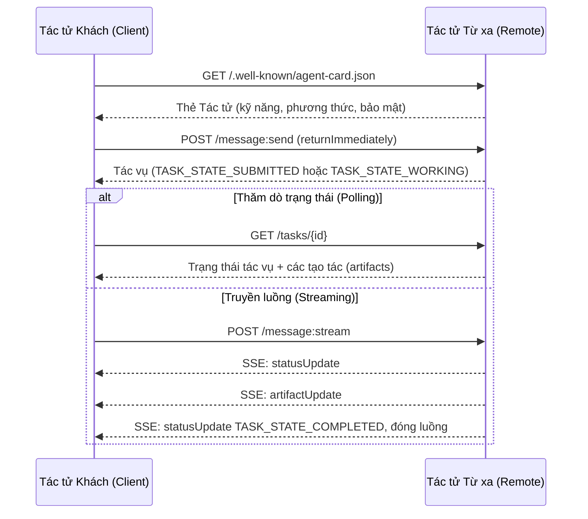

#### Cấu trúc Thực tế của Thẻ Tác tử (Agent Card)

Dưới đây là diện mạo thực tế của một Thẻ Tác tử A2A chuẩn mực được phục vụ tại đường dẫn `GET /.well-known/agent-card.json`:

```json
{
  "name": "Research Agent",
  "description": "Searches documentation and summarizes findings",
  "version": "1.0.0",
  "supportedInterfaces": [
    {
      "url": "https://research-agent.example.com/a2a/v1",
      "protocolBinding": "JSONRPC",
      "protocolVersion": "1.0"
    },
    {
      "url": "https://research-agent.example.com/a2a/rest",
      "protocolBinding": "HTTP+JSON",
      "protocolVersion": "1.0"
    }
  ],
  "provider": {
    "organization": "Your Company",
    "url": "https://example.com"
  },
  "capabilities": {
    "streaming": true,
    "pushNotifications": false
  },
  "defaultInputModes": ["text/plain", "application/json"],
  "defaultOutputModes": ["text/plain", "application/json"],
  "skills": [
    {
      "id": "web-research",
      "name": "Web Research",
      "description": "Searches the web and synthesizes findings",
      "tags": ["research", "search", "summarization"],
      "examples": ["Research the latest changes in React 19"]
    },
    {
      "id": "doc-analysis",
      "name": "Documentation Analysis",
      "description": "Reads and analyzes technical documentation",
      "tags": ["docs", "analysis"],
      "inputModes": ["text/plain", "application/pdf"],
      "outputModes": ["application/json"]
    }
  ],
  "securitySchemes": {
    "bearer": {
      "httpAuthSecurityScheme": {
        "scheme": "Bearer",
        "bearerFormat": "JWT"
      }
    }
  },
  "securityRequirements": [{ "schemes": { "bearer": { "list": [] } } }]
}
```

Các điểm mấu chốt cần lưu ý:
- **Kỹ năng (Skills)** đại diện cho năng lực tác tử có thể thực hiện. Mỗi kỹ năng có định danh ID, các thẻ phân loại (tags) và kiểu MIME đầu vào/đầu ra được hỗ trợ. Dựa vào đây, tác tử khách sẽ quyết định xem tác tử từ xa này có đủ năng lực xử lý yêu cầu hay không.
- **supportedInterfaces** liệt kê các liên kết giao thức được hỗ trợ. Một tác tử có thể hỗ trợ đồng thời JSON-RPC, REST và gRPC.
- **Cơ chế bảo mật (Security)** được tích hợp trực tiếp: `securitySchemes` đặt tên cho từng cơ chế xác thực và `securityRequirements` nêu rõ những cơ chế nào bắt buộc áp dụng. Tác tử khách biết rõ cần phương thức xác thực nào trước khi gửi đi yêu cầu đầu tiên.

#### Vòng đời Tác vụ (Task Lifecycle)

Tác vụ (Task) là đơn vị công việc trung tâm trong A2A. Tác vụ chuyển đổi qua các trạng thái xác định rõ ràng (sơ đồ dưới đây lược bỏ tiền tố `TASK_STATE_` xuất hiện trên đường truyền):

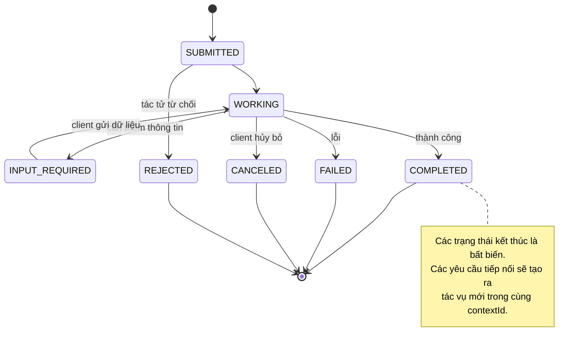

Toàn bộ 8 trạng thái (đặc tả còn định nghĩa thêm `UNSPECIFIED` làm lính canh (sentinel), được giản lược ở đây):

| Trạng thái | Là trạng thái kết thúc (Terminal)? | Ý nghĩa |
|---|---|---|
| `TASK_STATE_SUBMITTED` | Không | Đã tiếp nhận yêu cầu, chưa bắt đầu xử lý |
| `TASK_STATE_WORKING` | Không | Đang tích cực xử lý tác vụ |
| `TASK_STATE_INPUT_REQUIRED` | Không | Tác tử cần tác tử khách cung cấp thêm thông tin |
| `TASK_STATE_AUTH_REQUIRED` | Không | Yêu cầu phải xác thực danh tính |
| `TASK_STATE_COMPLETED` | Có | Tác vụ hoàn thành thành công |
| `TASK_STATE_FAILED` | Có | Tác vụ kết thúc do lỗi |
| `TASK_STATE_CANCELED` | Có | Bị hủy bỏ trước khi hoàn tất |
| `TASK_STATE_REJECTED` | Có | Tác tử chủ động từ chối tiếp nhận tác vụ |

Một khi tác vụ đã rơi vào trạng thái kết thúc (terminal state), nó trở thành bất biến (immutable). Không tin nhắn nào có thể gửi thêm vào tác vụ đó. Các tương tác tiếp theo phải tạo một tác vụ mới nằm trong cùng `contextId`.

#### Định dạng Dữ liệu trên Đường truyền (Wire Format)

A2A sử dụng JSON-RPC 2.0. Dưới đây là luồng thông điệp trao đổi thực tế:

**Tác tử khách gửi thông điệp:**
```json
{
  "jsonrpc": "2.0",
  "id": 1,
  "method": "SendMessage",
  "params": {
    "message": {
      "messageId": "msg-001",
      "role": "ROLE_USER",
      "parts": [{ "text": "Research React 19 compiler features" }]
    },
    "configuration": {
      "acceptedOutputModes": ["text/plain", "application/json"],
      "historyLength": 10
    }
  }
}
```

**Tác tử phản hồi lại bằng một tác vụ:**
```json
{
  "jsonrpc": "2.0",
  "id": 1,
  "result": {
    "task": {
      "id": "task-abc-123",
      "contextId": "ctx-xyz-789",
      "status": {
        "state": "TASK_STATE_COMPLETED",
        "timestamp": "2026-03-27T10:30:00Z"
      },
      "artifacts": [
        {
          "artifactId": "art-001",
          "name": "research-results",
          "parts": [{
            "data": {
              "findings": [
                "React 19 compiler auto-memoizes components",
                "No more manual useMemo/useCallback needed",
                "Compiler runs at build time, not runtime"
              ]
            },
            "mediaType": "application/json"
          }]
        }
      ]
    }
  }
}
```

**Truyền luồng dữ liệu thông qua SSE:**
```text
POST /message:stream HTTP/1.1
Content-Type: application/a2a+json
A2A-Version: 1.0

data: {"task":{"id":"task-123","contextId":"ctx-123","status":{"state":"TASK_STATE_WORKING"}}}

data: {"statusUpdate":{"taskId":"task-123","contextId":"ctx-123","status":{"state":"TASK_STATE_WORKING","message":{"messageId":"msg-002","role":"ROLE_AGENT","parts":[{"text":"Searching documentation..."}]}}}}

data: {"artifactUpdate":{"taskId":"task-123","contextId":"ctx-123","artifact":{"artifactId":"art-1","parts":[{"text":"partial findings..."}]},"append":true,"lastChunk":false}}

data: {"statusUpdate":{"taskId":"task-123","contextId":"ctx-123","status":{"state":"TASK_STATE_COMPLETED"}}}
```

### ACP (Giao thức Truyền thông Tác tử - Agent Communication Protocol)

**Được khởi xướng bởi:** IBM / BeeAI
**Phiên bản đặc tả:** 0.2.0 (OpenAPI 3.1.1)
**Tình trạng hiện tại:** Đang sáp nhập vào chuẩn A2A dưới sự quản lý của Linux Foundation
**Bài toán giải quyết:** Làm thế nào để các tác tử giao tiếp với khả năng kiểm toán toàn diện (auditability), duy trì phiên làm việc liên tục (session continuity) và truy vết quỹ đạo hoạt động (trajectory tracking)?

ACP là **giao thức dành cho doanh nghiệp**. Trái với nhiều thông tin tóm tắt thiếu chính xác, ACP **không** sử dụng JSON-LD. Nó là một REST/JSON API chuẩn mực được định nghĩa qua OpenAPI. Điểm tạo nên sự khác biệt vượt trội của nó là **TrajectoryMetadata**: mọi phản hồi của tác tử đều có thể đính kèm nhật ký chi tiết về các bước lập luận và các lượt gọi công cụ đã tạo ra kết quả đó.

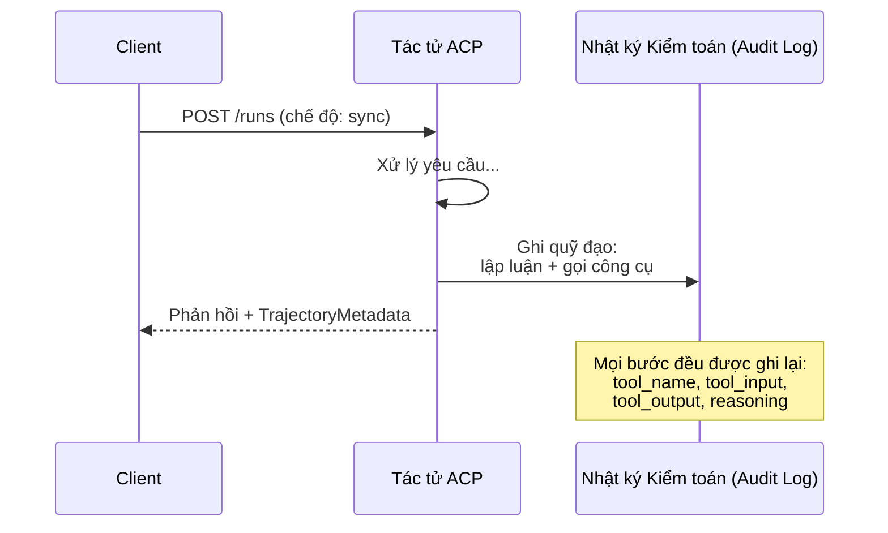

#### Cơ chế Khám phá Tác tử trong ACP

ACP định nghĩa 4 phương thức khám phá tác tử:

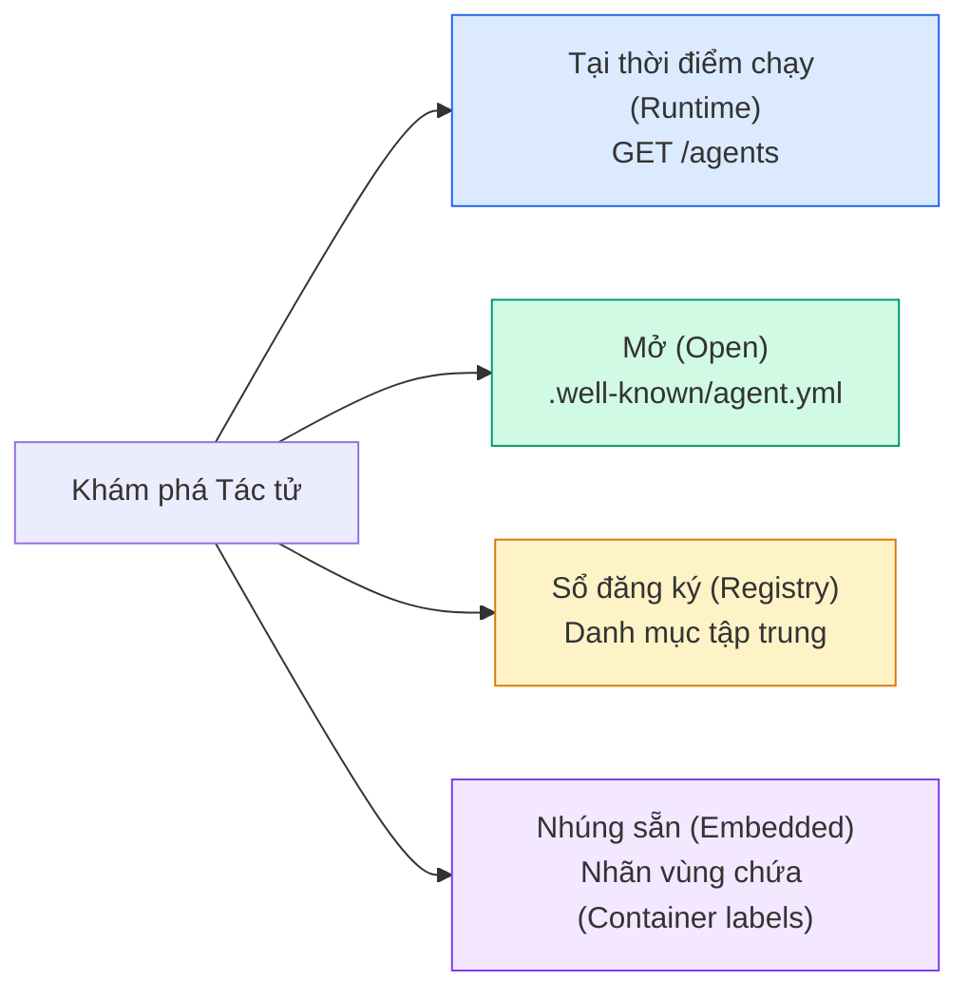

**Bản kê khai Tác tử (AgentManifest)** của ACP đơn giản hơn Thẻ Tác tử của A2A:

```json
{
  "name": "summarizer",
  "description": "Summarizes documents with source citations",
  "input_content_types": ["text/plain", "application/pdf"],
  "output_content_types": ["text/plain", "application/json"],
  "metadata": {
    "tags": ["summarization", "RAG"],
    "framework": "BeeAI",
    "capabilities": [
      {
        "name": "Document Summarization",
        "description": "Condenses long documents into key points"
      }
    ],
    "recommended_models": ["llama3.3:70b-instruct-fp16"],
    "license": "Apache-2.0",
    "programming_language": "Python"
  }
}
```

#### Vòng đời Phiên thực thi (Run Lifecycle)

ACP sử dụng thuật ngữ "Runs" thay vì "Tasks". Một Run là một phiên thực thi của tác tử với 3 chế độ hoạt động:

| Chế độ (Mode) | Hành vi |
|---|---|
| `sync` | Đồng bộ, chặn luồng (blocking). Phản hồi trả về kết quả hoàn chỉnh ngay lập tức. |
| `async` | Bất đồng bộ. Trả về mã 202 ngay tức thì. Tác tử khách thăm dò `GET /runs/{id}` để cập nhật trạng thái. |
| `stream` | Truyền luồng qua SSE. Các sự kiện được kích hoạt theo thời gian thực khi tác tử làm việc. |

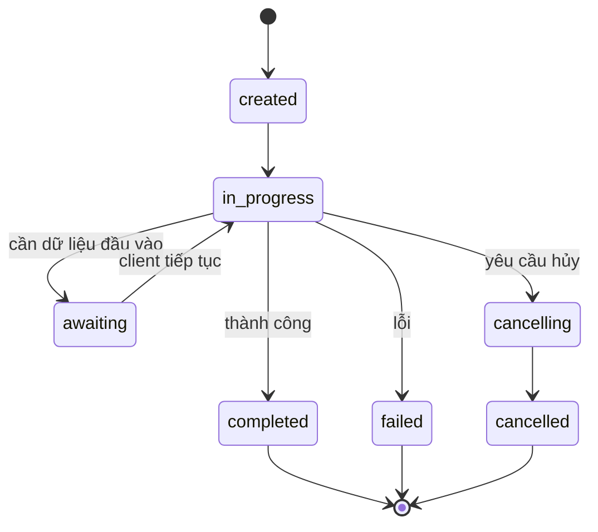

#### TrajectoryMetadata (Dấu vết Kiểm toán Chuyên sâu)

Đây là vũ khí chiến lược của ACP. Mọi phần nội dung tin nhắn đều có thể đính kèm siêu dữ liệu mô tả chính xác những gì tác tử đã làm:

```json
{
  "role": "agent/researcher",
  "parts": [
    {
      "content_type": "text/plain",
      "content": "The weather in San Francisco is 72F and sunny.",
      "metadata": {
        "kind": "trajectory",
        "message": "I need to check the weather for this location",
        "tool_name": "weather_api",
        "tool_input": { "location": "San Francisco, CA" },
        "tool_output": { "temperature": 72, "condition": "sunny" }
      }
    }
  ]
}
```

Đối với các ngành công nghiệp chịu sự quản lý nghiêm ngặt (tài chính, y tế), điều này mang tính sống còn. Mọi câu trả lời đều đi kèm một chuỗi lập luận có thể kiểm chứng toán học: công cụ nào đã được gọi, đầu vào ra sao, dữ liệu phản hồi là gì. Không còn tình trạng "hộp đen" bí ẩn.

ACP cũng hỗ trợ **CitationMetadata** phục vụ trích dẫn nguồn gốc dữ liệu:

```json
{
  "kind": "citation",
  "start_index": 0,
  "end_index": 47,
  "url": "https://weather.gov/sf",
  "title": "NWS San Francisco Forecast"
}
```

### ANP (Giao thức Mạng lưới Tác tử - Agent Network Protocol)

**Được khởi xướng bởi:** Cộng đồng mã nguồn mở (thành lập bởi GaoWei Chang)
**Kho lưu trữ:** [github.com/agent-network-protocol/AgentNetworkProtocol](https://github.com/agent-network-protocol/AgentNetworkProtocol)
**Bài toán giải quyết:** Làm thế nào để các tác tử đến từ các tổ chức khác nhau có thể tin tưởng nhau mà không cần thông qua một cơ quan trung ương tập quyền?

ANP là **giao thức định danh phi tập trung (decentralized identity protocol)**. Nó xây dựng niềm tin thông qua chuẩn Định danh Phi tập trung của W3C (Decentralized Identifiers - DIDs) và kỹ thuật mã hóa đầu cuối (end-to-end encryption). Không giống A2A vốn giả định bạn khám phá tác tử qua các điểm cuối đã biết trước, ANP cho phép tác tử chứng minh danh tính của mình bằng mật mã học (cryptography).

ANP gồm ba tầng kiến trúc:

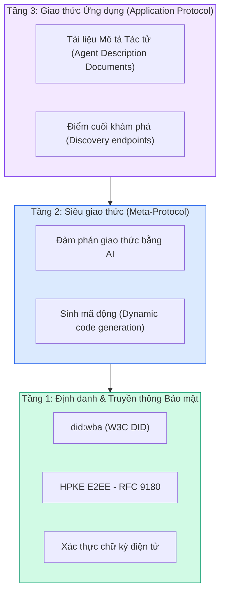

#### Tài liệu DID (Cấu trúc Thực tế)

ANP sử dụng một phương thức DID tùy biến mang tên `did:wba` (Web-Based Agent). Định danh DID `did:wba:example.com:user:alice` sẽ được phân giải về địa chỉ `https://example.com/user/alice/did.json`:

```json
{
  "@context": [
    "https://www.w3.org/ns/did/v1",
    "https://w3id.org/security/suites/jws-2020/v1",
    "https://w3id.org/security/suites/secp256k1-2019/v1"
  ],
  "id": "did:wba:example.com:user:alice",
  "verificationMethod": [
    {
      "id": "did:wba:example.com:user:alice#key-1",
      "type": "EcdsaSecp256k1VerificationKey2019",
      "controller": "did:wba:example.com:user:alice",
      "publicKeyJwk": {
        "crv": "secp256k1",
        "x": "NtngWpJUr-rlNNbs0u-Aa8e16OwSJu6UiFf0Rdo1oJ4",
        "y": "qN1jKupJlFsPFc1UkWinqljv4YE0mq_Ickwnjgasvmo",
        "kty": "EC"
      }
    },
    {
      "id": "did:wba:example.com:user:alice#key-x25519-1",
      "type": "X25519KeyAgreementKey2019",
      "controller": "did:wba:example.com:user:alice",
      "publicKeyMultibase": "z9hFgmPVfmBZwRvFEyniQDBkz9LmV7gDEqytWyGZLmDXE"
    }
  ],
  "authentication": [
    "did:wba:example.com:user:alice#key-1"
  ],
  "keyAgreement": [
    "did:wba:example.com:user:alice#key-x25519-1"
  ],
  "humanAuthorization": [
    "did:wba:example.com:user:alice#key-1"
  ],
  "service": [
    {
      "id": "did:wba:example.com:user:alice#agent-description",
      "type": "AgentDescription",
      "serviceEndpoint": "https://example.com/agents/alice/ad.json"
    }
  ]
}
```

Các chi tiết cốt lõi cần quan sát:
- **Tách biệt khóa (Key separation)** được thực thi nghiêm ngặt: Khóa ký (secp256k1) hoàn toàn tách biệt với khóa mã hóa dữ liệu (X25519).
- **`humanAuthorization`** là đặc trưng độc nhất của ANP. Những khóa này bắt buộc phải có sự phê duyệt trực tiếp của con người (sinh trắc học, mật mã, khóa phần cứng HSM) trước khi được sử dụng. Các hoạt động rủi ro cao như chuyển tiền bắt buộc phải đi qua luồng này.
- Khóa **`keyAgreement`** được dùng cho thuật toán mã hóa đầu cuối HPKE (RFC 9180).
- Phần **service** liên kết trực tiếp tới tài liệu Mô tả Tác tử (Agent Description).

#### Cơ chế Thiết lập Niềm tin trong ANP

ANP **không** sử dụng mạng lưới tín nhiệm (web-of-trust) hay đồ thị chứng thực phức tạp. Niềm tin mang tính song phương và được xác thực độc lập trên từng phiên tương tác:

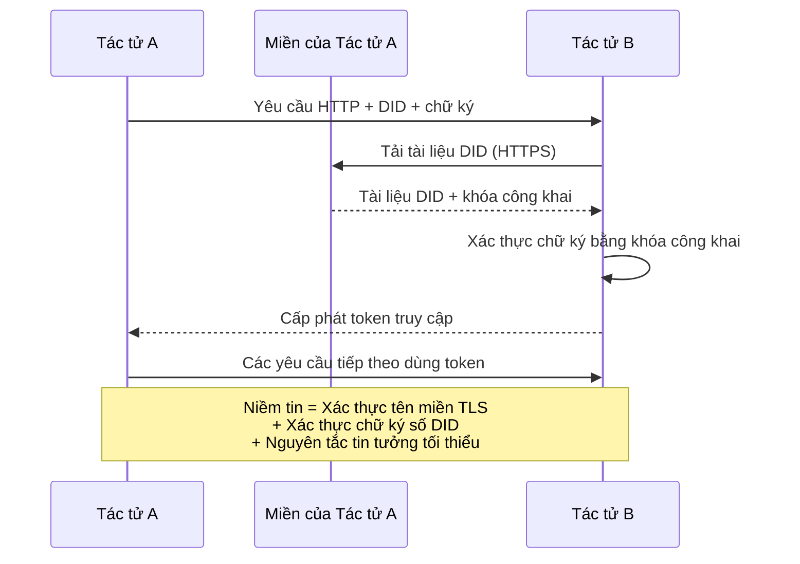

Niềm tin được xây dựng từ ba trụ cột:
1. **Xác thực tên miền qua TLS** đảm bảo máy chủ lưu trữ tài liệu DID là chính chủ.
2. **Chữ ký mật mã học DID** xác thực chính xác danh tính của tác tử gửi tin.
3. **Nguyên tắc tin tưởng tối thiểu (Principle of least trust)** chỉ cấp quyền hạn tối thiểu vừa đủ.

Không cần các thuật toán truyền bá niềm tin kiểu tin đồn (gossip) hay tính điểm PageRank. Bạn xác thực từng tác tử trực tiếp thông qua chính DID của nó.

#### Đàm phán Siêu giao thức (Meta-Protocol Negotiation)

Đây là tính năng độc đáo nhất của ANP. Khi hai tác tử từ hai hệ sinh thái hoàn toàn xa lạ lần đầu chạm mặt, chúng không cần phải thỏa thuận trước về cấu trúc dữ liệu. Chúng đàm phán trực tiếp bằng ngôn ngữ tự nhiên:

```json
{
  "action": "protocolNegotiation",
  "sequenceId": 0,
  "candidateProtocols": "I can communicate using:\n1. JSON-RPC with hotel booking schema\n2. REST with OpenAPI 3.1 spec\n3. Natural language over HTTP",
  "modificationSummary": "Initial proposal",
  "status": "negotiating"
}
```

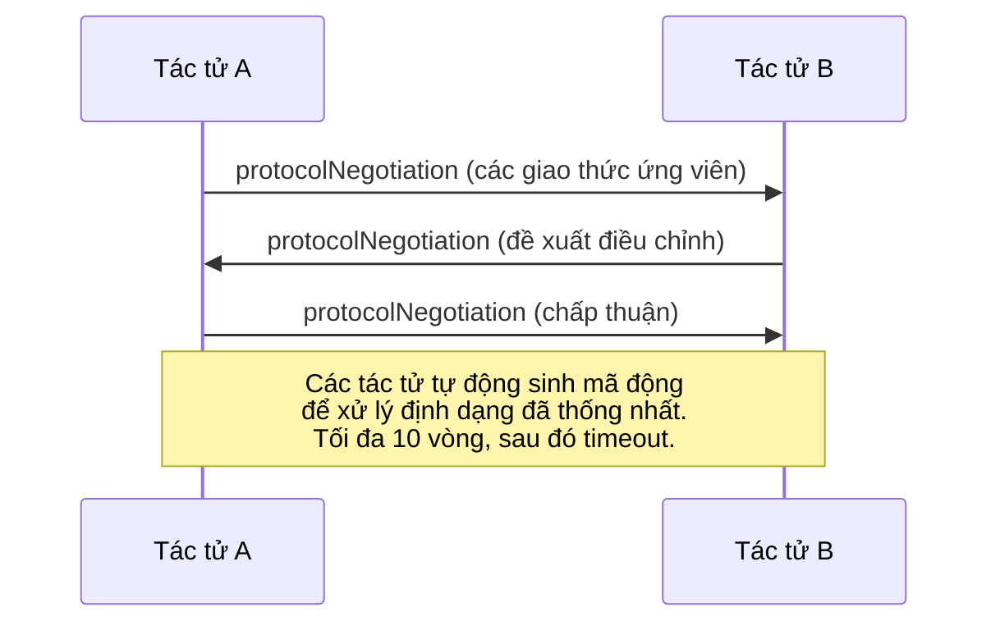

Hai tác tử trao đổi qua lại (tối đa 10 hiệp) cho tới khi đạt được sự đồng thuận về định dạng, sau đó sinh mã nguồn động (dynamic code generation) để xử lý định dạng đó. Các giá trị trạng thái gồm: `negotiating`, `rejected`, `accepted`, `timeout`.

Điều này đồng nghĩa với việc hai tác tử chưa từng biết đến sự tồn tại của nhau vẫn có thể tự tìm ra cách thức giao tiếp mà không cần bất kỳ lập trình viên nào phải viết sẵn lược đồ dữ liệu chung từ trước.

### Bảng So sánh Tổng hợp

| Tiêu chí | MCP | A2A | ACP | ANP |
|---|---|---|---|---|
| **Đơn vị sáng lập** | Anthropic | Google / Linux Foundation | IBM / BeeAI | Cộng đồng mã nguồn mở |
| **Định dạng đặc tả** | JSON-RPC | JSON-RPC / REST / gRPC | OpenAPI 3.1 (REST) | JSON-RPC |
| **Mục đích chính** | Tác tử tới Công cụ | Tác tử tới Tác tử | Tác tử tới Tác tử | Tác tử tới Tác tử |
| **Cơ chế khám phá** | Danh sách công cụ | `/.well-known/agent-card.json` | `GET /agents`, `/.well-known/agent.yml` | `/.well-known/agent-descriptions`, DID service endpoints |
| **Cơ chế định danh** | Ngầm định (cục bộ) | Các lược đồ bảo mật (OAuth, mTLS) | Cấp độ máy chủ | W3C DID (`did:wba`) với E2EE |
| **Dấu vết kiểm toán** | Không hỗ trợ | Cơ bản (lịch sử tác vụ) | TrajectoryMetadata (gọi công cụ, lập luận) | Chưa được đặc tả chính thức |
| **Máy trạng thái** | Không hỗ trợ | 9 trạng thái tác vụ | 7 trạng thái thực thi | Không hỗ trợ |
| **Truyền luồng dữ liệu** | Không hỗ trợ | SSE | SSE | Độc lập tầng vận chuyển |
| **Tính năng nổi bật** | Lược đồ định nghĩa công cụ | Thẻ Tác tử + Kỹ năng chuyên môn | Dấu vết quỹ đạo phục vụ kiểm toán | Đàm phán siêu giao thức linh hoạt |
| **Phù hợp nhất cho** | Công cụ & Dữ liệu | Cộng tác động giữa các tác tử | Ngành yêu cầu tuân thủ nghiêm ngặt | Xây dựng niềm tin liên tổ chức |
| **Tình trạng hiện tại** | Ổn định | Ổn định (v1.0) | Đang sáp nhập vào A2A | Đang phát triển tích cực |

### Cách thức Phối hợp Đồng bộ

Các giao thức này không triệt tiêu lẫn nhau. Một hệ thống thực tế cấp doanh nghiệp sẽ tận dụng sức mạnh tổng hợp của cả bốn giao thức:

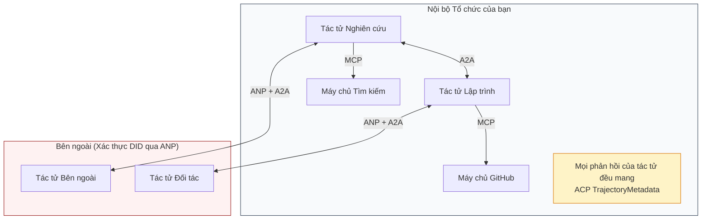

- **MCP** kết nối từng tác tử với các công cụ nghiệp vụ của nó.
- **A2A** quản lý sự phối hợp nhịp nhàng giữa các tác tử (cả nội bộ và bên ngoài).
- **ACP** bọc các phản hồi vào cấu trúc siêu dữ liệu quỹ đạo để phục vụ kiểm toán minh bạch.
- **ANP** cung cấp cơ chế xác thực danh tính cho các tác tử nằm ngoài tầm kiểm soát của tổ chức.

````figure
swarm-message-bus
````

## Tự tay xây dựng (Build It)

### Bước 1: Các Kiểu Thông điệp Cốt lõi

Mọi hệ đa tác tử đều khởi đầu từ một định dạng thông điệp nền tảng. Chúng ta định nghĩa các kiểu dữ liệu tương ứng chính xác với các giao thức thực tế:

```typescript
import crypto from "node:crypto";

type MessageRole = "ROLE_USER" | "ROLE_AGENT";

type MessagePart =
  | { text: string }
  | { data: unknown; mediaType: string }
  | { url: string; filename: string; mediaType: string };

type TrajectoryEntry = {
  reasoning: string;
  toolName?: string;
  toolInput?: unknown;
  toolOutput?: unknown;
  timestamp: number;
};

type AgentMessage = {
  id: string;
  role: MessageRole;
  parts: MessagePart[];
  trajectory?: TrajectoryEntry[];
  replyTo?: string;
  timestamp: number;
};

function createMessage(
  role: MessageRole,
  parts: MessagePart[],
  replyTo?: string
): AgentMessage {
  return {
    id: crypto.randomUUID(),
    role,
    parts,
    replyTo,
    timestamp: Date.now(),
  };
}

function textMessage(role: MessageRole, text: string): AgentMessage {
  return createMessage(role, [{ text }]);
}
```

Lưu ý: `MessagePart` hỗ trợ đa phương thức (văn bản thuần, dữ liệu có cấu trúc, tệp tin) hoàn toàn tương đồng với đặc tả chuẩn của A2A và ACP. Đúng như trong chuẩn A2A 1.0, sự hiện diện của trường nào (`text`, `data`, hoặc `url`) sẽ định nghĩa kiểu của thành phần đó mà không cần nhãn `kind`. `TrajectoryEntry` ghi lại chuỗi lập luận, tương ứng với TrajectoryMetadata của ACP.

### Bước 2: Thẻ Tác tử A2A và Sổ đăng ký (Registry)

Xây dựng hệ thống khám phá tác tử tương thích với đặc tả A2A:

```typescript
type Skill = {
  id: string;
  name: string;
  description: string;
  tags: string[];
  inputModes: string[];
  outputModes: string[];
};

type AgentInterface = {
  url: string;
  protocolBinding: string;
  protocolVersion: string;
};

type AgentCard = {
  name: string;
  description: string;
  version: string;
  supportedInterfaces: AgentInterface[];
  capabilities: {
    streaming: boolean;
    pushNotifications: boolean;
  };
  defaultInputModes: string[];
  defaultOutputModes: string[];
  skills: Skill[];
};

class AgentRegistry {
  private cards: Map<string, AgentCard> = new Map();

  register(card: AgentCard) {
    this.cards.set(card.name, card);
  }

  discoverBySkillTag(tag: string): AgentCard[] {
    return [...this.cards.values()].filter((card) =>
      card.skills.some((skill) => skill.tags.includes(tag))
    );
  }

  discoverByInputMode(mimeType: string): AgentCard[] {
    return [...this.cards.values()].filter(
      (card) =>
        card.defaultInputModes.includes(mimeType) ||
        card.skills.some((skill) => skill.inputModes.includes(mimeType))
    );
  }

  resolve(name: string): AgentCard | undefined {
    return this.cards.get(name);
  }

  listAll(): AgentCard[] {
    return [...this.cards.values()];
  }
}
```

Kiến trúc này phong phú hơn nhiều so với một bảng ánh xạ tên sang năng lực đơn thuần. Bạn có thể tìm kiếm tác tử theo thẻ kỹ năng, theo định dạng MIME đầu vào được hỗ trợ, hoặc theo định danh tên chuẩn xác như chuẩn A2A quy định.

### Bước 3: Vòng đời Tác vụ Chuẩn A2A

Xây dựng máy trạng thái tác vụ hoàn chỉnh:

```typescript
type TaskState =
  | "TASK_STATE_SUBMITTED"
  | "TASK_STATE_WORKING"
  | "TASK_STATE_INPUT_REQUIRED"
  | "TASK_STATE_AUTH_REQUIRED"
  | "TASK_STATE_COMPLETED"
  | "TASK_STATE_FAILED"
  | "TASK_STATE_CANCELED"
  | "TASK_STATE_REJECTED";

const TERMINAL_STATES: TaskState[] = [
  "TASK_STATE_COMPLETED",
  "TASK_STATE_FAILED",
  "TASK_STATE_CANCELED",
  "TASK_STATE_REJECTED",
];

type TaskStatus = {
  state: TaskState;
  message?: AgentMessage;
  timestamp: number;
};

type Artifact = {
  id: string;
  name: string;
  parts: MessagePart[];
};

type Task = {
  id: string;
  contextId: string;
  status: TaskStatus;
  artifacts: Artifact[];
  history: AgentMessage[];
};

type TaskEvent =
  | { statusUpdate: { taskId: string; status: TaskStatus } }
  | {
      artifactUpdate: {
        taskId: string;
        artifact: Artifact;
        append: boolean;
        lastChunk: boolean;
      };
    };

type TaskHandler = (
  task: Task,
  message: AgentMessage
) => AsyncGenerator<TaskEvent>;

class TaskManager {
  private tasks: Map<string, Task> = new Map();
  private handlers: Map<string, TaskHandler> = new Map();
  private listeners: Map<string, ((event: TaskEvent) => void)[]> = new Map();

  registerHandler(agentName: string, handler: TaskHandler) {
    this.handlers.set(agentName, handler);
  }

  subscribe(taskId: string, listener: (event: TaskEvent) => void) {
    const existing = this.listeners.get(taskId) ?? [];
    existing.push(listener);
    this.listeners.set(taskId, existing);
  }

  async sendMessage(
    agentName: string,
    message: AgentMessage,
    contextId?: string
  ): Promise<Task> {
    const handler = this.handlers.get(agentName);
    if (!handler) {
      const task = this.createTask(contextId);
      task.status = {
        state: "TASK_STATE_REJECTED",
        timestamp: Date.now(),
        message: textMessage("ROLE_AGENT", `No handler for ${agentName}`),
      };
      return task;
    }

    const task = this.createTask(contextId);
    task.history.push(message);
    task.status = { state: "TASK_STATE_SUBMITTED", timestamp: Date.now() };

    this.processTask(task, handler, message).catch((err) => {
      task.status = {
        state: "TASK_STATE_FAILED",
        timestamp: Date.now(),
        message: textMessage("ROLE_AGENT", String(err)),
      };
    });
    return task;
  }

  getTask(taskId: string): Task | undefined {
    return this.tasks.get(taskId);
  }

  cancelTask(taskId: string): boolean {
    const task = this.tasks.get(taskId);
    if (!task || TERMINAL_STATES.includes(task.status.state)) return false;
    task.status = { state: "TASK_STATE_CANCELED", timestamp: Date.now() };
    this.emit(taskId, {
      statusUpdate: { taskId, status: task.status },
    });
    return true;
  }

  private createTask(contextId?: string): Task {
    const task: Task = {
      id: crypto.randomUUID(),
      contextId: contextId ?? crypto.randomUUID(),
      status: { state: "TASK_STATE_SUBMITTED", timestamp: Date.now() },
      artifacts: [],
      history: [],
    };
    this.tasks.set(task.id, task);
    return task;
  }

  private async processTask(
    task: Task,
    handler: TaskHandler,
    message: AgentMessage
  ) {
    task.status = { state: "TASK_STATE_WORKING", timestamp: Date.now() };
    this.emit(task.id, {
      statusUpdate: { taskId: task.id, status: task.status },
    });

    try {
      for await (const event of handler(task, message)) {
        if (TERMINAL_STATES.includes(task.status.state)) break;

        if ("statusUpdate" in event) {
          task.status = event.statusUpdate.status;
        }
        if ("artifactUpdate" in event) {
          const update = event.artifactUpdate;
          const existing = task.artifacts.find(
            (a) => a.id === update.artifact.id
          );
          if (existing && update.append) {
            existing.parts.push(...update.artifact.parts);
          } else {
            task.artifacts.push(update.artifact);
          }
        }
        this.emit(task.id, event);
      }
    } catch (err) {
      task.status = {
        state: "TASK_STATE_FAILED",
        timestamp: Date.now(),
        message: textMessage("ROLE_AGENT", String(err)),
      };
      this.emit(task.id, {
        statusUpdate: { taskId: task.id, status: task.status },
      });
    }
  }

  private emit(taskId: string, event: TaskEvent) {
    for (const listener of this.listeners.get(taskId) ?? []) {
      listener(event);
    }
  }
}
```

Cấu trúc này mô phỏng trọn vẹn vòng đời tác vụ A2A: `TASK_STATE_SUBMITTED`, `TASK_STATE_WORKING`, `TASK_STATE_INPUT_REQUIRED`, rồi chuyển sang một trạng thái kết thúc (terminal state). Các hàm xử lý là các bộ sinh bất đồng bộ (async generators) tạo ra các sự kiện `statusUpdate` và `artifactUpdate`, đúng với các khối dữ liệu truyền tải qua luồng SSE trong thực tế.

### Bước 4: Chuỗi Dấu vết Kiểm toán theo Phong cách ACP

Bao bọc luồng giao tiếp bằng cơ chế ghi vết quỹ đạo hoạt động:

```typescript
type AuditEntry = {
  runId: string;
  agentName: string;
  input: AgentMessage[];
  output: AgentMessage[];
  trajectory: TrajectoryEntry[];
  status: "created" | "in-progress" | "completed" | "failed" | "awaiting";
  startedAt: number;
  completedAt?: number;
  sessionId?: string;
};

class AuditableRunner {
  private log: AuditEntry[] = [];
  private handlers: Map<
    string,
    (input: AgentMessage[]) => Promise<{
      output: AgentMessage[];
      trajectory: TrajectoryEntry[];
    }>
  > = new Map();

  registerAgent(
    name: string,
    handler: (input: AgentMessage[]) => Promise<{
      output: AgentMessage[];
      trajectory: TrajectoryEntry[];
    }>
  ) {
    this.handlers.set(name, handler);
  }

  async run(
    agentName: string,
    input: AgentMessage[],
    sessionId?: string
  ): Promise<AuditEntry> {
    const entry: AuditEntry = {
      runId: crypto.randomUUID(),
      agentName,
      input: structuredClone(input),
      output: [],
      trajectory: [],
      status: "created",
      startedAt: Date.now(),
      sessionId,
    };
    this.log.push(entry);

    const handler = this.handlers.get(agentName);
    if (!handler) {
      entry.status = "failed";
      return entry;
    }

    entry.status = "in-progress";
    try {
      const result = await handler(input);
      entry.output = structuredClone(result.output);
      entry.trajectory = structuredClone(result.trajectory);
      entry.status = "completed";
      entry.completedAt = Date.now();
    } catch (err) {
      entry.status = "failed";
      entry.trajectory.push({
        reasoning: `Error: ${String(err)}`,
        timestamp: Date.now(),
      });
      entry.completedAt = Date.now();
    }
    return entry;
  }

  getFullAuditLog(): AuditEntry[] {
    return structuredClone(this.log);
  }

  getAuditLogForAgent(agentName: string): AuditEntry[] {
    return structuredClone(
      this.log.filter((e) => e.agentName === agentName)
    );
  }

  getAuditLogForSession(sessionId: string): AuditEntry[] {
    return structuredClone(
      this.log.filter((e) => e.sessionId === sessionId)
    );
  }

  getTrajectoryForRun(runId: string): TrajectoryEntry[] {
    const entry = this.log.find((e) => e.runId === runId);
    return entry ? structuredClone(entry.trajectory) : [];
  }
}
```

Mỗi phiên thực thi của tác tử đều sinh ra một bản ghi kiểm toán toàn diện: đầu vào nhận gì, đầu ra trả về gì, và toàn bộ chuỗi các bước gọi công cụ cùng lập luận trung gian. Bạn có thể truy vấn nhật ký theo tác tử, theo phiên làm việc, hoặc theo từng lần chạy riêng lẻ.

### Bước 5: Xác thực Danh tính theo Phong cách ANP

Xây dựng cơ chế định danh và xác thực dựa trên chuẩn DID:

```typescript
type VerificationMethod = {
  id: string;
  type: string;
  controller: string;
  publicKeyDer: string;
};

type DIDDocument = {
  id: string;
  verificationMethod: VerificationMethod[];
  authentication: string[];
  keyAgreement: string[];
  humanAuthorization: string[];
  service: { id: string; type: string; serviceEndpoint: string }[];
};

type AgentIdentity = {
  did: string;
  document: DIDDocument;
  privateKey: crypto.KeyObject;
  publicKey: crypto.KeyObject;
};

class IdentityRegistry {
  private documents: Map<string, DIDDocument> = new Map();

  publish(doc: DIDDocument) {
    this.documents.set(doc.id, doc);
  }

  resolve(did: string): DIDDocument | undefined {
    return this.documents.get(did);
  }

  verify(did: string, signature: string, payload: string): boolean {
    const doc = this.documents.get(did);
    if (!doc) return false;

    const authKeyIds = doc.authentication;
    const authKeys = doc.verificationMethod.filter((vm) =>
      authKeyIds.includes(vm.id)
    );

    for (const key of authKeys) {
      const publicKey = crypto.createPublicKey({
        key: Buffer.from(key.publicKeyDer, "base64"),
        format: "der",
        type: "spki",
      });
      const isValid = crypto.verify(
        null,
        Buffer.from(payload),
        publicKey,
        Buffer.from(signature, "hex")
      );
      if (isValid) return true;
    }
    return false;
  }

  requiresHumanAuth(did: string, operationKeyId: string): boolean {
    const doc = this.documents.get(did);
    if (!doc) return false;
    return doc.humanAuthorization.includes(operationKeyId);
  }
}

function createIdentity(domain: string, agentName: string): AgentIdentity {
  const did = `did:wba:${domain}:agent:${agentName}`;
  const { publicKey, privateKey } = crypto.generateKeyPairSync("ed25519");

  const publicKeyDer = publicKey
    .export({ format: "der", type: "spki" })
    .toString("base64");

  const keyId = `${did}#key-1`;
  const encKeyId = `${did}#key-x25519-1`;

  const document: DIDDocument = {
    id: did,
    verificationMethod: [
      {
        id: keyId,
        type: "Ed25519VerificationKey2020",
        controller: did,
        publicKeyDer,
      },
      {
        id: encKeyId,
        type: "X25519KeyAgreementKey2019",
        controller: did,
        publicKeyDer,
      },
    ],
    authentication: [keyId],
    keyAgreement: [encKeyId],
    humanAuthorization: [],
    service: [
      {
        id: `${did}#agent-description`,
        type: "AgentDescription",
        serviceEndpoint: `https://${domain}/agents/${agentName}/ad.json`,
      },
    ],
  };

  return { did, document, privateKey, publicKey };
}

function signPayload(identity: AgentIdentity, payload: string): string {
  return crypto
    .sign(null, Buffer.from(payload), identity.privateKey)
    .toString("hex");
}
```

Phần này phản ánh chính xác mô hình định danh của ANP: các tác tử sở hữu tài liệu DID với các khóa xác thực, khóa thỏa thuận mã hóa và khóa ủy quyền con người riêng biệt. Lớp `IdentityRegistry` mô phỏng việc phân giải DID (trong môi trường sản xuất thực tế, đây sẽ là các lượt gọi HTTP tới tên miền của tác tử).

### Bước 6: Cổng Giao thức Hợp nhất (Protocol Gateway)

Kết nối cả bốn giao thức vào một hệ thống thống nhất:

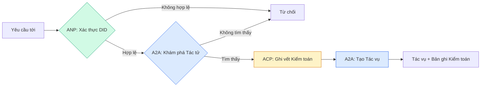

```typescript
class ProtocolGateway {
  private registry: AgentRegistry;
  private taskManager: TaskManager;
  private auditRunner: AuditableRunner;
  private identityRegistry: IdentityRegistry;

  constructor(
    registry: AgentRegistry,
    taskManager: TaskManager,
    auditRunner: AuditableRunner,
    identityRegistry: IdentityRegistry
  ) {
    this.registry = registry;
    this.taskManager = taskManager;
    this.auditRunner = auditRunner;
    this.identityRegistry = identityRegistry;
  }

  async delegateTask(
    fromDid: string,
    signature: string,
    targetAgent: string,
    message: AgentMessage,
    sessionId?: string
  ): Promise<{ task: Task; audit: AuditEntry } | { error: string }> {
    if (!this.identityRegistry.verify(fromDid, signature, message.id)) {
      return { error: "Identity verification failed" };
    }

    const card = this.registry.resolve(targetAgent);
    if (!card) {
      return { error: `Agent ${targetAgent} not found in registry` };
    }

    const audit = await this.auditRunner.run(
      targetAgent,
      [message],
      sessionId
    );
    const task = await this.taskManager.sendMessage(targetAgent, message);

    return { task, audit };
  }

  discoverAndDelegate(
    fromDid: string,
    signature: string,
    skillTag: string,
    message: AgentMessage
  ): Promise<{ task: Task; audit: AuditEntry } | { error: string }> {
    const candidates = this.registry.discoverBySkillTag(skillTag);
    if (candidates.length === 0) {
      return Promise.resolve({
        error: `No agents found with skill tag: ${skillTag}`,
      });
    }
    return this.delegateTask(
      fromDid,
      signature,
      candidates[0].name,
      message
    );
  }
}
```

Cổng kết nối thực hiện 4 tác vụ cốt lõi trong một lệnh gọi duy nhất:
1. **ANP**: Xác thực danh tính của bên gọi thông qua chữ ký số DID.
2. **A2A**: Khám phá tác tử mục tiêu và đối chiếu khả năng đáp ứng.
3. **ACP**: Gói phiên thực thi vào một bản ghi kiểm toán chứa toàn bộ chuỗi quỹ đạo.
4. **A2A**: Khởi tạo một tác vụ với đầy đủ cơ chế truy vết vòng đời.

### Bước 7: Kết nối Toàn bộ Hệ thống

```typescript
async function protocolDemo() {
  const registry = new AgentRegistry();
  registry.register({
    name: "researcher",
    description: "Searches and summarizes findings",
    version: "1.0.0",
    supportedInterfaces: [
      {
        url: "https://researcher.local/a2a/v1",
        protocolBinding: "JSONRPC",
        protocolVersion: "1.0",
      },
    ],
    capabilities: { streaming: true, pushNotifications: false },
    defaultInputModes: ["text/plain"],
    defaultOutputModes: ["text/plain", "application/json"],
    skills: [
      {
        id: "web-research",
        name: "Web Research",
        description: "Searches the web",
        tags: ["research", "search", "summarization"],
        inputModes: ["text/plain"],
        outputModes: ["application/json"],
      },
    ],
  });
  registry.register({
    name: "coder",
    description: "Writes code from specs",
    version: "1.0.0",
    supportedInterfaces: [
      {
        url: "https://coder.local/a2a/v1",
        protocolBinding: "JSONRPC",
        protocolVersion: "1.0",
      },
    ],
    capabilities: { streaming: false, pushNotifications: false },
    defaultInputModes: ["text/plain", "application/json"],
    defaultOutputModes: ["text/plain"],
    skills: [
      {
        id: "code-gen",
        name: "Code Generation",
        description: "Generates code",
        tags: ["coding", "generation"],
        inputModes: ["text/plain", "application/json"],
        outputModes: ["text/plain"],
      },
    ],
  });

  const taskManager = new TaskManager();
  const auditRunner = new AuditableRunner();

  const researchTrajectory: TrajectoryEntry[] = [];

  taskManager.registerHandler(
    "researcher",
    async function* (task, message) {
      yield {
        statusUpdate: {
          taskId: task.id,
          status: {
            state: "TASK_STATE_WORKING" as const,
            timestamp: Date.now(),
          },
        },
      };

      researchTrajectory.push({
        reasoning: "Searching for React 19 documentation",
        toolName: "web_search",
        toolInput: { query: "React 19 compiler features" },
        toolOutput: {
          results: ["react.dev/blog/react-19", "github.com/react/react"],
        },
        timestamp: Date.now(),
      });

      researchTrajectory.push({
        reasoning: "Extracting key findings from search results",
        toolName: "doc_analysis",
        toolInput: { url: "react.dev/blog/react-19" },
        toolOutput: {
          summary:
            "React 19 compiler auto-memoizes, no manual useMemo needed",
        },
        timestamp: Date.now(),
      });

      yield {
        artifactUpdate: {
          taskId: task.id,
          artifact: {
            id: crypto.randomUUID(),
            name: "research-results",
            parts: [
              {
                data: {
                  findings: [
                    "React 19 compiler auto-memoizes components",
                    "No more manual useMemo/useCallback needed",
                    "Compiler runs at build time, not runtime",
                  ],
                  sources: ["react.dev/blog/react-19"],
                },
                mediaType: "application/json",
              },
            ],
          },
          append: false,
          lastChunk: true,
        },
      };

      yield {
        statusUpdate: {
          taskId: task.id,
          status: {
            state: "TASK_STATE_COMPLETED" as const,
            timestamp: Date.now(),
          },
        },
      };
    }
  );

  auditRunner.registerAgent("researcher", async () => ({
    output: [
      textMessage("ROLE_AGENT", "React 19 compiler auto-memoizes components"),
    ],
    trajectory: researchTrajectory,
  }));

  const identityRegistry = new IdentityRegistry();

  const coderIdentity = createIdentity("coder.local", "coder");
  const researcherIdentity = createIdentity("researcher.local", "researcher");

  identityRegistry.publish(coderIdentity.document);
  identityRegistry.publish(researcherIdentity.document);

  const gateway = new ProtocolGateway(
    registry,
    taskManager,
    auditRunner,
    identityRegistry
  );

  console.log("=== Protocol Demo ===\n");

  console.log("1. Agent Discovery (A2A)");
  const researchAgents = registry.discoverBySkillTag("research");
  console.log(
    `   Found ${researchAgents.length} agent(s):`,
    researchAgents.map((a) => a.name)
  );

  console.log("\n2. Identity Verification (ANP)");
  const message = textMessage("ROLE_USER", "Research React 19 compiler features");
  const signature = signPayload(coderIdentity, message.id);
  const verified = identityRegistry.verify(
    coderIdentity.did,
    signature,
    message.id
  );
  console.log(`   Coder DID: ${coderIdentity.did}`);
  console.log(`   Signature verified: ${verified}`);

  console.log("\n3. Task Delegation (A2A + ACP + ANP)");
  const result = await gateway.delegateTask(
    coderIdentity.did,
    signature,
    "researcher",
    message,
    "session-001"
  );

  if ("error" in result) {
    console.log(`   Error: ${result.error}`);
    return;
  }

  console.log(`   Task ID: ${result.task.id}`);
  console.log(`   Task state: ${result.task.status.state}`);
  console.log(`   Artifacts: ${result.task.artifacts.length}`);

  console.log("\n4. Audit Trail (ACP)");
  console.log(`   Run ID: ${result.audit.runId}`);
  console.log(`   Status: ${result.audit.status}`);
  console.log(`   Trajectory steps: ${result.audit.trajectory.length}`);
  for (const step of result.audit.trajectory) {
    console.log(`     - ${step.reasoning}`);
    if (step.toolName) {
      console.log(`       Tool: ${step.toolName}`);
    }
  }

  console.log("\n5. Full Audit Log");
  const fullLog = auditRunner.getFullAuditLog();
  console.log(`   Total runs: ${fullLog.length}`);
  for (const entry of fullLog) {
    const duration = entry.completedAt
      ? `${entry.completedAt - entry.startedAt}ms`
      : "in-progress";
    console.log(`   ${entry.agentName}: ${entry.status} (${duration})`);
  }
}

protocolDemo().catch((err) => {
  console.error("Protocol demo failed:", err);
  process.exitCode = 1;
});
```

## Các Vấn đề Tiềm ẩn trong Thực tế (What Goes Wrong)

Các giao thức vận hành rất êm đẹp trong kịch bản lý tưởng (happy path). Tuy nhiên, khi đưa lên môi trường sản xuất, bạn sẽ phải đối mặt với các sự cố sau:

**Trôi dạt lược đồ (Schema drift).** Tác tử A xuất bản Thẻ Tác tử cam kết đầu ra ở định dạng `application/json`. Nhưng lược đồ JSON lại thay đổi ngầm giữa các phiên bản phần mềm. Tác tử B phân tích cú pháp theo định dạng cũ và nhận về toàn dữ liệu rác. Giải pháp: gắn phiên bản cụ thể cho từng kỹ năng và lược đồ đầu ra. Bản đặc tả của A2A hỗ trợ trường `version` trong Thẻ Tác tử chính là để giải quyết vấn đề này.

**Vi phạm máy trạng thái (State machine violations).** Một trình xử lý tác tử phát ra bản cập nhật trạng thái `TASK_STATE_COMPLETED`, nhưng sau đó lại cố phát thêm các tạo tác dữ liệu (artifacts). Lúc này tác vụ đã trở thành bất biến. Mã nguồn của bạn sẽ âm thầm đánh rơi dữ liệu cập nhật hoặc ném ra ngoại lệ sụp đổ chương trình. Giải pháp: kiểm tra trạng thái kết thúc trước khi phát sự kiện. Lớp `TaskManager` ở trên thực thi nghiêm ngặt việc này bằng lệnh `break` ngay khi phát hiện trạng thái kết thúc.

**Lỗi phân giải niềm tin (Trust resolution failures).** Tác tử A cố gắng xác thực DID của Tác tử B, nhưng tên miền của Tác tử B tạm thời mất kết nối. Tài liệu DID không thể tải về được. Bạn sẽ chọn chấp nhận rủi ro (cho phép tác tử chưa xác thực tiếp tục chạy) hay đóng băng toàn bộ (từ chối mọi yêu cầu)? Chuẩn ANP khuyến nghị nên đóng băng từ chối (fail closed) dựa trên nguyên tắc tin tưởng tối thiểu.

**Phình to dữ liệu quỹ đạo (Trajectory bloat).** Tính năng ghi vết quỹ đạo của ACP rất mạnh mẽ nhưng vô cùng tốn kém tài nguyên lưu trữ. Một tác tử phức tạp thực hiện 200 lượt gọi công cụ mỗi lượt chạy sẽ tạo ra những bản ghi kiểm toán khổng lồ. Giải pháp: áp dụng các mức độ ghi chi tiết (verbosity levels) có thể cấu hình linh hoạt. Luôn ghi lại tên công cụ và dữ liệu vào/ra phục vụ việc tuân thủ quy chuẩn, nhưng có thể lược bỏ các bước suy luận nội tâm đối với các luồng công việc thông thường.

**Nghẽn cổ chai khi đồng loạt khám phá (Discovery thundering herd).** Khi khởi động cùng lúc, 50 tác tử đồng loạt gửi yêu cầu `GET /agents`. Giải pháp: lưu đệm (cache) Thẻ Tác tử với thời gian sống (TTL) hợp lý, làm lệch pha các khoảng thời gian khám phá, hoặc áp dụng cơ chế đẩy thông báo đăng ký (push-based registration) thay vì thăm dò liên tục.

## Ứng dụng thực tế (Use It)

### Các Bản Cài đặt Thực tế trong Ngành

**A2A** hiện là giao thức hoàn thiện nhất. Bản [đặc tả chính thức](https://github.com/google/A2A) của Google là mã nguồn mở dưới sự quản lý của Linux Foundation. Đã có sẵn SDK cho Python và TypeScript. Nếu hệ thống tác tử của bạn cần sự cộng tác và khám phá động, hãy bắt đầu từ đây.

**ACP** đang trong lộ trình sáp nhập vào A2A. Dự án [BeeAI của IBM](https://github.com/i-am-bee/acp) ban đầu tạo ra ACP như một giải pháp thay thế ưu tiên chuẩn REST, nhưng khái niệm siêu dữ liệu quỹ đạo hiện đang được cộng đồng A2A tiếp thu toàn diện. Hãy áp dụng các mẫu hình của ACP (ghi vết quỹ đạo, vòng đời phiên thực thi) ngay cả khi bạn chọn A2A làm tầng truyền tải mạng.

**ANP** là giao thức mang tính thực nghiệm và tiên phong nhất. [Kho lưu trữ của cộng đồng](https://github.com/agent-network-protocol/AgentNetworkProtocol) cung cấp SDK Python (AgentConnect). Khái niệm đàm phán siêu giao thức là một phát kiến thực sự mới mẻ. Rất đáng theo dõi khi bạn cần triển khai các tác tử cộng tác xuyên tổ chức.

**MCP** đã được trình bày chi tiết trong Phase 13. Nếu bạn muốn tác tử tương tác với công cụ, MCP chính là tiêu chuẩn vàng không thể thay thế.

### Lựa chọn Giao thức Phù hợp

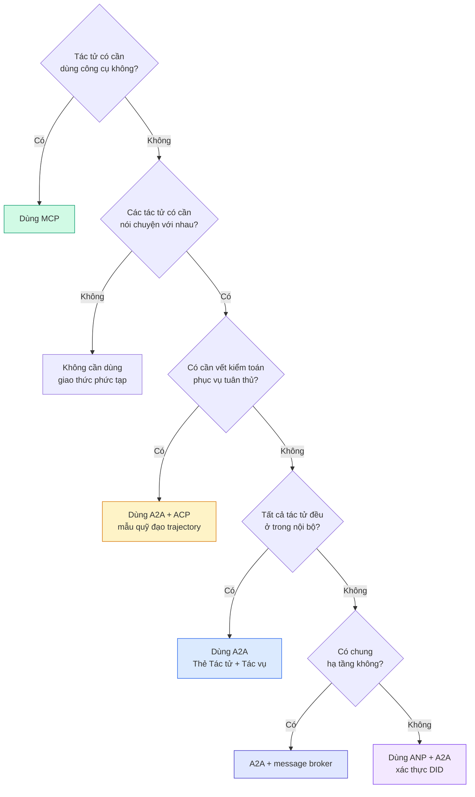

## Đưa vào sản phẩm (Ship It)

Bài học này cung cấp:
- `code/main.ts` -- bản hiện thực hóa hoàn chỉnh của cả bốn mẫu hình giao thức.
- `outputs/prompt-protocol-selector.md` -- mẫu prompt chuyên gia hỗ trợ bạn lựa chọn các giao thức tối ưu nhất cho kiến trúc hệ thống của mình.

## Bài tập thực hành (Exercises)

1. **Ủy thác tác vụ đa chặng (Multi-hop task delegation).** Mở rộng `TaskManager` để một hàm xử lý của tác tử có thể tự động ủy quyền các tác vụ con cho tác tử khác. Tác tử nghiên cứu nhận một tác vụ lớn, chia tách thành hai tác vụ con "tìm kiếm" và "tóm tắt" rồi giao cho hai tác tử chuyên trách, đợi cả hai hoàn thành rồi hợp nhất kết quả vào các tạo tác của riêng mình.
2. **Luồng kiểm toán thời gian thực (Streaming audit trail).** Nâng cấp `AuditableRunner` hỗ trợ chế độ truyền luồng. Thay vì đợi toàn bộ kết quả cuối cùng, hãy phát ra các bản cập nhật `AuditEntry` theo thời gian thực mỗi khi có một bước quỹ đạo mới được ghi lại. Sử dụng một bộ sinh bất đồng bộ để xuất các ảnh chụp nhanh (snapshots) kiểm toán.
3. **Cơ chế xoay vòng khóa DID (DID rotation).** Bổ sung tính năng xoay vòng khóa vào `IdentityRegistry`. Một tác tử có thể công bố tài liệu DID mới với các cặp khóa đã được cập nhật nhưng vẫn lưu tham chiếu `previousDid`. Bộ xác thực cần chấp nhận chữ ký từ cả khóa mới và khóa cũ trong một khoảng thời gian ân hạn nhất định.
4. **Đàm phán giao thức (Protocol negotiation).** Hiện thực hóa khái niệm siêu giao thức của ANP. Hai tác tử trao đổi các thông điệp `protocolNegotiation` chứa danh sách các định dạng ứng viên (ví dụ: "Tôi hỗ trợ JSON-RPC" đối chiếu với "Tôi ưu tiên REST"). Sau tối đa 3 vòng đàm phán, chúng thống nhất một định dạng hoặc báo quá thời gian (timeout). Định dạng thống nhất sẽ quyết định xem chúng dùng `TaskManager` hay `AuditableRunner`.
5. **Khám phá có giới hạn tần suất (Rate-limited discovery).** Xây dựng lớp bọc `RateLimitedRegistry` nhằm lưu đệm các kết quả tra cứu Thẻ Tác tử với một khoảng thời gian sống (TTL) linh hoạt, đồng thời giới hạn số lượng truy vấn khám phá trên mỗi tác tử mỗi giây. Giả lập tình huống 100 tác tử đồng loạt thức dậy và khám phá lẫn nhau để đo lường hiệu năng cải thiện.

## Các thuật ngữ then chốt (Key Terms)

| Thuật ngữ | Điều mọi người hay nói | Ý nghĩa bản chất thực tế |
|---|---|---|
| MCP | "Giao thức dành cho công cụ AI" | Giao thức client-server chuẩn hóa cách tác tử khám phá và sử dụng công cụ. Kết nối tác tử với công cụ, không kết nối tác tử với tác tử. |
| A2A | "Giao thức tác tử của Google" | Giao thức ngang hàng hỗ trợ sự cộng tác giữa các tác tử dưới sự quản lý của Linux Foundation. Khám phá qua Thẻ Tác tử, máy trạng thái tác vụ 9 bước, truyền luồng qua SSE. Hỗ trợ JSON-RPC, REST, và gRPC. |
| ACP | "Tin nhắn tác tử cấp doanh nghiệp" | REST API của IBM/BeeAI quản lý các phiên chạy của tác tử với TrajectoryMetadata: mọi phản hồi đều mang theo toàn bộ chuỗi lập luận và lượt gọi công cụ. Đang sáp nhập vào A2A. |
| ANP | "Định danh tác tử phi tập trung" | Giao thức cộng đồng sử dụng `did:wba` (DID) để xác thực danh tính bằng mật mã học, HPKE cho mã hóa đầu cuối E2EE, và đàm phán siêu giao thức bằng AI cho các tác tử chưa từng biết nhau. |
| Thẻ Tác tử (Agent Card) | "Danh thiếp của tác tử" | Tài liệu JSON phục vụ tại `/.well-known/agent-card.json` mô tả kỹ năng, kiểu MIME được hỗ trợ, cơ chế bảo mật và các liên kết giao thức. |
| DID | "Mã định danh phi tập trung" | Tiêu chuẩn của W3C về các danh tính có thể xác thực bằng mật mã học, được lưu trữ ngay trên tên miền của tác tử. ANP sử dụng phương thức `did:wba`. |
| TrajectoryMetadata | "Hóa đơn biên lai kiểm toán" | Cơ chế của ACP đính kèm các bước lập luận, lượt gọi công cụ cùng đầu vào/đầu ra tương ứng vào mọi thông điệp phản hồi của tác tử. |
| Siêu giao thức (Meta-protocol) | "Các tác tử tự thỏa thuận cách nói chuyện" | Phương pháp của ANP cho phép các tác tử sử dụng ngôn ngữ tự nhiên để linh hoạt thống nhất định dạng dữ liệu, sau đó tự sinh mã nguồn để xử lý. |
| Tác vụ (Task) | "Một đơn vị công việc" | Đối tượng có trạng thái trong A2A theo dõi công việc từ lúc nộp yêu cầu đến khi hoàn tất. Trở thành bất biến khi đã ở trạng thái kết thúc. |

## Tài liệu đọc thêm (Further Reading)

- [Bản đặc tả Google A2A](https://github.com/google/A2A) -- Bản đặc tả chính thức và các bộ SDK (v1.0.1, Linux Foundation).
- [Bản đặc tả IBM/BeeAI ACP](https://github.com/i-am-bee/acp) -- Đặc tả OpenAPI 3.1 cho các phiên chạy tác tử và siêu dữ liệu quỹ đạo.
- [Agent Network Protocol](https://github.com/agent-network-protocol/AgentNetworkProtocol) -- Định danh dựa trên DID, mã hóa E2EE, đàm phán siêu giao thức.
- [Tài liệu Model Context Protocol (MCP)](https://modelcontextprotocol.io/) -- Bản đặc tả MCP của Anthropic (đã học trong Phase 13).
- [W3C Decentralized Identifiers (DIDs)](https://www.w3.org/TR/did-core/) -- Tiêu chuẩn định danh nền tảng của ANP.
- [RFC 9180 (HPKE)](https://www.rfc-editor.org/rfc/rfc9180) -- Lược đồ mã hóa khóa công khai lai mà ANP sử dụng cho E2EE.
- [FIPA Agent Communication Language](http://www.fipa.org/specs/fipa00061/SC00061G.html) -- Tiền thân học thuật đặt nền móng cho các giao thức tác tử hiện đại.
