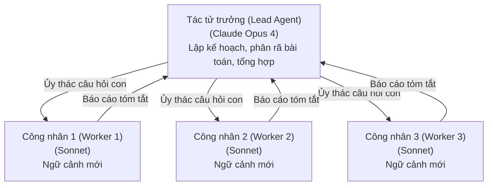

# Mẫu hình Giám sát viên / Điều phối viên - Công nhân (Supervisor / Orchestrator-Worker Pattern)

> Một tác tử trưởng (lead agent) chịu trách nhiệm lập kế hoạch và ủy thác; các tác tử công nhân (worker agents) chuyên trách thực thi trong các ngữ cảnh độc lập song song và báo cáo lại kết quả. Đây chính là mẫu hình nền tảng đằng sau hệ thống Nghiên cứu (Research system) của Anthropic (với Claude Opus 4 đóng vai trò tác tử trưởng và Sonnet 4 làm các tác tử con), đạt mức cải thiện hiệu năng +90,2% so với mô hình Opus 4 đơn lẻ trên các bài đánh giá nghiên cứu nội bộ. Bài viết kỹ thuật của Anthropic báo cáo rằng 80% phương sai trên thang đo BrowseComp được giải thích chỉ bởi lượng token tiêu thụ — hệ đa tác tử chiến thắng phần lớn là nhờ mỗi tác tử con được cung cấp một cửa sổ ngữ cảnh hoàn toàn mới (fresh context window). Bài học này xây dựng mẫu hình giám sát viên từ các nguyên hàm cơ bản và đúc kết những bài học kỹ thuật sản xuất thực tế năm 2026.

**Type:** Learn + Build
**Languages:** Python (stdlib, `threading`)
**Prerequisites:** Phase 16 · 04 (Primitive Model)
**Time:** ~75 phút

## Vấn đề

Nghiên cứu chuyên sâu là tác vụ điển hình mà các hệ thống tác tử đơn lẻ (single-agent systems) chắc chắn thất bại. Khi bạn đặt câu hỏi: "Các hệ đa tác tử đã có những thay đổi gì giữa năm 2023 và 2026?" Một tác tử đơn lẻ sẽ đọc tuần tự năm bài báo khoa học, lấp đầy một nửa cửa sổ ngữ cảnh bằng văn bản thô, và sau đó phải cố gắng lập luận tổng hợp về toàn bộ các bài viết đó cùng một lúc. Nó sẽ quên sạch nội dung của bài báo đầu tiên ngay khi đọc tới bài báo thứ năm. Nó hoàn toàn không thể xử lý song song.

Mẫu hình giám sát viên (supervisor pattern) giải quyết triệt để vấn đề này: một tác tử trưởng lập kế hoạch tìm kiếm, chia nhỏ thành các câu hỏi con rồi ủy thác cho từng công nhân, và sau cùng tổng hợp các kết quả lại. Mỗi công nhân sở hữu riêng một cửa sổ ngữ cảnh 200k tokens cho một câu hỏi hẹp cụ thể. Tác tử trưởng không bao giờ cần phải đọc trực tiếp các bài báo thô — nó chỉ tiếp nhận các bản tóm tắt từ các công nhân.

Hệ thống Nghiên cứu thực tế của Anthropic đã ghi nhận mức tăng trưởng +90,2% trong các bài đánh giá nghiên cứu nội bộ so với một mô hình Opus 4 đơn lẻ. Bài báo kỹ thuật cũng nhấn mạnh rằng 80% phương sai trên BrowseComp được giải thích *chỉ bởi lượng token tiêu thụ*. Việc cấp một ngữ cảnh tinh sạch cho từng tác tử con chính là cơ chế cốt lõi mang lại chiến thắng.

## Khái niệm

### Mẫu hình kiến trúc



Tác tử trưởng không bao giờ phải đọc tài liệu thô. Các công nhân không bao giờ nhìn thấy công việc của nhau cho đến khi tác tử trưởng tổng hợp lại. Mỗi mũi tên là một bước bàn giao (handoff) đi kèm một tạo tác dữ liệu (artifact) có phạm vi hẹp.

### Vì sao mẫu hình này giành chiến thắng

Ba cơ chế tạo nên sức mạnh vượt trội:

1. **Ngữ cảnh mới cho từng tác tử con (Fresh context per subagent).** Một công nhân tìm hiểu "di sản FIPA-ACL" không bị vướng bận bởi 40k tokens mà tác tử trưởng đã dùng để lập kế hoạch. Nó có trọn vẹn một cửa sổ 200k tokens dành riêng cho một câu hỏi duy nhất.
2. **Chuyên môn hóa thông qua prompt (Specialization via prompt).** Prompt của tác tử trưởng được tối ưu cho việc "phân rã bài toán và tổng hợp", chứ không phải "điều tra chi tiết". Mỗi tác tử công nhân nhận một prompt hẹp: "tìm hiểu xem điều gì đã thay đổi ở công nghệ X". Prompt tập trung sẽ tạo ra kết quả tập trung.
3. **Tính song song (Parallelism).** Các công nhân chạy đồng thời. Thời gian thực tế theo đồng hồ (wall-clock time) xấp xỉ bằng `max(thời_gian_công_nhân) + lập_kế_hoạch + tổng_hợp`, chứ không phải là `tổng(thời_gian_công_nhân)`.

### Các bài học kỹ thuật sản xuất (Anthropic 2025)

Bài viết kỹ thuật của Anthropic chia sẻ nhiều bài học vận hành thực tế vẫn giữ nguyên giá trị trong năm 2026:

- **Quy mô hóa nỗ lực theo độ phức tạp của truy vấn (Scale effort to query complexity).** Với truy vấn đơn giản: chỉ dùng một tác tử, thực hiện từ 3-10 lượt gọi công cụ. Với truy vấn phức tạp: kích hoạt từ 10 tác tử trở lên. Bản thân tác tử trưởng phải tự ước tính điều này, chứ không dựa vào người dùng gọi hệ thống.
- **Đi từ rộng đến hẹp (Broad then narrow).** Ban đầu phân rã thành các câu hỏi con khái quát trước, sau đó mới kích hoạt thêm các công nhân chuyên sâu cho từng câu hỏi con nếu câu trả lời đòi hỏi chiều sâu chi tiết.
- **Triển khai kiểu cầu vồng (Rainbow deployments).** Các tác tử là các thực thể chạy lâu và có trạng thái. Phương pháp triển khai blue-green truyền thống không thể áp dụng được. Anthropic sử dụng mô hình cầu vồng: triển khai phiên bản mới một cách từ từ trong khi chờ các phiên bản cũ thoát hết trạng thái (drain).
- **Lượng token tiêu thụ đóng vai trò chi phối.** Hệ đa tác tử tiêu tốn lượng token gấp khoảng 15 lần so với tác tử đơn lẻ. Chỉ nên triển khai khi giá trị của bài toán xứng đáng với chi phí bỏ ra.

### Bước chuyển dịch sang phương thức gọi công cụ (Tool-Calling)

Ban đầu LangGraph phát hành thư viện `langgraph-supervisor` đi kèm hàm tiện ích cấp cao `create_supervisor`. Đến năm 2025, LangChain đã chuyển khuyến nghị sang việc hiện thực hóa mẫu hình giám sát viên trực tiếp thông qua cơ chế gọi công cụ (tool calling), bởi vì các lượt gọi công cụ giúp kiểm soát chặt chẽ hơn *những gì mà giám sát viên nhìn thấy* (kỹ thuật ngữ cảnh - context engineering). Thư viện cũ vẫn hoạt động, nhưng tài liệu hiện tại khuyến khích dùng dạng gọi công cụ tường minh.

### Các kịch bản lỗi thường gặp (Failure Modes)

- **Tác tử trưởng tạo kế hoạch ảo giác (Hallucinated plan).** Nếu tác tử trưởng sinh ra các câu hỏi con không phân rã đúng trọng tâm bài toán, các công nhân sẽ nghiên cứu rất chính xác nhưng sai mục tiêu.
- **Công nhân khám phá quá đà (Over-exploration).** Nếu không có ranh giới phạm vi rõ ràng, công nhân sẽ đi chệch khỏi câu hỏi được giao và làm ô nhiễm bước tổng hợp cuối cùng.
- **Xung đột khi tổng hợp (Synthesis conflicts).** Hai công nhân trả về hai sự thật mâu thuẫn nhau. Tác tử trưởng buộc phải hỏi lại (thêm một hiệp xử lý) hoặc phải chỉ rõ sự bất đồng trong kết quả cuối cùng. Việc âm thầm chọn một bên là lỗi tệ hại nhất: người dùng sẽ không bao giờ biết được rằng có sự mâu thuẫn xảy ra trong dữ liệu.

### Khi nào KHÔNG nên dùng Mẫu hình Giám sát viên

- **Các tác vụ mang tính tuần tự tuyệt đối.** Nếu bước 2 bắt buộc phải nhận đầu ra của bước 1, việc chạy song song hoàn toàn vô nghĩa. Hãy dùng đường ống tuần tự (CrewAI Sequential, đồ thị tuyến tính của LangGraph).
- **Các truy vấn đơn giản.** Tác tử đơn lẻ xử lý nhanh hơn và rẻ hơn rất nhiều. Hãy áp dụng bước kiểm tra "quy mô hóa nỗ lực" của tác tử trưởng trước khi quyết định kích hoạt công nhân.
- **Đòi hỏi tính tất định nghiêm ngặt.** Mẫu hình giám sát viên sử dụng cơ chế ủy thác do LLM quyết định. Các đồ thị tĩnh (static graphs) sẽ vượt trội hơn khi khả năng kiểm toán và phát lại quan trọng hơn khả năng thích ứng linh hoạt.

````figure
supervisor-hierarchy
````

## Tự tay xây dựng (Build It)

Tệp `code/main.py` hiện thực hóa một bộ giám sát viên điều phối ba tác tử công nhân chạy song song sử dụng module `threading` của thư viện chuẩn Python. Tác tử trưởng phân rã truy vấn thành các câu hỏi con, các công nhân chạy đồng thời trên từng câu hỏi con, và tác tử trưởng tổng hợp lại kết quả. Không cần gọi LLM thật — các tác tử công nhân được viết kịch bản sẵn để mô phỏng việc thu thập và tóm tắt dữ liệu.

Cấu trúc then chốt:

- `Lead.plan(query)` chia tách một truy vấn lớn thành 3 câu hỏi con.
- `Worker.run(sub_q)` trả về một bản tóm tắt giả lập (trong môi trường thực tế, đây có thể là bất kỳ tác tử sử dụng công cụ nào).
- `Lead.run(query)` khởi chạy các công nhân trong các luồng riêng biệt, chờ đợi tất cả hoàn tất (`join`), và thực hiện bước tổng hợp.

Chạy thử:

```bash
python3 code/main.py
```

Đầu ra hiển thị kế hoạch đề ra, vết thực thi song song của các công nhân đi kèm dấu thời gian bắt đầu/kết thúc, và bản tổng hợp cuối cùng. Bạn sẽ thấy rõ lợi ích về mặt thời gian thực tế: ba công nhân mất 0,3 giây mỗi người nhưng chạy xong chỉ trong khoảng ~0,35 giây, thay vì phải mất 0,9 giây nếu chạy nối tiếp.

## Ứng dụng thực tế (Use It)

Tệp `outputs/skill-supervisor-designer.md` nhận một truy vấn của người dùng và thiết kế ra toàn bộ mẫu hình giám sát viên tương ứng: prompt hệ thống của tác tử trưởng, vai trò của từng công nhân, quy tắc phân rã câu hỏi con, và khuôn mẫu tổng hợp báo cáo. Hãy sử dụng tệp này trước khi xây dựng một hệ thống tác tử nghiên cứu mới.

## Đưa vào sản phẩm (Ship It)

Danh sách kiểm tra (checklist) trước khi triển khai mẫu hình giám sát viên vào sản phẩm:

- **Phối ghép mô hình (Model pairing).** Tác tử trưởng nên sử dụng mô hình có năng lực lập luận cao nhất (hạng Opus, hạng `o3`). Các công nhân nên dùng mô hình nhanh hơn và rẻ hơn nhiều (Sonnet, `o4-mini`).
- **Thời gian chờ của công nhân (Worker timeout).** Bất kỳ công nhân nào chạy vượt quá 2 lần thời gian trung vị (median runtime) phải bị hủy ngay lập tức; tác tử trưởng sẽ hoặc kích hoạt lại với phạm vi hẹp hơn hoặc tiếp tục tổng hợp mà không cần kết quả đó.
- **Giới hạn trần token cho từng công nhân (Token cap).** Đặt giới hạn cứng (chẳng hạn 10 lần kích thước đầu vào dự kiến của bước tổng hợp) để ngăn ngừa một công nhân chạy lạc hướng làm cạn kiệt ngân sách.
- **Khả năng quan sát (Observability).** Truy vết toàn bộ kế hoạch của tác tử trưởng, các lượt gọi công cụ của từng công nhân và quá trình tổng hợp. Đây là cơ sở sống còn cho mọi hoạt động gỡ lỗi sau này.
- **Triển khai kiểu cầu vồng (Rainbow rollout).** Các tác tử có trạng thái chạy lâu dài đòi hỏi phải chuyển đổi phiên bản từ từ, không được thay thế đột ngột theo kiểu hot swap.

## Bài tập thực hành (Exercises)

1. Chạy `code/main.py`, sau đó chỉnh sửa tác tử trưởng để khởi tạo 5 công nhân thay vì 3. Quan sát tác động đến thời gian chạy theo đồng hồ. Tại mức bao nhiêu công nhân thì chi phí khởi tạo luồng bắt đầu triệt tiêu lợi ích của việc chạy song song trong bản demo này?
2. Hiện thực hóa cơ chế hết giờ (timeout): hủy bỏ bất kỳ công nhân nào chạy quá 0,5 giây và yêu cầu tác tử trưởng tổng hợp từ các kết quả còn lại. Bạn cần hệ thống giám sát ghi nhận điều gì để biết rằng một công nhân đã bị cắt bỏ?
3. Bổ sung bước phát hiện mâu thuẫn vào khâu tổng hợp của tác tử trưởng: nếu hai công nhân trả về kết quả trái ngược nhau, tác tử trưởng phải nêu rõ sự bất đồng thay vì chỉ tự ý chọn một bên. Làm thế nào bạn phát hiện được sự mâu thuẫn logic mà không cần gọi thêm LLM?
4. Đọc bài viết kỹ thuật về hệ thống Nghiên cứu của Anthropic. Liệt kê ba thực tiễn sản xuất mà bản demo nhỏ này cần áp dụng để có thể vận hành ổn định trên môi trường production.
5. So sánh hàm `create_supervisor` của LangGraph (cũ) với khuyến nghị mới dùng cơ chế gọi công cụ (tool calling). Phương pháp nào giúp bạn kiểm soát tốt hơn những gì giám sát viên nhìn thấy? Tại sao Anthropic lại chủ đích chỉ chuyển các câu trả lời con tóm tắt mà không truyền ngữ cảnh thô của công nhân vào bước tổng hợp?

## Các thuật ngữ then chốt (Key Terms)

| Thuật ngữ | Điều mọi người hay nói | Ý nghĩa bản chất thực tế |
|---|---|---|
| Giám sát viên (Supervisor) | "Tác tử trưởng" | Một tác tử điều phối làm nhiệm vụ lập kế hoạch, ủy quyền và tổng hợp. Bản thân nó không trực tiếp làm việc chi tiết. |
| Công nhân (Worker) | "Tác tử con" | Một tác tử tập trung cao độ được giám sát viên kích hoạt với phạm vi hẹp và cửa sổ ngữ cảnh riêng biệt. |
| Điều phối viên - Công nhân (Orchestrator-worker) | "Mẫu hình giám sát viên" | Cùng một bản chất, chỉ khác tên gọi. Các tài liệu năm 2026 sử dụng song song cả hai thuật ngữ này. |
| Ngữ cảnh mới (Fresh context) | "Cửa sổ sạch" | Ngữ cảnh của tác tử con bắt đầu từ prompt hệ thống và câu hỏi được giao, không bị làm nhiễu bởi lịch sử của tác tử trưởng. |
| Triển khai cầu vồng (Rainbow deployment) | "Phát hành từ từ" | Các tác tử có trạng thái chạy lâu đòi hỏi quy trình thay thế phiên bản dần dần theo phiên bản, không dùng mô hình blue-green. |
| Chi phối bởi token (Token dominance) | "Ngữ cảnh là biến số quyết định" | 80% phương sai trong đánh giá nghiên cứu đến từ tổng lượng token tiêu thụ, chứ không phải do việc lựa chọn mô hình (theo nghiên cứu của Anthropic). |
| Quy mô hóa nỗ lực (Scale effort) | "Điều chỉnh số lượng tác tử theo độ khó" | Tác tử trưởng ước tính độ khó của truy vấn, từ đó kích hoạt 1 tác tử hay hơn 10 tác tử tương ứng. |
| Xung đột khi tổng hợp (Synthesis conflict) | "Các tác tử bất đồng" | Hai công nhân trả về các thông tin trái ngược nhau; tác tử trưởng phải làm nổi bật sự bất đồng thay vì âm thầm chọn một bên. |

## Tài liệu đọc thêm (Further Reading)

- [Kỹ thuật Anthropic — How we built our multi-agent research system](https://www.anthropic.com/engineering/multi-agent-research-system) — Tài liệu tham khảo sản xuất chuẩn mực nhất về mẫu hình giám sát viên.
- [LangGraph workflows and agents](https://docs.langchain.com/oss/python/langgraph/workflows-agents) — Mẫu hình giám sát viên dựa trên cơ chế gọi công cụ (tool calling) hiện là cách làm được khuyến nghị.
- [Tài liệu tham chiếu LangGraph supervisor](https://reference.langchain.com/python/langgraph-supervisor) — Bộ tiện ích kinh điển, vẫn được sử dụng trong các hệ thống sản xuất năm 2026.
- [OpenAI cookbook — Orchestrating Agents: Routines and Handoffs](https://developers.openai.com/cookbook/examples/orchestrating_agents) — Biến thể giám sát viên dựa trên cơ chế bàn giao handoff.
