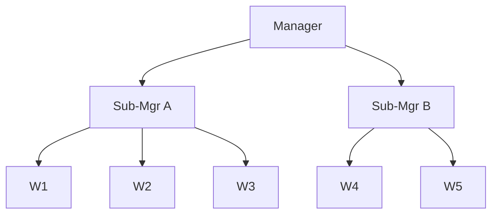

# Kiến trúc phân cấp và chế độ lỗi của nó (Hierarchical Architecture and Its Failure Mode)

> Kiến trúc phân cấp (hierarchical) là mô hình người giám sát (supervisor) lồng nhau: các agent quản lý đứng trên các quản lý con, và các quản lý con đứng trên các worker. `Process.hierarchical` của CrewAI là phiên bản điển hình: một `manager_llm` giao việc động và xác thực đầu ra. Tương đương trong LangGraph là `create_supervisor(create_supervisor(...))`. Đây là mẫu thiết kế tự nhiên khi bài toán thực sự có sơ đồ tổ chức. Nó cũng là mẫu dễ sụp đổ nhất thành vòng lặp quản lý (managerial looping): agent quản lý giao việc kém, hiểu sai đầu ra của cấp dưới, hoặc không đạt được đồng thuận. Kiến trúc tuần tự (sequential) thường thắng nó.

**Loại bài:** Học + Xây dựng
**Ngôn ngữ:** Python (stdlib)
**Điều kiện tiên quyết:** Phase 16 · 05 (Mẫu Supervisor)
**Thời lượng:** ~60 phút

## Vấn đề

Khi đã nắm được mẫu supervisor, bước tiếp theo tự nhiên là hỏi: "nếu bản thân các worker cũng là supervisor thì sao?" Các đội có đội con; công ty có phòng ban trong phòng ban. Kiến trúc phân cấp phản chiếu cấu trúc đó.

Vấn đề là: LLM làm quản lý không giống người làm quản lý. Một người quản lý có những niềm tin tiên nghiệm (prior) ổn định về việc cấp dưới của mình biết gì. Một LLM quản lý lại suy luận lại toàn bộ tổ chức ở mỗi lượt từ bất cứ thứ gì có trong ngữ cảnh (context). Chỉ cần ngữ cảnh lệch nhẹ, cả cây sẽ phân bổ công việc sai.

## Khái niệm

### Hình dạng



Mọi nút trong (internal node) đều lập kế hoạch, giao việc và tổng hợp. Chỉ các nút lá (leaf) mới làm việc thực tế.

### Khi nào nó tỏa sáng

- **Ánh xạ tổ chức rõ ràng.** Nếu tác vụ thật sự mang tính phòng ban ("pháp chế rà soát tài liệu, tài chính rà soát tài liệu, kỹ thuật rà soát tài liệu, rồi tóm tắt cho ban điều hành"), thì phân cấp là hiển nhiên.
- **Tóm tắt cục bộ.** Mỗi quản lý con tổng hợp đầu ra của đội mình trước khi quản lý cấp cao nhìn thấy. Quản lý cấp cao thấy ba bản tóm tắt của quản lý con, thay vì mười lăm đầu ra của worker.

### Khi nào nó hỏng

Ba chế độ lỗi mà các bản phân tích sau sự cố (post-mortem) năm 2026 liên tục phát hiện:

1. **Lỗi giao việc (task assignment error).** Quản lý đọc mục tiêu, tự tưởng tượng (hallucinate) ra một cách phân rã, và giao cho sai quản lý con. Vì quản lý con ngoan ngoãn làm đúng thứ được giao, lỗi chỉ lộ ra ở bước tổng hợp trên cùng, cách xa một cấp so với nơi con người có thể bắt được.
2. **Hiểu sai đầu ra (output misinterpretation).** Quản lý con trả về "không thể xác minh khẳng định X." Quản lý cấp cao tóm tắt thành "khẳng định X không được xác nhận." Ý nghĩa trôi dạt ở mỗi cấp.
3. **Vòng lặp đồng thuận (consensus loops).** Hai quản lý con bất đồng; quản lý cấp cao yêu cầu họ điều hòa; họ giao lại xuống dưới; worker chạy lại; các quản lý con trả về những câu trả lời hơi khác nhau; lặp. `Process.hierarchical` của CrewAI phòng ngừa điều này bằng giới hạn số bước, nhưng bản thân giới hạn đó giờ trở thành một siêu tham số (hyperparameter).

### Câu hỏi quyết định

Tuần tự (pipeline tuyến tính) so với phân cấp: tác vụ của bạn có thật sự gồm các đội con độc lập, hay chỉ là một luồng tuyến tính giả làm cái cây? Nếu là trường hợp sau, hãy dùng tuần tự. Nếu là trường hợp đầu, hãy dùng phân cấp nhưng phải dự trù quy tắc điều hòa tường minh.

### Triển khai theo framework dựa trên vai trò (role-framework)

`Process.hierarchical` của CrewAI nối một manager LLM lên trên các crew chuyên biệt. Manager:

- nhận tác vụ cấp cao nhất,
- giao các tác vụ con cho các crew,
- đánh giá đầu ra của crew,
- quyết định chấp nhận, giao lại hay lặp lại.

Tài liệu: https://docs.crewai.com/en/introduction (tìm "Hierarchical Process" trong Core Concepts).

### Triển khai theo framework dựa trên đồ thị (graph-framework)

LangGraph dùng các lời gọi `create_supervisor` lồng nhau. Supervisor bên trong có đồ thị riêng; supervisor bên ngoài coi đồ thị bên trong như một nút mờ (opaque node). Cách này gỡ lỗi sạch hơn CrewAI (có thể chạy từng bước qua từng đồ thị riêng biệt) nhưng khó biểu diễn việc định hình lại cây một cách động.

Tham khảo: https://reference.langchain.com/python/langgraph-supervisor.

```figure
swarm-hierarchy-token
```

## Xây dựng

`code/main.py` chạy một hệ phân cấp 3 cấp:

- manager cấp cao: tách tác vụ thành hai nhánh "engineering" và "legal",
- quản lý con engineering: tách thành các worker "frontend" và "backend",
- quản lý con legal: một worker.

Bản demo đối chiếu **đường đi thuận lợi** (mọi người đồng ý) với **đường đi bị nhiễu (perturbed path)**, trong đó cách phân rã của manager cấp cao gán nhầm "legal" thành "finance", rồi quan sát lỗi lan truyền: quản lý con ngoan ngoãn làm việc tài chính, bộ tổng hợp cấp cao báo cáo kết quả tài chính, và câu hỏi pháp lý ban đầu không được trả lời.

Chạy:

```bash
python3 code/main.py
```

Đầu ra hiển thị cả hai đường đi, đặt cạnh nhau "điều được hỏi" so với "điều được giao".

## Sử dụng

`outputs/skill-hierarchy-fitness.md` đánh giá xem một tác vụ nên dùng phân cấp, tuần tự hay supervisor phẳng. Đầu vào: mô tả tác vụ, cấu trúc tổ chức, ngân sách điều hòa. Đầu ra: khuyến nghị mẫu thiết kế kèm các chế độ lỗi cụ thể cần phòng ngừa.

## Đưa vào sản xuất

Nếu bạn triển khai kiến trúc phân cấp:

- **Giới hạn độ sâu cây ở 2.** Ba cấp đã che giấu phần lớn lỗi khỏi khả năng quan sát (observability).
- **Ngân sách điều hòa tường minh.** Đặt số vòng tối đa trước khi manager cấp cao buộc phải chốt. Thường là 2.
- **Truy xuất nguồn gốc (provenance) cho mọi bước tổng hợp.** Bản tóm tắt của mỗi nút phải trích dẫn những đầu ra lá nào đã tạo ra nó.
- **Cảnh báo về trôi dạt phân rã (decomposition drift).** Ghi log cách phân rã của manager ở mỗi bước; so sánh (diff) với truy vấn của người dùng. Nếu cách phân rã không còn bao phủ truy vấn, hãy phát cảnh báo.

## Bài tập

1. Chạy `code/main.py` và so sánh đường đi thuận lợi với đường đi bị nhiễu. Cần bao nhiêu cấp bàn giao giữa các manager thì đầu ra cấp cao nhất mới hoàn toàn lệch khỏi câu hỏi của người dùng?
2. Thêm cấp thứ ba (top → sub → sub-sub → worker). Đo tần suất đường đi bị nhiễu tự sửa so với lệch hoàn toàn khi độ sâu tăng.
3. Hiện thực một worker "canary" ở mỗi quản lý con, luôn được hỏi câu hỏi gốc của người dùng nguyên vẹn. Dùng câu trả lời của canary để phát hiện trôi dạt phân rã. Manager nên phản ứng thế nào khi canary bất đồng với câu trả lời đã tổng hợp?
4. Đọc tài liệu `Process.hierarchical` của CrewAI. Xác định một rào chắn (guardrail) cụ thể mà CrewAI áp dụng (giới hạn bước, ràng buộc manager_llm) và mô tả chế độ lỗi mà nó nhắm tới.
5. So sánh các supervisor LangGraph lồng nhau với CrewAI hierarchical. Cách nào giúp phát hiện vòng lặp điều hòa rẻ hơn?

## Thuật ngữ chính

| Thuật ngữ | Người ta thường nói | Ý nghĩa thực sự |
|------|----------------|------------------------|
| Phân cấp (Hierarchical) | "Mẫu sơ đồ tổ chức" | Supervisor đứng trên supervisor; chỉ các lá làm việc. |
| Manager LLM | "Ông sếp" | LLM phân rã, giao việc và xác thực tại một nút trong. |
| Trôi dạt phân rã (Decomposition drift) | "Sếp lạc đề" | Cách tách của manager cấp cao không còn bao phủ câu hỏi gốc. |
| Vòng lặp điều hòa (Reconciliation loop) | "Họp không hồi kết" | Các quản lý con bất đồng; cấp trên giao lại; worker chạy lại; lặp đến khi cạn ngân sách. |
| Trần độ sâu 2 (Depth-2 ceiling) | "Đừng đi sâu quá 2 cấp" | Rào chắn thực nghiệm: từ 3 cấp trở lên khả năng quan sát sụp đổ. |
| Câu hỏi canary (Canary question) | "Chân lý cơ sở ở mọi cấp" | Một worker luôn được hỏi truy vấn gốc nguyên vẹn để phát hiện trôi dạt. |
| Chuỗi nguồn gốc (Provenance chain) | "Ai nói gì" | Dấu vết từ mỗi bản tổng hợp ngược về các đầu ra lá đã tạo ra nó. |

## Đọc thêm

- [CrewAI introduction — Process.hierarchical](https://docs.crewai.com/en/introduction) — mô hình phân cấp điển hình với manager LLM
- [LangGraph supervisor reference](https://reference.langchain.com/python/langgraph-supervisor) — supervisor lồng nhau qua `create_supervisor`
- [Anthropic engineering — Research system](https://www.anthropic.com/engineering/multi-agent-research-system) — vì sao Anthropic cố ý chọn supervisor phẳng thay vì phân cấp
- [Cemri et al. — Why Do Multi-Agent LLM Systems Fail?](https://arxiv.org/abs/2503.13657) — phân loại MAST; phần về lỗi phối hợp ghi nhận trôi dạt phân rã
