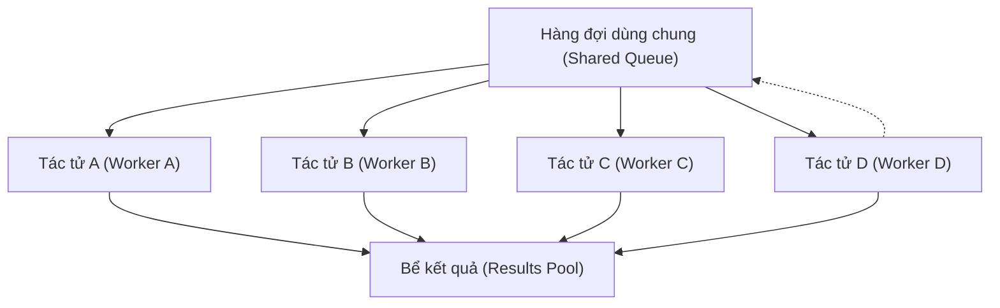

# Kiến trúc Song song / Bầy đàn / Mạng lưới (Parallel / Swarm / Networked Architectures)

> Ngược lại với mô hình người giám sát (supervisor): không có thực thể ra quyết định trung tâm. Các tác tử đọc một bus sự kiện dùng chung (shared event bus), tiếp nhận công việc bất đồng bộ và ghi kết quả trả về. LangGraph hỗ trợ tường minh "Kiến trúc bầy đàn" (Swarm Architecture) cho các môi trường phi tập trung và biến động. Nghiên cứu Matrix (arXiv:2511.21686) biểu diễn cả luồng điều khiển lẫn luồng dữ liệu dưới dạng các thông điệp tuần tự hóa truyền qua các hàng đợi phân tán nhằm loại bỏ nút thắt cổ chai của bộ điều phối trung tâm. Sự đánh đổi ở đây rất rõ ràng: hy sinh tính tất định và khả năng truy vết để đổi lấy khả năng mở rộng quy mô. Kiến trúc bầy đàn phù hợp với các tác vụ có nhiều bài toán con độc lập; nó không phù hợp với các tác vụ đòi hỏi một kế hoạch mạch lạc duy nhất.

**Type:** Learn + Build
**Languages:** Python (stdlib, `threading`, `queue`)
**Prerequisites:** Phase 16 · 05 (Supervisor Pattern), Phase 16 · 04 (Primitive Model)
**Time:** ~75 minutes

## Vấn đề

Mô hình người giám sát (supervisor) chỉ có thể mở rộng quy mô tới vài tác tử công nhân (workers). Điều gì sẽ xảy ra khi quy mô lên tới hàng trăm tác tử? Bản thân người giám sát sẽ trở thành nút thắt cổ chai: mọi quyết định về việc ai làm gì đều phải đổ dồn qua một tác tử duy nhất. Một bước lập kế hoạch chậm chạp sẽ làm đình trệ toàn bộ hệ thống.

Kiến trúc bầy đàn (swarm architecture) đảo ngược hoàn toàn thiết kế này. Thay vì một bộ lập kế hoạch trung tâm phân phối công việc, các tác tử công nhân sẽ chủ động rút các tác vụ từ một hàng đợi dùng chung. Cơ chế "phối hợp" được tích hợp sẵn vào ngữ nghĩa của bus sự kiện (event bus). Không có bộ điều phối trung tâm; hệ thống có thể mở rộng quy mô cho đến khi hàng đợi đạt giới hạn chịu tải.

## Khái niệm

### Cấu trúc hình thái



Không có bộ điều phối trung tâm. Mỗi tác tử công nhân lặp lại chu trình: lấy một tác vụ ra khỏi hàng đợi, xử lý, ghi kết quả (và tùy chọn đẩy tiếp các tác vụ tiếp nối vào hàng đợi).

### Khi nào nên áp dụng kiến trúc bầy đàn?

- **Nhiều tác vụ độc lập.** Thu thập dữ liệu (scraping), chuyển đổi dữ liệu (transforming), phân loại (classifying). Các tác vụ không phụ thuộc vào nhau.
- **Thời lượng công việc biến thiên.** Nếu một số tác vụ mất 100ms trong khi các tác vụ khác mất 10 giây, bầy đàn sẽ tự động cân bằng tải — các tác tử xử lý nhanh sẽ tự động nhận việc tiếp theo. Trong khi đó, người giám sát buộc phải dự đoán trước thời lượng.
- **Ưu tiên thông lượng hơn tính tất định.** Bạn quan tâm đến tổng thời gian hoàn thành thay vì thứ tự thực thi nghiêm ngặt.

### Khi nào kiến trúc bầy đàn thất bại?

- **Quy trình làm việc có thứ tự tuần tự.** Nếu bước 3 cần đầu ra của bước 2, kiến trúc bầy đàn có nguy cơ kích hoạt bước 3 trước khi bước 2 hoàn thành.
- **Các tác vụ đòi hỏi kế hoạch tổng thể.** Các câu hỏi nghiên cứu phức tạp cần một người lập kế hoạch điều phối. Một bầy các nhà nghiên cứu độc lập chỉ tạo ra các mẩu dữ kiện rời rạc chứ không thể kết xuất một báo cáo mạch lạc.
- **Gỡ lỗi (Debugging).** Do không có nhật ký tập trung và công việc diễn ra bất đồng bộ, việc tái hiện lại một lỗi phát sinh là cực kỳ tốn kém.

### Nghiên cứu Matrix (arXiv:2511.21686)

Matrix là bài báo năm 2025 đưa kiến trúc bầy đàn đến kết luận tự nhiên của nó: cả luồng điều khiển và luồng dữ liệu đều là các thông điệp được tuần tự hóa trên các hàng đợi phân tán. Không có bộ điều phối trung tâm. Khả năng chịu lỗi đến từ độ bền vững của thông điệp (message durability). Khả năng mở rộng quy mô trở thành bài toán của trình môi giới thông điệp (message broker), chứ không phải của hệ sinh thái tác tử.

Đóng góp cốt lõi: một mô hình lập trình nơi sự phối hợp đa tác tử trở thành "tác tử này đăng ký (subscribe) chủ đề thông điệp nào?" thay vì "người giám sát sẽ chọn tác tử nào tiếp theo?". Điều này biến hệ thống thành một lưới sự kiện xuất bản/đăng ký (pub/sub event mesh).

### Kiến trúc bầy đàn trong các framework dạng đồ thị

Tài liệu LangGraph 2025 mô tả rõ ràng "Swarm Architecture" là một trong các mẫu hình đa tác tử: các tác tử là các nút (nodes), nhưng các cạnh (edges) tạo thành một đồ thị có hướng chứa chu trình và bất kỳ nút nào cũng có thể được kích hoạt từ bể tài nguyên. Một tác tử công nhân chọn công việc khả dụng dựa theo điều kiện logic, chứ không phải qua sự chỉ định của người giám sát.

### Dạng thức thất bại: Bỏ đói tác vụ và Điểm nóng quá tải

Nếu tất cả các tác tử đều tranh nhau nhận tác vụ xử lý nhanh nhất hiện có, những tác vụ tốn nhiều thời gian sẽ không bao giờ được chọn cho đến khi chúng là những việc duy nhất còn sót lại. Đây là hiện tượng bỏ đói hàng đợi (queue starvation) kinh điển.

Biện pháp giảm thiểu:
- Hàng đợi ưu tiên kèm cơ chế cộng tuổi (priority queues with aging - tăng mức ưu tiên theo thời gian chờ).
- Chuyên môn hóa tác tử công nhân: một số tác tử chỉ chuyên nhận các tác vụ "dài".
- Áp lực ngược (Back-pressure): giới hạn số lượng tác vụ nhanh được đẩy vào hàng đợi.

### Liên kết với định tuyến dựa trên nội dung

Kiến trúc bầy đàn kết hợp tự nhiên với định tuyến dựa trên nội dung (content-based routing - Bài học 22). Thay vì sử dụng một hàng đợi chung chung, hãy tạo một hàng đợi riêng cho từng loại thông điệp. Các tác tử chuyên biệt chỉ đăng ký vào loại thông điệp của riêng chúng. Đây là nền tảng cho các kiến trúc bus thông điệp có khả năng mở rộng lên tới hàng nghìn tác tử.

```figure
sw-work-stealing
```

## Xây dựng thực tế

`code/main.py` triển khai một bầy đàn gồm 4 luồng công nhân (worker threads) rút việc từ một `queue.Queue` dùng chung. Các tác vụ có thời lượng biến thiên (một số nhanh, một số chậm). Bản minh họa đối chiếu giữa:

- **Đường cơ sở tuần tự (Sequential baseline):** một tác tử công nhân duy nhất xử lý lần lượt tất cả các tác vụ.
- **Phân bổ cố định (Fixed assignment):** mỗi tác vụ được gán sẵn cho một tác tử công nhân cụ thể (theo phong cách người giám sát).
- **Bầy đàn (Swarm):** các tác tử công nhân tự rút tác vụ từ hàng đợi dùng chung.

Kiến trúc bầy đàn tự động cân bằng tải; trong khi phân bổ cố định khiến các tác tử làm việc nhanh phải nhàn rỗi chờ đợi khi tác vụ được gán của chúng diễn ra chậm chạp.

Chạy chương trình:

```bash
python3 code/main.py
```

Đầu ra hiển thị số lượng tác vụ của từng tác tử (bầy đàn phân bổ không đồng đều nhưng đạt mức tối ưu về thời gian) và thời gian thực tế đo theo đồng hồ (wall-clock time).

## Ứng dụng thực tế

`outputs/skill-swarm-fit.md` đánh giá xem một tác vụ nên sử dụng kiến trúc bầy đàn hay mô hình người giám sát. Đầu vào bao gồm: tính độc lập của tác vụ, phương sai thời lượng, yêu cầu về thứ tự và nhu cầu gỡ lỗi.

## Đưa vào sản xuất

Danh sách kiểm tra khi triển khai:

- **Hàng đợi ưu tiên kèm cơ chế cộng tuổi.** Ngăn chặn tình trạng bỏ đói các tác vụ kéo dài.
- **Tính lũy đẳng của tác tử công nhân (Worker idempotency).** Một tác vụ có thể bị rút ra nhiều lần nếu một tác tử bị sập giữa chừng khi đang chạy. Tác tử công nhân bắt buộc phải có tính lũy đẳng (xử lý lại mà không làm sai lệch kết quả).
- **Hàng đợi bền vững (Durable queue).** Sử dụng Kafka, Redis Streams hoặc một hàng đợi có cơ sở dữ liệu hỗ trợ trong môi trường sản xuất. Thư viện `queue.Queue` chỉ nằm trong bộ nhớ RAM tạm thời.
- **Khả năng quan sát cho từng tác vụ (Observability per task).** Mỗi tác vụ phải có một ID truy vết (trace ID); mỗi tác tử công nhân ghi nhật ký thời điểm bắt đầu/kết thúc kèm ID này.
- **Áp lực ngược (Back-pressure).** Nếu hàng đợi phình to nhanh hơn tốc độ xử lý của các tác tử công nhân, hãy giảm tốc độ của bên tạo tác vụ (producer).

## Bài tập

1. Chạy `code/main.py`. Kiến trúc bầy đàn nhanh hơn bao nhiêu so với xử lý tuần tự trên khối lượng công việc có thời lượng biến thiên? Nhanh hơn bao nhiêu so với phân bổ cố định?
2. Bổ sung một biến thể hàng đợi ưu tiên (sử dụng `queue.PriorityQueue`). Gán mức ưu tiên dựa trên trường "importance" của tác vụ. Quan sát xem các tác vụ có độ ưu tiên thấp có bao giờ bị bỏ đói dưới tải liên tục hay không.
3. Triển khai một bộ phát hiện điểm nóng (hot-spot detector): ghi nhật ký cảnh báo khi bất kỳ tác tử công nhân nào xử lý số lượng tác vụ gấp 3 lần tác tử chậm nhất. Điều này phản ánh điều gì về phân phối thời lượng tác vụ?
4. Đọc tóm tắt và Mục 3 của bài báo Matrix (arXiv:2511.21686). Xác định một sự đánh đổi cụ thể mà Matrix chấp nhận (lợi ích mở rộng quy mô) và một yếu tố mà nó phải đánh đổi (khả năng truy vết, tính tất định).
5. Chuyển đổi bản minh họa bầy đàn sang sử dụng `queue.Queue` chứa các bộ giá trị `(task_type, payload)`, trong đó các tác tử công nhân chỉ đăng ký các loại tác vụ cụ thể. Những quy tắc định tuyến nào trở nên hợp lý khi các tác vụ có tính chất dị thể?

## Thuật ngữ then chốt

| Thuật ngữ | Mọi người thường nói | Bản chất kỹ thuật |
|---|---|---|
| Kiến trúc bầy đàn (Swarm architecture) | "Các tác tử phi tập trung" | Các tác tử công nhân tự rút việc từ hàng đợi dùng chung; không có bộ điều phối trung tâm. |
| Bus sự kiện (Event bus) | "Tác tử đăng ký chủ đề" | Trình môi giới thông điệp điều hướng tác vụ đến các tác tử công nhân theo loại hoặc nội dung. |
| Bỏ đói tác vụ (Starvation) | "Tác vụ không bao giờ chạy" | Tác vụ ưu tiên thấp không bao giờ được chọn vì các công việc ưu tiên cao liên tục đổ về. |
| Điểm nóng quá tải (Hot-spotting) | "Một tác tử bị quá tải" | Mất cân bằng tải khi một tác tử công nhân phải gánh phần lớn khối lượng tác vụ. |
| Áp lực ngược (Back-pressure) | "Làm chậm bên sản xuất" | Cơ chế phát tín hiệu ngược dòng để ngừng tạo việc khi hàng đợi bị đầy. |
| Tác tử lũy đẳng (Idempotent worker) | "Chạy lại vẫn an toàn" | Một tác vụ được xử lý hai lần vẫn cho ra cùng một kết quả. Bắt buộc phải có vì tác tử có thể bị sập giữa chừng. |
| Hàng đợi bền vững (Durable queue) | "Sống sót sau sự cố sập" | Hàng đợi được lưu trữ trên đĩa cứng hoặc bộ lưu trữ nhân bản; tác vụ không bị mất khi tác tử sập. |
| Framework Matrix | "Bầy đàn truyền thông điệp hoàn toàn" | Cả luồng dữ liệu và luồng điều khiển đều là các thông điệp tuần tự hóa trên các hàng đợi phân tán. |

## Tài liệu đọc thêm

- [LangGraph workflows and agents — Swarm Architecture](https://docs.langchain.com/oss/python/langgraph/workflows-agents) — tài liệu hỗ trợ kiến trúc bầy đàn chính thức
- [Matrix — A Decentralized Framework for Multi-Agent Systems](https://arxiv.org/abs/2511.21686) — bầy đàn truyền thông điệp phân tán toàn diện
- [Anthropic engineering — why supervisor not swarm in Research](https://www.anthropic.com/engineering/multi-agent-research-system) — lý do một hệ thống thực tế chọn mô hình giám sát thay vì bầy đàn
- [Tài liệu actor-model của AutoGen v0.4](https://microsoft.github.io/autogen/stable/) — bản kiến trúc viết lại theo mô hình actor hướng sự kiện
