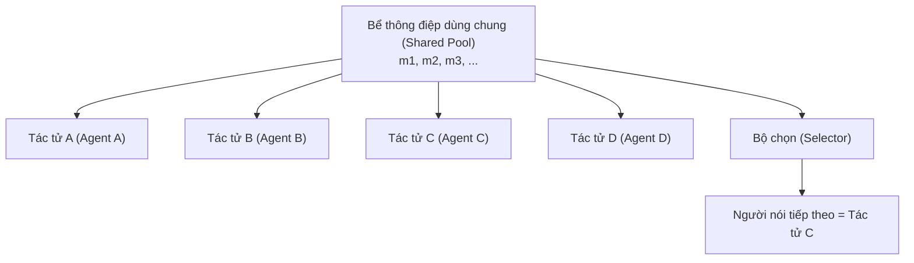

# Trò chuyện Nhóm và Lựa chọn Người phát ngôn (Group Chat and Speaker Selection)

> Cơ chế điều phối hội thoại dùng chung (shared-conversation orchestration) đưa N tác tử vào cùng một cuộc trò chuyện; một hàm lựa chọn (LLM, vòng tròn luân phiên, hoặc tùy chỉnh) sẽ quyết định ai là người phát ngôn tiếp theo. Đây là hình mẫu tiêu biểu cho cuộc trò chuyện đa tác tử mang tính xuất hiện (emergent multi-agent conversation) — các tác tử không hề biết trước vai trò của chúng trong một đồ thị tĩnh, chúng chỉ đơn thuần phản ứng với bể thông điệp dùng chung. AutoGen GroupChat và AG2 GroupChat là các triển khai tham chiếu chuẩn mực: ngữ nghĩa GroupChat của AutoGen v0.2 được bảo tồn trong bản fork AG2; trong khi AutoGen v0.4 được viết lại hoàn toàn theo mô hình actor hướng sự kiện (event-driven actor model). Tháng 2 năm 2026, Microsoft đưa AutoGen vào chế độ bảo trì và hợp nhất với Semantic Kernel thành Microsoft Agent Framework (bản RC tháng 2 năm 2026). Khái niệm nguyên thủy GroupChat tiếp tục tồn tại vững chắc trong cả AG2 lẫn Microsoft Agent Framework — học một lần, áp dụng ở mọi nơi.

**Type:** Learn + Build
**Languages:** Python (stdlib)
**Prerequisites:** Phase 16 · 04 (Primitive Model)
**Time:** ~60 minutes

## Vấn đề

Các đồ thị tĩnh (như trong LangGraph) hoạt động tuyệt vời khi quy trình công việc đã được xác định rõ ràng từ trước. Tuy nhiên, các cuộc hội thoại trong thế giới thực không hề mang tính tĩnh tại: đôi khi lập trình viên cần hỏi người đánh giá, đôi khi hỏi nhà nghiên cứu, đôi khi lại hỏi người viết tài liệu. Việc mã hóa cứng (hardcode) mọi khả năng bàn giao sẽ dẫn đến sự bùng nổ số lượng cạnh đồ thị (edge explosion). Bạn muốn *các tác tử cùng phản ứng với một bể thông điệp dùng chung*, kèm một hàm logic quyết định xem ai sẽ là người lên tiếng tiếp theo.

Đó chính xác là những gì AutoGen GroupChat hiện thực hóa.

## Khái niệm

### Cấu trúc hình thái



Mỗi tác tử đều có thể đọc toàn bộ lịch sử thông điệp. Một hàm lựa chọn (selector function) được kích hoạt ở mỗi lượt để chỉ định người phát ngôn tiếp theo.

### Ba biến thể lựa chọn người phát ngôn

**Vòng tròn luân phiên (Round-robin).** Chu trình cố định. Tính tất định cao. Quy mô mở rộng tuyến tính theo số lượng N tác tử nhưng bỏ qua ngữ cảnh — ví dụ: lập trình viên vẫn bị gọi tên ngay cả khi chủ đề đang bàn luận là thẩm định pháp lý.

**Lựa chọn bằng LLM (LLM-selected).** Thực hiện một lượt gọi LLM để đọc bể thông điệp gần nhất và chọn ra người phát ngôn phù hợp nhất. Nhận biết ngữ cảnh sâu sắc nhưng tốc độ chậm: mỗi lượt trao đổi đều phát sinh thêm một lượt gọi LLM. Đây là cấu hình mặc định của AutoGen.

**Tùy chỉnh (Custom).** Một hàm Python với bất kỳ logic nghiệp vụ nào bạn muốn. Mô hình điển hình: sử dụng LLM để chọn kèm các quy tắc dự phòng (ví dụ: "luôn luôn trao lượt cho bộ kiểm minh ngay sau khi lập trình viên hoàn thành mã").

### Giao diện lập trình ConversableAgent

```python
agent = ConversableAgent(
    name="coder",
    system_message="You write Python.",
    llm_config={...},
)
chat = GroupChat(agents=[coder, reviewer, tester], messages=[])
manager = GroupChatManager(groupchat=chat, llm_config={...})
```

`GroupChatManager` nắm giữ bộ chọn người phát ngôn. Khi một tác tử hoàn thành lượt của mình, bộ quản lý sẽ gọi bộ chọn, và bộ chọn sẽ trả về tác tử kế tiếp. Vòng lặp tiếp tục cho đến khi thỏa mãn một điều kiện dừng.

### Điều kiện dừng (Termination)

Ba mô hình dừng phổ biến:

- **Số vòng tối đa (Max rounds).** Giới hạn cứng về tổng số lượt trò chuyện.
- **Ký hiệu kết thúc ("TERMINATE" token).** Các tác tử có thể phát ra một thông điệp mang tính lính gác (sentinel message); bộ quản lý sẽ lập tức dừng lại khi phát hiện ký hiệu này.
- **Kiểm tra hoàn thành mục tiêu (Goal-reached check).** Một bộ kiểm minh gọn nhẹ chạy ở mỗi lượt và dừng cuộc trò chuyện ngay khi mục tiêu đạt được.

### Dòng lịch sử: Phân nhánh và Hợp nhất

Đầu năm 2025, Microsoft bắt đầu viết lại hoàn toàn AutoGen (phiên bản v0.4) xoay quanh mô hình actor hướng sự kiện. Cộng đồng mã nguồn mở đã phân nhánh (fork) ngữ nghĩa GroupChat của AutoGen v0.2 thành dự án độc lập **AG2**, nhằm bảo tồn giao diện lập trình mà người dùng ban đầu đã tích hợp sâu rộng.

Vào tháng 2 năm 2026, Microsoft thông báo đưa AutoGen vào chế độ bảo trì, đồng thời sáp nhập mô hình actor hướng sự kiện vào **Microsoft Agent Framework** (bản phát hành thử nghiệm RC tháng 2 năm 2026, hợp nhất cùng Semantic Kernel). Khái niệm cốt lõi GroupChat vẫn tiếp tục tồn tại ở cả hai nhánh phát triển; chỉ có chi tiết triển khai bên dưới là khác biệt. AG2 là lựa chọn tối ưu nếu bạn muốn duy trì khả năng tương thích với mã nguồn v0.2.

### Khi nào GroupChat phù hợp?

- **Các cuộc hội thoại mang tính xuất hiện tự nhiên (Emergent conversations).** Khi bạn không muốn nối dây cứng từng bước chuyển tiếp người nói kế tiếp.
- **Tác vụ phối hợp chéo vai trò.** Lập trình viên hỏi nhà nghiên cứu, nhà nghiên cứu hỏi người lưu trữ, người lưu trữ hỏi ngược lại lập trình viên. Luồng công việc không phải là đồ thị có hướng không chu trình (DAG).
- **Giải quyết vấn đề mang tính khám phá.** Mô hình này giống như một "buổi họp động não (brainstorming)", không phải là một "dây chuyền lắp ráp".

### Khi nào GroupChat thất bại?

- **Yêu cầu tính tất định nghiêm ngặt.** Bộ chọn LLM có thể hoạt động không nhất quán. Cùng một câu hỏi prompt, nhưng qua các lần chạy khác nhau lại chọn các tác tử khác nhau.
- **Thác nịnh bợ (Sycophancy cascades).** Các tác tử có xu hướng nhượng bộ bất kỳ ai phát ngôn tự tin nhất. Cần đưa vào prompt đối kháng một cách tường minh để phá vỡ hiện tượng này.
- **Phình to ngữ cảnh (Context bloat).** Mỗi tác tử đều phải đọc toàn bộ thông điệp trước đó; chỉ sau 10 lượt, kích thước ngữ cảnh đã phình to đáng kể. Hãy sử dụng các phép chiếu góc nhìn (projections - Bài học 15) để thu hẹp phạm vi theo dõi.
- **Hiện tượng độc chiếm phát ngôn (Hot speakers).** Một tác tử chiếm sóng phần lớn cuộc hội thoại do bộ chọn thiên vị chuyên môn của nó. Cần đưa cơ chế cân bằng lượt nói vào bộ chọn.

### So sánh Trò chuyện nhóm và Người giám sát

Cùng sử dụng các thành phần nguyên thủy, nhưng khác nhau ở cấu hình mặc định:

- **Người giám sát (Supervisor):** một tác tử lập kế hoạch và các tác tử khác thực thi. Bộ chọn thực chất là "hỏi người lập kế hoạch xem cần làm gì tiếp theo".
- **Trò chuyện nhóm (Group chat):** tất cả tác tử đều là đồng cấp; bộ chọn là một hàm tính toán trên bể thông điệp dùng chung.

Cả hai đều sử dụng bốn thành phần nguyên thủy từ Bài học 04. Trò chuyện nhóm mặc định áp dụng cơ chế điều phối chọn bằng LLM và trạng thái chia sẻ toàn bộ bể thông điệp.

```figure
swarm-speaker
```

## Xây dựng thực tế

`code/main.py` triển khai cơ chế GroupChat từ đầu chỉ dùng thư viện chuẩn Python (stdlib). Hệ thống bao gồm ba tác tử (coder, reviewer, manager), hai biến thể lựa chọn người phát ngôn (vòng tròn luân phiên và chọn bằng LLM), cùng cơ chế dừng khi gặp mã `TERMINATE`.

Bản minh họa in ra toàn bộ biên bản hội thoại kèm dấu vết ra quyết định của bộ chọn cho cả hai biến thể.

Chạy chương trình:

```bash
python3 code/main.py
```

## Ứng dụng thực tế

`outputs/skill-groupchat-selector.md` cấu hình bộ chọn cho GroupChat cho một tác vụ định trước — lựa chọn giữa vòng tròn luân phiên, chọn bằng LLM hay bộ chọn tùy chỉnh, đồng thời quy định dữ liệu đầu vào cho bộ chọn (thông điệp gần nhất, thế mạnh tác tử, số lượt phát ngôn).

## Đưa vào sản xuất

Danh sách kiểm tra khi triển khai:

- **Giới hạn số vòng tối đa (Max rounds cap).** Luôn luôn thiết lập. Con số 10-20 vòng là tiêu chuẩn cho hầu hết các tác vụ.
- **Chỉ số cân bằng lượt nói (Speaker-balance metric).** Theo dõi số lượt của từng tác tử; cảnh báo khi mức độ chênh lệch vượt ngưỡng an toàn.
- **Ký hiệu dừng rõ ràng.** Sử dụng `TERMINATE` hoặc một tác tử kiểm minh chuyên dụng.
- **Phép chiếu góc nhìn hoặc bộ nhớ thu hẹp.** Sau khoảng 10 thông điệp, hãy cân nhắc chỉ cung cấp cho mỗi tác tử một góc nhìn giới hạn để tránh phình to ngữ cảnh.
- **Ghi nhật ký quyết định của bộ chọn.** Đối với biến thể dùng LLM, bắt buộc phải ghi nhật ký cả đầu vào lẫn quyết định lựa chọn. Nếu không, việc gỡ lỗi là bất khả thi.

## Bài tập

1. Chạy `code/main.py`. So sánh diễn biến hội thoại giữa cơ chế vòng tròn luân phiên và lựa chọn bằng LLM. Tác tử nào chiếm ưu thế trong từng biến thể?
2. Bổ sung quy tắc "số lượt phát ngôn tối đa cho mỗi tác tử" vào bộ chọn. Quy tắc này thay đổi biên bản hội thoại ra sao?
3. Triển khai cơ chế dừng khi đạt mục tiêu: dừng cuộc trò chuyện ngay khi reviewer phản hồi "approved". Tần suất kích hoạt điều kiện này trước khi chạm giới hạn vòng là bao nhiêu?
4. Đọc tài liệu chuẩn của AutoGen về GroupChat. Xác định bộ chọn mặc định được `GroupChatManager` sử dụng.
5. Xem kho mã nguồn AG2 và so sánh phiên bản GroupChat v0.2 với phiên bản hướng sự kiện v0.4. Phiên bản v0.4 bổ sung những đặc tính cụ thể nào (thông lượng, khả năng chịu lỗi, tính khả hợp)?

## Thuật ngữ then chốt

| Thuật ngữ | Mọi người thường nói | Bản chất kỹ thuật |
|---|---|---|
| Trò chuyện nhóm (GroupChat) | "Các tác tử trong một phòng chat" | Bể thông điệp dùng chung + hàm lựa chọn người nói. Thành phần nguyên thủy trong AutoGen / AG2. |
| Lựa chọn người phát ngôn (Speaker selection) | "Ai nói tiếp theo" | Hàm quyết định tác tử kế tiếp. Theo vòng tròn luân phiên, dùng LLM, hoặc tùy chỉnh. |
| Bộ quản lý GroupChat (GroupChatManager) | "Người chủ trì cuộc họp" | Thành phần của AutoGen nắm giữ bộ chọn và điều khiển vòng lặp qua từng lượt. |
| Tác tử đàm thoại (ConversableAgent) | "Tác tử cơ sở" | Lớp cơ sở trong AutoGen; tác tử có khả năng gửi và nhận thông điệp. |
| Mã kết thúc (Termination token) | "Từ khóa dừng" | Chuỗi ký tự lính gác (thường là `TERMINATE`) để báo hiệu kết thúc trò chuyện. |
| Người nói độc chiếm (Hot speaker) | "Một tác tử nói hết phần người khác" | Lỗi khi bộ chọn liên tục chỉ định cùng một tác tử duy nhất. |
| Phình to ngữ cảnh (Context bloat) | "Bể thông điệp tăng vô hạn" | Mỗi tác tử đều đọc lại mọi thông điệp trước đó; ngữ cảnh phình to theo từng lượt. |
| Phép chiếu góc nhìn (Projection) | "Tầm nhìn thu hẹp" | Góc nhìn riêng biệt theo vai trò vào bể thông điệp chung nhằm tránh phình to ngữ cảnh. |

## Tài liệu đọc thêm

- [Tài liệu AutoGen về Group Chat](https://microsoft.github.io/autogen/stable/user-guide/core-user-guide/design-patterns/group-chat.html) — tài liệu tham chiếu chuẩn
- [Kho mã nguồn AG2](https://github.com/ag2ai/ag2) — dự án kế thừa AutoGen v0.2 của cộng đồng
- [Tài liệu Microsoft Agent Framework](https://learn.microsoft.com/en-us/agent-framework/) — nền tảng kế nhiệm hợp nhất, RC tháng 2 năm 2026
- [Ghi chú phát hành AutoGen v0.4](https://microsoft.github.io/autogen/stable/) — chi tiết kiến trúc actor hướng sự kiện viết lại
