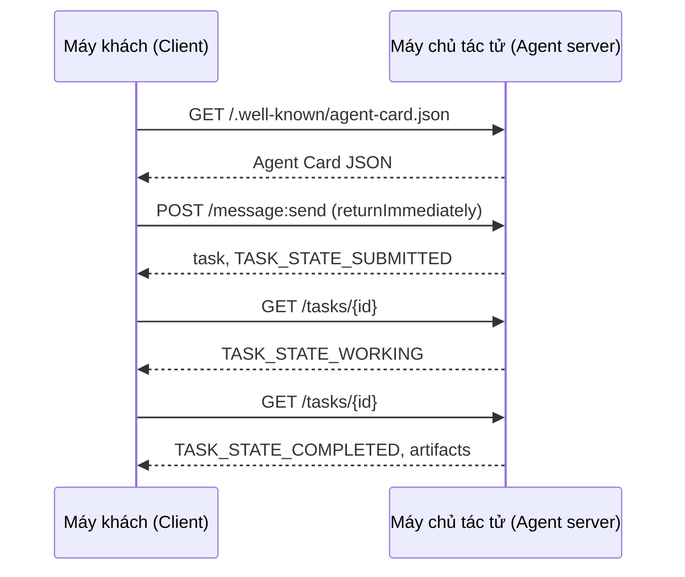

# A2A — Giao thức Tác tử-với-Tác tử (A2A — The Agent-to-Agent Protocol)

> Google công bố A2A vào tháng 4 năm 2025; tính đến tháng 4 năm 2026, bản đặc tả kỹ thuật đã có tại https://a2a-protocol.org/latest/specification/ và nhận được sự ủng hộ từ hơn 150 tổ chức. A2A là mảnh ghép ngang bổ sung cho MCP (Bài học 13): nếu MCP mang tính chiều dọc (tác tử ↔ công cụ), thì A2A mang tính ngang hàng (tác tử ↔ tác tử). Giao thức này định nghĩa Thẻ Tác tử (Agent Cards - phục vụ khám phá dịch vụ), các tác vụ đi kèm sản phẩm đầu ra (văn bản, dữ liệu có cấu trúc, video), vòng đời tác vụ mờ (opaque task lifecycles), và cơ chế xác thực. Các hệ thống trong môi trường sản xuất ngày càng kết hợp chặt chẽ giữa MCP và A2A. Google Cloud đã tích hợp hỗ trợ A2A vào Vertex AI Agent Builder trong giai đoạn 2025-2026.

**Type:** Learn + Build
**Languages:** Python (stdlib, `http.server`, `json`)
**Prerequisites:** Phase 16 · 04 (Primitive Model)
**Time:** ~75 minutes

## Vấn đề

Tác tử của bạn cần gọi một tác tử khác trên một hệ thống khác. Bằng cách nào? Bạn có thể mở một endpoint HTTP, tự định nghĩa một lược đồ JSON tùy biến và hy vọng phía bên kia hiểu được nó. Khi đó, mỗi cặp tác tử tương tác với nhau lại trở thành một ca tích hợp riêng biệt, tốn công sức xây dựng lại từ đầu.

A2A (Agent-to-Agent Protocol) là giao thức đường truyền chuẩn hóa toàn cầu cho các cuộc gọi như vậy. Giao thức cung cấp cơ chế khám phá dịch vụ chuẩn, mô hình tác vụ chuẩn, tầng vận chuyển chuẩn và định dạng sản phẩm đầu ra chuẩn. Nó tương tự như HTTP+REST nhưng được thiết kế chuyên biệt cho các tác tử dưới dạng các đối tượng hạng nhất (first-class citizens).

## Khái niệm

### Bốn yếu tố cốt lõi

**Thẻ Tác tử (Agent Card).** Một tài liệu JSON đặt tại đường dẫn `/.well-known/agent-card.json` mô tả tác tử: tên, kỹ năng, các giao diện hỗ trợ `supportedInterfaces` (URL endpoint, ràng buộc giao thức, phiên bản giao thức), các kiểu phương tiện đầu vào và đầu ra mặc định, cùng các yêu cầu xác thực (`securitySchemes` và `securityRequirements`). Việc khám phá dịch vụ diễn ra bằng cách đọc thẻ này.

```http
GET /.well-known/agent-card.json HTTP/1.1
Host: agent.example.com
```

```json
{
  "name": "code-review-agent",
  "description": "Reviews Python and TypeScript code.",
  "version": "1.0.0",
  "supportedInterfaces": [
    {
      "url": "https://agent.example.com",
      "protocolBinding": "HTTP+JSON",
      "protocolVersion": "1.0"
    }
  ],
  "capabilities": {"streaming": false, "pushNotifications": false},
  "securitySchemes": {
    "bearer": {"httpAuthSecurityScheme": {"scheme": "Bearer"}}
  },
  "securityRequirements": [{"schemes": {"bearer": {"list": []}}}],
  "defaultInputModes": ["text/plain", "application/json"],
  "defaultOutputModes": ["application/json"],
  "skills": [
    {
      "id": "review-python",
      "name": "Review Python",
      "description": "Reviews Python code.",
      "tags": ["code-review", "python"]
    },
    {
      "id": "review-typescript",
      "name": "Review TypeScript",
      "description": "Reviews TypeScript code.",
      "tags": ["code-review", "typescript"]
    }
  ]
}
```

**Tác vụ (Task).** Đơn vị công việc độc lập. Một đối tượng bất đồng bộ, có trạng thái với một vòng đời cụ thể: `TASK_STATE_SUBMITTED` → `TASK_STATE_WORKING` → `TASK_STATE_COMPLETED` / `TASK_STATE_FAILED` / `TASK_STATE_CANCELED`. Phía máy khách (client) gửi một thông điệp, máy chủ (server) tạo tác vụ và máy khách tiến hành thăm dò (poll) hoặc đăng ký nhận các bản cập nhật.

**Sản phẩm đầu ra (Artifact).** Kiểu kết quả được tạo ra bởi một tác vụ: văn bản, JSON có cấu trúc, hình ảnh, video, âm thanh. Các sản phẩm đầu ra đều có kiểu dữ liệu rõ ràng: mỗi phần mang một trong các trường `text`, `raw`, `url`, hoặc `data` và có thể khai báo `mediaType`, giúp việc hỗ trợ đa phương thức trở thành tính năng hạng nhất.

**Vòng đời mờ (Opaque lifecycle).** A2A không áp đặt *cách thức* mà tác tử từ xa giải quyết tác vụ. Phía máy khách chỉ nhìn thấy các bước chuyển đổi trạng thái và các sản phẩm đầu ra; phía triển khai máy chủ hoàn toàn tự do sử dụng bất kỳ framework hoặc công cụ nào bên dưới.

### Phân định ranh giới giữa MCP và A2A

- **MCP** (Model Context Protocol - Bài học 13): giao tiếp tác tử ↔ công cụ. Tác tử đọc/ghi thông qua JSON-RPC đến một máy chủ công cụ. Mặc định là phi trạng thái.
- **A2A**: giao tiếp tác tử ↔ tác tử. Giao thức ngang hàng (peer-to-peer); cả hai phía đều là các tác tử có năng lực suy luận độc lập.

Các hệ thống đa tác tử cấp sản xuất sử dụng kết hợp cả hai. Một tác tử ngang hàng A2A có thể kích hoạt các công cụ MCP ở phía máy chủ của nó. Sự phân tách này giữ cho hai mối quan tâm kiến trúc luôn rành mạch.

### Luồng khám phá và tương tác



Đây là các tuyến đường ràng buộc HTTP+JSON, và mỗi yêu cầu đều mang tiêu đề `A2A-Version: 1.0`. Mặc định phương thức `SendMessage` sẽ chặn (block) cho đến khi tác vụ đạt đến trạng thái kết thúc hoặc bị gián đoạn, vì vậy máy khách dùng cơ chế thăm dò sẽ đặt cờ `configuration.returnImmediately` để nhận lại đối tượng tác vụ ngay lập tức.

Ngoài ra, với cơ chế truyền phát dữ liệu (streaming): `POST /message:stream` sẽ trả về các sự kiện Server-Sent Events (đầu tiên là một sự kiện `task`, sau đó là các sự kiện `statusUpdate` và `artifactUpdate`), còn `/tasks/{id}:subscribe` cho phép gắn kết nối lại vào một tác vụ đang chạy. Luồng truyền phát sẽ đóng lại khi tác vụ đạt đến trạng thái kết thúc; không có cờ `final` riêng biệt.

### Xác thực (Auth)

A2A hỗ trợ ba mô hình xác thực phổ biến:

- **Bearer token**: Sử dụng OAuth2 hoặc token mờ (`httpAuthSecurityScheme` hoặc `oauth2SecurityScheme`).
- **mTLS**: Mutual TLS; hai tổ chức xác thực danh tính lẫn nhau qua chứng chỉ số (`mtlsSecurityScheme`).
- **API key**: Khóa bảo mật truyền qua header, tham số truy vấn (query parameter), hoặc cookie (`apiKeySecurityScheme`).

Thông tin xác thực được khai báo tường minh trong Thẻ Tác tử: `securitySchemes` đặt tên cho từng lược đồ và `securityRequirements` chỉ rõ những yêu cầu mà máy khách bắt buộc phải đáp ứng. Máy khách sẽ khám phá thẻ và tuân thủ theo.

### Hơn 150 tổ chức tính đến tháng 4 năm 2026

Sự tiếp nhận mạnh mẽ từ khối doanh nghiệp đã thúc đẩy quy mô bùng nổ của A2A. Yếu tố nổi bật: A2A đã trở thành phương thức tiêu chuẩn để các hệ thống tác tử doanh nghiệp vượt qua các ranh giới tin cậy (trust boundaries). Google Cloud phát hành bản hỗ trợ A2A trên Vertex AI Agent Builder; Microsoft Agent Framework hỗ trợ A2A; và hầu hết các framework lớn (LangGraph, CrewAI, AutoGen) đều cung cấp bộ điều hợp (adapter) A2A.

### Điểm mạnh của A2A

- **Các lệnh gọi xuyên tổ chức.** Tác tử tại Công ty A gọi tác tử tại Công ty B. Nếu không có A2A, mỗi cặp kết nối đều là một bản hợp đồng kỹ thuật tùy biến.
- **Hệ sinh thái framework không đồng nhất.** Tác tử LangGraph gọi tác tử CrewAI gọi tác tử Python thuần. A2A chuẩn hóa toàn bộ quá trình giao tiếp.
- **Sản phẩm đầu ra có định kiểu (Typed artifacts).** Kết quả dạng video, JSON có cấu trúc, âm thanh — tất cả đều được hỗ trợ nguyên bản.
- **Tác vụ chạy trong thời gian dài.** Vòng đời mờ kết hợp cùng cơ chế thăm dò giúp việc quản lý các tác vụ kéo dài nhiều giờ trở nên đơn giản và tin cậy.

### Điểm hạn chế của A2A

- **Các vi lệnh gọi nhạy cảm với độ trễ.** Vòng đời của A2A là bất đồng bộ. Các cuộc gọi tác tử-với-tác tử dưới một mili-giây không phù hợp; hãy sử dụng RPC trực tiếp.
- **Các tác tử liên kết chặt chẽ trong cùng một tiến trình.** Nếu cả hai tác tử cùng chạy trong một tiến trình Python, việc gọi qua vòng lặp mạng HTTP của A2A là quá cồng kềnh.
- **Các đội ngũ quy mô nhỏ.** Chi phí triển khai tuân thủ đặc tả kỹ thuật là có thật; các tác tử nội bộ đơn giản có thể không cần đến sự trang trọng này.

### So sánh A2A với ACP, ANP, NLIP

Nhiều đặc tả kỹ thuật liên quan đã xuất hiện trong giai đoạn 2024-2026:

- **ACP** (IBM/Linux Foundation) — tiền thân của A2A, phạm vi hẹp hơn.
- **ANP** (Agent Network Protocol) — tập trung mạnh vào khám phá ngang hàng, ưu tiên kiến trúc phi tập trung.
- **NLIP** (Ecma Natural Language Interaction Protocol, chuẩn hóa tháng 12/2025) — kiểu nội dung ngôn ngữ tự nhiên.

A2A là giao thức ngang hàng có mức độ phổ biến cao nhất tính đến tháng 4 năm 2026. Tham khảo bài báo tổng quan arXiv:2505.02279 (Liu và cộng sự, "A Survey of Agent Interoperability Protocols") để xem chi tiết so sánh.

```figure
sw-agent-card-discovery
```

## Xây dựng thực tế

`code/main.py` triển khai một máy chủ và máy khách A2A tối giản sử dụng `http.server` và JSON, tuân theo ràng buộc HTTP+JSON phiên bản 1.0. Máy chủ thực hiện:

- Công khai tệp `/.well-known/agent-card.json`,
- Tiếp nhận yêu cầu `POST /message:send`,
- Quản lý trạng thái tác vụ,
- Trả về sản phẩm đầu ra qua `GET /tasks/{id}`.

Máy khách thực hiện:

- Tải về Thẻ Tác tử (Agent Card),
- Gửi thông điệp kèm cờ `returnImmediately`,
- Thăm dò liên tục cho đến khi tác vụ hoàn thành,
- Đọc sản phẩm đầu ra.

Chạy chương trình:

```bash
python3 code/main.py
```

Tệp mã nguồn sẽ khởi chạy máy chủ trên một luồng nền, sau đó cho máy khách tương tác với máy chủ đó. Bạn sẽ quan sát toàn bộ quy trình hoàn chỉnh: khám phá, gửi việc, thăm dò trạng thái và tiếp nhận sản phẩm đầu ra.

## Ứng dụng thực tế

`outputs/skill-a2a-integrator.md` thiết kế một quy trình tích hợp A2A hoàn chỉnh: nội dung Thẻ Tác tử, lược đồ dữ liệu tác vụ, lựa chọn phương thức xác thực, và quyết định giữa truyền phát (streaming) hay thăm dò (polling).

## Đưa vào sản xuất

Danh sách kiểm tra khi triển khai:

- **Ghim chặt phiên bản đặc tả.** A2A vẫn đang tiếp tục phát triển; mỗi mục trong `supportedInterfaces` cần khai báo rõ `protocolVersion`, và máy khách phải gửi tiêu đề `A2A-Version: 1.0`.
- **Khởi tạo tác vụ có tính lũy đẳng (Idempotent task creation).** Việc gửi yêu cầu trùng lặp (do mạng thử lại) chỉ được phép tạo ra một tác vụ duy nhất. Tiến hành khử trùng lặp dựa trên `messageId` của máy khách.
- **Lược đồ cho sản phẩm đầu ra (Artifact schemas).** Khai báo rõ ràng cấu trúc dữ liệu mà tác tử sẽ trả về; phía nhận bắt buộc phải kiểm thực dữ liệu này.
- **Giới hạn tốc độ và xác thực.** A2A mở ra môi trường mạng công cộng; hãy áp dụng các tiêu chuẩn an ninh web thông thường.
- **Hàng đợi thư chết (Dead-letter) cho các tác vụ thất bại.** Phân tích các mẫu lỗi phát sinh theo thời gian để phát hiện các nguyên nhân hỏng hóc có tính lặp lại.

## Bài tập

1. Chạy `code/main.py`. Xác nhận rằng máy khách đã tự động khám phá máy chủ và nhận được đúng sản phẩm đầu ra mong đợi.
2. Thêm một kỹ năng thứ hai vào máy chủ (ví dụ: "summarize"). Cập nhật lại Thẻ Tác tử. Viết mã máy khách để chọn kỹ năng dựa trên loại tác vụ. Yêu cầu phiên bản 1.0 không có trường skill riêng biệt, do đó máy chủ phải định tuyến dựa trên các thành phần của thông điệp.
3. Triển khai endpoint `POST /message:stream`: phản hồi bằng Server-Sent Events (đầu tiên là một sự kiện `task`, sau đó là các sự kiện `statusUpdate`) và đóng luồng khi đạt trạng thái kết thúc. Phía máy khách cần thay đổi logic xử lý như thế nào?
4. Đọc tài liệu đặc tả của A2A. Xác định ba yêu cầu bắt buộc trong đặc tả mà bản minh họa này chưa triển khai.
5. So sánh cơ chế của A2A (khám phá qua Agent Card) với MCP (liệt kê năng lực phía máy chủ thông qua `listTools`). Sự đánh đổi giữa mô hình tác tử tự mô tả (self-describing) và mô hình thăm dò năng lực (capability-probing) là gì?

## Thuật ngữ then chốt

| Thuật ngữ | Mọi người thường nói | Bản chất kỹ thuật |
|---|---|---|
| A2A | "Tác tử với tác tử" | Giao thức ngang hàng để các tác tử gọi nhau xuyên suốt các hệ thống độc lập. Google khởi xướng năm 2025. |
| Thẻ Tác tử (Agent Card) | "Danh thiếp của tác tử" | Tài liệu JSON tại `/.well-known/agent-card.json` mô tả kỹ năng, `supportedInterfaces`, và cơ chế xác thực. |
| Tác vụ (Task) | "Đơn vị công việc" | Đối tượng bất đồng bộ có trạng thái cùng một vòng đời; tạo ra các sản phẩm đầu ra khi hoàn tất. |
| Sản phẩm đầu ra (Artifact) | "Kết quả công việc" | Đầu ra có kiểu dữ liệu: văn bản, JSON có cấu trúc, hình ảnh, video, âm thanh. Phương tiện hạng nhất. |
| Vòng đời mờ (Opaque lifecycle) | "Giải quyết thế nào là việc của tác tử" | Máy khách chỉ quan sát các bước chuyển trạng thái; máy chủ tự do lựa chọn framework và công cụ xử lý. |
| Khám phá dịch vụ (Discovery) | "Tìm kiếm tác tử" | Gửi lệnh `GET /.well-known/agent-card.json` để nhận về Thẻ Tác tử. |
| MCP và A2A | "Công cụ và Bạn đồng cấp" | MCP: quan hệ dọc giữa tác tử và công cụ. A2A: quan hệ ngang hàng giữa tác tử và tác tử. |
| ACP / ANP / NLIP | "Các giao thức anh em" | Các bộ đặc tả kỹ thuật liền kề; A2A là giao thức được áp dụng rộng rãi nhất tính đến năm 2026. |

## Tài liệu đọc thêm

- [Đặc tả kỹ thuật A2A](https://a2a-protocol.org/latest/specification/) — tài liệu đặc tả chuẩn mực
- [Bản phát hành A2A v1.0.1](https://github.com/a2aproject/A2A/tree/v1.0.1): tài liệu `docs/specification.md` và `specification/a2a.proto` được ghim phiên bản mà bài học này tuân thủ
- [Google Developers Blog — Công bố A2A](https://developers.googleblog.com/en/a2a-a-new-era-of-agent-interoperability/) — bài viết ra mắt vào tháng 4 năm 2025
- [Kho mã nguồn GitHub của A2A](https://github.com/a2aproject/A2A) — các bản triển khai tham chiếu và bộ SDK
- [Liu et al. — A Survey of Agent Interoperability Protocols](https://arxiv.org/html/2505.02279v1) — bài tổng quan so sánh MCP, ACP, A2A và ANP
