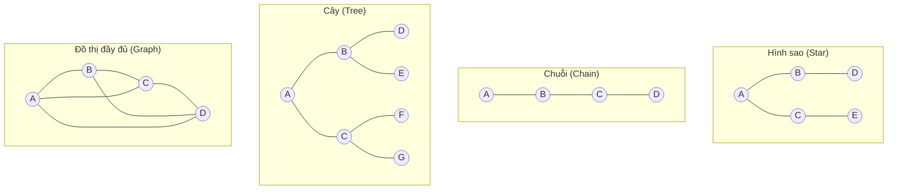

# Cơ chế Bỏ phiếu, Tính Nhất quán Tự thân và Cấu trúc Liên kết Tranh biện (Voting, Self-Consistency, and Debate Topology)

> Phương pháp tổng hợp tiết kiệm chi phí nhất: lấy mẫu từ $N$ tác tử độc lập và bỏ phiếu theo đa số (majority-vote). Wang et al. (2022) từng tiên phong ý tưởng này với kỹ thuật tính nhất quán tự thân (self-consistency) bằng cách lấy mẫu $N$ lần trên một mô hình duy nhất. Hệ đa tác tử đã mở rộng phương pháp này lên các tác tử **không đồng nhất** (heterogeneous agents) nhằm phá vỡ văn hóa đơn canh (monoculture) — sử dụng các mô hình khác nhau, prompt khác nhau, nhiệt độ (temperature) khác nhau và ngữ cảnh khác nhau. Vượt ra ngoài cơ chế bỏ phiếu đa số đơn thuần, cấu trúc liên kết tranh biện (debate topology) đóng vai trò sống còn: MultiAgentBench (arXiv:2503.01935, ACL 2025) đã đánh giá các mô hình điều phối dạng sao (star) / chuỗi (chain) / cây (tree) / đồ thị (graph) và phát hiện ra rằng **cấu trúc đồ thị tối ưu nhất cho các tác vụ nghiên cứu**, nhưng sẽ chịu một khoản "thuế điều phối" (coordination tax) đáng kể khi vượt quá ~4 tác tử. Nghiên cứu AgentVerse (ICLR 2024) đã ghi nhận hai mẫu hình hành vi tự phát sinh — hành vi xung phong (volunteer behaviors) và hành vi tuân phục (conformity behaviors) — trong đó sự tuân phục vừa là một đặc tính hữu ích (giúp tìm kiếm đồng thuận) vừa là một hiểm họa (nguy cơ tư duy tập thể - groupthink, Bài học 24). Bài học này sẽ phác họa bản đồ không gian cấu trúc liên kết, tự tay xây dựng từng biến thể và đo lường thuế điều phối trên thực tế.

**Type:** Learn + Build
**Languages:** Python (stdlib)
**Prerequisites:** Phase 16 · 07 (Society of Mind and Debate), Phase 16 · 14 (Consensus and BFT)
**Time:** ~75 phút

## Vấn đề

Tranh biện có thể nâng cao độ chính xác (Du et al., arXiv:2305.14325). Nhưng nó cũng có thể làm suy giảm chất lượng đầu ra. Tranh biện có mang lại hiệu quả hay không phụ thuộc vào bốn lựa chọn mang tính cấu trúc:

1. Ai trao đổi với ai (cấu trúc liên kết - topology).
2. Bao nhiêu vòng tranh biện (Du 2023 chỉ ra rằng cả số vòng lẫn số lượng tác tử đều đóng vai trò độc lập).
3. Các tác tử có thực sự không đồng nhất hay không (sử dụng các mô hình nền khác nhau để phá vỡ văn hóa đơn canh).
4. Có sự hiện diện của tiếng nói đối nghịch hay không (nguyên tắc tăng cường lập luận - steel-manning so với tấn công ngụy biện - straw-manning).

Nhiều đội ngũ kỹ sư áp dụng một cách máy móc công thức "chạy 5 tác tử rồi bỏ phiếu", để rồi nhận lại kết quả kém hơn cả khi dùng một tác tử đơn lẻ duy nhất. Thất bại đó không phải là ngẫu nhiên, mà bắt nguồn trực tiếp từ cấu trúc liên kết và mức độ đa dạng của các mô hình. Bài học này chính là bản đồ điều hướng cho không gian cấu trúc liên kết đó.

## Khái niệm

### Tính nhất quán tự thân: Mốc chuẩn trên mô hình đơn lẻ (Self-Consistency Baseline)

Wang et al. (2022, "Self-Consistency Improves Chain of Thought Reasoning") đề xuất lấy mẫu cùng một mô hình $N$ lần ở tham số nhiệt độ $temperature > 0$ và bỏ phiếu theo đa số dựa trên các câu trả lời thuộc chuỗi lập luận (chain of thought). Kết quả trên tập dữ liệu toán GSM8K cho thấy: độ chính xác tăng vượt bậc với $N = 40$ mẫu so với phương pháp giải mã tham lam (greedy decode) một lần duy nhất. Tính nhất quán tự thân chính là tiền thân ở cấp độ tác tử đơn lẻ của cơ chế bỏ phiếu đa tác tử.

Hạn chế cốt tử: tính nhất quán tự thân chỉ sử dụng một mô hình nền tảng duy nhất. Các lỗi sinh ra vốn đã bị tương quan về mặt cấu trúc. Nếu mô hình có một định kiến hay lỗ hổng hệ thống, cả $N$ mẫu thử đều sẽ chia sẻ chung điểm yếu đó.

### Bỏ phiếu đa tác tử: Mở rộng tính không đồng nhất (Heterogeneous Extension)

Thay thế $N$ mẫu thử bằng $N$ tác tử *khác biệt hoàn toàn*. Sử dụng các mô hình nền tảng khác nhau (Claude, GPT, Llama), các prompt khác nhau, quyền truy cập công cụ khác nhau. Lợi ích thu được: các lỗi không còn bị tương quan chéo. Đánh đổi: chi phí vận hành các mô hình khác nhau là khác nhau; việc điều phối giữa chúng phát sinh chi phí phụ trội.

Tên gọi chuẩn mực năm 2026 cho tranh biện không đồng nhất là **A-HMAD** — Tranh biện Đa tác tử Đối kháng Không đồng nhất (Adversarial Heterogeneous Multi-Agent Debate). Dù chưa phải là chuẩn mực phổ quát tuyệt đối, các bài báo khoa học dùng thuật ngữ này để chỉ "các mô hình khác nhau tranh luận với nhau, giúp triệt tiêu các lỗi tương quan phát sinh từ sự sụp đổ do văn hóa đơn canh".

### Bốn cấu trúc liên kết kinh điển (Topologies)



- **Hình sao (Star):** Một nút trung tâm (hub), tất cả các nút khác chỉ giao tiếp trực tiếp với nút trung tâm này. Tương đương với mô hình giám sát viên - công nhân (supervisor-worker) không có kênh trao đổi chéo.
- **Chuỗi (Chain):** Tuyến tính, mỗi tác tử chỉ thấy đầu ra của tác tử liền trước. Hoạt động như một đường ống xử lý (pipeline).
- **Cây (Tree):** Phân cấp, thường dùng trong các hệ tác tử có thứ bậc (Bài học 06).
- **Đồ thị (Graph):** Mọi nút đều có thể giao tiếp với nhau (any-to-any). Bao gồm cả đồ thị liên thông hoàn toàn (clique) và các đồ thị có hướng không chu trình (DAG) tùy ý.

### Thuế điều phối (MultiAgentBench)

Nghiên cứu MultiAgentBench (MARBLE, ACL 2025, arXiv:2503.01935) đã đo chuẩn cấu trúc hình sao, chuỗi, cây và đồ thị trên một bộ tác vụ toàn diện gồm nghiên cứu, lập trình và lập kế hoạch. Các kết luận định lượng cốt lõi:

- Cấu trúc **đồ thị (Graph)** chiến thắng áp đảo trong các tác vụ nghiên cứu. Thông tin luân chuyển tự do giữa mọi nút; các tác tử có thể phản biện chéo lẫn nhau.
- Cấu trúc **hình sao (Star)** tối ưu cho các tác vụ tra cứu dữ kiện cần câu trả lời nhanh. Nút trung tâm lọc và tổng hợp thông tin hiệu quả.
- Cấu trúc **chuỗi (Chain)** chiếm ưu thế trong các quy trình xử lý từng bước (tinh chỉnh dần qua các giai đoạn).
- **Thuế điều phối (Coordination tax)** bắt đầu xuất hiện rõ rệt khi vượt quá ~4 tác tử trong cấu trúc đồ thị. Thời gian thực thi thực tế (wall-clock) và chi phí token tăng nhanh hơn nhiều so với mức tăng trưởng chất lượng.

Ngưỡng giới hạn 4 tác tử này mang tính thực nghiệm tại thời điểm hiện tại, không phải là giới hạn vật lý tuyệt đối. Nó phản ánh dung lượng ngữ cảnh của LLM năm 2026: cửa sổ ngữ cảnh của từng tác tử nhanh chóng bị lấp đầy bởi đầu ra của các bạn đồng hành, và giá trị biên của việc bổ sung thêm tác tử thứ $N+1$ giảm sút nghiêm trọng một khi mọi tác tử đều đã có thể quan sát thấy nhau.

### Các chiến lược tranh luận đa tác tử ("Should we be going MAD?")

Tài liệu arXiv:2311.17371 là bản khảo sát năm 2023 về các chiến lược Tranh luận Đa tác tử (MAD). Phát hiện quan trọng được nhiều nhóm nghiên cứu kiểm chứng lại: các biến thể MAD có *cấu trúc tương tự* như tính nhất quán tự thân (lấy mẫu độc lập rồi tổng hợp) thường có hiệu năng kém hơn tính nhất quán tự thân khi so sánh trên cùng một ngân sách tính toán. MAD phát huy giá trị lớn nhất khi các tác tử thực sự không đồng nhất và cuộc tranh biện có cấu trúc đối kháng rõ rệt (có ít nhất một tác tử chuyên tâm phản biện lại).

### Các mẫu hình tự phát sinh trong AgentVerse

Nghiên cứu AgentVerse (ICLR 2024) ghi nhận hai hành vi tự động nảy sinh từ quá trình tranh biện đa tác tử ngay cả khi không được lập trình tường minh:

- **Hành vi xung phong (Volunteer).** Một tác tử chủ động đề xuất hỗ trợ ("Tôi có thể đảm nhận bước tiếp theo") mà không cần ai chỉ định. Rất hữu ích: nó tự động phân bổ công việc cho tác tử có năng lực phù hợp nhất cho tác vụ phụ đó.
- **Hành vi tuân phục (Conformity).** Một tác tử tự động điều chỉnh lập trường của mình để thuận theo người phản biện, ngay cả khi người phản biện hoàn toàn sai. Đây chính là biểu hiện tương đương của sự nịnh bợ trong tranh biện (Bài học 14).

Hiện tượng tuân phục chính là lý do vì sao việc tranh luận không giới hạn cho đến khi đạt đồng thuận sẽ vô tình trao quyền lực cho kẻ to tiếng nhất. Áp đặt số vòng giới hạn kết hợp với một trọng tài độc lập là giải pháp khắc phục triệt để.

### Tính không đồng nhất: Đòn bẩy thực sự nâng cao độ chính xác

Một nguyên lý thực hành phổ biến trong giai đoạn 2024–2026: việc tráo đổi một trong $N$ tác tử sang một mô hình nền tảng khác mang lại bước nhảy vọt về độ chính xác lớn hơn nhiều so với việc chỉ đơn thuần tăng $N$ thêm 1. Trực giác ở đây bắt nguồn từ vấn đề văn hóa đơn canh — mỗi nguồn lỗi độc lập mới luôn có giá trị hơn một mẫu thử bị tương quan lỗi bổ sung.

Khi xét tới giới hạn, tính không đồng nhất luôn đánh bại số lượng thuần túy. Ba mô hình khác biệt nhau sẽ đánh bại năm bản sao của cùng một mô hình trên hầu hết các tác vụ có chân lý khách quan rõ ràng.

### Phương pháp Bồi thẩm đoàn (Jury Methods)

Khung làm việc Sibyl (được trích dẫn nhiều trong các nghiên cứu Minsky-LLM) đã hình thức hóa mô hình "bồi thẩm đoàn" — một nhóm nhỏ các tác tử chuyên biệt có nhiệm vụ tinh chỉnh câu trả lời bằng cách bỏ phiếu ở từng giai đoạn. Khác với bỏ phiếu đa số giản đơn, một bồi thẩm đoàn phân chia vai trò rõ ràng: một tác tử chất vấn chéo, một tác tử cung cấp ngữ cảnh bổ sung, một tác tử chấm điểm tính hợp lý. Phương pháp bồi thẩm đoàn là điểm cân bằng lý tưởng giữa bỏ phiếu thuần túy (chi phí thấp nhưng dễ dính lỗi đơn canh) và tranh luận đối kháng toàn phần MAD (đắt đỏ và dễ dính lỗi a dua tuân phục).

### Khi nào bỏ phiếu kết hợp tranh luận chiếm ưu thế

- Câu hỏi có chân lý khách quan (dữ kiện thực tế, toán học, hành vi mã nguồn). Sự hội tụ phiếu bầu thực sự mang lại ý nghĩa.
- Các tác tử có thể tiếp cận các nguồn dữ liệu hoặc công cụ khác nhau (có sẵn tính không đồng nhất).
- Số vòng tranh luận được giới hạn chặt chẽ (thường từ 2–3 vòng) và có một trọng tài hoặc tác tử thẩm định độc lập.
- Ngân sách cho phép triển khai 3–5 tác tử. Vượt quá 5–7 tác tử trên cấu trúc đồ thị, thuế điều phối sẽ chiếm ưu thế hoàn toàn.

### Khi nào bỏ phiếu kết hợp tranh luận phản tác dụng

- Câu hỏi mang tính chất quan điểm, thị hiếu. Các tác tử sẽ nhanh chóng hội tụ về câu trả lời có vẻ tự tin nhất, chứ không phải đúng đắn nhất.
- Tất cả các tác tử đều dùng chung một mô hình nền. Văn hóa đơn canh khiến mọi sự đồng thuận trở nên vô nghĩa.
- Số vòng tranh luận không có điểm dừng. Sự tuân phục sẽ chiến thắng trong mọi trường hợp.
- Tác vụ quá đơn giản. Một tác tử đơn lẻ kết hợp tính nhất quán tự thân ở mức $N=5$ vừa tiết kiệm chi phí vừa đạt độ chính xác tương đương.

````figure
sw-debate-topology
````

## Xây dựng thực tế

Tệp `code/main.py` triển khai:

- `run_star(agents, hub, question)` — nút trung tâm thu thập ý kiến từ từng công nhân và tổng hợp.
- `run_chain(agents, question)` — tinh chỉnh tuần tự qua chuỗi.
- `run_tree(root, children, question)` — mô hình phân cấp với tổng hợp ở độ sâu 2.
- `run_graph(agents, question, rounds)` — tranh biện tự do mọi nút, có giới hạn số vòng.
- Một tham số điều chỉnh độ không đồng nhất theo kịch bản: mỗi tác tử có một độ lệch sai số `error_bias` phản ánh lỗi hệ thống của nó.
- Khung đo lường chạy từng cấu trúc ở các quy mô $N=3, 5, 7$ và xuất báo cáo `(accuracy, total_tokens, wallclock_simulated)`.

Chạy chương trình:

```bash
python3 code/main.py
```

Đầu ra kỳ vọng: một bảng ma trận `topology × N -> (accuracy, tokens, latency)`. Cấu trúc đồ thị chiến thắng ở $N=3–5$ trên các tác vụ nghiên cứu; cấu trúc hình sao tối ưu nhất trên các câu hỏi thực tế nhanh; cấu trúc đồ thị ở $N=7$ bộc lộ rõ thuế điều phối (độ trễ tăng phi mã trong khi độ chính xác cải thiện không đáng kể).

## Sử dụng trong thực tế

Tệp `outputs/skill-topology-picker.md` là kỹ năng đọc mô tả tác vụ và đề xuất cấu trúc liên kết tối ưu (hình sao / chuỗi / cây / đồ thị), quy mô $N$ (số lượng tác tử), hồ sơ không đồng nhất (các mô hình nền cần phối hợp), và giới hạn số vòng tranh luận.

## Đưa vào sản xuất

Đối với bất kỳ tập hợp tác tử nào:

- Bắt đầu với **tính nhất quán tự thân ở mức $N=5$** bằng một mô hình nền tảng mạnh. Đây là mốc chuẩn chi phí thấp hiệu quả nhất.
- Nâng cấp lên **bỏ phiếu không đồng nhất ở mức $N=3$** nếu bài toán đòi hỏi độ chính xác cao hơn. Đo lường mức chênh lệch hiệu năng.
- Chỉ nâng cấp lên **cấu trúc liên kết tranh luận** nếu tác vụ có cấu trúc phức tạp (nghiên cứu, suy luận nhiều bước) và việc giới hạn số vòng là khả thi.
- Luôn ghi nhật ký cụm ý kiến thiểu số. Khi một nhóm thiểu số liên tục đưa ra kết quả đúng, bạn đang có trong tay một tín hiệu quý giá về tính đa dạng của mô hình.
- Đo chuẩn thời gian thực thi thực tế và lượng token song song với độ chính xác. "Độ chính xác cao hơn nhưng chi phí gấp 10 lần" là một quyết định thuộc về bài toán kinh doanh.

## Bài tập thực hành

1. Chạy `code/main.py`. Vẽ biểu đồ đường cong thuế điều phối cho cấu trúc đồ thị: độ chính xác so với $N$, lượng token so với $N$. Tại giá trị $N$ nào đường cong bắt đầu uốn cong suy giảm hiệu quả?
2. Triển khai phương pháp A-HMAD: ba tác tử với các độ lệch sai số cố ý khác nhau. So sánh mốc chuẩn toàn bộ cùng độ lệch với A-HMAD trong cuộc tấn công đơn canh từ Bài học 14.
3. Thêm một vai trò "trọng tài" (judge) vào cấu trúc đồ thị, trọng tài không bỏ phiếu mà chỉ chấm điểm sự đồng thuận cuối cùng. Điều này có làm thay đổi hành vi tuân phục tự phát sinh hay không?
4. Đọc bài báo AgentVerse (ICLR 2024). Xác định xem mã nguồn triển khai của bạn bộc lộ hành vi tự phát sinh nào rõ nét nhất. Bạn có thể kích hoạt hành vi đối lập chỉ bằng cách thay đổi prompt không?
5. Đọc Mục 4 (thực nghiệm cấu trúc liên kết) trong MultiAgentBench (arXiv:2503.01935). Tái lập kết quả "đồ thị chiến thắng ở tác vụ nghiên cứu" trên một tác vụ từ bài báo bằng khung đo lường của bạn.

## Thuật ngữ then chốt

| Thuật ngữ | Cách hiểu phổ biến | Ý nghĩa kỹ thuật thực tế |
|---|---|---|
| Tính nhất quán tự thân (Self-consistency) | "Lấy mẫu N lần rồi bỏ phiếu" | Kỹ thuật của Wang (2022). Dùng một mô hình, lấy mẫu $N$ lần với $temperature > 0$, bỏ phiếu đa số trên các chuỗi lập luận. |
| Tính không đồng nhất (Heterogeneity) | "Dùng các mô hình khác nhau" | Tập hợp kết hợp nhiều mô hình nền tảng hoặc họ prompt khác nhau nhằm triệt tiêu lỗi đơn canh. |
| Tranh luận đa tác tử (MAD) | "Các tác tử phản biện nhau" | Thuật ngữ chung chỉ việc các tác tử trao đổi phê bình qua nhiều vòng (Du 2023). |
| A-HMAD | "Tranh biện đối kháng không đồng nhất" | Biến thể MAD nhấn mạnh vào các mô hình khác nhau kết hợp cấu trúc phản biện đối nghịch. |
| Cấu trúc liên kết (Topology) | "Ai trao đổi với ai" | Hình sao, chuỗi, cây, đồ thị. Quy định đường đi và luồng luân chuyển thông tin. |
| Thuế điều phối (Coordination tax) | "Quy luật lợi tức giảm dần" | Hiện tượng chi phí tăng nhanh hơn chất lượng khi vượt quá ~4 tác tử trong cấu trúc đồ thị. |
| Hành vi xung phong (Volunteer behavior) | "Tự nguyện hỗ trợ" | Mẫu hình tự phát trong AgentVerse: tác tử tự đề xuất nhận bước việc tiếp theo. |
| Hành vi tuân phục (Conformity behavior) | "Thỏa hiệp dưới áp lực" | Mẫu hình tự phát trong AgentVerse: tác tử tự uốn mình theo ý kiến phản biện dù người kia sai. |
| Bồi thẩm đoàn (Jury) | "Hội đồng chuyên môn nhỏ" | Tập hợp kiểu Sibyl với các vai trò chuyên biệt (người chất vấn, người cấp ngữ cảnh, người chấm điểm). |

## Tài liệu tham khảo

- [Wang et al. — Self-Consistency Improves Chain of Thought Reasoning](https://arxiv.org/abs/2203.11171) — Mốc chuẩn trên mô hình đơn lẻ.
- [Du et al. — Improving Factuality and Reasoning via Multiagent Debate](https://arxiv.org/abs/2305.14325) — Cả số lượng tác tử lẫn số vòng tranh biện đều đóng vai trò độc lập.
- [MultiAgentBench / MARBLE](https://arxiv.org/abs/2503.01935) — Đo chuẩn cấu trúc liên kết chỉ ra đồ thị tối ưu cho nghiên cứu, chuỗi tối ưu cho đường ống.
- [Should we be going MAD?](https://arxiv.org/abs/2311.17371) — Khảo sát chiến lược MAD; chỉ ra MAD thường thua tính nhất quán tự thân trên cùng ngân sách.
- [AgentVerse (ICLR 2024)](https://proceedings.iclr.cc/paper_files/paper/2024/file/578e65cdee35d00c708d4c64bce32971-Paper-Conference.pdf) — Các mẫu hình hành vi tự phát sinh: xung phong và tuân phục.
- [MARBLE repo](https://github.com/ulab-uiuc/MARBLE) — Triển khai tham chiếu của bộ đo chuẩn.
