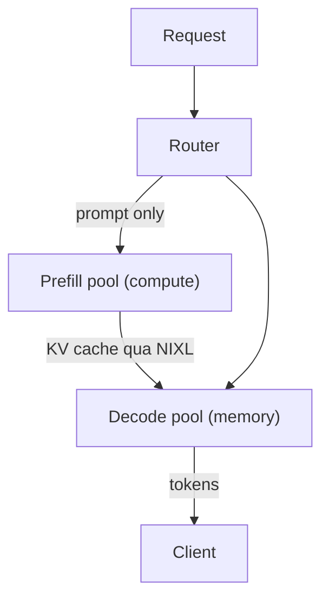

# Tách rời Prefill/Decode — NVIDIA Dynamo và llm-d (Disaggregated Prefill/Decode)

> Prefill bị giới hạn bởi tính toán (compute-bound); decode bị giới hạn bởi bộ nhớ (memory-bound). Chạy cả hai trên cùng một GPU sẽ lãng phí một trong hai loại tài nguyên. Tách rời (disaggregation) chia chúng ra các nhóm (pool) riêng và chuyển KV cache giữa chúng qua NIXL (RDMA/InfiniBand hoặc TCP dự phòng). NVIDIA Dynamo (công bố tại GTC 2025, 1.0 GA) nằm phía trên vLLM/SGLang/TRT-LLM — Planner Profiler + SLA Planner của nó tự động khớp tỷ lệ prefill:decode để đạt SLO. NVIDIA công bố mức tăng thông lượng trong khoảng này — developer.nvidia.com (2025-06) cho thấy cải thiện ~6 lần với DeepSeek-R1 MoE trên GB200 NVL72 + Dynamo ở chế độ độ trễ trung bình, và trang sản phẩm Dynamo (developer.nvidia.com, không đề ngày) quảng bá thông lượng MoE lên tới 50 lần trên GB300 NVL72 + Dynamo so với Hopper. Con số "30 lần" là tổng hợp của cộng đồng từ các báo cáo Blackwell + Dynamo + DeepSeek-R1 toàn ngăn xếp; chúng tôi chưa tìm thấy nguồn sơ cấp nào nói đúng 30 lần, nên hãy coi đó là tuyên bố mang tính định hướng. llm-d (Red Hat + AWS) là thuần Kubernetes: prefill / decode / router là các Service độc lập với HPA theo từng vai trò. llm-d 0.5 bổ sung offload KV phân cấp, định tuyến LoRA nhận biết cache, mạng UCCL, scale-to-zero. Kinh tế: tổng hợp nội bộ từ nhiều tiết lộ của khách hàng cho thấy tiết kiệm 30–40% trên chi tiêu suy luận cỡ 2 triệu USD (tức 600-800 nghìn USD/năm) khi chuyển từ phục vụ đồng đặt (colocated) sang tách rời với Dynamo ở cùng SLA; con số cụ thể 2 triệu → 600-800 nghìn USD là một tổng hợp nội bộ, không phải một ca nghiên cứu đã công bố — hãy dùng nó làm mốc bậc độ lớn, không phải trích dẫn tham chiếu. Prompt ngắn (<512 token, đầu ra ngắn) không biện minh được chi phí chuyển.

**Loại bài:** Học
**Ngôn ngữ:** Python (stdlib, trình mô phỏng đồ chơi tách rời so với đồng đặt)
**Điều kiện tiên quyết:** Phase 17 · 04 (Nội bộ engine phục vụ), Phase 17 · 08 (Chỉ số suy luận)
**Thời lượng:** ~75 phút

## Mục tiêu học tập

- Giải thích vì sao prefill và decode có phân bổ GPU tối ưu khác nhau và định lượng mức lãng phí khi đồng đặt.
- Vẽ sơ đồ kiến trúc tách rời: pool prefill, pool decode, chuyển KV qua NIXL, router.
- Nêu điều kiện khi tách rời KHÔNG đáng giá (prompt ngắn, đầu ra ngắn).
- Phân biệt NVIDIA Dynamo (nằm phía trên ngăn xếp) với llm-d (thuần Kubernetes) và ghép mỗi cái với một bối cảnh vận hành.

## Vấn đề

Bạn chạy Llama 3.3 70B trên 8 H100. Với tải hỗn hợp (prompt dài + đầu ra ngắn), các GPU nhàn rỗi trong decode vì phần lớn tính toán đã dành cho prefill. Với tải khác (prompt ngắn + đầu ra dài), điều ngược lại xảy ra. Prefill + decode đồng đặt nghĩa là bạn cấp thừa cho cả hai.

Tác động ngân sách: 20-40% thời gian GPU bị lãng phí vào sai loại tài nguyên. Bạn đang mua sức tính toán H100 để chạy decode bị giới hạn bộ nhớ, hoặc mua băng thông HBM của H100 để chạy prefill bị giới hạn tính toán. Cả hai đều là lãng phí đắt đỏ.

Tách rời chia prefill và decode vào các pool riêng, được định cỡ theo nút thắt của từng bên. KV cache được chuyển từ pool prefill sang pool decode qua kết nối băng thông cao.

## Khái niệm

### Vì sao các nút thắt khác nhau

**Prefill** — chạy transformer trên toàn bộ prompt đầu vào trong một lượt forward. Phép nhân ma trận chiếm ưu thế; bị giới hạn tính toán. H100 FP8 cho ~2000 TFLOPS thông lượng hữu ích. Hiệu quả theo lô tốt — một lượt forward xử lý nhiều token.

**Decode** — sinh từng token một, đọc toàn bộ trọng số mỗi vòng lặp. Bị giới hạn băng thông bộ nhớ. HBM3 cho ~3 TB/s. Hiệu quả theo lô chỉ tốt ở mức đồng thời cao — việc đọc trọng số được phân bổ đều qua lô.

Đồng đặt chúng: bạn mua GPU tối ưu cho cả hai. H100 giỏi cả hai nhưng giá như nhau dù dùng cách nào. Ở quy mô lớn, bạn muốn pool prefill trên H100 / nặng tính toán; pool decode trên H200 / nặng bộ nhớ, hoặc với lượng tử hóa mạnh.

### Kiến trúc



NIXL là phương tiện truyền liên nút của NVIDIA. Dùng RDMA/InfiniBand khi có, nếu không thì dự phòng TCP. Độ trễ chuyển là có thật — thường 20-80 ms cho KV cache của prompt 4K token trên 70B FP8. Đây là lý do prompt ngắn không biện minh được cho tách rời: thuế chuyển vượt quá phần tiết kiệm.

### Dynamo so với llm-d

**NVIDIA Dynamo** (công bố tại GTC 2025, 1.0 GA):
- Nằm phía trên vLLM, SGLang, TRT-LLM như một bộ điều phối (orchestrator).
- Planner Profiler đo tải, SLA Planner tự cấu hình tỷ lệ prefill:decode.
- Lõi Rust, mở rộng bằng Python.
- Mức tăng thông lượng: NVIDIA báo cáo 6 lần cho DeepSeek-R1 MoE trên GB200 NVL72 + Dynamo ở chế độ độ trễ trung bình (developer.nvidia.com, 2025-06); các báo cáo cộng đồng về "lên tới 30 lần" trên các ngăn xếp Blackwell + Dynamo + DeepSeek-R1 đầy đủ thiếu một nguồn sơ cấp duy nhất và nên coi là mang tính định hướng.
- GB300 NVL72 + Dynamo: thông lượng MoE lên tới 50 lần so với Hopper theo trang sản phẩm Dynamo (developer.nvidia.com, không đề ngày).

**llm-d** (Red Hat + AWS, thuần Kubernetes):
- Prefill / decode / router là các Kubernetes Service độc lập.
- HPA theo từng vai trò với tín hiệu độ sâu hàng đợi (prefill) / mức dùng KV (decode).
- `topologyConstraint packDomain: rack` gom các clique prefill+decode vào cùng một rack để chuyển KV với băng thông cao.
- llm-d 0.5 (2026): offload KV phân cấp, định tuyến LoRA nhận biết cache, mạng UCCL, scale-to-zero.

Dùng Dynamo nếu bạn muốn một bộ điều phối được quản lý, nằm phía trên ngăn xếp. Dùng llm-d nếu bạn muốn các nguyên thủy thuần Kubernetes và cam kết với hệ sinh thái CNCF.

### Kinh tế

Tổng hợp nội bộ (không phải một ca nghiên cứu đã công bố — mốc bậc độ lớn):

- Chi tiêu suy luận 2 triệu USD/năm cho phục vụ đồng đặt.
- Chuyển sang tách rời với Dynamo.
- Cùng khối lượng yêu cầu, cùng SLA độ trễ P99.
- Mức tiết kiệm báo cáo: 600 nghìn–800 nghìn USD/năm (giảm 30–40%).
- Không có phần cứng mới.

Chúng tôi tổng hợp con số này từ nhiều tiết lộ của khách hàng thay vì một ca nghiên cứu duy nhất có thể trích dẫn; điểm dữ liệu đã công bố gần nhất là TTFT nhanh gấp 2 lần / thông lượng cao hơn 61% của Baseten với định tuyến KV của Dynamo (baseten.co, 2025-10), và dự báo của VAST + CoreWeave về nhiều hơn 60–130% token/USD ở tỷ lệ trúng KV 40–60% (vastdata.com, 2025-12). Khoản tiết kiệm đến từ việc định cỡ đúng từng pool; các tải nặng prefill (RAG với tiền tố 8K+) hưởng lợi nhiều hơn các tải cân bằng.

### Khi nào KHÔNG nên tách rời

- Prompt < 512 token và đầu ra < 200 token: thuế chuyển lấn át lợi ích.
- Cụm nhỏ (< 4 GPU): không đủ đa dạng pool.
- Đội ngũ không thể vận hành hai pool GPU với co giãn theo vai trò: Dynamo giúp nhưng không tầm thường.
- Không có fabric RDMA: thuế chuyển qua TCP nặng hơn.

### Router tích hợp với Phase 17 · 11

Router tách rời nhận biết KV cache (Phase 17 · 11). Một yêu cầu rơi vào pool decode đang giữ tiền tố của nó — nếu không khớp, nó đi prefill → decode. Tỷ lệ trúng và tách rời cộng hưởng với nhau — router nhận biết cache quyết định liệu có cần một prefill mới hay không.

### MoE trên Blackwell là nơi có các con số thực

GB300 NVL72 + Dynamo cho thấy thông lượng MoE gấp 50 lần so với đường cơ sở Hopper. Định tuyến chuyên gia (expert) của MoE nặng tính toán ở prefill nhưng nặng bộ nhớ ở decode (cache chuyên gia), nên tách rời là chiến thắng kép. Phục vụ mô hình tiên phong năm 2026 do MoE thống trị (DeepSeek-V3, các biến thể GPT-5 tương lai).

### Những con số bạn nên nhớ

Các con số benchmark trôi theo thời gian — NVIDIA và ngăn xếp suy luận đăng kết quả cập nhật mỗi quý. Hãy kiểm tra lại trước khi trích dẫn.

- DeepSeek-R1 trên GB200 NVL72 + Dynamo: ~6 lần thông lượng so với đường cơ sở ở chế độ độ trễ trung bình (developer.nvidia.com, 2025-06); các tuyên bố cộng đồng "lên tới 30 lần" trên ngăn xếp Blackwell + Dynamo đầy đủ là các tổng hợp mang tính định hướng, không có nguồn sơ cấp duy nhất.
- GB300 NVL72 + Dynamo: thông lượng MoE lên tới 50 lần so với Hopper (developer.nvidia.com, không đề ngày).
- Mốc tiết kiệm (tổng hợp nội bộ, không phải một ca duy nhất): 600-800 nghìn USD/năm trên khoản chi 2 triệu USD hằng năm ở cùng SLA.
- Ngưỡng tách rời: prompt > 512 token + đầu ra > 200 token.
- Chuyển KV qua NIXL: 20-80 ms cho KV của prompt 4K trên 70B FP8.

```figure
prefill-decode-split
```

## Sử dụng

`code/main.py` mô phỏng phục vụ đồng đặt so với tách rời. Báo cáo thông lượng, chi phí mỗi yêu cầu và điểm giao cắt theo độ dài prompt.

## Đưa vào sản xuất

Bài học này tạo ra `outputs/skill-disaggregation-decider.md`. Dựa trên tải và cụm, quyết định có nên tách rời hay không.

## Bài tập

1. Chạy `code/main.py`. Ở độ dài prompt nào thì tách rời thắng đồng đặt?
2. Thiết kế pool prefill và pool decode cho một dịch vụ RAG với độ dài tiền tố P99 là 8K, đầu ra 300.
3. Dynamo so với llm-d: chọn một cho một cửa hàng thuần Kubernetes không ưu tiên runtime Python.
4. Tính chi phí chuyển KV: prefill 4K trên 70B FP8 = ~500 MB KV. Với RDMA 100 GB/s, chuyển = 5 ms. Với TCP 10 GB/s = 50 ms. Cái nào quan trọng với SLA của bạn?
5. Định tuyến chuyên gia MoE thay đổi mẫu truy cập KV. Tách rời hoạt động ra sao với MoE kích hoạt các chuyên gia khác nhau cho mỗi token?

## Thuật ngữ chính

| Thuật ngữ | Người ta thường nói | Ý nghĩa thực sự |
|------|----------------|------------------------|
| Phục vụ tách rời (Disaggregated serving) | "tách prefill/decode" | Các pool GPU riêng cho mỗi pha |
| NIXL | "phương tiện truyền của NVIDIA" | Cơ chế chuyển KV liên nút của Dynamo (RDMA/TCP) |
| NVIDIA Dynamo | "bộ điều phối" | Bộ điều phối nằm phía trên ngăn xếp cho vLLM/SGLang/TRT-LLM |
| llm-d | "thuần Kubernetes" | Ngăn xếp tách rời K8s của Red Hat + AWS |
| Planner Profiler | "tự cấu hình của Dynamo" | Đo tải, cấu hình tỷ lệ pool |
| SLA Planner | "chính sách của Dynamo" | Tự khớp tỷ lệ prefill:decode để đạt SLO |
| `packDomain: rack` | "topo của llm-d" | Gom prefill+decode vào cùng rack để KV nhanh |
| UCCL | "tập thể hợp nhất" | Lớp mạng của llm-d 0.5 cho scale-to-zero |
| Định tuyến chuyên gia MoE (MoE expert routing) | "chuyên gia cho mỗi token" | Mẫu của DeepSeek-V3; tách rời có ích |

## Đọc thêm

- [NVIDIA — Introducing Dynamo](https://developer.nvidia.com/blog/introducing-nvidia-dynamo-a-low-latency-distributed-inference-framework-for-scaling-reasoning-ai-models/)
- [NVIDIA — Disaggregated LLM Inference on Kubernetes](https://developer.nvidia.com/blog/deploying-disaggregated-llm-inference-workloads-on-kubernetes/)
- [TensorRT-LLM Disaggregated Serving blog](https://nvidia.github.io/TensorRT-LLM/blogs/tech_blog/blog5_Disaggregated_Serving_in_TensorRT-LLM.html)
- [llm-d GitHub](https://github.com/llm-d/llm-d)
- [llm-d 0.5 release notes](https://github.com/llm-d/llm-d/releases)
