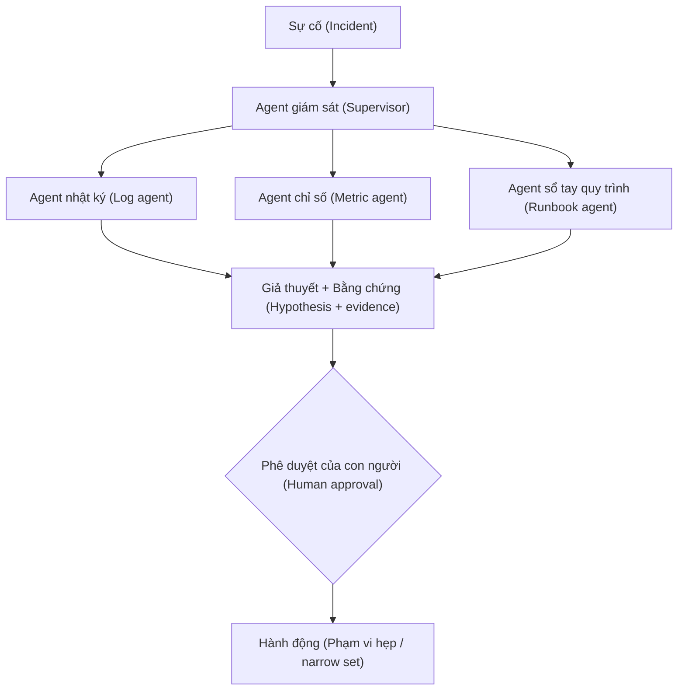

# SRE cho hệ thống AI — Ứng phó sự cố đa Agent, Sổ tay quy trình và Phát hiện mang tính dự đoán

> SRE cho hệ thống AI (SRE for AI) sử dụng các mô hình ngôn ngữ lớn (LLM) được neo giữ trên dữ liệu hạ tầng (nhật ký, sổ tay quy trình, cấu trúc liên kết dịch vụ) thông qua kỹ thuật tạo sinh tăng cường truy xuất (retrieval-augmented generation - RAG) để tự động hóa các giai đoạn điều tra, lập tài liệu và điều phối. Mô hình kiến trúc của năm 2026 là điều phối đa agent (multi-agent orchestration) — các agent chuyên biệt (nhật ký, chỉ số, sổ tay quy trình) được điều phối bởi một agent giám sát (supervisor); AI đề xuất các giả thuyết và truy vấn, con người phê duyệt các quyết định đánh giá. Datadog Bits AI và Azure SRE Agent cung cấp mô hình này dưới dạng các sản phẩm được quản lý. Các sổ tay quy trình vận hành (runbooks) đang không ngừng phát triển: NeuBird Hawkeye áp dụng phương pháp đánh giá đối kháng (adversarial evaluation) (hai mô hình cùng phân tích một sự cố; đồng thuận = độ tin cậy cao, bất đồng = bất định); bộ nhớ vận hành (operational memory) được duy trì liên tục qua các lần thay đổi nhân sự trong nhóm. Khả năng tự động khắc phục (auto-remediation) vẫn duy trì sự thận trọng: AI đề xuất, con người phê duyệt. Hành động hoàn toàn tự trị chỉ giới hạn trong phạm vi hẹp (khởi động lại pod, hoàn nguyên bản triển khai cụ thể) đi kèm với các rào chắn bảo vệ (guardrails) nghiêm ngặt — bất kỳ ai quảng bá giải pháp "thiết lập rồi để đó" đều là nói quá sự thật. Ranh giới mới nổi: dự đoán trước sự cố (pre-incident prediction). Nghiên cứu từ MIT báo cáo rằng một LLM được huấn luyện trên nhật ký lịch sử + nhiệt độ GPU + các mẫu lỗi API đã dự đoán trước được 89% các sự cố gián đoạn dịch vụ trước 10-15 phút. Dự báo: 95% LLM cấp doanh nghiệp sẽ có cơ chế dự phòng chuyển đổi tự động (automated failover) vào cuối năm 2026.

**Type:** Learn
**Languages:** Python (thư viện chuẩn, trình mô phỏng phân loại sự cố đa agent đồ chơi)
**Prerequisites:** Phase 17 · 13 (Khả năng quan sát - Observability), Phase 17 · 24 (Kỹ thuật hỗn loạn - Chaos Engineering)
**Time:** ~60 phút

## Mục tiêu học tập

- Vẽ sơ đồ kiến trúc SRE cho AI đa agent: supervisor + các agent chuyên biệt (nhật ký, chỉ số, sổ tay quy trình) + cổng phê duyệt của con người.
- Giải thích lý do tại sao tự động khắc phục chỉ nên giới hạn trong phạm vi hẹp (khởi động lại pod, hoàn nguyên bản triển khai) thay vì phạm vi rộng (tái cấu trúc dịch vụ).
- Nêu tên mẫu hình đánh giá đối kháng (NeuBird Hawkeye): hai mô hình đồng thuận = độ tin cậy cao; bất đồng = chuyển cấp xử lý (escalate).
- Trích dẫn kết quả phát hiện sớm 89% của MIT và ràng buộc vận hành: dự đoán mà không có hành động kích hoạt chỉ đơn thuần là các bảng điều khiển (dashboards).

## Vấn đề đặt ra

Một kỹ sư trực ca (on-call engineer) nhận trang báo động lúc 3 giờ sáng: "Tỷ lệ lỗi cao trong quy trình thanh toán." Họ kiểm tra Datadog, Loki, ba sổ tay quy trình và nhật ký triển khai. 30 phút sau, họ nhận ra nguyên nhân gốc rễ (root cause) là sự cố tràn bộ nhớ (OOM) của vLLM do bộ nhớ đệm KV (KV cache) tăng đột biến. Họ khởi động lại pod; lỗi biến mất.

Vào năm 2026, 20 phút đầu tiên của cuộc điều tra đó hoàn toàn có thể tự động hóa được. Việc gom nhóm nhật ký theo dịch vụ, đối chiếu tương quan với các bản triển khai gần đây, khớp nối với các sổ tay quy trình — tất cả đều là RAG kết hợp sử dụng công cụ (tool-use). Một agent có giám sát có thể thực hiện phân loại bước đầu và đưa ra một giả thuyết trước cả khi con người kịp mở Datadog.

Khắc phục hoàn toàn tự trị lại là một bài toán khác. Khởi động lại pod: an toàn. Mở rộng cụm GPU: an toàn nếu chính sách cho phép. Tái cấu trúc lại dịch vụ: tuyệt đối không. Tính kỷ luật nằm ở việc vạch ra ranh giới phạm vi hẹp đó.

## Khái niệm

### Kiến trúc đa agent



Agent giám sát phân chia sự cố thành các truy vấn phụ. Các agent chuyên biệt có quyền truy cập công cụ (tìm kiếm nhật ký, PromQL, truy xuất tài liệu). Agent giám sát tổng hợp, trình bày giả thuyết + bằng chứng cho con người. Con người phê duyệt hoặc điều hướng lại.

### Phạm vi tự động khắc phục

**An toàn (phạm vi hẹp)**: khởi động lại pod, hoàn nguyên bản triển khai cụ thể, mở rộng cụm tài nguyên trong giới hạn đã phê duyệt trước, kích hoạt cờ tính năng (feature flag) đã được duyệt trước.

**Không an toàn (phạm vi rộng)**: thay đổi cấu trúc liên kết dịch vụ (service topology), sửa đổi giới hạn tài nguyên, triển khai mã nguồn mới, thay đổi quyền IAM, can thiệp vào cơ sở dữ liệu.

Bất kỳ ai quảng bá giải pháp "thiết lập rồi để đó" đều là nói quá sự thật. Tập hợp các hành động an toàn sẽ mở rộng dần khi SRE cho AI trưởng thành hơn, nhưng ranh giới này là có thực.

### Đánh giá đối kháng (NeuBird Hawkeye)

Hai mô hình phân tích độc lập cùng một sự cố. Nếu chúng đồng thuận về nguyên nhân gốc rễ, độ tin cậy là cao. Nếu chúng bất đồng quan điểm, sự cố được chuyển cấp lên cho con người với cả hai giả thuyết được hiển thị rõ ràng. Một mẫu hình đơn giản nhưng là bộ lọc hiệu quả chống lại các nguyên nhân gốc rễ bị ảo giác (hallucinated).

### Bộ nhớ vận hành

Sự biến động nhân sự là "sát thủ thầm lặng" của SRE truyền thống — tri thức nội bộ rời đi cùng con người. SRE cho AI lưu trữ các sổ tay quy trình + các báo cáo mổ xẻ sự cố (post-mortems) trong một cơ sở dữ liệu vector; các agent sẽ truy xuất chúng trong mỗi sự cố mới. Khi các kỹ sư mới gia nhập đội ngũ, AI đã nắm giữ toàn bộ lịch sử vận hành.

### Dự đoán trước sự cố

Nghiên cứu năm 2025 của MIT: LLM được huấn luyện trên nhật ký lịch sử, nhiệt độ GPU và các mẫu lỗi API đã dự đoán trước được 89% các sự cố gián đoạn dịch vụ trước 10-15 phút trên tập kiểm thử.

Nhìn nhận thực tế: Các dự đoán mà không có khả năng kích hoạt hành động thực tế thì chỉ là những bảng điều khiển. Câu hỏi vận hành là: "Khi chúng ta dự đoán được, chúng ta sẽ làm gì?" Chủ động rút tải (pre-emptive drain)? Báo trang sự cố? Tự động mở rộng quy mô? Câu trả lời phụ thuộc vào chính sách cụ thể của từng hệ thống.

### Các sản phẩm trong năm 2026

- **Datadog Bits AI** — trợ lý SRE được quản lý ngay bên trong Datadog.
- **Azure SRE Agent** — giải pháp gốc trên nền tảng Azure.
- **NeuBird Hawkeye** — đánh giá đối kháng + bộ nhớ vận hành.
- **PagerDuty AIOps** — phân loại bước đầu + khử trùng lặp cảnh báo.
- **Incident.io Autopilot** — chỉ huy sự cố (incident commander) + điều phối hoạt động.

### Sổ tay quy trình dưới dạng mã nguồn (Runbooks as code)

Sổ tay quy trình phát triển từ các trang tài liệu Confluence thành các tệp markdown có quản lý phiên bản với các phần có cấu trúc rõ ràng (triệu chứng, giả thuyết, xác minh, hành động). Sổ tay quy trình có cấu trúc giúp nâng cao hiệu quả truy xuất RAG. Hãy bắt đầu mọi lộ trình triển khai AI-SRE bằng cách chuyển đổi các sổ tay quy trình phi cấu trúc thành dạng có cấu trúc.

### Những con số cần ghi nhớ

- Khả năng phát hiện sớm của MIT: 89% sự cố gián đoạn, thời gian báo trước 10-15 phút.
- Phân loại đa agent: supervisor + (nhật ký, chỉ số, sổ tay quy trình) + con người.
- Tập hành động tự khắc phục an toàn: khởi động lại pod, hoàn nguyên bản triển khai, mở rộng quy mô trong ngưỡng giới hạn.
- Đánh giá đối kháng: hai mô hình hoạt động độc lập; đồng thuận = độ tin cậy cao.

```figure
i4-incident-agents
```

## Sử dụng trong thực tế (Use It)

Tệp `code/main.py` mô phỏng quy trình phân loại sự cố đa agent: agent nhật ký phát hiện lỗi, agent chỉ số phát hiện mức tăng đột biến CPU, agent sổ tay quy trình khớp nối với sự cố đã biết. Agent giám sát xếp hạng các giả thuyết.

## Triển khai thành phẩm (Ship It)

Bài học này tạo ra tệp `outputs/skill-ai-sre-plan.md`. Dựa trên lịch trực ca hiện tại, khối lượng sự cố và mức độ trưởng thành của đội ngũ, tệp này thiết kế lộ trình triển khai AI SRE cho tổ chức.

## Bài tập thực hành (Exercises)

1. Chạy `code/main.py`. Điều gì xảy ra nếu agent nhật ký và agent chỉ số bất đồng quan điểm? Agent giám sát giải quyết sự bất đồng này như thế nào?
2. Xác định ba hành động tự động khắc phục "an toàn" cho dịch vụ của bạn. Đưa ra lập luận bảo vệ cho từng hành động.
3. Viết một mẫu sổ tay quy trình có cấu trúc: các phân mục, các trường bắt buộc, các lệnh xác minh.
4. Hệ thống phát hiện dự đoán kích hoạt cảnh báo trước 12 phút. Chính sách của bạn là gì — báo trang kỹ sư, chủ động rút tải (pre-drain), hay kết hợp cả hai?
5. Tranh luận xem một nhóm gồm 3 người có nên áp dụng AI SRE vào năm 2026 hay nên chờ đợi. Hãy xem xét mức độ trưởng thành, khối lượng sự cố và rủi ro.

## Thuật ngữ cốt lõi (Key Terms)

| Thuật ngữ | Mọi người thường nói | Ý nghĩa thực tế |
|---|---|---|
| AI SRE | "agent trực ca" | Hoạt động điều tra và điều phối sự cố có sự hỗ trợ của LLM |
| Supervisor agent | "bộ điều phối" | Agent cấp cao nhất có nhiệm vụ phân chia sự cố thành các truy vấn phụ |
| Specialized agent | "agent nghiệp vụ" | Agent phụ có quyền truy cập công cụ chuyên biệt (nhật ký, chỉ số, sổ tay quy trình) |
| Auto-remediation | "AI tự sửa lỗi" | Hành động phạm vi hẹp đã phê duyệt trước; KHÔNG PHẢI tái cấu trúc diện rộng |
| Operational memory | "sổ tay quy trình vector" | Báo cáo mổ xẻ sự cố + sổ tay quy trình lưu trong DB vector phục vụ RAG |
| Adversarial eval | "kiểm tra hai mô hình" | Phân tích độc lập; đồng thuận = độ tin cậy cao |
| NeuBird Hawkeye | "công cụ đối kháng" | Sản phẩm áp dụng mẫu hình đánh giá đối kháng + bộ nhớ vận hành |
| Bits AI | "agent SRE của Datadog" | AI SRE do Datadog quản lý |
| Pre-incident prediction | "phát hiện sớm" | Dự đoán sự cố gián đoạn dịch vụ trước 10-15 phút |

## Đọc thêm (Further Reading)

- [incident.io — AI SRE Complete Guide 2026](https://incident.io/blog/what-is-ai-sre-complete-guide-2026)
- [InfoQ — Human-Centred AI for SRE](https://www.infoq.com/news/2026/01/opsworker-ai-sre/)
- [DZone — AI in SRE 2026](https://dzone.com/articles/ai-in-sre-whats-actually-coming-in-2026)
- [Datadog Bits AI](https://www.datadoghq.com/product/bits-ai/)
- [NeuBird Hawkeye](https://www.neubird.ai/)
- [awesome-ai-sre](https://github.com/agamm/awesome-ai-sre)
