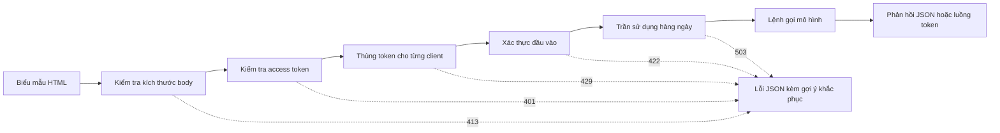

# Giao diện Demo Mô hình — Từ một Hàm đến một Ứng dụng Có thể Chia sẻ

> Một bản demo mô hình có đúng một bản giao ước giao tiếp (contract): một đầu vào, một lệnh gọi mô hình, và một đầu ra. Hãy đặt giới hạn nghiêm ngặt cho từng phần trước khi bạn chia sẻ liên kết ra bên ngoài.

**Type:** Build
**Languages:** Python
**Prerequisites:** Phase 11 · 13 (Xây dựng Ứng dụng LLM trong Sản xuất), Phase 17 · 08 (Các Chỉ số Đo lường Suy luận), Phase 17 · 19 (Cổng AI - AI Gateways)
**Time:** ~90 phút

## Mục tiêu học tập

- Xây dựng bản giao ước giao tiếp gồm đầu vào, lệnh gọi mô hình và đầu ra cho một bản demo, với các giới hạn cụ thể cho từng thành phần.
- Xây dựng một ứng dụng HTTP chỉ sử dụng thư viện chuẩn (standard library) với một trang HTML duy nhất, một endpoint JSON, và một endpoint Server-Sent Events (SSE).
- Xác thực dữ liệu đầu vào theo thứ tự tối ưu chi phí, và trả về thông báo lỗi định dạng JSON hướng dẫn người dùng hành động tiếp theo.
- Bảo vệ bản demo công khai bằng thuật toán thùng token (token bucket) cho từng máy khách, trần giới hạn sử dụng hàng ngày (daily usage cap), và mã token truy cập tùy chọn (access token).
- Ghi nhật ký yêu cầu (request logs) an toàn, tuyệt đối không lưu trữ văn bản đầu vào và địa chỉ IP của máy khách.
- So sánh phiên bản demo thư viện chuẩn với hai framework phổ biến, và nhận diện các tín hiệu cho thấy một bản demo cần phải chuyển đổi thành một sản phẩm chính thức.

## Vấn đề thực tế

Mô hình của bạn hoạt động rất tốt trong một notebook. Giờ đây, một người đánh giá muốn thử nghiệm mười trường hợp đầu vào khác nhau, và một khách hàng muốn trực tiếp xem một kết quả mẫu trên điện thoại di động. Cả hai người họ đều sẽ không bao giờ mở notebook của bạn ra.

Một ô lệnh notebook (notebook cell) không có bất kỳ giới hạn đầu vào nào và không có hiển thị tiến trình thực thi. Các lỗi phát sinh chỉ là các vết ngăn xếp (stack traces) mà duy nhất bạn mới có thể hiểu được. Nó cũng chạy trực tiếp bằng thông tin xác thực và ngân sách cá nhân của bạn. Nếu bạn đặt ô lệnh đó sau một URL công khai mà không có bất kỳ tinh chỉnh nào, bạn có thể dự đoán trước những sự cố sau:

- Người dùng dán vào một tài liệu dài tới 40.000 ký tự. Lệnh gọi mô hình chạy miệt mài trong một phút rồi sụp đổ với một chuỗi lỗi stack trace dài dằng dặc.
- Một đoạn mã script tự động gửi 500 yêu cầu chỉ trong một phút. Mỗi yêu cầu đó đều là một lệnh gọi mô hình có tính phí.
- Trang web hoàn toàn không phản hồi gì trong tám giây, khiến người dùng bấm nút gửi thêm bốn lần nữa.
- Tệp nhật ký máy chủ lưu lại toàn bộ văn bản đầu vào, bao gồm cả chuỗi chứa số tài khoản nhạy cảm của khách hàng.

Một giao diện demo chuẩn mực sẽ ngăn chặn toàn bộ các lỗi này chỉ với một lượng mã nguồn rất nhỏ. Bài học này sẽ hướng dẫn bạn tự tay xây dựng một giao diện như vậy hoàn toàn bằng thư viện chuẩn của Python, giúp bạn thấu hiểu từng chi tiết cấu thành. Sau đó, bài học sẽ tái hiện cùng một bản demo đó bằng hai framework phổ biến và so sánh các hành vi mặc định của từng công cụ.

## Khái niệm then chốt

### Bản demo là một hợp đồng giao tiếp (Contract)

Mỗi bản demo đều bao gồm ba phần cốt lõi: Đầu vào là những gì người dùng có thể gửi lên. Lệnh gọi mô hình chuyển đổi đầu vào thành đầu ra. Đầu ra là những gì người dùng nhìn thấy trên màn hình, bao gồm cả các thông báo lỗi.

Hãy đặc tả chi tiết bản hợp đồng này trước khi bắt tay vào viết mã giao diện:

| Thành phần | Câu hỏi cần giải quyết | Câu trả lời trong bài học này |
|---|---|---|
| Đầu vào (Input) | Kiểu dữ liệu gì, kích thước bao nhiêu, chứa những ký tự nào? | Một chuỗi văn bản từ 1 đến 500 ký tự, không chứa ký tự điều khiển |
| Lệnh gọi mô hình (Model call) | Một lần gọi mất bao lâu, và tiêu tốn chi phí thế nào? | Một mô hình đếm từ khóa mẫu chạy dưới 1 mili-giây và không mất chi phí |
| Đầu ra (Output) | Người dùng nhìn thấy gì khi thành công và thất bại? | Một nhãn phân loại, một điểm số và lời phản hồi, hoặc một lỗi JSON kèm gợi ý khắc phục |

Một notebook không đặt bất kỳ giới hạn nào cho cả ba thành phần trên. Một bản demo sản xuất thiết lập ranh giới rõ ràng cho từng phần, và máy chủ sẽ áp dụng nghiêm ngặt các rào cản này lên mọi máy khách kết nối.



Các bước kiểm tra được thực hiện tuần tự theo mức độ tốn kém chi phí tăng dần. Một yêu cầu không hợp lệ sẽ bị chặn đứng ngay tại bước kiểm tra đầu tiên mà nó vi phạm, nhờ đó máy chủ hầu như không phải tiêu tốn tài nguyên xử lý. Lệnh gọi mô hình được đặt ở bước cuối cùng, bởi vì đây là công đoạn duy nhất thực sự phát sinh chi phí tiền tệ.

### Xác thực trước khi mô hình khởi chạy

Trình duyệt có thể kiểm tra sơ bộ dữ liệu trước khi gửi bất kỳ gói tin nào qua mạng. Các thuộc tính `maxlength` và `required` trên thẻ text area cung cấp phản hồi tức thì cho người dùng mà không cần gửi yêu cầu HTTP. Tuy nhiên, các cơ chế kiểm tra phía client này chỉ có tác dụng hỗ trợ người dùng có thiện chí. Bất kỳ máy khách nào cũng có thể gửi yêu cầu trực tiếp qua API mà không cần thông qua giao diện trang web, do đó máy chủ bắt buộc phải lặp lại đầy đủ từng bước kiểm tra.

Sắp xếp các bước kiểm tra của máy chủ theo thứ tự chi phí tài nguyên:

1. Đọc tiêu đề `Content-Length`. Từ chối ngay các thân yêu cầu (body) vượt quá kích thước giới hạn trước khi đọc dữ liệu vào bộ nhớ.
2. Phân tích cú pháp JSON body. Từ chối mọi body không phải là một đối tượng JSON hợp lệ.
3. Kiểm tra các trường dữ liệu. Từ chối văn bản trống, văn bản vượt quá độ dài, hoặc chứa ký tự điều khiển.
4. Chỉ thực hiện lệnh gọi mô hình đối với các yêu cầu đã vượt qua thành công toàn bộ các bước kiểm tra trên.

| Kiểm tra thất bại | Trạng thái HTTP | Mã lỗi kỹ thuật |
|---|---|---|
| Thiếu tiêu đề `Content-Length` | 411 Length Required | `length_required` |
| `Content-Length` không phải là số hợp lệ | 400 Bad Request | `bad_length` |
| Thân yêu cầu vượt quá 4.096 bytes | 413 Content Too Large | `body_too_large` |
| Thân yêu cầu bị ngắt trước khi nhận đủ số byte `Content-Length` | 408 Request Timeout | `request_timeout` |
| Kiểu nội dung không phải JSON | 415 Unsupported Media Type | `unsupported_media_type` |
| Thân yêu cầu không phải là đối tượng JSON | 400 Bad Request | `bad_json` |
| Trường văn bản bị thiếu, trống, quá dài, hoặc chứa ký tự điều khiển | 422 Unprocessable Content | `missing_text`, `empty_text`, `text_too_long`, `control_characters` |

Chuẩn RFC 9110 định nghĩa chi tiết các mã trạng thái này cùng tên gọi quy chuẩn của chúng.

Các mẫu ví dụ (examples) là một phần quan trọng trong thiết kế trải nghiệm đầu vào. Một ví dụ mẫu cho người dùng biết dữ liệu hợp lệ trông như thế nào, đồng thời giúp người đánh giá có thể kiểm thử hệ thống chỉ với một cú nhấp chuột. Hãy chọn sẵn ít nhất một ví dụ đại diện cho mỗi lớp đầu ra. Bản demo trong bài học này cung cấp sẵn các ví dụ tích cực (positive), tiêu cực (negative), và trung tính (neutral).

### Hiển thị trạng thái hoạt động của mô hình

Một lệnh gọi mô hình có thể mất từ vài giây đến hàng chục giây. Nếu không có phản hồi trực quan, người dùng không thể phân biệt được giữa một mô hình đang xử lý chậm với một trang web đã bị treo. Một người dùng không thấy bất kỳ thay đổi nào trên màn hình thường sẽ nhấn nút gửi nhiều lần, và máy chủ sẽ phải gánh thêm các yêu cầu tính phí lặp lại không đáng có.

Trang web trong bài học này cung cấp bốn loại phản hồi trực quan:

- Vô hiệu hóa nút gửi trong suốt thời gian yêu cầu đang được xử lý.
- Hiển thị thời gian đã trôi qua và cập nhật liên tục mỗi 100 mili-giây.
- Hiển thị thời gian đến token đầu tiên (TTFT) ngay khi token đầu tiên xuất hiện.
- Hiển thị tổng thời gian thực thi khi toàn bộ yêu cầu kết thúc.

Khi bạn nghiên cứu về [chỉ số suy luận](../../08-inference-metrics-goodput/), thời gian đến token đầu tiên (TTFT) được đo lường dưới góc độ máy chủ. Trang demo này hiển thị chính chỉ số đó cho người dùng, nhưng được đo lường trực tiếp từ phía trình duyệt client.

### Truyền phát đầu ra dạng luồng (Stream)

Một mô hình ngôn ngữ sinh câu trả lời theo từng token tuần tự. Nếu máy chủ chờ đợi cho đến khi token cuối cùng hoàn tất mới trả lời, người dùng sẽ phải chờ đợi toàn bộ chu trình sinh văn bản. Nhưng nếu máy chủ gửi từng token ngay khi nó vừa được tạo ra, người dùng có thể bắt đầu đọc nội dung ngay từ token đầu tiên.

Server-Sent Events (SSE) là định dạng tiêu chuẩn kỹ thuật phục vụ mục đích này. Phản hồi mang kiểu nội dung `text/event-stream`. Mỗi sự kiện là một nhóm các dòng `event:` và `data:`, được kết thúc bằng một dòng trống. Chuẩn WHATWG HTML định nghĩa chi tiết định dạng này.

```text
event: token
data: {"index":0,"text":"Label:"}

event: token
data: {"index":1,"text":" positive."}

event: done
data: {"label":"positive","score":1.0,"tokens":11}
```

Trình duyệt cung cấp sẵn giao diện `EventSource` cho SSE, nhưng giao diện này chỉ hỗ trợ phương thức GET. Một yêu cầu GET buộc phải đặt dữ liệu đầu vào trên URL, và các máy chủ web cùng proxy trung gian sẽ ghi toàn bộ URL này vào tệp nhật ký truy cập (access logs). Bản demo này thay thế bằng cách gửi yêu cầu POST mang thân JSON. Trang web đọc phản hồi thông qua `fetch()` kết hợp `response.body.getReader()`, và tự phân tích cú pháp định dạng sự kiện.

Cơ chế truyền phát dạng luồng gặp phải một vấn đề mà các phản hồi JSON đơn lẻ không mắc phải: Máy chủ buộc phải gửi mã trạng thái HTTP 200 trước khi gửi token đầu tiên. Nếu mô hình gặp sự cố sau thời điểm đó, máy chủ không thể thay đổi mã trạng thái HTTP được nữa. Do đó, máy chủ sẽ gửi một sự kiện `error` ngay trong luồng dữ liệu, và giao diện trang web sẽ bắt sự kiện này để hiển thị thông báo lỗi cho người dùng.

Khi bạn xây dựng [ứng dụng LLM sản xuất](../../../11-llm-engineering/13-production-app/), một framework đã tự động xử lý việc truyền token qua SSE cho bạn. Bài học này sẽ tự tay xây dựng giao thức đó từ đầu, giúp bạn quan sát chính xác từng dòng dữ liệu mà máy chủ gửi đi.

### Soạn thảo thông báo lỗi có tính hành động

Một thông báo lỗi chuẩn mực phải hoàn thành hai nhiệm vụ: Nó cho người dùng biết chuyện gì vừa xảy ra, và nó chỉ dẫn rõ ràng cho họ biết cần phải làm gì tiếp theo. Một chuỗi vết ngăn xếp kỹ thuật (stack trace) hoàn toàn vô nghĩa đối với một người dùng thông thường.

Mọi thông báo lỗi trong bản demo này đều tuân theo cùng một cấu trúc JSON:

```json
{
  "error": {
    "code": "text_too_long",
    "message": "The text has 812 characters. The limit is 500.",
    "hint": "Shorten the text to 500 characters or fewer.",
    "request_id": "a8f3c2b435e3"
  }
}
```

- `code`: Định danh lỗi cố định. Mã máy khách và các bài kiểm thử tự động dùng trường này để so sánh.
- `message`: Trình bày thực tế sự việc, kèm các con số cụ thể mà người dùng cần biết.
- `hint`: Đưa ra đúng một hành động khắc phục cụ thể cho người dùng.
- `request_id`: Mã định danh liên kết trực tiếp báo cáo sự cố của người dùng với một bản ghi nhật ký cụ thể trên máy chủ.

Chuẩn RFC 9457 định nghĩa định dạng lỗi tiêu chuẩn cho các API HTTP (gọi là problem details). Bản demo này sử dụng một cấu trúc thu gọn với mục đích tương tự. Hãy sử dụng đầy đủ RFC 9457 khi xây dựng các API phục vụ các đội ngũ khác tích hợp.

### Chia sẻ bản demo công khai an toàn

Một liên kết công khai sẽ mở rộng đối tượng có thể gửi yêu cầu tới hệ thống. Hãy thiết lập một biện pháp kiểm soát cho từng nguy cơ tiềm ẩn:

| Nguy cơ | Biện pháp kiểm soát trong demo này | Biện pháp kiểm soát cho hệ thống quy mô lớn |
|---|---|---|
| Một máy khách gửi quá nhiều yêu cầu | Thùng token cho từng client, trả về mã 429 kèm tiêu đề `Retry-After` | Hạn mức theo từng người dùng sau khi đăng nhập |
| Người lạ vô tình phát hiện liên kết | Mã token truy cập tùy chọn trong tiêu đề `Authorization` | Đăng nhập một lần (SSO) với nhà cung cấp danh tính |
| Tổng chi phí tăng trưởng không giới hạn | Trần giới hạn sử dụng hàng ngày, trả về mã 503 kèm `Retry-After` | Thiết lập hạn mức chi tiêu và cảnh báo tại nhà cung cấp mô hình |
| Dữ liệu đầu vào quá lớn hoặc bất thường | Giới hạn kích thước body, độ dài văn bản, kiểm tra ký tự điều khiển | Hệ thống kiểm duyệt nội dung (content moderation) cả đầu vào và đầu ra |
| Nhật ký ghi lại dữ liệu cá nhân nhạy cảm | Ghi nhật ký độ dài văn bản và mã băm có khóa (keyed hash) của client | Chính sách thời hạn lưu trữ và kiểm soát truy cập nghiêm ngặt vào nhật ký |

Thuật toán thùng token (token bucket) vận hành dựa trên hai tham số chính: Dung lượng (capacity) là lượng xung yêu cầu tối đa mà một máy khách có thể gửi cùng lúc. Tốc độ nạp (refill rate) là tần suất yêu cầu được chấp nhận trong dài hạn. Mỗi yêu cầu tiêu thụ một token, và thùng sẽ được nạp lại liên tục theo thời gian cho đến khi đạt dung lượng tối đa:

```text
tokens = min(capacity, tokens + refill_rate * seconds_since_last_request)
chấp nhận yêu cầu nếu tokens >= 1, sau đó trừ đi 1
```

Khi thùng token trống, máy chủ trả về mã lỗi `429 Too Many Requests`. Chuẩn RFC 6585 định nghĩa mã trạng thái 429 và cho phép máy chủ bổ sung tiêu đề `Retry-After`. Bản demo này luôn đính kèm tiêu đề đó, chỉ định chính xác số giây cần chờ cho đến khi có token tiếp theo. Giao diện trang web sẽ đọc giá trị này và vô hiệu hóa nút gửi trong khoảng thời gian tương ứng.

Bản demo sử dụng địa chỉ IP của máy khách làm khóa định danh cho thùng token. Khi chạy phía sau một reverse proxy, mọi yêu cầu đều xuất phát từ địa chỉ IP của proxy, dẫn đến việc tất cả người dùng bị gộp chung vào một thùng duy nhất. Trong tình huống đó, hãy đọc địa chỉ IP của máy khách từ tiêu đề do chính proxy của bạn thiết lập. Tuyệt đối không tin tưởng tiêu đề này từ bất kỳ nguồn nào khác, bởi vì kẻ tấn công có thể tùy ý chèn giá trị giả mạo vào đó.

Khi nghiên cứu về [cổng AI (AI Gateways)](../../19-ai-gateways/), cổng kết nối áp dụng giới hạn tần suất theo từng đối tượng thuê. Một bản demo cũng cần cơ chế tương tự nhưng ở quy mô nhỏ hơn. Giới hạn tần suất kiểm soát từng máy khách riêng lẻ, nhưng nó không kiểm soát được tổng chi phí toàn cục. Một trăm máy khách khác nhau, dù mỗi máy đều tuân thủ dưới ngưỡng giới hạn, vẫn có thể làm cạn kiệt toàn bộ ngân sách dự án. Một trần sử dụng (usage cap) sẽ đếm tổng số lệnh gọi mô hình trong ngày và từ chối mọi yêu cầu tiếp theo sau khi đã đạt ngưỡng cố định.

Nhật ký hệ thống cần được bảo vệ cẩn trọng tương đương dữ liệu đầu vào. Bộ xử lý mặc định của `http.server` sẽ ghi địa chỉ IP của máy khách và toàn bộ dòng yêu cầu ra kênh standard error. Nếu đầu vào nằm trên URL, dữ liệu đó sẽ bị lưu thẳng vào tệp nhật ký. Bản demo này thay thế hoàn toàn dòng nhật ký mặc định đó: Mỗi yêu cầu chỉ ghi lại đúng một bản ghi chứa tên tuyến đường (route), mã trạng thái, mã lỗi kỹ thuật, độ trễ và độ dài chuỗi ký tự. Địa chỉ IP của máy khách được chuyển đổi thành một chuỗi băm có khóa (keyed hash), giúp bạn có thể đếm số lượng yêu cầu của từng máy khách mà không cần lưu lại địa chỉ IP thực tế của họ.

Hãy thông báo minh bạch cho người dùng về những dữ liệu bạn lưu giữ. Giao diện trang demo nêu rõ rằng máy chủ chỉ lưu độ dài của văn bản và tuyệt đối không bao giờ lưu trữ nội dung văn bản của họ.

### Thời điểm bản demo cần chuyển thành sản phẩm chính thức

Một bản demo phục vụ những người dùng quen biết trong các phiên tương tác ngắn từ một tiến trình duy nhất. Những tín hiệu sau đây báo hiệu rằng bản demo của bạn đã trở thành một sản phẩm thực thụ:

- Những người ngoài nhóm phát triển sử dụng hệ thống hàng tuần.
- Có người yêu cầu cam kết chỉ số khả dụng (uptime target), hoặc gửi báo cáo khi hệ thống gián đoạn.
- Người dùng yêu cầu tính năng đăng nhập, lưu trữ kết quả, hoặc xem lại lịch sử phiên làm việc.
- Chi phí gọi mô hình hàng tuần trở thành một dòng mục bắt buộc trong ngân sách tài chính.
- Dữ liệu đầu vào bắt đầu chứa các thông tin chịu sự điều chỉnh của hợp đồng pháp lý hoặc luật bảo vệ dữ liệu.

| Đặc tính | Bản demo | Sản phẩm chính thức |
|---|---|---|
| Người dùng | Người quen biết, phiên sử dụng ngắn | Người dùng đại chúng, sử dụng hàng ngày |
| Trạng thái | Không lưu trạng thái (Stateless) | Quản lý tài khoản, lịch sử, lưu trữ kết quả |
| Tính khả dụng | Cố gắng tối đa (Best effort), một tiến trình đơn | Cam kết SLA bằng văn bản, nhân bản cụm (replicas), kỹ sư trực nhật |
| Kiểm soát chi phí | Một trần sử dụng chung hàng ngày | Phân bổ hạn ngạch (quotas) và tính phí theo từng người dùng |
| Khả năng quan sát | Một bản ghi nhật ký cho mỗi yêu cầu | Tracing phân tán, hệ thống chỉ số đo lường (metrics), cảnh báo tự động |

Khi nhận thấy các tín hiệu này, hãy chuyển dịch bản demo lên ngăn xếp sản xuất chuẩn hóa từ bài học ứng dụng LLM sản xuất. Ngăn xếp đó sẽ bổ sung cơ chế xác thực danh tính thực thụ, điều hướng mô hình dự phòng (fallback models), phân tích dấu vết luồng (tracing), và hạch toán chi phí chi tiết theo từng người dùng.

```figure
demo-token-bucket
```

## Xây dựng hệ thống (Build It)

Toàn bộ mã nguồn nằm gọn trong một tệp duy nhất, `code/main.py`, hoàn toàn không có phụ thuộc nào nằm ngoài thư viện chuẩn của Python. Hãy chạy bài tự kiểm tra (self-test) trước tiên:

```bash
python3 code/main.py
```

Bài tự kiểm tra sẽ kiểm chứng bộ xác thực (validator), thùng token, định dạng luồng sự kiện, và thực hiện một chu trình yêu cầu-phản hồi HTTP thực tế hoàn chỉnh. Nó khởi động máy chủ trên một cổng ngẫu nhiên khả dụng, gửi ba yêu cầu kiểm thử, dừng máy chủ, và thoát mã 0. Chỉ khởi chạy máy chủ phục vụ trình duyệt khi bạn thực sự cần:

```bash
python3 code/main.py --serve
```

Mở địa chỉ `http://127.0.0.1:8000` trên trình duyệt web. Nhấn tổ hợp phím Ctrl+C để dừng máy chủ.

### Bước 1: Lệnh gọi mô hình

Mô hình trong bài là một bộ đếm từ khóa mô phỏng. Nó gán nhãn văn bản thành tích cực (positive), tiêu cực (negative), hoặc trung tính (neutral). Đồng thời, nó sinh ra một phản hồi ngắn gọn theo từng token:

```python
def classify(text):
    words = WORD_RE.findall(text.lower())
    positive = sum(1 for word in words if word in POSITIVE)
    negative = sum(1 for word in words if word in NEGATIVE)
    score = (positive - negative) / max(1, positive + negative)
    if score > 0:
        label = "positive"
    elif score < 0:
        label = "negative"
    else:
        label = "neutral"
    return {"label": label, "score": round(score, 3), "positive_cues": positive,
            "negative_cues": negative, "words": len(words)}


def generate(text):
    result = classify(text)
    reply = (
        f"Label: {result['label']}. Positive cues: {result['positive_cues']}. "
        f"Negative cues: {result['negative_cues']}. Words read: {result['words']}."
    )
    parts = reply.split(" ")
    yield parts[0]
    for part in parts[1:]:
        yield " " + part
```

Một mô hình thực tế chỉ cần thay thế hàm `generate` và không làm ảnh hưởng tới các thành phần khác. Bạn có thể đặt một lệnh gọi API hoặc một mô hình cục bộ bên trong hàm này. Hãy giữ nguyên chữ ký hàm: Nhận vào một chuỗi văn bản, và phát ra một chuỗi các token qua `yield`. Toàn bộ bộ xác thực, các giới hạn an toàn, và giao diện trang web đều được giữ nguyên vẹn.

### Bước 2: Xác thực và phản hồi lỗi

Một lớp ngoại lệ duy nhất đóng gói toàn bộ các lỗi phát sinh. Nó chứa mã trạng thái HTTP, mã lỗi kỹ thuật cố định, thông báo thực tế, gợi ý khắc phục, và các tiêu đề phản hồi tùy chọn:

```python
class DemoError(Exception):
    def __init__(self, status, code, message, hint, headers=None):
        super().__init__(message)
        self.status = status
        self.code = code
        self.message = message
        self.hint = hint
        self.headers = dict(headers or {})


def validate_text(payload, max_chars=MAX_CHARS):
    if "text" not in payload:
        raise DemoError(422, "missing_text", 'The field "text" is missing.', 'Add a "text" field with your input.')
    text = payload["text"]
    if not isinstance(text, str):
        raise DemoError(422, "text_not_string", 'The field "text" is not a string.', "Send the input as a string.")
    text = text.strip()
    if not text:
        raise DemoError(422, "empty_text", "The text is empty.", "Type a sentence or pick an example.")
    if len(text) > max_chars:
        raise DemoError(422, "text_too_long", f"The text has {len(text)} characters. The limit is {max_chars}.",
                        f"Shorten the text to {max_chars} characters or fewer.")
    if CONTROL_RE.search(text):
        raise DemoError(422, "control_characters", "The text contains control characters.",
                        "Remove the hidden characters, then send the text again.")
    return text
```

Hàm xác thực sẽ loại bỏ các khoảng trắng thừa ở đầu và cuối chuỗi trước tiên. Một chuỗi chỉ toàn khoảng trắng sẽ bị từ chối với mã lỗi văn bản trống, và phần gợi ý sẽ hướng dẫn người dùng nhập nội dung hợp lệ. Các hàm `check_body_size` và `parse_json_body` cũng áp dụng cùng một mô hình xử lý cho các trường hợp mã 411, 413, 415, và 400. Hàm `error_body` chuyển đổi bất kỳ đối tượng `DemoError` nào thành cấu trúc JSON chuẩn mực đã nêu trong phần khái niệm.

### Bước 3: Thuật toán thùng token

```python
class TokenBucket:
    def __init__(self, capacity, refill_per_second, now):
        if capacity < 1:
            raise ValueError("capacity must be at least 1")
        if refill_per_second <= 0:
            raise ValueError("refill_per_second must be positive")
        self.capacity = float(capacity)
        self.refill_per_second = float(refill_per_second)
        self.tokens = float(capacity)
        self.updated = now

    def take(self, now, cost=1.0):
        elapsed = max(0.0, now - self.updated)
        self.tokens = min(self.capacity, self.tokens + elapsed * self.refill_per_second)
        self.updated = now
        if self.tokens >= cost:
            self.tokens -= cost
            return 0.0
        return (cost - self.tokens) / self.refill_per_second
```

Phương thức `take` trả về `0.0` khi nó chấp nhận yêu cầu. Trong trường hợp ngược lại, nó tính toán và trả về chính xác số giây cần chờ cho đến khi thùng tích lũy đủ token. Máy chủ sẽ làm tròn giá trị đó lên và gửi trả trong tiêu đề `Retry-After`.

Lớp `RateLimiter` quản lý một thùng token cho mỗi máy khách trong một cấu trúc `OrderedDict`. Một khóa luồng (threading lock) bảo vệ từ điển này, vì `ThreadingHTTPServer` xử lý mỗi yêu cầu trên một luồng riêng biệt. Khi từ điển vượt quá số lượng `max_clients`, bộ giới hạn sẽ tự động loại bỏ máy khách có yêu cầu cũ nhất. Máy khách bị loại bỏ sẽ nhận lại một thùng đầy token trong lần gửi yêu cầu tiếp theo. Hãy thiết lập `max_clients` cao hơn số lượng máy khách hoạt động đồng thời mà bạn dự kiến.

Bộ giới hạn tiếp nhận một tham số `clock`. Các bài kiểm thử truyền vào một đối tượng `FakeClock`, giúp bài test có thể tua nhanh thời gian thêm mười giây mà không cần phải chờ đợi trong thực tế. Lớp `UsageCap` áp dụng cùng một mẫu thiết kế đồng hồ này để kiểm soát tổng hạn mức ngày: Nó đếm số lượt gọi trong các khung thời gian cố định 86.400 giây, và trả về số giây còn lại cho đến chu kỳ tiếp theo khi hạn ngạch đã hết.

### Bước 4: Luồng truyền phát sự kiện

```python
def sse_event(event, data):
    payload = json.dumps(data, separators=(",", ":"), ensure_ascii=False)
    return f"event: {event}\ndata: {payload}\n\n".encode("utf-8")


def stream_events(text, generate_fn=generate, delay=0.0, sleep=time.sleep):
    count = 0
    try:
        for token in generate_fn(text):
            yield sse_event("token", {"index": count, "text": token})
            count += 1
            if delay:
                sleep(delay)
    except Exception:
        yield sse_event("error", MODEL_ERROR)
        return
    result = classify(text)
    yield sse_event("done", {"label": result["label"], "score": result["score"], "tokens": count})
```

Hàm `json.dumps` chuyển đổi ký tự xuống dòng bên trong chuỗi thành hai ký tự hiển thị `\n`. Nhờ đó, mỗi sự kiện chỉ có duy nhất một dòng data và không chứa ký tự xuống dòng thô nào. Sự xuất hiện của ký tự xuống dòng thô trong phần data sẽ phá vỡ hoàn toàn định dạng của giao thức SSE.

Hàm sinh (generator) bắt mọi ngoại lệ phát sinh từ mô hình và phát ra một sự kiện `error`, vì máy chủ trước đó đã gửi tiêu đề trạng thái thành công. Các tham số `delay` và `sleep` cho phép làm chậm luồng truyền dữ liệu phục vụ việc quan sát trực quan trên trình duyệt, đồng thời giúp các bài kiểm thử tự động chạy với tốc độ tức thì.

### Bước 5: Bộ xử lý yêu cầu HTTP

Lớp `DemoHandler` kế thừa từ `BaseHTTPRequestHandler`. Bộ xử lý yêu cầu POST thực thi các bước kiểm tra theo đúng thứ tự đã nêu trong phần khái niệm:

```python
def do_POST(self):
    app = self.server.app
    request_id = uuid.uuid4().hex[:12]
    client_id = self.client_address[0]
    started = time.perf_counter()
    route = self.path if self.path in self.routes else "other"
    status, code, chars = 200, None, 0
    try:
        declared = self.headers.get("Content-Length")
        try:
            if route == "other":
                raise DemoError(404, "not_found", "This endpoint does not exist.",
                                "Send requests to /api/predict or /api/stream.")
            size = check_body_size(declared, app.config.max_body_bytes)
        except DemoError:
            self.drain(int(declared) if declared and declared.isdigit() else 0)
            raise
        try:
            body = self.rfile.read(size)
        except TimeoutError:
            self.close_connection = True
            raise DemoError(408, "request_timeout", "The request body did not arrive in time.",
                            "Send the request again with the full body.") from None
        app.admit(client_id, self.headers.get("Authorization"))
        text = app.read_text(self.headers.get("Content-Type"), body)
        chars = len(text)
        app.charge()
        if route == "/api/predict":
            self.send_json(200, predict(text), request_id)
        else:
            code = self.send_stream(text, request_id)
    except DemoError as err:
        status, code = err.status, err.code
        self.send_error_json(err, request_id)
    except TimeoutError:
        status, code = 408, "request_timeout"
        self.close_connection = True
    except Exception:
        status, code = 500, "internal_error"
        self.send_error_json(DemoError(500, "internal_error", "The server failed on this request.",
                                       "Try again. Quote the request id if you report the problem."), request_id)
    finally:
        latency_ms = (time.perf_counter() - started) * 1000
        app.log.record(request_id, route, client_id, status, chars, latency_ms, code)
```

Phương thức `admit` kiểm tra tính hợp lệ của mã access token và trạng thái thùng token. Phương thức `charge` kiểm tra trần sử dụng trong ngày: Nó được đặt ở bước cuối cùng, đảm bảo chỉ những yêu cầu hoàn toàn hợp lệ mới bị tính vào hạn ngạch sử dụng. Mỗi yêu cầu đều ghi lại đúng một bản ghi nhật ký trong khối `finally`, bao gồm cả các yêu cầu bị từ chối. Bản ghi chỉ lưu trường `route` cố định chứ không lưu đường dẫn thô `path`, bởi vì đường dẫn thô có thể chứa chuỗi truy vấn (query string) mang dữ liệu cá nhân của người dùng.

Bốn chi tiết kỹ thuật tinh tế giúp ngăn chặn các lỗi nghiêm trọng thường bị bỏ quên:

- Thuộc tính `timeout = 10` trên lớp xử lý sẽ tự động ngắt kết nối khi máy khách ngừng truyền dữ liệu. Nếu thiếu thuộc tính này, một máy khách khai báo kích thước 100 bytes nhưng chỉ gửi 10 bytes sẽ chiếm dụng một luồng của máy chủ vĩnh viễn. Bộ xử lý sẽ gửi về mã lỗi 408 dạng JSON kèm mã định danh yêu cầu và đóng kết nối. Nếu sự cố timeout xảy ra sau khi luồng SSE đã bắt đầu, nó sẽ lập tức đóng kết nối vì dòng trạng thái HTTP đã được gửi đi trước đó.
- Hàm `log_message` được ghi đè để không in ra bất kỳ nội dung gì. Điều này giúp loại bỏ hoàn toàn dòng nhật ký mặc định vốn chứa địa chỉ IP thô và dòng yêu cầu của máy khách.
- Hàm `drain` chủ động đọc và loại bỏ tối đa 64 KiB dữ liệu của một thân yêu cầu bị từ chối. Chuẩn RFC 1122 quy định rằng giao thức TCP sẽ gửi gói tin reset (RST) khi một máy chủ đóng kết nối trong khi vẫn còn dữ liệu chưa đọc. Điều này có thể khiến máy khách bị mất gói tin phản hồi lỗi 413.
- Hàm `send_stream` bắt ngoại lệ `BrokenPipeError` và lập tức đóng generator. Khi người dùng đóng tab trình duyệt, mô hình sẽ dừng tính toán ngay lập tức, giúp loại bỏ hoàn toàn các chi phí phát sinh vô ích.

Lớp `BaseHTTPRequestHandler` mặc định sử dụng chuẩn HTTP/1.0. Trong chuẩn này, điểm kết thúc của một luồng dữ liệu chính là thời điểm máy chủ chủ động đóng kết nối TCP. Một máy chủ hỗ trợ HTTP/1.1 sẽ sử dụng cơ chế mã hóa truyền tải phân đoạn (chunked transfer coding) cho cùng mục đích này.

### Bước 6: Giao diện trang web

Hàm `render_page` trả về một tài liệu HTML hoàn chỉnh tích hợp sẵn mã định dạng CSS và mã kịch bản JavaScript nội tuyến. Trang web hoàn toàn không tải bất kỳ tệp script, font chữ hay hình ảnh nào từ bên ngoài. Đoạn mã JavaScript xử lý luồng dữ liệu như sau:

```javascript
const reader = response.body.getReader();
const decoder = new TextDecoder();
let buffer = "";
while (true) {
  const chunk = await reader.read();
  if (chunk.done) { break; }
  buffer += decoder.decode(chunk.value, { stream: true });
  let cut = buffer.indexOf("\n\n");
  while (cut >= 0) {
    const frame = parseFrame(buffer.slice(0, cut));
    buffer = buffer.slice(cut + 2);
    cut = buffer.indexOf("\n\n");
    if (frame.event === "token") { output.textContent += frame.data.text; }
  }
}
```

Một phân đoạn mạng (network chunk) có thể bị cắt ngang ngay giữa chừng một sự kiện. Bộ đọc sẽ lưu trữ phần dữ liệu chưa trọn vẹn đó trong biến `buffer` cho đến khi dòng trống kết thúc sự kiện được nhận đầy đủ.

Trang web luôn hiển thị kết quả của mô hình thông qua thuộc tính `textContent` và tuyệt đối không bao giờ dùng `innerHTML`. Đầu ra của mô hình ngôn ngữ phải luôn được đối xử như dữ liệu chưa được kiểm chứng (untrusted text). Giả sử trang web chèn phản hồi dưới dạng HTML thô, và phản hồi đó chứa một thẻ phần tử mang thuộc tính `onerror`: Thuộc tính này có thể kích hoạt thực thi mã độc ngay trên trình duyệt của người dùng (tấn công XSS).

Máy chủ cũng gửi kèm tiêu đề bảo mật `Content-Security-Policy` (CSP) với chỉ thị `default-src 'none'`. Chính sách này chỉ cho phép duy nhất một khối script nội tuyến và một khối style nội tuyến hoạt động, được định danh chính xác bằng giá trị băm SHA-256 của chúng. Trình duyệt sẽ từ chối thực thi mọi đoạn mã script nào khác, bao gồm cả các đoạn mã do kẻ tấn công tiêm nhiễm vào trang:

```python
def csp_hash(source):
    digest = hashlib.sha256(source.encode("utf-8")).digest()
    return "'sha256-" + base64.b64encode(digest).decode("ascii") + "'"
```

### Bước 7: Vận hành và kiểm thử phá vỡ hệ thống

Khởi động máy chủ, sau đó mở một cửa sổ terminal thứ hai và sử dụng lệnh `curl`. Gửi liên tiếp bảy yêu cầu tới máy chủ vừa khởi chạy. Thùng token chứa tối đa năm token và được nạp lại một token mới sau mỗi hai giây:

```bash
for i in 1 2 3 4 5 6 7; do
  curl -s -o /dev/null -w '%{http_code} ' -X POST http://127.0.0.1:8000/api/predict \
    -H 'Content-Type: application/json' -d '{"text": "ok"}'
done
```

```text
200 200 200 200 200 429 429
```

Chờ mười giây để thùng được nạp đầy, sau đó gửi một yêu cầu với văn bản rỗng:

```bash
curl -s -X POST http://127.0.0.1:8000/api/predict \
  -H 'Content-Type: application/json' -d '{"text": ""}'
```

```json
{"error": {"code": "empty_text", "message": "The text is empty.", "hint": "Type a sentence or pick an example.", "request_id": "e3e3599feaea"}}
```

Quan sát luồng sự kiện truyền phát trực tiếp bằng cờ `curl -N` (tắt cơ chế đệm đầu ra):

```bash
curl -N -X POST http://127.0.0.1:8000/api/stream \
  -H 'Content-Type: application/json' -d '{"text": "The screen is bright."}'
```

Để kích hoạt chế độ bắt buộc có mã xác thực truy cập, hãy thiết lập biến môi trường `DEMO_ACCESS_TOKEN` trước khi khởi động máy chủ. Giao diện trang web lúc này sẽ hiển thị thêm một trường nhập token:

```bash
export DEMO_ACCESS_TOKEN="$(python3 -c 'import secrets; print(secrets.token_urlsafe(24))')"
echo "$DEMO_ACCESS_TOKEN"
python3 code/main.py --serve
```

Chạy toàn bộ bộ kiểm thử tự động:

```bash
python3 -m unittest discover -s code/tests -v
```

Các bài kiểm tra HTTP khởi động máy chủ trên cổng 0, cho phép hệ điều hành tự động cấp phát một cổng rảnh rỗi. Phương thức `tearDown` sẽ dừng máy chủ một cách an toàn và xác nhận luồng xử lý đã kết thúc hoàn toàn.

## Sử dụng trong thực tế (Use It)

Hai framework phổ biến trong hệ sinh thái Python giúp bạn xây dựng cùng loại giao diện demo này với ít dòng mã hơn: Gradio và Streamlit. Cả hai ví dụ dưới đây đều tái sử dụng trực tiếp bản giao ước từ tệp `main.py`, giữ nguyên bộ xác thực và logic của mô hình. Bạn không bắt buộc phải cài đặt hai framework này để chạy `main.py` hay bộ kiểm thử.

### Các thành phần bao bọc quanh một hàm duy nhất

Gradio bọc một giao diện web trực quan xung quanh một hàm Python duy nhất. Các thành phần đầu vào và đầu ra đặc tả bản giao ước giao tiếp, và một hàm generator sẽ gửi dần các kết quả từng phần:

```python
import os

import gradio as gr

from main import EXAMPLES, MAX_CHARS, DemoError, classify, generate, validate_text


def label_text(text):
    try:
        clean = validate_text({"text": text})
    except DemoError as err:
        raise gr.Error(f"{err.message} {err.hint}")
    label = classify(clean)["label"]
    reply = ""
    for token in generate(clean):
        reply += token
        yield reply, label


demo = gr.Interface(
    fn=label_text,
    inputs=gr.Textbox(label="Text to label", lines=5, max_length=MAX_CHARS),
    outputs=[gr.Textbox(label="Reply"), gr.Textbox(label="Label")],
    examples=list(EXAMPLES),
    flagging_mode="never",
)

if __name__ == "__main__":
    demo.queue(max_size=20).launch(auth=("demo", os.environ["DEMO_PASSWORD"]))
```

Mỗi lệnh `yield` trong Gradio sẽ thay thế toàn bộ giá trị đầu ra hiển thị. Do đó, hàm này sẽ tích lũy và phát ra toàn bộ chuỗi phản hồi tích lũy được tại mỗi bước.

Hãy luôn chủ động thiết lập tham số `flagging_mode` trước khi chia sẻ liên kết ra ngoài. Chế độ mặc định của Gradio sẽ hiển thị một nút gắn cờ (flag). Khi người dùng nhấn nút này, Gradio sẽ tự động ghi toàn bộ dữ liệu đầu vào và đầu ra vào một tệp CSV trên ổ đĩa máy chủ. Thiết lập giá trị `"never"` sẽ loại bỏ hoàn toàn nút này.

Lời gọi `queue(max_size=20)` giới hạn số lượng yêu cầu xếp hàng chờ xử lý. Giới hạn đồng thời mặc định là một lệnh gọi cho mỗi sự kiện. Do đó, một mô hình có tốc độ xử lý chậm sẽ chỉ phục vụ tuần tự từng người dùng một cho đến khi bạn chủ động nâng mức giới hạn này lên. Gradio cũng tự động tạo ra các endpoint API khi ứng dụng khởi chạy, cho phép các đoạn mã script bên ngoài gọi trực tiếp mà không qua giao diện web. Hãy đảm bảo cơ chế giới hạn tần suất của bạn bao quát cả các endpoint này.

### Kịch bản thực thi lại trên mỗi thao tác đầu vào

Streamlit thực thi lại toàn bộ tệp kịch bản từ trên xuống dưới mỗi khi người dùng thay đổi trạng thái của một tiện ích (widget). Một biểu mẫu (form) sẽ gom toàn bộ giá trị của các widget và chỉ gửi đi một lần khi người dùng bấm nút xác nhận.

```python
import streamlit as st

from main import EXAMPLES, MAX_CHARS, DemoError, classify, generate, validate_text

st.title("Toy sentiment demo")
st.caption("Do not paste private data.")

example = st.selectbox("Start from an example", ["", *EXAMPLES])
with st.form("demo"):
    text = st.text_area("Text to label", value=example, max_chars=MAX_CHARS)
    submitted = st.form_submit_button("Run model")

if submitted:
    try:
        clean = validate_text({"text": text})
    except DemoError as err:
        st.error(f"{err.message} {err.hint}")
    else:
        st.write_stream(generate(clean))
        st.write(f"Label: {classify(clean)['label']}")
```

Hàm `st.write_stream` tiếp nhận trực tiếp generator và hiển thị từng phân đoạn dữ liệu ngay khi nó được phát ra. Hãy luôn nạp mô hình thực tế thông qua bộ trang trí `@st.cache_resource`, vì mã nguồn kịch bản sẽ được chạy lại từ đầu sau mỗi lần gửi form. Bộ trang trí này đảm bảo duy trì duy nhất một bản sao mô hình trong bộ nhớ dùng chung cho tất cả các phiên người dùng.

### So sánh hành vi mặc định giữa các giải pháp

| Nhu cầu kỹ thuật | Thư viện chuẩn (bài học này) | Gradio | Streamlit |
|---|---|---|---|
| Biểu mẫu, ví dụ mẫu, vùng kết quả | Bạn tự viết mã HTML | `Interface` tự động tạo từ các thành phần và `examples` | Các widget như `st.text_area` và `st.selectbox` |
| Giới hạn độ dài đầu vào | Thuộc tính `maxlength` trên trang và kiểm tra phía server | Tham số `max_length` trên `Textbox` | Tham số `max_chars` trên `st.text_area` |
| Kết quả từng phần (Streaming) | Bạn tự xây dựng SSE và bộ đọc stream | Hàm generator, mỗi lệnh `yield` thay thế toàn bộ đầu ra | `st.write_stream` nhận generator phát từng chunk |
| Hiển thị tiến trình | Bạn tự viết đồng hồ đếm thời gian | Thanh tiến trình trên vùng kết quả, cấu hình qua `show_progress` | `st.write_stream` tự động hiển thị từng chunk ngay khi đến |
| Thông báo lỗi cho người dùng | Cấu trúc JSON gồm `code`, `message`, `hint`, `request_id` | Lệnh `raise gr.Error(...)` hiển thị thông báo | Lệnh `st.error(...)` hiển thị thông báo |
| Quản lý đồng thời | Một luồng riêng cho mỗi yêu cầu, không giới hạn | Hàng đợi (queue), mặc định xử lý 1 lệnh gọi đồng thời | Mỗi tương tác sẽ kích hoạt chạy lại toàn bộ script cho phiên đó |
| Chia sẻ liên kết công khai | Bạn tự quản lý máy chủ và tên miền | Cờ `launch(share=True)` tạo liên kết hết hạn sau một tuần | Bạn tự triển khai ứng dụng lên hạ tầng máy chủ |
| Xác thực đăng nhập | Kiểm tra bearer token trên tiêu đề | Cấu hình `launch(auth=...)` với danh sách tài khoản/mật khẩu | Hàm `st.login()` kết nối nhà cung cấp OpenID Connect |
| Giới hạn tần suất và trần chi phí | Thùng token và trần hạn mức ngày tự xây dựng | Bạn tự lập trình, trích xuất địa chỉ client từ request | Bạn tự lập trình |
| Dữ liệu ghi xuống đĩa máy chủ | Chỉ lưu độ dài chuỗi ký tự trong log | Các mẫu bị gắn cờ lưu trong file CSV, trừ khi đặt `flagging_mode="never"` | Do mã nguồn của bạn quyết định |

Các framework hỗ trợ tiết kiệm tối đa thời gian xây dựng giao diện hiển thị: biểu mẫu, danh sách ví dụ, thanh tiến trình và truyền phát kết quả từng phần. Tuy nhiên, chúng không giải quyết trọn vẹn các rủi ro phát sinh khi chia sẻ một liên kết ra mạng công cộng. Trong cả ba giải pháp, việc thiết lập giới hạn tần suất, khống chế trần chi phí và bảo vệ quyền riêng tư trong nhật ký vẫn hoàn toàn là trách nhiệm của bạn. Bản demo xây dựng bằng thư viện chuẩn giúp bạn nắm vững cơ chế vận hành của từng mắt xích này, từ đó biết chính xác những gì cần cấu hình khi sử dụng bất kỳ framework nào.

## Triển khai thực tế (Ship It)

Bài học này xây dựng sản phẩm mẫu `outputs/skill-demo-interface-checklist.md`. Hãy cung cấp cho tài liệu này bản mô tả hoặc mã nguồn của một bản demo mô hình. Nó sẽ thực hiện rà soát và đánh giá đạt/không đạt đối với bản hợp đồng giao tiếp, cơ chế phản hồi trực quan, cấu trúc thông báo lỗi và các biện pháp bảo vệ khi chia sẻ công khai. Mỗi tiêu chí không đạt đều đi kèm giải pháp khắc phục cụ thể.

## Bài tập

1. Thiết lập `BUCKET_CAPACITY` thành 2 và `REFILL_PER_SECOND` thành 1. Hãy dự đoán chuỗi mã phản hồi của vòng lặp bảy yêu cầu liên tiếp. Sau đó chạy thực tế và so sánh kết quả.
2. Bổ sung trường `language` vào thân yêu cầu JSON. Chỉ chấp nhận giá trị `"en"`. Trả về mã lỗi 422 kèm gợi ý khắc phục cho bất kỳ giá trị nào khác, và bổ sung thêm hai bài kiểm thử tự động.
3. Tìm một câu văn bản mà mô hình từ khóa đơn giản phân loại sai (ví dụ: "The screen is not good."). Thêm câu đó làm ví dụ mẫu thứ tư, kèm theo một dòng ghi chú trên giao diện giải thích về hạn chế kỹ thuật này của mô hình.
4. Đặt bản demo phía sau một reverse proxy cục bộ. Bổ sung tùy chọn `trust_proxy` chỉ đọc tiêu đề `X-Forwarded-For` phát xuất từ địa chỉ của proxy. Viết bài kiểm thử chứng minh một máy khách không thể tự ý giả mạo khóa định danh thùng token của mình.
5. Thay thế hàm `generate` bằng một lệnh gọi API mô hình thực tế có hỗ trợ luồng token. Duy trì nguyên vẹn bộ xác thực, các ngưỡng giới hạn an toàn và định dạng luồng sự kiện. So sánh chỉ số thời gian đến token đầu tiên (TTFT) hiển thị trên trình duyệt với độ trễ ghi nhận trong nhật ký máy chủ.

## Thuật ngữ then chốt

| Thuật ngữ | Cách gọi thông thường | Ý nghĩa kỹ thuật thực tế |
|---|---|---|
| Demo contract | "Giao diện UI" | Giới hạn đầu vào, lệnh gọi mô hình, và cấu trúc đầu ra bao gồm cả phản hồi lỗi |
| Token bucket | "Bộ giới hạn tần suất" | Bộ đếm theo từng máy khách được nạp lại theo tốc độ cố định đến trần dung lượng. Mỗi yêu cầu tiêu thụ một token |
| Retry-After | "Thử lại sau" | Tiêu đề phản hồi HTTP chỉ định số giây hoặc mốc thời gian máy khách có thể gửi lại yêu cầu |
| Server-Sent Events | "Truyền phát trực tuyến" | Phản hồi mang kiểu `text/event-stream` gồm các dòng `event:` và `data:`, phân tách bằng dòng trống |
| Time to first token | "Độ trễ" | Khoảng thời gian từ lúc gửi yêu cầu đến khi token đầu tiên hiển thị trên màn hình người dùng |
| Usage cap | "Ngân sách chi tiêu" | Giới hạn tổng số lệnh gọi mô hình trong một khoảng thời gian cho toàn bộ các máy khách |
| Keyed hash | "Mã ID ẩn danh" | Mã HMAC của địa chỉ IP máy khách kết hợp chuỗi salt bí mật. Đây là cơ chế định danh ẩn danh giả định |
| Content Security Policy | "Chính sách CSP" | Tiêu đề phản hồi chỉ dẫn trình duyệt những script, style và kết nối mạng nào được phép thực thi |

## Tài liệu tham khảo

- [Tài liệu Python `http.server`](https://docs.python.org/3/library/http.server.html): Các lớp máy chủ, mặc định HTTP/1.0, dòng nhật ký mặc định, và cảnh báo về việc không sử dụng trực tiếp trong sản xuất quy mô lớn.
- [WHATWG HTML Standard, server-sent events](https://html.spec.whatwg.org/multipage/server-sent-events.html): Đặc tả kỹ thuật định dạng luồng sự kiện và giao diện `EventSource`.
- [MDN, Using server-sent events](https://developer.mozilla.org/en-US/docs/Web/API/Server-sent_events/Using_server-sent_events): Hướng dẫn định dạng sự kiện và API trình duyệt.
- [MDN, Using readable streams](https://developer.mozilla.org/en-US/docs/Web/API/Streams_API/Using_readable_streams): Kỹ thuật đọc thân phản hồi `fetch()` theo từng phân đoạn dữ liệu.
- [MDN, Using the Fetch API](https://developer.mozilla.org/en-US/docs/Web/API/Fetch_API/Using_Fetch): Thực hiện yêu cầu mang thân JSON và xử lý phản hồi.
- [MDN, 429 Too Many Requests](https://developer.mozilla.org/en-US/docs/Web/HTTP/Reference/Status/429) và [MDN, Retry-After](https://developer.mozilla.org/en-US/docs/Web/HTTP/Reference/Headers/Retry-After): Trạng thái giới hạn tần suất và cấu hình tiêu đề.
- [MDN, Content Security Policy](https://developer.mozilla.org/en-US/docs/Web/HTTP/Guides/CSP): Kỹ thuật tạo mã băm cho script nội tuyến và chỉ thị `default-src`.
- [RFC 6585](https://www.rfc-editor.org/rfc/rfc6585.html): Các mã trạng thái HTTP bổ sung, bao gồm 429.
- [RFC 9110](https://www.rfc-editor.org/rfc/rfc9110.html): Ngữ nghĩa giao thức HTTP, bao gồm các mã 413, 415, và 422.
- [RFC 9457](https://www.rfc-editor.org/rfc/rfc9457.html): Problem Details, định dạng phản hồi lỗi JSON tiêu chuẩn cho các API HTTP.
- [RFC 1122](https://www.rfc-editor.org/rfc/rfc1122.html): Yêu cầu máy chủ mạng internet, bao gồm cơ chế ngắt kết nối TCP với dữ liệu chưa đọc (mục 4.2.2.13).
- [Gradio, Sharing your app](https://gradio.app/guides/sharing-your-app): Chia sẻ liên kết, cơ chế xác thực, trang tài liệu API và giới hạn tần suất.
- [Gradio, Streaming outputs](https://gradio.app/guides/streaming-outputs): Kỹ thuật sử dụng generator để truyền phát kết quả từng phần.
- [Gradio, Interface](https://gradio.app/docs/gradio/interface): Cấu hình `examples`, `flagging_mode`, và `concurrency_limit`.
- [Gradio, Using flagging](https://gradio.app/guides/using-flagging): Cơ chế lưu trữ các mẫu dữ liệu bị gắn cờ lên ổ đĩa.
- [Streamlit, Basic concepts](https://docs.streamlit.io/get-started/fundamentals/main-concepts): Luồng dữ liệu thực thi lại toàn bộ của kịch bản.
- [Streamlit, st.write_stream](https://docs.streamlit.io/develop/api-reference/write-magic/st.write_stream) và [Streamlit, Caching](https://docs.streamlit.io/develop/concepts/architecture/caching): Truyền phát dữ liệu từng phần và lưu đệm mô hình dùng chung.
- [Streamlit, st.login](https://docs.streamlit.io/develop/api-reference/user/st.login): Đăng nhập người dùng thông qua nhà cung cấp OpenID Connect.
