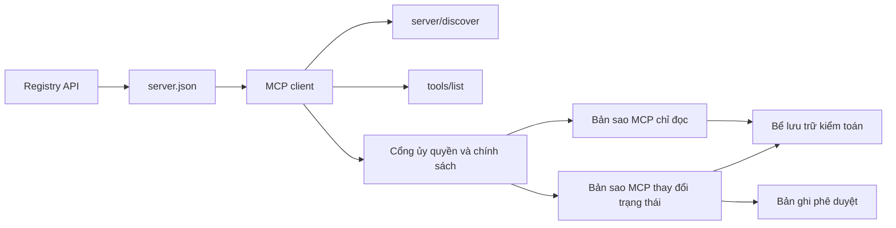

# Đồ án 13: Máy chủ MCP Phi trạng thái với Registry và Quản trị

> MCP trong môi trường production không đơn thuần là một tiến trình máy chủ đơn lẻ. Đó là một chuỗi các giao ước: siêu dữ liệu có thể công bố, khám phá trực tiếp (live discovery), phong bì yêu cầu phi trạng thái (stateless request envelope), ủy quyền (authorization), chính sách (policy), kiểm toán (audit) và bằng chứng triển khai.

**Phân loại:** Đồ án (Capstone)
**Ngôn ngữ:** Mô hình tham chiếu bằng Python và TypeScript; bất kỳ ngôn ngữ production nào
**Điều kiện tiên quyết:** Phase 11, Phase 13, Phase 14, Phase 17 và Phase 18
**Các bài học chuyên sâu MCP bắt buộc:** [Bài 28: Giao ước Công cụ](../../../13-tools-and-protocols/28-mcp-tool-contracts-and-content/docs/vi.md), [Bài 29: Độ tin cậy](../../../13-tools-and-protocols/29-mcp-reliability-cancellation-and-flow-control/docs/vi.md), [Bài 30: Chuỗi cung ứng Registry](../../../13-tools-and-protocols/30-mcp-registry-supply-chain-and-drift/docs/vi.md), và [Bài 31: Vận hành Phù hợp Chuẩn](../../../13-tools-and-protocols/31-mcp-conformance-versioning-and-operations/docs/vi.md)
**Mục tiêu giao thức:** MCP `2026-07-28`
**Thời lượng:** ~25 giờ

## Mục tiêu Học tập

- Triển khai phong bì yêu cầu và kết quả phi trạng thái (stateless request and result envelope) trong MCP.
- Tách biệt rành mạch siêu dữ liệu của Registry khỏi quá trình khám phá giao thức trực tiếp (live protocol discovery).
- Xây dựng cơ chế khám phá công cụ mang tính tất định, nhận biết bộ nhớ đệm (cache-aware).
- Thực thi chính sách về bên phát hành (issuer), đối tượng thụ hưởng (audience), phạm vi (scope) và phê duyệt (approval) cho từng lệnh gọi công cụ.
- Triển khai Streamable HTTP mà không phụ thuộc vào độ bám dính phiên (session affinity).
- Chứng minh hành vi chuẩn xác tại các ranh giới: đường truyền vật lý (wire), ủy quyền, chính sách, registry và kiểm toán.

## Lộ trình Điều kiện Tiên quyết MCP Bắt buộc

Hãy hoàn thành tuần tự 4 bài học liên kết thuộc Phase 13 trước khi đưa đồ án capstone này vào trạng thái sẵn sàng cho production:

1. [Bài 28](../../../13-tools-and-protocols/28-mcp-tool-contracts-and-content/docs/vi.md) định nghĩa các giao ước về công cụ, lược đồ (schema), nội dung, phân trang, hoàn tất (completion), định tuyến và lỗi mà máy chủ này bắt buộc phải công bố.
2. [Bài 29](../../../13-tools-and-protocols/29-mcp-reliability-cancellation-and-flow-control/docs/vi.md) định nghĩa các xung đột hủy bỏ (cancellation races), hạn chót (deadlines), tính lũy đẳng (idempotency), áp lực ngược (backpressure), thử lại (retry) và hành vi tái kết nối.
3. [Bài 30](../../../13-tools-and-protocols/30-mcp-registry-supply-chain-and-drift/docs/vi.md) định nghĩa không gian tên (namespace), nguồn gốc (provenance), ghim tiếp nhận (admission pin), trạng thái Registry, độ trôi dạt (drift), sổ cái (ledger) và bằng chứng hoàn nguyên (rollback evidence).
4. [Bài 31](../../../13-tools-and-protocols/31-mcp-conformance-versioning-and-operations/docs/vi.md) định nghĩa bản ghi đối chiếu chuẩn (golden transcripts) và bản ghi phủ định (negative transcripts), các kỷ nguyên phiên bản nghiêm ngặt, kiểm tra sai khác qua SDK, bằng chứng proxy, làm sạch/biên tập dữ liệu nhạy cảm (redaction), kiểm tra tình trạng sức khỏe (health) và cổng kiểm soát phát hành (release gating).

Đồ án này tích hợp toàn diện các thành phần trên, chứ không thay thế chúng bằng một bài kiểm thử SDK đơn giản chỉ kiểm tra trường hợp lý tưởng (happy path).

## Vấn đề Cần Giải quyết

Một nền tảng nội bộ cần các công cụ truy xuất dữ liệu chỉ đọc (read-only) cùng một nhóm nhỏ các công cụ làm thay đổi trạng thái (state-changing). Các kỹ sư phát triển phải có khả năng khám phá máy chủ, hiểu cách kết nối, kiểm tra các năng lực vận hành trực tiếp, và chỉ được phép gọi những tác vụ mà họ đã được phân quyền hợp lệ.

Thách thức không nằm ở việc đăng ký một hàm thông thường. Điểm khó khăn cốt lõi là duy trì sự đồng bộ nhất quán giữa 6 tầng sự thật (truths) khác nhau:

1. `server.json` chỉ định vị trí máy chủ có thể được cài đặt hoặc kết nối tới.
2. `server/discover` cho biết tiến trình đang chạy trực tiếp hiện hỗ trợ những gì.
3. Mỗi yêu cầu đều chỉ rõ phiên bản sửa đổi giao thức (protocol revision) và các năng lực của client (client capabilities) mà nó sử dụng.
4. Tầng ủy quyền liên kết caller với đúng bên phát hành (issuer), tài nguyên (resource) và các phạm vi (scopes).
5. Chính sách (policy) quyết định xem hành động cụ thể này có được phép thực thi hay không.
6. Bằng chứng kiểm toán (audit evidence) ghi lại chính xác những gì đã vượt qua ranh giới hệ thống mà không làm rò rỉ bí mật hay payload nhạy cảm.

Nếu bất kỳ một trong các yếu tố trên bị trôi dạt (drift), nền tảng có thể niêm yết một máy chủ không thể kết nối tới, định tuyến một client không tương thích, chấp nhận một token được cấp phát cho một tài nguyên khác, hoặc để lộ một hành động mang tính phá hủy (destructive action) mà không qua quy trình phê duyệt cần thiết.

## Hai Tầng Khám phá

Registry và máy chủ MCP trực tiếp trả lời hai câu hỏi hoàn toàn khác biệt.

| Tầng | Giao ước (Contract) | Câu hỏi cần trả lời |
|---|---|---|
| Xuất bản (Publication) | `server.json` và Registry API | Máy chủ này là gì, gói cài đặt hoặc điểm cuối từ xa (remote endpoint) nằm ở đâu và nó được cấu hình như thế nào? |
| Thời gian chạy (Runtime) | `server/discover` | Tiến trình này hỗ trợ các phiên bản giao thức, năng lực (capabilities), phần mở rộng (extensions) và danh tính máy chủ nào? |

Registry chính thức sử dụng một lược đồ `server.json` có phiên bản. Một mục từ xa có thể chỉ định một URL Streamable HTTP:

```json
{
  "$schema": "https://static.modelcontextprotocol.io/schemas/2025-12-11/server.schema.json",
  "name": "com.example/internal-readonly",
  "title": "Internal Read-Only Tools",
  "description": "Read-only incident and data lookup tools.",
  "version": "1.0.0",
  "remotes": [
    {
      "type": "streamable-http",
      "url": "https://mcp.internal.example.com/readonly"
    }
  ]
}
```

Phiên bản lược đồ Registry và phiên bản sửa đổi giao thức MCP là độc lập với nhau. Tuyệt đối không viết lại ngày tháng của cái này để khớp với cái kia. Hãy xác thực từng tài liệu dựa trên chính giao ước riêng của nó.

Tính hợp lệ của lược đồ không chứng minh được quyền sở hữu không gian tên (namespace ownership). Một nhà xuất bản đã được xác minh cho tên miền `example.com` sẽ sử dụng không gian tên DNS ngược (reverse-DNS) `com.example/*` hoặc một trong các không gian tên con của nó. Luồng xác thực Registry sẽ chứng minh quyền sở hữu đó. Việc giữ nguyên thứ tự nhãn thông thường của tên miền sẽ đại diện cho một không gian tên hoàn toàn khác.

Hàm `validate_registry_document` trong mô hình thư viện chuẩn (stdlib) được cố ý thiết kế như một bộ xác thực hồ sơ từ xa từng phần (partial remote-profile validator). Nó kiểm tra các trường bắt buộc chính thức là `name`, `description`, và `version`; trường tùy chọn `title`; các ràng buộc về tên và độ dài đã công bố; hình dạng phiên bản cụ thể; cùng định dạng URL HTTP(S) của từng remote `streamable-http` hoặc `sse`. Nó cũng yêu cầu danh sách `remotes` không được rỗng vì đồ án này luôn thăm dò trực tiếp (live-probe) một remote. Hàm `validate_publisher_namespace` kiểm tra độc lập tên đối chiếu với miền của nhà xuất bản đã được xác minh, trong khi `validate_runtime_alignment` so sánh tên và phiên bản xuất bản với `serverInfo` trực tiếp lúc runtime. Lược đồ chính thức cũng hỗ trợ các bản ghi chỉ chứa package và nhiều trường remote bổ sung khác. Trước khi xuất bản, hãy xác thực toàn bộ tài liệu bằng JSON Schema chính thức đã được ghim hoặc công cụ `mcp-publisher`; không xem tập con không phụ thuộc thư viện ngoài này là giải pháp xác thực lược đồ toàn diện.

Máy chủ phải triển khai `server/discover`; client có thể gọi phương thức này trước các phương thức khác. Client trong đồ án capstone này thực hiện việc gọi ngay sau khi phân giải điểm cuối, và nhận về phiên bản sửa đổi giao thức hiện tại cùng các năng lực trực tiếp:

```json
{
  "resultType": "complete",
  "supportedVersions": ["2026-07-28"],
  "capabilities": {
    "tools": {
      "listChanged": false
    }
  },
  "_meta": {
    "io.modelcontextprotocol/serverInfo": {
      "name": "com.example/internal-readonly",
      "version": "1.0.0"
    }
  },
  "ttlMs": 3600000,
  "cacheScope": "public"
}
```

Một danh mục riêng tư (private catalog) có thể lập chỉ mục thêm dữ liệu về quyền sở hữu, đánh giá hoặc vòng đời, nhưng tuyệt đối không được tự ý đưa dữ liệu đó thành các trường truyền tải trên mạng của MCP (wire fields) hay các trường gốc trong `server.json`. Hãy lưu trữ chính sách tổ chức bên cạnh bản ghi đã xuất bản. Khi cần thiết phải có siêu dữ liệu tùy chỉnh công khai, hãy sử dụng phần mở rộng `_meta.io.modelcontextprotocol.registry/publisher-provided` của Registry và tuân thủ giới hạn kích thước 4 KB.

## Lõi MCP Phi trạng thái

Phiên bản sửa đổi MCP `2026-07-28` loại bỏ hoàn toàn các phiên giao thức (protocol sessions) và bước bắt tay (handshake) `initialize` / `notifications/initialized`. Nó cũng loại bỏ tiêu đề `Mcp-Session-Id`.

Mỗi yêu cầu đều mang ngữ cảnh giao thức bên trong `params._meta`:

```json
{
  "io.modelcontextprotocol/protocolVersion": "2026-07-28",
  "io.modelcontextprotocol/clientCapabilities": {},
  "io.modelcontextprotocol/clientInfo": {
    "name": "internal-platform-client",
    "version": "1.0.0"
  }
}
```

Phiên bản và các năng lực là những sự thật gắn liền với từng yêu cầu cụ thể (request facts), chứ không phải sự thật của kết nối (connection facts). Một bộ cân bằng tải (load balancer) có thể gửi các yêu cầu liên tiếp tới các bản sao (replicas) lành mạnh khác nhau vì bất kỳ bản sao nào cũng có thể tự xác thực yêu cầu dựa trên chính thông điệp đó.

Các kết quả thông thường bao gồm `resultType: "complete"`. Máy chủ cần đặt danh tính của mình vào `_meta.io.modelcontextprotocol/serverInfo` trên mỗi kết quả trả về. Phiên bản giao thức bị thiếu hoặc không phải chuỗi sẽ dẫn đến lỗi tham số không hợp lệ `-32602`. Mã lỗi `-32022` chỉ dành riêng cho trường hợp chuỗi phiên bản được cung cấp không được hỗ trợ, đi kèm chính xác dữ liệu `{"supported": ["2026-07-28"], "requested": "..."}`.

### Khám phá Có thể Lưu vào Bộ nhớ Đệm

`tools/list` phải mang tính tất định đối với cùng một tập công cụ hiệu dụng. Kết quả bao gồm:

- `ttlMs`: gợi ý về độ tươi mới (freshness hint) dành cho client;
- `cacheScope`: giá trị `public` hoặc `private`;
- thứ tự công cụ ổn định để các danh sách đồng nhất có thể tái sử dụng bộ nhớ đệm prompt (prompt caches);
- `resultType: "complete"` và siêu dữ liệu định danh máy chủ.

Việc phân quyền theo từng người dùng (per-user authorization) thông thường sẽ tạo ra `cacheScope: "private"`. Tuyệt đối không đặt phạm vi hiển thị công cụ đặc thù cho người dùng phía sau một bộ nhớ đệm công khai dùng chung.

## Streamable HTTP

Một máy chủ mạng mở ra một điểm cuối MCP duy nhất chấp nhận phương thức POST. Mỗi yêu cầu hoặc thông báo JSON-RPC sẽ nhận một POST riêng biệt.

Đối với một yêu cầu, máy chủ sẽ trả về một đối tượng JSON đơn lẻ hoặc một luồng sự kiện gửi từ máy chủ (Server-Sent Events - SSE) giới hạn trong phạm vi yêu cầu đó. Yêu cầu `subscriptions/listen` tồn tại lâu dài sẽ mang các thông báo thay đổi đã chọn đăng ký. Không có luồng GET độc lập, không có DELETE phiên, không có tiêu đề phiên hay cơ chế phát lại `Last-Event-ID` trong tầng truyền tải hiện tại.

Mỗi yêu cầu bao gồm:

- `MCP-Protocol-Version`: khớp với siêu dữ liệu trong thân (body);
- `Mcp-Method`: khớp với phương thức JSON-RPC;
- `Mcp-Name`: dành cho `tools/call`, `resources/read`, và `prompts/get`;
- `Accept: application/json, text/event-stream`.

Từ chối các tiêu đề phản chiếu (mirrored headers) không khớp với mã lỗi `-32020` được quy định. Xác thực `Origin`, liên kết máy chủ phát triển cục bộ với loopback, xác thực các client từ xa, và xử lý việc đóng phản hồi SSE theo phạm vi yêu cầu như một thao tác hủy bỏ.



````figure
cf-mcp-gate
````

## Ủy quyền và Chính sách

Siêu dữ liệu truyền tải không đồng nghĩa với ủy quyền. Hãy xác thực quyền hạn trên từng lượt gọi.

Đối với máy chủ từ xa:

1. Khám phá siêu dữ liệu tài nguyên được bảo vệ (protected-resource metadata).
2. Chọn máy chủ ủy quyền (authorization server) cho tài nguyên đó.
3. Ưu tiên sử dụng Tài liệu Siêu dữ liệu Định danh Client (Client ID Metadata Documents) để đăng ký client. Xem Đăng ký Client Động (Dynamic Client Registration) là cơ chế hỗ trợ tương thích.
4. Gửi chỉ báo tài nguyên (resource indicator) trong quá trình ủy quyền.
5. Xác thực giá trị `iss` trả về đối chiếu với máy chủ ủy quyền đã ghi nhận cho luồng đó.
6. Đánh khóa thông tin xác thực client theo bên phát hành (issuer). Tuyệt đối không tái sử dụng dữ liệu đăng ký giữa các bên phát hành khác nhau.
7. Xác thực bên phát hành token, đối tượng thụ hưởng (audience) hoặc tài nguyên, thời hạn hết hiệu lực (expiry), và các phạm vi (scopes) tại máy chủ MCP.
8. Áp dụng quyết định chính sách cấp hai cho công cụ cụ thể và các đối số truyền vào.

Các chú thích công cụ như `readOnlyHint` và `destructiveHint` giúp client hiển thị mức độ rủi ro trực quan. Chúng không phải là cơ chế kiểm soát ủy quyền đáng tin cậy.

### Phê duyệt là một Bản ghi, Không phải một Quyền hạn Thần kỳ

Một lệnh gọi làm thay đổi trạng thái cần có một bản ghi phê duyệt (approval record) gắn liền với tác nhân (actor), công cụ, các đối số đã được chuẩn hóa hoặc hàm băm (digest), môi trường mục tiêu, thời hạn hết hiệu lực, cùng chính sách dùng một lần hoặc tái sử dụng. Một tin nhắn trò chuyện thông thường không thể cấu thành bằng chứng phê duyệt.

Mô hình Python băm JSON chuẩn hóa với các khóa đã được sắp xếp, sau đó liên kết chuỗi băm đó với chủ thể token (subject), tên công cụ, URL máy chủ và hạn hết hiệu lực. Việc phát lại (replaying) bản ghi sau khi thay đổi dù chỉ một đối số sẽ thất bại ngay trước khi trình xử lý (handler) kịp chạy. Phê duyệt là một bằng chứng độc lập, không phải là một phạm vi (scope) được nhét thêm vào token truy cập.

Hãy tách biệt các công cụ rủi ro cao trên một bề mặt có thể đánh giá độc lập khi điều đó thực sự làm giảm thiểu bán kính ảnh hưởng (blast radius). Sự chia tách này chỉ thực sự hữu ích nếu thông tin xác thực, chính sách, danh tính triển khai và cơ chế kiểm toán cũng được phân tách độc lập.

## Xây dựng Hệ thống

### 1. Mô hình hóa siêu dữ liệu xuất bản

Tạo và kiểm tra tính hợp lệ của lược đồ `server.json`. Bao gồm một tên ổn định nằm trong không gian tên đã xác thực cho nhà xuất bản, cùng phiên bản, mô tả, siêu dữ liệu `repository` hoặc `packages` chính thức khi phù hợp, và tầng truyền tải remote hoặc stdio. Hãy khai báo các bí mật dưới dạng biến môi trường đầu vào, tuyệt đối không gán giá trị trực tiếp (literal values).

### 2. Triển khai cơ chế khám phá trực tiếp

Triển khai `server/discover` trước bất kỳ RPC tính năng nào. Công bố các phiên bản giao thức được hỗ trợ, năng lực, phần mở rộng và danh tính máy chủ. Bổ sung trường hợp từ chối phiên bản bằng mã lỗi `-32022`.

### 3. Triển khai phong bì phi trạng thái

Bắt buộc phải có phiên bản giao thức và năng lực client trong mọi yêu cầu. Trả về `resultType` và danh tính máy chủ trong mọi kết quả. Loại bỏ trạng thái khởi tạo, bộ nhớ đệm năng lực theo phạm vi kết nối và các mã định danh phiên.

### 4. Xây dựng bề mặt công cụ

Bắt đầu với hai công cụ chỉ đọc và một công cụ làm thay đổi trạng thái. Gán cho mỗi công cụ một JSON Schema có giới hạn rõ ràng, mô tả chính xác, khuôn dạng kết quả tất định và các chú thích trung thực. Bổ sung lược đồ đầu ra (output schemas) khi client phụ thuộc vào kết quả có cấu trúc.

### 5. Bổ sung danh sách nhận biết bộ nhớ đệm

Trả về danh sách công cụ theo thứ tự ổn định kèm theo `ttlMs` và `cacheScope`. Kiểm thử riêng biệt hành vi hết hạn bộ nhớ đệm và hành vi thông báo thay đổi danh sách.

### 6. Tích hợp ủy quyền và chính sách

Xác thực bên phát hành, đối tượng thụ hưởng, hạn sử dụng và phạm vi. Thực thi quyết định chính sách cho từng lượt gọi công cụ. Gắn các phê duyệt vào chính xác những hành động rủi ro cao. Từ chối các phê duyệt bị thiếu hoặc đã lỗi thời trước khi thực thi trình xử lý.

### 7. Tách biệt xác thực registry và runtime

Xác thực bản ghi `server.json` tĩnh, sau đó thăm dò điểm cuối từ xa bằng `server/discover`. Báo cáo độ trôi dạt (drift) khi remote đã xuất bản, danh tính, phiên bản hoặc các năng lực bắt buộc không đồng nhất với tiến trình đang chạy trực tiếp.

### 8. Bổ sung bằng chứng kiểm toán

Ghi lại tác nhân, bên phát hành, tài nguyên, công cụ, quyết định chính sách, mã định danh yêu cầu, ngữ cảnh vết (trace context), độ trễ và kết quả. Biên tập làm sạch (redact) hoặc băm các đối số và kết quả nhạy cảm trước khi lưu trữ bền vững. Đặt bể lưu trữ kiểm toán nằm ngoài ngữ cảnh mà mô hình có thể đọc được.

### 9. Thử nghiệm mở rộng quy mô theo chiều ngang

Đặt hai bản sao phi trạng thái phía sau một bộ cân bằng tải. Gửi ít nhất 100 yêu cầu đồng thời. Chứng minh rằng tính đúng đắn không phụ thuộc vào độ bám dính phiên (affinity). Nếu một công cụ cần trạng thái xuyên suốt các lượt gọi, hãy cấp phát một tay cầm mờ tường minh (opaque handle) và lưu trữ nó trong một hệ thống bền vững dùng chung.

### 10. Truyền tải trên đường truyền thực tế

Chạy các bài kiểm tra mức độ phù hợp chuẩn (conformance checks) đối với tệp nhị phân thực tế của máy chủ. Thu thập các tiêu đề yêu cầu và phần thân JSON thực tế, không chỉ các đối tượng SDK. Kiểm thử phiên bản sai, tiêu đề không khớp, thiếu phạm vi, sai đối tượng thụ hưởng, đối số dị dạng, lỗi trình xử lý, hủy bỏ và hết hạn bộ nhớ đệm.

## Bộ Bằng chứng Bắt buộc

Một bài nộp được xem là chưa hoàn chỉnh cho đến khi chứa đầy đủ cả 5 lớp bằng chứng sau:

| Bằng chứng | Bằng chứng tối thiểu | Bài học nguồn |
|---|---|---|
| Đường truyền (Wire) | Các tiêu đề thô và phần thân JSON-RPC đã biên tập sạch dữ liệu nhạy cảm cho các trường hợp đối chiếu chuẩn và trường hợp phủ định, bao gồm lỗi kiểu siêu dữ liệu, không khớp tiêu đề, phiên bản không được hỗ trợ, thiếu hoặc không nhận dạng được `resultType`, thông báo không phản hồi, và khớp mã ID phản hồi | [Bài 31](../../../13-tools-and-protocols/31-mcp-conformance-versioning-and-operations/docs/vi.md) |
| Proxy | Cùng một trường hợp ổn định được chạy trực tiếp và chạy thông qua trung gian đã triển khai, với trạng thái ingress, origin, egress cùng hàm băm phần thân; chứng minh các lỗi giao thức không bị gộp chung thành mã phản hồi 500 thông thường và luồng truyền không bị lưu đệm (buffered) | [Bài 29](../../../13-tools-and-protocols/29-mcp-reliability-cancellation-and-flow-control/docs/vi.md) và [Bài 31](../../../13-tools-and-protocols/31-mcp-conformance-versioning-and-operations/docs/vi.md) |
| Tiếp nhận (Admission) | Không gian tên nhà xuất bản đã xác minh, hàm băm bản ghi Registry bất biến, nguồn gốc tạo phẩm hoặc remote, quan sát danh tính và năng lực qua `server/discover` trực tiếp, ghim mô tả (descriptor pin), trạng thái Registry hiện tại, và sự kiện sổ cái tiếp nhận (admission-ledger event) | [Bài 30](../../../13-tools-and-protocols/30-mcp-registry-supply-chain-and-drift/docs/vi.md) |
| Thử lại (Retry) | Xung đột giữa hủy bỏ và hoàn tất (cancellation-versus-completion race), thời gian chờ tường minh (timeout), thử lại thao tác đọc an toàn, khóa lũy đẳng (idempotency key) cho thao tác biến đổi, lấy lại dữ liệu khi tái kết nối, và bằng chứng cho thấy việc hủy yêu cầu không thể âm thầm biến thành hủy tác vụ bền vững | [Bài 29](../../../13-tools-and-protocols/29-mcp-reliability-cancellation-and-flow-control/docs/vi.md) |
| Hoàn nguyên (Rollback) | Phiên bản trước chính xác, mã băm tiếp nhận và tạo phẩm, ghim mô tả, trạng thái Registry đang hoạt động, cửa sổ sức khỏe hiện tại, kết quả khôi phục định tuyến, và bằng chứng quyết định đã biên tập sạch | [Bài 30](../../../13-tools-and-protocols/30-mcp-registry-supply-chain-and-drift/docs/vi.md) và [Bài 31](../../../13-tools-and-protocols/31-mcp-conformance-versioning-and-operations/docs/vi.md) |

Hãy lưu trữ chuỗi băm của bộ bằng chứng đã biên tập sạch kèm theo bản phát hành. Nếu thiếu bất kỳ lớp bằng chứng nào, hãy tạm dừng phát hành. Không suy đoán hành vi proxy từ bộ điều phối nội tiến trình (in-process dispatcher), suy đoán tiếp nhận từ sự hiện diện trong Registry, suy đoán an toàn thử lại từ một mã ID JSON-RPC mới, hoặc suy đoán tính sẵn sàng hoàn nguyên từ "bản triển khai trước đó".

## Các Mô hình Tham chiếu Cục bộ

Mô hình Python minh họa siêu dữ liệu registry, xác thực không gian tên nhà xuất bản theo DNS ngược, kiểm tra danh tính từ xuất bản đến runtime, khám phá trực tiếp, liệt kê công cụ mang tính tất định, siêu dữ liệu trên từng yêu cầu, kiểm tra bên phát hành đáng tin cậy, đối tượng thụ hưởng, thời hạn hết hạn và phạm vi, phê duyệt gắn liền với hành động, bộ xác thực Registry từng phần có tài liệu, chính sách, và kiểm toán mà không cần mở socket mạng:

```bash
cd phases/19-capstone-projects/13-mcp-server-with-registry
python3 code/main.py
python3 -m unittest discover -s code/tests -v
```

Dự án TypeScript thể hiện khuôn dạng JSON-RPC phi trạng thái qua stdio mà không cần MCP SDK. Tuyến `tools/call` của nó thực thi cùng các lược đồ đầu vào có giới hạn như đã công bố bởi `tools/list`; các đối số không hợp lệ đối với một công cụ đã biết sẽ trả về một kết quả hoàn chỉnh với `isError: true` mà không kích hoạt bộ thực thi:

```bash
cd phases/19-capstone-projects/13-mcp-server-with-registry/code/ts
npm install
npm run typecheck
npm test
npm run demo
```

Các mô hình này chứng minh logic giao ước ở cấp cục bộ. Chúng không chứng minh các tiêu đề HTTP, trao đổi OAuth, xuất bản lên Registry, tích hợp OPA, cân bằng tải hay biên nhận của bộ thu thập số liệu (collector).

## Ví dụ trên Đường truyền

```http
POST /mcp HTTP/1.1
Host: mcp.internal.example.com
Content-Type: application/json
Accept: application/json, text/event-stream
MCP-Protocol-Version: 2026-07-28
Mcp-Method: tools/call
Mcp-Name: postgres.readonly
Authorization: Bearer REDACTED

{
  "jsonrpc": "2.0",
  "id": 42,
  "method": "tools/call",
  "params": {
    "name": "postgres.readonly",
    "arguments": {"sql": "SELECT 1"},
    "_meta": {
      "io.modelcontextprotocol/protocolVersion": "2026-07-28",
      "io.modelcontextprotocol/clientCapabilities": {},
      "io.modelcontextprotocol/clientInfo": {
        "name": "internal-platform-client",
        "version": "1.0.0"
      }
    }
  }
}
```

## Bàn giao Sản phẩm

Bàn giao một kho lưu trữ bao gồm:

- Một tệp `server.json` hợp lệ theo lược đồ;
- Các bề mặt máy chủ chỉ đọc và thay đổi trạng thái;
- `server/discover`, `tools/list` mang tính tất định, và `tools/call` được kiểm soát bởi chính sách;
- Một bản triển khai Streamable HTTP với hai bản sao có thể hoán đổi cho nhau;
- Tích hợp ủy quyền và phê duyệt;
- Bộ xuất bản Registry hoặc bộ điều hợp (adapter) Registry API nội bộ;
- Các định nghĩa chính sách và bản ghi phê duyệt gắn liền với hành động;
- Đầu ra kiểm toán đã biên tập sạch và lan truyền vết (trace propagation);
- Bằng chứng về lỗi đường truyền và lỗi proxy;
- Bằng chứng tiếp nhận, thử lại, tình trạng sức khỏe và hoàn nguyên kèm theo hàm băm của bộ bằng chứng đã biên tập sạch.

| Trọng số | Tiêu chí | Bằng chứng |
|---:|---|---|
| 25 | Tính đúng đắn của giao thức | Siêu dữ liệu yêu cầu phi trạng thái, khám phá, kết quả, tiêu đề và các trường hợp phủ định |
| 20 | Ủy quyền | Các trường hợp về bên phát hành, đối tượng thụ hưởng, thời hạn, phạm vi và phê duyệt gắn liền hành động |
| 15 | Tính toàn vẹn của Registry | `server.json` hợp lệ, bản ghi xuất bản, thăm dò khám phá trực tiếp và báo cáo độ trôi dạt |
| 15 | Chính sách và An toàn | Các trường hợp cho phép, từ chối, dữ liệu dị dạng, phê duyệt lỗi thời và dữ liệu nhạy cảm |
| 15 | Khả năng mở rộng và Độ tin cậy | Hai bản sao, không phụ thuộc độ bám dính phiên, hủy bỏ, thời gian chờ và khôi phục |
| 10 | Khả năng kiểm toán | Bằng chứng kiểm toán và vết phía bên nhận đã được biên tập sạch |

## Bài tập Thực hành

1. Thay đổi URL remote đã xuất bản trong khi vẫn giữ nguyên máy chủ đang chạy trực tiếp. Làm cho quy trình xác thực registry báo cáo chính xác độ trôi dạt.
2. Gửi `tools/list` hai lần với cùng các tham số đầu vào và chứng minh thứ tự công cụ ổn định đến từng byte. Sau đó đợi `ttlMs` hết hạn và làm mới lại.
3. Gửi một phần thân hợp lệ nhưng đi kèm tiêu đề `MCP-Protocol-Version` khác. Trả về mã lỗi `-32020` và không kích hoạt chính sách hay công cụ.
4. Cấp phát một token cho máy chủ chỉ đọc và xuất trình nó cho máy chủ thay đổi trạng thái. Chứng minh rằng việc xác thực đối tượng thụ hưởng (audience) thất bại trước khi trình xử lý kịp chạy.
5. Gắn một phê duyệt vào hàm băm đối số đã chuẩn hóa. Thay đổi một trường dữ liệu và chứng minh rằng phê duyệt đó không thể bị phát lại.
6. Định tuyến các lệnh gọi liên tiếp luân phiên giữa hai bản sao. Thay thế bộ nhớ tiến trình ẩn bằng một tay cầm dùng chung tường minh tại bất kỳ vị trí nào mà luồng công việc yêu cầu tính bền vững.
7. Ngắt kết nối SSE có phạm vi yêu cầu và thử lại với một ID yêu cầu JSON-RPC mới. Xác minh rằng không có đường dẫn khôi phục nào thông qua `Last-Event-ID` được sử dụng.

## Thuật ngữ Then chốt

| Thuật ngữ | Điều mọi người hay nói | Ý nghĩa thực tế |
|---|---|---|
| MCP phi trạng thái (Stateless MCP) | "Hoàn toàn không có trạng thái ở bất kỳ đâu" | Không có phiên giao thức; trạng thái xuyên suốt các lệnh gọi là tường minh và do máy chủ quản lý |
| `server.json` | "Bản kê khai công cụ (tool manifest)" | Siêu dữ liệu Registry phục vụ việc định danh, đóng gói, cấu hình và các tầng truyền tải |
| `server/discover` | "Bước bắt tay (handshake)" | Một RPC bắt buộc thông thường dành cho các phiên bản và năng lực trực tiếp, không phải là bộ khởi tạo phiên |
| Phạm vi bộ nhớ đệm (Cache scope) | "Tôi có thể lưu đệm nó không?" | Liệu một kết quả có thể lưu đệm có an toàn để tái sử dụng công khai hay chỉ dùng riêng tư |
| Quyết định chính sách (Policy decision) | "Token cho phép điều đó" | Một quyết định độc lập xem xét tác nhân, công cụ, đối tượng đích, đối số và ngữ cảnh |
| Bản ghi phê duyệt (Approval record) | "Một con người đã nhấn nút đồng ý" | Bằng chứng gắn liền với một tác nhân và một hành động có hệ quả dưới một chính sách hết hạn xác định |
| Tay cầm tường minh (Explicit handle) | "Một ID phiên (session ID)" | Dữ liệu ứng dụng thông thường cho trạng thái do máy chủ quản lý có đặt tên, không phải là trạng thái kết nối giao thức |

## Đọc thêm

- [Các thay đổi chính của MCP 2026-07-28](https://modelcontextprotocol.io/specification/2026-07-28/changelog)
- [Streamable HTTP](https://modelcontextprotocol.io/specification/2026-07-28/basic/transports/streamable-http)
- [Khám phá máy chủ (Server discovery)](https://modelcontextprotocol.io/specification/2026-07-28/server/discover)
- [Ủy quyền trong MCP (MCP authorization)](https://modelcontextprotocol.io/specification/2026-07-28/basic/authorization)
- [Yêu cầu chính thức của Registry đối với server.json](https://github.com/modelcontextprotocol/registry/blob/main/docs/reference/server-json/official-registry-requirements.md)
- [Giao ước OpenAPI chính thức của Registry](https://registry.modelcontextprotocol.io/openapi.yaml)
