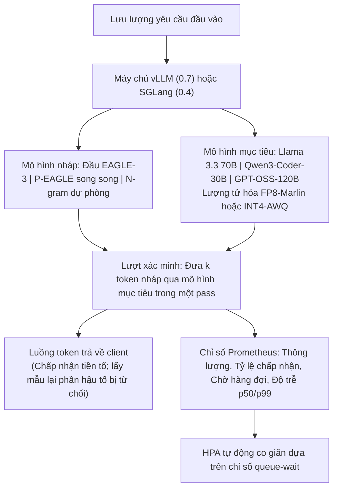

# Đồ án 14 — Máy chủ Suy luận với Giải mã Phỏng đoán

> Giải mã phỏng đoán (speculative decoding) — cơ chế trong đó một mô hình nháp chi phí thấp đề xuất các token và mô hình mục tiêu xác minh chúng chỉ trong một lượt duyệt — hiện đã là một phương pháp tối ưu hóa sẵn sàng cho môi trường production, không còn là mẹo thử nghiệm trong nghiên cứu. EAGLE-3 trong vLLM 0.7 mang lại thông lượng gấp 2,5–3 lần trên lưu lượng thực tế. P-EAGLE (AWS 2026) đã thúc đẩy phỏng đoán song song đi xa hơn nữa. SpecForge của SGLang đã huấn luyện các đầu nháp (draft heads) trên quy mô lớn. Hub Speculators của Red Hat đã công bố các bản nháp được căn chỉnh sẵn cho các mô hình nguồn mở phổ biến. TensorRT-LLM đưa giải mã phỏng đoán thành tính năng hạng nhất (first-class) trên phần cứng NVIDIA. Ngăn xếp phục vụ production của năm 2026 là vLLM hoặc SGLang kết hợp với các bản nháp họ EAGLE, lượng tử hóa (quantization) FP8 hoặc INT4, và HPA co giãn theo thời gian chờ hàng đợi (queue-wait). Đồ án capstone này yêu cầu bạn phục vụ hai mô hình mã nguồn mở với thông lượng cao hơn ít nhất 2,5 lần so với mức cơ sở kèm báo cáo đầy đủ về độ trễ đuôi (tail latency).

**Phân loại:** Đồ án (Capstone)
**Ngôn ngữ:** Python (serving), C++ / CUDA (kiểm tra kernel), YAML (cấu hình)
**Điều kiện tiên quyết:** Phase 3 (học sâu), Phase 7 (transformers), Phase 10 (tự xây dựng LLM từ đầu), Phase 17 (cơ sở hạ tầng)
**Các Phase thực hành:** P3 · P7 · P10 · P17
**Thời lượng:** 30 giờ

## Vấn đề Cần Giải quyết

Giải mã phỏng đoán đã trở thành một thành phần phổ biến rộng rãi vào năm 2026. Các đầu nháp EAGLE-3 được huấn luyện dựa trên trạng thái ẩn (hidden states) của mô hình mục tiêu và dự đoán trước N token; mô hình mục tiêu sẽ xác minh toàn bộ các token này trong một lượt duy nhất. Tỷ lệ chấp nhận (acceptance rates) đạt 60–80% tương ứng với thông lượng tổng thể (end-to-end throughput) tăng 2–3 lần. vLLM 0.7 tích hợp cơ chế này một cách tự nhiên. SGLang + SpecForge cung cấp cho bạn một đường ống (pipeline) huấn luyện hoàn chỉnh. Hub Speculators của Red Hat công bố các bản nháp đã được căn chỉnh cho Llama 3.3 70B, Qwen3-Coder-30B MoE và GPT-OSS-120B.

Điểm tinh tế của kỹ thuật không nằm ở mô hình, mà nằm ở khâu vận hành phục vụ (serving operations). Tỷ lệ chấp nhận bị trôi dạt (drift) theo phân phối lưu lượng truy cập (ShareGPT so với mã nguồn code hay dữ liệu chuyên ngành). Độ trễ đuôi khi bị từ chối còn tệ hơn cả khi không dùng phỏng đoán — do đó bạn phải báo cáo độ trễ p99 ở nhiều kích thước batch khác nhau, chứ không chỉ đưa ra số lượng token/giây ở trạng thái ổn định. Chi phí trên 1 triệu token so với API của Anthropic / OpenAI chính là đòn bẩy chứng minh tính thuyết phục của giải pháp.

## Khái niệm Cốt lõi

Giải mã phỏng đoán gồm hai tầng: Một mô hình **nháp (draft)** (đầu EAGLE-3, ngram, hoặc một mô hình nhỏ hơn đã được căn chỉnh với mô hình mục tiêu) sẽ đề xuất k token ứng viên tại mỗi bước. Mô hình **mục tiêu (target)** sẽ xác minh toàn bộ k token đó chỉ trong một lượt duyệt; bất kỳ tiền tố nào được chấp thuận sẽ thay thế cho đường dẫn giải mã tham lam (greedy path). Tỷ lệ chấp nhận phụ thuộc vào mức độ căn chỉnh giữa mô hình nháp và mô hình mục tiêu cũng như phân phối của dữ liệu đầu vào.

EAGLE-3 vượt trội hơn các bản nháp ngram trên phần lớn lưu lượng truy cập. P-EAGLE thực thi phỏng đoán song song để tạo ra các cây nháp sâu hơn. Sự đánh đổi ở đây là: Độ trễ P99 khi bị từ chối sẽ cao hơn do lượt xác minh có khối lượng tính toán lớn hơn. Cấu hình phục vụ phải báo cáo độ trễ được phân nhóm theo kích thước batch để làm rõ sự đánh đổi này.

Môi trường triển khai là Kubernetes. vLLM 0.7 chạy một bản sao (replica) trên mỗi GPU hoặc một phân mảnh song song tensor (tensor-parallel shard). Bộ tự động co giãn pod theo chiều ngang (Horizontal Pod Autoscaler - HPA) tự động co giãn dựa trên thời gian chờ hàng đợi thay vì tải CPU. Các kỹ thuật lượng tử hóa FP8 (Marlin) và INT4 (AWQ) giữ dung lượng bộ nhớ GPU nằm gọn trong giới hạn của H100 / H200. Báo cáo tổng thể cần thể hiện thông lượng, tỷ lệ chấp nhận, độ trễ p50/p99 tại các kích thước batch 1/8/32, và chi phí $/1M token.

## Kiến trúc Hệ thống



## Ngăn xếp Công nghệ

- Phục vụ (Serving): vLLM 0.7 hoặc SGLang 0.4
- Phương pháp phỏng đoán: Đầu nháp EAGLE-3, phỏng đoán song song P-EAGLE, dự phòng ngram
- Huấn luyện bản nháp: SpecForge (SGLang) hoặc Red Hat Speculators
- Mô hình mục tiêu: Llama 3.3 70B, Qwen3-Coder-30B MoE, GPT-OSS-120B
- Lượng tử hóa: FP8 (Marlin), INT4 AWQ
- Triển khai: Kubernetes + NVIDIA device plugin; HPA dựa trên chỉ số thời gian chờ hàng đợi (queue-wait)
- Đánh giá (Eval): ShareGPT, MT-Bench-v2, GSM8K, HumanEval để đo lường tỷ lệ chấp nhận trên nhiều miền phân phối
- Đối chiếu tham khảo: Giải mã phỏng đoán của TensorRT-LLM làm đường cơ sở của nhà cung cấp phần cứng

````figure
cf-spec-decode
````

## Xây dựng Hệ thống

1. **Chuẩn bị mô hình mục tiêu.** Chọn Llama 3.3 70B. Lượng tử hóa sang FP8 thông qua Marlin. Triển khai dưới vLLM 0.7 trên 1xH100 (hoặc 2x GPU song song tensor).

2. **Nguồn bản nháp.** Kéo đầu nháp EAGLE-3 đã căn chỉnh từ Red Hat Speculators (hoặc tự huấn luyện thông qua SpecForge). Nạp vào cấu hình giải mã phỏng đoán của vLLM.

3. **Thu thập số liệu cơ sở.** Trước khi bật phỏng đoán: đo token/giây tại kích thước batch 1/8/32, độ trễ p50/p99, mức sử dụng GPU. Công bố kết quả.

4. **Bật EAGLE-3.** Kích hoạt cấu hình; chạy lại cùng bài kiểm chuẩn. Báo cáo hệ số tăng tốc, tỷ lệ chấp nhận, mức thay đổi độ trễ đuôi p99.

5. **Thử nghiệm P-EAGLE.** Kích hoạt phỏng đoán song song; đo lường cây nháp sâu hơn so với EAGLE-3 tuần tự. Báo cáo điểm uốn (inflection point) nơi P-EAGLE mang lại lợi thế so với khi nó làm giảm hiệu năng.

6. **Lưu lượng truy cập theo miền.** Đưa dữ liệu ShareGPT so với HumanEval so với lưu lượng truy cập đặc thù theo miền qua cùng một máy chủ. Đo lường tỷ lệ chấp nhận trên từng phân phối. Nhận diện thời điểm bản nháp bị trôi dạt (drift).

7. **Mô hình mục tiêu thứ hai.** Chạy cùng một pipeline trên Qwen3-Coder-30B MoE. Việc tạo bản nháp phức tạp hơn do nhiễu định tuyến của MoE (MoE routing noise). Báo cáo chi tiết.

8. **Cấu hình K8s HPA.** Triển khai trên K8s với HPA theo dõi chỉ số `queue_wait_ms`. Chứng minh khả năng tự động mở rộng quy mô khi tải tăng gấp ba.

9. **So sánh chi phí.** Tính toán chi phí $/1M token so với Claude Sonnet 4.7 của Anthropic và GPT-5.4 của OpenAI trên cùng bài đánh giá. Công bố số liệu.

## Sử dụng Hệ thống

```bash
curl https://infer.example.com/v1/chat/completions -d '{"messages":[...]}'
```

```text
[serve]     vLLM 0.7, Llama 3.3 70B FP8, EAGLE-3 active
[decode]    bs=8, accepted_tokens_per_step=3.2, acceptance_rate=0.76
[latency]   first-token 42ms, full-response 980ms (620 tokens)
[cost]      $0.34 per 1M output tokens at sustained throughput
```

## Bàn giao Sản phẩm

Tệp `outputs/skill-inference-server.md` mô tả kết quả bàn giao. Đó là một ngăn xếp phục vụ hoàn chỉnh có đo lường với giải mã phỏng đoán, một báo cáo kiểm chuẩn toàn diện, và cấu hình triển khai K8s.

| Trọng số | Tiêu chí | Cách thức đo lường |
|:-:|---|---|
| 25 | Tốc độ tăng tốc đo được so với mức cơ sở | Thông lượng tăng từ 2,5 lần trở lên ở chất lượng tương đương trên hai mô hình |
| 20 | Tỷ lệ chấp nhận trên lưu lượng thực tế | Báo cáo tỷ lệ chấp nhận phân tách theo từng phân phối dữ liệu |
| 20 | Kiểm soát độ trễ đuôi P99 | Báo cáo p99 tại batch 1/8/32 có và không có giải mã phỏng đoán |
| 20 | Vận hành (Ops) | Triển khai K8s, HPA trên hàng đợi, triển khai mượt mà không gián đoạn |
| 15 | Báo cáo và phương pháp luận | Giải thích rõ ràng những gì đã thay đổi và lý do vì sao |
| **100** | | |

## Bài tập Thực hành

1. Đo lường mức độ suy giảm tỷ lệ chấp nhận khi mô hình nháp chậm hơn một phiên bản so với mô hình mục tiêu (ví dụ: độ trôi từ Llama 3.3 -> 3.4). Xây dựng một cảnh báo giám sát tương ứng.

2. Triển khai cơ chế dự phòng ngram: nếu tỷ lệ chấp nhận của EAGLE-3 giảm xuống dưới một ngưỡng nhất định, tự động chuyển sang bản nháp ngram. Báo cáo mức độ cải thiện độ tin cậy.

3. Thực hiện một thử nghiệm MoE có đối chứng: cùng mô hình Qwen3-Coder-30B khi được tiêm nhiễu định tuyến so với khi không có nhiễu. Đo độ nhạy của tỷ lệ chấp nhận ở bản nháp.

4. Mở rộng lên phần cứng H200 (141 GB). Báo cáo khoảng trống kích thước mô hình trên mỗi bản sao (headroom) đạt được và liệu bạn có thể phục vụ mô hình Llama 3.3 70B không nén lượng tử hóa hay không.

5. Đo điểm chuẩn giải mã phỏng đoán của TensorRT-LLM trên cùng phần cứng H100. Báo cáo các trường hợp mà nó vượt trội hơn vLLM.

## Thuật ngữ Then chốt

| Thuật ngữ | Điều mọi người hay nói | Ý nghĩa thực tế |
|---|---|---|
| Mô hình nháp (Draft model) | "Bộ phỏng đoán (Speculator)" | Mô hình nhỏ đề xuất N token để mô hình mục tiêu xác minh |
| EAGLE-3 | "Kiến trúc nháp năm 2026" | Đầu nháp được huấn luyện trên trạng thái ẩn của mục tiêu; tỷ lệ chấp nhận ~75% |
| P-EAGLE | "Phỏng đoán song song" | Cây các nhánh nháp được xác minh trong một lượt duyệt của mô hình mục tiêu |
| Tỷ lệ chấp nhận (Acceptance rate) | "Tỷ lệ trúng (Hit rate)" | Tỷ lệ phần trăm token nháp được chấp thuận mà không cần lấy mẫu lại |
| Lượng tử hóa (Quantization) | "FP8 / INT4" | Giảm độ chính xác trọng số để nạp được mô hình lớn hơn vào bộ nhớ GPU |
| Chờ hàng đợi (Queue wait) | "Chỉ số HPA" | Thời gian yêu cầu nằm chờ trong hàng đợi trước khi bắt đầu suy luận |
| Hub Speculators | "Bản nháp căn chỉnh sẵn" | Hub của Red Hat Neural Magic cung cấp các bản nháp EAGLE cho các mô hình mở phổ biến |

## Đọc thêm

- [Tài liệu vLLM EAGLE và P-EAGLE](https://docs.vllm.ai) — ngăn xếp phục vụ tham chiếu
- [P-EAGLE (AWS 2026)](https://aws.amazon.com/blogs/machine-learning/p-eagle-faster-llm-inference-with-parallel-speculative-decoding-in-vllm/) — bài báo và tích hợp giải mã phỏng đoán song song
- [SGLang SpecForge](https://github.com/sgl-project/SpecForge) — đường ống huấn luyện đầu nháp
- [Red Hat Speculators](https://github.com/neuralmagic/speculators) — hub bản nháp căn chỉnh sẵn
- [TensorRT-LLM speculative decoding](https://nvidia.github.io/TensorRT-LLM/) — giải pháp thay thế từ nhà cung cấp
- [Kiến trúc phục vụ của Fireworks.ai](https://fireworks.ai/blog) — tài liệu tham chiếu thương mại
- [Bài báo EAGLE-3 (arXiv:2503.01840)](https://arxiv.org/abs/2503.01840) — bài báo công bố phương pháp
- [Kho lưu trữ vLLM](https://github.com/vllm-project/vllm) — mã nguồn và bài kiểm chuẩn
